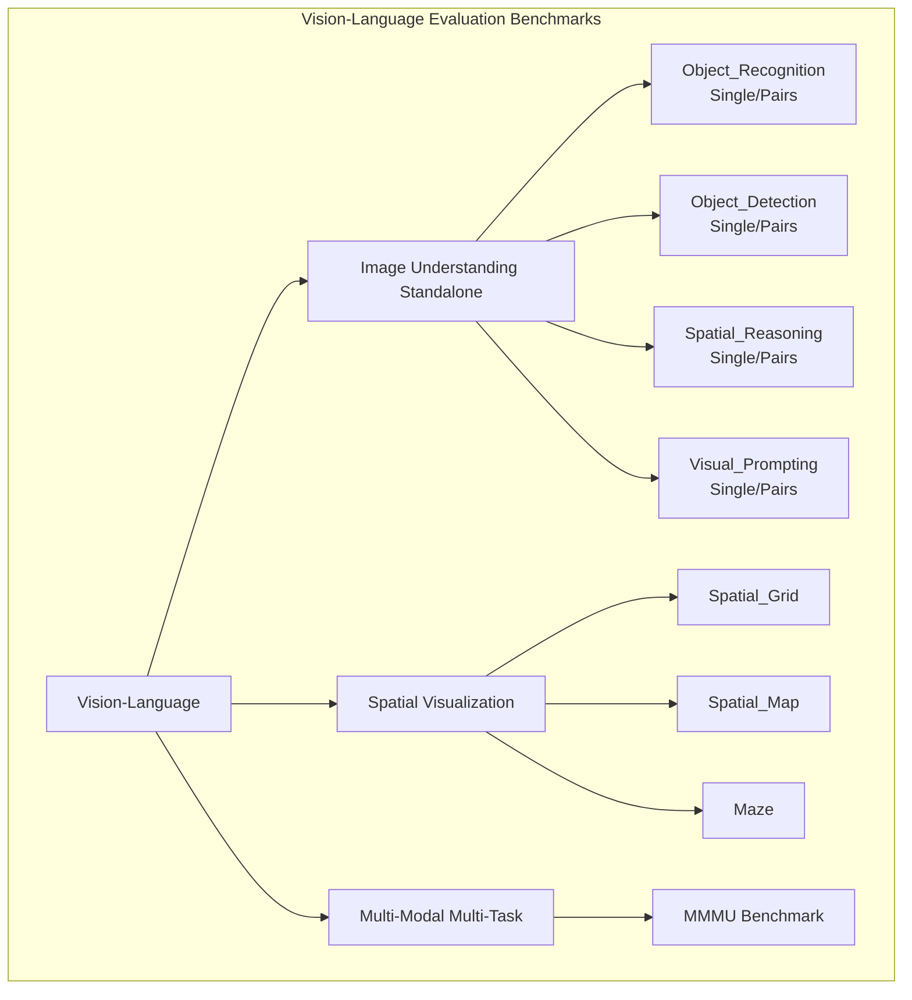
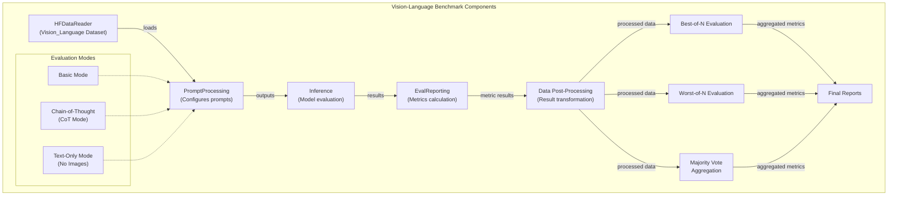
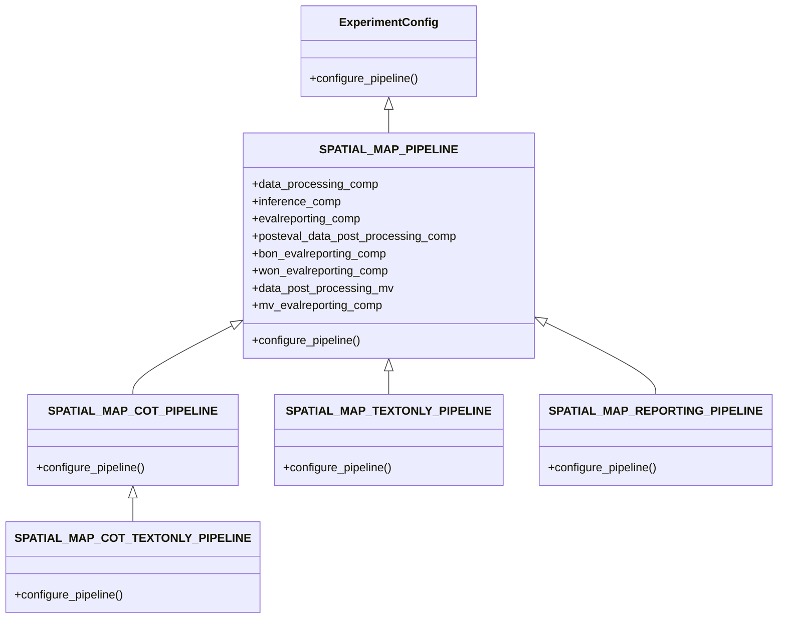
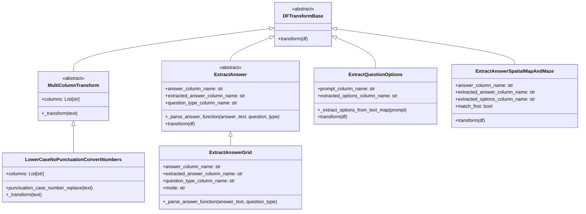

<!-- source: DeepWiki mcp.deepwiki.com · repo microsoft/eureka-ml-insights · page 5.1 Vision and Image Understanding · fetched 2026-10-26 -->

# Vision and Image Understanding

Relevant source files

The following files were used as context for generating this wiki page:

- [eureka_ml_insights/data_utils/spatial_utils.py](eureka_ml_insights/data_utils/spatial_utils.py)
- [eureka_ml_insights/user_configs/__init__.py](eureka_ml_insights/user_configs/__init__.py)
- [eureka_ml_insights/user_configs/vision_language/maze.py](eureka_ml_insights/user_configs/vision_language/maze.py)
- [eureka_ml_insights/user_configs/vision_language/spatial_map.py](eureka_ml_insights/user_configs/vision_language/spatial_map.py)
- [tests/data_utils_tests/vision_language_data_utils_tests.py](tests/data_utils_tests/vision_language_data_utils_tests.py)

## Purpose and Scope

This document covers the vision and image understanding components of the Eureka ML Insights framework. These components are designed to evaluate multimodal Large Language Models (LLMs) on vision-language tasks that require spatial reasoning, object recognition, navigation, and other visual understanding capabilities. The benchmarks in this section help assess how well models can interpret, reason about, and respond to image content in conjunction with text.

## Overview of Vision-Language Benchmarks

The Eureka ML Insights framework includes several distinct benchmark categories for vision and image understanding:

Each of these benchmarks evaluates different aspects of vision-language understanding:

1. **Image Understanding Standalone**:
   - **Object Recognition**: Tests the model's ability to identify objects in images
   - **Object Detection**: Evaluates the model's capability to locate specific objects within images
   - **Spatial Reasoning**: Assesses how well models understand spatial relationships between objects
   - **Visual Prompting**: Tests the model's ability to follow visual instructions and cues

2. **Spatial Visualization**:
   - **Spatial Grid**: Tests understanding of objects arranged in grid patterns
   - **Spatial Map**: Evaluates navigation and positional understanding on maps
   - **Maze**: Tests pathfinding and navigation through maze structures

3. **Multi-Modal Multi-Task**:
   - **MMMU**: Evaluates cross-domain vision-language understanding across university-level tasks

Sources: [eureka_ml_insights/user_configs/__init__.py:22-46](), [eureka_ml_insights/user_configs/vision_language/spatial_map.py:1-50](), [eureka_ml_insights/user_configs/vision_language/maze.py:1-50]()

## Benchmark Architecture

The vision-language benchmarks follow a common architecture pattern while supporting different evaluation modes:

Each benchmark in the vision-language system supports multiple evaluation configurations:

- **Basic Mode**: Standard prompt with image
- **Chain-of-Thought (CoT)**: Prompts that encourage step-by-step reasoning
- **Text-Only Mode**: Evaluates using only text descriptions (no images)

Sources: [eureka_ml_insights/user_configs/vision_language/spatial_map.py:48-400](), [eureka_ml_insights/user_configs/vision_language/maze.py:48-403]()

## Pipeline Implementation

The pipeline implementation for vision-language tasks follows a modular structure with configurable components. Below is an example of how a typical vision-language pipeline is structured:

All vision-language benchmarks follow an inheritance pattern that permits task-specific configurations while sharing core functionality. Each pipeline class inherits from the base `ExperimentConfig` and customizes one or more components.

Sources: [eureka_ml_insights/user_configs/vision_language/spatial_map.py:48-400](), [eureka_ml_insights/user_configs/vision_language/maze.py:48-403]()

## Pipeline Components

A typical vision-language pipeline consists of the following components:

| Component | Class | Purpose |
|-----------|-------|---------|
| Data Processing | `PromptProcessing` | Loads data from dataset, applies transformations, and prepares prompts |
| Inference | `Inference` | Runs model inference on the prepared data |
| Evaluation Reporting | `EvalReporting` | Calculates metrics on model outputs |
| Data Post-Processing | `DataProcessing` | Transforms evaluation results for aggregation |
| Best-of-N Evaluation | `EvalReporting` | Aggregates results using the maximum score across runs |
| Worst-of-N Evaluation | `EvalReporting` | Aggregates results using the minimum score across runs |
| Majority Vote Processing | `DataProcessing` | Creates majority-vote aggregated answers |
| Majority Vote Evaluation | `EvalReporting` | Evaluates majority-vote answers |

Each component is configured with appropriate data readers, transformations, and output settings.

Sources: [eureka_ml_insights/user_configs/vision_language/spatial_map.py:54-334](), [eureka_ml_insights/user_configs/vision_language/maze.py:54-334]()

## Data Processing and Answer Extraction

Vision-language benchmarks require specialized utilities for processing data and extracting answers from model outputs. These utilities handle the complexities of parsing textual responses to visual questions.

### Spatial Utilities

The framework includes several utility classes and functions in `spatial_utils.py` to support vision-language tasks:

Key utility functions for answer extraction:

1. **extract_answer_from_text_grid**: Extracts numerical or textual answers from grid-based tasks
2. **extract_answer_from_text_map_and_maze**: Extracts directional or option-based answers from map and maze tasks
3. **remove_redundancy**: Cleans text by removing redundant symbols
4. **extract_before_is**: Extracts the part of a string before the word "is"

These utilities handle the variety of ways models might format their answers, applying rules to standardize the extraction process.

Sources: [eureka_ml_insights/data_utils/spatial_utils.py:1-348](), [tests/data_utils_tests/vision_language_data_utils_tests.py:1-64]()

## Evaluation Process

The evaluation process for vision-language tasks follows these steps:

1. **Data Loading**: Loads multimodal data from the "microsoft/VISION_LANGUAGE" dataset using `HFDataReader`
2. **Prompt Creation**: Applies a prompt template to the data
3. **Inference**: Runs model inference using configured model
4. **Answer Extraction**: Extracts structured answers from model outputs
5. **Metric Calculation**: Applies `SubstringExistsMatch` metric to check correctness
6. **Aggregation**: Aggregates results through multiple methods:
   - Per-run metrics (individual accuracies)
   - Average across runs (stability)
   - Best-of-N (maximum potential)
   - Worst-of-N (minimum guarantee)
   - Majority vote (consensus)
7. **Reporting**: Generates final reports with performance metrics

For tasks with multiple-choice answers (like Spatial Map and Maze), the evaluation extracts both letter answers (A, B, C, D) and word answers (e.g., "Northeast") to handle different model output formats.

Sources: [eureka_ml_insights/user_configs/vision_language/spatial_map.py:87-334](), [eureka_ml_insights/user_configs/vision_language/maze.py:87-334]()

## Aggregation Methods

Vision-language benchmarks use several aggregation methods to provide comprehensive evaluation:

| Aggregation Method | Implementation | Purpose |
|--------------------|----------------|---------|
| Pass@1 | `CountAggregator` | Calculates individual run accuracies |
| Average of N Runs | `BiLevelCountAggregator` | Measures average performance across runs |
| Best-of-N | `BiLevelAggregator` with `max` | Measures best possible performance |
| Worst-of-N | `BiLevelAggregator` with `min` | Measures guaranteed performance floor |
| Majority Vote | `MajorityVoteTransform` + `CountAggregator` | Measures consensus performance |

Different aggregation methods provide distinct insights into model reliability and performance. For example, Best-of-N shows the model's potential performance with multiple attempts, while Majority Vote reveals performance stability across runs.

Sources: [eureka_ml_insights/user_configs/vision_language/spatial_map.py:113-334](), [eureka_ml_insights/user_configs/vision_language/maze.py:113-334]()

## Dataset Structure

The vision-language benchmarks use a dataset hosted in Hugging Face at "microsoft/VISION_LANGUAGE". The dataset includes:

- **Object detection/recognition**: Single or pairs of images
- **Spatial reasoning**: Tasks involving spatial relationships
- **Visual prompting**: Tasks requiring following visual instructions
- **Spatial grid**: Tasks with objects arranged in grids
- **Spatial map**: Navigation and directional tasks on maps
- **Maze**: Pathfinding and navigation through mazes

Each task can also have a "text-only" variant, which tests whether models can perform the same reasoning without visual input.

Sources: [eureka_ml_insights/user_configs/vision_language/spatial_map.py:54-70](), [eureka_ml_insights/user_configs/vision_language/maze.py:54-70]()

## Integration with Broader Framework

The vision-language benchmarks integrate with the broader Eureka ML Insights framework through:

1. The **Model System**: Uses the model abstraction layer to work with any model that supports image inputs
2. The **Pipeline Framework**: Configures components through the standard pipeline mechanism
3. The **Configuration System**: Uses the same configuration pattern as other benchmarks
4. The **Metrics System**: Leverages common metrics and aggregation methods

This integration ensures that vision-language benchmarks can be run with the same workflow as other benchmarks in the framework.

## Conclusion

The Vision and Image Understanding components of Eureka ML Insights provide a comprehensive evaluation framework for multimodal LLMs. Through carefully designed benchmarks, data processing utilities, and evaluation methodologies, these components enable systematic assessment of how well models understand and reason about visual information in combination with text.

---

