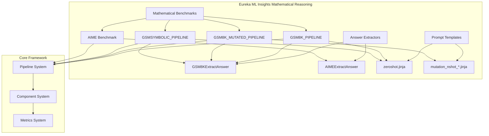
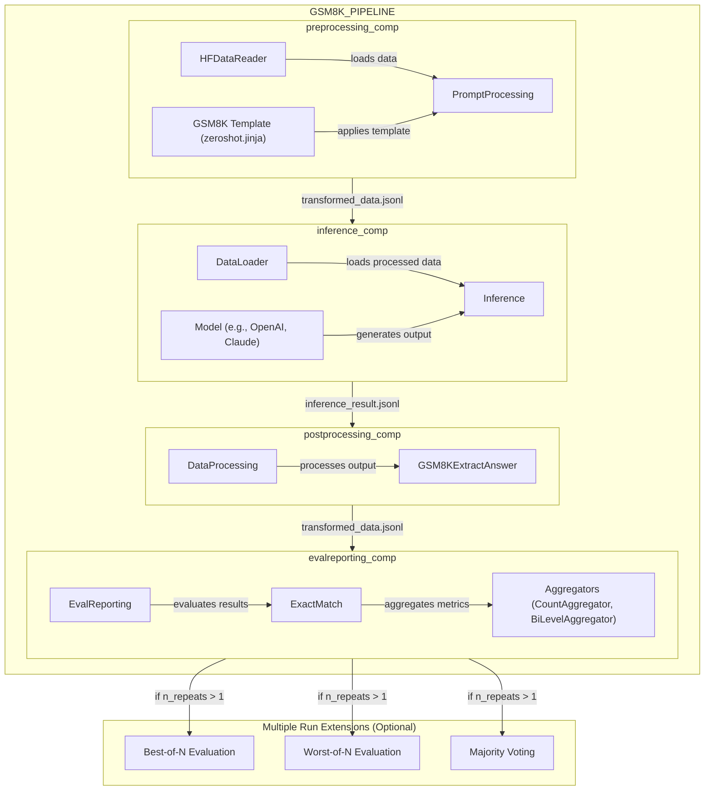
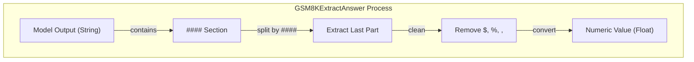
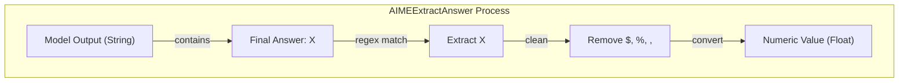
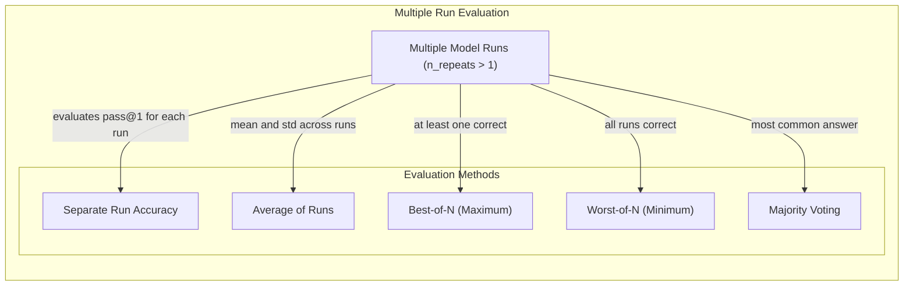

<!-- source: DeepWiki mcp.deepwiki.com · repo microsoft/eureka-ml-insights · page 5.2 Mathematical Reasoning · fetched 2026-10-26 -->

# Mathematical Reasoning

<details>
<summary>Relevant source files</summary>

The following files were used as context for generating this wiki page:

- [eureka_ml_insights/data_utils/aime_utils.py](eureka_ml_insights/data_utils/aime_utils.py)
- [eureka_ml_insights/data_utils/gsm8k_utils.py](eureka_ml_insights/data_utils/gsm8k_utils.py)
- [eureka_ml_insights/prompt_templates/gsm8k_templates/mutation_nshot_chats_careful.jinja](eureka_ml_insights/prompt_templates/gsm8k_templates/mutation_nshot_chats_careful.jinja)
- [eureka_ml_insights/prompt_templates/gsm8k_templates/mutation_nshot_chats_single_user.jinja](eureka_ml_insights/prompt_templates/gsm8k_templates/mutation_nshot_chats_single_user.jinja)
- [eureka_ml_insights/prompt_templates/gsm8k_templates/zeroshot.jinja](eureka_ml_insights/prompt_templates/gsm8k_templates/zeroshot.jinja)
- [eureka_ml_insights/user_configs/gsm8k.py](eureka_ml_insights/user_configs/gsm8k.py)
- [tests/data_utils_tests/aime_utils_tests.py](tests/data_utils_tests/aime_utils_tests.py)
- [tests/data_utils_tests/gsm8k_utils_tests.py](tests/data_utils_tests/gsm8k_utils_tests.py)

</details>


## Purpose and Scope

This page documents the mathematical reasoning benchmarks and components in the Eureka ML Insights framework. These components evaluate an LLM's ability to solve mathematical problems through step-by-step reasoning and provide precise numerical answers. The material covered includes the GSM8K (Grade School Math 8K), GSM-Symbolic, and AIME (American Invitational Mathematics Examination) benchmarks, along with the pipeline implementations, answer extraction mechanisms, and evaluation methods.

Sources: [eureka_ml_insights/user_configs/gsm8k.py:42-514]()

## Benchmark Overview

The Eureka ML Insights framework includes several mathematical reasoning benchmarks:

| Benchmark | Description | Key Features |
|-----------|-------------|--------------|
| GSM8K | Grade school math word problems | Step-by-step reasoning, numerical answers after #### |
| GSM8K Mutated | Variations of GSM8K with added distractors | Factual mutations, different prompt templates |
| GSM-Symbolic | Symbolic math problems | Derived from GSM8K but with symbolic reasoning |
| AIME | American Invitational Mathematics Examination | Higher difficulty problems, answers in "Final Answer: X" format |

Each benchmark tests different aspects of mathematical reasoning, from basic arithmetic to complex problem-solving strategies.

Sources: [eureka_ml_insights/user_configs/gsm8k.py:42-514](), [eureka_ml_insights/data_utils/aime_utils.py:1-43]()

## Mathematical Reasoning System Architecture

The following diagram illustrates how the mathematical reasoning components fit into the larger Eureka ML Insights framework:



Sources: [eureka_ml_insights/user_configs/gsm8k.py:42-514](), [eureka_ml_insights/data_utils/gsm8k_utils.py:1-52](), [eureka_ml_insights/data_utils/aime_utils.py:1-43]()

## Mathematical Reasoning Pipeline Architecture

Each mathematical reasoning benchmark in Eureka ML Insights is implemented as a pipeline with several components. The following diagram illustrates the typical pipeline architecture for the GSM8K benchmark:



This pipeline architecture is shared across different mathematical reasoning benchmarks with minor variations. For example, the `GSM8K_MUTATED_PIPELINE` and `GSMSYMBOLIC_PIPELINE` extend the basic `GSM8K_PIPELINE` with specific configurations.

Sources: [eureka_ml_insights/user_configs/gsm8k.py:42-514]()

## Answer Extraction

A critical component of mathematical reasoning evaluation is extracting numerical answers from model outputs. The framework provides specialized transformers for this purpose:

### GSM8KExtractAnswer

The `GSM8KExtractAnswer` class extracts numerical answers from model outputs for GSM8K problems:



The method looks for text after the "####" marker, removes special characters ($, %, commas), and converts the result to a floating-point number. If the extraction fails, it returns `None`.

### AIMEExtractAnswer

The `AIMEExtractAnswer` class extracts numerical answers from model outputs for AIME problems:



The method looks for text in the format "Final Answer: X", removes special characters, and converts the result to a floating-point number. If the extraction fails, it returns `None`.

Sources: [eureka_ml_insights/data_utils/gsm8k_utils.py:8-52](), [eureka_ml_insights/data_utils/aime_utils.py:9-43]()

## Prompt Templates

The framework provides several prompt templates for mathematical reasoning tasks:

### Zero-shot Template

The basic zero-shot template (`zeroshot.jinja`) prompts the model to solve math problems step by step and provide the final answer after "####":

```
As an expert problem solver, solve step by step the following mathematical questions.
At the end, you MUST write the final numerical answer after '####'.
Question: {{prompt}}
Answer: 
```

### Mutation Templates

For mutated GSM8K problems, which include irrelevant information or distractors, specialized templates are available:

**mutation_nshot_chats_careful.jinja**:
```
Let's think step by step.
At the end, you MUST write the answer after '####'.
Note that, this might be a trick question designed to confuse LLMs with additional information. 
Look for irrelevant information, new assumptions or distractors in the question.
```

**mutation_nshot_chats_single_user.jinja**:
```
// preamble or system instruction
As an expert problem solver, solve step by step the following mathematical questions.
Note that, this might be a trick question designed to confuse LLMs with additional information.
Look for irrelevant information, new assumptions or distractors in the question.
```

Sources: [eureka_ml_insights/prompt_templates/gsm8k_templates/zeroshot.jinja:1-4](), [eureka_ml_insights/prompt_templates/gsm8k_templates/mutation_nshot_chats_careful.jinja:1-4](), [eureka_ml_insights/prompt_templates/gsm8k_templates/mutation_nshot_chats_single_user.jinja:1-5]()

## Multiple Run Evaluation

The framework supports running models multiple times on the same problems to evaluate consistency and improve accuracy through aggregation methods:



### Majority Voting

For multiple runs, the `MajorityVoteTransform` aggregates answers from different runs for the same problem and selects the most common answer. This often improves accuracy by filtering out occasional errors.

### Best-of-N and Worst-of-N

The framework calculates two key metrics for multiple runs:
- **Best-of-N**: The fraction of problems solved correctly in at least one attempt
- **Worst-of-N**: The fraction of problems solved correctly in all attempts

These metrics help evaluate model consistency and reliability.

Sources: [eureka_ml_insights/user_configs/gsm8k.py:186-373]()

## Configuration and Customization

The mathematical reasoning benchmarks can be configured through the `ExperimentConfig` subclasses:

- `GSM8K_PIPELINE`: Basic GSM8K benchmark pipeline
- `GSM8K_MUTATED_PIPELINE`: GSM8K with mutations (distractors, irrelevant information)
- `GSMSYMBOLIC_PIPELINE`: GSM-Symbolic benchmark pipeline

Key customization options include:
- Model selection
- Number of repeats (for multiple run evaluation)
- Prompt template selection
- Sample count (for limiting the number of problems)

Example usage involves creating a pipeline configuration with a model configuration:

```python
# Example (not actual code)
gsm8k_config = GSM8K_PIPELINE()
pipeline = gsm8k_config.configure_pipeline(model_config=model_config)
```

Sources: [eureka_ml_insights/user_configs/gsm8k.py:42-514]()

## Integration with the Metrics System

Mathematical reasoning benchmarks use specific metrics and aggregators:

- **ExactMatch**: Used to determine if the extracted model answer exactly matches the ground truth
- **CountAggregator**: Calculates the overall accuracy (pass@1)
- **BiLevelAggregator**: Used for calculating metrics across multiple runs

The metrics results are stored in JSON format and can be further processed to generate detailed reports.

Sources: [eureka_ml_insights/user_configs/gsm8k.py:138-178]()

## Summary

The mathematical reasoning component of Eureka ML Insights provides a comprehensive framework for evaluating LLM performance on mathematical problem-solving tasks. It includes:

1. Multiple benchmark datasets (GSM8K, GSM-Symbolic, AIME)
2. Specialized answer extraction utilities
3. Customizable prompt templates
4. Support for multiple runs with aggregation methods
5. Detailed evaluation metrics

This system enables systematic evaluation of a model's mathematical reasoning capabilities, with options for different problem types, evaluation methods, and reporting formats.

---

