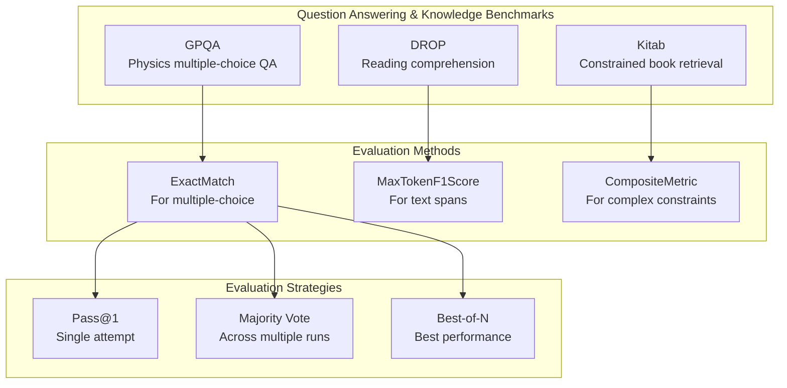
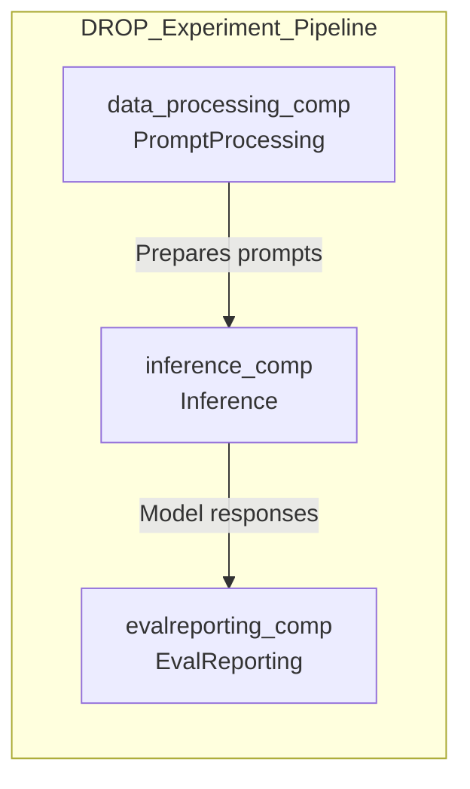
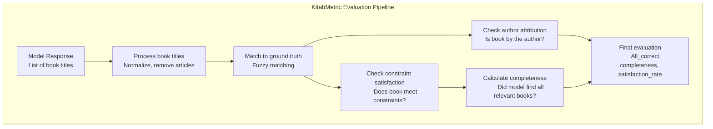
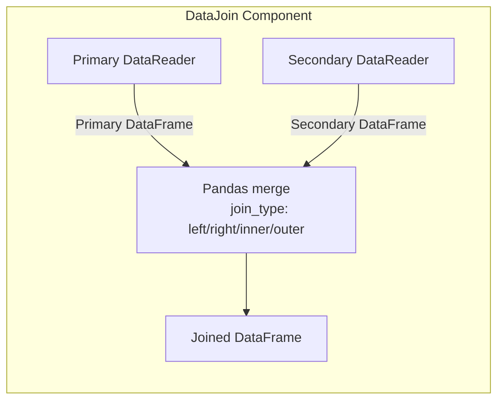

<!-- source: DeepWiki mcp.deepwiki.com · repo microsoft/eureka-ml-insights · page 5.3 Question Answering and Knowledge · fetched 2026-10-26 -->

# Question Answering and Knowledge

<details>
<summary>Relevant source files</summary>

The following files were used as context for generating this wiki page:

- [eureka_ml_insights/core/data_join.py](eureka_ml_insights/core/data_join.py)
- [eureka_ml_insights/metrics/kitab_metrics.py](eureka_ml_insights/metrics/kitab_metrics.py)
- [eureka_ml_insights/prompt_templates/gpqa_templates/extract_gpqa_answer.jinja](eureka_ml_insights/prompt_templates/gpqa_templates/extract_gpqa_answer.jinja)
- [eureka_ml_insights/prompt_templates/gpqa_templates/gpqa_basic.jinja](eureka_ml_insights/prompt_templates/gpqa_templates/gpqa_basic.jinja)
- [eureka_ml_insights/prompt_templates/gpqa_templates/gpqa_brief.jinja](eureka_ml_insights/prompt_templates/gpqa_templates/gpqa_brief.jinja)
- [eureka_ml_insights/prompt_templates/gpqa_templates/gpqa_cot.jinja](eureka_ml_insights/prompt_templates/gpqa_templates/gpqa_cot.jinja)
- [eureka_ml_insights/prompt_templates/gpqa_templates/gpqa_solution.jinja](eureka_ml_insights/prompt_templates/gpqa_templates/gpqa_solution.jinja)
- [eureka_ml_insights/user_configs/drop.py](eureka_ml_insights/user_configs/drop.py)
- [eureka_ml_insights/user_configs/gpqa.py](eureka_ml_insights/user_configs/gpqa.py)

</details>


This page documents the question answering and knowledge retrieval benchmarks implemented in the Eureka ML Insights framework. These benchmarks evaluate language models' ability to answer factual questions, perform reasoning, and retrieve information based on specific constraints.

## Overview

The Question Answering and Knowledge module includes several benchmarks designed to test different aspects of a model's knowledge and reasoning capabilities:

1. **GPQA (General Physics Question Answering)** - A physics-focused multiple-choice benchmark
2. **DROP** - A reading comprehension dataset requiring numerical reasoning
3. **Kitab** - A constrained book search and retrieval task



Sources: [eureka_ml_insights/user_configs/gpqa.py:56-506](), [eureka_ml_insights/user_configs/drop.py:33-114](), [eureka_ml_insights/metrics/kitab_metrics.py:27-578]()

## GPQA Benchmark

GPQA (General Physics Question Answering) is a challenging benchmark consisting of physics multiple-choice questions across various domains. It evaluates a model's scientific knowledge and reasoning ability.

### Dataset Details

- Source: Hugging Face dataset `Idavidrein/gpqa`
- Task: `gpqa_diamond` 
- Format: Multiple-choice questions with 4 options (A, B, C, D)
- Domains: Organized by high-level domains and subdomains

### Pipeline Architecture

The GPQA pipeline implements a comprehensive evaluation workflow with repeated runs to measure both deterministic and probabilistic performance:

```mermaid
graph TD
    subgraph "GPQA_Experiment_Pipeline Components"
        DP["data_processing_comp
        PromptProcessing"]
        INF["inference_comp
        Inference"]
        PP["preeval_data_post_processing_comp
        DataProcessing"]
        FEA["filter_empty_answer
        PromptProcessing"]
        LLM["inference_llm_answer_extract
        Inference"]
        DJ["data_join
        DataJoin"]
        ER["evalreporting_comp
        EvalReporting"]
        PDP["posteval_data_post_processing_comp
        DataProcessing"]
        BON["bon_evalreporting_comp
        EvalReporting"]
        WON["won_evalreporting_comp
        EvalReporting"]
        MV["data_post_processing_mv
        DataProcessing"]
        MVE["mv_evalreporting_comp
        EvalReporting"]
    end
    
    DP -->|"Creates prompts"| INF
    INF -->|"Model responses"| PP
    PP -->|"Extract answers"| DJ
    PP -->|"Empty answers"| FEA
    FEA -->|"Reformatted prompts"| LLM
    LLM -->|"Extracted answers"| DJ
    DJ -->|"Combined answers"| ER
    ER -->|"Metric results"| PDP
    PDP -->|"Numeric results"| BON
    PDP -->|"Numeric results"| WON
    ER -->|"For majority vote"| MV
    MV -->|"Voted answers"| MVE
```



Sources: [eureka_ml_insights/user_configs/gpqa.py:56-506]()

### Key Components

1. **Data Processing**
   - Loads data from Hugging Face
   - Shuffles answer choices to prevent position bias
   - Prepares prompts using templates 

2. **Inference**
   - Runs the model on prepared prompts
   - Support for multiple runs per question (typically 5)

3. **Answer Extraction**
   - RegexTransform to parse model outputs for "Final Answer: X"
   - Secondary LLM for parsing answers that don't follow the format

4. **Data Join**
   - Combines answers from main model and fallback extractor
   - Uses left join to preserve all original data points

5. **Evaluation**
   - ExactMatch metric compares predicted answer with ground truth
   - Multiple aggregation strategies:
     - Pass@1: Individual run accuracy
     - Best-of-N: Best performance across runs
     - Worst-of-N: Worst performance across runs
     - Majority Vote: Most common answer across runs

Sources: [eureka_ml_insights/user_configs/gpqa.py:62-490](), [eureka_ml_insights/prompt_templates/gpqa_templates/gpqa_cot.jinja:1-12]()

### Prompt Templates

GPQA supports several prompt templates:

1. **Chain-of-Thought (CoT)**: Encourages step-by-step reasoning
   ```
   Question: [question]
   A) [option A]
   B) [option B]
   C) [option C]
   D) [option D]
   
   Let's think step by step. Think through and provide your answer in the following format.
   Reasoning: <reasoning>
   Final Answer: <single letter of your answer choice>
   ```

2. **Brief**: Direct question without reasoning
   ```
   Question: [question]
   A) [option A]
   B) [option B]
   C) [option C]
   D) [option D]
   
   Final Answer: <single letter of your answer choice>
   ```

3. **Solution**: Separates solution from final answer
   ```
   Solution: <solution>
   Final Answer: <single letter of your answer choice>
   ```

Sources: [eureka_ml_insights/prompt_templates/gpqa_templates/gpqa_cot.jinja:1-12](), [eureka_ml_insights/prompt_templates/gpqa_templates/gpqa_brief.jinja:1-12](), [eureka_ml_insights/prompt_templates/gpqa_templates/gpqa_solution.jinja:1-12]()

### Evaluation and Reporting

The GPQA benchmark generates comprehensive reports with multiple aggregation strategies:

1. **Per-Run Metrics**
   - Overall accuracy for each run
   - Breakdown by domain and subdomain
   - Token usage statistics

2. **Cross-Run Aggregations**
   - Majority Vote: Most common answer across all runs
   - Best-of-N: Best performance over N runs
   - Worst-of-N: Worst performance over N runs

3. **Token Usage Analysis**
   - Completion token count per question
   - Aggregated by domain and subdomain

Sources: [eureka_ml_insights/user_configs/gpqa.py:198-490]()

## DROP Benchmark

DROP (Discrete Reasoning Over Paragraphs) is a reading comprehension dataset that requires models to perform numerical reasoning and extract answer spans from paragraphs.

### Dataset Details

- Source: Hugging Face dataset `ucinlp/drop`
- Format: Paragraphs with questions and answer spans
- Focus: Numerical reasoning and text extraction

### Pipeline Components

The DROP benchmark implementation uses a simpler pipeline than GPQA:



Sources: [eureka_ml_insights/user_configs/drop.py:33-114]()

### Key Components

1. **Data Processing**
   - Loads data from the `ucinlp/drop` dataset
   - Extracts ground truth answer spans
   - Prepares prompts with paragraphs and questions

2. **Inference**
   - Runs the model on prepared prompts
   - Collects model outputs

3. **Evaluation**
   - Uses `MaxTokenF1ScoreMetric` to evaluate answer quality
   - Extracts answers with regex pattern `"My answer is (.+)"`
   - Reports F1 score as the primary metric

Sources: [eureka_ml_insights/user_configs/drop.py:38-105]()

## Kitab Benchmark

Kitab is a specialized benchmark designed to test book search and retrieval capabilities under specific constraints. It evaluates a model's ability to retrieve relevant books that satisfy complex constraints while maintaining accuracy.

### Constraint Types

The Kitab benchmark supports various constraint types:

1. **Alphabetical**
   - `starts-with`: Books starting with a specific letter
   - `ends-with`: Books ending with a specific letter

2. **Structural**
   - `word-count`: Books with a specific number of words in the title

3. **Temporal**
   - `publishing-year`: Books published within a specific year range

4. **Named Entity**
   - `human-name`: Books containing (or not containing) human names
   - `city-name`: Books containing (or not containing) city names

### Evaluation Architecture



Sources: [eureka_ml_insights/metrics/kitab_metrics.py:27-250]()

### Integration with External Services

The Kitab metric relies on external services for named entity recognition:

1. **Azure Language Service**
   - Recognizes person names in book titles
   - Identifies city names in book titles
   - Requires Azure Cognitive Services credentials

2. **Pre-processed Name Data**
   - Uses pre-extracted human names from GPT-4
   - Complements Azure Language Service results

Sources: [eureka_ml_insights/metrics/kitab_metrics.py:30-67](), [eureka_ml_insights/metrics/kitab_metrics.py:425-482]()

### Key Metrics

The Kitab metric computes several evaluation metrics:

| Metric | Description |
|--------|-------------|
| `completeness` | Proportion of relevant books found by the model |
| `satisfied_rate` | Proportion of model books that satisfy constraints |
| `unsatisfied_rate` | Proportion of model books that don't satisfy constraints |
| `not_from_author_rate` | Proportion of hallucinated books not by the author |
| `all_correct` | Binary score (1/0) if model was completely correct |
| `constrainedness` | Difficulty measure of the query |

Sources: [eureka_ml_insights/metrics/kitab_metrics.py:185-210]()

### Constraint Checking Implementation

The metric implements specialized methods for checking each constraint type:

1. **Alphabetical Constraints**
   - `check_starts_with`: Checks if book titles start with a specific letter
   - `check_ends_with`: Checks if book titles end with a specific letter

2. **Word Count Constraint**
   - `check_word_count`: Checks if titles have a specific number of words

3. **Publishing Year Constraint**
   - `check_publishing_year`: Checks if publication year is within range

4. **Named Entity Constraints**
   - `check_human_name`: Uses Azure Language Service and GPT-4 data
   - `check_city_name`: Uses Azure Language Service and external API

Sources: [eureka_ml_insights/metrics/kitab_metrics.py:488-578]()

## Common Components

Several components are shared across the question answering and knowledge benchmarks:

### DataJoin Component

The `DataJoin` component is used in complex pipelines like GPQA to combine data from multiple processing steps:



The component supports various join types:
- `left`: Keep all records from primary dataset
- `right`: Keep all records from secondary dataset
- `inner`: Keep only matching records
- `outer`: Keep all records from both datasets
- `cross`: Cartesian product of both datasets

Sources: [eureka_ml_insights/core/data_join.py:1-76]()

### Prompt Templates

Prompt templates are critical for question answering tasks. They:
- Structure the input for consistent model responses
- Specify the expected answer format
- Include task-specific instructions or reasoning guidelines
- Support different reasoning modes (brief, CoT, solution-focused)

Sources: [eureka_ml_insights/prompt_templates/gpqa_templates/gpqa_cot.jinja:1-12](), [eureka_ml_insights/prompt_templates/gpqa_templates/gpqa_brief.jinja:1-12](), [eureka_ml_insights/prompt_templates/gpqa_templates/gpqa_solution.jinja:1-12]()

### Evaluation Strategies

Multiple evaluation strategies are implemented:

1. **Single-run evaluation**
   - Standard pass@1 performance

2. **Multi-run strategies**
   - **Majority Vote**: Most common answer across runs
   - **Best-of-N**: Best performance across N runs
   - **Worst-of-N**: Worst performance across N runs

3. **Hierarchical aggregation**
   - Overall performance
   - By domain/category
   - By subdomain/subcategory

Sources: [eureka_ml_insights/user_configs/gpqa.py:198-428]()

## Conclusion

The Question Answering and Knowledge benchmarks in Eureka ML Insights provide comprehensive evaluation of model capabilities across factual knowledge retrieval, complex reasoning, and constraint satisfaction. These benchmarks use specialized metrics and pipelines tailored to each task's requirements, with support for various evaluation strategies.

For related benchmarks focused on mathematical reasoning, see [Mathematical Reasoning](#5.2).

---

