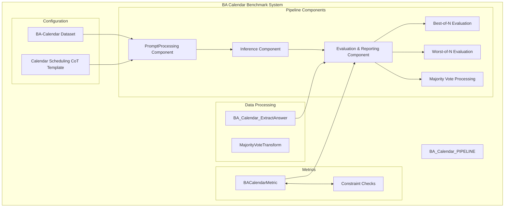
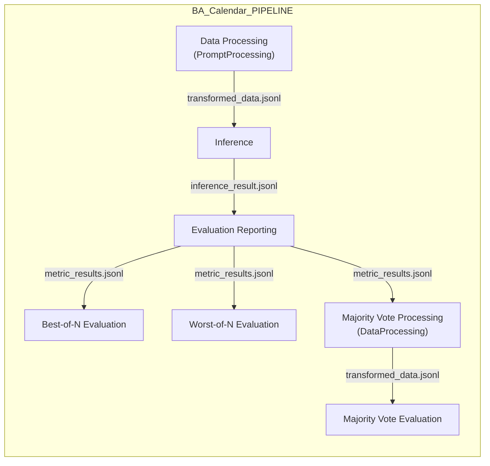
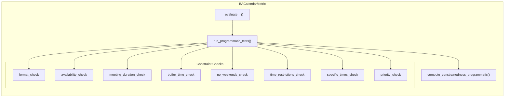
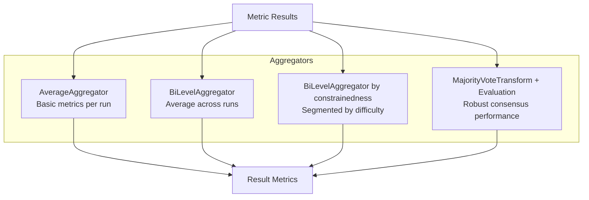

<!-- source: DeepWiki mcp.deepwiki.com · repo microsoft/eureka-ml-insights · page 5.4 Business Logic and Calendaring · fetched 2026-10-26 -->

# Business Logic and Calendaring

<details>
<summary>Relevant source files</summary>

The following files were used as context for generating this wiki page:

- [eureka_ml_insights/data_utils/ba_calendar_utils.py](eureka_ml_insights/data_utils/ba_calendar_utils.py)
- [eureka_ml_insights/metrics/ba_calendar_metrics.py](eureka_ml_insights/metrics/ba_calendar_metrics.py)
- [eureka_ml_insights/user_configs/ba_calendar.py](eureka_ml_insights/user_configs/ba_calendar.py)
- [tests/data_utils_tests/ba_calendar_tests.py](tests/data_utils_tests/ba_calendar_tests.py)
- [tests/metric_utils_tests/aggregator_tests.py](tests/metric_utils_tests/aggregator_tests.py)

</details>


## Purpose and Scope

This document describes the Business Logic and Calendaring system within the Eureka ML Insights framework. This subsystem provides a benchmark for evaluating how well large language models (LLMs) can handle calendar scheduling tasks with multiple constraints. The benchmark tests a model's ability to find appropriate meeting times while adhering to various business rules and participant availability requirements.

The BA Calendar benchmark specifically evaluates models on their reasoning about calendaring constraints such as availability windows, meeting durations, buffer requirements, time restrictions, and priority rules - common challenges in business scheduling scenarios.

Sources: [eureka_ml_insights/user_configs/ba_calendar.py:51-455](), [eureka_ml_insights/metrics/ba_calendar_metrics.py:70-357]()

## System Overview

**BA Calendar Benchmark Architecture**



Sources: [eureka_ml_insights/user_configs/ba_calendar.py:51-191](), [eureka_ml_insights/metrics/ba_calendar_metrics.py:70-113]()

## BA Calendar Benchmark

The BA Calendar benchmark tests a model's ability to schedule meetings under various constraints. It uses the microsoft/ba-calendar dataset from the Hugging Face Hub, which contains scheduling problems of varying complexity.

**Calendar Problem Structure**

```mermaid
classDiagram
    class "Calendar Problem" {
        task_prompt: String
        params: Dictionary
        constraints: Dictionary
        metadata: Dictionary
    }
    
    class "Constraints" {
        availability: Boolean
        meeting_duration: Integer
        buffer_time_before_and_after_meeting: Integer
        no_meetings_on_weekends: Boolean
        no_meetings_before: Integer
        no_meetings_after: Integer
        no_meetings_during_specific_times: String
        high_priority_meeting: Boolean
    }
    
    class "Metadata" {
        availability: JSON String
    }
    
    class "Model Output" {
        format: "Day HH:MM-HH:MM"
        example: "Monday 14:00-15:00"
    }
    
    "Calendar Problem" *-- "Constraints"
    "Calendar Problem" *-- "Metadata"
    "Calendar Problem" --> "Model Output"
```

Sources: [eureka_ml_insights/metrics/ba_calendar_metrics.py:17-83](), [eureka_ml_insights/user_configs/ba_calendar.py:61-69]()

### Constraints Evaluated

The BA Calendar benchmark evaluates model responses against the following constraints:

| Constraint | Description | Metric Name |
|------------|-------------|-------------|
| Format | Solution must be in format "Day HH:MM-HH:MM" | `format_programmatic` |
| Availability | Meeting time must be within availability windows of all participants | `availability_programmatic_check` |
| Meeting Duration | Meeting must have the specified duration | `meeting_duration_programmatic_check` |
| Buffer Time | Must have specified buffer time before and after meeting | `buffer_time_programmatic_check` |
| No Weekends | If specified, meeting must not be on weekends | `no_weekends_programmatic_check` |
| Time Restrictions | If specified, meeting must not be before/after certain times | `time_restrictions_programmatic_check` |
| Specific Times | Meeting must not overlap with specified time blocks | `specific_times_programmatic_check` |
| Priority | High-priority meetings should be scheduled at earliest slot | `priority_programmatic_check` |

Sources: [eureka_ml_insights/metrics/ba_calendar_metrics.py:94-101](), [eureka_ml_insights/metrics/ba_calendar_metrics.py:120-301]()

### Constrainedness Measurement

The benchmark also measures the difficulty of each problem by calculating a "constrainedness" value:

- Defined as 1 - (feasible slots / total slots)
- Higher values indicate more constrained problems
- Results are grouped by constrainedness buckets to analyze performance across difficulty levels

Sources: [eureka_ml_insights/metrics/ba_calendar_metrics.py:304-357]()

## Pipeline Architecture

The BA Calendar benchmark uses a multi-component pipeline to process data, run inference, and evaluate results.

**Pipeline Component Flow**



Sources: [eureka_ml_insights/user_configs/ba_calendar.py:405-416]()

### Data Processing Component

The data processing component:

1. Loads the calendar scheduling problems from the `microsoft/ba-calendar` dataset
2. Transforms the data by renaming columns and applying necessary transformations
3. Applies a prompt template to generate prompts for the model

Sources: [eureka_ml_insights/user_configs/ba_calendar.py:56-74]()

### Inference Component

The inference component:

1. Takes the transformed data with prompts
2. Runs the configured model on each prompt
3. Outputs model responses for each scheduling problem

Sources: [eureka_ml_insights/user_configs/ba_calendar.py:77-87]()

### Evaluation Components

The pipeline includes multiple evaluation components:

1. **Basic Evaluation**: Evaluates each model response against the defined constraints
2. **Best-of-N Evaluation**: For repeated runs, calculates the best performance for each problem
3. **Worst-of-N Evaluation**: For repeated runs, calculates the worst performance for each problem
4. **Majority Vote Evaluation**: Uses majority voting across multiple runs to determine the final answer

Sources: [eureka_ml_insights/user_configs/ba_calendar.py:93-402]()

## Metrics System

The BA Calendar metrics system uses a composite metric approach to evaluate model responses against multiple constraints.

**BACalendarMetric Architecture**



Sources: [eureka_ml_insights/metrics/ba_calendar_metrics.py:70-113](), [eureka_ml_insights/metrics/ba_calendar_metrics.py:120-301]()

### Evaluation Process

For each model response, the evaluation process:

1. Checks if the response is properly formatted
2. Runs programmatic tests for each constraint
3. Computes overall metrics:
   - `all_correct`: 1 if all constraints are satisfied, 0 otherwise
   - `fraction_passed`: Percentage of constraints that are satisfied
4. Computes the constrainedness of the problem

Sources: [eureka_ml_insights/metrics/ba_calendar_metrics.py:86-111]()

### Answer Extraction

The pipeline extracts the model's final answer using a regex pattern to identify the "Final Answer:" portion of the response:

```
Final Answer: <day> <time>
```

Where `<day>` is a day of the week and `<time>` is in the format "HH:MM-HH:MM".

Sources: [eureka_ml_insights/data_utils/ba_calendar_utils.py:9-39](), [eureka_ml_insights/metrics/ba_calendar_metrics.py:17-18]()

## Aggregation and Reporting

The BA Calendar benchmark uses various aggregation methods to analyze model performance.

**Aggregation Architecture**



Sources: [eureka_ml_insights/user_configs/ba_calendar.py:115-200](), [eureka_ml_insights/user_configs/ba_calendar.py:201-313](), [eureka_ml_insights/user_configs/ba_calendar.py:317-402]()

### Aggregation Methods

The benchmark uses several aggregation methods:

1. **Average Aggregator**: Computes the average performance across all test cases
2. **BiLevel Aggregator**: For runs with multiple repeats:
   - First aggregates by data point ID (to handle repeated runs of the same problem)
   - Then aggregates across all problems
3. **Best-of-N & Worst-of-N**: Calculates the best and worst performance across multiple runs
4. **Majority Vote**: Uses majority voting across multiple runs to determine final answers

Sources: [eureka_ml_insights/user_configs/ba_calendar.py:115-389](), [tests/metric_utils_tests/aggregator_tests.py:221-339]()

### Constrainedness Analysis

Results are aggregated by constrainedness buckets to analyze performance across different difficulty levels:

- Problems are grouped into buckets based on their constrainedness value (intervals of 0.1)
- Performance metrics are reported for each bucket
- This helps identify where models struggle as problems become more constrained

Sources: [eureka_ml_insights/metrics/ba_calendar_metrics.py:355-357](), [eureka_ml_insights/user_configs/ba_calendar.py:166-170]()

## Using the BA Calendar Benchmark

The framework provides three pipeline configurations for flexibility:

1. **BA_Calendar_PIPELINE**: Base pipeline for running the benchmark
2. **BA_Calendar_Parallel_PIPELINE**: Runs the benchmark with 5 repeats per problem
3. **BA_Calendar_RunEvals_PIPELINE**: Runs only evaluation components on existing inference results

Sources: [eureka_ml_insights/user_configs/ba_calendar.py:51-54](), [eureka_ml_insights/user_configs/ba_calendar.py:419-454]()

### Output Reports

The benchmark generates multiple reports to provide comprehensive analysis:

| Report Name | Description |
|-------------|-------------|
| `OverallMetrics_Separate_Runs` | Metrics for each individual run |
| `OverallMetrics_Avg` | Average performance across all runs |
| `OverallMetrics_Avg_by_constrainedness` | Performance segmented by problem difficulty |
| `OverallMetrics_BestofN` | Best performance for each problem across repeats |
| `OverallMetrics_WorstofN` | Worst performance for each problem across repeats |
| `OverallMetrics_MajVote` | Performance using majority vote answers |
| `UsageCompletion_AllRuns` | Token usage metrics |

Sources: [eureka_ml_insights/user_configs/ba_calendar.py:130-186](), [eureka_ml_insights/user_configs/ba_calendar.py:271-390]()

## Conclusion

The Business Logic and Calendaring benchmark provides a rigorous test of model capabilities in handling complex scheduling scenarios. Through its comprehensive evaluation system, it measures both the accuracy of scheduling solutions and assesses performance across varying levels of problem difficulty. This allows for detailed analysis of model strengths and weaknesses in business logic reasoning tasks.

---

