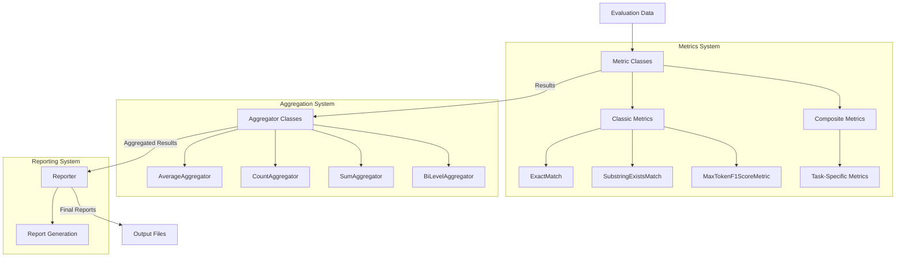
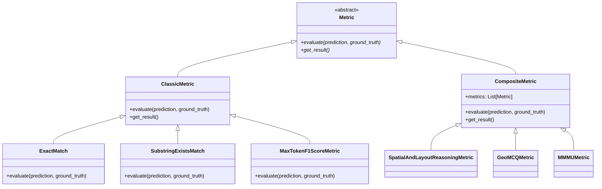
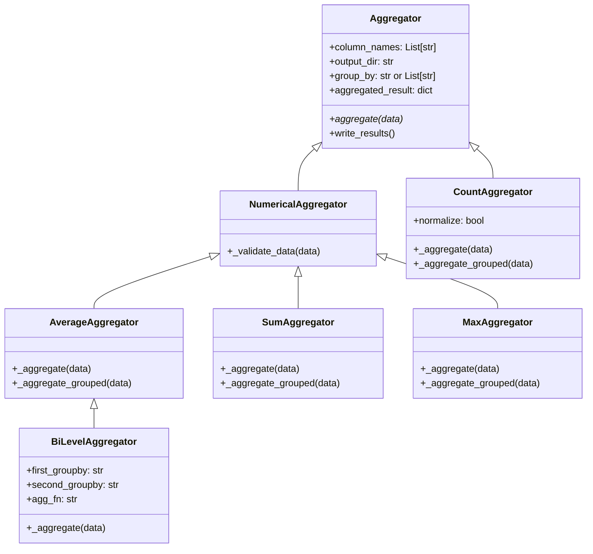
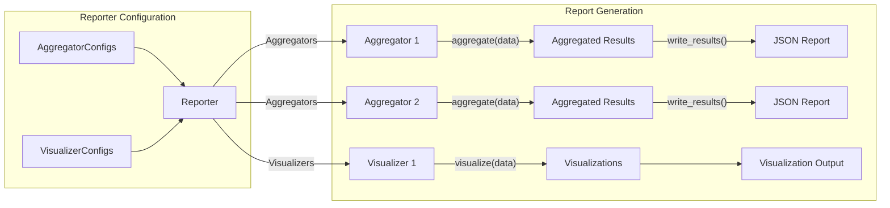
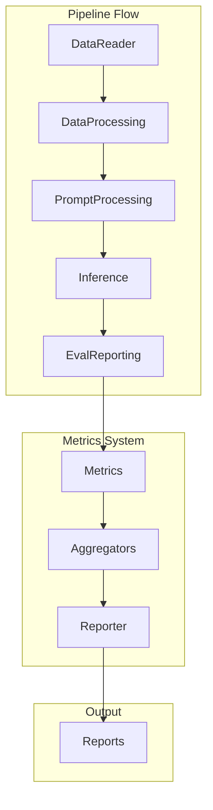

<!-- source: DeepWiki mcp.deepwiki.com · repo microsoft/eureka-ml-insights · page 6 Metrics and Evaluation · fetched 2026-10-26 -->

# Metrics and Evaluation

<details>
<summary>Relevant source files</summary>

The following files were used as context for generating this wiki page:

- [eureka_ml_insights/metrics/__init__.py](eureka_ml_insights/metrics/__init__.py)
- [eureka_ml_insights/metrics/reports.py](eureka_ml_insights/metrics/reports.py)

</details>


This document provides a comprehensive overview of the metrics and evaluation system in the Eureka ML Insights framework. The system is designed to evaluate machine learning model outputs, aggregate results across various dimensions, and generate structured reports.

For detailed information about specific metric implementations used in different benchmarks, see [Task-Specific Metrics](#6.3). For information about configuring benchmarks to use these metrics, see [Benchmarks](#5).

## System Overview

The metrics and evaluation system serves as the backbone for quantifying model performance in Eureka ML Insights. It provides a standardized way to measure how well models perform on various tasks, aggregate these measurements, and generate reports.



Sources: [eureka_ml_insights/metrics/__init__.py:1-61](), [eureka_ml_insights/metrics/reports.py:13-432]()

## Metrics Framework

The metrics framework provides the foundation for evaluating model outputs against expected or ground truth values. It follows a hierarchical structure that allows for both simple and complex evaluation methods.



The `Metric` abstract class defines the interface for all metrics:
- `evaluate(prediction, ground_truth)`: Takes a model prediction and ground truth, computes the metric
- `get_result()`: Returns the computed metric result

Concrete metric implementations fall into two main categories:

1. **ClassicMetric**: Simple metrics with straightforward evaluation logic
2. **CompositeMetric**: Complex metrics that may combine multiple evaluation techniques

Sources: [eureka_ml_insights/metrics/__init__.py:3-11]()

### Common Metrics

The framework includes several common metrics frequently used in evaluation:

| Metric Type | Description | Use Case |
|-------------|-------------|----------|
| `ExactMatch` | Checks if prediction exactly matches ground truth | Multiple-choice questions, classification |
| `CaseInsensitiveMatch` | Exact match ignoring case | Text generation with variable casing |
| `SubstringExistsMatch` | Checks if ground truth is contained in prediction | Answer extraction, information retrieval |
| `MaxTokenF1ScoreMetric` | Computes F1 score based on token overlap | Text generation, summarization |
| `IdentityMetric` | Returns the prediction unchanged | Pass-through for post-processing |

Sources: [eureka_ml_insights/metrics/__init__.py:3-11](), [eureka_ml_insights/metrics/__init__.py:34-61]()

### Task-Specific Metrics

The framework also provides specialized metrics for specific tasks:

| Metric | Task Type | Description |
|--------|-----------|-------------|
| `SpatialAndLayoutReasoningMetric` | Visual reasoning | Evaluates spatial relationship understanding |
| `ObjectRecognitionMetric` | Computer vision | Evaluates object detection accuracy |
| `CocoObjectDetectionMetric` | Computer vision | Uses COCO evaluation protocol |
| `GeoMCQMetric` | Geometric reasoning | Evaluates geometric multiple-choice questions |
| `MMMUMetric` | Multimodal understanding | Evaluates multimedia understanding |
| `NPHardTSPMetric` | Optimization | Evaluates traveling salesman problem solutions |

Sources: [eureka_ml_insights/metrics/__init__.py:28-32](), [eureka_ml_insights/metrics/__init__.py:34-61]()

## Aggregation System

After metrics are computed for individual examples, the aggregation system collects and summarizes these results. Aggregators are essential for understanding model performance across datasets.



The base `Aggregator` class defines:
- `aggregate(data)`: Processes data and computes aggregated statistics
- `write_results()`: Saves aggregated results to a file

Common aggregators include:

| Aggregator | Description | Use Case |
|------------|-------------|----------|
| `AverageAggregator` | Computes mean of metric values | Overall accuracy, average scores |
| `CountAggregator` | Counts occurrences of values | Error analysis, distribution analysis |
| `SumAggregator` | Sums metric values | Cumulative metrics, total counts |
| `MaxAggregator` | Finds maximum values | Best performance analysis |
| `BiLevelAggregator` | Aggregates in two stages | Complex hierarchical evaluation |
| `CocoDetectionAggregator` | Uses COCO evaluation tools | Object detection evaluation |

Sources: [eureka_ml_insights/metrics/reports.py:13-87](), [eureka_ml_insights/metrics/reports.py:90-324]()

### Advanced Aggregators

For more complex aggregation needs, the framework provides specialized aggregators:

1. **BiLevelAggregator**: Performs two-stage aggregation, useful for hierarchical data
   ```python
   BiLevelAggregator(
       column_names=["accuracy", "f1_score"],
       first_groupby="question_type",
       output_dir="./reports",
       second_groupby="model_name"
   )
   ```

2. **TwoColumnSumAverageAggregator**: Computes ratio of sums between two columns
   ```python
   TwoColumnSumAverageAggregator(
       numerator_column_name="correct_count",
       denominator_column_name="total_count",
       output_dir="./reports",
       group_by="model_name"
   )
   ```

3. **ValueFilteredAggregator**: Filters out specific values before aggregation
   ```python
   ValueFilteredAggregator(
       agg_class=AverageAggregator,
       value=-1,  # Value to filter out
       column_names=["score"],
       output_dir="./reports"
   )
   ```

Sources: [eureka_ml_insights/metrics/reports.py:199-370]()

## Reporting System

The reporting system generates final outputs from aggregated metrics for analysis and visualization.



The `Reporter` class coordinates the aggregation and visualization process:
- Takes configurations for both aggregators and visualizers
- Applies all configured aggregators to the data
- Generates reports in the specified output directory

```python
reporter = Reporter(
    output_dir="./reports",
    aggregator_configs=[
        AggregatorConfig(AverageAggregator, column_names=["accuracy"], group_by="model"),
        AggregatorConfig(CountAggregator, column_names=["error_type"], normalize=True)
    ],
    visualizer_configs=[
        VisualizerConfig(BarChartVisualizer, x="model", y="accuracy")
    ]
)

# Generate reports from evaluation data
reporter.generate_report(evaluation_data)
```

Sources: [eureka_ml_insights/metrics/reports.py:408-432]()

## Integration with Pipeline System

The metrics and evaluation system integrates with the broader pipeline system in Eureka ML Insights, allowing for seamless evaluation within experiment workflows.



During pipeline execution:
1. The `EvalReporting` component applies metrics to model outputs
2. Metrics compute scores for each example
3. Aggregators summarize results across the dataset
4. The reporter generates final output files

This integration allows for automated evaluation as part of the model testing workflow.

Sources: [eureka_ml_insights/metrics/reports.py:408-432]()

## Usage Examples

### Basic Metric Evaluation

```python
# Create a metric instance
exact_match = ExactMatch()

# Evaluate a prediction against ground truth
exact_match.evaluate("Paris", "Paris")
result = exact_match.get_result()  # Returns 1.0 (correct)

# Evaluate another example
exact_match.evaluate("London", "Paris")
result = exact_match.get_result()  # Returns 0.0 (incorrect)
```

### Aggregating Results

```python
# Create an aggregator for averaging accuracy scores
aggregator = AverageAggregator(
    column_names=["accuracy", "f1_score"],
    output_dir="./reports",
    group_by="model_name"
)

# Aggregate results from evaluation data
aggregator.aggregate(evaluation_df)
aggregator.write_results()  # Saves JSON report to output directory
```

### Generating Reports

```python
# Create a reporter with multiple aggregators
reporter = Reporter(
    output_dir="./reports",
    aggregator_configs=[
        AggregatorConfig(AverageAggregator, column_names=["accuracy"], group_by="model"),
        AggregatorConfig(CountAggregator, column_names=["error_type"], normalize=True)
    ]
)

# Generate comprehensive report
reporter.generate_report(evaluation_df)
```

## Summary

The metrics and evaluation system in Eureka ML Insights provides:

1. A flexible framework for defining and computing metrics
2. Robust aggregation capabilities for summarizing results
3. Standardized reporting mechanisms for analysis and visualization

This system enables researchers to consistently evaluate models across various benchmarks and compare performance metrics in a structured manner.

---

