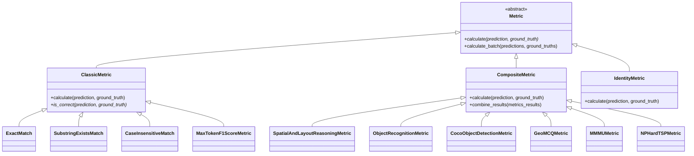
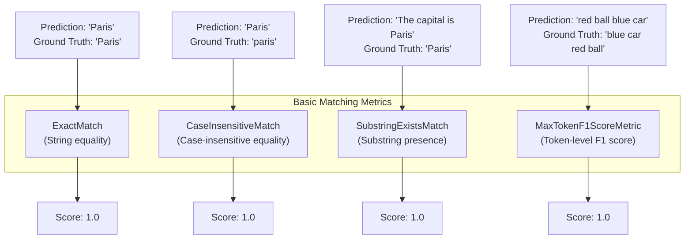
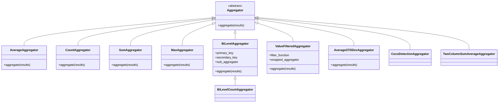
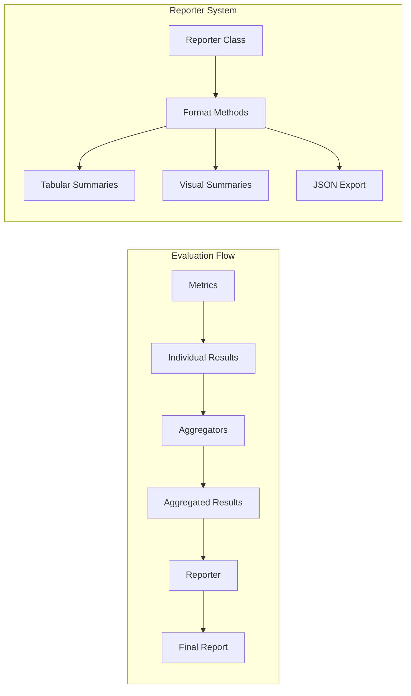
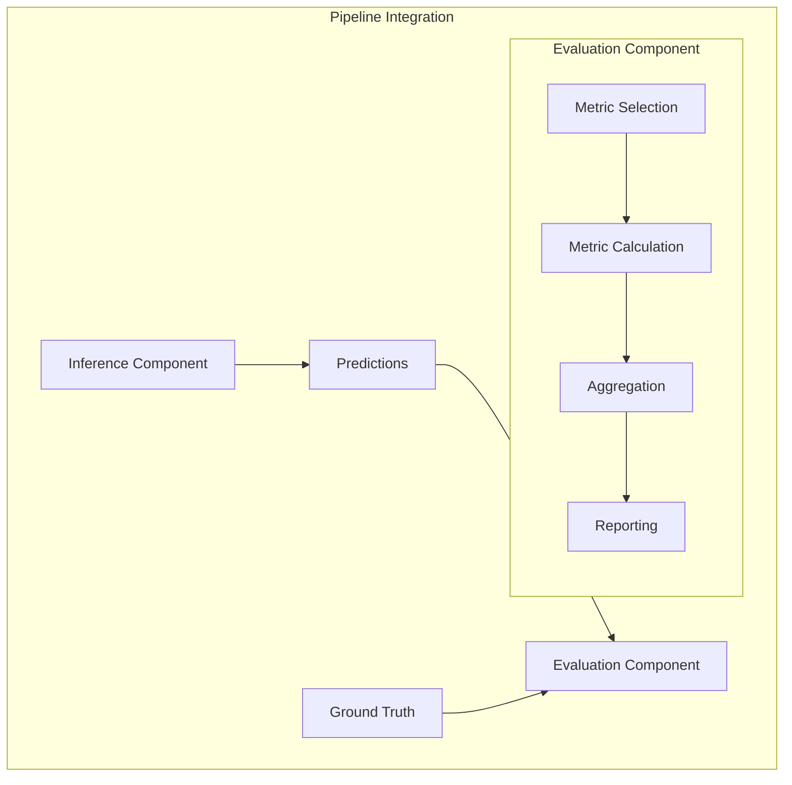

<!-- source: DeepWiki mcp.deepwiki.com · repo microsoft/eureka-ml-insights · page 6.1 Metrics Framework · fetched 2026-10-26 -->

# Metrics Framework

Relevant source files

The following files were used as context for generating this wiki page:

- [eureka_ml_insights/metrics/__init__.py](eureka_ml_insights/metrics/__init__.py)

## Purpose and Scope

The Metrics Framework provides a structured system for evaluating model outputs within the Eureka ML Insights repository. It defines the core abstractions for metrics, implements specific evaluation methodologies, and offers mechanisms for aggregating and reporting results. This document covers the architecture of the metrics system, available metric implementations, and the aggregation/reporting functionality. For information about how these metrics integrate with the overall evaluation pipeline, see [Pipeline System](#2.1). For task-specific metrics implementations, see [Task-Specific Metrics](#6.3).

Sources: [eureka_ml_insights/metrics/__init__.py:1-61]()

## Metric Architecture

The Metrics Framework is built around a hierarchy of metric classes, with the abstract `Metric` class at the root. This design enables a composable approach to evaluation where metrics can be selected, combined, and applied based on the specific task requirements.

### Metric Class Hierarchy

Sources: [eureka_ml_insights/metrics/__init__.py:3-11](), [eureka_ml_insights/metrics/__init__.py:28-32]()

### Core Abstractions

1. **Metric**: The foundational abstract class that defines the interface for all metrics. It requires implementing a `calculate` method that determines the score for a prediction against a ground truth.

2. **ClassicMetric**: Extends `Metric` and simplifies implementation by requiring only an `is_correct` method that returns a boolean indicating correctness.

3. **CompositeMetric**: Extends `Metric` and allows combining multiple metrics into a single evaluation, with the ability to define custom logic for merging results.

4. **IdentityMetric**: A simple metric that returns the input directly, useful as a passthrough in certain evaluation pipelines.

Sources: [eureka_ml_insights/metrics/__init__.py:3-11]()

## Available Metrics

The framework provides several built-in metrics that can be broadly categorized into basic matching metrics and task-specific metrics.

### Basic Matching Metrics

- **ExactMatch**: Checks for exact string equality between prediction and ground truth.
- **CaseInsensitiveMatch**: Similar to ExactMatch but ignores case differences.
- **SubstringExistsMatch**: Checks if the ground truth exists as a substring within the prediction.
- **MaxTokenF1ScoreMetric**: Calculates the F1 score based on the overlap of tokens between prediction and ground truth.

Sources: [eureka_ml_insights/metrics/__init__.py:4-10](), [eureka_ml_insights/metrics/__init__.py:1-1]()

### Task-Specific Metrics

The framework includes several specialized metrics for specific evaluation tasks:

| Metric Class | Purpose | Task Domain |
|--------------|---------|-------------|
| `SpatialAndLayoutReasoningMetric` | Evaluates spatial relationships in model responses | Vision-Language |
| `ObjectRecognitionMetric` | Evaluates object detection capabilities | Vision-Language |
| `CocoObjectDetectionMetric` | Uses COCO format for object detection evaluation | Vision-Language |
| `GeoMCQMetric` | Evaluates geometric multiple-choice questions | Mathematical Reasoning |
| `MMMUMetric` | Specialized for Massive Multitask Multimodal Understanding | Multimodal |
| `NPHardTSPMetric` | Evaluates solutions to NP-Hard Traveling Salesperson Problem | Algorithmic Reasoning |

These task-specific metrics typically extend the `CompositeMetric` class and implement specialized logic for their respective domains.

Sources: [eureka_ml_insights/metrics/__init__.py:2-2](), [eureka_ml_insights/metrics/__init__.py:12-13](), [eureka_ml_insights/metrics/__init__.py:28-32]()

## Aggregation and Reporting System

The metrics framework includes a comprehensive system for aggregating individual metric results and generating reports.

### Aggregator Architecture

Sources: [eureka_ml_insights/metrics/__init__.py:14-27]()

### Aggregator Types

1. **Basic Aggregators**:
   - `AverageAggregator`: Calculates the mean of metric results
   - `CountAggregator`: Counts the occurrences of specific values
   - `SumAggregator`: Sums the metric results
   - `MaxAggregator`: Returns the maximum value

2. **Advanced Aggregators**:
   - `BiLevelAggregator`: Performs hierarchical aggregation using primary and secondary keys
   - `ValueFilteredAggregator`: Filters results before applying another aggregator
   - `AverageSTDDevAggregator`: Calculates both mean and standard deviation

3. **Task-Specific Aggregators**:
   - `CocoDetectionAggregator`: Specialized for COCO object detection metrics
   - `TwoColumnSumAverageAggregator`: Handles two-column data with sum and average

Sources: [eureka_ml_insights/metrics/__init__.py:14-27]()

### Reporting Flow

The `Reporter` class takes aggregated results and transforms them into human-readable formats or structured data for further analysis.

Sources: [eureka_ml_insights/metrics/__init__.py:14-27]()

## Integration with Pipeline System

Metrics are used as part of the evaluation component in the pipeline system. A typical pattern involves:

1. Running model inference to generate predictions
2. Applying appropriate metrics to compute scores
3. Aggregating results using selected aggregators
4. Generating reports through the Reporter class

Sources: [eureka_ml_insights/metrics/__init__.py:1-61]()

## Selecting and Using Metrics

When implementing an evaluation pipeline, consider these factors when selecting metrics:

1. **Task Type**: Choose metrics appropriate to your task (e.g., `ExactMatch` for classification, `MaxTokenF1ScoreMetric` for generation)
2. **Strictness**: Consider how strict the evaluation should be (e.g., `ExactMatch` vs `SubstringExistsMatch`)
3. **Composition**: Use `CompositeMetric` when multiple evaluation criteria are needed
4. **Aggregation**: Select aggregators based on the analysis required (averages, counts, etc.)

For task-specific metrics and advanced use cases, refer to [Task-Specific Metrics](#6.3) documentation.

Sources: [eureka_ml_insights/metrics/__init__.py:1-61]()

---

