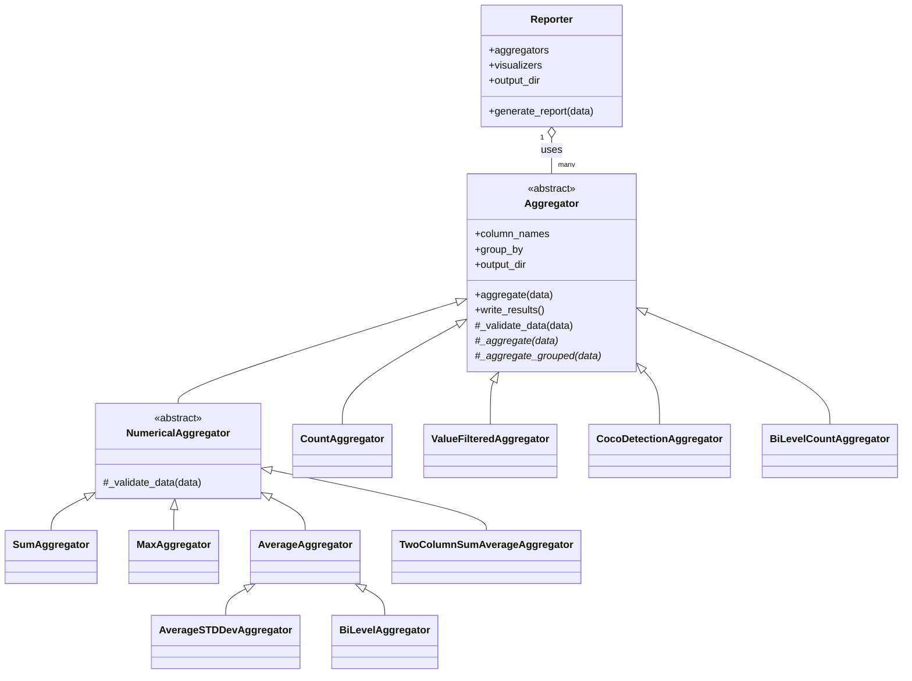
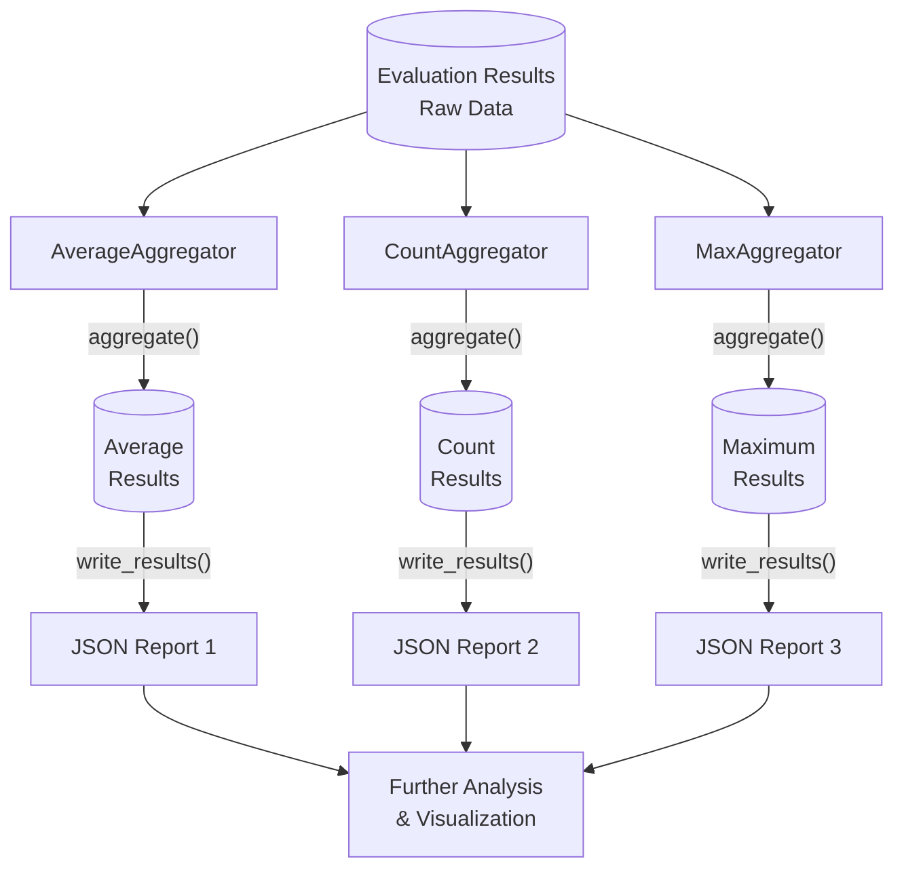
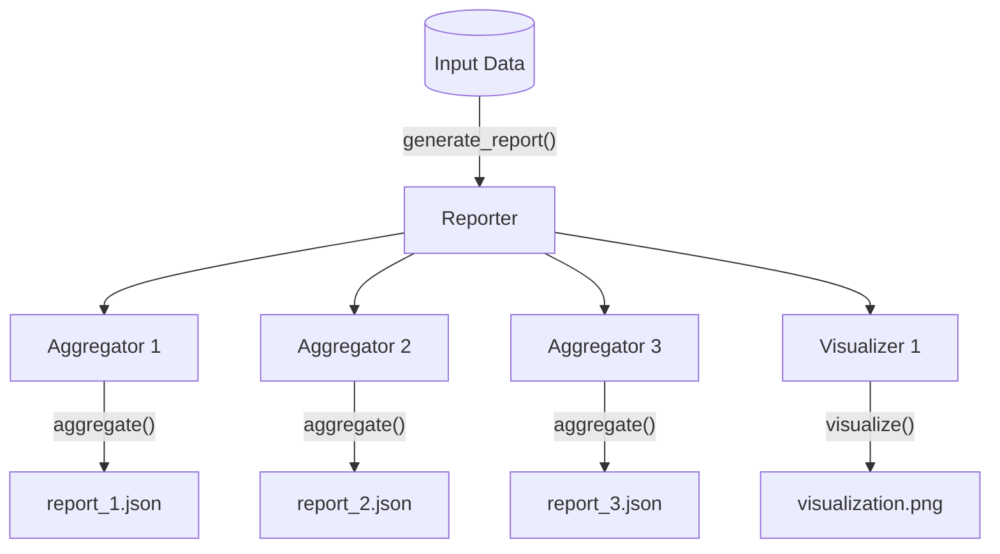

<!-- source: DeepWiki mcp.deepwiki.com · repo microsoft/eureka-ml-insights · page 6.2 Aggregators and Reporting · fetched 2026-10-26 -->

# Aggregators and Reporting

<details>
<summary>Relevant source files</summary>

The following files were used as context for generating this wiki page:

- [eureka_ml_insights/metrics/reports.py](eureka_ml_insights/metrics/reports.py)

</details>


This document describes the Aggregators and Reporting system in the Eureka ML Insights framework. The system provides tools for analyzing, summarizing, and reporting evaluation results from model runs. For information about the metrics that generate these results, see [Metrics Framework](#6.1).

## Purpose and Architecture

The Aggregators and Reporting system serves three main functions:

1. **Aggregating evaluation results** - Calculating summary statistics (averages, counts, sums, etc.)
2. **Processing grouped data** - Analyzing results across different dimensions (e.g., by model type)
3. **Generating standardized reports** - Outputting results in consistent JSON format



**Aggregator Class Hierarchy**

Sources: [eureka_ml_insights/metrics/reports.py:13-406]()

## Data Flow

The following diagram shows how data flows through the aggregation and reporting system:



**Data Flow in Aggregation System**

Sources: [eureka_ml_insights/metrics/reports.py:64-71](), [eureka_ml_insights/metrics/reports.py:33-46]()

## Base Aggregator Classes

### Aggregator

The `Aggregator` is the foundation of the aggregation system:

```python
Aggregator(column_names, output_dir, group_by=None, ignore_non_numeric=False, filename_base=None, **kwargs)
```

**Key Methods:**
- `aggregate(data)`: Processes the data, handling grouped or ungrouped cases
- `write_results()`: Writes aggregated results to a JSON file
- `_validate_data(data)`: Ensures input data is valid
- `_aggregate(data)`: Abstract method for non-grouped aggregation
- `_aggregate_grouped(data)`: Abstract method for grouped aggregation

Sources: [eureka_ml_insights/metrics/reports.py:13-87]()

### NumericalAggregator

The `NumericalAggregator` extends the base `Aggregator` with validation specific to numerical data:

```python
NumericalAggregator(column_names, output_dir, group_by=None, **kwargs)
```

It ensures all data in specified columns can be converted to numeric values.

Sources: [eureka_ml_insights/metrics/reports.py:90-97]()

## Standard Aggregators

### SumAggregator

Calculates the sum of values in each specified column:

```python
SumAggregator(column_names, output_dir, group_by=None, **kwargs)
```

Sources: [eureka_ml_insights/metrics/reports.py:100-112]()

### MaxAggregator

Finds the maximum value in each specified column:

```python
MaxAggregator(column_names, output_dir, group_by=None, **kwargs)
```

Sources: [eureka_ml_insights/metrics/reports.py:114-125]()

### AverageAggregator

Calculates the mean of values in each specified column:

```python
AverageAggregator(column_names, output_dir, group_by=None, **kwargs)
```

Sources: [eureka_ml_insights/metrics/reports.py:128-143]()

### AverageSTDDevAggregator

Calculates both mean and standard deviation for each column:

```python
AverageSTDDevAggregator(column_names, output_dir, group_by=None, **kwargs)
```

Sources: [eureka_ml_insights/metrics/reports.py:146-162]()

### CountAggregator

Counts occurrences of each unique value in specified columns:

```python
CountAggregator(column_names, output_dir, group_by=None, normalize=False, **kwargs)
```

**Additional Parameters:**
- `normalize`: When True, converts counts to percentages (0-1)

Sources: [eureka_ml_insights/metrics/reports.py:165-196]()

## Advanced Aggregators

### BiLevelAggregator

Performs two-level aggregation - first groups by primary column, then optionally by secondary column:

```python
BiLevelAggregator(column_names, first_groupby, output_dir, second_groupby=None, agg_fn="mean", **kwargs)
```

**Additional Parameters:**
- `first_groupby`: Primary column to group by
- `second_groupby`: Optional secondary column to group by
- `agg_fn`: Aggregation function for first level (default: "mean")

Sources: [eureka_ml_insights/metrics/reports.py:199-245]()

### BiLevelCountAggregator

Similar to `BiLevelAggregator` but specialized for counting:

```python
BiLevelCountAggregator(column_names, first_groupby, output_dir, normalize=False, second_groupby=None, **kwargs)
```

Sources: [eureka_ml_insights/metrics/reports.py:246-295]()

### TwoColumnSumAverageAggregator

Calculates the ratio of summed values from two columns:

```python
TwoColumnSumAverageAggregator(numerator_column_name, denominator_column_name, output_dir, group_by=None, **kwargs)
```

This is useful for metrics like accuracy (correct answers / total questions).

Sources: [eureka_ml_insights/metrics/reports.py:298-323]()

### ValueFilteredAggregator

Filters out specific values before applying another aggregator:

```python
ValueFilteredAggregator(agg_class, value, column_names, output_dir, group_by=None, ignore_non_numeric=False, filename_base=None, **kwargs)
```

**Additional Parameters:**
- `agg_class`: Aggregator class to use after filtering
- `value`: Value to filter out

Sources: [eureka_ml_insights/metrics/reports.py:326-370]()

### CocoDetectionAggregator

Specialized aggregator for computer vision object detection tasks:

```python
CocoDetectionAggregator(column_names, output_dir, target_coco_json_reader)
```

Uses COCO tools to calculate AP50 (Average Precision at IoU=0.5) for detection results.

Sources: [eureka_ml_insights/metrics/reports.py:372-406]()

## Reporter System

The `Reporter` class orchestrates multiple aggregators to generate comprehensive reports:

```python
Reporter(output_dir, aggregator_configs=None, visualizer_configs=None)
```

**Key Methods:**
- `generate_report(data)`: Applies all configured aggregators and visualizers to the data



**Reporter Orchestration Flow**

Sources: [eureka_ml_insights/metrics/reports.py:408-432]()

## Common Usage Examples

### Basic Aggregation

```python
# Create an average aggregator for accuracy metrics
avg_aggregator = AverageAggregator(
    column_names=["exact_match", "f1_score"], 
    output_dir="./reports"
)

# Apply the aggregator to the data
avg_aggregator.aggregate(results_df)
avg_aggregator.write_results()
```

### Grouped Aggregation

```python
# Group by model name and calculate averages
grouped_aggregator = AverageAggregator(
    column_names=["exact_match", "f1_score"],
    output_dir="./reports",
    group_by="model_name"
)

grouped_aggregator.aggregate(results_df)
grouped_aggregator.write_results()
```

### Using Reporter for Multiple Aggregations

```python
# Configure a reporter with multiple aggregators
reporter = Reporter(
    output_dir="./reports",
    aggregator_configs=[
        AggregatorConfig(AverageAggregator, {"column_names": ["accuracy"]}),
        AggregatorConfig(CountAggregator, {"column_names": ["error_type"], "normalize": True})
    ]
)

# Generate the report
reporter.generate_report(results_df)
```

## Output Format and Naming

Aggregators generate JSON files with the following naming pattern:

```
{aggregator_name}_{timestamp}_{on_columns}_{grouping_info}_report.json
```

Example: `averageaggregator_120231500_on_exact_match_f1_score_grouped_by_model_name_report.json`

The output format varies by aggregator but typically looks like:

```json
{
  "exact_match": {
    "model_a": 0.875,
    "model_b": 0.923
  },
  "f1_score": {
    "model_a": 0.912,
    "model_b": 0.947
  }
}
```

Sources: [eureka_ml_insights/metrics/reports.py:48-62](), [eureka_ml_insights/metrics/reports.py:64-71]()

## Integration with Metrics System

The Aggregators and Reporting system typically processes output from the [Metrics Framework](#6.1). The typical flow is:

1. Metrics produce raw evaluation results for each sample/prompt
2. Aggregators summarize these results across samples
3. Reports are generated in standardized JSON format
4. These reports can be used for further analysis or visualization

---

