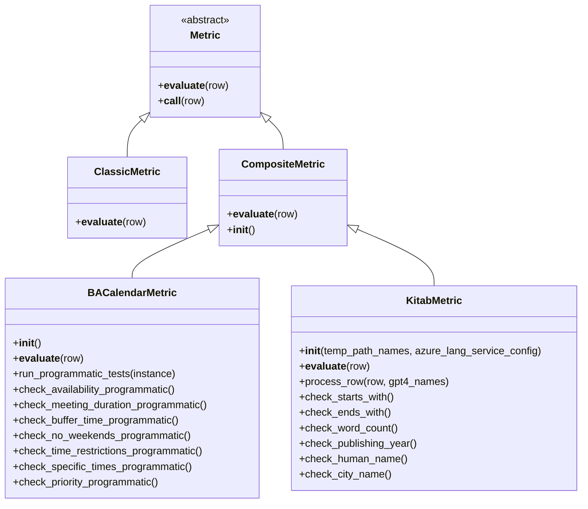
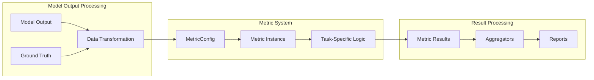
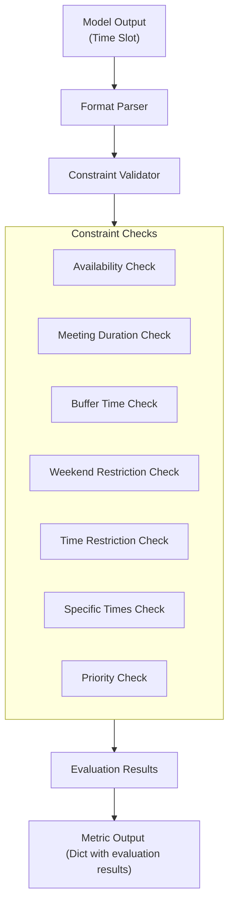
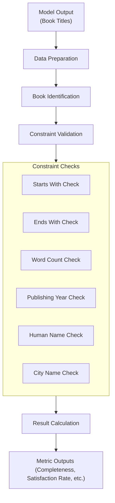
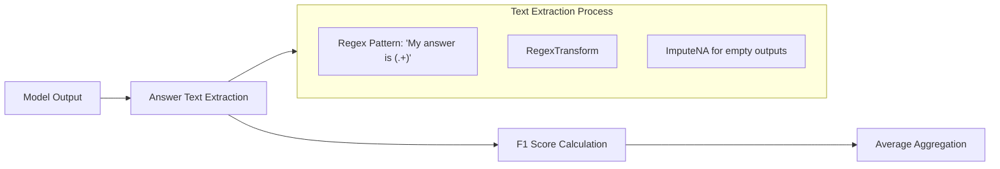

<!-- source: DeepWiki mcp.deepwiki.com · repo microsoft/eureka-ml-insights · page 6.3 Task-Specific Metrics · fetched 2026-10-26 -->

# Task-Specific Metrics

<details>
<summary>Relevant source files</summary>

The following files were used as context for generating this wiki page:

- [eureka_ml_insights/data_utils/ba_calendar_utils.py](eureka_ml_insights/data_utils/ba_calendar_utils.py)
- [eureka_ml_insights/metrics/ba_calendar_metrics.py](eureka_ml_insights/metrics/ba_calendar_metrics.py)
- [eureka_ml_insights/metrics/kitab_metrics.py](eureka_ml_insights/metrics/kitab_metrics.py)
- [eureka_ml_insights/user_configs/drop.py](eureka_ml_insights/user_configs/drop.py)
- [eureka_ml_insights/user_configs/gpqa.py](eureka_ml_insights/user_configs/gpqa.py)
- [tests/data_utils_tests/ba_calendar_tests.py](tests/data_utils_tests/ba_calendar_tests.py)

</details>


## Introduction

Task-Specific Metrics in Eureka ML Insights are specialized evaluation metrics designed for particular tasks or benchmarks that require custom evaluation logic beyond general-purpose metrics. This page documents the available task-specific metrics, their implementations, and how they integrate with the broader metrics framework.

For information about the general metrics framework and base metric classes, see [Metrics Framework](#6.1). For details on how metrics results are aggregated and reported, see [Aggregators and Reporting](#6.2).

Sources: [eureka_ml_insights/metrics/ba_calendar_metrics.py:1-357](), [eureka_ml_insights/metrics/kitab_metrics.py:1-579]()

## Metric Hierarchy

The task-specific metrics in Eureka ML Insights inherit from base metric classes and implement custom evaluation logic tailored to specific benchmark requirements. All task-specific metrics extend the `CompositeMetric` base class, which provides the framework for implementing complex, multi-faceted evaluation.

Metric Class Hierarchy



Sources: [eureka_ml_insights/metrics/ba_calendar_metrics.py:70-111](), [eureka_ml_insights/metrics/kitab_metrics.py:27-75]()

## Integration with Evaluation Pipeline

Task-specific metrics are integrated into the evaluation pipeline through metric configuration and the EvalReporting component. The following diagram illustrates how these metrics fit into the broader evaluation process:

Metrics Integration Flow



Sources: [eureka_ml_insights/user_configs/gpqa.py:214-219](), [eureka_ml_insights/user_configs/drop.py:97-98]()

## BA Calendar Metrics

The `BACalendarMetric` is a composite metric designed for evaluating model responses to calendar scheduling problems. It assesses whether a given scheduling solution satisfies various constraints such as participant availability, meeting duration, buffer times, and time restrictions.

### Implementation Structure

BACalendar Metric Components



### Key Constraints Evaluated

The `BACalendarMetric` evaluates the following constraints:

1. **Format correctness**: Checks if the solution follows the required format (`Day HH:MM-HH:MM`)
2. **Availability**: Verifies that all participants are available during the proposed time slot
3. **Meeting duration**: Ensures the scheduled meeting has the required duration
4. **Buffer time**: Checks if required buffer times before and after the meeting are respected
5. **Weekend restrictions**: Verifies that the meeting is not scheduled on weekends if restricted
6. **Time restrictions**: Ensures the meeting is within allowed time ranges (e.g., not before 9 AM)
7. **Specific time exclusions**: Checks that the meeting doesn't overlap with specific excluded times
8. **Priority scheduling**: For priority meetings, verifies they're scheduled at the earliest possible slot

### Result Format

The metric returns a dictionary with results for each constraint check, along with an `all_correct` value indicating if all constraints were satisfied and a `fraction_passed` value showing the proportion of passed constraints.

Sources: [eureka_ml_insights/metrics/ba_calendar_metrics.py:70-357](), [eureka_ml_insights/data_utils/ba_calendar_utils.py:1-40](), [tests/data_utils_tests/ba_calendar_tests.py:1-40]()

## Kitab Metrics

The `KitabMetric` is a composite metric designed for evaluating model responses to queries about book titles that satisfy specific constraints. This metric was adapted from the Kitab dataset benchmark.

### Implementation Structure

Kitab Metric Components



### Key Features

1. **Book title matching**: Uses fuzzy matching to identify book titles that may have variations in format
2. **External services integration**: Uses Azure Language Service for identifying human names and cities in book titles
3. **Multiple constraint types**: Supports various constraint types:
   - Titles that start with a specific letter
   - Titles that end with a specific letter
   - Titles with a specific word count
   - Books published within a year range
   - Titles containing human names
   - Titles containing city names

### Result Metrics

The metric calculates several evaluation metrics:
- **Completeness**: The proportion of ground truth books that were correctly identified
- **Satisfied rate**: The proportion of returned books that satisfy the constraints
- **Unsatisfied rate**: The proportion of returned books that don't satisfy the constraints
- **Not from author rate**: The proportion of hallucinated books (not in the author's bibliography)
- **All correct**: Binary indicator if the model response is completely correct

Sources: [eureka_ml_insights/metrics/kitab_metrics.py:1-579]()

## Task-Specific Metrics in GPQA

The General Physics Questions and Answers (GPQA) benchmark uses the `ExactMatch` metric to evaluate model responses. This metric checks if the model's answer exactly matches the ground truth answer for multiple-choice questions.

### Implementation in GPQA Pipeline

The GPQA pipeline performs the following metric-related operations:

1. Extracts the model's answer using regex pattern matching
2. Applies the `ExactMatch` metric to compare with ground truth
3. Aggregates results using various aggregators:
   - Per-run (Pass@1) statistics
   - Group-by-domain statistics
   - Best-of-N statistics
   - Majority vote statistics

### Aggregation Strategies

GPQA implements several aggregation strategies to evaluate model performance:

| Strategy | Description | Implementation |
|----------|-------------|----------------|
| Pass@1 | Evaluates single-run accuracy | `CountAggregator` with normalization |
| Domain-specific | Evaluates performance by domain | `CountAggregator` grouped by domain |
| Best-of-N | Takes the best result from N runs | `BiLevelAggregator` with max function |
| Worst-of-N | Takes the worst result from N runs | `BiLevelAggregator` with min function |
| Majority Vote | Uses majority voting across runs | Custom transformation + `ExactMatch` |

Sources: [eureka_ml_insights/user_configs/gpqa.py:29-34](), [eureka_ml_insights/user_configs/gpqa.py:214-289]()

## DROP Metric

The Discrete Reasoning Over Paragraphs (DROP) benchmark uses the `MaxTokenF1ScoreMetric` for evaluation. This metric calculates the F1 score between the tokens in the model's answer and the ground truth answer.

### Implementation in DROP Pipeline



The DROP pipeline:
1. Extracts answer text from model output using regex
2. Applies the `MaxTokenF1ScoreMetric` to calculate token-level F1 score
3. Aggregates results using `AverageAggregator`

Sources: [eureka_ml_insights/user_configs/drop.py:15-15](), [eureka_ml_insights/user_configs/drop.py:97-102]()

## Implementing Custom Task-Specific Metrics

To implement a new task-specific metric for a specialized benchmark, follow these guidelines:

1. **Inherit from appropriate base class**: 
   - Use `CompositeMetric` for complex evaluations with multiple criteria
   - Use `ClassicMetric` for simpler, single-value evaluations

2. **Implement the required methods**:
   - Override `__evaluate__(self, row)` method to implement the evaluation logic
   - For composite metrics, typically return a dictionary with multiple evaluation results

3. **Reference in pipeline configuration**:
   - Configure the metric in your pipeline using `MetricConfig`
   - Specify appropriate aggregators for processing metric results

### Integration Example

```python
# Pipeline configuration with custom metric
evalreporting_comp = EvalReportingConfig(
    component_type=EvalReporting,
    data_reader_config=DataSetConfig(...),
    # Configure your custom metric
    metric_config=MetricConfig(YourCustomMetric, {"param1": value1}),
    aggregator_configs=[
        AggregatorConfig(AverageAggregator, {"column_names": ["YourCustomMetric_result"]}),
    ],
    output_dir=os.path.join(log_dir, "eval_report"),
)
```

Sources: [eureka_ml_insights/user_configs/gpqa.py:198-290](), [eureka_ml_insights/user_configs/drop.py:74-105]()

---

