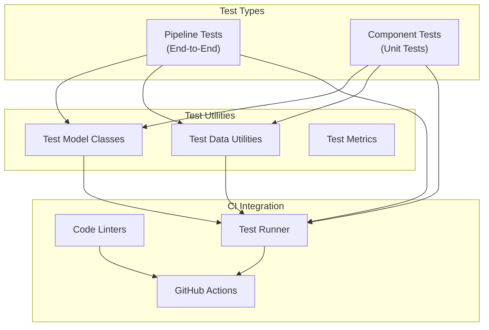
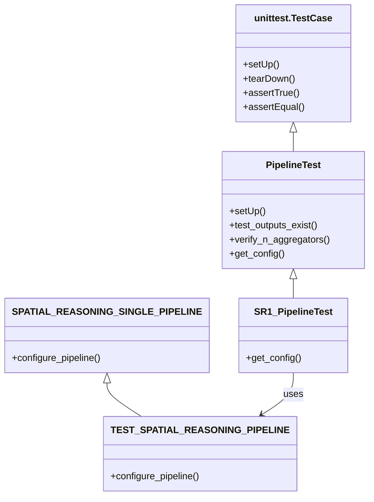
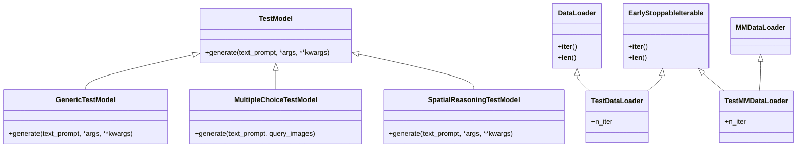
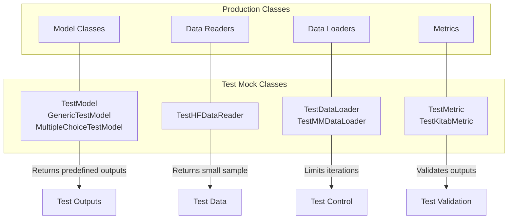

<!-- source: DeepWiki mcp.deepwiki.com · repo microsoft/eureka-ml-insights · page 7 Testing and Development · fetched 2026-10-26 -->

# Testing and Development

<details>
<summary>Relevant source files</summary>

The following files were used as context for generating this wiki page:

- [.github/workflows/eureka-tests.yml](.github/workflows/eureka-tests.yml)
- [README.md](README.md)
- [docs/figures/eureka_logo.png](docs/figures/eureka_logo.png)
- [eureka_ml_insights/core/data_processing.py](eureka_ml_insights/core/data_processing.py)
- [eureka_ml_insights/metrics/ifeval_instruction_utils.py](eureka_ml_insights/metrics/ifeval_instruction_utils.py)
- [tests/component_tests.py](tests/component_tests.py)
- [tests/pipeline_tests.py](tests/pipeline_tests.py)
- [tests/test_utils.py](tests/test_utils.py)

</details>


This page documents the testing framework and development workflows for the Eureka ML Insights codebase. It provides guidance on how to write tests, use the testing utilities, and follow best practices when contributing to the repository. For information about the system architecture, see [Architecture](#2).

## Testing Framework Overview

The Eureka ML Insights framework uses Python's `unittest` framework as its primary testing infrastructure. Tests are organized into pipeline tests (end-to-end tests) and component tests (unit tests). The framework provides specialized test utilities to facilitate testing with minimal dependencies on external services or large datasets.



Sources:
- [tests/pipeline_tests.py]()
- [tests/test_utils.py]()
- [.github/workflows/eureka-tests.yml]()

## Pipeline Tests

Pipeline tests are designed to validate end-to-end functionality of various evaluation pipelines. The framework uses test-specific pipeline configurations that inherit from the real benchmark pipeline configurations but replace components with test counterparts that don't require external dependencies.

### Pipeline Test Architecture



Each pipeline test follows a similar pattern:

1. Define a test-specific pipeline configuration class (e.g., `TEST_SPATIAL_REASONING_PIPELINE`) that inherits from a real pipeline configuration
2. Override the `configure_pipeline` method to replace real components with test versions
3. Create a test class (e.g., `SR1_PipelineTest`) that inherits from `PipelineTest` and `unittest.TestCase`
4. Implement `get_config()` to return the test pipeline configuration

The `PipelineTest` base class handles:
- Setting up the test environment
- Running the pipeline
- Verifying that expected output files exist
- Checking that the correct number of aggregators ran

Sources:
- [tests/pipeline_tests.py:379-406]()
- [tests/pipeline_tests.py:68-78]()
- [tests/pipeline_tests.py:409-411]()

## Test Utilities

The framework provides several test utilities to make testing easier without requiring external dependencies:

### Test Models

Test models are simplified implementations of model interfaces that return predefined outputs. For example:

- `GenericTestModel`: Returns a fixed output for any input
- `MultipleChoiceTestModel`: Returns a random multiple-choice answer
- `SpatialReasoningTestModel`: Returns a random spatial relation
- `KitabTestModel`: Returns predefined responses for Kitab tests

### Test Data Utilities

- `TestHFDataReader`: Modified HF data reader that only loads a small sample
- `TestDataLoader`: Data loader that limits the number of iterations
- `TestMMDataLoader`: Multimodal data loader for testing

### Test Metrics

- `TestMetric`: Simple metric implementation for testing
- `TestKitabMetric`: Test implementation of the Kitab metric



Sources:
- [tests/test_utils.py:13-118]()
- [tests/test_utils.py:256-284]()
- [tests/test_utils.py:214-253]()

## Writing Tests

### Pipeline Tests

To create a new pipeline test:

1. Create a test pipeline configuration class that inherits from the real pipeline configuration
2. Override `configure_pipeline()` to replace components with test versions
3. Create a test class that inherits from `PipelineTest` and `unittest.TestCase`
4. Implement the `get_config()` method

Example:

```python
class TEST_MY_PIPELINE(MY_PIPELINE):
    def configure_pipeline(self):
        model_config = ModelConfig(GenericTestModel, {})
        config = super().configure_pipeline(model_config=model_config)
        self.inference_comp.data_loader_config.class_name = TestDataLoader
        self.inference_comp.data_loader_config.init_args["n_iter"] = N_ITER
        return config

class MY_PipelineTest(PipelineTest, unittest.TestCase):
    def get_config(self):
        return TEST_MY_PIPELINE().pipeline_config
```

### Component Tests

Component tests validate individual components in isolation. They typically:

1. Create a component configuration
2. Instantiate the component
3. Run the component
4. Assert that outputs match expectations

Example:

```python
class TestPromptProcessing(unittest.TestCase):
    def setUp(self) -> None:
        self.log_dir = create_logdir("TestPromptProcessing")
        self.config = PromptProcessingConfig(
            component_type=PromptProcessing,
            data_reader_config=DataSetConfig(...),
            prompt_template_path=...,
            output_dir=...,
        )
        component = PromptProcessing.from_config(self.config)
        component.run()

    def test_prompt_processing(self):
        self.assertTrue(os.path.exists(self.config.output_dir))
        # Additional assertions
```

Sources:
- [tests/component_tests.py:32-69]()
- [tests/pipeline_tests.py:68-78]()
- [tests/pipeline_tests.py:409-411]()

## CI/CD Integration

### GitHub Actions Workflow

The repository uses GitHub Actions for continuous integration. The main workflow includes:

1. Setting up the Python environment
2. Installing dependencies
3. Running linters (optional failure)
4. Running tests

The workflow is defined in `.github/workflows/eureka-tests.yml` and includes:

```yaml
name: Eureka Tests

on:
  push:
    branches: ["main"]
  pull_request:
    branches: ["main"]

jobs:
  build:
    runs-on: ubuntu-latest
    strategy:
      fail-fast: false
      matrix:
        python-version: ["3.10"]
    
    steps:
    - name: Checkout the repository
      uses: actions/checkout@v4
    - name: Set up Python 3.10
      uses: actions/setup-python@v5
    - name: Install dependencies
      run: |
        pip install --upgrade pip
        pip install -r requirements.txt
        pip install .
    - name: Run linters
      continue-on-error: true
      run: |
        make linters
    - name: Run tests
      run: |
        export skip_tests_with_missing_ds=1
        export skip_slow_tests=1
        make test
```

The CI pipeline skips tests that require external datasets (`skip_tests_with_missing_ds=1`) and slow tests (`skip_slow_tests=1`). This ensures that the CI pipeline runs quickly and reliably without external dependencies.

Sources:
- [.github/workflows/eureka-tests.yml]()

## Development Workflow

### Setup for Development

1. Clone the repository
2. Set up the development environment:
   - Using pip: `python -m venv .venv && pip install -e .`
   - Using conda: `conda env create --name myenv --file environment.yml`
3. Run tests to ensure everything works

### Contribution Guidelines

When contributing to the Eureka ML Insights framework:

1. Create a new branch for your changes
2. Implement your changes, including tests
3. Format code with `make format-inplace`
4. Run linters with `make linters`
5. Run tests with `make test`
6. Submit a pull request

### Code Formatting and Linting

The repository uses:
- Code formatting tools to ensure consistent code style
- Linters to check for potential issues
- Unit tests to verify functionality

Format code with:

```bash
make format-inplace
```

Check for linting issues with:

```bash
make linters
```

Run tests with:

```bash
make test
```

Sources:
- [README.md:149-166]()

## Testing Conventions and Best Practices

### Test Mocking Strategy

The testing framework uses test utilities to replace real components that would otherwise require external services or large datasets:



### Pipeline Test Configuration

When creating a test pipeline configuration:

1. Replace real models with test models
2. Replace data readers with test data readers
3. Replace data loaders with test data loaders
4. Set a small number of iterations (`n_iter`)
5. Use appropriate test metrics

This approach ensures that tests:
- Run quickly
- Don't depend on external services
- Provide consistent results
- Cover the entire pipeline

Sources:
- [tests/test_utils.py]()
- [tests/pipeline_tests.py]()

### Skipping Tests

Some tests may be skipped under certain conditions:

- Tests requiring external datasets: Skipped when `skip_tests_with_missing_ds` is set
- Slow tests: Skipped when `skip_slow_tests` is set

Example:

```python
@unittest.skipIf("skip_tests_with_missing_ds" in os.environ, "Missing public dataset. TODO: revert")
class SR1_PipelineTest(PipelineTest, unittest.TestCase):
    def get_config(self):
        return TEST_SPATIAL_REASONING_PIPELINE().pipeline_config
```

Sources:
- [tests/pipeline_tests.py:408-411]()
- [tests/component_tests.py:256-257]()

## Common Testing Patterns

### Testing Output Existence

The `PipelineTest` base class verifies that expected output files exist:

```python
def test_outputs_exist(self) -> None:
    self.assertTrue(any("transformed_data.jsonl" in str(file) for file in self.files))
    if self.data_reader_config.prompt_template_path:
        self.assertTrue(any("processed_prompts.jsonl" in str(file) for file in self.files))
    self.assertTrue(any("inference_result.jsonl" in str(file) for file in self.files))
    self.verify_n_aggregators(self.eval_config)
```

### Verifying Component Outputs

Component tests typically verify:
- Output files exist
- Output content matches expectations
- Component behavior is correct

Example:

```python
def test_data_processing(self):
    self.assertTrue(os.path.exists(self.config.output_dir))
    self.assertTrue(os.path.exists(os.path.join(self.config.output_dir, "transformed_data.jsonl")))
    df = pd.read_json(os.path.join(self.config.output_dir, "transformed_data.jsonl"), lines=True)
    self.assertSetEqual(set(df.columns.tolist()), set(["query_text", "ground_truth"]))
    self.assertEqual(df["query_text"].str.contains("\n").sum(), 0)
```

Sources:
- [tests/pipeline_tests.py:390-406]()
- [tests/component_tests.py:95-100]()

---

