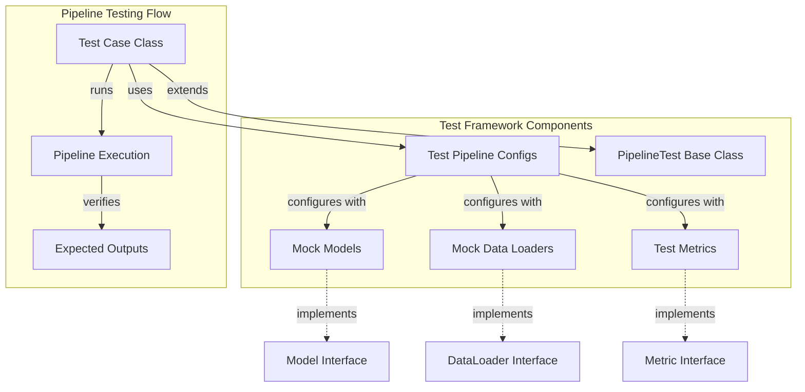
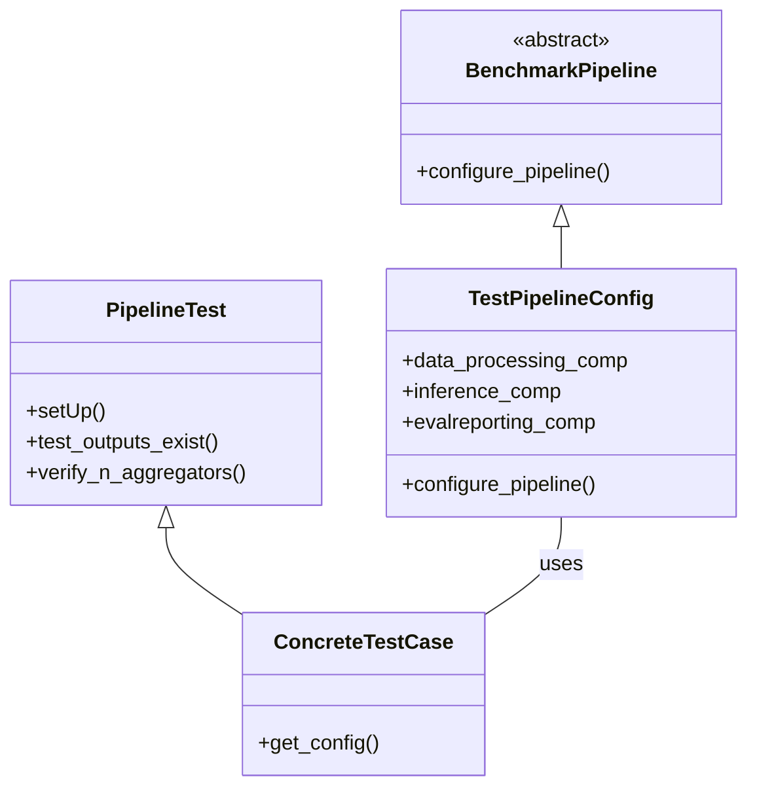
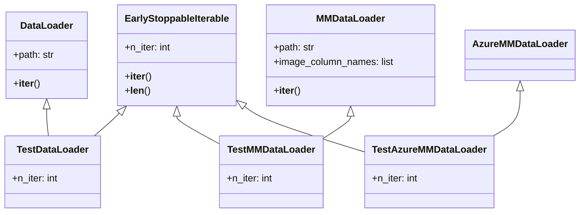
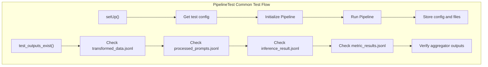
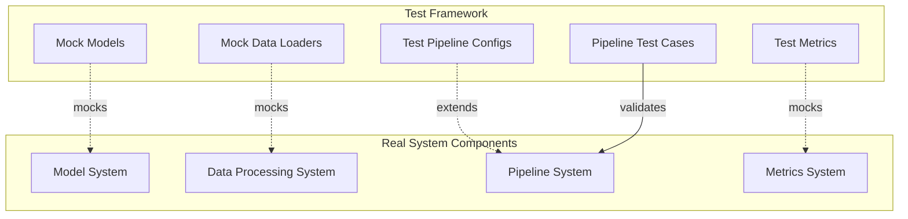

<!-- source: DeepWiki mcp.deepwiki.com · repo microsoft/eureka-ml-insights · page 7.1 Test Framework · fetched 2026-10-26 -->

# Test Framework

<details>
<summary>Relevant source files</summary>

The following files were used as context for generating this wiki page:

- [tests/pipeline_tests.py](tests/pipeline_tests.py)
- [tests/test_utils.py](tests/test_utils.py)

</details>


This document details the testing infrastructure of the Eureka ML Insights framework, focusing on the approach to testing evaluation pipelines, metrics, and components. The test framework enables systematic validation of the codebase through mock components and standardized test patterns.

## Overview and Architecture

The Eureka ML Insights test framework is built on Python's standard `unittest` library and implements a comprehensive testing approach that validates evaluation pipelines and components through:

1. Test configurations for benchmark pipelines
2. Mock implementations of models, data loaders, and metrics
3. Standardized test patterns for validating pipeline outputs

### Test Framework Architecture



Sources: [tests/pipeline_tests.py:379-406](), [tests/test_utils.py:13-253]()

## Test Pipeline Configuration System

The test system uses a configuration-based approach where benchmark pipeline configurations are extended to create test-specific configurations. These test configurations replace real components with mock components for testing.



Sources: [tests/pipeline_tests.py:68-366]()

### Example Test Pipeline Configuration

Test pipeline configurations extend the benchmark pipeline configurations and override the `configure_pipeline` method to use mock components. Here's how a typical test pipeline configuration is structured:

1. It extends a benchmark pipeline class
2. It overrides the `configure_pipeline` method
3. It replaces real components with test components:
   - Uses mock models from `test_utils.py`
   - Uses test data loaders with limited iterations
   - May modify the evaluation components

For example, the Spatial Reasoning test pipeline configuration:

```
TEST_SPATIAL_REASONING_PIPELINE extends SPATIAL_REASONING_SINGLE_PIPELINE
├── Override configure_pipeline()
│   ├── Use SpatialReasoningTestModel
│   ├── Replace data reader with TestHFDataReader
│   ├── Replace data loader with TestMMDataLoader
│   └── Limit iterations to N_ITER
```

Sources: [tests/pipeline_tests.py:68-78]()

## Mock Components

The test framework provides mock implementations of various components that are needed in the evaluation pipeline.

### Mock Models

Mock models implement the model interface but return predetermined outputs. These mock models are essential for testing pipeline components without requiring actual model inference.

| Mock Model Class | Purpose | Test Usage |
|-----------------|---------|------------|
| `TestModel` | Generic test model | Basic pipeline tests |
| `SpatialReasoningTestModel` | Spatial reasoning tests | Spatial reasoning benchmark |
| `MultipleChoiceTestModel` | Multiple choice tests | MMMU, GPQA benchmarks |
| `GeometricReasoningTestModel` | Geometric reasoning tests | Geometric reasoning benchmark |
| `KitabTestModel` | Kitab benchmark tests | Kitab benchmark |
| `GenericTestModel` | Generic output generation | Various benchmarks |
| `DetectionTestModel` | Object detection tests | Object detection benchmark |
| `ToxiGenTestModel` | Toxicity tests | ToxiGen benchmark |

Sources: [tests/test_utils.py:13-211]()

### Mock Data Loaders

The test framework provides mock data loaders that limit the amount of data processed during tests:



These mock data loaders implement the `EarlyStoppableIterable` class, which limits iteration to a specified number of items (`n_iter`), making tests run faster.

Sources: [tests/test_utils.py:256-284]()

### Mock Metrics

The test framework also provides mock metrics for testing evaluation components:

- `TestMetric`: A simple metric that returns 1 if the target text is in the answer text, 0 otherwise
- `TestKitabMetric`: A mock implementation of the Kitab metric for testing the Kitab benchmark

Sources: [tests/test_utils.py:214-253]()

## Pipeline Test Base Class

The `PipelineTest` class serves as a base class for all pipeline tests, providing common functionality:



The `PipelineTest` class:
1. Sets up the test by initializing and running the pipeline
2. Stores the configuration and output files
3. Provides a `test_outputs_exist` method that verifies the pipeline outputs
4. Provides a `verify_n_aggregators` method to check aggregator outputs

Sources: [tests/pipeline_tests.py:379-406]()

## Test Cases

The test framework includes test cases for various benchmarks, each inheriting from `PipelineTest` and `unittest.TestCase`:

| Test Case Class | Benchmark | Description |
|----------------|-----------|-------------|
| `SR1_PipelineTest` | Spatial Reasoning | Tests spatial reasoning pipeline |
| `VP1_PipelineTest` | Visual Prompting | Tests visual prompting pipeline |
| `OR1_PipelineTest` | Object Recognition | Tests object recognition pipeline |
| `OD1_PipelineTest` | Object Detection | Tests object detection pipeline |
| `MMMU_PipelineTest` | MMMU | Tests MMMU baseline pipeline |
| `DNA_PipelineTest` | Do Not Answer | Tests DNA pipeline |
| `IFEval_PipelineTest` | Instruction Following | Tests instruction following evaluation |
| `BA_Calendar_PipelineTest` | BA Calendar | Tests business analysis calendar pipeline |
| `TOXIGEN_PipelineTest` | ToxiGen Discriminative | Tests toxicity evaluation |
| `KITAB_ONE_BOOK_CONSTRAINT_PIPELINE_PipelineTest` | Kitab | Tests Kitab one book constraint pipeline |
| `GSM8K_PipelineTest` | GSM8K | Tests GSM8K math problem pipeline |

Each test case implements a `get_config` method that returns a test pipeline configuration.

Sources: [tests/pipeline_tests.py:409-596]()

## Running Tests

Tests can be run using Python's unittest framework:

```
python -m unittest tests/pipeline_tests.py
```

Some tests have a conditional skip annotation (`@unittest.skipIf("skip_tests_with_missing_ds" in os.environ, "Missing public dataset. TODO: revert")`) to handle cases where public datasets might not be available.

The framework validates that pipelines produce expected outputs:
1. Transformed data files
2. Processed prompt files (if applicable)
3. Inference result files
4. Metric result files (if applicable)
5. Aggregator output files

Sources: [tests/pipeline_tests.py:408-409](), [tests/pipeline_tests.py:390-395]()

## Integration with the Overall Framework

The test framework integrates with the Eureka ML Insights pipeline and component system:



The test framework enables comprehensive testing of the pipeline system (described in [Pipeline System](#2.1)) and component configurations (described in [Configuration System](#2.2)) without requiring actual model inference or real data access.

Sources: [tests/pipeline_tests.py:16-48](), [tests/test_utils.py:4-11]()

## Summary

The Eureka ML Insights test framework provides:

1. A systematic approach to testing evaluation pipelines
2. Mock implementations of models, data loaders, and metrics
3. Standardized test patterns for validating pipeline outputs
4. Test cases for various benchmarks

This framework enables efficient testing of the codebase without requiring actual model inference or access to full datasets, facilitating rapid development and validation of the evaluation framework.

---

