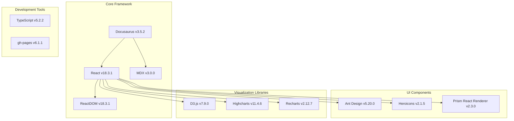
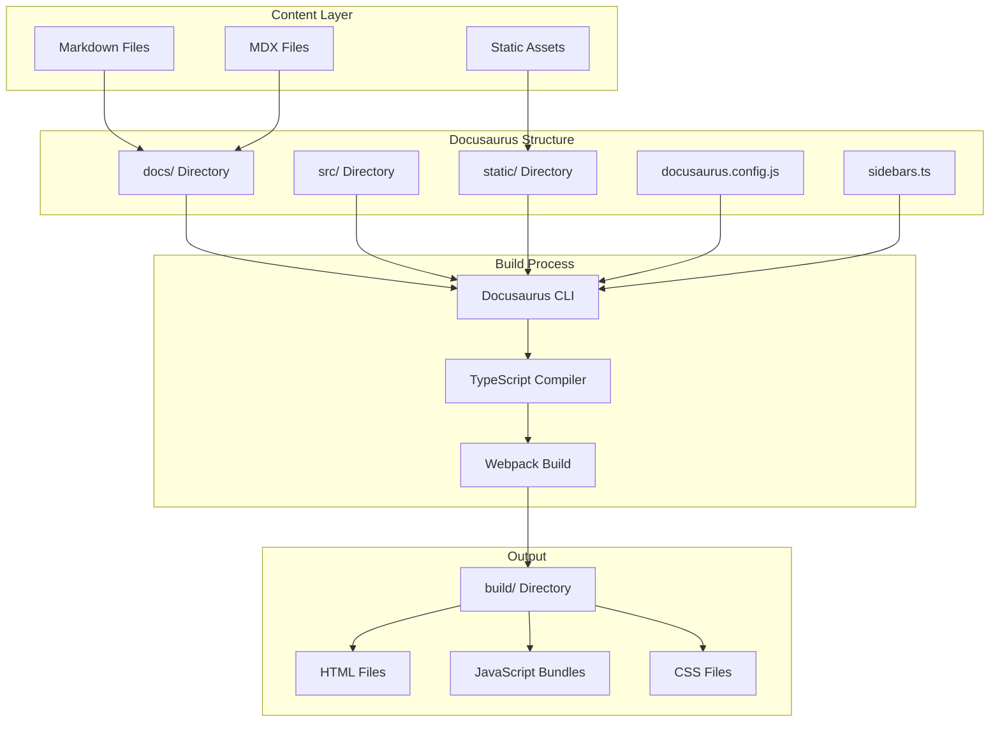
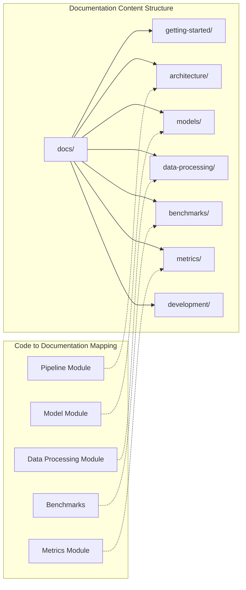
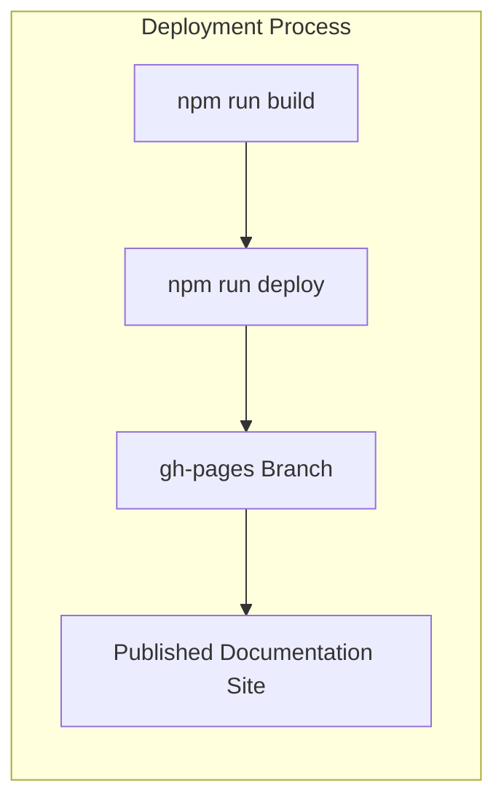

<!-- source: DeepWiki mcp.deepwiki.com · repo microsoft/eureka-ml-insights · page 7.2 Documentation Website · fetched 2026-10-26 -->

# Documentation Website

<details>
<summary>Relevant source files</summary>

The following files were used as context for generating this wiki page:

- [website/package-lock.json](website/package-lock.json)
- [website/package.json](website/package.json)
- [website/sidebars.ts](website/sidebars.ts)

</details>


This document describes the documentation website for the Eureka ML Insights framework. It covers the technology stack, architecture, organization, and development workflow of the documentation system.

## Purpose

The documentation website serves as the central knowledge repository for the Eureka ML Insights framework. It provides comprehensive documentation on all aspects of the framework, including architecture overviews, component guides, API references, and usage examples. The site is designed to support both new users getting started with the framework and experienced developers who need detailed technical information.

## Technology Stack

The documentation website is built using Docusaurus, a modern static site generator specifically designed for creating technical documentation websites.



Sources: [website/package.json:17-33]()

## Site Architecture

The documentation website follows the standard Docusaurus architecture with specific customizations for Eureka ML Insights:



Sources: [website/package.json:5-16]()

## Documentation Structure

The documentation content is organized hierarchically according to the major systems of the Eureka ML Insights framework:

```mermaid
graph TD
    Root["Documentation Root"]
    
    Root --> Overview["1. Overview"]
    Root --> Architecture["2. Architecture"]
    Root --> ModelSystem["3. Model System"]
    Root --> DataProcessing["4. Data Processing"]
    Root --> Benchmarks["5. Benchmarks"]
    Root --> Metrics["6. Metrics and Evaluation"]
    Root --> Development["7. Testing and Development"]
    Root --> GettingStarted["8. Getting Started"]
    
    Architecture --> PipelineSystem["2.1 Pipeline System"]
    Architecture --> ConfigSystem["2.2 Configuration System"]
    
    ModelSystem --> ModelClasses["3.1 Model Classes"]
    ModelSystem --> ModelConfigs["3.2 Model Configurations"]
    ModelSystem --> Inference["3.3 Inference"]
    
    DataProcessing --> DataReaders["4.1 Data Readers and Loaders"]
    DataProcessing --> DataTransforms["4.2 Data Transformations"]
    DataProcessing --> TaskUtils["4.3 Task-Specific Utilities"]
    
    Benchmarks --> Vision["5.1 Vision and Image Understanding"]
    Benchmarks --> Math["5.2 Mathematical Reasoning"]
    Benchmarks --> QA["5.3 Question Answering and Knowledge"]
    Benchmarks --> Business["5.4 Business Logic and Calendaring"]
    
    Metrics --> MetricsFramework["6.1 Metrics Framework"]
    Metrics --> Aggregators["6.2 Aggregators and Reporting"]
    Metrics --> TaskMetrics["6.3 Task-Specific Metrics"]
    
    Development --> Testing["7.1 Test Framework"]
    Development --> DocSite["7.2 Documentation Website"]
    
    classDef current fill:#f6f6f6,stroke:#333,stroke-width:2px;
    class DocSite current;
```



Sources: [website/sidebars.ts:13-31]()

## Sidebar Configuration

The site navigation is configured in `sidebars.ts` using Docusaurus's automatic sidebar generation feature:

```typescript
const sidebars: SidebarsConfig = {
  tutorialSidebar: [{type: 'autogenerated', dirName: '.'}],
};
```

This configuration automatically generates the sidebar structure based on the directory hierarchy and frontmatter metadata in the documentation files, ensuring that the navigation reflects the content organization.

Sources: [website/sidebars.ts:13-16]()

## Development Workflow

The development workflow for the documentation website is managed through npm scripts defined in the `package.json` file:

| Script | Description |
|--------|-------------|
| `npm start` | Starts the development server with hot reloading |
| `npm run build` | Builds the website for production deployment |
| `npm run serve` | Serves the built website locally |
| `npm run deploy` | Deploys the website to GitHub Pages |
| `npm run clear` | Clears the build cache |
| `npm run swizzle` | Customizes Docusaurus components |
| `npm run write-translations` | Generates translation files |
| `npm run write-heading-ids` | Automatically adds heading IDs to Markdown files |
| `npm run typecheck` | Runs TypeScript type checking |

Sources: [website/package.json:5-16]()

## Content Organization

The documentation site organizes content in a hierarchical structure that maps to the system architecture of Eureka ML Insights:



Sources: [website/sidebars.ts:13-31]()

## Browser Compatibility

The documentation website is configured to support modern browsers with the following compatibility settings:

**Production Build Target:**
- Browsers with >0.5% market share
- Non-dead browsers
- Excluding Opera Mini

**Development Build Target:**
- Last 3 Chrome versions
- Last 3 Firefox versions
- Last 5 Safari versions

Sources: [website/package.json:41-51]()

## Deployment Process

The documentation website is deployed using GitHub Pages, which allows for hosting directly from a GitHub repository. The deployment process is facilitated by the `gh-pages` package, which is listed as a development dependency.



Sources: [website/package.json:34-39]()

## Custom Visualization Components

The documentation site includes various visualization libraries to enable rich, interactive documentation:

| Library | Purpose |
|---------|---------|
| D3.js | Low-level visualization library for creating custom, interactive data visualizations |
| Highcharts | Library for creating interactive charts and graphs |
| Recharts | React-based charting library for creating responsive charts |
| Ant Design | UI component library for consistent styling and interactive elements |

These visualization components are used to illustrate complex concepts, display benchmark results, and provide interactive examples of the framework's capabilities.

Sources: [website/package.json:17-33]()

## Contributing to Documentation

To contribute to the documentation website:

1. Set up the local development environment:
   ```bash
   git clone https://github.com/microsoft/eureka-ml-insights.git
   cd eureka-ml-insights/website
   npm install
   npm start
   ```

2. Create or modify documentation in the `docs` directory using Markdown or MDX format

3. Test your changes locally using `npm start`

4. Build and verify the production output using `npm run build` and `npm run serve`

5. Submit your changes via a pull request

Sources: [website/package.json:5-16]()

## System Requirements

The documentation website requires:

- Node.js ≥ 18.0
- npm (typically bundled with Node.js)

Sources: [website/package.json:53-55]()

## Conclusion

The Documentation Website is an essential component of the Eureka ML Insights framework, providing a structured, comprehensive, and accessible way for users to learn about and effectively use the framework. Built on modern documentation technology, it offers an optimal experience for both new users and experienced developers.

---

