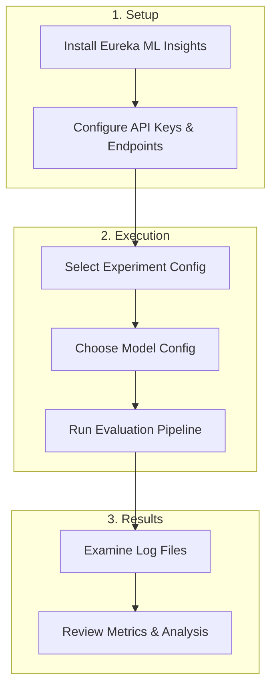
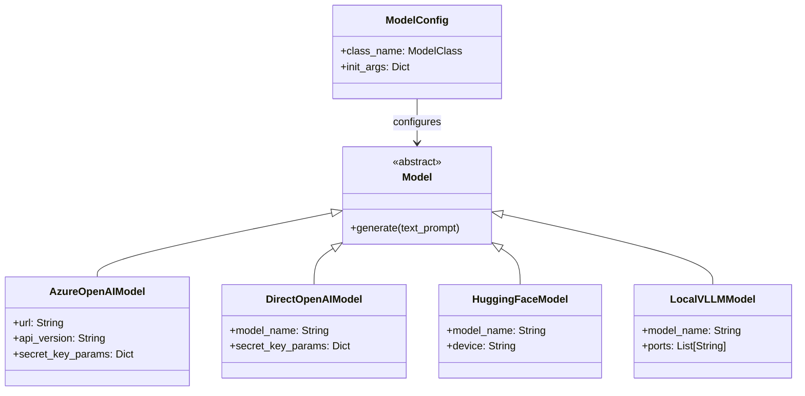
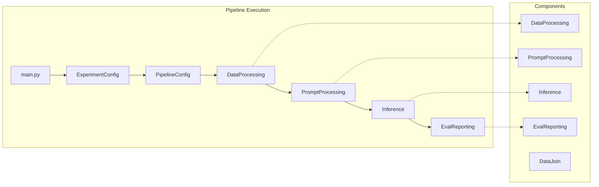

<!-- source: DeepWiki mcp.deepwiki.com · repo microsoft/eureka-ml-insights · page 8 Getting Started · fetched 2026-10-26 -->

# Getting Started

<details>
<summary>Relevant source files</summary>

The following files were used as context for generating this wiki page:

- [.github/workflows/eureka-tests.yml](.github/workflows/eureka-tests.yml)
- [README.md](README.md)
- [deploy_vllm_and_run_eval.sh](deploy_vllm_and_run_eval.sh)
- [docs/figures/eureka_logo.png](docs/figures/eureka_logo.png)
- [environment.yml](environment.yml)
- [environment_gpu.yml](environment_gpu.yml)
- [eureka_ml_insights/configs/model_configs.py](eureka_ml_insights/configs/model_configs.py)
- [eureka_ml_insights/core/data_processing.py](eureka_ml_insights/core/data_processing.py)
- [eureka_ml_insights/metrics/ifeval_instruction_utils.py](eureka_ml_insights/metrics/ifeval_instruction_utils.py)
- [main.py](main.py)
- [setup.py](setup.py)
- [tests/component_tests.py](tests/component_tests.py)

</details>


This guide provides a comprehensive introduction to the Eureka ML Insights framework, focusing on installation, basic configuration, and running your first evaluation. The framework allows researchers and practitioners to run reproducible evaluations of generative models, particularly Large Language Models (LLMs), using a variety of benchmarks and metrics efficiently.

For more detailed information about the architecture and design of Eureka ML Insights, see [Architecture](#2).

## Installation

Eureka ML Insights offers several installation methods to accommodate different use cases and environments.

### Using pip (Development Mode)

For active development, you can install the package in editable mode:

```bash
# Create a virtual environment
python3 -m venv .venv

# Activate the virtual environment
# On Windows: .venv\Scripts\activate
# On Unix/MacOS: source .venv/bin/activate

# Install in editable mode
pip install -e .
```

### Using Conda

If you prefer using Conda for environment management:

```bash
# Create and activate a Conda environment using the provided file
conda env create --name myenv --file environment.yml
conda activate myenv

# Optional: Install GPU packages if you have a GPU and want to self-host models
conda env update --file environment_gpu.yml
```

### Creating a Wheel Package

To share the framework with others as a package:

```bash
# Activate your virtual environment
# Install wheel package
pip install wheel

# Build the wheel
python setup.py bdist_wheel

# The .whl file will be available in the dist/ directory
# Others can install it with: pip install eureka_ml_insights.whl
```

Sources: [README.md:61-72](), [setup.py:1-52]()

## System Requirements

The framework requires Python 3.8 or higher and includes several dependencies:

- Key ML libraries: torch, transformers, numpy, pandas
- API client libraries: anthropic, openai, azure-identity, google-generativeai
- Utilities: tqdm, jinja2, fuzzywuzzy, datasets

For a complete list of dependencies, refer to the `setup.py` file or `environment.yml`.

Sources: [setup.py:15-44](), [environment.yml:1-490]()

## Running Your First Evaluation

Eureka ML Insights provides pre-configured experiment pipelines for various benchmarks. Here's how to run your first evaluation:

### Basic Command Structure

```bash
python main.py --exp_config <experiment_config_name> --model_config <model_config_name> --exp_logdir <log_directory>
```

For example:

```bash
python main.py --exp_config FlenQA_Experiment_Pipeline --model_config OAI_GPT4_1106_PREVIEW_CONFIG --exp_logdir gpt4_flenqa_test
```

This command runs the FlenQA experiment (long context multi-hop QA) using GPT-4 and saves results in a subdirectory named `gpt4_flenqa_test`.

Sources: [main.py:1-92](), [README.md:84-94]()

## Workflow Diagram



Sources: [README.md:84-94](), [main.py:1-92]()

## Configuring Models

Before running experiments, you need to configure model access by setting up API keys and endpoints. The framework supports a wide range of models:

1. OpenAI models (GPT-4, Claude, etc.)
2. Azure OpenAI endpoints
3. Local models via HuggingFace and vLLM
4. Anthropic models (Claude)
5. Google models (Gemini)
6. Together.ai models
7. Custom REST endpoints

### Model Configuration Process



### API Key Configuration

API keys can be stored in three ways:

1. Local JSON file (keys/keys.json)
2. Azure Key Vault
3. Direct environment variables

Here's an example model configuration from `model_configs.py`:

```python
# OpenAI models
OPENAI_SECRET_KEY_PARAMS = {
    "key_name": "your_openai_secret_key_name",
    "local_keys_path": "keys/keys.json",
    "key_vault_url": None,
}

OAI_GPT4_1106_PREVIEW_CONFIG = ModelConfig(
    DirectOpenAIModel,
    {
        "model_name": "gpt-4-1106-preview",
        "secret_key_params": OPENAI_SECRET_KEY_PARAMS,
    },
)
```

To configure your own API keys:

1. Create a `keys/keys.json` file or use Azure Key Vault
2. Update the key_name, local_keys_path, or key_vault_url parameters
3. Modify the URL for endpoint-based models

Sources: [eureka_ml_insights/configs/model_configs.py:1-349]()

## Understanding Pipeline Components

Eureka ML Insights is built around a modular pipeline system. Each evaluation pipeline consists of components that process data, run inference, and evaluate results.



### Core Components:

1. **DataProcessing**: Loads and transforms input data
2. **PromptProcessing**: Prepares data for model inference, applies templates
3. **Inference**: Runs models on processed data
4. **EvalReporting**: Evaluates model outputs and generates reports
5. **DataJoin**: Joins data from different sources (optional)

Sources: [README.md:96-113](), [eureka_ml_insights/core/data_processing.py:1-76]()

## Running Local Models with vLLM

Eureka ML Insights supports running local models using vLLM. This is useful for evaluating open-source models or when you need more control over inference:

```bash
# Run evaluation with a local model
python main.py --exp_config IFEval_PIPELINE --model_config PHI4_LOCAL_CONFIG --local_vllm
```

For more complex deployments, you can use the provided script:

```bash
# Deploy vLLM servers and run evaluation
./deploy_vllm_and_run_eval.sh
```

Sources: [deploy_vllm_and_run_eval.sh:1-77]()

## Available Benchmarks

Eureka ML Insights includes several pre-configured benchmarks:

| Benchmark | Modality | Capability | Example Command |
|-----------|----------|------------|----------------|
| FlenQA | Text → Text | Long Context Multi-hop QA | `--exp_config FlenQA_Experiment_Pipeline` |
| IFEval | Text → Text | Instruction Following | `--exp_config IFEval_PIPELINE` |
| GeoMeter | Image → Text | Geometric Reasoning | `--exp_config GeoMeter_Experiment_Pipeline` |
| MMMU | Image → Text | Multimodal QA | `--exp_config MMMU_Experiment_Pipeline` |
| Kitab | Text → Text | Information Retrieval | `--exp_config Kitab_Experiment_Pipeline` |
| ToxiGen | Text → Text | Toxicity Detection | `--exp_config ToxiGen_Experiment_Pipeline` |
| Image Understanding | Image → Text | Object Recognition | `--exp_config Object_Recognition_Pipeline` |

Sources: [README.md:40-56]()

## Next Steps

After getting started with basic evaluation pipelines, you can:

1. Create custom pipelines by implementing your own experiment configuration class
2. Add new model configurations to evaluate different models
3. Implement custom metrics and evaluation components
4. Extend the framework with new utility classes as needed

For details on the architecture and components of Eureka ML Insights, refer to the [Architecture](#2) section.

Sources: [README.md:149-167]()