# Page: Overview

# Overview

<details>
<summary>Relevant source files</summary>

The following files were used as context for generating this wiki page:

- [.github/workflows/eureka-tests.yml](.github/workflows/eureka-tests.yml)
- [README.md](README.md)
- [docs/figures/eureka_logo.png](docs/figures/eureka_logo.png)
- [environment.yml](environment.yml)
- [environment_gpu.yml](environment_gpu.yml)
- [eureka_ml_insights/core/data_processing.py](eureka_ml_insights/core/data_processing.py)
- [eureka_ml_insights/metrics/ifeval_instruction_utils.py](eureka_ml_insights/metrics/ifeval_instruction_utils.py)
- [setup.py](setup.py)
- [tests/component_tests.py](tests/component_tests.py)

</details>


Eureka ML Insights is a comprehensive framework designed for evaluating machine learning models, particularly Large Language Models (LLMs), across various benchmarks in a systematic and reproducible manner. This page provides a high-level understanding of the framework's purpose, architecture, and capabilities.

## Purpose and Scope

Eureka ML Insights helps researchers and practitioners:

- Run reproducible evaluations of generative models using a variety of benchmarks and metrics efficiently
- Define custom pipelines for data processing, inference, and evaluation
- Leverage pre-defined evaluation pipelines for key benchmarks
- Evaluate multimodal models (text, image, vision-language)
- Compare multiple models across standardized tasks

For specific details about the system implementation, see [Architecture](#2).

## Core Architecture

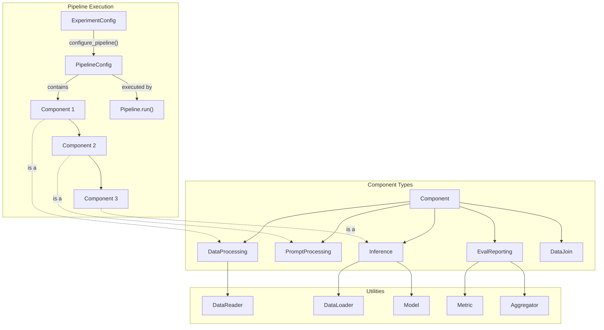

Sources: [README.md:96-116](), [eureka_ml_insights/core/data_processing.py:22-75]()

The framework is built around a pipeline-component architecture that allows flexible composition of evaluation workflows. The main execution flow begins with an experiment configuration that defines a pipeline of components, each handling a specific part of the evaluation process.

## Component System

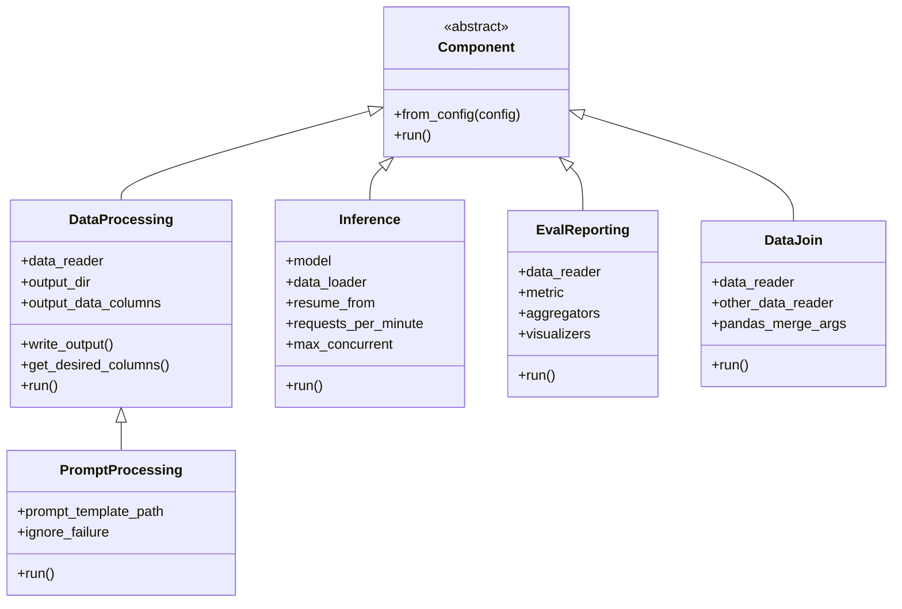

Sources: [tests/component_tests.py:32-267](), [README.md:101-124]()

The component system forms the backbone of the evaluation framework, with each component serving a specific purpose:

- **DataProcessing**: Loads and processes input data
- **PromptProcessing**: Prepares data for model inference, often applying prompt templates
- **Inference**: Runs models on processed data
- **EvalReporting**: Evaluates model outputs and generates reports
- **DataJoin**: Joins data from multiple sources

## Model System

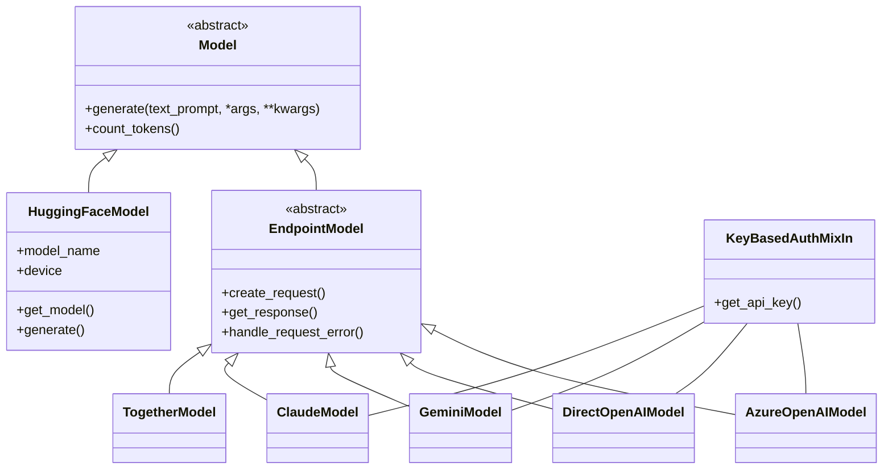

Sources: [setup.py:15-44](), [README.md:115]()

The model system provides a unified interface for accessing different types of language models:

- Abstract `Model` class defines the common interface
- Support for API-based models (OpenAI, Claude, Gemini)
- Support for locally-hosted models via Hugging Face
- Authentication handling via mixins

## Configuration System

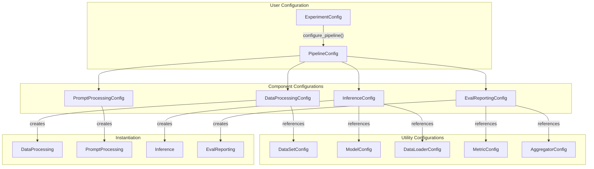

Sources: [tests/component_tests.py:32-49](), [README.md:85-91]()

The configuration system uses a hierarchical approach:

- **ExperimentConfig**: Top-level configuration that defines a pipeline
- **Component Configs**: Configure individual pipeline components
- **Utility Configs**: Configuration for utility classes used by components

## Benchmark Suite

Eureka ML Insights includes pre-configured pipelines for several benchmarks:

| Benchmark | Modality | Capability | Pipeline Config |
|-----------|----------|------------|----------------|
| GeoMeter | Image -> Text | Geometric Reasoning | `geometer.py` |
| MMMU | Image -> Text | Multimodal QA | `mmmu.py` |
| Image Understanding | Image -> Text | Object Recognition, Detection | Various configs |
| Vision Language | Image -> Text | Spatial Understanding | Various configs |
| IFEval | Text -> Text | Instruction Following | `ifeval.py` |
| FlenQA | Text -> Text | Long Context Multi-hop QA | `flenqa.py` |
| Kitab | Text -> Text | Information Retrieval | `kitab.py` |
| ToxiGen | Text -> Text | Toxicity Detection | `toxigen.py` |

Sources: [README.md:40-57](), [eureka_ml_insights/metrics/ifeval_instruction_utils.py:20-3404]()

## Getting Started

To use Eureka ML Insights, you typically:

1. Choose or define an experiment configuration
2. Select a model configuration
3. Run the evaluation pipeline
4. Analyze the results

Basic usage:

```bash
python main.py --exp_config <experiment_config> --model_config <model_config> --exp_logdir <output_directory>
```

Example:

```bash
python main.py --exp_config FlenQA_Experiment_Pipeline --model_config OAI_GPT4_1106_PREVIEW_CONFIG --exp_logdir gpt4_flenqa
```

Sources: [README.md:84-94](), [README.md:58-83]()

## Installation

Eureka ML Insights can be installed in several ways:

### Using pip (for development)

```bash
python3 -m venv .venv
# Activate venv
pip install -e .
```

### Using pip (from wheel package)

```bash
pip install eureka_ml_insights.whl
```

### Using Conda

```bash
conda env create --name myenv --file environment.yml
conda activate myenv
# Optional for GPU support
conda env update --file environment_gpu.yml
```

Sources: [README.md:58-82](), [environment.yml:1-490](), [environment_gpu.yml:1-14]()

## Key Features

- **Modular Design**: Components can be independently configured and combined
- **Comprehensive Model Support**: API-based and self-hosted models
- **Flexible Data Processing**: Various data sources and formats
- **Rich Evaluation Capabilities**: Extensive metrics and aggregators
- **Extensive Benchmark Suite**: Pre-configured for many tasks
- **Parallel Inference**: Support for concurrent model requests
- **Resumable Operations**: Continue interrupted evaluations

Sources: [README.md:19-18](), [tests/component_tests.py:191-232]()

Eureka ML Insights provides a systematic way to evaluate machine learning models across a diverse set of tasks, with particular focus on LLMs and multimodal models. Its modular architecture allows for flexibility and extensibility, enabling researchers to create custom evaluation pipelines tailored to their specific needs.

---

# Page: Architecture

# Architecture

<details>
<summary>Relevant source files</summary>

The following files were used as context for generating this wiki page:

- [.github/workflows/eureka-tests.yml](.github/workflows/eureka-tests.yml)
- [.gitignore](.gitignore)
- [README.md](README.md)
- [docs/figures/eureka_logo.png](docs/figures/eureka_logo.png)
- [eureka_ml_insights/configs/config.py](eureka_ml_insights/configs/config.py)
- [eureka_ml_insights/core/data_processing.py](eureka_ml_insights/core/data_processing.py)
- [eureka_ml_insights/metrics/ifeval_instruction_utils.py](eureka_ml_insights/metrics/ifeval_instruction_utils.py)
- [tests/component_tests.py](tests/component_tests.py)
- [tests/pipeline_tests.py](tests/pipeline_tests.py)

</details>


## Purpose and Scope

This document describes the high-level architecture of the Eureka ML Insights framework, designed for evaluating machine learning models, particularly Large Language Models (LLMs), across various benchmarks. It explains the main components of the system, their relationships, and the design principles behind them.

For detailed information about specific subsystems, please refer to:
- For Pipeline System details, see [Pipeline System](#2.1)
- For Configuration System details, see [Configuration System](#2.2)
- For Model System details, see [Model System](#3)
- For Data Processing details, see [Data Processing](#4)

## High-Level Architecture Overview

Eureka ML Insights is built on a modular, component-based architecture that enables flexible evaluation pipeline construction. The architecture consists of several key systems that work together to create, configure, and execute evaluation pipelines.

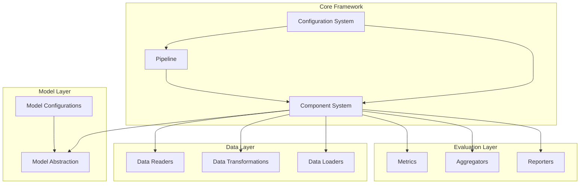

Sources: [README.md:17-20]()

## Component System

The component system is the backbone of the framework, enabling modular and composable evaluation pipelines. Each component encapsulates a specific functionality in the evaluation process, and components can be chained together to create complete evaluation pipelines.

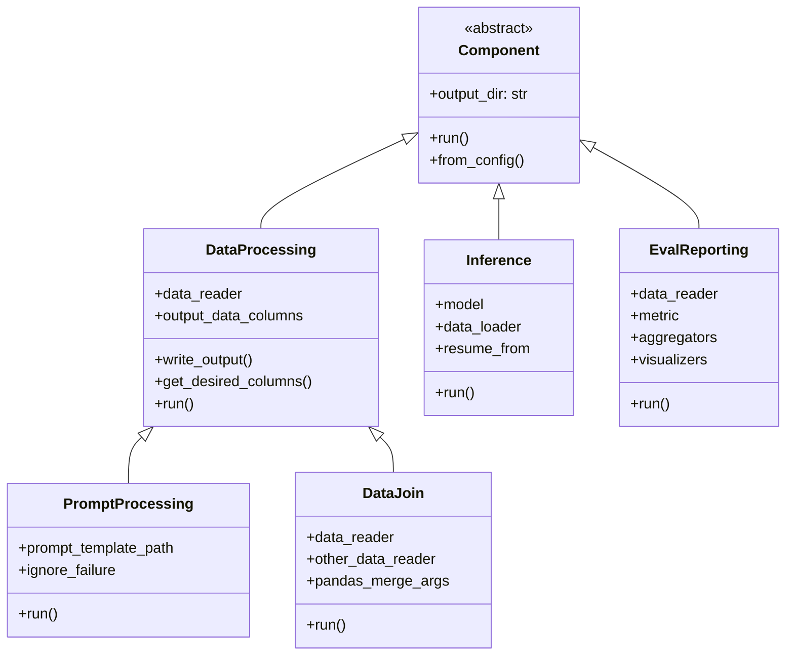

Sources: [README.md:100-113](), [eureka_ml_insights/core/data_processing.py:15-75](), [tests/component_tests.py:1-50]()

### Component Types

Eureka ML Insights defines several types of components, each serving a specific function in the evaluation process:

1. **DataProcessing**: Handles data loading and transformation.
2. **PromptProcessing**: Extends DataProcessing with capabilities for preparing prompts for model inference.
3. **Inference**: Manages model inference on processed data.
4. **EvalReporting**: Evaluates model outputs using metrics and generates reports.
5. **DataJoin**: Joins data from multiple sources.

Each component is configurable through a corresponding configuration class.

Sources: [README.md:100-113]()

## Pipeline Architecture

The Pipeline is the orchestration layer that connects components together and manages their execution. It takes a list of component configurations and executes them in sequence, passing data between components.

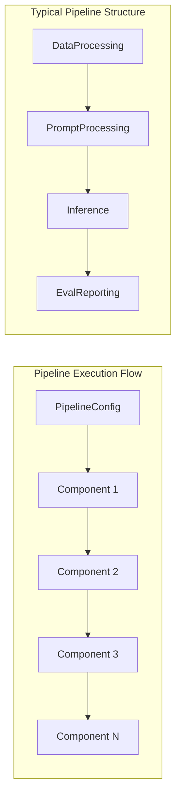

Sources: [tests/pipeline_tests.py:1-48](), [README.md:94-99]()

### Pipeline Flow

1. The pipeline receives a list of component configurations.
2. It instantiates each component using its configuration.
3. It executes each component in sequence.
4. Each component produces output that can be consumed by the next component.
5. Results are stored in component-specific output directories.

Sources: [tests/pipeline_tests.py:380-406]()

## Configuration System

The configuration system provides a structured way to define the behavior of components and pipelines. It uses a hierarchy of configuration classes that correspond to different aspects of the system.

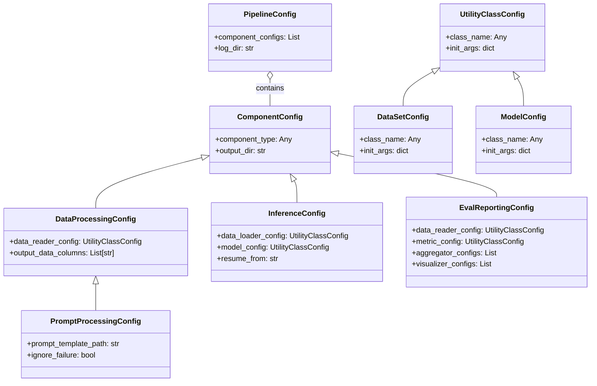

Sources: [eureka_ml_insights/configs/config.py:1-154]()

### Configuration Hierarchy

The configuration system consists of two main types of configurations:

1. **Utility Class Configurations**: Configure standalone utility classes like models, metrics, or data readers.
   - `UtilityClassConfig`: Base class for utility configurations
   - `DataSetConfig`: For data readers and loaders
   - `ModelConfig`: For model configurations
   - `MetricConfig`: For metric configurations

2. **Component Configurations**: Configure components within a pipeline.
   - `ComponentConfig`: Base class for component configurations
   - `DataProcessingConfig`: For data processing components
   - `PromptProcessingConfig`: For prompt processing components
   - `InferenceConfig`: For inference components
   - `EvalReportingConfig`: For evaluation and reporting components

3. **Pipeline Configuration**: Combines multiple component configurations.
   - `PipelineConfig`: Contains a list of component configurations and specifies the output directory for logs

Sources: [eureka_ml_insights/configs/config.py:10-154]()

## Experiment Configuration and Pipeline Creation

Experiment configurations are user-defined classes that encapsulate the logic for creating pipeline configurations for specific benchmark evaluations. These classes inherit from `ExperimentConfig` and implement a `configure_pipeline` method.

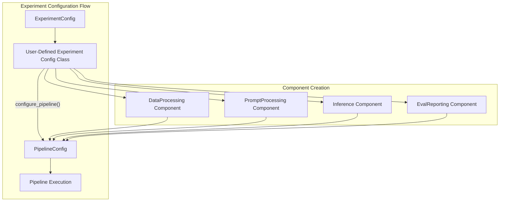

Sources: [tests/pipeline_tests.py:65-376](), [README.md:94-99]()

### Creating Custom Evaluations

Users can define custom evaluation pipelines by:

1. Creating a class that inherits from `ExperimentConfig`
2. Implementing the `configure_pipeline` method to define components and their configurations
3. Connecting components in the desired order
4. Configuring each component with appropriate utility classes and parameters

The resulting pipeline can then be executed to perform the evaluation.

Sources: [tests/pipeline_tests.py:65-115](), [README.md:94-99]()

## Data Flow

The data flow in Eureka ML Insights follows a well-defined path through various components:

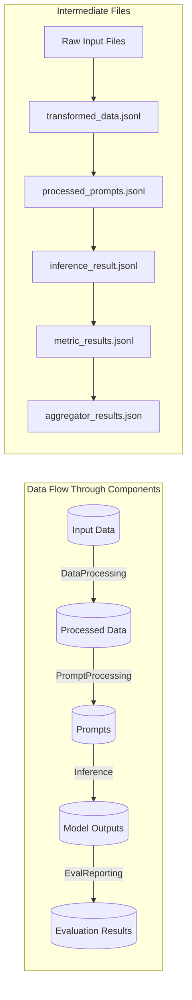

Sources: [eureka_ml_insights/core/data_processing.py:50-58](), [tests/component_tests.py:50-100](), [tests/pipeline_tests.py:390-406]()

### Data Processing Flow

1. **Data Reading**: Input data is loaded using a `DataReader` configured through `DataReaderConfig`.
2. **Data Transformation**: Loaded data can be transformed using various transformation classes.
3. **Prompt Generation**: If using `PromptProcessing`, prompts are generated according to templates.
4. **Model Inference**: The `Inference` component uses a model to generate outputs for the prompts.
5. **Evaluation**: The `EvalReporting` component applies metrics to the model outputs and generates reports.

Each step outputs files that can be consumed by the next step:
- `transformed_data.jsonl`: Output of data processing
- `processed_prompts.jsonl`: Output of prompt processing
- `inference_result.jsonl`: Output of inference
- `metric_results.jsonl`: Output of metric evaluation
- Various aggregator and visualizer outputs

Sources: [eureka_ml_insights/core/data_processing.py:50-75](), [tests/pipeline_tests.py:390-406]()

## Implementation of User Configurations

User configurations define specific benchmarks or evaluation scenarios. They create and configure the pipeline components needed for a specific evaluation task.

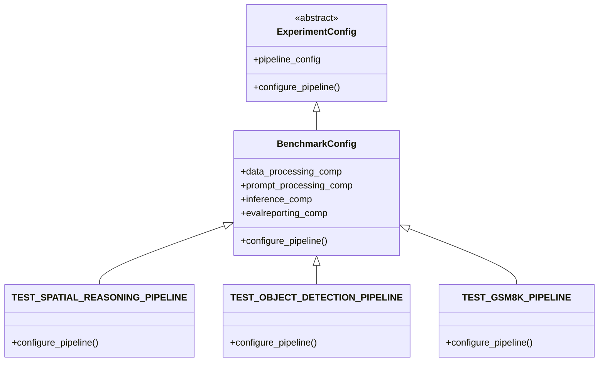

Sources: [tests/pipeline_tests.py:65-376](), [README.md:31-65]()

### Example User Configuration

The test pipeline configurations in `tests/pipeline_tests.py` demonstrate how to create custom evaluation pipelines for different benchmarks, such as spatial reasoning, object detection, and mathematical reasoning. These configurations:

1. Define the necessary components for the evaluation
2. Configure data readers and loaders
3. Specify models to use
4. Define evaluation metrics and reporting

Users can create similar configurations for their own evaluation needs.

Sources: [tests/pipeline_tests.py:65-188](), [README.md:88-125]()

## Conclusion

The Eureka ML Insights architecture provides a flexible, modular framework for evaluating machine learning models. Its key features include:

1. **Component-Based Design**: Enables modular, reusable evaluation components
2. **Configuration System**: Provides a structured way to define component behavior
3. **Pipeline Architecture**: Facilitates the connection of components into coherent evaluation flows
4. **Extensibility**: Allows users to define custom evaluation scenarios

This architecture makes it easy to create reproducible, systematic evaluations of machine learning models across a wide range of benchmarks.

---

# Page: Pipeline System

# Pipeline System

<details>
<summary>Relevant source files</summary>

The following files were used as context for generating this wiki page:

- [.github/workflows/eureka-tests.yml](.github/workflows/eureka-tests.yml)
- [README.md](README.md)
- [docs/figures/eureka_logo.png](docs/figures/eureka_logo.png)
- [eureka_ml_insights/core/data_processing.py](eureka_ml_insights/core/data_processing.py)
- [eureka_ml_insights/metrics/ifeval_instruction_utils.py](eureka_ml_insights/metrics/ifeval_instruction_utils.py)
- [tests/component_tests.py](tests/component_tests.py)
- [tests/pipeline_tests.py](tests/pipeline_tests.py)

</details>


The Pipeline System is the core orchestration framework in Eureka ML Insights that manages the execution flow of evaluation tasks. It provides a structured way to chain together modular components that handle different aspects of model evaluation, from data loading and transformation to model inference and result evaluation. This page documents the design, implementation, and usage of the Pipeline System.

For information about the specific components that can be used within a pipeline, see [Architecture](#2). For details on how pipelines are configured, see [Configuration System](#2.2).

## Overview

The Pipeline System in Eureka ML Insights enables the composition of complex evaluation workflows by connecting specialized components in a sequential chain. Each component in the pipeline performs a specific function (such as data processing or model inference) and passes its output to subsequent components. This modular design allows users to create evaluation pipelines tailored to specific benchmarks or testing scenarios.

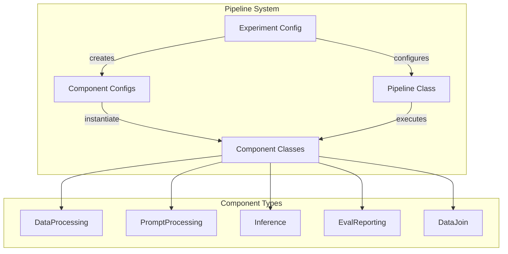

Sources: [README.md:96-107](), [tests/pipeline_tests.py:382-386]()

## Pipeline Architecture

The Pipeline System follows a component-based architecture where each component is responsible for a specific stage in the evaluation process. Components are executed sequentially, with the output of one component serving as input for the next.

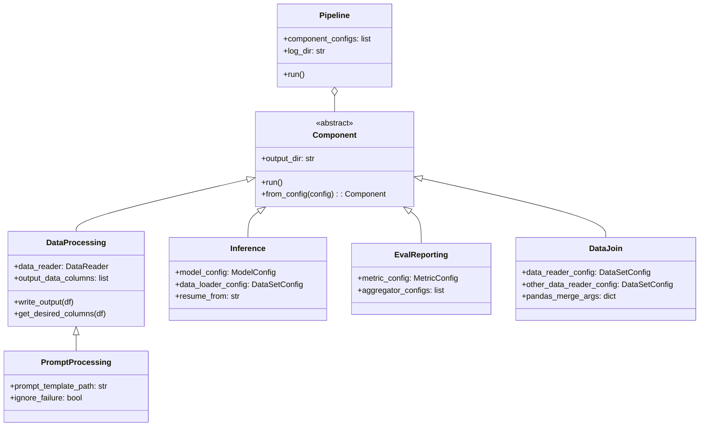

Sources: [eureka_ml_insights/core/data_processing.py:23-75](), [README.md:100-107](), [tests/component_tests.py:32-266]()

## Pipeline Execution Flow

The Pipeline class orchestrates the execution of components in sequence. When the pipeline is run, each component processes data and produces output that serves as input for the next component.

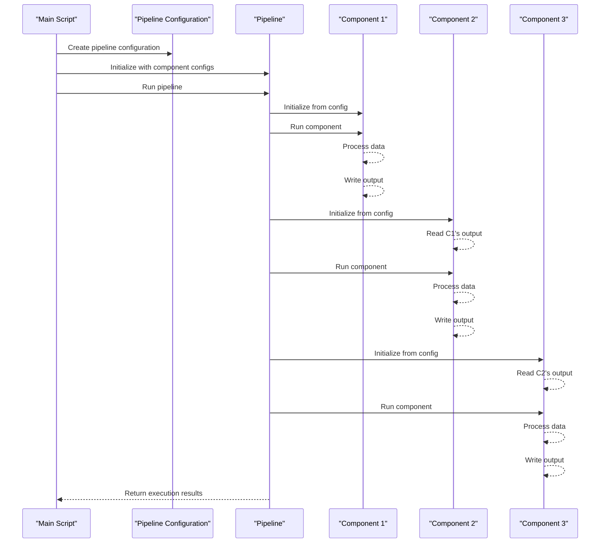

Sources: [tests/pipeline_tests.py:379-386](), [README.md:84-92]()

## Component Types

The Pipeline System includes several component types, each designed for a specific stage in the evaluation process:

### DataProcessing Component

The `DataProcessing` component is responsible for loading data from a source and applying transformations. It reads data using a configured `DataReader`, applies optional transformations, and writes the processed data to an output directory.

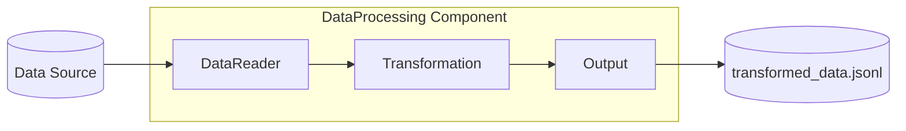

Sources: [eureka_ml_insights/core/data_processing.py:23-75](), [README.md:124-130]()

### PromptProcessing Component

The `PromptProcessing` component extends the DataProcessing component and adds the ability to apply prompt templates to data. It can use a Jinja template to format data for model inference.

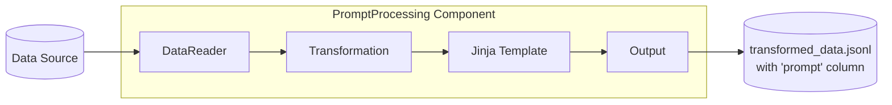

Sources: [README.md:134-137]()

### Inference Component

The `Inference` component runs model inference on processed data. It loads data using a configured `DataLoader`, passes it to a model, and collects the model outputs.

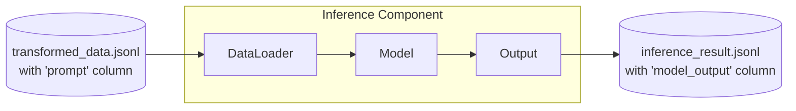

Sources: [README.md:140-142]()

### EvalReporting Component

The `EvalReporting` component evaluates model outputs using metrics and generates reports. It applies configured metrics to the model outputs and uses aggregators to summarize results.

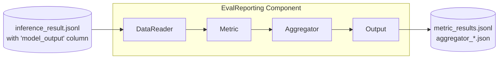

Sources: [README.md:144-147]()

### DataJoin Component

The `DataJoin` component combines data from multiple sources. It merges data from two sources using pandas' merge operations.

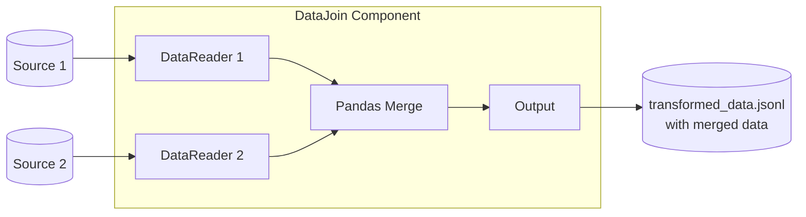

Sources: [README.md:107](), [tests/component_tests.py:103-147]()

## Configuring a Pipeline

Pipelines are configured using a series of configuration objects that specify the components, their parameters, and how they're connected. The configuration approach follows a hierarchy:

1. **ExperimentConfig**: Top-level configuration that defines a complete experiment
2. **PipelineConfig**: Configuration for a specific pipeline
3. **Component Configs**: Configurations for individual components (DataProcessingConfig, InferenceConfig, etc.)

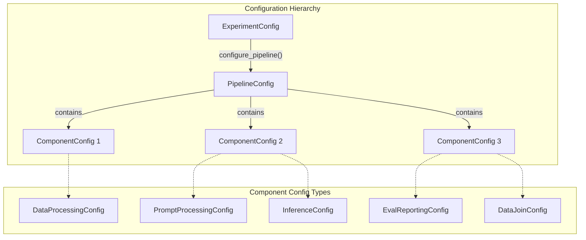

Sources: [README.md:96-99](), [tests/pipeline_tests.py:68-79]()

## Creating Custom Pipelines

To create a custom pipeline, you can define a class that inherits from `ExperimentConfig` and implements the `configure_pipeline` method. This method should return a `PipelineConfig` object that contains configurations for all the components in your pipeline.

The following example shows a simplified version of how a pipeline configuration might be defined:

```python
class MyExperimentPipeline(ExperimentConfig):
    def configure_pipeline(self, model_config=None):
        # Configure a data processing component
        self.data_processing_comp = DataProcessingConfig(
            component_type=DataProcessing,
            data_reader_config=DataSetConfig(...),
            output_dir="data_processing_output"
        )
        
        # Configure an inference component
        self.inference_comp = InferenceConfig(
            component_type=Inference,
            model_config=model_config,
            data_loader_config=DataSetConfig(...),
            output_dir="inference_output"
        )
        
        # Configure an evaluation component
        self.eval_reporting_comp = EvalReportingConfig(
            component_type=EvalReporting,
            data_reader_config=DataSetConfig(...),
            metric_config=MetricConfig(...),
            aggregator_configs=[...],
            output_dir="eval_output"
        )
        
        # Create and return the pipeline configuration
        return PipelineConfig(
            component_configs=[
                self.data_processing_comp,
                self.inference_comp,
                self.eval_reporting_comp
            ],
            log_dir="logs/my_experiment"
        )
```

Sources: [tests/pipeline_tests.py:68-210](), [README.md:97-99]()

## Running a Pipeline

Once a pipeline is configured, it can be executed using the `Pipeline` class. The pipeline will run each component in sequence, passing the output of one component as input to the next.

```mermaid
flowchart LR
    subgraph "Pipeline Execution"
        PC["PipelineConfig"]
        P["Pipeline"]
        C1["Component 1: DataProcessing"]
        C2["Component 2: Inference"]
        C3["Component 3: EvalReporting"]
    end
    
    PC -->|"initialize"| P
    P -->|"run()"| C1
    C1 -->|"output"| C2
    C2 -->|"output"| C3
    C3 -->|"final output"| Results[("Evaluation Results")]
```

Sources: [tests/pipeline_tests.py:383-386](), [README.md:84-92]()

## Data Flow Between Components

Components in a pipeline communicate by writing and reading files. Each component writes its output to its designated output directory, and subsequent components read from these directories. This file-based communication mechanism ensures that the state of the pipeline execution is persistent and can be resumed if interrupted.

```mermaid
flowchart LR
    subgraph "Component 1: DataProcessing"
        DP["DataProcessing.run()"]
    end
    
    subgraph "Component 2: Inference"
        INF["Inference.run()"]
    end
    
    subgraph "Component 3: EvalReporting"
        ER["EvalReporting.run()"]
    end
    
    DP -->|"writes transformed_data.jsonl"| File1[("transformed_data.jsonl")]
    File1 -->|"reads"| INF
    INF -->|"writes inference_result.jsonl"| File2[("inference_result.jsonl")]
    File2 -->|"reads"| ER
    ER -->|"writes metric_results.jsonl\naggregator_*.json"| File3[("Evaluation Results")]
```

Sources: [eureka_ml_insights/core/data_processing.py:50-58](), [tests/pipeline_tests.py:390-405]()

## Extending the Pipeline System

The Pipeline System is designed to be extensible. New component types can be added by creating new classes that inherit from the `Component` base class and implement the `run` method. Similarly, new configurations can be created by extending the configuration classes.

```mermaid
classDiagram
    class Component {
        <<abstract>>
        +output_dir: str
        +run()
        +from_config(config): Component
    }
    
    class CustomComponent {
        +custom_attribute: Any
        +run()
        +from_config(config): CustomComponent
    }
    
    class ComponentConfig {
        +component_type: Type[Component]
        +output_dir: str
    }
    
    class CustomComponentConfig {
        +component_type: Type[CustomComponent]
        +output_dir: str
        +custom_config_attribute: Any
    }
    
    Component <|-- CustomComponent
    ComponentConfig <|-- CustomComponentConfig
```

Sources: [README.md:149-152]()

## Summary

The Pipeline System is a core part of the Eureka ML Insights framework that enables the creation of modular, configurable evaluation pipelines. By chaining together specialized components, users can create complex evaluation workflows that are easy to understand, maintain, and extend.

The key features of the Pipeline System include:

1. **Modularity**: Each component focuses on a specific task, making the system easier to understand and extend.
2. **Configurability**: Components and pipelines can be configured to suit different evaluation scenarios.
3. **File-based communication**: Components communicate through files, ensuring persistence and allowing for pipeline resumption.
4. **Extensibility**: New components and configurations can be added to extend the system's capabilities.

For information on how to configure specific components for your evaluation scenarios, see [Configuration System](#2.2).

---

# Page: Configuration System

# Configuration System

<details>
<summary>Relevant source files</summary>

The following files were used as context for generating this wiki page:

- [.gitignore](.gitignore)
- [deploy_vllm_and_run_eval.sh](deploy_vllm_and_run_eval.sh)
- [eureka_ml_insights/configs/config.py](eureka_ml_insights/configs/config.py)
- [eureka_ml_insights/configs/model_configs.py](eureka_ml_insights/configs/model_configs.py)
- [main.py](main.py)

</details>


## Purpose and Scope

The Configuration System in Eureka ML Insights provides a structured way to define, organize, and manage the components and parameters used in ML evaluation pipelines. This system enables users to configure various aspects of the evaluation framework including data processing, model settings, inference parameters, and evaluation metrics.

This page documents the architecture and usage of the configuration classes that form the backbone of experiment definition in the framework. For information about specific model configurations, see [Model Configurations](#3.2).

## Architecture Overview

The Configuration System consists of several hierarchical configuration classes that represent different aspects of the evaluation pipeline. These classes provide a type-safe and structured way to define the behavior of components in the system.

```mermaid
flowchart TD
    subgraph "Configuration Hierarchy"
        UC["UtilityClassConfig"] --> DSC["DataSetConfig"]
        UC --> MC["ModelConfig"]
        UC --> MTC["MetricConfig"]
        UC --> AC["AggregatorConfig"]
        
        CC["ComponentConfig"] --> DPC["DataProcessingConfig"]
        CC --> PPC["PromptProcessingConfig"]
        CC --> DJC["DataJoinConfig"]
        CC --> IC["InferenceConfig"]
        CC --> ERC["EvalReportingConfig"]
        
        PC["PipelineConfig"] --> |contains| CC
    end
    
    subgraph "User Experiments"
        EC["Experiment Config"] --> |creates| PC
        EC --> |uses| UC
    end
    
    subgraph "Execution"
        PL["Pipeline"] --> |initialized with| PC
    end
```

Sources: [eureka_ml_insights/configs/config.py:1-155]()

## Core Configuration Classes

The configuration system is built around two main types of configurations: utility class configurations and component configurations.

### UtilityClassConfig

The `UtilityClassConfig` is the base class for all utility configurations. It defines the structure for configuring utility classes like models, datasets, and metrics.

```mermaid
classDiagram
    class UtilityClassConfig {
        +class_name: Any
        +init_args: dict
        +__repr__()
    }
    
    class ModelConfig {
    }
    
    class DataSetConfig {
    }
    
    class MetricConfig {
    }
    
    class AggregatorConfig {
    }
    
    UtilityClassConfig <|-- ModelConfig
    UtilityClassConfig <|-- DataSetConfig
    UtilityClassConfig <|-- MetricConfig
    UtilityClassConfig <|-- AggregatorConfig
```

Key fields:
- `class_name`: The utility class to be used with this configuration
- `init_args`: Dictionary of arguments to be passed to the utility class constructor

Sources: [eureka_ml_insights/configs/config.py:10-30]()

### ComponentConfig

The `ComponentConfig` is the base class for all component configurations. It defines the structure for configuring pipeline components like data processing, prompt processing, and inference.

```mermaid
classDiagram
    class ComponentConfig {
        +component_type: Any
        +output_dir: str
    }
    
    class DataProcessingConfig {
        +data_reader_config: UtilityClassConfig
        +output_data_columns: List[str]
    }
    
    class PromptProcessingConfig {
        +prompt_template_path: str
        +ignore_failure: bool
    }
    
    class InferenceConfig {
        +data_loader_config: UtilityClassConfig
        +model_config: UtilityClassConfig
        +resume_from: str
        +new_columns: List[str]
        +requests_per_minute: int
        +max_concurrent: int
        +chat_mode: bool
    }
    
    class EvalReportingConfig {
        +data_reader_config: UtilityClassConfig
        +metric_config: UtilityClassConfig
        +aggregator_configs: List[UtilityClassConfig]
        +visualizer_configs: List[UtilityClassConfig]
    }
    
    ComponentConfig <|-- DataProcessingConfig
    DataProcessingConfig <|-- PromptProcessingConfig
    ComponentConfig <|-- InferenceConfig
    ComponentConfig <|-- EvalReportingConfig
```

Key fields of `ComponentConfig`:
- `component_type`: The component class to be used with this configuration
- `output_dir`: The directory to save the output files of this component

Sources: [eureka_ml_insights/configs/config.py:53-64]()

### PipelineConfig

The `PipelineConfig` represents the configuration for an entire evaluation pipeline, containing a sequence of component configurations.

```python
@dataclass
class PipelineConfig:
    component_configs: list[ComponentConfigType] = field(default_factory=list)
    log_dir: str = None
```

Key fields:
- `component_configs`: A list of component configurations that define the pipeline workflow
- `log_dir`: The directory to save the logs and outputs of the pipeline

Sources: [eureka_ml_insights/configs/config.py:139-154]()

## Configuration Flow

The following diagram shows how configurations flow through the system from definition to execution:

```mermaid
sequenceDiagram
    participant User
    participant EC as "ExperimentConfig"
    participant PC as "PipelineConfig"
    participant Pipeline
    participant Component1 as "Component 1"
    participant Component2 as "Component 2"

    User->>EC: Create experiment config
    EC->>PC: configure_pipeline()
    User->>+Pipeline: Initialize with PC
    Pipeline->>+Component1: Initialize with component config
    Component1->>-Pipeline: Process data & return results
    Pipeline->>+Component2: Initialize with component config
    Component2->>-Pipeline: Process data & return results
    Pipeline->>-User: Return evaluation results
```

Sources: [main.py:1-93]()

## Model Configuration System

The model configuration system is a specific implementation of the utility configuration classes. It provides a way to define and manage model parameters for various model types.

```mermaid
classDiagram
    class ModelConfig {
        +class_name: Any
        +init_args: dict
    }
    
    class Model {
        <<abstract>>
    }
    
    class EndpointModel {
        <<abstract>>
    }
    
    class HuggingFaceModel {
    }
    
    ModelConfig --> Model: "configures"
    Model <|-- EndpointModel
    Model <|-- HuggingFaceModel
    EndpointModel <|-- AzureOpenAIModel
    EndpointModel <|-- DirectOpenAIModel
    EndpointModel <|-- GeminiModel
    EndpointModel <|-- ClaudeModel
```

The `ModelConfig` class is used to configure model instances with appropriate parameters.

Sources: [eureka_ml_insights/configs/model_configs.py:1-349]()

### Pre-defined Model Configurations

The framework includes a wide range of pre-defined model configurations for various model providers. Here's an example of some model configurations:

```python
# Test model
TEST_MODEL_CONFIG = ModelConfig(TestModel, {})

# Claude models
CLAUDE_3_OPUS_CONFIG = ModelConfig(
    ClaudeModel,
    {
        "model_name": "claude-3-opus-20240229",
        "secret_key_params": CLAUDE_SECRET_KEY_PARAMS,
    },
)

# OpenAI models
OAI_GPT4O_2024_05_13_CONFIG = ModelConfig(
    DirectOpenAIModel,
    {
        "model_name": "gpt-4o-2024-05-13",
        "secret_key_params": OPENAI_SECRET_KEY_PARAMS,
    },
)
```

These configurations encapsulate all the information needed to initialize and use a model, including:
- The model class to instantiate
- The specific model name/version
- Authentication parameters
- Generation parameters (temperature, max tokens, etc.)

Sources: [eureka_ml_insights/configs/model_configs.py:32-349]()

## Component Configuration Details

Each component type has its own configuration class with specific parameters. Below are details of the key component configurations:

### DataProcessingConfig

```python
@dataclass
class DataProcessingConfig(ComponentConfig):
    data_reader_config: UtilityClassConfigType = None
    output_data_columns: List[str] = None
```

Purpose: Configure data processing components to read and transform input data.

Sources: [eureka_ml_insights/configs/config.py:66-76]()

### PromptProcessingConfig

```python
@dataclass
class PromptProcessingConfig(DataProcessingConfig):
    prompt_template_path: str = None
    ignore_failure: bool = False
```

Purpose: Configure prompt generation using template files.

Sources: [eureka_ml_insights/configs/config.py:78-88]()

### InferenceConfig

```python
@dataclass
class InferenceConfig(ComponentConfig):
    data_loader_config: UtilityClassConfigType = None
    model_config: UtilityClassConfigType = None
    resume_from: str = None
    new_columns: List[str] = None
    requests_per_minute: int = None
    max_concurrent: int = 1
    chat_mode: bool = False
```

Purpose: Configure model inference parameters, including the model to use, concurrency settings, and rate limiting.

Sources: [eureka_ml_insights/configs/config.py:102-118]()

### EvalReportingConfig

```python
@dataclass
class EvalReportingConfig(ComponentConfig):
    data_reader_config: UtilityClassConfigType = None
    metric_config: UtilityClassConfigType = None
    aggregator_configs: List[UtilityClassConfigType] = field(default_factory=list)
    visualizer_configs: List[UtilityClassConfigType] = field(default_factory=list)
```

Purpose: Configure evaluation metrics, result aggregation, and visualization.

Sources: [eureka_ml_insights/configs/config.py:120-134]()

## Security Considerations

The configuration system includes built-in security features to avoid exposing sensitive information:

```python
def __repr__(self):
    # remove "secret_key_params" from the init_args representation for security reasons
    # but keep it in the actual config
    init_args_copy = copy.deepcopy(self.init_args)
    init_args_copy.pop("secret_key_params", None)
    init_args_copy.pop("api_key", None)
    return f"{self.__class__.__name__}(class_name={self.class_name.__name__}, init_args={init_args_copy})"
```

This ensures that sensitive API keys and credentials are not inadvertently exposed in logs or debug output.

Sources: [eureka_ml_insights/configs/config.py:22-28]()

## Usage in Pipeline Execution

The configuration system plays a central role in the pipeline execution process. Here's how it's used in the main execution flow:

```mermaid
flowchart TD
    subgraph "Command Line Interface"
        CLI["main.py"]
    end
    
    subgraph "User Configs"
        EC["ExperimentConfig"]
    end
    
    subgraph "Configuration System"
        PC["PipelineConfig"]
        MC["ModelConfig"]
        CC["Component Configs"]
    end
    
    subgraph "Pipeline System"
        Pipeline --> Components
    end
    
    CLI --> |instantiates| EC
    EC --> |creates| PC
    EC --> |references| MC
    PC --> |contains| CC
    CLI --> |initializes| Pipeline
    Pipeline --> |uses| PC
    Components --> |configured by| CC
```

The main execution process:
1. User specifies an experiment configuration class via command line
2. The experiment config is instantiated, possibly with overrides from command line args
3. The experiment config creates a pipeline configuration
4. A pipeline is initialized with the pipeline configuration
5. The pipeline initializes components based on their configurations
6. The components execute in sequence, processing data and generating results

Sources: [main.py:10-92]()

## Configuration for Model Authentication

The configuration system supports multiple methods for handling authentication keys:

```python
# Example key parameter structure
OPENAI_SECRET_KEY_PARAMS = {
    "key_name": "your_openai_secret_key_name",
    "local_keys_path": "keys/keys.json",
    "key_vault_url": None,
}
```

The system supports:
1. Loading keys from a local JSON file
2. Fetching keys from Azure Key Vault
3. Directly providing keys (not recommended for production)

Note that the actual key files are excluded from version control, as seen in the `.gitignore` file: `/keys`.

Sources: [eureka_ml_insights/configs/model_configs.py:25-40](), [.gitignore:401-402]()

## Integration with Deployment Scripts

The configuration system integrates with deployment scripts, allowing for dynamic configuration of models in deployment scenarios:

```bash
# Call Eureka to initiate evals
ports=$(seq -s ' ' $base_port $((base_port + num_servers - 1)))
EUREKA_ARGS="\
    --model_config=${model_name} \
    --exp_config=${exp_config} \
    --local_vllm \
    --ports ${ports} \
"
python main.py ${EUREKA_ARGS} >> $log_dir/out.log 2>&1
```

This shows how command-line arguments can override or extend configuration parameters at runtime.

Sources: [deploy_vllm_and_run_eval.sh:58-67]()

## Summary

The configuration system is a core architectural component of the Eureka ML Insights framework that:

1. Provides a structured way to define evaluation pipelines
2. Enables modular and reusable configuration of components
3. Supports secure handling of authentication credentials
4. Allows for flexible runtime configuration via command-line arguments
5. Facilitates the integration of various model types and evaluation metrics

The design follows object-oriented principles with a clear hierarchy of configurations that map to the different aspects of the evaluation pipeline, making it both flexible and extensible.

---

# Page: Model System

# Model System

<details>
<summary>Relevant source files</summary>

The following files were used as context for generating this wiki page:

- [eureka_ml_insights/models/__init__.py](eureka_ml_insights/models/__init__.py)
- [eureka_ml_insights/models/models.py](eureka_ml_insights/models/models.py)

</details>


The Model System in Eureka ML Insights provides a unified abstraction layer for interacting with various Large Language Models (LLMs). This system enables seamless integration of different model providers and deployment types (API-based or self-hosted) through a common interface, allowing the framework to work with diverse models while maintaining a consistent evaluation methodology.

This page provides an overview of the Model System architecture and its key components. For more detailed information, see [Model Classes](#3.1), [Model Configurations](#3.2), and [Inference](#3.3).

## Core Architecture

The Model System is built around a flexible class hierarchy that abstracts away the implementation details of different model providers. This allows the rest of the framework to interact with models in a consistent way, regardless of whether they're API-based (like OpenAI or Claude) or self-hosted (like HuggingFace models).

### Model Class Hierarchy

```mermaid
classDiagram
    class Model {
        <<abstract>>
        +generate(text_prompt, *args, **kwargs)
        +count_tokens()
        +base64encode()
    }
    
    class EndpointModel {
        <<abstract>>
        +create_request()
        +get_response()
        +handle_request_error()
        +update_chat_history()
    }
    
    class HuggingFaceModel {
        +model_name
        +device
        +get_model()
        +_generate()
        +model_template_fn()
    }
    
    class VLLMModel {
        +model_name
        +get_model()
        +_generate()
        +create_request()
    }
    
    class KeyBasedAuthMixIn {
        +api_key
        +secret_key_params
        +get_api_key()
    }

    Model <|-- EndpointModel
    Model <|-- HuggingFaceModel
    Model <|-- VLLMModel
    
    EndpointModel <|-- RestEndpointModel
    EndpointModel <|-- AzureOpenAIModel
    EndpointModel <|-- DirectOpenAIModel
    EndpointModel <|-- GeminiModel
    EndpointModel <|-- ClaudeModel
    EndpointModel <|-- TogetherModel
    EndpointModel <|-- LocalVLLMModel
    
    RestEndpointModel <|-- ServerlessAzureRestEndpointModel
    
    HuggingFaceModel <|-- Phi3HFModel
    HuggingFaceModel <|-- Phi4HFModel
    HuggingFaceModel <|-- LLaVAHuggingFaceModel
    
    KeyBasedAuthMixIn -- RestEndpointModel
    KeyBasedAuthMixIn -- AzureOpenAIModel
    KeyBasedAuthMixIn -- DirectOpenAIModel
    KeyBasedAuthMixIn -- GeminiModel
    KeyBasedAuthMixIn -- ClaudeModel
    KeyBasedAuthMixIn -- TogetherModel
```

Sources: [eureka_ml_insights/models/models.py:20-65](), [eureka_ml_insights/models/models.py:92-181](), [eureka_ml_insights/models/__init__.py:1-47]()

### Model System Components

The Model System consists of several key components:

1. **Base Model Class**: An abstract class that defines the common interface for all models
2. **Model Type Classes**: Implementations for different types of models (API-based, self-hosted)
3. **Provider-Specific Classes**: Concrete implementations for specific model providers
4. **Utility Mixins**: Reusable components for common functionality (authentication, request handling)

```mermaid
flowchart TB
    subgraph "Model System"
        AbstractLayer["Model Abstract Class"]
        
        subgraph "Model Types"
            Endpoint["EndpointModel"]
            SelfHosted["Self-Hosted Models"]
        end
        
        subgraph "Provider Implementations"
            OpenAI["OpenAI Models"]
            Azure["Azure Models"]
            Claude["Claude Models"]
            Gemini["Gemini Models"]
            HF["HuggingFace Models"]
            Others["Other Providers"]
        end
        
        subgraph "Utility Components"
            Auth["Authentication"]
            ReqHandling["Request Handling"]
            TokenCount["Token Counting"]
            ImageProc["Image Processing"]
        end
    end
    
    subgraph "Framework Components"
        InferenceComp["Inference Components"]
        Evaluation["Evaluation System"]
        Pipeline["Pipeline System"]
    end
    
    AbstractLayer --> Endpoint
    AbstractLayer --> SelfHosted
    
    Endpoint --> OpenAI
    Endpoint --> Azure
    Endpoint --> Claude
    Endpoint --> Gemini
    Endpoint --> Others
    
    SelfHosted --> HF
    
    Auth --> OpenAI
    Auth --> Azure
    Auth --> Claude
    Auth --> Gemini
    
    ReqHandling --> OpenAI
    ReqHandling --> Azure
    
    InferenceComp --> AbstractLayer
    Pipeline --> InferenceComp
```

Sources: [eureka_ml_insights/models/models.py:20-181](), [eureka_ml_insights/models/models.py:439-808](), [eureka_ml_insights/models/models.py:857-1096]()

## Key Components

### Model Abstract Base Class

The `Model` abstract base class is the foundation of the Model System. It defines the common interface that all model implementations must adhere to.

```python
@dataclass
class Model(ABC):
    """This class is used to define the structure of a model class.
    Any model class should inherit from this class and implement the generate method that returns a dict
    containing the model_output, is_valid, and other relevant information.
    """

    chat_mode: bool = False
    system_message: str = None

    @abstractmethod
    def generate(self, text_prompt, *args, **kwargs):
        raise NotImplementedError

    def count_tokens(self, model_output: str = None, is_valid: bool = False):
        # Token counting implementation
        pass

    def base64encode(self, query_images):
        # Image encoding implementation
        pass
```

The most important method in this interface is `generate()`, which all model implementations must override. This method takes a text prompt and optional arguments (such as system messages or images) and returns a standardized response containing the model's output, validation status, response time, and token counts.

Sources: [eureka_ml_insights/models/models.py:20-65]()

### EndpointModel

The `EndpointModel` class extends the base `Model` class to provide functionality specific to API-based models. It handles common operations like making API requests, processing responses, and managing errors and retries.

```python
@dataclass
class EndpointModel(Model):
    """This class is used to interact with API-based models."""

    num_retries: int = 3

    @abstractmethod
    def create_request(self, text_prompt, *args, **kwargs):
        raise NotImplementedError

    @abstractmethod
    def get_response(self, request):
        # must return the model output and the response time
        raise NotImplementedError
        
    def update_chat_history(self, query_text, model_output, *args, **kwargs):
        # Implementation for chat history management
        pass
        
    def generate(self, query_text, *args, **kwargs):
        # Implementation for generating responses with retry logic
        pass
        
    @abstractmethod
    def handle_request_error(self, e):
        raise NotImplementedError
```

The `EndpointModel` defines three additional abstract methods that its subclasses must implement:
- `create_request()`: Builds the request payload for the API
- `get_response()`: Handles the API call and processes the response
- `handle_request_error()`: Manages error conditions from the API

It also implements the `generate()` method, which orchestrates the process of creating a request, sending it to the API, handling retries on failure, and formatting the response.

Sources: [eureka_ml_insights/models/models.py:92-181]()

### HuggingFaceModel

The `HuggingFaceModel` class implements the `Model` interface for self-hosted models using the HuggingFace Transformers library. It handles model loading, inference, and prompt formatting.

```python
@dataclass
class HuggingFaceModel(Model):
    """This class is used to run a self-hosted language model via HuggingFace apis."""

    model_name: str = None
    device: str = "cpu"
    max_tokens: int = 2000
    temperature: float = 0.001
    top_p: float = 0.95
    do_sample: bool = True
    apply_model_template: bool = True

    quantize: bool = False
    use_flash_attn: bool = False
    
    def __post_init__(self):
        # The device need to be set before get_model() is called
        self.device = self.pick_available_device()
        self.get_model()
        
    def get_model(self):
        # Load the model from HuggingFace
        pass
        
    def pick_available_device(self):
        # Select the best available device
        pass
        
    def _generate(self, text_prompt, query_images=None):
        # Core generation implementation
        pass
        
    def generate(self, text_prompt, query_images=None, system_message=None):
        # Implementation of the Model interface
        pass
        
    def model_template_fn(self, text_prompt, system_message=None):
        # Format the prompt according to model requirements
        pass
```

This class provides additional functionality specific to self-hosted models, such as:
- `get_model()`: Loads the model from HuggingFace
- `pick_available_device()`: Automatically selects the best available device (CPU or GPU)
- `model_template_fn()`: Applies model-specific templates to prompts

There are specialized subclasses for specific model families like `Phi3HFModel`, `Phi4HFModel`, and `LLaVAHuggingFaceModel` that customize the template function and other aspects for those models.

Sources: [eureka_ml_insights/models/models.py:857-1096]()

### Utility Components

#### KeyBasedAuthMixIn

The `KeyBasedAuthMixIn` class provides authentication functionality for API-based models. It can either use a directly provided API key or retrieve one from a secret management system.

```python
@dataclass
class KeyBasedAuthMixIn:
    """This class is used to handle key-based authentication for models."""

    api_key: str = None
    secret_key_params: dict = None

    def __post_init__(self):
        if self.api_key is None and self.secret_key_params is None:
            raise ValueError("Either api_key or secret_key_params must be provided.")
        self.api_key = self.get_api_key()

    def get_api_key(self):
        """
        This method is used to get the api_key for the models that require key-based authentication.
        Either api_key (str) or secret_key_params (dict) must be provided.
        if api_key is not directly provided, secret_key_params must be provided to get the api_key using get_secret method.
        """
        if self.api_key is None:
            self.api_key = get_secret(**self.secret_key_params)
        return self.api_key
```

Sources: [eureka_ml_insights/models/models.py:69-88]()

## Model Types and Provider Integrations

The Model System includes implementations for a wide range of LLM providers, both API-based and self-hosted. The following table summarizes the main provider integrations:

| Model Type | Provider | Class | Description |
|------------|---------|-------|-------------|
| API-based  | OpenAI  | `DirectOpenAIModel` | Direct access to OpenAI models |
| API-based  | Azure OpenAI | `AzureOpenAIModel` | Access to OpenAI models hosted on Azure |
| API-based  | Google Gemini | `GeminiModel` | Access to Google's Gemini models |
| API-based  | Anthropic | `ClaudeModel` | Access to Anthropic's Claude models |
| API-based  | Together | `TogetherModel` | Access to Together's model APIs |
| API-based  | Azure Serverless | `ServerlessAzureRestEndpointModel` | Base class for Azure serverless deployments |
| API-based  | Azure Serverless | `LlamaServerlessAzureRestEndpointModel` | Access to Llama models on Azure serverless |
| API-based  | Azure Serverless | `MistralServerlessAzureRestEndpointModel` | Access to Mistral models on Azure serverless |
| API-based  | Azure Serverless | `DeepseekR1ServerlessAzureRestEndpointModel` | Access to DeepSeek models on Azure serverless |
| Self-hosted | HuggingFace | `HuggingFaceModel` | Base class for self-hosted HuggingFace models |
| Self-hosted | Microsoft Phi | `Phi3HFModel`, `Phi4HFModel` | Self-hosted Microsoft Phi models |
| Self-hosted | LLaVA | `LLaVAHuggingFaceModel`, `LLaVAModel` | Self-hosted LLaVA vision-language models |
| Self-hosted | vLLM | `VLLMModel` | Models deployed with vLLM |
| Self-hosted | vLLM Local | `LocalVLLMModel` | Local vLLM server deployments |

Sources: [eureka_ml_insights/models/models.py:185-1531](), [eureka_ml_insights/models/__init__.py:1-47]()

## Model System Use Cases

The Model System is designed to support a variety of use cases within the Eureka ML Insights framework:

### Model-Based Inference

The primary use case is to provide a unified interface for model inference within evaluation pipelines. Components that need to interact with LLMs can use the Model System without needing to know the specific details of the underlying model implementation.

```mermaid
sequenceDiagram
    participant Component as "Inference Component"
    participant ModelSystem as "Model System"
    participant Provider as "Model Provider"
    
    Component->>ModelSystem: create model instance
    Component->>ModelSystem: model.generate(prompt)
    ModelSystem->>ModelSystem: format request
    ModelSystem->>Provider: API call / local inference
    Provider->>ModelSystem: model response
    ModelSystem->>ModelSystem: process response
    ModelSystem->>Component: standardized response
```

Sources: [eureka_ml_insights/models/models.py:120-177]()

### Multimodal Support

The Model System includes support for multimodal models that can process both text and images. This allows for evaluating models on tasks that require visual understanding.

```mermaid
flowchart LR
    subgraph "Inference Component"
        Prompt["Text Prompt"]
        Images["Image Inputs"]
    end
    
    subgraph "Model System"
        ModelInstance["Model Instance"]
        ImageEncoder["Image Encoder"]
        RequestBuilder["Request Builder"]
    end
    
    subgraph "Provider API/Model"
        API["Provider Endpoint/Model"]
    end
    
    Prompt --> ModelInstance
    Images --> ImageEncoder
    ImageEncoder --> RequestBuilder
    Prompt --> RequestBuilder
    RequestBuilder --> API
    API --> ModelInstance
```

Sources: [eureka_ml_insights/models/models.py:51-65](), [eureka_ml_insights/models/models.py:446-466](), [eureka_ml_insights/models/models.py:1066-1087]()

### Chat Modes and System Messages

Many modern LLMs support chat-based interfaces with system messages. The Model System provides standardized support for these features across different providers.

```mermaid
flowchart TD
    subgraph "Input"
        SystemMsg["System Message"]
        UserPrompt["User Prompt"]
        ChatHistory["Previous Messages"]
    end
    
    subgraph "Model System"
        ModelChat["Chat Mode Handling"]
        ProviderSpecific["Provider-Specific Formatting"]
    end
    
    subgraph "Output"
        Response["Model Response"]
        UpdatedHistory["Updated Chat History"]
    end
    
    SystemMsg --> ModelChat
    UserPrompt --> ModelChat
    ChatHistory --> ModelChat
    
    ModelChat --> ProviderSpecific
    ProviderSpecific --> Response
    ModelChat --> UpdatedHistory
```

Sources: [eureka_ml_insights/models/models.py:106-118](), [eureka_ml_insights/models/models.py:446-466]()

## Integration with the Framework

The Model System is integrated with other components of the Eureka ML Insights framework, particularly:

1. The Pipeline Component System, where models are used in inference components
2. The Configuration System, which provides model configurations
3. The Benchmark Suite, which uses models to evaluate performance on various tasks

```mermaid
flowchart TB
    subgraph "Pipeline System"
        Pipeline["Pipeline Framework"]
        Components["Component System"]
        InferenceComponent["Inference Component"]
    end
    
    subgraph "Configuration System"
        ModelConfig["Model Configuration"]
    end
    
    subgraph "Model System"
        ModelAbstraction["Model Abstraction Layer"]
        ModelInstances["Model Instances"]
    end
    
    subgraph "Benchmark Suite"
        Benchmarks["Benchmarks"]
        Tasks["Evaluation Tasks"]
    end
    
    Pipeline --> Components
    Components --> InferenceComponent
    
    ModelConfig --> ModelInstances
    
    InferenceComponent --> ModelAbstraction
    ModelAbstraction --> ModelInstances
    
    Benchmarks --> Tasks
    Tasks --> InferenceComponent
```

Sources: [eureka_ml_insights/models/models.py:20-65](), [eureka_ml_insights/models/__init__.py:1-47]()

## Summary

The Model System in Eureka ML Insights provides a flexible and extensible abstraction layer for working with various LLM providers. Its key features include:

- A unified interface for model interactions, regardless of provider or deployment type
- Support for both API-based and self-hosted models
- Robust error handling and retry mechanisms
- Multimodal support for models that can process images
- Chat mode and system message support
- Integration with the framework's configuration and component systems

This abstraction allows the framework to be model-agnostic, making it easy to evaluate and compare different models across a wide range of benchmarks and tasks.

For more detailed information about specific model classes, see [Model Classes](#3.1). For information about model configuration, see [Model Configurations](#3.2). For details about the inference process, see [Inference](#3.3).

---

# Page: Model Classes

# Model Classes

<details>
<summary>Relevant source files</summary>

The following files were used as context for generating this wiki page:

- [eureka_ml_insights/models/__init__.py](eureka_ml_insights/models/__init__.py)
- [eureka_ml_insights/models/models.py](eureka_ml_insights/models/models.py)

</details>


This document covers the model abstraction layer within the Eureka ML Insights framework that provides a unified interface for interacting with various language models (LLMs). The model system enables seamless integration with both API-based models (like OpenAI, Claude, or Gemini) and self-hosted models (like HuggingFace implementations).

For configuration information about these models, see [Model Configurations](#3.2), and for details on how inference is performed, see [Inference](#3.3).

## Class Hierarchy Overview

The model system is organized around a clear inheritance hierarchy that enables flexibility while maintaining a consistent interface.

```mermaid
classDiagram
    class Model {
        <<abstract>>
        +generate(text_prompt, *args, **kwargs)*
        +count_tokens()
        +base64encode()
    }

    class EndpointModel {
        <<abstract>>
        +create_request()*
        +get_response()*
        +handle_request_error()*
        +update_chat_history()
    }

    class KeyBasedAuthMixIn {
        +api_key
        +secret_key_params
        +get_api_key()
    }

    Model <|-- EndpointModel
    Model <|-- HuggingFaceModel
    Model <|-- VLLMModel
    Model <|-- TestModel
    
    KeyBasedAuthMixIn -- EndpointModel
    
    EndpointModel <|-- RestEndpointModel
    EndpointModel <|-- AzureOpenAIModel
    EndpointModel <|-- DirectOpenAIModel
    EndpointModel <|-- GeminiModel
    EndpointModel <|-- ClaudeModel
    EndpointModel <|-- TogetherModel
    EndpointModel <|-- LocalVLLMModel
    
    RestEndpointModel <|-- ServerlessAzureRestEndpointModel
    
    ServerlessAzureRestEndpointModel <|-- LlamaServerlessAzureRestEndpointModel
    ServerlessAzureRestEndpointModel <|-- MistralServerlessAzureRestEndpointModel
    ServerlessAzureRestEndpointModel <|-- DeepseekR1ServerlessAzureRestEndpointModel
    
    HuggingFaceModel <|-- Phi3HFModel
    HuggingFaceModel <|-- Phi4HFModel
    HuggingFaceModel <|-- LLaVAHuggingFaceModel
    
    LLaVAHuggingFaceModel <|-- LLaVAModel
```

Sources: [eureka_ml_insights/models/models.py:1-1666](), [eureka_ml_insights/models/__init__.py:1-48]()

## Base Classes

### Model Abstract Base Class

The `Model` class serves as the abstract base class for all model implementations. It defines the core interface that all models must implement, ensuring consistency across different model types.

```python
@dataclass
class Model(ABC):
    chat_mode: bool = False
    system_message: str = None

    @abstractmethod
    def generate(self, text_prompt, *args, **kwargs):
        raise NotImplementedError

    def count_tokens(self, model_output: str = None, is_valid: bool = False):
        # Token counting logic
        pass

    def base64encode(self, query_images):
        # Image encoding logic
        pass
```

Key features:
- Abstract `generate()` method that must be implemented by all subclasses
- Token counting functionality using `tiktoken`
- Image encoding functionality for multimodal models
- Support for chat mode and system messages

Sources: [eureka_ml_insights/models/models.py:20-65]()

### EndpointModel Base Class

The `EndpointModel` class extends `Model` to provide a foundation for API-based models. It handles the common patterns of creating API requests, handling responses, and managing retries.

```python
@dataclass
class EndpointModel(Model):
    num_retries: int = 3

    @abstractmethod
    def create_request(self, text_prompt, *args, **kwargs):
        raise NotImplementedError

    @abstractmethod
    def get_response(self, request):
        raise NotImplementedError

    @abstractmethod
    def handle_request_error(self, e):
        raise NotImplementedError
```

Key features:
- Abstract methods for creating requests, handling responses, and managing errors
- Built-in retry mechanism for handling API failures
- Support for chat history management
- Standardized response dictionary format

Sources: [eureka_ml_insights/models/models.py:91-181]()

### KeyBasedAuthMixIn

The `KeyBasedAuthMixIn` provides a reusable implementation for key-based authentication used by many API-based models.

```python
@dataclass
class KeyBasedAuthMixIn:
    api_key: str = None
    secret_key_params: dict = None

    def get_api_key(self):
        # API key retrieval logic
        pass
```

Key features:
- Support for direct API key provision or secret key retrieval
- Integration with the framework's secret management system

Sources: [eureka_ml_insights/models/models.py:68-88]()

## API-Based Model Implementations

The framework provides implementations for various API-based LLM providers. These classes handle the specific requirements and formats of each provider while maintaining a consistent interface.

### OpenAI Models

```mermaid
classDiagram
    class OpenAICommonRequestResponseMixIn {
        +create_request()
        +get_response()
    }
    
    class AzureOpenAIClientMixIn {
        +get_client()
        +handle_request_error()
    }
    
    class DirectOpenAIClientMixIn {
        +get_client()
        +handle_request_error()
    }
    
    class OpenAIOModelsRequestResponseMixIn {
        +create_request()
        +get_response()
    }
    
    class AzureOpenAIModel {
        +url
        +model_name
        +temperature
        +max_tokens
        +api_version
    }
    
    class DirectOpenAIModel {
        +model_name
        +temperature
        +max_tokens
        +base_url
    }
    
    class AzureOpenAIOModel {
        +url
        +model_name
        +temperature
        +reasoning_effort
    }
    
    class DirectOpenAIOModel {
        +model_name
        +temperature
        +reasoning_effort
    }
    
    OpenAICommonRequestResponseMixIn -- AzureOpenAIModel
    OpenAICommonRequestResponseMixIn -- DirectOpenAIModel
    
    OpenAIOModelsRequestResponseMixIn -- AzureOpenAIOModel
    OpenAIOModelsRequestResponseMixIn -- DirectOpenAIOModel
    
    AzureOpenAIClientMixIn -- AzureOpenAIModel
    AzureOpenAIClientMixIn -- AzureOpenAIOModel
    
    DirectOpenAIClientMixIn -- DirectOpenAIModel
    DirectOpenAIClientMixIn -- DirectOpenAIOModel
```

The framework supports both direct OpenAI API access and Azure-hosted OpenAI models through these classes:

- **AzureOpenAIModel**: For accessing OpenAI models deployed on Azure
- **DirectOpenAIModel**: For accessing OpenAI models directly through their API
- **AzureOpenAIOModel**: For Azure-hosted O models (Claude Sonnet and O1 models) 
- **DirectOpenAIOModel**: For direct access to O models

These implementations handle authentication, request formatting, and response parsing specific to OpenAI's API.

Sources: [eureka_ml_insights/models/models.py:442-691]()

### Claude Models

```python
@dataclass
class ClaudeModel(EndpointModel, KeyBasedAuthMixIn):
    model_name: str = None
    temperature: float = 0
    max_tokens: int = 2000
    top_p: float = 0.95
    timeout: int = 60
```

The framework provides two Claude model implementations:

- **ClaudeModel**: For standard Claude API access
- **ClaudeReasoningModel**: Special implementation for Claude models with reasoning capabilities

The Claude implementations include support for images in prompts for multimodal models like Claude 3.

Sources: [eureka_ml_insights/models/models.py:1535-1651]()

### Gemini Models

```python
@dataclass
class GeminiModel(EndpointModel, KeyBasedAuthMixIn):
    timeout: int = 600
    model_name: str = None
    temperature: float = 0
    max_tokens: int = 2000
    top_p: float = 0.95
```

The `GeminiModel` class provides integration with Google's Gemini models. It includes:

- Custom safety settings configuration
- Support for image inputs
- Error handling specific to Gemini's API behavior

Sources: [eureka_ml_insights/models/models.py:694-807]()

### Together Models

```python
@dataclass
class TogetherModel(OpenAICommonRequestResponseMixIn, KeyBasedAuthMixIn, EndpointModel):
    timeout: int = 600
    model_name: str = None
    temperature: float = 0
    max_tokens: int = 65536
    top_p: float = 0.95
    presence_penalty: float = 0
    stop = ["<｜end▁of▁sentence｜>"]
```

The `TogetherModel` class enables access to models hosted on the Together API platform, using their OpenAI-compatible interface.

Sources: [eureka_ml_insights/models/models.py:810-853]()

### Serverless Azure Models

```mermaid
classDiagram
    class ServerlessAzureRestEndpointModel {
        +url
        +model_name
        +stream
        +auth_scope
        +timeout
    }
    
    class LlamaServerlessAzureRestEndpointModel {
        +temperature
        +max_tokens
        +top_p
        +use_beam_search
    }
    
    class MistralServerlessAzureRestEndpointModel {
        +temperature
        +max_tokens
        +top_p
        +safe_prompt
    }
    
    class DeepseekR1ServerlessAzureRestEndpointModel {
        +temperature
        +max_tokens
        +top_p
        +presence_penalty
    }
    
    ServerlessAzureRestEndpointModel <|-- LlamaServerlessAzureRestEndpointModel
    ServerlessAzureRestEndpointModel <|-- MistralServerlessAzureRestEndpointModel
    ServerlessAzureRestEndpointModel <|-- DeepseekR1ServerlessAzureRestEndpointModel
```

The framework provides specialized implementations for Azure Serverless model deployments:

- **LlamaServerlessAzureRestEndpointModel**: For Llama models (including vision capabilities)
- **MistralServerlessAzureRestEndpointModel**: For Mistral Large models
- **DeepseekR1ServerlessAzureRestEndpointModel**: For DeepSeek models

These implementations handle the specific API requirements and parameters for each model family.

Sources: [eureka_ml_insights/models/models.py:250-438]()

## Self-Hosted Model Implementations

The framework provides implementations for locally deployed models using various backends.

### HuggingFace Models

```python
@dataclass
class HuggingFaceModel(Model):
    model_name: str = None
    device: str = "cpu"
    max_tokens: int = 2000
    temperature: float = 0.001
    top_p: float = 0.95
    do_sample: bool = True
    apply_model_template: bool = True
    quantize: bool = False
    use_flash_attn: bool = False
```

The base `HuggingFaceModel` provides functionality for loading and running models from the HuggingFace ecosystem. Specialized implementations include:

- **Phi3HFModel**: Optimized for Microsoft's Phi-3 models
- **Phi4HFModel**: Optimized for Microsoft's Phi-4 models
- **LLaVAHuggingFaceModel**: For LLaVA multimodal models using HuggingFace

Key features:
- Automatic device selection based on GPU availability
- Support for model quantization
- Specialized prompt templating for different model families

Sources: [eureka_ml_insights/models/models.py:856-1117]()

### vLLM Models

```python
@dataclass
class VLLMModel(Model):
    model_name: str = None
    trust_remote_code: bool = False
    tensor_parallel_size: int = 1
    dtype: str = "auto"
    quantization: str = None
    seed: int = 0
    gpu_memory_utilization: float = 0.9
    cpu_offload_gb: float = 0
```

The framework provides two ways to use vLLM for efficient model serving:

- **VLLMModel**: Direct integration with vLLM for self-hosted models
- **LocalVLLMModel**: Manages local vLLM deployments with automatic server creation

The LocalVLLM implementation includes sophisticated server management:
- Dynamic deployment of vLLM servers
- Load balancing across multiple servers
- Automatic server health checking

Sources: [eureka_ml_insights/models/models.py:1197-1532]()

## Multimodal Model Support

The framework includes specialized implementations for multimodal models that can process both text and images.

### LLaVA Models

```python
@dataclass
class LLaVAHuggingFaceModel(HuggingFaceModel):
    # Inherits parameters from HuggingFaceModel
```

```python
@dataclass
class LLaVAModel(LLaVAHuggingFaceModel):
    model_base: str = None
    num_beams: int = 1
```

The framework provides two implementations for LLaVA models:

- **LLaVAHuggingFaceModel**: Using HuggingFace's transformers library
- **LLaVAModel**: Using the native LLaVA package

Both handle the specialized processing required for vision-language models, including image preprocessing and prompt formatting.

Sources: [eureka_ml_insights/models/models.py:1014-1193]()

## Usage Patterns

### Common Instantiation Pattern

Model classes are typically instantiated with the necessary configuration parameters:

```python
model = AzureOpenAIModel(
    url="https://example.openai.azure.com/",
    model_name="gpt-4",
    api_key="your_api_key",  # Or use secret_key_params for secure key retrieval
    temperature=0.7,
    max_tokens=1000
)
```

### Generating Responses

All model classes provide a consistent `generate()` method:

```python
response = model.generate(
    text_prompt="What is machine learning?",
    system_message="You are a helpful AI assistant.",
    query_images=[image1, image2]  # For multimodal models
)

# Access response elements
model_output = response["model_output"]
is_valid = response["is_valid"]
response_time = response["response_time"]
token_count = response["n_output_tokens"]
```

### Handling Authentication

For API-based models requiring authentication, you can provide credentials in two ways:

1. Direct API key:
```python
model = GeminiModel(
    model_name="gemini-1.0-pro",
    api_key="your_api_key"
)
```

2. Using the secret management system:
```python
model = DirectOpenAIModel(
    model_name="gpt-4",
    secret_key_params={
        "secret_name": "openai-key",
        "key_vault_name": "my-key-vault"
    }
)
```

## Testing Support

For testing and development, the framework provides a `TestModel` class that returns fixed responses without making actual API calls.

```python
@dataclass
class TestModel(Model):
    def generate(self, text_prompt, **kwargs):
        output = "This is a test response."
        is_valid = True
        return {
            "model_output": output,
            "is_valid": is_valid,
            "response_time": 0.1,
            "n_output_tokens": self.count_tokens(output, is_valid),
        }
```

Sources: [eureka_ml_insights/models/models.py:1653-1665]()

## Common Response Format

All model classes return responses in a consistent dictionary format:

| Key | Type | Description |
|-----|------|-------------|
| `model_output` | str | The text response from the model |
| `is_valid` | bool | Whether the response was successfully generated |
| `response_time` | float | Time taken to generate the response in seconds |
| `n_output_tokens` | int | Number of tokens in the model output |
| `usage` | dict | (Optional) Detailed token usage information if available |
| `previous_messages` | list | (Optional) Updated chat history for chat mode |

This standardized format enables consistent evaluation and analytics across different model types.

Sources: [eureka_ml_insights/models/models.py:122-177]()

---

# Page: Model Configurations

# Model Configurations

<details>
<summary>Relevant source files</summary>

The following files were used as context for generating this wiki page:

- [deploy_vllm_and_run_eval.sh](deploy_vllm_and_run_eval.sh)
- [eureka_ml_insights/configs/model_configs.py](eureka_ml_insights/configs/model_configs.py)
- [main.py](main.py)

</details>


## Introduction

This document explains how to configure different Language Models (LLMs) and multimodal models for use in Eureka ML Insights evaluations. Model configurations define the specific parameters and connection details required to use a particular model, including API endpoints, authentication keys, and generation parameters.

For information about the underlying model classes that implement these configurations, see [Model Classes](#3.1). For details on how inference is performed using these models, see [Inference](#3.3).

Sources: [eureka_ml_insights/configs/model_configs.py:1-3]()

## Configuration Structure

Model configurations in Eureka ML Insights are defined using the `ModelConfig` class, which connects a specific model implementation with its initialization parameters.

```mermaid
classDiagram
    class ModelConfig {
        +model_class
        +init_args
        +__init__(model_class, init_args)
    }
    
    class "Model System" {
        <<System>>
    }
    
    class "Configuration System" {
        <<System>>
    }
    
    class "Pipeline System" {
        <<System>>
    }
    
    "Configuration System" --> ModelConfig
    ModelConfig --> "Model System"
    "Pipeline System" ..> ModelConfig: uses
    
    note for ModelConfig "Connects a model implementation\nwith its configuration"
```

Each `ModelConfig` instance requires:
1. A model class - the implementation class for the model
2. Initialization arguments - parameters needed to instantiate the model

Sources: [eureka_ml_insights/configs/model_configs.py:25]()

### Basic Structure

```mermaid
graph TD
    subgraph "ModelConfig Structure"
        MC["ModelConfig"] --> MC1["model_class: The model implementation"]
        MC --> MC2["init_args: Dictionary of parameters"]
    end
    
    subgraph "Common init_args Parameters"
        MC2 --> P1["model_name: Model identifier"]
        MC2 --> P2["secret_key_params: Authentication"]
        MC2 --> P3["temperature: Sampling temperature"]
        MC2 --> P4["max_tokens: Output length limit"]
        MC2 --> P5["url: API endpoint (for REST models)"]
    end
```

Sources: [eureka_ml_insights/configs/model_configs.py:33-349]()

## Authentication and Secret Management

Model configurations support multiple authentication methods for accessing API-based models. Secret keys can be managed in multiple ways:

| Method | Configuration | Description |
|--------|--------------|-------------|
| Local JSON file | `local_keys_path` | Path to a local JSON file containing API keys |
| Azure Key Vault | `key_vault_url` | URL for Azure Key Vault to retrieve keys securely |
| Key name | `key_name` | Name of the key to retrieve from the storage method |

Example secret key configuration:

```python
SECRET_KEY_PARAMS = {
    "key_name": "your_api_secret_key_name",
    "local_keys_path": "keys/keys.json",
    "key_vault_url": None,  # Optional Azure Key Vault URL
}
```

Sources: [eureka_ml_insights/configs/model_configs.py:27-29](), [eureka_ml_insights/configs/model_configs.py:36-40]()

## Supported Model Types

Eureka ML Insights supports a wide range of model types through different model classes. Each model type has specific configuration requirements.

```mermaid
graph TD
    subgraph "Model Types in Eureka ML Insights"
        MC["ModelConfig"]
        
        MC --> API["API-based Models"]
        MC --> Local["Local Models"]
        MC --> Vision["Vision-Language Models"]
        
        API --> OAI["OpenAI/Azure OpenAI\n(DirectOpenAIModel,\nAzureOpenAIModel)"]
        API --> Claude["Anthropic Claude\n(ClaudeModel,\nClaudeReasoningModel)"]
        API --> Gemini["Google Gemini\n(GeminiModel)"]
        API --> Together["Together AI\n(TogetherModel)"]
        API --> REST["Custom REST Endpoints\n(RestEndpointModel)"]
        API --> Serverless["Serverless Models\n(ServerlessAzureRestEndpointModel)"]
        
        Local --> VLLM["Local VLLM\n(LocalVLLMModel)"]
        Local --> HF["Hugging Face\n(Phi4HFModel)"]
        
        Vision --> LLaVA["LLaVA Models\n(LLaVAModel,\nLLaVAHuggingFaceModel)"]
    end
```

Sources: [eureka_ml_insights/configs/model_configs.py:5-22]()

### API-Based Models

These models access LLMs through REST endpoints or provider-specific SDKs:

1. **OpenAI/Azure OpenAI**
   - Direct OpenAI access: `DirectOpenAIModel`, `DirectOpenAIOModel` 
   - Azure-hosted OpenAI: `AzureOpenAIModel`, `AzureOpenAIOModel`

2. **Claude Models**
   - Standard: `ClaudeModel`
   - With reasoning: `ClaudeReasoningModel`

3. **Google Gemini**: `GeminiModel`

4. **Together AI**: `TogetherModel`

5. **Custom REST Endpoints**: `RestEndpointModel` and its subclasses

Sources: [eureka_ml_insights/configs/model_configs.py:67-121](), [eureka_ml_insights/configs/model_configs.py:197-237](), [eureka_ml_insights/configs/model_configs.py:165-194](), [eureka_ml_insights/configs/model_configs.py:36-64]()

### Local Models

These models run locally or on accessible servers:

1. **VLLM-hosted Models**: `LocalVLLMModel`
2. **Hugging Face Models**: `Phi4HFModel` and other HF-based models

Sources: [eureka_ml_insights/configs/model_configs.py:316-333](), [eureka_ml_insights/configs/model_configs.py:262-268]()

### Vision-Language Models

Models that support both text and image inputs:

1. **LLaVA Models**: 
   - Standard: `LLaVAModel`
   - Hugging Face: `LLaVAHuggingFaceModel`

2. **Multimodal API Models**:
   - GPT-4 Vision: `DirectOpenAIModel` with vision-capable model names
   - Gemini: `GeminiModel` with vision-capable model variants
   - Claude: `ClaudeModel` with vision-capable model variants

Sources: [eureka_ml_insights/configs/model_configs.py:241-259](), [eureka_ml_insights/configs/model_configs.py:124-130]()

## Common Model Configurations

The repository provides pre-configured `ModelConfig` instances for widely used models. Here are some examples:

### OpenAI Models

```python
OAI_GPT4O_2024_05_13_CONFIG = ModelConfig(
    DirectOpenAIModel,
    {
        "model_name": "gpt-4o-2024-05-13",
        "secret_key_params": OPENAI_SECRET_KEY_PARAMS,
    },
)
```

### Claude Models

```python
CLAUDE_3_7_SONNET_THINKING_CONFIG = ModelConfig(
    ClaudeReasoningModel,
    {
        "secret_key_params": CLAUDE_SECRET_KEY_PARAMS,
        "model_name": "claude-3-7-sonnet-20250219",
        "thinking_enabled": True,
        "thinking_budget": 30720,
        "max_tokens": 32768,
        "temperature": 1.0,
        "timeout": 600,
    },
)
```

### Local Models

```python
PHI4_LOCAL_CONFIG = ModelConfig(
    LocalVLLMModel,
    {
        "model_name": "microsoft/phi-4",
        "ports": ["8002", "8003"],
    },
)
```

Sources: [eureka_ml_insights/configs/model_configs.py:74-154](), [eureka_ml_insights/configs/model_configs.py:203-230](), [eureka_ml_insights/configs/model_configs.py:316-324]()

## Using Model Configurations

Model configurations connect to the pipeline system through the command-line interface or direct code references.

```mermaid
sequenceDiagram
    participant User
    participant Main as "main.py"
    participant Config as "ModelConfig"
    participant Pipeline as "Pipeline System"
    participant Model as "Model Instance"
    
    User->>Main: Run with --model_config argument
    Main->>Config: Get model configuration
    Main->>Pipeline: Pass model_config to experiment
    Pipeline->>Model: Create model instance
    Model->>Model: Initialize with configuration
    
    Note over User, Model: Model configuration flows from command line to model instantiation
```

Sources: [main.py:12-76]()

### Command-Line Usage

Model configurations can be specified when running evaluations:

```bash
python main.py --exp_config=EXPERIMENT_NAME --model_config=OAI_GPT4O_2024_05_13_CONFIG
```

For local VLLM models, additional parameters can be specified:

```bash
python main.py --exp_config=EXPERIMENT_NAME --model_config=PHI4_LOCAL_CONFIG --local_vllm --ports 8000 8001
```

Sources: [main.py:12-76](), [deploy_vllm_and_run_eval.sh:59-67]()

### In-Code Usage

Model configurations are passed to experiment configurations, which include them in pipeline configurations:

```python
experiment_config = ExperimentConfig(model_config=OAI_GPT4O_2024_05_13_CONFIG)
pipeline_config = experiment_config.pipeline_config
pipeline = Pipeline(pipeline_config.component_configs, pipeline_config.log_dir)
```

Sources: [main.py:82-88]()

## Creating Custom Model Configurations

You can create custom model configurations for new models or with different parameters:

1. **For existing model classes**:
   ```python
   MY_CUSTOM_GPT4_CONFIG = ModelConfig(
       DirectOpenAIModel,
       {
           "model_name": "gpt-4-1106-preview",
           "secret_key_params": MY_SECRET_KEY_PARAMS,
           "temperature": 0.2,  # Lower temperature for more deterministic outputs
           "max_tokens": 4096,
       },
   )
   ```

2. **For local VLLM deployments**:
   ```python
   MY_LOCAL_MODEL_CONFIG = ModelConfig(
       LocalVLLMModel,
       {
           "model_name": "path/to/my/model",
           "tensor_parallel_size": 4,  # For multi-GPU inference
           "ports": ["8000", "8001"],  # Existing deployments
       },
   )
   ```

Sources: [eureka_ml_insights/configs/model_configs.py:316-333](), [eureka_ml_insights/configs/model_configs.py:116-162]()

## Performance and Resource Considerations

Different model configurations may have different resource requirements and performance characteristics:

| Configuration Type | Considerations |
|--------------------|----------------|
| API-based models | - API costs<br>- Network latency<br>- Request rate limits<br>- Higher timeout values needed for complex tasks |
| Local models | - GPU memory requirements<br>- Inference speed<br>- Number of parallel servers<br>- Tensor parallelism for large models |
| Vision models | - Higher resource requirements<br>- Longer inference times<br>- Special image preprocessing needs |

For local VLLM deployments, you can script deployment and evaluation:

```bash
# Example from deploy_vllm_and_run_eval.sh
CUDA_VISIBLE_DEVICES=${devices} vllm serve ${model_name} "$@" --port ${port} ${VLLM_ARGS}
python main.py --model_config=${model_name} --exp_config=${exp_config} --local_vllm --ports ${ports}
```

Sources: [deploy_vllm_and_run_eval.sh:24-67](), [eureka_ml_insights/configs/model_configs.py:316-333]()

## Related Pages

- [Model Classes](#3.1) - Details on the model class implementations
- [Inference](#3.3) - How inference is performed using configured models
- [Pipeline System](#2.1) - How model configurations are used in evaluation pipelines
- [Configuration System](#2.2) - The broader configuration framework

---

# Page: Inference

# Inference

<details>
<summary>Relevant source files</summary>

The following files were used as context for generating this wiki page:

- [eureka_ml_insights/core/inference.py](eureka_ml_insights/core/inference.py)
- [eureka_ml_insights/models/models.py](eureka_ml_insights/models/models.py)
- [eureka_ml_insights/user_configs/chat_test.py](eureka_ml_insights/user_configs/chat_test.py)

</details>


## Purpose and Scope

This document details the Inference component of the Eureka ML Insights framework, which is responsible for executing model inference on input data. The Inference component acts as the bridge between data processing and evaluation, handling the actual model invocation and result collection. This page covers the design, configuration, and execution flow of the Inference system, including advanced features like parallel inference, rate limiting, and chat mode.

For information about model implementations, see [Model Classes](#3.1). For details on configuring models, see [Model Configurations](#3.2).

## Inference Component Overview

The Inference component is designed to efficiently manage the process of running model predictions on prepared data. It handles various execution scenarios, from simple sequential inference to complex parallel executions with rate limiting.

```mermaid
classDiagram
    class Component {
        <<abstract>>
        +run()
    }
    
    class Inference {
        -model: Model
        -data_loader
        -appender: JsonLinesWriter
        -resume_from: str
        -new_columns: list
        -requests_per_minute: int
        -max_concurrent: int
        -chat_mode: bool
        +run()
        +_run_single()
        +validate_response_dict()
        +fetch_previous_inference_results()
    }

    class Model {
        <<abstract>>
        +generate(text_prompt, *args, **kwargs)
        +count_tokens()
    }

    Component <|-- Inference
    Inference --> Model: uses
    
    note for Inference "Core component that handles model inference execution"
```

Sources: [eureka_ml_insights/core/inference.py:21-218](), [eureka_ml_insights/models/models.py:20-32]()

## Inference Flow and Execution

The Inference component follows a structured flow to process data through the model and collect results. The system is designed to be flexible, supporting both sequential and parallel execution modes.

```mermaid
flowchart TD
    subgraph "Inference Process"
        A["Initialize Inference Component"] --> B{"Resume from\nexisting results?"}
        B -->|"Yes"| C["Load previous results"]
        B -->|"No"| D["Load input data"]
        C --> D
        
        D --> E{"Parallel\nExecution?"}
        E -->|"Yes"| F["Create thread pool"]
        E -->|"No"| G["Sequential execution"]
        
        F --> H["Submit inference tasks"]
        G --> I["Process one record at a time"]
        
        H --> J["Collect results as completed"]
        I --> K["Apply rate limiting if configured"]
        
        J --> L["Write results to output file"]
        K --> L
    end
```

Sources: [eureka_ml_insights/core/inference.py:178-192](), [eureka_ml_insights/core/inference.py:193-218]()

### Single Inference Execution

For each data point, the Inference component executes the following process:

1. If resuming from previous results, check if this data point was already processed
2. Apply rate limiting if configured (for sequential execution only)
3. Call the model's `generate()` method with input data
4. Validate response and update the data record with results
5. Write results to output file

```mermaid
sequenceDiagram
    participant Dataloader
    participant Inference as "Inference._run_single"
    participant Model as "Model.generate"
    participant Output as "JsonLinesWriter"
    
    Dataloader ->> Inference: data, model_args, model_kwargs
    
    alt Resuming from previous run
        Inference ->> Inference: Check if data already processed
        Inference -->> Output: Write existing result (if found)
    end
    
    alt Rate limiting enabled
        Inference ->> Inference: Wait if rate limit reached
    end
    
    Inference ->> Model: generate(*model_args, **model_kwargs)
    Model -->> Inference: response_dict
    
    Inference ->> Inference: validate_response_dict()
    Inference ->> Inference: Update data with response
    
    Inference -->> Output: Write updated data
```

Sources: [eureka_ml_insights/core/inference.py:193-218](), [eureka_ml_insights/models/models.py:31-32]()

## Parallel Inference and Rate Limiting

The Inference component supports parallel execution through multi-threading, allowing multiple inference requests to be processed concurrently.

### Parallel Inference

When configured with `max_concurrent` > 1, the component creates a thread pool to handle multiple inference requests simultaneously:

```mermaid
flowchart TD
    subgraph "Parallel Inference"
        A["ThreadPoolExecutor\n(max_workers=max_concurrent)"] --> B["Submit inference tasks\nfor each record"]
        B --> C1["Task 1"]
        B --> C2["Task 2"]
        B --> C3["..."]
        B --> CN["Task N"]
        
        C1 --> D["Collect completed tasks\nvia as_completed()"]
        C2 --> D
        C3 --> D
        CN --> D
        
        D --> E["Write results\nwith thread-safe appender"]
    end
```

Sources: [eureka_ml_insights/core/inference.py:181-186](), [eureka_ml_insights/core/inference.py:188-191]()

### Rate Limiting

For API-based models that have rate constraints, the Inference component provides rate limiting functionality to prevent exceeding API limits:

```mermaid
flowchart TD
    subgraph "Rate Limiting Mechanism"
        A["New inference request"] --> B{"Rate limit reached?\n(requests_per_minute)"}
        B -->|"Yes"| C["Wait until a slot opens"]
        B -->|"No"| D["Record request time"]
        C --> B
        D --> E["Proceed with inference"]
        
        F["Request times deque"] -->|"Check against"| B
        D -->|"Add to"| F
    end
```

Sources: [eureka_ml_insights/core/inference.py:205-213]()

## Chat Mode for Conversational Models

The Inference component supports a chat mode for conversational models, maintaining a history of previous interactions.

```mermaid
flowchart TD
    subgraph "Chat Mode Workflow"
        A["First inference\n(user query)"] --> B["Model response"]
        B --> C["Store conversation in\nprevious_messages"]
        C --> D["Second inference\n(follow-up query)"]
        D --> E["Model response with context"]
        
        F["previous_messages field"] -->|"Maintains context"| D
    end
```

Sources: [eureka_ml_insights/core/inference.py:64-65](), [eureka_ml_insights/user_configs/chat_test.py:42-57](), [eureka_ml_insights/user_configs/chat_test.py:79-93]()

## Configuration and Integration

The Inference component is configured via the `InferenceConfig` class within the pipeline configuration system.

### Example Configuration

This table shows the key configuration parameters for the Inference component:

| Parameter | Type | Description |
|-----------|------|-------------|
| `component_type` | Class | Set to `Inference` |
| `model_config` | ModelConfig | Configuration for the model to use |
| `data_loader_config` | DataSetConfig | Configuration for the data loader |
| `output_dir` | str | Directory to save inference results |
| `resume_from` | str | Optional path to previous inference results |
| `new_columns` | list | Optional list of new columns to add to resumed data |
| `requests_per_minute` | int | Optional rate limiting parameter |
| `max_concurrent` | int | Number of concurrent inference processes |
| `chat_mode` | bool | Whether to maintain conversation history |

Sources: [eureka_ml_insights/core/inference.py:22-66](), [eureka_ml_insights/user_configs/chat_test.py:44-57]()

### Integration with Pipeline

The Inference component integrates with the pipeline system as shown in this example configuration:

```mermaid
flowchart LR
    subgraph "Pipeline Configuration"
        A["DataProcessing/\nPromptProcessing"] --> B["Inference"]
        B --> C["EvalReporting/\nAdditional Processing"]
        
        D["ModelConfig"] -->|"Configures"| B
        E["DataSetConfig"] -->|"Configures"| B
    end
```

Sources: [eureka_ml_insights/user_configs/chat_test.py:44-57](), [eureka_ml_insights/user_configs/chat_test.py:96-104]()

## Inference Component Architecture

The following diagram illustrates the key classes and interfaces involved in the Inference system and their relationships:

```mermaid
classDiagram
    class Component {
        <<abstract>>
        +run()
    }
    
    class Inference {
        -model: Model
        -data_loader
        -appender: JsonLinesWriter
        -resume_from: str
        -writer_lock: threading.Lock
        +run()
        +_run_single()
        +_append_threadsafe()
    }
    
    class Model {
        <<abstract>>
        +generate(text_prompt, *args, **kwargs)
    }
    
    class InferenceConfig {
        +component_type
        +model_config: ModelConfig
        +data_loader_config: DataSetConfig
        +output_dir: str
        +resume_from: str
        +max_concurrent: int
        +chat_mode: bool
    }
    
    class ThreadPoolExecutor {
        +submit()
    }
    
    Component <|-- Inference
    Inference --> Model: uses
    Inference --> ThreadPoolExecutor: uses for parallel execution
    InferenceConfig ..> Inference: configures
```

Sources: [eureka_ml_insights/core/inference.py:21-68](), [eureka_ml_insights/core/inference.py:181-186]()

## Resumable Inference

The Inference component supports resuming from a previous inference run, which is useful for:
- Continuing after interruptions
- Extending inference with new models
- Adding columns to existing inference results

```mermaid
flowchart TD
    subgraph "Resumable Inference Process"
        A["Initialize with resume_from parameter"] --> B["Load previous inference results"]
        B --> C["Validate columns against current model"]
        C --> D["Determine last processed UID"]
        D --> E["Skip already processed records"]
        E --> F["Process new records"]
    end
```

Sources: [eureka_ml_insights/core/inference.py:82-129](), [eureka_ml_insights/core/inference.py:137-176](), [eureka_ml_insights/core/inference.py:199-202]()

## Model Response Handling

The Inference component expects a standardized response format from all model implementations:

| Required Field | Type | Description |
|---------------|------|-------------|
| `model_output` | str | The text output from the model |
| `is_valid` | bool | Whether the response is valid |
| `response_time` | float | Time taken to get the response (in seconds) |
| `n_output_tokens` | int | Number of tokens in the output (optional) |

Sources: [eureka_ml_insights/core/inference.py:131-135](), [eureka_ml_insights/models/models.py:167-174]()

## Conclusion

The Inference component serves as a critical bridge between data processing and evaluation in the Eureka ML Insights framework. It provides a flexible and robust system for executing model inference with support for advanced features like parallel execution, rate limiting, and conversational history. By abstracting the complexities of model invocation and result collection, it allows researchers to focus on model evaluation rather than infrastructure concerns.

---

# Page: Data Processing

# Data Processing

<details>
<summary>Relevant source files</summary>

The following files were used as context for generating this wiki page:

- [eureka_ml_insights/data_utils/__init__.py](eureka_ml_insights/data_utils/__init__.py)
- [eureka_ml_insights/data_utils/data.py](eureka_ml_insights/data_utils/data.py)
- [eureka_ml_insights/data_utils/transform.py](eureka_ml_insights/data_utils/transform.py)
- [tests/data_utils_tests/data_tests.py](tests/data_utils_tests/data_tests.py)

</details>


The Data Processing system in Eureka ML Insights is responsible for loading, transforming, and preparing data for model evaluation. It includes components for reading data from various sources, applying transformations to prepare the data for inference, and delivering data to models during evaluation.

For information about model-specific components, see [Model System](#3). For details about how to configure data processing pipelines, see [Configuration System](#2.2).

## Overview

The Data Processing system consists of three main component types:

1. **Data Readers** - Load data from various sources (local files, Azure storage, HuggingFace)
2. **Data Transformations** - Modify and prepare data for model evaluation
3. **Data Loaders** - Feed data to models during inference

```mermaid
graph TD
    subgraph "Data Processing System"
        subgraph "Data Readers"
            DR["DataReader"] --> LR["LocalReaders"]
            DR --> CR["CloudReaders"]
            
            LR --> JR["JsonReader"]
            CR --> AR["AzureDataReader"]
            CR --> HFR["HFDataReader"]
        end
        
        subgraph "Data Transformations"
            DT["DFTransformBase"] --> ST["SequenceTransform"]
            DT --> SCT["SingleColumnTransforms"]
            DT --> MCT["MultiColumnTransform"]
            
            SCT --> CR["ColumnRename"]
            SCT --> RPT["RunPythonTransform"]
            
            MCT --> RT["RegexTransform"]
            MCT --> IT["ImputeNA"]
            MCT --> TT["TokenCounterTransform"]
        end
        
        subgraph "Data Loaders"
            DL["DataLoader"] --> MMDL["MMDataLoader"]
            MMDL --> AMMDL["AzureMMDataLoader"]
        end
    end
    
    DR --> |"produces"| DF[("Pandas DataFrame")]
    DF --> |"processed by"| DT
    DT --> |"outputs"| DF2[("Transformed DataFrame")]
    DF2 --> |"loaded by"| DL
    DL --> |"feeds"| MODEL[("Model Inference")]
```

Sources: [eureka_ml_insights/data_utils/data.py:32-504](), [eureka_ml_insights/data_utils/transform.py:29-506]()

## Data Readers

Data Readers are classes responsible for loading data from various sources into pandas DataFrames.

### Class Hierarchy

```mermaid
classDiagram
    class DataReaderBase {
        <<abstract>>
        +read()*
    }
    
    class DataReader {
        +path: str
        +format: str
        +transform: DFTransformBase
        +load_dataset() DataFrame
        -_load_dataset() DataFrame
    }
    
    class JsonReader {
        +path: str
        +format: str
        +read() dict
    }
    
    class AzureBlobReader {
        +read_azure_blob(blob_url) str
    }
    
    class HFDataReader {
        +path: str
        +split: List[str]|str
        +tasks: List[str]|str
        +transform: DFTransformBase
        +load_dataset() DataFrame
        -_load_dataset() DataFrame
        -_hf_to_dataframe() DataFrame
        -_save_images() DataFrame
    }
    
    class AzureDataReader {
        +account_url: str
        +blob_container: str
        +blob_name: str
        +format: str
        +transform: DFTransformBase
        -_load_dataset() DataFrame
    }
    
    class AzureJsonReader {
        +account_url: str
        +blob_container: str
        +blob_name: str
        +read() dict
    }
    
    class HFJsonReader {
        +repo_id: str
        +repo_type: str
        +filename: str
        +read() dict
    }
    
    DataReaderBase <|-- JsonReader
    DataReaderBase <|-- DataReader
    
    JsonReader <|-- HFJsonReader
    JsonReader <|-- AzureJsonReader
    
    AzureBlobReader <|-- AzureJsonReader
    AzureBlobReader <|-- AzureDataReader
    
    DataReader <|-- AzureDataReader
    DataReader <|-- HFDataReader
```

Sources: [eureka_ml_insights/data_utils/data.py:32-650]()

### Key Data Reader Classes

| Class | Description | Source |
|-------|-------------|--------|
| `DataReaderBase` | Abstract base class for all data readers | [data.py:32-35]() |
| `DataReader` | Base implementation for reading datasets and applying transformations | [data.py:418-468]() |
| `JsonReader` | Reads JSON or JSONL files from local paths | [data.py:302-321]() |
| `AzureDataReader` | Reads data from Azure Blob Storage | [data.py:471-504]() |
| `HFDataReader` | Reads data from HuggingFace datasets | [data.py:507-650]() |
| `AzureJsonReader` | Reads JSON data from Azure Blob Storage | [data.py:340-371]() |
| `HFJsonReader` | Reads JSON data from HuggingFace repositories | [data.py:374-390]() |

Sources: [eureka_ml_insights/data_utils/data.py:32-650]()

#### Common Usage Pattern

```mermaid
sequenceDiagram
    participant User
    participant DataReader
    participant Transform
    
    User->>DataReader: Create reader with path & transform
    User->>DataReader: load_dataset()
    DataReader->>DataReader: _load_dataset()
    DataReader->>Transform: transform.transform(df)
    Transform-->>DataReader: transformed df
    DataReader-->>User: Processed DataFrame
```

Sources: [eureka_ml_insights/data_utils/data.py:445-453]()

## Data Transformations

Data Transformations allow manipulation of DataFrames to prepare data for model evaluation. The framework is built around the `DFTransformBase` abstract class and provides numerous implementations for specific transformation needs.

### Transform Class Hierarchy

```mermaid
classDiagram
    class DFTransformBase {
        <<abstract>>
        +transform(df: DataFrame) DataFrame*
    }
    
    class SequenceTransform {
        +transforms: List[DFTransformBase]
        +transform(df: DataFrame) DataFrame
    }
    
    class MultiColumnTransform {
        +columns: List[str]|str
        +validate(df: DataFrame)
        +transform(df: DataFrame) DataFrame
        #_transform(value) value
    }
    
    class ColumnRename {
        +name_mapping: Dict[str, str]
        +transform(df: DataFrame) DataFrame
    }
    
    class RunPythonTransform {
        +python_code: str
        +global_imports: list
        +validate()
        +transform(df: DataFrame) DataFrame
    }
    
    class ImputeNA {
        +columns: List[str]|str
        +value: str
        +_transform(value) value
    }
    
    class TokenCounterTransform {
        +columns: List[str]|str
        +transform(df: DataFrame, encoding) DataFrame
    }
    
    class RegexTransform {
        +columns: List[str]|str
        +prompt_pattern: str
        +ignore_case: bool
        +occurrence: str
        +_transform(sentence) value
    }
    
    class MajorityVoteTransform {
        +model_output_col: str
        +id_col: str
        +majority_vote_col: str
        +transform(df: DataFrame, random_state) DataFrame
    }
    
    DFTransformBase <|-- SequenceTransform
    DFTransformBase <|-- ColumnRename
    DFTransformBase <|-- RunPythonTransform
    DFTransformBase <|-- MultiColumnTransform
    DFTransformBase <|-- MajorityVoteTransform
    
    MultiColumnTransform <|-- ImputeNA
    MultiColumnTransform <|-- TokenCounterTransform
    MultiColumnTransform <|-- RegexTransform
```

Sources: [eureka_ml_insights/data_utils/transform.py:29-506]()

### Key Transformation Classes

| Category | Class | Description | Source |
|----------|-------|-------------|--------|
| **Base** | `DFTransformBase` | Abstract base class for all transformations | [transform.py:29-32]() |
| **Composition** | `SequenceTransform` | Applies multiple transformations in sequence | [transform.py:35-42]() |
| **Column Operations** | `ColumnRename` | Renames columns according to a mapping | [transform.py:45-50]() |
| | `CopyColumn` | Copies data from one column to another | [transform.py:158-168]() |
| | `AddColumn` | Adds an empty column | [transform.py:138-144]() |
| | `AddColumnAndData` | Adds a column with specified data | [transform.py:147-155]() |
| **Data Manipulation** | `ImputeNA` | Fills missing values | [transform.py:264-275]() |
| | `ReplaceStringsTransform` | Replaces strings in selected columns | [transform.py:278-294]() |
| | `MapStringsTransform` | Maps values according to a dictionary | [transform.py:297-311]() |
| | `RegexTransform` | Extracts patterns using regex | [transform.py:334-361]() |
| **Advanced** | `RunPythonTransform` | Runs arbitrary Python code | [transform.py:53-100]() |
| | `MajorityVoteTransform` | Applies majority voting across repeats | [transform.py:404-429]() |
| **MCQ Specific** | `ShuffleColumnsTransform` | Shuffles values across columns for MCQ benchmarks | [transform.py:204-228]() |
| | `ColumnMatchMapTransform` | Identifies columns with matching values | [transform.py:231-261]() |

Sources: [eureka_ml_insights/data_utils/transform.py:29-506]()

### Transformation Workflow

```mermaid
flowchart TD
    DF1[("Raw DataFrame")] --> TR1["Transform 1\n(ImputeNA)"]
    TR1 --> DF2[("Intermediate Result")]
    DF2 --> TR2["Transform 2\n(ColumnRename)"]
    TR2 --> DF3[("Intermediate Result")]
    DF3 --> TR3["Transform 3\n(RegexTransform)"]
    TR3 --> DF4[("Final DataFrame")]
    
    SEQ["SequenceTransform"]
    SEQ --- TR1
    SEQ --- TR2
    SEQ --- TR3
    
    style SEQ stroke-dasharray: 5 5
```

Sources: [eureka_ml_insights/data_utils/transform.py:35-42]()

### Example: Token Counting

The `TokenCounterTransform` class illustrates a practical transformation that counts tokens in string columns, which is useful for working with LLMs:

```mermaid
flowchart LR
    DF1[("DataFrame\nColumns: ['prompt', 'response']")] --> TC["TokenCounterTransform(['prompt', 'response'])"]
    TC --> DF2[("Transformed DataFrame\nColumns: ['prompt', 'response', 'prompt_token_count', 'response_token_count']")]
```

Sources: [eureka_ml_insights/data_utils/transform.py:377-401]()

## Data Loaders

Data Loaders are responsible for feeding data to models during inference. They handle the iteration through dataset records and prepare the input for models in the expected format.

### Loader Class Hierarchy

```mermaid
classDiagram
    class DataLoader {
        +path: str
        +total_lines: int
        +prepare_model_input(row) tuple
        +get_sample_model_input() tuple
    }
    
    class MMDataLoader {
        +mm_data_path_prefix: str
        +load_images: bool
        +image_column_names: List[str]
        +image_column_search_regex: str
        +misc_columns: List[str]
        +prepare_model_input(row) tuple
        -_search_for_image_columns(data_row) list
        -_gather_image_file_names(data, image_column_names) list
        -_load_images(images) list
        +load_image(image_file_name) Image
    }
    
    class AzureMMDataLoader {
        +account_url: str
        +blob_container: str
        +load_image(image_file_name) Image
    }
    
    DataLoader <|-- MMDataLoader
    MMDataLoader <|-- AzureMMDataLoader
```

Sources: [eureka_ml_insights/data_utils/data.py:38-281]()

### Key Data Loader Classes

| Class | Description | Source |
|-------|-------------|--------|
| `DataLoader` | Base loader for JSONL data | [data.py:38-73]() |
| `MMDataLoader` | Loader for multimodal data with images | [data.py:75-219]() |
| `AzureMMDataLoader` | Loader for multimodal data from Azure | [data.py:237-281]() |

Sources: [eureka_ml_insights/data_utils/data.py:38-281]()

### Multimodal Data Loading Process

```mermaid
sequenceDiagram
    participant User
    participant MMDataLoader
    participant Storage
    participant Model
    
    User->>MMDataLoader: __iter__() 
    loop For each record
        MMDataLoader->>MMDataLoader: prepare_model_input(row)
        alt Has image columns
            MMDataLoader->>MMDataLoader: _search_for_image_columns()
            MMDataLoader->>MMDataLoader: _gather_image_file_names()
            MMDataLoader->>MMDataLoader: _load_images()
            loop For each image
                MMDataLoader->>Storage: load_image()
                Storage-->>MMDataLoader: PIL.Image
            end
        end
        MMDataLoader-->>User: (row, model_args, model_kwargs)
        User->>Model: model(*model_args, **model_kwargs)
    end
```

Sources: [eureka_ml_insights/data_utils/data.py:75-219]()

## Task-Specific Utilities

The Data Processing system includes specialized utilities for processing benchmark-specific data:

| Task Type | Utilities | Purpose |
|-----------|-----------|---------|
| Spatial Reasoning | `ExtractAnswerGrid`, `ExtractAnswerSpatialMapAndMaze` | Extract answers from spatial reasoning tasks |
| Math Problems | `AIMEExtractAnswer` | Extract answers from AIME math problems |
| Multiple Choice | `ShuffleColumnsTransform`, `ColumnMatchMapTransform` | Handle randomization and answer matching in MCQ benchmarks |

Sources: [eureka_ml_insights/data_utils/__init__.py:1-83]()

## Integration with Pipeline System

```mermaid
flowchart LR
    subgraph "Pipeline"
        PC["PipelineConfig"]
        DP["DataProcessingComponent"]
        PP["PromptProcessingComponent"]
        INF["InferenceComponent"]
        ER["EvalReportingComponent"]
        
        PC --> DP
        DP --> PP
        PP --> INF
        INF --> ER
    end
    
    subgraph "Data Processing System"
        DR["DataReader"]
        DT["DFTransformBase"]
        DL["DataLoader"]
        
        DR --> |outputs| DF[("DataFrame")]
        DF --> |processed by| DT
        DT --> |produces| TDF[("Transformed DataFrame")]
        TDF --> |loaded by| DL
    end
    
    DP --- DR
    DP --- DT
    INF --- DL
```

Sources: [eureka_ml_insights/data_utils/data.py:32-650](), [eureka_ml_insights/data_utils/transform.py:29-506]()

## End-to-End Data Processing Flow

```mermaid
flowchart TD
    DS1[("Data Source\n(Local, Azure, HF)")] --> DR["DataReader"]
    DR --> |"load_dataset()"| DF[("Raw DataFrame")]
    DF --> |"transform.transform()"| TDF[("Transformed DataFrame")]
    
    TDF --> |"iter()"| DL["DataLoader"]
    DL --> |"prepare_model_input()"| MI[("Model Input\n(row, model_args, model_kwargs)")]
    MI --> MD["Model"]
    MD --> |"generate()"| MO["Model Output"]
    
    MO --> |"store"| RDF[("Results DataFrame")]
    RDF --> |"MajorityVoteTransform"| ADF[("Aggregated Results")]
    ADF --> |"save"| FDF[("Final Results")]
```

Sources: [eureka_ml_insights/data_utils/data.py:32-650](), [eureka_ml_insights/data_utils/transform.py:29-506]()

## Conclusion

The Data Processing system in Eureka ML Insights provides a comprehensive framework for working with evaluation data throughout the model evaluation lifecycle. Its modular design allows for flexibility in data sources, transformations, and loading strategies, making it adaptable to various evaluation scenarios.

For information about specific task implementations, see the [Benchmarks](#5) section.

---

# Page: Data Readers and Loaders

# Data Readers and Loaders

<details>
<summary>Relevant source files</summary>

The following files were used as context for generating this wiki page:

- [eureka_ml_insights/data_utils/data.py](eureka_ml_insights/data_utils/data.py)

</details>


## Purpose and Scope

This document covers the data reading and loading components within the Eureka ML Insights framework. These components handle data acquisition from various sources (local, cloud, external repositories), transformation, and preparation for model inference. For information about data transformations specifically, see [Data Transformations](#4.2).

The Data Readers and Loaders system serves as the critical bridge between raw data sources and the model inference process, supporting both standard text data and multimodal inputs containing images.

## System Overview

The Data Readers and Loaders system provides a flexible framework for:
1. Reading data from different sources (local files, Azure Blob Storage, HuggingFace datasets)
2. Supporting multiple file formats (JSON, JSONL, Parquet, CSV)
3. Handling multimodal data with images
4. Applying transformations to prepare data for model inference
5. Efficiently iterating through data during model evaluation

```mermaid
graph TD
    subgraph "Data Sources"
        LocalFiles["Local Files\n(.json, .jsonl, .parquet, .csv)"]
        AzureBlob["Azure Blob Storage"]
        HuggingFace["HuggingFace Datasets"]
    end

    subgraph "Data Reading Layer"
        DataReaders["DataReaderBase\nand implementations"]
    end

    subgraph "Transformation Layer"
        Transform["DFTransformBase\nand implementations"]
    end

    subgraph "Data Loading Layer"
        DataLoaders["DataLoader\nand implementations"]
    end

    subgraph "Model System"
        ModelInput["Model Input"]
    end

    LocalFiles --> DataReaders
    AzureBlob --> DataReaders
    HuggingFace --> DataReaders
    DataReaders --> |"DataFrame"| Transform
    Transform --> |"Transformed DataFrame"| DataLoaders
    DataLoaders --> |"Batches/Iterations"| ModelInput

    classDef default fill:#f9f9f9,stroke:#333,stroke-width:1px;
```

Sources: [eureka_ml_insights/data_utils/data.py:32-650]()

## Class Architecture

The system is structured into a hierarchy of classes that handle different aspects of data operations:

```mermaid
classDiagram
    class DataReaderBase {
        <<abstract>>
        +read()
    }

    class JsonReader {
        +path
        +format
        +read()
    }

    class DataReader {
        +path
        +format
        +transform
        +load_dataset()
        -_load_dataset()
    }

    class AzureBlobReader {
        +read_azure_blob()
    }

    class AzureJsonReader {
        +blob_url
        +read()
    }

    class HFJsonReader {
        +read()
    }

    class AzureDataReader {
        +blob_url
        -_load_dataset()
    }

    class HFDataReader {
        +split
        +tasks
        +cache_dir
        -_load_dataset()
        -_hf_to_dataframe()
        -_save_images()
    }

    class DataLoader {
        +path
        +total_lines
        +prepare_model_input()
        +get_sample_model_input()
    }

    class MMDataLoader {
        +mm_data_path_prefix
        +load_images
        +image_column_names
        +prepare_model_input()
        +load_image()
    }

    class AzureMMDataLoader {
        +account_url
        +blob_container
        +container_client
        +load_image()
    }

    DataReaderBase <|-- JsonReader
    DataReaderBase <|-- DataReader
    
    JsonReader <|-- AzureJsonReader
    JsonReader <|-- HFJsonReader
    
    DataReader <|-- AzureDataReader
    DataReader <|-- HFDataReader
    
    AzureBlobReader <|-- AzureJsonReader
    AzureBlobReader <|-- AzureDataReader
    
    DataLoader <|-- MMDataLoader
    MMDataLoader <|-- AzureMMDataLoader
```

Sources: [eureka_ml_insights/data_utils/data.py:32-50](), [eureka_ml_insights/data_utils/data.py:302-371](), [eureka_ml_insights/data_utils/data.py:418-650](), [eureka_ml_insights/data_utils/data.py:38-73](), [eureka_ml_insights/data_utils/data.py:75-218](), [eureka_ml_insights/data_utils/data.py:237-281]()

## Data Readers

Data Readers are responsible for loading data from various sources into pandas DataFrames for processing. They support different file formats and can apply transformations to the loaded data.

### Core Data Reader Classes

1. **`DataReaderBase`**: Abstract base class that defines the reader interface
2. **`DataReader`**: Base implementation for reading local files
3. **`AzureDataReader`**: Reads data from Azure Blob Storage
4. **`HFDataReader`**: Reads data from HuggingFace datasets
5. **`JsonReader`**: Specialized reader for JSON/JSONL files
6. **`AzureJsonReader`**: Reads JSON/JSONL from Azure Blob Storage
7. **`HFJsonReader`**: Reads JSON/JSONL from HuggingFace

### Data Reader Data Flow

```mermaid
flowchart TD
    subgraph "DataReader Classes"
        direction LR
        DR["DataReader"] --> |"local files"| LD["_load_dataset()"]
        ADR["AzureDataReader"] --> |"Azure blob"| ALD["_load_dataset()"]
        HFDR["HFDataReader"] --> |"HuggingFace"| HFLD["_load_dataset()"]
    end

    LD --> |"raw DataFrame"| TRANS["transform.transform()"]
    ALD --> |"raw DataFrame"| TRANS
    HFLD --> |"raw DataFrame"| TRANS

    TRANS --> |"transformed\nDataFrame"| DFr["Final DataFrame"]

    style LD fill:#f9f9f9,stroke:#333
    style ALD fill:#f9f9f9,stroke:#333
    style HFLD fill:#f9f9f9,stroke:#333
```

Sources: [eureka_ml_insights/data_utils/data.py:32-37](), [eureka_ml_insights/data_utils/data.py:418-468](), [eureka_ml_insights/data_utils/data.py:471-504](), [eureka_ml_insights/data_utils/data.py:507-650]()

### Example Usage Patterns

#### Reading Local Data
- Use `DataReader` for Parquet, CSV, or JSONL files
- Apply optional transformations during loading

#### Reading from Azure Blob Storage
- Use `AzureDataReader` with account URL, container, and blob name
- Supports JSONL format with potential transformations

#### Reading from HuggingFace Datasets
- Use `HFDataReader` with dataset path, split, and optional task names
- Handles multimodal data with image caching

## Data Loaders

Data Loaders provide an iterable interface to feed data to models during inference. They prepare data records in the format required by the model, including handling multimodal content.

### Core Data Loader Classes

1. **`DataLoader`**: Base class for loading data from local files
2. **`MMDataLoader`**: Extends DataLoader with support for multimodal (image) data
3. **`AzureMMDataLoader`**: Loads multimodal data with images from Azure Blob Storage

### Key Features

- Iterator interface for efficient data processing
- Specialized handling of multimodal data with images
- Methods to prepare model inputs in the correct format
- Support for multiple image columns and different storage locations

### Multimodal Data Flow

```mermaid
flowchart LR
    Data["Data Record"] --> LoadCheck{"Has Images?"}
    LoadCheck -->|"Yes"| ImageColumns["Find Image Columns"]
    LoadCheck -->|"No"| TextOnly["Text-Only Processing"]
    
    ImageColumns --> ImageNames["Get Image Filenames"]
    ImageNames --> LoadImages["Load Images"]
    
    LoadImages --> MMInput["Multimodal Input\n(text, images)"]
    TextOnly --> TextInput["Text Input\n(text)"]
    
    MMInput --> ModelReady["Model-Ready Input"]
    TextInput --> ModelReady
```

Sources: [eureka_ml_insights/data_utils/data.py:38-73](), [eureka_ml_insights/data_utils/data.py:75-218](), [eureka_ml_insights/data_utils/data.py:237-281]()

## Specialized Components

### JSON Readers

The framework provides specialized readers for JSON and JSONL data:

- **`JsonReader`**: Base class for JSON/JSONL reading
- **`AzureJsonReader`**: Reads JSON/JSONL from Azure Blob Storage
- **`HFJsonReader`**: Reads JSON/JSONL from HuggingFace datasets

### Writer Components

The framework also includes writers for saving data:

- **`Writer`**: Base class for writing data
- **`TXTWriter`**: Writes to text files
- **`JsonLinesWriter`**: Writes JSONL files

Sources: [eureka_ml_insights/data_utils/data.py:284-299](), [eureka_ml_insights/data_utils/data.py:302-371](), [eureka_ml_insights/data_utils/data.py:393-415]()

## Azure Integration

The framework provides extensive support for Azure Blob Storage through several components:

- **`AzureBlobReader`**: Core functionality for reading from Azure blobs
- **`AzureStorageLogger`**: Logger for Azure Storage operations
- **`AzureDataAuthenticator`**: Authentication for Azure services
- **`AzureDataReader`**: Reads data from Azure Blob Storage
- **`AzureJsonReader`**: Specialized JSON reader for Azure Blob Storage
- **`AzureMMDataLoader`**: Loads multimodal data with images from Azure Blob Storage

These components use the `DefaultAzureCredential` for authentication and support various Azure-specific features.

Sources: [eureka_ml_insights/data_utils/data.py:25-29](), [eureka_ml_insights/data_utils/data.py:221-235](), [eureka_ml_insights/data_utils/data.py:324-337](), [eureka_ml_insights/data_utils/data.py:340-371](), [eureka_ml_insights/data_utils/data.py:471-504](), [eureka_ml_insights/data_utils/data.py:237-281]()

## HuggingFace Integration

The framework integrates with HuggingFace datasets through:

- **`HFDataReader`**: Loads data from HuggingFace datasets
- **`HFJsonReader`**: Specialized JSON reader for HuggingFace repositories

These components support loading datasets based on split and task, handling multimodal data, and applying transformations.

Sources: [eureka_ml_insights/data_utils/data.py:374-390](), [eureka_ml_insights/data_utils/data.py:507-650]()

## Implementation Details

### Data Reader Base Classes

The `DataReaderBase` is an abstract base class that defines the interface for all data readers:

```python
class DataReaderBase(ABC):
    @abstractmethod
    def read(self):
        raise NotImplementedError
```

The concrete implementation in `DataReader` provides the foundation for reading various file formats:

```python
class DataReader:
    def __init__(self, path, format=None, transform=None, **kwargs):
        # Initialize with path, format, transform, and other args
        
    def load_dataset(self) -> pd.DataFrame:
        # Load dataset, apply transform, and return DataFrame
        
    def _load_dataset(self) -> pd.DataFrame:
        # Implementation for different file formats
```

Sources: [eureka_ml_insights/data_utils/data.py:32-37](), [eureka_ml_insights/data_utils/data.py:418-468]()

### Data Loader Implementation

The base `DataLoader` class provides an iterator interface for data:

```python
class DataLoader:
    def __init__(self, path, total_lines=None):
        # Initialize with path and optional line count
        
    def __iter__(self):
        # Iterate through data, yielding prepared inputs
        
    def prepare_model_input(self, row):
        # Convert data row to model input format
```

The `MMDataLoader` extends this for multimodal data:

```python
class MMDataLoader(DataLoader):
    def __init__(self, path, mm_data_path_prefix="", total_lines=None, 
                 load_images=True, image_column_names=None, 
                 image_column_search_regex="image", misc_columns=None):
        # Initialize with multimodal specific parameters
        
    def prepare_model_input(self, row):
        # Handle text and images for model input
```

Sources: [eureka_ml_insights/data_utils/data.py:38-73](), [eureka_ml_insights/data_utils/data.py:75-218]()

## Summary

The Data Readers and Loaders system in Eureka ML Insights provides a flexible framework for loading, transforming, and feeding data to models. Key features include:

1. Support for multiple data sources (local, Azure, HuggingFace)
2. Handling of various file formats
3. Built-in support for multimodal data with images
4. Transformation pipeline integration
5. Efficient iteration for model inference

This system forms a critical part of the evaluation pipeline, bridging between raw data and model inference.

---

# Page: Data Transformations

# Data Transformations

<details>
<summary>Relevant source files</summary>

The following files were used as context for generating this wiki page:

- [eureka_ml_insights/data_utils/__init__.py](eureka_ml_insights/data_utils/__init__.py)
- [eureka_ml_insights/data_utils/transform.py](eureka_ml_insights/data_utils/transform.py)
- [tests/data_utils_tests/data_tests.py](tests/data_utils_tests/data_tests.py)

</details>


This page documents the data transformation framework in Eureka ML Insights, which provides a flexible system for manipulating data in evaluation pipelines. The framework is built around pandas DataFrames and offers various transformation types that can be composed together to build complex data processing logic.

For information about loading data from different sources, see [Data Readers and Loaders](#4.1). For task-specific data processing utilities, see [Task-Specific Utilities](#4.3).

## Core Architecture

The data transformation framework is designed around a simple, composable architecture that allows transformations to be chained together and reused across different evaluation pipelines.

```mermaid
classDiagram
    class "DFTransformBase" {
        <<abstract>>
        +transform(df: DataFrame): DataFrame
    }
    
    class "SequenceTransform" {
        +transforms: List[DFTransformBase]
        +transform(df: DataFrame): DataFrame
    }
    
    class "MultiColumnTransform" {
        <<abstract>>
        +columns: List[str] | str
        +validate(df: DataFrame): void
        +transform(df: DataFrame): DataFrame
        +_transform(value): any
    }
    
    class "SingleColumnTransforms" {
        ColumnRename
        AddColumn
        AddColumnAndData
        CopyColumn
        SamplerTransform
        MultiplyTransform
        RunPythonTransform
    }
    
    class "DerivedMultiColumnTransforms" {
        ImputeNA
        MapStringsTransform
        ReplaceStringsTransform
        PrependStringTransform
        RegexTransform
        ASTEvalTransform
        TokenCounterTransform
    }
    
    class "SpecializedTransforms" {
        ShuffleColumnsTransform
        ColumnMatchMapTransform
        MajorityVoteTransform
        ExtractUsageTransform
    }
    
    DFTransformBase <|-- SequenceTransform
    DFTransformBase <|-- MultiColumnTransform
    DFTransformBase <|-- SingleColumnTransforms
    MultiColumnTransform <|-- DerivedMultiColumnTransforms
    DFTransformBase <|-- SpecializedTransforms
```

**Diagram: Data Transformation Class Hierarchy**

Sources: [eureka_ml_insights/data_utils/transform.py:29-32](), [eureka_ml_insights/data_utils/transform.py:35-42](), [eureka_ml_insights/data_utils/transform.py:171-201]()

The architecture follows these principles:

1. **Composability**: All transformations implement a common interface through the `DFTransformBase` abstract class
2. **Chainability**: `SequenceTransform` allows multiple transformations to be applied in sequence
3. **Column-centric**: Many transformations operate on specific columns of the DataFrame
4. **Type safety**: Transformations validate input data before processing

## Base Classes

### DFTransformBase

`DFTransformBase` is the abstract base class for all data transformations, providing a simple, consistent interface:

```mermaid
classDiagram
    class "DFTransformBase" {
        <<abstract>>
        +transform(df: DataFrame): DataFrame
    }
```

**Diagram: DFTransformBase Interface**

Sources: [eureka_ml_insights/data_utils/transform.py:29-32]()

All transformation classes must implement the `transform` method, which:
- Takes a pandas DataFrame as input
- Returns a transformed pandas DataFrame as output

### SequenceTransform

`SequenceTransform` allows multiple transformations to be chained together:

```mermaid
flowchart LR
    DF["Input DataFrame"] --> T1["Transform 1"]
    T1 --> T2["Transform 2"]
    T2 --> T3["Transform 3"]
    T3 --> DFT["Transformed DataFrame"]
    
    subgraph "SequenceTransform"
        T1
        T2
        T3
    end
```

**Diagram: SequenceTransform Operation**

Sources: [eureka_ml_insights/data_utils/transform.py:35-42]()

`SequenceTransform` takes a list of transformations and applies them sequentially, passing the output of one transformation as the input to the next.

### MultiColumnTransform

`MultiColumnTransform` is a base class for transformations that apply a common operation to multiple columns:

```mermaid
flowchart TD
    DF["Input DataFrame"] --> MC["MultiColumnTransform"]
    MC --> VC["Validate Columns"]
    VC --> LP["Loop Through Columns"]
    LP --> AT["Apply _transform to Each Value"]
    AT --> DFT["Transformed DataFrame"]
```

**Diagram: MultiColumnTransform Operation Flow**

Sources: [eureka_ml_insights/data_utils/transform.py:171-201]()

Key features of `MultiColumnTransform`:
- Validates that specified columns exist in the DataFrame
- Applies the same transformation to each specified column
- Subclasses implement the `_transform` method to define the specific transformation

## General Purpose Transformations

### Column Operations

These transformations modify the structure of the DataFrame by operating on columns:

| Transformation | Description | Key Parameters |
|----------------|-------------|----------------|
| `ColumnRename` | Renames columns using a mapping | `name_mapping`: Dictionary of old to new column names |
| `AddColumn` | Adds a new empty column | `column_name`: Name of the column to add |
| `AddColumnAndData` | Adds a new column with specified data | `column_name`, `data`: Name and value for the new column |
| `CopyColumn` | Copies data from one column to another | `column_name_src`, `column_name_dst`: Source and destination columns |

Sources: [eureka_ml_insights/data_utils/transform.py:45-168]()

### Row Operations

These transformations operate on rows or alter the number of rows:

| Transformation | Description | Key Parameters |
|----------------|-------------|----------------|
| `SamplerTransform` | Randomly samples rows | `sample_count`: Number of rows to sample, `random_seed`: For reproducibility, `stratify_by`: Optional column(s) for stratified sampling |
| `MultiplyTransform` | Repeats each row multiple times | `n_repeats`: Number of times to repeat each row |

Sources: [eureka_ml_insights/data_utils/transform.py:104-135]()

### Python Code Execution

`RunPythonTransform` allows executing arbitrary Python code on the DataFrame:

```mermaid
flowchart LR
    DF["Input DataFrame"] --> SC["Security Check"]
    SC --> EX["Execute Python Code"]
    EX --> DFT["Transformed DataFrame"]
```

**Diagram: RunPythonTransform Operation**

Sources: [eureka_ml_insights/data_utils/transform.py:53-100]()

Key features:
- Security validation to allow only safe operations
- Support for global imports from a restricted safe list
- Execution in a controlled environment

## Text and String Transformations

These transformations are designed for manipulating text data:

| Transformation | Description | Key Parameters |
|----------------|-------------|----------------|
| `ImputeNA` | Replaces missing values | `columns`: Columns to process, `value`: Replacement value |
| `MapStringsTransform` | Maps strings to other values using a dictionary | `columns`, `mapping`: Dictionary mapping from old to new values |
| `ReplaceStringsTransform` | Replaces substrings | `columns`, `mapping`: Dictionary of substrings to replace, `case`: Whether to be case-sensitive |
| `PrependStringTransform` | Adds a prefix to strings | `columns`, `string`: The prefix to add |
| `RegexTransform` | Extracts patterns using regex | `columns`, `prompt_pattern`: Regex pattern, `occurrence`: Which match to extract |
| `ASTEvalTransform` | Parses strings using Python's AST | `columns`: Columns containing string representations of Python literals |

Sources: [eureka_ml_insights/data_utils/transform.py:265-374]()

### Token Counter Transform

`TokenCounterTransform` counts tokens in text using the `tiktoken` library:

```mermaid
flowchart TD
    DF["Input DataFrame"] --> TT["TokenCounterTransform"]
    TT --> TE["Get tiktoken encoder"]
    TE --> LC["Loop through columns"]
    LC --> CT["Count tokens per value"]
    CT --> AC["Add count columns"]
    AC --> DFT["Transformed DataFrame"]
```

**Diagram: TokenCounterTransform Operation**

Sources: [eureka_ml_insights/data_utils/transform.py:377-401]()

This transformation is particularly useful for:
- Estimating token usage in LLM prompts and responses
- Planning or optimizing prompts to fit within token limits
- Analyzing model output length

## Specialized Transformations

### MCQ Benchmark Transformations

These transformations are specialized for multiple-choice question (MCQ) benchmarks:

| Transformation | Description | Key Parameters |
|----------------|-------------|----------------|
| `ShuffleColumnsTransform` | Shuffles values across columns for each row | `columns`: Columns to shuffle, `rng`: Random number generator |
| `ColumnMatchMapTransform` | Finds which column matches a key value | `key_col`: Column containing the value to match, `new_col`: Column to store the result, `columns`: Columns to search in |

Sources: [eureka_ml_insights/data_utils/transform.py:204-261]()

### Aggregation and Analysis Transformations

| Transformation | Description | Key Parameters |
|----------------|-------------|----------------|
| `MajorityVoteTransform` | Calculates majority vote per group | `model_output_col`: Column with model outputs, `id_col`: Column for grouping, `majority_vote_col`: Column to store results |
| `ExtractUsageTransform` | Extracts token usage metrics | `model_config`: Configuration of the model, `usage_completion_output_col`: Column to store results |

Sources: [eureka_ml_insights/data_utils/transform.py:404-506]()

## Usage Patterns

The data transformation framework is typically used in these ways:

```mermaid
flowchart TD
    DR["Data Reader"] --> DF1["Raw DataFrame"]
    DF1 --> ST["SequenceTransform"]
    
    subgraph "Sequential Transformations"
        T1["Basic Cleanup Transforms"]
        T2["Feature Engineering Transforms"]
        T3["Task-Specific Transforms"]
        T1 --> T2
        T2 --> T3
    end
    
    ST --> T1
    T3 --> DF2["Processed DataFrame"]
    DF2 --> INF["Inference Component"]
```

**Diagram: Typical Data Transformation Pipeline**

Sources: [eureka_ml_insights/data_utils/transform.py:35-42]()

Common patterns include:
1. **Preprocessing**: Clean and prepare data before inference
2. **Feature Engineering**: Create new features from existing data
3. **Post-processing**: Extract and format model outputs for evaluation
4. **Answer Extraction**: Parse model responses to get structured answers

## Examples

Here's an example of how to chain transformations together:

```python
transforms = SequenceTransform([
    # Rename columns for consistency
    ColumnRename({"input": "question", "output": "ground_truth"}),
    
    # Add a placeholder for model output
    AddColumn("model_output"),
    
    # Clean up missing values
    ImputeNA(["question", "ground_truth"], ""),
    
    # Extract numerical answers using regex
    RegexTransform("model_output", r"\d+(\.\d+)?", occurrence="first"),
    
    # Count tokens in the questions
    TokenCounterTransform("question")
])

processed_df = transforms.transform(input_df)
```

Another example showing transformations for multiple-choice questions:

```python
mcq_transforms = SequenceTransform([
    # Shuffle the answer choices
    ShuffleColumnsTransform(columns=["option_A", "option_B", "option_C", "option_D"]),
    
    # Track which column has the correct answer
    ColumnMatchMapTransform(
        key_col="correct_answer", 
        new_col="answer_key", 
        columns=["option_A", "option_B", "option_C", "option_D"]
    )
])
```

Sources: [tests/data_utils_tests/data_tests.py:28-257](), [eureka_ml_insights/data_utils/transform.py:35-42]()

## Creating Custom Transformations

To create a custom transformation, you can either:

1. **Extend DFTransformBase** - For completely custom transformations
2. **Extend MultiColumnTransform** - For transformations that apply to specific columns

Example structure for a custom transformation:

```python
@dataclass
class MyCustomTransform(DFTransformBase):
    # Define any parameters needed for the transformation
    param1: str
    param2: int
    
    def transform(self, df: pd.DataFrame) -> pd.DataFrame:
        # Implement transformation logic here
        result_df = df.copy()
        # ... transformation code ...
        return result_df
```

For column-based transformations:

```python
@dataclass
class MyColumnTransform(MultiColumnTransform):
    columns: List[str] | str
    additional_param: str
    
    def _transform(self, value):
        # Implement per-value transformation
        # ... transformation code ...
        return transformed_value
```

Sources: [eureka_ml_insights/data_utils/transform.py:29-32](), [eureka_ml_insights/data_utils/transform.py:171-201]()

## Summary

The data transformation framework in Eureka ML Insights provides a flexible, composable system for manipulating DataFrame data throughout the evaluation pipeline. The system's design emphasizes:

1. **Modularity**: Individual transformations can be combined in different ways
2. **Extensibility**: New transformations can be easily added
3. **Safety**: Built-in validation and security checks
4. **Specialization**: Purpose-built transformations for common ML evaluation tasks

This framework plays a crucial role in the overall evaluation pipeline, connecting data loading to model inference by ensuring that data is in the correct format for models and that model outputs are properly processed for evaluation.

Sources: [eureka_ml_insights/data_utils/__init__.py:22-43](), [eureka_ml_insights/data_utils/transform.py:29-506]()

---

# Page: Task-Specific Utilities

# Task-Specific Utilities

<details>
<summary>Relevant source files</summary>

The following files were used as context for generating this wiki page:

- [eureka_ml_insights/core/data_join.py](eureka_ml_insights/core/data_join.py)
- [eureka_ml_insights/data_utils/aime_utils.py](eureka_ml_insights/data_utils/aime_utils.py)
- [eureka_ml_insights/data_utils/spatial_utils.py](eureka_ml_insights/data_utils/spatial_utils.py)
- [eureka_ml_insights/prompt_templates/gpqa_templates/extract_gpqa_answer.jinja](eureka_ml_insights/prompt_templates/gpqa_templates/extract_gpqa_answer.jinja)
- [eureka_ml_insights/prompt_templates/gpqa_templates/gpqa_basic.jinja](eureka_ml_insights/prompt_templates/gpqa_templates/gpqa_basic.jinja)
- [eureka_ml_insights/prompt_templates/gpqa_templates/gpqa_brief.jinja](eureka_ml_insights/prompt_templates/gpqa_templates/gpqa_brief.jinja)
- [eureka_ml_insights/prompt_templates/gpqa_templates/gpqa_cot.jinja](eureka_ml_insights/prompt_templates/gpqa_templates/gpqa_cot.jinja)
- [eureka_ml_insights/prompt_templates/gpqa_templates/gpqa_solution.jinja](eureka_ml_insights/prompt_templates/gpqa_templates/gpqa_solution.jinja)
- [eureka_ml_insights/user_configs/vision_language/maze.py](eureka_ml_insights/user_configs/vision_language/maze.py)
- [eureka_ml_insights/user_configs/vision_language/spatial_map.py](eureka_ml_insights/user_configs/vision_language/spatial_map.py)
- [tests/data_utils_tests/aime_utils_tests.py](tests/data_utils_tests/aime_utils_tests.py)
- [tests/data_utils_tests/vision_language_data_utils_tests.py](tests/data_utils_tests/vision_language_data_utils_tests.py)

</details>


## Purpose and Scope

This document describes the specialized utility classes and functions designed to handle task-specific data processing needs within the Eureka ML Insights framework. These utilities primarily focus on answer extraction, formatting, and standardization for various benchmark tasks such as spatial reasoning, mathematical problem-solving, and other specialized evaluations.

Task-specific utilities serve as an essential bridge between raw model outputs and standardized evaluation metrics. They transform unstructured or semi-structured model responses into normalized formats that can be consistently evaluated against reference answers.

For general data transformation utilities that are not specific to particular tasks, see [Data Transformations](#4.2).

## Overview of Task-Specific Utilities

```mermaid
flowchart TD
    subgraph "Pipeline Flow"
        ModelOutput["Raw Model Output"]
        TaskUtils["Task-Specific Utilities"]
        StdOutput["Standardized Output"]
        Evaluation["Metric Evaluation"]
        
        ModelOutput --> TaskUtils
        TaskUtils --> StdOutput
        StdOutput --> Evaluation
    end
    
    subgraph "Task-Specific Utility Categories"
        SpatialUtils["Spatial Reasoning Utilities"]
        MathUtils["Math Problem Utilities"]
        
        SpatialUtils --> |"includes"| GridUtils["Grid Utilities"]
        SpatialUtils --> |"includes"| MapUtils["Map & Maze Utilities"]
        MathUtils --> |"includes"| AIMEUtils["AIME Utilities"]
    end
    
    TaskUtils --- SpatialUtils
    TaskUtils --- MathUtils
```

Sources:
- [eureka_ml_insights/data_utils/spatial_utils.py]()
- [eureka_ml_insights/data_utils/aime_utils.py]()

## Spatial Reasoning Utilities

Spatial reasoning utilities parse and standardize model outputs for tasks that involve spatial relationships, such as understanding relative positions in grids, maps, and mazes.

### Class Hierarchy

```mermaid
classDiagram
    class DFTransformBase {
        <<abstract>>
        +transform(df: DataFrame) DataFrame
    }
    
    class MultiColumnTransform {
        +columns: List[str]
        +_transform(text)
    }
    
    class ExtractAnswer {
        <<abstract>>
        +answer_column_name: str
        +extracted_answer_column_name: str
        +question_type_column_name: str
        +_parse_answer_function(answer_text, question_type)
        +transform(df: DataFrame) DataFrame
    }
    
    class ExtractQuestionOptions {
        +prompt_column_name: str
        +extracted_options_column_name: str
        +_extract_options_from_text_map(prompt)
        +transform(df: DataFrame) DataFrame
    }
    
    class ExtractAnswerGrid {
        +answer_column_name: str
        +extracted_answer_column_name: str
        +question_type_column_name: str
        +mode: str
        +_parse_answer_function(answer_text, question_type)
    }
    
    class ExtractAnswerSpatialMapAndMaze {
        +answer_column_name: str
        +extracted_answer_column_name: str
        +extracted_options_column_name: str
        +match_first: bool
        +transform(df: DataFrame) DataFrame
    }
    
    class LowerCaseNoPunctuationConvertNumbers {
        +columns: List[str]
        +punctuation_case_number_replace(text)
        +_transform(text)
    }
    
    DFTransformBase <|-- MultiColumnTransform
    DFTransformBase <|-- ExtractAnswer
    DFTransformBase <|-- ExtractQuestionOptions
    ExtractAnswer <|-- ExtractAnswerGrid
    DFTransformBase <|-- ExtractAnswerSpatialMapAndMaze
    MultiColumnTransform <|-- LowerCaseNoPunctuationConvertNumbers
```

Sources:
- [eureka_ml_insights/data_utils/spatial_utils.py:11-347]()
- [eureka_ml_insights/data_utils/transform.py]()

### Key Classes and Functions

#### Text Normalization

`LowerCaseNoPunctuationConvertNumbers` is a transformation class that normalizes text by:
- Converting to lowercase
- Removing punctuation
- Converting textual numbers (e.g., "one", "two") to numeric equivalents

This standardization helps improve the robustness of answer matching by handling common variations in model outputs.

```python
# Example of how number mapping works
number_mapping = {
    "zero": 0,
    "one": 1,
    "two": 2,
    # ...and so on
}
```

Sources:
- [eureka_ml_insights/data_utils/spatial_utils.py:11-42]()

#### Answer Extraction Functions

The spatial utilities module provides several specialized functions for extracting answers from model outputs:

1. `extract_answer_from_text_grid`: Extracts numerical or categorical answers from grid-based spatial reasoning tasks
   
2. `extract_answer_from_text_map_and_maze`: Extracts directional or positional answers from map and maze tasks

These functions employ various pattern matching techniques to identify answers in different formats, including:
- Detecting letter-based answers (e.g., "A", "B", "C", "D")
- Finding numeric counts
- Identifying directional terms (e.g., "northeast", "southwest")
- Parsing specific phrases (e.g., "there are X blocks")

Sources:
- [eureka_ml_insights/data_utils/spatial_utils.py:70-266]()

#### Answer Extraction Classes

The module defines several DataFrame transformation classes that apply the extraction functions:

1. `ExtractAnswer`: Abstract base class for answer extractors
   
2. `ExtractAnswerGrid`: Implementation for grid-based spatial tasks
   
3. `ExtractAnswerSpatialMapAndMaze`: Implementation for map and maze tasks
   
4. `ExtractQuestionOptions`: Extracts the available options from multiple-choice prompts

These classes integrate with the data processing pipeline to transform raw model outputs into standardized formats for evaluation.

Sources:
- [eureka_ml_insights/data_utils/spatial_utils.py:269-347]()

### Usage Example

```mermaid
sequenceDiagram
    participant DF as "DataFrame with raw outputs"
    participant EO as "ExtractQuestionOptions"
    participant EA as "ExtractAnswerSpatialMapAndMaze"
    participant MDF as "DataFrame with extracted answers"
    
    DF->>EO: transform
    Note over EO: Extracts multiple-choice options
    EO->>DF: Add options column
    DF->>EA: transform
    Note over EA: Extract standardized answer
    EA->>MDF: Return DataFrame with extracted answers
```

Here's how these utilities are typically used in a pipeline configuration:

```python
# Extract options and then extract answer
ExtractQuestionOptions(
    prompt_column_name="prompt",
    extracted_options_column_name="target_options_answers",
),
ColumnRename(name_mapping={"model_output": "model_output_raw"}),
ExtractAnswerSpatialMapAndMaze(
    answer_column_name="model_output_raw",
    extracted_answer_column_name="model_output",
    extracted_options_column_name="target_options_answers",
),
```

Sources:
- [eureka_ml_insights/user_configs/vision_language/spatial_map.py:95-107]()
- [eureka_ml_insights/user_configs/vision_language/maze.py:95-107]()

## Mathematical Reasoning Utilities

### AIME Utilities

The AIME (American Invitational Mathematics Examination) utilities provide specialized functions for parsing numerical answers from mathematical problem-solving tasks.

```mermaid
classDiagram
    class DFTransformBase {
        <<abstract>>
        +transform(df: DataFrame) DataFrame
    }
    
    class AIMEExtractAnswer {
        +model_output_column: str
        +model_answer_column: str
        +transform(df: DataFrame) DataFrame
        +parse_output_answer(response) static
    }
    
    DFTransformBase <|-- AIMEExtractAnswer
```

The `AIMEExtractAnswer` class handles:
- Extracting numeric answers from the format "Final Answer: X"
- Handling various number formats, including currency symbols and percentages
- Converting to standardized float values for consistent evaluation

Sources:
- [eureka_ml_insights/data_utils/aime_utils.py:1-43]()

### Pattern Matching for Numerical Answers

The AIME utilities use regular expressions to identify and extract numerical answers from model outputs:

```python
# Pattern to extract answers in the format "Final Answer: X"
match = re.search(r"Final Answer:\s*([\$]?-?[\d,]+(?:\.\d+)?%?)", response)
```

This pattern can match:
- Integer values: "Final Answer: 42"
- Decimal values: "Final Answer: 3.14"
- Currency values: "Final Answer: $100"
- Percentage values: "Final Answer: 75%"
- Negative values: "Final Answer: -17"

Sources:
- [eureka_ml_insights/data_utils/aime_utils.py:30-43]()
- [tests/data_utils_tests/aime_utils_tests.py:1-32]()

## Integration with Evaluation Pipelines

Task-specific utilities are integral components within evaluation pipelines. The following diagram illustrates how these utilities fit into the broader data processing workflow:

```mermaid
flowchart TD
    subgraph "Pipeline Components"
        DP["DataProcessing"]
        PP["PromptProcessing"]
        INF["Inference"]
        ER["EvalReporting"]
    end
    
    subgraph "Data Processing Flow"
        DR["DataReader"] --> RAW["Raw Data"]
        RAW --> TF["Transformations"]
        TF --> TSU["Task-Specific Utilities"]
        TSU --> STD["Standardized Data"]
        STD --> MET["Metrics"]
    end
    
    DP --- DR
    PP --- RAW
    INF --- TF
    ER --- MET
    
    subgraph "Task-Specific Example"
        MapInput["Raw Map Task Output"] 
        MapInput --> |"Extract Options"| Options["Multiple-Choice Options"]
        Options --> |"Extract Answer"| MapAnswer["Standardized Direction Answer"]
        MapAnswer --> |"SubstringExistsMatch"| MapMetric["Direction Match Score"]
    end
```

Sources:
- [eureka_ml_insights/user_configs/vision_language/spatial_map.py:54-165]()
- [eureka_ml_insights/user_configs/vision_language/maze.py:54-165]()

### Pipeline Configuration Examples

Task-specific utilities are typically configured within data processing transforms as part of the evaluation pipeline. Here's how they are used in spatial reasoning tasks:

#### Spatial Map Task

```python
# SequenceTransform with task-specific utilities
SequenceTransform([
    ExtractUsageTransform(model_config),                        
    ExtractQuestionOptions(
        prompt_column_name="prompt",
        extracted_options_column_name="target_options_answers",
    ),
    ColumnRename(name_mapping={"model_output": "model_output_raw"}),
    ExtractAnswerSpatialMapAndMaze(
        answer_column_name="model_output_raw",
        extracted_answer_column_name="model_output",
        extracted_options_column_name="target_options_answers",
    ),
])
```

Sources:
- [eureka_ml_insights/user_configs/vision_language/spatial_map.py:95-108]()

#### Maze Task

The configuration for maze tasks is almost identical to spatial map tasks, as they use the same answer extraction utilities:

```python
# Similar configuration for maze tasks
SequenceTransform([
    ExtractUsageTransform(model_config),                        
    ExtractQuestionOptions(
        prompt_column_name="prompt",
        extracted_options_column_name="target_options_answers",
    ),
    ColumnRename(name_mapping={"model_output": "model_output_raw"}),
    ExtractAnswerSpatialMapAndMaze(
        answer_column_name="model_output_raw",
        extracted_answer_column_name="model_output",
        extracted_options_column_name="target_options_answers",
    ),
])
```

Sources:
- [eureka_ml_insights/user_configs/vision_language/maze.py:95-108]()

## Creating Custom Task-Specific Utilities

To create a new task-specific utility for a specialized benchmark:

1. Inherit from `DFTransformBase` or an appropriate subclass
2. Implement the `transform` method to process a DataFrame
3. Create specialized extraction functions as needed
4. Integrate the utility into your pipeline configuration

The existing utilities provide patterns to follow for answer extraction:

- For multiple-choice answers: See `ExtractAnswerSpatialMapAndMaze`
- For numerical answers: See `AIMEExtractAnswer`
- For text-based answers: See `extract_answer_from_text_grid`

Sources:
- [eureka_ml_insights/data_utils/spatial_utils.py:269-347]()
- [eureka_ml_insights/data_utils/aime_utils.py:9-43]()

## Summary

Task-specific utilities in the Eureka ML Insights framework serve as specialized data transformation tools that convert raw model outputs into standardized formats for evaluation. They handle the idiosyncrasies of different benchmark tasks, ensuring consistent and accurate metric computation.

These utilities provide:
- Robust answer extraction from semi-structured text
- Standardization of text formats and number representations
- Specialized pattern matching for different answer types
- Integration with the broader data processing pipeline

The modular design allows for easy extension to new benchmark tasks by creating custom extractors following the established patterns.

---

# Page: Benchmarks

# Benchmarks

<details>
<summary>Relevant source files</summary>

The following files were used as context for generating this wiki page:

- [eureka_ml_insights/user_configs/__init__.py](eureka_ml_insights/user_configs/__init__.py)

</details>


## Overview

The Benchmarks system in Eureka ML Insights provides a comprehensive suite of standardized evaluation tasks designed to assess Large Language Model (LLM) capabilities across multiple domains. This page provides an overview of the available benchmarks and their organization within the framework.

For information about the metrics used to evaluate benchmark performance, see [Metrics and Evaluation](#6).

## Benchmark Categories

Eureka ML Insights organizes benchmarks into several major categories, each targeting different aspects of model capabilities.

```mermaid
graph TD
    Benchmarks["Benchmarks"] --> VIU["Vision and Image Understanding"]
    Benchmarks --> MR["Mathematical Reasoning"]
    Benchmarks --> QAK["Question Answering & Knowledge"]
    Benchmarks --> BLC["Business Logic & Calendaring"]
    Benchmarks --> Other["Other Benchmarks"]
    
    VIU --> OD["Object Detection"]
    VIU --> OR["Object Recognition"]
    VIU --> SR["Spatial Reasoning"]
    VIU --> VP["Visual Prompting"]
    VIU --> MMMU["Multimodal Understanding"]
    VIU --> VL["Vision Language Tasks"]
    
    MR --> AIME["AIME Math Competition"]
    MR --> GEO["GEOMETER"]
    MR --> GSM["GSM8K"]
    MR --> TSP["NP-Hard TSP"]
    
    QAK --> DROP["DROP QA"]
    QAK --> FLEN["FlenQA"]
    QAK --> GPQA["GPQA"]
    QAK --> KITAB["Kitab"]
    QAK --> DNA["DNA"]
    QAK --> IFE["IFEval"]
    
    BLC --> BAC["BA Calendar"]
    
    Other --> TOX["ToxiGen"]
    Other --> ND["Nondeterminism"]
```

Sources: [eureka_ml_insights/user_configs/__init__.py:1-149]()

## Benchmark Implementation

Each benchmark in Eureka ML Insights is implemented as a pipeline configuration that orchestrates the data loading, prompt processing, model inference, and evaluation components. These pipeline configurations are defined in the `user_configs` module.

```mermaid
flowchart LR
    BC["Benchmark Config"] --> |"configures"| PC["Pipeline Config"]
    PC --> |"contains"| C1["Data Loading\nComponent"]
    C1 --> |"passes data to"| C2["Prompt Processing\nComponent"]
    C2 --> |"sends prompts to"| C3["Inference\nComponent"]
    C3 --> |"sends results to"| C4["Evaluation\nComponent"]
    C4 --> |"generates"| Results["Evaluation\nResults"]
```

Sources: [eureka_ml_insights/user_configs/__init__.py:1-149]()

## Vision and Image Understanding Benchmarks

The vision and image understanding benchmarks evaluate a model's ability to understand, interpret, and reason about visual information.

### Object Detection

Object detection benchmarks assess a model's ability to identify and locate objects within images. They include:

- `OBJECT_DETECTION_PAIRS_PIPELINE`: Evaluates the model on paired object detection tasks
- `OBJECT_DETECTION_SINGLE_PIPELINE`: Evaluates the model on single object detection tasks
- Local variants for offline testing: `OBJECT_DETECTION_PAIRS_LOCAL_PIPELINE`, `OBJECT_DETECTION_SINGLE_LOCAL_PIPELINE`

### Object Recognition

Object recognition benchmarks test a model's ability to recognize and classify objects:

- `OBJECT_RECOGNITION_PAIRS_PIPELINE`: Evaluates paired object recognition tasks
- `OBJECT_RECOGNITION_SINGLE_PIPELINE`: Evaluates single object recognition tasks
- Local variants: `OBJECT_RECOGNITION_PAIRS_LOCAL_PIPELINE`, `OBJECT_RECOGNITION_SINGLE_LOCAL_PIPELINE`

### Spatial Reasoning

Spatial reasoning benchmarks assess a model's understanding of spatial relationships between objects:

- `SPATIAL_REASONING_PAIRS_PIPELINE`: Tests paired spatial reasoning tasks
- `SPATIAL_REASONING_SINGLE_PIPELINE`: Tests single spatial reasoning tasks
- Local variants: `SPATIAL_REASONING_PAIRS_LOCAL_PIPELINE`, `SPATIAL_REASONING_SINGLE_LOCAL_PIPELINE`

### Visual Prompting

Visual prompting benchmarks evaluate how models respond to visual cues in prompts:

- `VISUAL_PROMPTING_PAIRS_PIPELINE`: Tests paired visual prompting tasks
- `VISUAL_PROMPTING_SINGLE_PIPELINE`: Tests single visual prompting tasks
- Local variants: `VISUAL_PROMPTING_PAIRS_LOCAL_PIPELINE`, `VISUAL_PROMPTING_SINGLE_LOCAL_PIPELINE`

### Multimodal Understanding (MMMU)

- `MMMU_BASELINE_PIPELINE`: Tests the model on the MMMU benchmark for multimodal understanding

### Vision Language Tasks

The framework includes specialized benchmarks for complex vision-language reasoning:

- Maze navigation: `MAZE_PIPELINE`, `MAZE_COT_PIPELINE`, `MAZE_TEXTONLY_PIPELINE`
- Spatial grid understanding: `SPATIAL_GRID_PIPELINE`, `SPATIAL_GRID_TEXTONLY_PIPELINE`
- Spatial map reasoning: `SPATIAL_MAP_PIPELINE`, `SPATIAL_MAP_COT_PIPELINE`, `SPATIAL_MAP_TEXTONLY_PIPELINE`

Sources: [eureka_ml_insights/user_configs/__init__.py:23-46](), [eureka_ml_insights/user_configs/__init__.py:55-55](), [eureka_ml_insights/user_configs/__init__.py:67-85]()

## Mathematical Reasoning Benchmarks

Mathematical reasoning benchmarks assess a model's ability to solve mathematical problems of varying difficulty.

### AIME (American Invitational Mathematics Examination)

- `AIME_PIPELINE`: Standard pipeline for AIME problems
- Multiple run variants for robustness testing: `AIME_PIPELINE5Run`, `AIME_PIPELINE16Run`, `AIME_PIPELINE32Run`, `AIME_PIPELINE64Run`, `AIME_PIPELINE256Run`, `AIME_PIPELINE512Run`, `AIME_PIPELINE1024Run`

### GSM8K (Grade School Math 8K)

- `GSM8K_PIPELINE`: Standard pipeline for GSM8K problems
- `GSM8K_MUTATED_PIPELINE`: Tests GSM8K with problem variations
- `GSMSYMBOLIC_PIPELINE`: Tests symbolic reasoning on GSM8K problems

### GEOMETER

- `GEOMETER_PIPELINE`: Evaluates geometric reasoning capabilities

### NP-Hard TSP (Traveling Salesman Problem)

- `NPHARD_TSP_PIPELINE`: Tests performance on NP-hard problems
- `NPHARD_TSP_PIPELINE_MULTIPLE_RUNS`: Multiple run version for robustness testing

Sources: [eureka_ml_insights/user_configs/__init__.py:1-10](), [eureka_ml_insights/user_configs/__init__.py:20-21](), [eureka_ml_insights/user_configs/__init__.py:62-62]()

## Question Answering and Knowledge Benchmarks

These benchmarks evaluate a model's ability to retrieve and apply knowledge to answer questions.

### DROP (Discrete Reasoning Over Paragraphs)

- `Drop_Experiment_Pipeline`: Tests reasoning over paragraphs

### FlenQA

- `FlenQA_Experiment_Pipeline`: Evaluates factual knowledge and reasoning

### GPQA (Graduate-level Professional QA)

- `GPQA_Experiment_Pipeline`: Tests graduate-level professional knowledge
- `GPQA_PIPELINE_5Run`: Multiple run variant for robustness testing

### Kitab (Book-related QA)

- `KITAB_ONE_BOOK_CONSTRAINT_PIPELINE`: Tests knowledge about books with one-book constraint
- `KITAB_ONE_BOOK_CONSTRAINT_PIPELINE_WITH_CONTEXT`: Includes context for the questions
- `KITAB_ONE_BOOK_CONSTRAINT_PIPELINE_SELF_CONTEXT`: Uses self-generated context
- `KITAB_TWO_BOOK_CONSTRAINT_PIPELINE`: Tests with two-book constraints
- `KITAB_TWO_BOOK_CONSTRAINT_PIPELINE_WITH_CONTEXT`: Two-book constraints with context
- `GPT35_KITAB_ONE_BOOK_CONSTRAINT_PIPELINE`: GPT-3.5 specific pipeline

### Other QA Benchmarks

- `DNA_PIPELINE`: Tests knowledge about DNA and genetics
- `IFEval_PIPELINE`: Evaluates instruction following capabilities

Sources: [eureka_ml_insights/user_configs/__init__.py:16-22](), [eureka_ml_insights/user_configs/__init__.py:47-54]()

## Business Logic and Calendaring Benchmarks

These benchmarks test a model's ability to perform business-oriented tasks.

### BA Calendar

- `BA_Calendar_PIPELINE`: Tests calendar reasoning and scheduling
- `BA_Calendar_Parallel_PIPELINE`: Parallel version for efficiency
- `BA_Calendar_RunEvals_PIPELINE`: Focuses on evaluation aspects

Sources: [eureka_ml_insights/user_configs/__init__.py:11-15]()

## Other Benchmarks

### ToxiGen

Evaluates model safety and toxicity handling:

- `ToxiGen_Discriminative_PIPELINE`: Tests discrimination of toxic content
- `ToxiGen_Generative_PIPELINE`: Tests generation of potentially toxic content

### Nondeterminism Benchmarks

Tests the consistency of model outputs:

- `Geo_Nondeterminism`: Tests geometric reasoning consistency
- `MMMU_Nondeterminism`: Tests multimodal understanding consistency
- `IFEval_Nondeterminism`: Tests instruction following consistency
- `Kitab_Nondeterminism`: Tests book knowledge consistency

Sources: [eureka_ml_insights/user_configs/__init__.py:56-66]()

## Benchmark Integration with Model System

The following diagram illustrates how benchmarks integrate with the model system in Eureka ML Insights:

```mermaid
graph TD
    BC["Benchmark Config"] --> |"references"| PC["Pipeline Config"]
    PC --> |"configures"| MC["Model Config"]
    PC --> |"contains"| DPC["Data Processing Component"]
    PC --> |"contains"| IC["Inference Component"]
    PC --> |"contains"| EC["Evaluation Component"]
    
    MC --> |"defines"| Model["Model Interface"]
    
    DPC --> |"processes"| Data["Benchmark Dataset"]
    IC --> |"uses"| Model
    IC --> |"generates"| Outputs["Model Outputs"]
    EC --> |"evaluates"| Outputs
    EC --> |"produces"| Results["Benchmark Results"]
```

Sources: [eureka_ml_insights/user_configs/__init__.py:1-149]()

## Benchmark Registry

The following diagram maps natural language benchmark names to their corresponding code entities in the system:

```mermaid
classDiagram
    class VisionBenchmarks {
        OBJECT_DETECTION_PIPELINE
        SPATIAL_REASONING_PIPELINE
        VISUAL_PROMPTING_PIPELINE
        MMMU_BASELINE_PIPELINE
    }
    
    class MathBenchmarks {
        AIME_PIPELINE
        GEOMETER_PIPELINE
        GSM8K_PIPELINE
        NPHARD_TSP_PIPELINE
    }
    
    class QABenchmarks {
        Drop_Experiment_Pipeline
        FlenQA_Experiment_Pipeline
        GPQA_Experiment_Pipeline
        KITAB_ONE_BOOK_CONSTRAINT_PIPELINE
        DNA_PIPELINE
        IFEval_PIPELINE
    }
    
    class BusinessBenchmarks {
        BA_Calendar_PIPELINE
    }
    
    class OtherBenchmarks {
        ToxiGen_Discriminative_PIPELINE
        ToxiGen_Generative_PIPELINE
        Geo_Nondeterminism
        MMMU_Nondeterminism
        IFEval_Nondeterminism
        Kitab_Nondeterminism
    }
```

Sources: [eureka_ml_insights/user_configs/__init__.py:87-149]()

## Running Benchmarks

Benchmarks can be run through the pipeline system by referencing the pre-configured pipeline for the benchmark of interest. Each benchmark pipeline is a composite of configurations that specify:

1. The dataset to use
2. The model(s) to evaluate
3. The prompt processing approach
4. The evaluation metrics

For more detailed information about specific benchmark categories, refer to:
- [Vision and Image Understanding](#5.1)
- [Mathematical Reasoning](#5.2)
- [Question Answering and Knowledge](#5.3)
- [Business Logic and Calendaring](#5.4)

For information about the pipeline system used to execute benchmarks, see [Pipeline System](#2.1).

---

# Page: Vision and Image Understanding

# Vision and Image Understanding

<details>
<summary>Relevant source files</summary>

The following files were used as context for generating this wiki page:

- [eureka_ml_insights/data_utils/spatial_utils.py](eureka_ml_insights/data_utils/spatial_utils.py)
- [eureka_ml_insights/user_configs/__init__.py](eureka_ml_insights/user_configs/__init__.py)
- [eureka_ml_insights/user_configs/vision_language/maze.py](eureka_ml_insights/user_configs/vision_language/maze.py)
- [eureka_ml_insights/user_configs/vision_language/spatial_map.py](eureka_ml_insights/user_configs/vision_language/spatial_map.py)
- [tests/data_utils_tests/vision_language_data_utils_tests.py](tests/data_utils_tests/vision_language_data_utils_tests.py)

</details>


## Purpose and Scope

This document covers the vision and image understanding components of the Eureka ML Insights framework. These components are designed to evaluate multimodal Large Language Models (LLMs) on vision-language tasks that require spatial reasoning, object recognition, navigation, and other visual understanding capabilities. The benchmarks in this section help assess how well models can interpret, reason about, and respond to image content in conjunction with text.

## Overview of Vision-Language Benchmarks

The Eureka ML Insights framework includes several distinct benchmark categories for vision and image understanding:

```mermaid
flowchart TD
    subgraph "Vision-Language Evaluation Benchmarks"
        VL["Vision-Language"]
        
        VL --> IS["Image Understanding Standalone"]
        VL --> SV["Spatial Visualization"]
        VL --> MM["Multi-Modal Multi-Task"]
        
        IS --> OR["Object_Recognition\nSingle/Pairs"]
        IS --> OD["Object_Detection\nSingle/Pairs"]
        IS --> SR["Spatial_Reasoning\nSingle/Pairs"]
        IS --> VP["Visual_Prompting\nSingle/Pairs"]
        
        SV --> SG["Spatial_Grid"]
        SV --> SM["Spatial_Map"]
        SV --> MZ["Maze"]
        
        MM --> MMMU["MMMU Benchmark"]
    end
```

Each of these benchmarks evaluates different aspects of vision-language understanding:

1. **Image Understanding Standalone**:
   - **Object Recognition**: Tests the model's ability to identify objects in images
   - **Object Detection**: Evaluates the model's capability to locate specific objects within images
   - **Spatial Reasoning**: Assesses how well models understand spatial relationships between objects
   - **Visual Prompting**: Tests the model's ability to follow visual instructions and cues

2. **Spatial Visualization**:
   - **Spatial Grid**: Tests understanding of objects arranged in grid patterns
   - **Spatial Map**: Evaluates navigation and positional understanding on maps
   - **Maze**: Tests pathfinding and navigation through maze structures

3. **Multi-Modal Multi-Task**:
   - **MMMU**: Evaluates cross-domain vision-language understanding across university-level tasks

Sources: [eureka_ml_insights/user_configs/__init__.py:22-46](), [eureka_ml_insights/user_configs/vision_language/spatial_map.py:1-50](), [eureka_ml_insights/user_configs/vision_language/maze.py:1-50]()

## Benchmark Architecture

The vision-language benchmarks follow a common architecture pattern while supporting different evaluation modes:

```mermaid
flowchart TD
    subgraph "Vision-Language Benchmark Components"
        DR["HFDataReader\n(Vision_Language Dataset)"] --> |loads| DP["PromptProcessing\n(Configures prompts)"]
        DP --> |outputs| IF["Inference\n(Model evaluation)"]
        IF --> |results| ER["EvalReporting\n(Metrics calculation)"]
        ER --> |metric results| PDP["Data Post-Processing\n(Result transformation)"]
        
        PDP --> |processed data| BON["Best-of-N Evaluation"]
        PDP --> |processed data| WON["Worst-of-N Evaluation"]
        PDP --> |processed data| MV["Majority Vote\nAggregation"]
        
        BON --> |aggregated metrics| FR["Final Reports"]
        WON --> |aggregated metrics| FR
        MV --> |aggregated metrics| FR
        
        subgraph "Evaluation Modes"
            BM["Basic Mode"]
            CM["Chain-of-Thought\n(CoT Mode)"]
            TM["Text-Only Mode\n(No Images)"]
        end
        
        BM -.-> DP
        CM -.-> DP
        TM -.-> DP
    end
```

Each benchmark in the vision-language system supports multiple evaluation configurations:

- **Basic Mode**: Standard prompt with image
- **Chain-of-Thought (CoT)**: Prompts that encourage step-by-step reasoning
- **Text-Only Mode**: Evaluates using only text descriptions (no images)

Sources: [eureka_ml_insights/user_configs/vision_language/spatial_map.py:48-400](), [eureka_ml_insights/user_configs/vision_language/maze.py:48-403]()

## Pipeline Implementation

The pipeline implementation for vision-language tasks follows a modular structure with configurable components. Below is an example of how a typical vision-language pipeline is structured:

```mermaid
classDiagram
    class ExperimentConfig {
        +configure_pipeline()
    }
    
    class SPATIAL_MAP_PIPELINE {
        +data_processing_comp
        +inference_comp
        +evalreporting_comp
        +posteval_data_post_processing_comp
        +bon_evalreporting_comp
        +won_evalreporting_comp
        +data_post_processing_mv
        +mv_evalreporting_comp
        +configure_pipeline()
    }
    
    class SPATIAL_MAP_COT_PIPELINE {
        +configure_pipeline()
    }
    
    class SPATIAL_MAP_TEXTONLY_PIPELINE {
        +configure_pipeline()
    }
    
    class SPATIAL_MAP_COT_TEXTONLY_PIPELINE {
        +configure_pipeline()
    }
    
    class SPATIAL_MAP_REPORTING_PIPELINE {
        +configure_pipeline()
    }
    
    ExperimentConfig <|-- SPATIAL_MAP_PIPELINE
    SPATIAL_MAP_PIPELINE <|-- SPATIAL_MAP_COT_PIPELINE
    SPATIAL_MAP_PIPELINE <|-- SPATIAL_MAP_TEXTONLY_PIPELINE
    SPATIAL_MAP_COT_PIPELINE <|-- SPATIAL_MAP_COT_TEXTONLY_PIPELINE
    SPATIAL_MAP_PIPELINE <|-- SPATIAL_MAP_REPORTING_PIPELINE
```

All vision-language benchmarks follow an inheritance pattern that permits task-specific configurations while sharing core functionality. Each pipeline class inherits from the base `ExperimentConfig` and customizes one or more components.

Sources: [eureka_ml_insights/user_configs/vision_language/spatial_map.py:48-400](), [eureka_ml_insights/user_configs/vision_language/maze.py:48-403]()

## Pipeline Components

A typical vision-language pipeline consists of the following components:

| Component | Class | Purpose |
|-----------|-------|---------|
| Data Processing | `PromptProcessing` | Loads data from dataset, applies transformations, and prepares prompts |
| Inference | `Inference` | Runs model inference on the prepared data |
| Evaluation Reporting | `EvalReporting` | Calculates metrics on model outputs |
| Data Post-Processing | `DataProcessing` | Transforms evaluation results for aggregation |
| Best-of-N Evaluation | `EvalReporting` | Aggregates results using the maximum score across runs |
| Worst-of-N Evaluation | `EvalReporting` | Aggregates results using the minimum score across runs |
| Majority Vote Processing | `DataProcessing` | Creates majority-vote aggregated answers |
| Majority Vote Evaluation | `EvalReporting` | Evaluates majority-vote answers |

Each component is configured with appropriate data readers, transformations, and output settings.

Sources: [eureka_ml_insights/user_configs/vision_language/spatial_map.py:54-334](), [eureka_ml_insights/user_configs/vision_language/maze.py:54-334]()

## Data Processing and Answer Extraction

Vision-language benchmarks require specialized utilities for processing data and extracting answers from model outputs. These utilities handle the complexities of parsing textual responses to visual questions.

### Spatial Utilities

The framework includes several utility classes and functions in `spatial_utils.py` to support vision-language tasks:

```mermaid
classDiagram
    class DFTransformBase {
        <<abstract>>
        +transform(df)
    }
    
    class MultiColumnTransform {
        <<abstract>>
        +columns: List[str]
        +_transform(text)
    }
    
    class LowerCaseNoPunctuationConvertNumbers {
        +columns: List[str]
        +punctuation_case_number_replace(text)
        +_transform(text)
    }
    
    class ExtractAnswer {
        <<abstract>>
        +answer_column_name: str
        +extracted_answer_column_name: str
        +question_type_column_name: str
        +_parse_answer_function(answer_text, question_type)*
        +transform(df)
    }
    
    class ExtractQuestionOptions {
        +prompt_column_name: str
        +extracted_options_column_name: str
        +_extract_options_from_text_map(prompt)
        +transform(df)
    }
    
    class ExtractAnswerGrid {
        +answer_column_name: str
        +extracted_answer_column_name: str
        +question_type_column_name: str
        +mode: str
        +_parse_answer_function(answer_text, question_type)
    }
    
    class ExtractAnswerSpatialMapAndMaze {
        +answer_column_name: str
        +extracted_answer_column_name: str
        +extracted_options_column_name: str
        +match_first: bool
        +transform(df)
    }
    
    DFTransformBase <|-- MultiColumnTransform
    MultiColumnTransform <|-- LowerCaseNoPunctuationConvertNumbers
    DFTransformBase <|-- ExtractAnswer
    DFTransformBase <|-- ExtractQuestionOptions
    ExtractAnswer <|-- ExtractAnswerGrid
    DFTransformBase <|-- ExtractAnswerSpatialMapAndMaze
```

Key utility functions for answer extraction:

1. **extract_answer_from_text_grid**: Extracts numerical or textual answers from grid-based tasks
2. **extract_answer_from_text_map_and_maze**: Extracts directional or option-based answers from map and maze tasks
3. **remove_redundancy**: Cleans text by removing redundant symbols
4. **extract_before_is**: Extracts the part of a string before the word "is"

These utilities handle the variety of ways models might format their answers, applying rules to standardize the extraction process.

Sources: [eureka_ml_insights/data_utils/spatial_utils.py:1-348](), [tests/data_utils_tests/vision_language_data_utils_tests.py:1-64]()

## Evaluation Process

The evaluation process for vision-language tasks follows these steps:

1. **Data Loading**: Loads multimodal data from the "microsoft/VISION_LANGUAGE" dataset using `HFDataReader`
2. **Prompt Creation**: Applies a prompt template to the data
3. **Inference**: Runs model inference using configured model
4. **Answer Extraction**: Extracts structured answers from model outputs
5. **Metric Calculation**: Applies `SubstringExistsMatch` metric to check correctness
6. **Aggregation**: Aggregates results through multiple methods:
   - Per-run metrics (individual accuracies)
   - Average across runs (stability)
   - Best-of-N (maximum potential)
   - Worst-of-N (minimum guarantee)
   - Majority vote (consensus)
7. **Reporting**: Generates final reports with performance metrics

For tasks with multiple-choice answers (like Spatial Map and Maze), the evaluation extracts both letter answers (A, B, C, D) and word answers (e.g., "Northeast") to handle different model output formats.

Sources: [eureka_ml_insights/user_configs/vision_language/spatial_map.py:87-334](), [eureka_ml_insights/user_configs/vision_language/maze.py:87-334]()

## Aggregation Methods

Vision-language benchmarks use several aggregation methods to provide comprehensive evaluation:

| Aggregation Method | Implementation | Purpose |
|--------------------|----------------|---------|
| Pass@1 | `CountAggregator` | Calculates individual run accuracies |
| Average of N Runs | `BiLevelCountAggregator` | Measures average performance across runs |
| Best-of-N | `BiLevelAggregator` with `max` | Measures best possible performance |
| Worst-of-N | `BiLevelAggregator` with `min` | Measures guaranteed performance floor |
| Majority Vote | `MajorityVoteTransform` + `CountAggregator` | Measures consensus performance |

Different aggregation methods provide distinct insights into model reliability and performance. For example, Best-of-N shows the model's potential performance with multiple attempts, while Majority Vote reveals performance stability across runs.

Sources: [eureka_ml_insights/user_configs/vision_language/spatial_map.py:113-334](), [eureka_ml_insights/user_configs/vision_language/maze.py:113-334]()

## Dataset Structure

The vision-language benchmarks use a dataset hosted in Hugging Face at "microsoft/VISION_LANGUAGE". The dataset includes:

- **Object detection/recognition**: Single or pairs of images
- **Spatial reasoning**: Tasks involving spatial relationships
- **Visual prompting**: Tasks requiring following visual instructions
- **Spatial grid**: Tasks with objects arranged in grids
- **Spatial map**: Navigation and directional tasks on maps
- **Maze**: Pathfinding and navigation through mazes

Each task can also have a "text-only" variant, which tests whether models can perform the same reasoning without visual input.

Sources: [eureka_ml_insights/user_configs/vision_language/spatial_map.py:54-70](), [eureka_ml_insights/user_configs/vision_language/maze.py:54-70]()

## Integration with Broader Framework

The vision-language benchmarks integrate with the broader Eureka ML Insights framework through:

1. The **Model System**: Uses the model abstraction layer to work with any model that supports image inputs
2. The **Pipeline Framework**: Configures components through the standard pipeline mechanism
3. The **Configuration System**: Uses the same configuration pattern as other benchmarks
4. The **Metrics System**: Leverages common metrics and aggregation methods

This integration ensures that vision-language benchmarks can be run with the same workflow as other benchmarks in the framework.

## Conclusion

The Vision and Image Understanding components of Eureka ML Insights provide a comprehensive evaluation framework for multimodal LLMs. Through carefully designed benchmarks, data processing utilities, and evaluation methodologies, these components enable systematic assessment of how well models understand and reason about visual information in combination with text.

---

# Page: Mathematical Reasoning

# Mathematical Reasoning

<details>
<summary>Relevant source files</summary>

The following files were used as context for generating this wiki page:

- [eureka_ml_insights/data_utils/aime_utils.py](eureka_ml_insights/data_utils/aime_utils.py)
- [eureka_ml_insights/data_utils/gsm8k_utils.py](eureka_ml_insights/data_utils/gsm8k_utils.py)
- [eureka_ml_insights/prompt_templates/gsm8k_templates/mutation_nshot_chats_careful.jinja](eureka_ml_insights/prompt_templates/gsm8k_templates/mutation_nshot_chats_careful.jinja)
- [eureka_ml_insights/prompt_templates/gsm8k_templates/mutation_nshot_chats_single_user.jinja](eureka_ml_insights/prompt_templates/gsm8k_templates/mutation_nshot_chats_single_user.jinja)
- [eureka_ml_insights/prompt_templates/gsm8k_templates/zeroshot.jinja](eureka_ml_insights/prompt_templates/gsm8k_templates/zeroshot.jinja)
- [eureka_ml_insights/user_configs/gsm8k.py](eureka_ml_insights/user_configs/gsm8k.py)
- [tests/data_utils_tests/aime_utils_tests.py](tests/data_utils_tests/aime_utils_tests.py)
- [tests/data_utils_tests/gsm8k_utils_tests.py](tests/data_utils_tests/gsm8k_utils_tests.py)

</details>


## Purpose and Scope

This page documents the mathematical reasoning benchmarks and components in the Eureka ML Insights framework. These components evaluate an LLM's ability to solve mathematical problems through step-by-step reasoning and provide precise numerical answers. The material covered includes the GSM8K (Grade School Math 8K), GSM-Symbolic, and AIME (American Invitational Mathematics Examination) benchmarks, along with the pipeline implementations, answer extraction mechanisms, and evaluation methods.

Sources: [eureka_ml_insights/user_configs/gsm8k.py:42-514]()

## Benchmark Overview

The Eureka ML Insights framework includes several mathematical reasoning benchmarks:

| Benchmark | Description | Key Features |
|-----------|-------------|--------------|
| GSM8K | Grade school math word problems | Step-by-step reasoning, numerical answers after #### |
| GSM8K Mutated | Variations of GSM8K with added distractors | Factual mutations, different prompt templates |
| GSM-Symbolic | Symbolic math problems | Derived from GSM8K but with symbolic reasoning |
| AIME | American Invitational Mathematics Examination | Higher difficulty problems, answers in "Final Answer: X" format |

Each benchmark tests different aspects of mathematical reasoning, from basic arithmetic to complex problem-solving strategies.

Sources: [eureka_ml_insights/user_configs/gsm8k.py:42-514](), [eureka_ml_insights/data_utils/aime_utils.py:1-43]()

## Mathematical Reasoning System Architecture

The following diagram illustrates how the mathematical reasoning components fit into the larger Eureka ML Insights framework:

```mermaid
flowchart TD
    subgraph "Eureka ML Insights Mathematical Reasoning"
        MathBenchmarks["Mathematical Benchmarks"]
        GSM8K["GSM8K_PIPELINE"]
        GSMM["GSM8K_MUTATED_PIPELINE"]
        GSMS["GSMSYMBOLIC_PIPELINE"]
        AIME["AIME Benchmark"]

        AnswerExtractors["Answer Extractors"]
        GSM8KExtract["GSM8KExtractAnswer"]
        AIMEExtract["AIMEExtractAnswer"]

        PromptTemplates["Prompt Templates"]
        ZeroShot["zeroshot.jinja"]
        MutationNShot["mutation_nshot_*.jinja"]
    end

    MathBenchmarks --> GSM8K
    MathBenchmarks --> GSMM
    MathBenchmarks --> GSMS
    MathBenchmarks --> AIME

    AnswerExtractors --> GSM8KExtract
    AnswerExtractors --> AIMEExtract

    PromptTemplates --> ZeroShot
    PromptTemplates --> MutationNShot

    GSM8K --> GSM8KExtract
    GSMM --> GSM8KExtract
    GSMS --> GSM8KExtract
    AIME --> AIMEExtract

    GSM8K --> ZeroShot
    GSMM --> MutationNShot
    GSMS --> ZeroShot

    subgraph "Core Framework"
        Pipeline["Pipeline System"]
        Components["Component System"]
        Metrics["Metrics System"]
    end

    GSM8K --> Pipeline
    GSMM --> Pipeline
    GSMS --> Pipeline
    AIME --> Pipeline

    Pipeline --> Components
    Components --> Metrics
```

Sources: [eureka_ml_insights/user_configs/gsm8k.py:42-514](), [eureka_ml_insights/data_utils/gsm8k_utils.py:1-52](), [eureka_ml_insights/data_utils/aime_utils.py:1-43]()

## Mathematical Reasoning Pipeline Architecture

Each mathematical reasoning benchmark in Eureka ML Insights is implemented as a pipeline with several components. The following diagram illustrates the typical pipeline architecture for the GSM8K benchmark:

```mermaid
flowchart TB
    subgraph "GSM8K_PIPELINE"
        direction TB
        
        subgraph "preprocessing_comp"
            PromptProcessing["PromptProcessing"]
            HFDataReader["HFDataReader"]
            JinjaTemplate["GSM8K Template (zeroshot.jinja)"]
            
            HFDataReader -->|"loads data"| PromptProcessing
            JinjaTemplate -->|"applies template"| PromptProcessing
        end
        
        subgraph "inference_comp"
            Inference["Inference"]
            Model["Model (e.g., OpenAI, Claude)"]
            DataLoader["DataLoader"]
            
            DataLoader -->|"loads processed data"| Inference
            Model -->|"generates output"| Inference
        end
        
        subgraph "postprocessing_comp"
            DataProcessing["DataProcessing"]
            GSM8KExtractAnswer["GSM8KExtractAnswer"]
            
            DataProcessing -->|"processes output"| GSM8KExtractAnswer
        end
        
        subgraph "evalreporting_comp"
            EvalReporting["EvalReporting"]
            ExactMatch["ExactMatch"]
            Aggregators["Aggregators (CountAggregator, BiLevelAggregator)"]
            
            EvalReporting -->|"evaluates results"| ExactMatch
            ExactMatch -->|"aggregates metrics"| Aggregators
        end
        
        preprocessing_comp -->|"transformed_data.jsonl"| inference_comp
        inference_comp -->|"inference_result.jsonl"| postprocessing_comp
        postprocessing_comp -->|"transformed_data.jsonl"| evalreporting_comp
    end
    
    subgraph "Multiple Run Extensions (Optional)"
        BestOfN["Best-of-N Evaluation"]
        WorstOfN["Worst-of-N Evaluation"]
        MajorityVote["Majority Voting"]
        
        evalreporting_comp -->|"if n_repeats > 1"| BestOfN
        evalreporting_comp -->|"if n_repeats > 1"| WorstOfN
        evalreporting_comp -->|"if n_repeats > 1"| MajorityVote
    end
```

This pipeline architecture is shared across different mathematical reasoning benchmarks with minor variations. For example, the `GSM8K_MUTATED_PIPELINE` and `GSMSYMBOLIC_PIPELINE` extend the basic `GSM8K_PIPELINE` with specific configurations.

Sources: [eureka_ml_insights/user_configs/gsm8k.py:42-514]()

## Answer Extraction

A critical component of mathematical reasoning evaluation is extracting numerical answers from model outputs. The framework provides specialized transformers for this purpose:

### GSM8KExtractAnswer

The `GSM8KExtractAnswer` class extracts numerical answers from model outputs for GSM8K problems:

```mermaid
flowchart LR
    subgraph "GSM8KExtractAnswer Process"
        direction LR
        ModelOutput["Model Output (String)"] -->|"contains"| HashtagSection["#### Section"]
        HashtagSection -->|"split by ####"| ExtractPart["Extract Last Part"]
        ExtractPart -->|"clean"| CleanAnswer["Remove $, %, ,"]
        CleanAnswer -->|"convert"| NumericValue["Numeric Value (Float)"]
    end
```

The method looks for text after the "####" marker, removes special characters ($, %, commas), and converts the result to a floating-point number. If the extraction fails, it returns `None`.

### AIMEExtractAnswer

The `AIMEExtractAnswer` class extracts numerical answers from model outputs for AIME problems:

```mermaid
flowchart LR
    subgraph "AIMEExtractAnswer Process"
        direction LR
        ModelOutput["Model Output (String)"] -->|"contains"| FinalAnswerSection["Final Answer: X"]
        FinalAnswerSection -->|"regex match"| ExtractPart["Extract X"]
        ExtractPart -->|"clean"| CleanAnswer["Remove $, %, ,"]
        CleanAnswer -->|"convert"| NumericValue["Numeric Value (Float)"]
    end
```

The method looks for text in the format "Final Answer: X", removes special characters, and converts the result to a floating-point number. If the extraction fails, it returns `None`.

Sources: [eureka_ml_insights/data_utils/gsm8k_utils.py:8-52](), [eureka_ml_insights/data_utils/aime_utils.py:9-43]()

## Prompt Templates

The framework provides several prompt templates for mathematical reasoning tasks:

### Zero-shot Template

The basic zero-shot template (`zeroshot.jinja`) prompts the model to solve math problems step by step and provide the final answer after "####":

```
As an expert problem solver, solve step by step the following mathematical questions.
At the end, you MUST write the final numerical answer after '####'.
Question: {{prompt}}
Answer: 
```

### Mutation Templates

For mutated GSM8K problems, which include irrelevant information or distractors, specialized templates are available:

**mutation_nshot_chats_careful.jinja**:
```
Let's think step by step.
At the end, you MUST write the answer after '####'.
Note that, this might be a trick question designed to confuse LLMs with additional information. 
Look for irrelevant information, new assumptions or distractors in the question.
```

**mutation_nshot_chats_single_user.jinja**:
```
// preamble or system instruction
As an expert problem solver, solve step by step the following mathematical questions.
Note that, this might be a trick question designed to confuse LLMs with additional information.
Look for irrelevant information, new assumptions or distractors in the question.
```

Sources: [eureka_ml_insights/prompt_templates/gsm8k_templates/zeroshot.jinja:1-4](), [eureka_ml_insights/prompt_templates/gsm8k_templates/mutation_nshot_chats_careful.jinja:1-4](), [eureka_ml_insights/prompt_templates/gsm8k_templates/mutation_nshot_chats_single_user.jinja:1-5]()

## Multiple Run Evaluation

The framework supports running models multiple times on the same problems to evaluate consistency and improve accuracy through aggregation methods:

```mermaid
flowchart TD
    subgraph "Multiple Run Evaluation"
        direction TB
        
        MultipleRuns["Multiple Model Runs (n_repeats > 1)"]
        
        subgraph "Evaluation Methods"
            SeparateRuns["Separate Run Accuracy"]
            AverageRuns["Average of Runs"]
            BestOfN["Best-of-N (Maximum)"]
            WorstOfN["Worst-of-N (Minimum)"]
            MajorityVote["Majority Voting"]
        end
        
        MultipleRuns -->|"evaluates pass@1 for each run"| SeparateRuns
        MultipleRuns -->|"mean and std across runs"| AverageRuns
        MultipleRuns -->|"at least one correct"| BestOfN
        MultipleRuns -->|"all runs correct"| WorstOfN
        MultipleRuns -->|"most common answer"| MajorityVote
    end
```

### Majority Voting

For multiple runs, the `MajorityVoteTransform` aggregates answers from different runs for the same problem and selects the most common answer. This often improves accuracy by filtering out occasional errors.

### Best-of-N and Worst-of-N

The framework calculates two key metrics for multiple runs:
- **Best-of-N**: The fraction of problems solved correctly in at least one attempt
- **Worst-of-N**: The fraction of problems solved correctly in all attempts

These metrics help evaluate model consistency and reliability.

Sources: [eureka_ml_insights/user_configs/gsm8k.py:186-373]()

## Configuration and Customization

The mathematical reasoning benchmarks can be configured through the `ExperimentConfig` subclasses:

- `GSM8K_PIPELINE`: Basic GSM8K benchmark pipeline
- `GSM8K_MUTATED_PIPELINE`: GSM8K with mutations (distractors, irrelevant information)
- `GSMSYMBOLIC_PIPELINE`: GSM-Symbolic benchmark pipeline

Key customization options include:
- Model selection
- Number of repeats (for multiple run evaluation)
- Prompt template selection
- Sample count (for limiting the number of problems)

Example usage involves creating a pipeline configuration with a model configuration:

```python
# Example (not actual code)
gsm8k_config = GSM8K_PIPELINE()
pipeline = gsm8k_config.configure_pipeline(model_config=model_config)
```

Sources: [eureka_ml_insights/user_configs/gsm8k.py:42-514]()

## Integration with the Metrics System

Mathematical reasoning benchmarks use specific metrics and aggregators:

- **ExactMatch**: Used to determine if the extracted model answer exactly matches the ground truth
- **CountAggregator**: Calculates the overall accuracy (pass@1)
- **BiLevelAggregator**: Used for calculating metrics across multiple runs

The metrics results are stored in JSON format and can be further processed to generate detailed reports.

Sources: [eureka_ml_insights/user_configs/gsm8k.py:138-178]()

## Summary

The mathematical reasoning component of Eureka ML Insights provides a comprehensive framework for evaluating LLM performance on mathematical problem-solving tasks. It includes:

1. Multiple benchmark datasets (GSM8K, GSM-Symbolic, AIME)
2. Specialized answer extraction utilities
3. Customizable prompt templates
4. Support for multiple runs with aggregation methods
5. Detailed evaluation metrics

This system enables systematic evaluation of a model's mathematical reasoning capabilities, with options for different problem types, evaluation methods, and reporting formats.

---

# Page: Question Answering and Knowledge

# Question Answering and Knowledge

<details>
<summary>Relevant source files</summary>

The following files were used as context for generating this wiki page:

- [eureka_ml_insights/core/data_join.py](eureka_ml_insights/core/data_join.py)
- [eureka_ml_insights/metrics/kitab_metrics.py](eureka_ml_insights/metrics/kitab_metrics.py)
- [eureka_ml_insights/prompt_templates/gpqa_templates/extract_gpqa_answer.jinja](eureka_ml_insights/prompt_templates/gpqa_templates/extract_gpqa_answer.jinja)
- [eureka_ml_insights/prompt_templates/gpqa_templates/gpqa_basic.jinja](eureka_ml_insights/prompt_templates/gpqa_templates/gpqa_basic.jinja)
- [eureka_ml_insights/prompt_templates/gpqa_templates/gpqa_brief.jinja](eureka_ml_insights/prompt_templates/gpqa_templates/gpqa_brief.jinja)
- [eureka_ml_insights/prompt_templates/gpqa_templates/gpqa_cot.jinja](eureka_ml_insights/prompt_templates/gpqa_templates/gpqa_cot.jinja)
- [eureka_ml_insights/prompt_templates/gpqa_templates/gpqa_solution.jinja](eureka_ml_insights/prompt_templates/gpqa_templates/gpqa_solution.jinja)
- [eureka_ml_insights/user_configs/drop.py](eureka_ml_insights/user_configs/drop.py)
- [eureka_ml_insights/user_configs/gpqa.py](eureka_ml_insights/user_configs/gpqa.py)

</details>


This page documents the question answering and knowledge retrieval benchmarks implemented in the Eureka ML Insights framework. These benchmarks evaluate language models' ability to answer factual questions, perform reasoning, and retrieve information based on specific constraints.

## Overview

The Question Answering and Knowledge module includes several benchmarks designed to test different aspects of a model's knowledge and reasoning capabilities:

1. **GPQA (General Physics Question Answering)** - A physics-focused multiple-choice benchmark
2. **DROP** - A reading comprehension dataset requiring numerical reasoning
3. **Kitab** - A constrained book search and retrieval task

```mermaid
flowchart TD
    subgraph "Question Answering & Knowledge Benchmarks"
        GPQA["GPQA
        Physics multiple-choice QA"]
        DROP["DROP
        Reading comprehension"]
        Kitab["Kitab
        Constrained book retrieval"]
    end
    
    subgraph "Evaluation Methods"
        EM["ExactMatch
        For multiple-choice"]
        F1["MaxTokenF1Score
        For text spans"]
        CM["CompositeMetric
        For complex constraints"]
    end
    
    subgraph "Evaluation Strategies"
        Pass1["Pass@1
        Single attempt"]
        MV["Majority Vote
        Across multiple runs"]
        BestN["Best-of-N
        Best performance"]
    end
    
    GPQA --> EM
    DROP --> F1
    Kitab --> CM
    
    EM --> Pass1
    EM --> MV
    EM --> BestN
```

Sources: [eureka_ml_insights/user_configs/gpqa.py:56-506](), [eureka_ml_insights/user_configs/drop.py:33-114](), [eureka_ml_insights/metrics/kitab_metrics.py:27-578]()

## GPQA Benchmark

GPQA (General Physics Question Answering) is a challenging benchmark consisting of physics multiple-choice questions across various domains. It evaluates a model's scientific knowledge and reasoning ability.

### Dataset Details

- Source: Hugging Face dataset `Idavidrein/gpqa`
- Task: `gpqa_diamond` 
- Format: Multiple-choice questions with 4 options (A, B, C, D)
- Domains: Organized by high-level domains and subdomains

### Pipeline Architecture

The GPQA pipeline implements a comprehensive evaluation workflow with repeated runs to measure both deterministic and probabilistic performance:

```mermaid
graph TD
    subgraph "GPQA_Experiment_Pipeline Components"
        DP["data_processing_comp
        PromptProcessing"]
        INF["inference_comp
        Inference"]
        PP["preeval_data_post_processing_comp
        DataProcessing"]
        FEA["filter_empty_answer
        PromptProcessing"]
        LLM["inference_llm_answer_extract
        Inference"]
        DJ["data_join
        DataJoin"]
        ER["evalreporting_comp
        EvalReporting"]
        PDP["posteval_data_post_processing_comp
        DataProcessing"]
        BON["bon_evalreporting_comp
        EvalReporting"]
        WON["won_evalreporting_comp
        EvalReporting"]
        MV["data_post_processing_mv
        DataProcessing"]
        MVE["mv_evalreporting_comp
        EvalReporting"]
    end
    
    DP -->|"Creates prompts"| INF
    INF -->|"Model responses"| PP
    PP -->|"Extract answers"| DJ
    PP -->|"Empty answers"| FEA
    FEA -->|"Reformatted prompts"| LLM
    LLM -->|"Extracted answers"| DJ
    DJ -->|"Combined answers"| ER
    ER -->|"Metric results"| PDP
    PDP -->|"Numeric results"| BON
    PDP -->|"Numeric results"| WON
    ER -->|"For majority vote"| MV
    MV -->|"Voted answers"| MVE
```

Sources: [eureka_ml_insights/user_configs/gpqa.py:56-506]()

### Key Components

1. **Data Processing**
   - Loads data from Hugging Face
   - Shuffles answer choices to prevent position bias
   - Prepares prompts using templates 

2. **Inference**
   - Runs the model on prepared prompts
   - Support for multiple runs per question (typically 5)

3. **Answer Extraction**
   - RegexTransform to parse model outputs for "Final Answer: X"
   - Secondary LLM for parsing answers that don't follow the format

4. **Data Join**
   - Combines answers from main model and fallback extractor
   - Uses left join to preserve all original data points

5. **Evaluation**
   - ExactMatch metric compares predicted answer with ground truth
   - Multiple aggregation strategies:
     - Pass@1: Individual run accuracy
     - Best-of-N: Best performance across runs
     - Worst-of-N: Worst performance across runs
     - Majority Vote: Most common answer across runs

Sources: [eureka_ml_insights/user_configs/gpqa.py:62-490](), [eureka_ml_insights/prompt_templates/gpqa_templates/gpqa_cot.jinja:1-12]()

### Prompt Templates

GPQA supports several prompt templates:

1. **Chain-of-Thought (CoT)**: Encourages step-by-step reasoning
   ```
   Question: [question]
   A) [option A]
   B) [option B]
   C) [option C]
   D) [option D]
   
   Let's think step by step. Think through and provide your answer in the following format.
   Reasoning: <reasoning>
   Final Answer: <single letter of your answer choice>
   ```

2. **Brief**: Direct question without reasoning
   ```
   Question: [question]
   A) [option A]
   B) [option B]
   C) [option C]
   D) [option D]
   
   Final Answer: <single letter of your answer choice>
   ```

3. **Solution**: Separates solution from final answer
   ```
   Solution: <solution>
   Final Answer: <single letter of your answer choice>
   ```

Sources: [eureka_ml_insights/prompt_templates/gpqa_templates/gpqa_cot.jinja:1-12](), [eureka_ml_insights/prompt_templates/gpqa_templates/gpqa_brief.jinja:1-12](), [eureka_ml_insights/prompt_templates/gpqa_templates/gpqa_solution.jinja:1-12]()

### Evaluation and Reporting

The GPQA benchmark generates comprehensive reports with multiple aggregation strategies:

1. **Per-Run Metrics**
   - Overall accuracy for each run
   - Breakdown by domain and subdomain
   - Token usage statistics

2. **Cross-Run Aggregations**
   - Majority Vote: Most common answer across all runs
   - Best-of-N: Best performance over N runs
   - Worst-of-N: Worst performance over N runs

3. **Token Usage Analysis**
   - Completion token count per question
   - Aggregated by domain and subdomain

Sources: [eureka_ml_insights/user_configs/gpqa.py:198-490]()

## DROP Benchmark

DROP (Discrete Reasoning Over Paragraphs) is a reading comprehension dataset that requires models to perform numerical reasoning and extract answer spans from paragraphs.

### Dataset Details

- Source: Hugging Face dataset `ucinlp/drop`
- Format: Paragraphs with questions and answer spans
- Focus: Numerical reasoning and text extraction

### Pipeline Components

The DROP benchmark implementation uses a simpler pipeline than GPQA:

```mermaid
flowchart LR
    subgraph "DROP_Experiment_Pipeline"
        DP["data_processing_comp
        PromptProcessing"]
        INF["inference_comp
        Inference"]
        ER["evalreporting_comp
        EvalReporting"]
    end
    
    DP -->|"Prepares prompts"| INF
    INF -->|"Model responses"| ER
```

Sources: [eureka_ml_insights/user_configs/drop.py:33-114]()

### Key Components

1. **Data Processing**
   - Loads data from the `ucinlp/drop` dataset
   - Extracts ground truth answer spans
   - Prepares prompts with paragraphs and questions

2. **Inference**
   - Runs the model on prepared prompts
   - Collects model outputs

3. **Evaluation**
   - Uses `MaxTokenF1ScoreMetric` to evaluate answer quality
   - Extracts answers with regex pattern `"My answer is (.+)"`
   - Reports F1 score as the primary metric

Sources: [eureka_ml_insights/user_configs/drop.py:38-105]()

## Kitab Benchmark

Kitab is a specialized benchmark designed to test book search and retrieval capabilities under specific constraints. It evaluates a model's ability to retrieve relevant books that satisfy complex constraints while maintaining accuracy.

### Constraint Types

The Kitab benchmark supports various constraint types:

1. **Alphabetical**
   - `starts-with`: Books starting with a specific letter
   - `ends-with`: Books ending with a specific letter

2. **Structural**
   - `word-count`: Books with a specific number of words in the title

3. **Temporal**
   - `publishing-year`: Books published within a specific year range

4. **Named Entity**
   - `human-name`: Books containing (or not containing) human names
   - `city-name`: Books containing (or not containing) city names

### Evaluation Architecture

```mermaid
flowchart TD
    subgraph "KitabMetric Evaluation Pipeline"
        Input["Model Response
        List of book titles"]
        Process["Process book titles
        Normalize, remove articles"]
        Match["Match to ground truth
        Fuzzy matching"]
        Auth["Check author attribution
        Is book by the author?"]
        Constr["Check constraint satisfaction
        Does book meet constraints?"]
        Compl["Calculate completeness
        Did model find all relevant books?"]
        Output["Final evaluation
        All_correct, completeness, satisfaction_rate"]
    end
    
    Input --> Process
    Process --> Match
    Match --> Auth
    Match --> Constr
    Auth --> Output
    Constr --> Compl
    Compl --> Output
```

Sources: [eureka_ml_insights/metrics/kitab_metrics.py:27-250]()

### Integration with External Services

The Kitab metric relies on external services for named entity recognition:

1. **Azure Language Service**
   - Recognizes person names in book titles
   - Identifies city names in book titles
   - Requires Azure Cognitive Services credentials

2. **Pre-processed Name Data**
   - Uses pre-extracted human names from GPT-4
   - Complements Azure Language Service results

Sources: [eureka_ml_insights/metrics/kitab_metrics.py:30-67](), [eureka_ml_insights/metrics/kitab_metrics.py:425-482]()

### Key Metrics

The Kitab metric computes several evaluation metrics:

| Metric | Description |
|--------|-------------|
| `completeness` | Proportion of relevant books found by the model |
| `satisfied_rate` | Proportion of model books that satisfy constraints |
| `unsatisfied_rate` | Proportion of model books that don't satisfy constraints |
| `not_from_author_rate` | Proportion of hallucinated books not by the author |
| `all_correct` | Binary score (1/0) if model was completely correct |
| `constrainedness` | Difficulty measure of the query |

Sources: [eureka_ml_insights/metrics/kitab_metrics.py:185-210]()

### Constraint Checking Implementation

The metric implements specialized methods for checking each constraint type:

1. **Alphabetical Constraints**
   - `check_starts_with`: Checks if book titles start with a specific letter
   - `check_ends_with`: Checks if book titles end with a specific letter

2. **Word Count Constraint**
   - `check_word_count`: Checks if titles have a specific number of words

3. **Publishing Year Constraint**
   - `check_publishing_year`: Checks if publication year is within range

4. **Named Entity Constraints**
   - `check_human_name`: Uses Azure Language Service and GPT-4 data
   - `check_city_name`: Uses Azure Language Service and external API

Sources: [eureka_ml_insights/metrics/kitab_metrics.py:488-578]()

## Common Components

Several components are shared across the question answering and knowledge benchmarks:

### DataJoin Component

The `DataJoin` component is used in complex pipelines like GPQA to combine data from multiple processing steps:

```mermaid
flowchart LR
    subgraph "DataJoin Component"
        DR1["Primary DataReader"]
        DR2["Secondary DataReader"]
        Merge["Pandas merge
        join_type: left/right/inner/outer"]
        Output["Joined DataFrame"]
    end
    
    DR1 -->|"Primary DataFrame"| Merge
    DR2 -->|"Secondary DataFrame"| Merge
    Merge --> Output
```

The component supports various join types:
- `left`: Keep all records from primary dataset
- `right`: Keep all records from secondary dataset
- `inner`: Keep only matching records
- `outer`: Keep all records from both datasets
- `cross`: Cartesian product of both datasets

Sources: [eureka_ml_insights/core/data_join.py:1-76]()

### Prompt Templates

Prompt templates are critical for question answering tasks. They:
- Structure the input for consistent model responses
- Specify the expected answer format
- Include task-specific instructions or reasoning guidelines
- Support different reasoning modes (brief, CoT, solution-focused)

Sources: [eureka_ml_insights/prompt_templates/gpqa_templates/gpqa_cot.jinja:1-12](), [eureka_ml_insights/prompt_templates/gpqa_templates/gpqa_brief.jinja:1-12](), [eureka_ml_insights/prompt_templates/gpqa_templates/gpqa_solution.jinja:1-12]()

### Evaluation Strategies

Multiple evaluation strategies are implemented:

1. **Single-run evaluation**
   - Standard pass@1 performance

2. **Multi-run strategies**
   - **Majority Vote**: Most common answer across runs
   - **Best-of-N**: Best performance across N runs
   - **Worst-of-N**: Worst performance across N runs

3. **Hierarchical aggregation**
   - Overall performance
   - By domain/category
   - By subdomain/subcategory

Sources: [eureka_ml_insights/user_configs/gpqa.py:198-428]()

## Conclusion

The Question Answering and Knowledge benchmarks in Eureka ML Insights provide comprehensive evaluation of model capabilities across factual knowledge retrieval, complex reasoning, and constraint satisfaction. These benchmarks use specialized metrics and pipelines tailored to each task's requirements, with support for various evaluation strategies.

For related benchmarks focused on mathematical reasoning, see [Mathematical Reasoning](#5.2).

---

# Page: Business Logic and Calendaring

# Business Logic and Calendaring

<details>
<summary>Relevant source files</summary>

The following files were used as context for generating this wiki page:

- [eureka_ml_insights/data_utils/ba_calendar_utils.py](eureka_ml_insights/data_utils/ba_calendar_utils.py)
- [eureka_ml_insights/metrics/ba_calendar_metrics.py](eureka_ml_insights/metrics/ba_calendar_metrics.py)
- [eureka_ml_insights/user_configs/ba_calendar.py](eureka_ml_insights/user_configs/ba_calendar.py)
- [tests/data_utils_tests/ba_calendar_tests.py](tests/data_utils_tests/ba_calendar_tests.py)
- [tests/metric_utils_tests/aggregator_tests.py](tests/metric_utils_tests/aggregator_tests.py)

</details>


## Purpose and Scope

This document describes the Business Logic and Calendaring system within the Eureka ML Insights framework. This subsystem provides a benchmark for evaluating how well large language models (LLMs) can handle calendar scheduling tasks with multiple constraints. The benchmark tests a model's ability to find appropriate meeting times while adhering to various business rules and participant availability requirements.

The BA Calendar benchmark specifically evaluates models on their reasoning about calendaring constraints such as availability windows, meeting durations, buffer requirements, time restrictions, and priority rules - common challenges in business scheduling scenarios.

Sources: [eureka_ml_insights/user_configs/ba_calendar.py:51-455](), [eureka_ml_insights/metrics/ba_calendar_metrics.py:70-357]()

## System Overview

**BA Calendar Benchmark Architecture**

```mermaid
flowchart TB
    subgraph "BA Calendar Benchmark System"
        BA_Calendar_PIPELINE["BA_Calendar_PIPELINE"]

        subgraph "Pipeline Components"
            DataProcessing["PromptProcessing Component"]
            Inference["Inference Component"]
            EvalReporting["Evaluation & Reporting Component"]
            BestOfN["Best-of-N Evaluation"]
            WorstOfN["Worst-of-N Evaluation"] 
            MajVote["Majority Vote Processing"]
        end

        subgraph "Data Processing"
            BA_Calendar_ExtractAnswer["BA_Calendar_ExtractAnswer"]
            MajorityVoteTransform["MajorityVoteTransform"]
        end

        subgraph "Metrics"
            BACalendarMetric["BACalendarMetric"]
            direction TB
            ConstraintChecks["Constraint Checks"]
        end

        subgraph "Configuration"
            Prompt["Calendar Scheduling CoT Template"]
            Dataset["BA-Calendar Dataset"]
        end
    end

    Dataset --> DataProcessing
    Prompt --> DataProcessing
    DataProcessing --> Inference
    Inference --> EvalReporting
    EvalReporting --> BestOfN
    EvalReporting --> WorstOfN
    EvalReporting --> MajVote
    
    BA_Calendar_ExtractAnswer --> EvalReporting
    BACalendarMetric --> EvalReporting
    BACalendarMetric <--> ConstraintChecks
```

Sources: [eureka_ml_insights/user_configs/ba_calendar.py:51-191](), [eureka_ml_insights/metrics/ba_calendar_metrics.py:70-113]()

## BA Calendar Benchmark

The BA Calendar benchmark tests a model's ability to schedule meetings under various constraints. It uses the microsoft/ba-calendar dataset from the Hugging Face Hub, which contains scheduling problems of varying complexity.

**Calendar Problem Structure**

```mermaid
classDiagram
    class "Calendar Problem" {
        task_prompt: String
        params: Dictionary
        constraints: Dictionary
        metadata: Dictionary
    }
    
    class "Constraints" {
        availability: Boolean
        meeting_duration: Integer
        buffer_time_before_and_after_meeting: Integer
        no_meetings_on_weekends: Boolean
        no_meetings_before: Integer
        no_meetings_after: Integer
        no_meetings_during_specific_times: String
        high_priority_meeting: Boolean
    }
    
    class "Metadata" {
        availability: JSON String
    }
    
    class "Model Output" {
        format: "Day HH:MM-HH:MM"
        example: "Monday 14:00-15:00"
    }
    
    "Calendar Problem" *-- "Constraints"
    "Calendar Problem" *-- "Metadata"
    "Calendar Problem" --> "Model Output"
```

Sources: [eureka_ml_insights/metrics/ba_calendar_metrics.py:17-83](), [eureka_ml_insights/user_configs/ba_calendar.py:61-69]()

### Constraints Evaluated

The BA Calendar benchmark evaluates model responses against the following constraints:

| Constraint | Description | Metric Name |
|------------|-------------|-------------|
| Format | Solution must be in format "Day HH:MM-HH:MM" | `format_programmatic` |
| Availability | Meeting time must be within availability windows of all participants | `availability_programmatic_check` |
| Meeting Duration | Meeting must have the specified duration | `meeting_duration_programmatic_check` |
| Buffer Time | Must have specified buffer time before and after meeting | `buffer_time_programmatic_check` |
| No Weekends | If specified, meeting must not be on weekends | `no_weekends_programmatic_check` |
| Time Restrictions | If specified, meeting must not be before/after certain times | `time_restrictions_programmatic_check` |
| Specific Times | Meeting must not overlap with specified time blocks | `specific_times_programmatic_check` |
| Priority | High-priority meetings should be scheduled at earliest slot | `priority_programmatic_check` |

Sources: [eureka_ml_insights/metrics/ba_calendar_metrics.py:94-101](), [eureka_ml_insights/metrics/ba_calendar_metrics.py:120-301]()

### Constrainedness Measurement

The benchmark also measures the difficulty of each problem by calculating a "constrainedness" value:

- Defined as 1 - (feasible slots / total slots)
- Higher values indicate more constrained problems
- Results are grouped by constrainedness buckets to analyze performance across difficulty levels

Sources: [eureka_ml_insights/metrics/ba_calendar_metrics.py:304-357]()

## Pipeline Architecture

The BA Calendar benchmark uses a multi-component pipeline to process data, run inference, and evaluate results.

**Pipeline Component Flow**

```mermaid
flowchart LR
    subgraph "BA_Calendar_PIPELINE"
        direction TB
        DP["Data Processing\n(PromptProcessing)"]
        INF["Inference"]
        ER["Evaluation Reporting"]
        BON["Best-of-N Evaluation"]
        WON["Worst-of-N Evaluation"]
        MVP["Majority Vote Processing\n(DataProcessing)"]
        MVER["Majority Vote Evaluation"]
    end
    
    DP -->|"transformed_data.jsonl"| INF
    INF -->|"inference_result.jsonl"| ER
    ER -->|"metric_results.jsonl"| BON
    ER -->|"metric_results.jsonl"| WON
    ER -->|"metric_results.jsonl"| MVP
    MVP -->|"transformed_data.jsonl"| MVER
```

Sources: [eureka_ml_insights/user_configs/ba_calendar.py:405-416]()

### Data Processing Component

The data processing component:

1. Loads the calendar scheduling problems from the `microsoft/ba-calendar` dataset
2. Transforms the data by renaming columns and applying necessary transformations
3. Applies a prompt template to generate prompts for the model

Sources: [eureka_ml_insights/user_configs/ba_calendar.py:56-74]()

### Inference Component

The inference component:

1. Takes the transformed data with prompts
2. Runs the configured model on each prompt
3. Outputs model responses for each scheduling problem

Sources: [eureka_ml_insights/user_configs/ba_calendar.py:77-87]()

### Evaluation Components

The pipeline includes multiple evaluation components:

1. **Basic Evaluation**: Evaluates each model response against the defined constraints
2. **Best-of-N Evaluation**: For repeated runs, calculates the best performance for each problem
3. **Worst-of-N Evaluation**: For repeated runs, calculates the worst performance for each problem
4. **Majority Vote Evaluation**: Uses majority voting across multiple runs to determine the final answer

Sources: [eureka_ml_insights/user_configs/ba_calendar.py:93-402]()

## Metrics System

The BA Calendar metrics system uses a composite metric approach to evaluate model responses against multiple constraints.

**BACalendarMetric Architecture**

```mermaid
flowchart TB
    subgraph "BACalendarMetric"
        direction TB
        EP["__evaluate__()"]
        RPT["run_programmatic_tests()"]
        
        subgraph "Constraint Checks"
            direction LR
            FC["format_check"]
            AC["availability_check"]
            MC["meeting_duration_check"]
            BC["buffer_time_check"]
            WC["no_weekends_check"]
            TC["time_restrictions_check"]
            SC["specific_times_check"]
            PC["priority_check"]
        end
        
        CPT["compute_constrainedness_programmatic()"]
    end
    
    EP --> RPT
    RPT --> FC
    RPT --> AC
    RPT --> MC
    RPT --> BC
    RPT --> WC
    RPT --> TC
    RPT --> SC
    RPT --> PC
    RPT --> CPT
```

Sources: [eureka_ml_insights/metrics/ba_calendar_metrics.py:70-113](), [eureka_ml_insights/metrics/ba_calendar_metrics.py:120-301]()

### Evaluation Process

For each model response, the evaluation process:

1. Checks if the response is properly formatted
2. Runs programmatic tests for each constraint
3. Computes overall metrics:
   - `all_correct`: 1 if all constraints are satisfied, 0 otherwise
   - `fraction_passed`: Percentage of constraints that are satisfied
4. Computes the constrainedness of the problem

Sources: [eureka_ml_insights/metrics/ba_calendar_metrics.py:86-111]()

### Answer Extraction

The pipeline extracts the model's final answer using a regex pattern to identify the "Final Answer:" portion of the response:

```
Final Answer: <day> <time>
```

Where `<day>` is a day of the week and `<time>` is in the format "HH:MM-HH:MM".

Sources: [eureka_ml_insights/data_utils/ba_calendar_utils.py:9-39](), [eureka_ml_insights/metrics/ba_calendar_metrics.py:17-18]()

## Aggregation and Reporting

The BA Calendar benchmark uses various aggregation methods to analyze model performance.

**Aggregation Architecture**

```mermaid
flowchart TB
    subgraph "Aggregators"
        direction LR
        AA["AverageAggregator\nBasic metrics per run"]
        BLA["BiLevelAggregator\nAverage across runs"]
        BC["BiLevelAggregator by constrainedness\nSegmented by difficulty"]
        MAJ["MajorityVoteTransform + Evaluation\nRobust consensus performance"]
    end
    
    MR["Metric Results"] --> AA
    MR --> BLA
    MR --> BC
    MR --> MAJ
    
    AA --> RM["Result Metrics"]
    BLA --> RM
    BC --> RM
    MAJ --> RM
```

Sources: [eureka_ml_insights/user_configs/ba_calendar.py:115-200](), [eureka_ml_insights/user_configs/ba_calendar.py:201-313](), [eureka_ml_insights/user_configs/ba_calendar.py:317-402]()

### Aggregation Methods

The benchmark uses several aggregation methods:

1. **Average Aggregator**: Computes the average performance across all test cases
2. **BiLevel Aggregator**: For runs with multiple repeats:
   - First aggregates by data point ID (to handle repeated runs of the same problem)
   - Then aggregates across all problems
3. **Best-of-N & Worst-of-N**: Calculates the best and worst performance across multiple runs
4. **Majority Vote**: Uses majority voting across multiple runs to determine final answers

Sources: [eureka_ml_insights/user_configs/ba_calendar.py:115-389](), [tests/metric_utils_tests/aggregator_tests.py:221-339]()

### Constrainedness Analysis

Results are aggregated by constrainedness buckets to analyze performance across different difficulty levels:

- Problems are grouped into buckets based on their constrainedness value (intervals of 0.1)
- Performance metrics are reported for each bucket
- This helps identify where models struggle as problems become more constrained

Sources: [eureka_ml_insights/metrics/ba_calendar_metrics.py:355-357](), [eureka_ml_insights/user_configs/ba_calendar.py:166-170]()

## Using the BA Calendar Benchmark

The framework provides three pipeline configurations for flexibility:

1. **BA_Calendar_PIPELINE**: Base pipeline for running the benchmark
2. **BA_Calendar_Parallel_PIPELINE**: Runs the benchmark with 5 repeats per problem
3. **BA_Calendar_RunEvals_PIPELINE**: Runs only evaluation components on existing inference results

Sources: [eureka_ml_insights/user_configs/ba_calendar.py:51-54](), [eureka_ml_insights/user_configs/ba_calendar.py:419-454]()

### Output Reports

The benchmark generates multiple reports to provide comprehensive analysis:

| Report Name | Description |
|-------------|-------------|
| `OverallMetrics_Separate_Runs` | Metrics for each individual run |
| `OverallMetrics_Avg` | Average performance across all runs |
| `OverallMetrics_Avg_by_constrainedness` | Performance segmented by problem difficulty |
| `OverallMetrics_BestofN` | Best performance for each problem across repeats |
| `OverallMetrics_WorstofN` | Worst performance for each problem across repeats |
| `OverallMetrics_MajVote` | Performance using majority vote answers |
| `UsageCompletion_AllRuns` | Token usage metrics |

Sources: [eureka_ml_insights/user_configs/ba_calendar.py:130-186](), [eureka_ml_insights/user_configs/ba_calendar.py:271-390]()

## Conclusion

The Business Logic and Calendaring benchmark provides a rigorous test of model capabilities in handling complex scheduling scenarios. Through its comprehensive evaluation system, it measures both the accuracy of scheduling solutions and assesses performance across varying levels of problem difficulty. This allows for detailed analysis of model strengths and weaknesses in business logic reasoning tasks.

---

# Page: Metrics and Evaluation

# Metrics and Evaluation

<details>
<summary>Relevant source files</summary>

The following files were used as context for generating this wiki page:

- [eureka_ml_insights/metrics/__init__.py](eureka_ml_insights/metrics/__init__.py)
- [eureka_ml_insights/metrics/reports.py](eureka_ml_insights/metrics/reports.py)

</details>


This document provides a comprehensive overview of the metrics and evaluation system in the Eureka ML Insights framework. The system is designed to evaluate machine learning model outputs, aggregate results across various dimensions, and generate structured reports.

For detailed information about specific metric implementations used in different benchmarks, see [Task-Specific Metrics](#6.3). For information about configuring benchmarks to use these metrics, see [Benchmarks](#5).

## System Overview

The metrics and evaluation system serves as the backbone for quantifying model performance in Eureka ML Insights. It provides a standardized way to measure how well models perform on various tasks, aggregate these measurements, and generate reports.

```mermaid
flowchart TB
    subgraph "Metrics System"
        M["Metric Classes"] --> CM["Classic Metrics"]
        M --> COMP["Composite Metrics"]
        
        CM --> EM["ExactMatch"]
        CM --> SM["SubstringExistsMatch"]
        CM --> F1["MaxTokenF1ScoreMetric"]
        
        COMP --> TSM["Task-Specific Metrics"]
    end
    
    subgraph "Aggregation System"
        A["Aggregator Classes"] --> AA["AverageAggregator"]
        A --> CA["CountAggregator"]
        A --> SA["SumAggregator"]
        A --> BL["BiLevelAggregator"]
    end
    
    subgraph "Reporting System"
        R["Reporter"] --> REP["Report Generation"]
    end
    
    DATA["Evaluation Data"] --> M
    M --> |"Results"| A
    A --> |"Aggregated Results"| R
    R --> |"Final Reports"| OUT["Output Files"]
```

Sources: [eureka_ml_insights/metrics/__init__.py:1-61](), [eureka_ml_insights/metrics/reports.py:13-432]()

## Metrics Framework

The metrics framework provides the foundation for evaluating model outputs against expected or ground truth values. It follows a hierarchical structure that allows for both simple and complex evaluation methods.

```mermaid
classDiagram
    class Metric {
        <<abstract>>
        +evaluate(prediction, ground_truth)*
        +get_result()*
    }
    
    class ClassicMetric {
        +evaluate(prediction, ground_truth)
        +get_result()
    }
    
    class CompositeMetric {
        +metrics: List[Metric]
        +evaluate(prediction, ground_truth)
        +get_result()
    }
    
    class ExactMatch {
        +evaluate(prediction, ground_truth)
    }
    
    class SubstringExistsMatch {
        +evaluate(prediction, ground_truth)
    }
    
    class MaxTokenF1ScoreMetric {
        +evaluate(prediction, ground_truth)
    }
    
    Metric <|-- ClassicMetric
    Metric <|-- CompositeMetric
    
    ClassicMetric <|-- ExactMatch
    ClassicMetric <|-- SubstringExistsMatch
    ClassicMetric <|-- MaxTokenF1ScoreMetric
    
    CompositeMetric <|-- SpatialAndLayoutReasoningMetric
    CompositeMetric <|-- GeoMCQMetric
    CompositeMetric <|-- MMMUMetric
```

The `Metric` abstract class defines the interface for all metrics:
- `evaluate(prediction, ground_truth)`: Takes a model prediction and ground truth, computes the metric
- `get_result()`: Returns the computed metric result

Concrete metric implementations fall into two main categories:

1. **ClassicMetric**: Simple metrics with straightforward evaluation logic
2. **CompositeMetric**: Complex metrics that may combine multiple evaluation techniques

Sources: [eureka_ml_insights/metrics/__init__.py:3-11]()

### Common Metrics

The framework includes several common metrics frequently used in evaluation:

| Metric Type | Description | Use Case |
|-------------|-------------|----------|
| `ExactMatch` | Checks if prediction exactly matches ground truth | Multiple-choice questions, classification |
| `CaseInsensitiveMatch` | Exact match ignoring case | Text generation with variable casing |
| `SubstringExistsMatch` | Checks if ground truth is contained in prediction | Answer extraction, information retrieval |
| `MaxTokenF1ScoreMetric` | Computes F1 score based on token overlap | Text generation, summarization |
| `IdentityMetric` | Returns the prediction unchanged | Pass-through for post-processing |

Sources: [eureka_ml_insights/metrics/__init__.py:3-11](), [eureka_ml_insights/metrics/__init__.py:34-61]()

### Task-Specific Metrics

The framework also provides specialized metrics for specific tasks:

| Metric | Task Type | Description |
|--------|-----------|-------------|
| `SpatialAndLayoutReasoningMetric` | Visual reasoning | Evaluates spatial relationship understanding |
| `ObjectRecognitionMetric` | Computer vision | Evaluates object detection accuracy |
| `CocoObjectDetectionMetric` | Computer vision | Uses COCO evaluation protocol |
| `GeoMCQMetric` | Geometric reasoning | Evaluates geometric multiple-choice questions |
| `MMMUMetric` | Multimodal understanding | Evaluates multimedia understanding |
| `NPHardTSPMetric` | Optimization | Evaluates traveling salesman problem solutions |

Sources: [eureka_ml_insights/metrics/__init__.py:28-32](), [eureka_ml_insights/metrics/__init__.py:34-61]()

## Aggregation System

After metrics are computed for individual examples, the aggregation system collects and summarizes these results. Aggregators are essential for understanding model performance across datasets.

```mermaid
classDiagram
    class Aggregator {
        +column_names: List[str]
        +output_dir: str
        +group_by: str or List[str]
        +aggregated_result: dict
        +aggregate(data)*
        +write_results()
    }
    
    class NumericalAggregator {
        +_validate_data(data)
    }
    
    class AverageAggregator {
        +_aggregate(data)
        +_aggregate_grouped(data)
    }
    
    class CountAggregator {
        +normalize: bool
        +_aggregate(data)
        +_aggregate_grouped(data)
    }
    
    class SumAggregator {
        +_aggregate(data)
        +_aggregate_grouped(data)
    }
    
    class MaxAggregator {
        +_aggregate(data)
        +_aggregate_grouped(data)
    }
    
    class BiLevelAggregator {
        +first_groupby: str
        +second_groupby: str
        +agg_fn: str
        +_aggregate(data)
    }
    
    Aggregator <|-- NumericalAggregator
    Aggregator <|-- CountAggregator
    
    NumericalAggregator <|-- AverageAggregator
    NumericalAggregator <|-- SumAggregator
    NumericalAggregator <|-- MaxAggregator
    
    AverageAggregator <|-- BiLevelAggregator
```

The base `Aggregator` class defines:
- `aggregate(data)`: Processes data and computes aggregated statistics
- `write_results()`: Saves aggregated results to a file

Common aggregators include:

| Aggregator | Description | Use Case |
|------------|-------------|----------|
| `AverageAggregator` | Computes mean of metric values | Overall accuracy, average scores |
| `CountAggregator` | Counts occurrences of values | Error analysis, distribution analysis |
| `SumAggregator` | Sums metric values | Cumulative metrics, total counts |
| `MaxAggregator` | Finds maximum values | Best performance analysis |
| `BiLevelAggregator` | Aggregates in two stages | Complex hierarchical evaluation |
| `CocoDetectionAggregator` | Uses COCO evaluation tools | Object detection evaluation |

Sources: [eureka_ml_insights/metrics/reports.py:13-87](), [eureka_ml_insights/metrics/reports.py:90-324]()

### Advanced Aggregators

For more complex aggregation needs, the framework provides specialized aggregators:

1. **BiLevelAggregator**: Performs two-stage aggregation, useful for hierarchical data
   ```python
   BiLevelAggregator(
       column_names=["accuracy", "f1_score"],
       first_groupby="question_type",
       output_dir="./reports",
       second_groupby="model_name"
   )
   ```

2. **TwoColumnSumAverageAggregator**: Computes ratio of sums between two columns
   ```python
   TwoColumnSumAverageAggregator(
       numerator_column_name="correct_count",
       denominator_column_name="total_count",
       output_dir="./reports",
       group_by="model_name"
   )
   ```

3. **ValueFilteredAggregator**: Filters out specific values before aggregation
   ```python
   ValueFilteredAggregator(
       agg_class=AverageAggregator,
       value=-1,  # Value to filter out
       column_names=["score"],
       output_dir="./reports"
   )
   ```

Sources: [eureka_ml_insights/metrics/reports.py:199-370]()

## Reporting System

The reporting system generates final outputs from aggregated metrics for analysis and visualization.

```mermaid
flowchart LR
    subgraph "Reporter Configuration"
        AC["AggregatorConfigs"] --> R["Reporter"]
        VC["VisualizerConfigs"] --> R
    end
    
    subgraph "Report Generation"
        R --> |"Aggregators"| A1["Aggregator 1"]
        R --> |"Aggregators"| A2["Aggregator 2"]
        R --> |"Visualizers"| V1["Visualizer 1"]
        
        A1 --> |"aggregate(data)"| AR1["Aggregated Results"]
        A2 --> |"aggregate(data)"| AR2["Aggregated Results"]
        V1 --> |"visualize(data)"| VR1["Visualizations"]
        
        AR1 --> |"write_results()"| F1["JSON Report"]
        AR2 --> |"write_results()"| F2["JSON Report"]
        VR1 --> F3["Visualization Output"]
    end
```

The `Reporter` class coordinates the aggregation and visualization process:
- Takes configurations for both aggregators and visualizers
- Applies all configured aggregators to the data
- Generates reports in the specified output directory

```python
reporter = Reporter(
    output_dir="./reports",
    aggregator_configs=[
        AggregatorConfig(AverageAggregator, column_names=["accuracy"], group_by="model"),
        AggregatorConfig(CountAggregator, column_names=["error_type"], normalize=True)
    ],
    visualizer_configs=[
        VisualizerConfig(BarChartVisualizer, x="model", y="accuracy")
    ]
)

# Generate reports from evaluation data
reporter.generate_report(evaluation_data)
```

Sources: [eureka_ml_insights/metrics/reports.py:408-432]()

## Integration with Pipeline System

The metrics and evaluation system integrates with the broader pipeline system in Eureka ML Insights, allowing for seamless evaluation within experiment workflows.

```mermaid
flowchart TB
    subgraph "Pipeline Flow"
        DR["DataReader"] --> DP["DataProcessing"]
        DP --> PP["PromptProcessing"]
        PP --> INF["Inference"]
        INF --> ER["EvalReporting"]
    end
    
    subgraph "Metrics System"
        ER --> M["Metrics"]
        M --> A["Aggregators"]
        A --> R["Reporter"]
    end
    
    subgraph "Output"
        R --> REP["Reports"]
    end
```

During pipeline execution:
1. The `EvalReporting` component applies metrics to model outputs
2. Metrics compute scores for each example
3. Aggregators summarize results across the dataset
4. The reporter generates final output files

This integration allows for automated evaluation as part of the model testing workflow.

Sources: [eureka_ml_insights/metrics/reports.py:408-432]()

## Usage Examples

### Basic Metric Evaluation

```python
# Create a metric instance
exact_match = ExactMatch()

# Evaluate a prediction against ground truth
exact_match.evaluate("Paris", "Paris")
result = exact_match.get_result()  # Returns 1.0 (correct)

# Evaluate another example
exact_match.evaluate("London", "Paris")
result = exact_match.get_result()  # Returns 0.0 (incorrect)
```

### Aggregating Results

```python
# Create an aggregator for averaging accuracy scores
aggregator = AverageAggregator(
    column_names=["accuracy", "f1_score"],
    output_dir="./reports",
    group_by="model_name"
)

# Aggregate results from evaluation data
aggregator.aggregate(evaluation_df)
aggregator.write_results()  # Saves JSON report to output directory
```

### Generating Reports

```python
# Create a reporter with multiple aggregators
reporter = Reporter(
    output_dir="./reports",
    aggregator_configs=[
        AggregatorConfig(AverageAggregator, column_names=["accuracy"], group_by="model"),
        AggregatorConfig(CountAggregator, column_names=["error_type"], normalize=True)
    ]
)

# Generate comprehensive report
reporter.generate_report(evaluation_df)
```

## Summary

The metrics and evaluation system in Eureka ML Insights provides:

1. A flexible framework for defining and computing metrics
2. Robust aggregation capabilities for summarizing results
3. Standardized reporting mechanisms for analysis and visualization

This system enables researchers to consistently evaluate models across various benchmarks and compare performance metrics in a structured manner.

---

# Page: Metrics Framework

# Metrics Framework

<details>
<summary>Relevant source files</summary>

The following files were used as context for generating this wiki page:

- [eureka_ml_insights/metrics/__init__.py](eureka_ml_insights/metrics/__init__.py)

</details>


## Purpose and Scope

The Metrics Framework provides a structured system for evaluating model outputs within the Eureka ML Insights repository. It defines the core abstractions for metrics, implements specific evaluation methodologies, and offers mechanisms for aggregating and reporting results. This document covers the architecture of the metrics system, available metric implementations, and the aggregation/reporting functionality. For information about how these metrics integrate with the overall evaluation pipeline, see [Pipeline System](#2.1). For task-specific metrics implementations, see [Task-Specific Metrics](#6.3).

Sources: [eureka_ml_insights/metrics/__init__.py:1-61]()

## Metric Architecture

The Metrics Framework is built around a hierarchy of metric classes, with the abstract `Metric` class at the root. This design enables a composable approach to evaluation where metrics can be selected, combined, and applied based on the specific task requirements.

### Metric Class Hierarchy

```mermaid
classDiagram
    class Metric {
        <<abstract>>
        +calculate(prediction, ground_truth)*
        +calculate_batch(predictions, ground_truths)
    }
    
    class ClassicMetric {
        +calculate(prediction, ground_truth)
        +is_correct(prediction, ground_truth)*
    }
    
    class CompositeMetric {
        +calculate(prediction, ground_truth)
        +combine_results(metrics_results)
    }
    
    class IdentityMetric {
        +calculate(prediction, ground_truth)
    }
    
    Metric <|-- ClassicMetric
    Metric <|-- CompositeMetric
    Metric <|-- IdentityMetric
    
    ClassicMetric <|-- ExactMatch
    ClassicMetric <|-- SubstringExistsMatch
    ClassicMetric <|-- CaseInsensitiveMatch
    ClassicMetric <|-- MaxTokenF1ScoreMetric
    
    CompositeMetric <|-- SpatialAndLayoutReasoningMetric
    CompositeMetric <|-- ObjectRecognitionMetric
    CompositeMetric <|-- CocoObjectDetectionMetric
    CompositeMetric <|-- GeoMCQMetric
    CompositeMetric <|-- MMMUMetric
    CompositeMetric <|-- NPHardTSPMetric
```

Sources: [eureka_ml_insights/metrics/__init__.py:3-11](), [eureka_ml_insights/metrics/__init__.py:28-32]()

### Core Abstractions

1. **Metric**: The foundational abstract class that defines the interface for all metrics. It requires implementing a `calculate` method that determines the score for a prediction against a ground truth.

2. **ClassicMetric**: Extends `Metric` and simplifies implementation by requiring only an `is_correct` method that returns a boolean indicating correctness.

3. **CompositeMetric**: Extends `Metric` and allows combining multiple metrics into a single evaluation, with the ability to define custom logic for merging results.

4. **IdentityMetric**: A simple metric that returns the input directly, useful as a passthrough in certain evaluation pipelines.

Sources: [eureka_ml_insights/metrics/__init__.py:3-11]()

## Available Metrics

The framework provides several built-in metrics that can be broadly categorized into basic matching metrics and task-specific metrics.

### Basic Matching Metrics

```mermaid
flowchart TD
    subgraph "Basic Matching Metrics"
        EM["ExactMatch
        (String equality)"]
        
        CIM["CaseInsensitiveMatch
        (Case-insensitive equality)"]
        
        SEM["SubstringExistsMatch
        (Substring presence)"]
        
        F1["MaxTokenF1ScoreMetric
        (Token-level F1 score)"]
    end

    input1["Prediction: 'Paris'
    Ground Truth: 'Paris'"] --> EM --> result1["Score: 1.0"]
    
    input2["Prediction: 'Paris'
    Ground Truth: 'paris'"] --> CIM --> result2["Score: 1.0"]
    
    input3["Prediction: 'The capital is Paris'
    Ground Truth: 'Paris'"] --> SEM --> result3["Score: 1.0"]
    
    input4["Prediction: 'red ball blue car'
    Ground Truth: 'blue car red ball'"] --> F1 --> result4["Score: 1.0"]
```

- **ExactMatch**: Checks for exact string equality between prediction and ground truth.
- **CaseInsensitiveMatch**: Similar to ExactMatch but ignores case differences.
- **SubstringExistsMatch**: Checks if the ground truth exists as a substring within the prediction.
- **MaxTokenF1ScoreMetric**: Calculates the F1 score based on the overlap of tokens between prediction and ground truth.

Sources: [eureka_ml_insights/metrics/__init__.py:4-10](), [eureka_ml_insights/metrics/__init__.py:1-1]()

### Task-Specific Metrics

The framework includes several specialized metrics for specific evaluation tasks:

| Metric Class | Purpose | Task Domain |
|--------------|---------|-------------|
| `SpatialAndLayoutReasoningMetric` | Evaluates spatial relationships in model responses | Vision-Language |
| `ObjectRecognitionMetric` | Evaluates object detection capabilities | Vision-Language |
| `CocoObjectDetectionMetric` | Uses COCO format for object detection evaluation | Vision-Language |
| `GeoMCQMetric` | Evaluates geometric multiple-choice questions | Mathematical Reasoning |
| `MMMUMetric` | Specialized for Massive Multitask Multimodal Understanding | Multimodal |
| `NPHardTSPMetric` | Evaluates solutions to NP-Hard Traveling Salesperson Problem | Algorithmic Reasoning |

These task-specific metrics typically extend the `CompositeMetric` class and implement specialized logic for their respective domains.

Sources: [eureka_ml_insights/metrics/__init__.py:2-2](), [eureka_ml_insights/metrics/__init__.py:12-13](), [eureka_ml_insights/metrics/__init__.py:28-32]()

## Aggregation and Reporting System

The metrics framework includes a comprehensive system for aggregating individual metric results and generating reports.

### Aggregator Architecture

```mermaid
classDiagram
    class Aggregator {
        <<abstract>>
        +aggregate(results)*
    }
    
    class AverageAggregator {
        +aggregate(results)
    }
    
    class CountAggregator {
        +aggregate(results)
    }
    
    class SumAggregator {
        +aggregate(results)
    }
    
    class MaxAggregator {
        +aggregate(results)
    }
    
    class BiLevelAggregator {
        +aggregate(results)
        +primary_key
        +secondary_key
        +sub_aggregator
    }
    
    class ValueFilteredAggregator {
        +aggregate(results)
        +filter_function
        +wrapped_aggregator
    }
    
    class AverageSTDDevAggregator {
        +aggregate(results)
    }
    
    Aggregator <|-- AverageAggregator
    Aggregator <|-- CountAggregator
    Aggregator <|-- SumAggregator
    Aggregator <|-- MaxAggregator
    Aggregator <|-- BiLevelAggregator
    Aggregator <|-- ValueFilteredAggregator
    Aggregator <|-- AverageSTDDevAggregator
    
    BiLevelAggregator <|-- BiLevelCountAggregator
    
    Aggregator <|-- CocoDetectionAggregator
    Aggregator <|-- TwoColumnSumAverageAggregator
```

Sources: [eureka_ml_insights/metrics/__init__.py:14-27]()

### Aggregator Types

1. **Basic Aggregators**:
   - `AverageAggregator`: Calculates the mean of metric results
   - `CountAggregator`: Counts the occurrences of specific values
   - `SumAggregator`: Sums the metric results
   - `MaxAggregator`: Returns the maximum value

2. **Advanced Aggregators**:
   - `BiLevelAggregator`: Performs hierarchical aggregation using primary and secondary keys
   - `ValueFilteredAggregator`: Filters results before applying another aggregator
   - `AverageSTDDevAggregator`: Calculates both mean and standard deviation

3. **Task-Specific Aggregators**:
   - `CocoDetectionAggregator`: Specialized for COCO object detection metrics
   - `TwoColumnSumAverageAggregator`: Handles two-column data with sum and average

Sources: [eureka_ml_insights/metrics/__init__.py:14-27]()

### Reporting Flow

```mermaid
flowchart LR
    subgraph "Evaluation Flow"
        M["Metrics"] --> IR["Individual Results"]
        IR --> A["Aggregators"]
        A --> AR["Aggregated Results"]
        AR --> R["Reporter"]
        R --> RF["Final Report"]
    end
    
    subgraph "Reporter System"
        direction TB
        RCL["Reporter Class"] --> FM["Format Methods"]
        FM --> TS["Tabular Summaries"]
        FM --> VS["Visual Summaries"]
        FM --> JS["JSON Export"]
    end
```

The `Reporter` class takes aggregated results and transforms them into human-readable formats or structured data for further analysis.

Sources: [eureka_ml_insights/metrics/__init__.py:14-27]()

## Integration with Pipeline System

Metrics are used as part of the evaluation component in the pipeline system. A typical pattern involves:

1. Running model inference to generate predictions
2. Applying appropriate metrics to compute scores
3. Aggregating results using selected aggregators
4. Generating reports through the Reporter class

```mermaid
flowchart LR
    subgraph "Pipeline Integration"
        direction LR
        
        IC["Inference Component"] --> P["Predictions"]
        P --> EC["Evaluation Component"]
        GT["Ground Truth"] --> EC
        
        subgraph "Evaluation Component"
            direction TB
            M["Metric Selection"] --> MC["Metric Calculation"]
            MC --> A["Aggregation"]
            A --> R["Reporting"]
        end
    end
```

Sources: [eureka_ml_insights/metrics/__init__.py:1-61]()

## Selecting and Using Metrics

When implementing an evaluation pipeline, consider these factors when selecting metrics:

1. **Task Type**: Choose metrics appropriate to your task (e.g., `ExactMatch` for classification, `MaxTokenF1ScoreMetric` for generation)
2. **Strictness**: Consider how strict the evaluation should be (e.g., `ExactMatch` vs `SubstringExistsMatch`)
3. **Composition**: Use `CompositeMetric` when multiple evaluation criteria are needed
4. **Aggregation**: Select aggregators based on the analysis required (averages, counts, etc.)

For task-specific metrics and advanced use cases, refer to [Task-Specific Metrics](#6.3) documentation.

Sources: [eureka_ml_insights/metrics/__init__.py:1-61]()

---

# Page: Aggregators and Reporting

# Aggregators and Reporting

<details>
<summary>Relevant source files</summary>

The following files were used as context for generating this wiki page:

- [eureka_ml_insights/metrics/reports.py](eureka_ml_insights/metrics/reports.py)

</details>


This document describes the Aggregators and Reporting system in the Eureka ML Insights framework. The system provides tools for analyzing, summarizing, and reporting evaluation results from model runs. For information about the metrics that generate these results, see [Metrics Framework](#6.1).

## Purpose and Architecture

The Aggregators and Reporting system serves three main functions:

1. **Aggregating evaluation results** - Calculating summary statistics (averages, counts, sums, etc.)
2. **Processing grouped data** - Analyzing results across different dimensions (e.g., by model type)
3. **Generating standardized reports** - Outputting results in consistent JSON format

```mermaid
classDiagram
    class Aggregator {
        <<abstract>>
        +column_names
        +group_by
        +output_dir
        +aggregate(data)
        +write_results()
        #_validate_data(data)
        #_aggregate(data)*
        #_aggregate_grouped(data)*
    }
    
    class NumericalAggregator {
        <<abstract>>
        #_validate_data(data)
    }
    
    class Reporter {
        +aggregators
        +visualizers
        +output_dir
        +generate_report(data)
    }
    
    Aggregator <|-- NumericalAggregator
    
    NumericalAggregator <|-- SumAggregator
    NumericalAggregator <|-- MaxAggregator
    NumericalAggregator <|-- AverageAggregator
    NumericalAggregator <|-- TwoColumnSumAverageAggregator
    
    AverageAggregator <|-- AverageSTDDevAggregator
    AverageAggregator <|-- BiLevelAggregator
    
    Aggregator <|-- CountAggregator
    Aggregator <|-- ValueFilteredAggregator
    Aggregator <|-- CocoDetectionAggregator
    Aggregator <|-- BiLevelCountAggregator
    
    Reporter "1" o-- "many" Aggregator : uses
```

**Aggregator Class Hierarchy**

Sources: [eureka_ml_insights/metrics/reports.py:13-406]()

## Data Flow

The following diagram shows how data flows through the aggregation and reporting system:

```mermaid
flowchart TD
    Raw[("Evaluation Results\nRaw Data")] --> Agg1["AverageAggregator"]
    Raw --> Agg2["CountAggregator"]
    Raw --> Agg3["MaxAggregator"]
    
    Agg1 --> |"aggregate()"| Res1[("Average\nResults")]
    Agg2 --> |"aggregate()"| Res2[("Count\nResults")]
    Agg3 --> |"aggregate()"| Res3[("Maximum\nResults")]
    
    Res1 --> |"write_results()"| Report1["JSON Report 1"]
    Res2 --> |"write_results()"| Report2["JSON Report 2"]
    Res3 --> |"write_results()"| Report3["JSON Report 3"]
    
    Report1 --> Analysis["Further Analysis\n& Visualization"]
    Report2 --> Analysis
    Report3 --> Analysis
```

**Data Flow in Aggregation System**

Sources: [eureka_ml_insights/metrics/reports.py:64-71](), [eureka_ml_insights/metrics/reports.py:33-46]()

## Base Aggregator Classes

### Aggregator

The `Aggregator` is the foundation of the aggregation system:

```python
Aggregator(column_names, output_dir, group_by=None, ignore_non_numeric=False, filename_base=None, **kwargs)
```

**Key Methods:**
- `aggregate(data)`: Processes the data, handling grouped or ungrouped cases
- `write_results()`: Writes aggregated results to a JSON file
- `_validate_data(data)`: Ensures input data is valid
- `_aggregate(data)`: Abstract method for non-grouped aggregation
- `_aggregate_grouped(data)`: Abstract method for grouped aggregation

Sources: [eureka_ml_insights/metrics/reports.py:13-87]()

### NumericalAggregator

The `NumericalAggregator` extends the base `Aggregator` with validation specific to numerical data:

```python
NumericalAggregator(column_names, output_dir, group_by=None, **kwargs)
```

It ensures all data in specified columns can be converted to numeric values.

Sources: [eureka_ml_insights/metrics/reports.py:90-97]()

## Standard Aggregators

### SumAggregator

Calculates the sum of values in each specified column:

```python
SumAggregator(column_names, output_dir, group_by=None, **kwargs)
```

Sources: [eureka_ml_insights/metrics/reports.py:100-112]()

### MaxAggregator

Finds the maximum value in each specified column:

```python
MaxAggregator(column_names, output_dir, group_by=None, **kwargs)
```

Sources: [eureka_ml_insights/metrics/reports.py:114-125]()

### AverageAggregator

Calculates the mean of values in each specified column:

```python
AverageAggregator(column_names, output_dir, group_by=None, **kwargs)
```

Sources: [eureka_ml_insights/metrics/reports.py:128-143]()

### AverageSTDDevAggregator

Calculates both mean and standard deviation for each column:

```python
AverageSTDDevAggregator(column_names, output_dir, group_by=None, **kwargs)
```

Sources: [eureka_ml_insights/metrics/reports.py:146-162]()

### CountAggregator

Counts occurrences of each unique value in specified columns:

```python
CountAggregator(column_names, output_dir, group_by=None, normalize=False, **kwargs)
```

**Additional Parameters:**
- `normalize`: When True, converts counts to percentages (0-1)

Sources: [eureka_ml_insights/metrics/reports.py:165-196]()

## Advanced Aggregators

### BiLevelAggregator

Performs two-level aggregation - first groups by primary column, then optionally by secondary column:

```python
BiLevelAggregator(column_names, first_groupby, output_dir, second_groupby=None, agg_fn="mean", **kwargs)
```

**Additional Parameters:**
- `first_groupby`: Primary column to group by
- `second_groupby`: Optional secondary column to group by
- `agg_fn`: Aggregation function for first level (default: "mean")

Sources: [eureka_ml_insights/metrics/reports.py:199-245]()

### BiLevelCountAggregator

Similar to `BiLevelAggregator` but specialized for counting:

```python
BiLevelCountAggregator(column_names, first_groupby, output_dir, normalize=False, second_groupby=None, **kwargs)
```

Sources: [eureka_ml_insights/metrics/reports.py:246-295]()

### TwoColumnSumAverageAggregator

Calculates the ratio of summed values from two columns:

```python
TwoColumnSumAverageAggregator(numerator_column_name, denominator_column_name, output_dir, group_by=None, **kwargs)
```

This is useful for metrics like accuracy (correct answers / total questions).

Sources: [eureka_ml_insights/metrics/reports.py:298-323]()

### ValueFilteredAggregator

Filters out specific values before applying another aggregator:

```python
ValueFilteredAggregator(agg_class, value, column_names, output_dir, group_by=None, ignore_non_numeric=False, filename_base=None, **kwargs)
```

**Additional Parameters:**
- `agg_class`: Aggregator class to use after filtering
- `value`: Value to filter out

Sources: [eureka_ml_insights/metrics/reports.py:326-370]()

### CocoDetectionAggregator

Specialized aggregator for computer vision object detection tasks:

```python
CocoDetectionAggregator(column_names, output_dir, target_coco_json_reader)
```

Uses COCO tools to calculate AP50 (Average Precision at IoU=0.5) for detection results.

Sources: [eureka_ml_insights/metrics/reports.py:372-406]()

## Reporter System

The `Reporter` class orchestrates multiple aggregators to generate comprehensive reports:

```python
Reporter(output_dir, aggregator_configs=None, visualizer_configs=None)
```

**Key Methods:**
- `generate_report(data)`: Applies all configured aggregators and visualizers to the data

```mermaid
flowchart TD
    Reporter["Reporter"] --> Agg1["Aggregator 1"]
    Reporter --> Agg2["Aggregator 2"]
    Reporter --> Agg3["Aggregator 3"]
    Reporter --> Vis1["Visualizer 1"]
    
    Data[("Input Data")] --> |"generate_report()"| Reporter
    
    Agg1 --> |"aggregate()"| File1["report_1.json"]
    Agg2 --> |"aggregate()"| File2["report_2.json"]
    Agg3 --> |"aggregate()"| File3["report_3.json"]
    Vis1 --> |"visualize()"| Chart["visualization.png"]
```

**Reporter Orchestration Flow**

Sources: [eureka_ml_insights/metrics/reports.py:408-432]()

## Common Usage Examples

### Basic Aggregation

```python
# Create an average aggregator for accuracy metrics
avg_aggregator = AverageAggregator(
    column_names=["exact_match", "f1_score"], 
    output_dir="./reports"
)

# Apply the aggregator to the data
avg_aggregator.aggregate(results_df)
avg_aggregator.write_results()
```

### Grouped Aggregation

```python
# Group by model name and calculate averages
grouped_aggregator = AverageAggregator(
    column_names=["exact_match", "f1_score"],
    output_dir="./reports",
    group_by="model_name"
)

grouped_aggregator.aggregate(results_df)
grouped_aggregator.write_results()
```

### Using Reporter for Multiple Aggregations

```python
# Configure a reporter with multiple aggregators
reporter = Reporter(
    output_dir="./reports",
    aggregator_configs=[
        AggregatorConfig(AverageAggregator, {"column_names": ["accuracy"]}),
        AggregatorConfig(CountAggregator, {"column_names": ["error_type"], "normalize": True})
    ]
)

# Generate the report
reporter.generate_report(results_df)
```

## Output Format and Naming

Aggregators generate JSON files with the following naming pattern:

```
{aggregator_name}_{timestamp}_{on_columns}_{grouping_info}_report.json
```

Example: `averageaggregator_120231500_on_exact_match_f1_score_grouped_by_model_name_report.json`

The output format varies by aggregator but typically looks like:

```json
{
  "exact_match": {
    "model_a": 0.875,
    "model_b": 0.923
  },
  "f1_score": {
    "model_a": 0.912,
    "model_b": 0.947
  }
}
```

Sources: [eureka_ml_insights/metrics/reports.py:48-62](), [eureka_ml_insights/metrics/reports.py:64-71]()

## Integration with Metrics System

The Aggregators and Reporting system typically processes output from the [Metrics Framework](#6.1). The typical flow is:

1. Metrics produce raw evaluation results for each sample/prompt
2. Aggregators summarize these results across samples
3. Reports are generated in standardized JSON format
4. These reports can be used for further analysis or visualization

---

# Page: Task-Specific Metrics

# Task-Specific Metrics

<details>
<summary>Relevant source files</summary>

The following files were used as context for generating this wiki page:

- [eureka_ml_insights/data_utils/ba_calendar_utils.py](eureka_ml_insights/data_utils/ba_calendar_utils.py)
- [eureka_ml_insights/metrics/ba_calendar_metrics.py](eureka_ml_insights/metrics/ba_calendar_metrics.py)
- [eureka_ml_insights/metrics/kitab_metrics.py](eureka_ml_insights/metrics/kitab_metrics.py)
- [eureka_ml_insights/user_configs/drop.py](eureka_ml_insights/user_configs/drop.py)
- [eureka_ml_insights/user_configs/gpqa.py](eureka_ml_insights/user_configs/gpqa.py)
- [tests/data_utils_tests/ba_calendar_tests.py](tests/data_utils_tests/ba_calendar_tests.py)

</details>


## Introduction

Task-Specific Metrics in Eureka ML Insights are specialized evaluation metrics designed for particular tasks or benchmarks that require custom evaluation logic beyond general-purpose metrics. This page documents the available task-specific metrics, their implementations, and how they integrate with the broader metrics framework.

For information about the general metrics framework and base metric classes, see [Metrics Framework](#6.1). For details on how metrics results are aggregated and reported, see [Aggregators and Reporting](#6.2).

Sources: [eureka_ml_insights/metrics/ba_calendar_metrics.py:1-357](), [eureka_ml_insights/metrics/kitab_metrics.py:1-579]()

## Metric Hierarchy

The task-specific metrics in Eureka ML Insights inherit from base metric classes and implement custom evaluation logic tailored to specific benchmark requirements. All task-specific metrics extend the `CompositeMetric` base class, which provides the framework for implementing complex, multi-faceted evaluation.

Metric Class Hierarchy

```mermaid
classDiagram
    class Metric {
        <<abstract>>
        +__evaluate__(row)
        +__call__(row)
    }
    
    class ClassicMetric {
        +__evaluate__(row)
    }
    
    class CompositeMetric {
        +__evaluate__(row)
        +__init__()
    }
    
    Metric <|-- ClassicMetric
    Metric <|-- CompositeMetric
    
    CompositeMetric <|-- BACalendarMetric
    CompositeMetric <|-- KitabMetric
    
    class BACalendarMetric {
        +__init__()
        +__evaluate__(row)
        +run_programmatic_tests(instance)
        +check_availability_programmatic()
        +check_meeting_duration_programmatic()
        +check_buffer_time_programmatic()
        +check_no_weekends_programmatic()
        +check_time_restrictions_programmatic()
        +check_specific_times_programmatic()
        +check_priority_programmatic()
    }
    
    class KitabMetric {
        +__init__(temp_path_names, azure_lang_service_config)
        +__evaluate__(row)
        +process_row(row, gpt4_names)
        +check_starts_with()
        +check_ends_with()
        +check_word_count()
        +check_publishing_year()
        +check_human_name()
        +check_city_name()
    }
```

Sources: [eureka_ml_insights/metrics/ba_calendar_metrics.py:70-111](), [eureka_ml_insights/metrics/kitab_metrics.py:27-75]()

## Integration with Evaluation Pipeline

Task-specific metrics are integrated into the evaluation pipeline through metric configuration and the EvalReporting component. The following diagram illustrates how these metrics fit into the broader evaluation process:

Metrics Integration Flow

```mermaid
flowchart LR
    subgraph Input ["Model Output Processing"]
        ModelOutput["Model Output"]
        GroundTruth["Ground Truth"]
        DataTransformation["Data Transformation"]
    end
    
    subgraph MetricSystem ["Metric System"]
        MetricConfig["MetricConfig"]
        MetricInstance["Metric Instance"]
        TaskSpecificLogic["Task-Specific Logic"]
    end
    
    subgraph Output ["Result Processing"]
        MetricResults["Metric Results"]
        Aggregators["Aggregators"]
        Reports["Reports"]
    end
    
    ModelOutput --> DataTransformation
    GroundTruth --> DataTransformation
    DataTransformation --> MetricConfig
    
    MetricConfig --> MetricInstance
    MetricInstance --> TaskSpecificLogic
    TaskSpecificLogic --> MetricResults
    
    MetricResults --> Aggregators
    Aggregators --> Reports
```

Sources: [eureka_ml_insights/user_configs/gpqa.py:214-219](), [eureka_ml_insights/user_configs/drop.py:97-98]()

## BA Calendar Metrics

The `BACalendarMetric` is a composite metric designed for evaluating model responses to calendar scheduling problems. It assesses whether a given scheduling solution satisfies various constraints such as participant availability, meeting duration, buffer times, and time restrictions.

### Implementation Structure

BACalendar Metric Components

```mermaid
flowchart TD
    Input["Model Output \n(Time Slot)"] --> Parser["Format Parser"]
    Parser --> Validator["Constraint Validator"]
    
    subgraph Constraint["Constraint Checks"]
        Check1["Availability Check"]
        Check2["Meeting Duration Check"]
        Check3["Buffer Time Check"]
        Check4["Weekend Restriction Check"]
        Check5["Time Restriction Check"]
        Check6["Specific Times Check"]
        Check7["Priority Check"]
    end
    
    Validator --> Constraint
    Constraint --> Results["Evaluation Results"]
    
    Results --> MetricOutput["Metric Output \n(Dict with evaluation results)"]
```

### Key Constraints Evaluated

The `BACalendarMetric` evaluates the following constraints:

1. **Format correctness**: Checks if the solution follows the required format (`Day HH:MM-HH:MM`)
2. **Availability**: Verifies that all participants are available during the proposed time slot
3. **Meeting duration**: Ensures the scheduled meeting has the required duration
4. **Buffer time**: Checks if required buffer times before and after the meeting are respected
5. **Weekend restrictions**: Verifies that the meeting is not scheduled on weekends if restricted
6. **Time restrictions**: Ensures the meeting is within allowed time ranges (e.g., not before 9 AM)
7. **Specific time exclusions**: Checks that the meeting doesn't overlap with specific excluded times
8. **Priority scheduling**: For priority meetings, verifies they're scheduled at the earliest possible slot

### Result Format

The metric returns a dictionary with results for each constraint check, along with an `all_correct` value indicating if all constraints were satisfied and a `fraction_passed` value showing the proportion of passed constraints.

Sources: [eureka_ml_insights/metrics/ba_calendar_metrics.py:70-357](), [eureka_ml_insights/data_utils/ba_calendar_utils.py:1-40](), [tests/data_utils_tests/ba_calendar_tests.py:1-40]()

## Kitab Metrics

The `KitabMetric` is a composite metric designed for evaluating model responses to queries about book titles that satisfy specific constraints. This metric was adapted from the Kitab dataset benchmark.

### Implementation Structure

Kitab Metric Components

```mermaid
flowchart TD
    Input["Model Output \n(Book Titles)"] --> DataPrep["Data Preparation"]
    DataPrep --> Identification["Book Identification"]
    Identification --> Validation["Constraint Validation"]
    
    subgraph ConstraintChecks["Constraint Checks"]
        Check1["Starts With Check"]
        Check2["Ends With Check"]
        Check3["Word Count Check"]
        Check4["Publishing Year Check"]
        Check5["Human Name Check"]
        Check6["City Name Check"]
    end
    
    Validation --> ConstraintChecks
    ConstraintChecks --> ResultCalc["Result Calculation"]
    
    ResultCalc --> Outputs["Metric Outputs \n(Completeness, Satisfaction Rate, etc.)"]
```

### Key Features

1. **Book title matching**: Uses fuzzy matching to identify book titles that may have variations in format
2. **External services integration**: Uses Azure Language Service for identifying human names and cities in book titles
3. **Multiple constraint types**: Supports various constraint types:
   - Titles that start with a specific letter
   - Titles that end with a specific letter
   - Titles with a specific word count
   - Books published within a year range
   - Titles containing human names
   - Titles containing city names

### Result Metrics

The metric calculates several evaluation metrics:
- **Completeness**: The proportion of ground truth books that were correctly identified
- **Satisfied rate**: The proportion of returned books that satisfy the constraints
- **Unsatisfied rate**: The proportion of returned books that don't satisfy the constraints
- **Not from author rate**: The proportion of hallucinated books (not in the author's bibliography)
- **All correct**: Binary indicator if the model response is completely correct

Sources: [eureka_ml_insights/metrics/kitab_metrics.py:1-579]()

## Task-Specific Metrics in GPQA

The General Physics Questions and Answers (GPQA) benchmark uses the `ExactMatch` metric to evaluate model responses. This metric checks if the model's answer exactly matches the ground truth answer for multiple-choice questions.

### Implementation in GPQA Pipeline

The GPQA pipeline performs the following metric-related operations:

1. Extracts the model's answer using regex pattern matching
2. Applies the `ExactMatch` metric to compare with ground truth
3. Aggregates results using various aggregators:
   - Per-run (Pass@1) statistics
   - Group-by-domain statistics
   - Best-of-N statistics
   - Majority vote statistics

### Aggregation Strategies

GPQA implements several aggregation strategies to evaluate model performance:

| Strategy | Description | Implementation |
|----------|-------------|----------------|
| Pass@1 | Evaluates single-run accuracy | `CountAggregator` with normalization |
| Domain-specific | Evaluates performance by domain | `CountAggregator` grouped by domain |
| Best-of-N | Takes the best result from N runs | `BiLevelAggregator` with max function |
| Worst-of-N | Takes the worst result from N runs | `BiLevelAggregator` with min function |
| Majority Vote | Uses majority voting across runs | Custom transformation + `ExactMatch` |

Sources: [eureka_ml_insights/user_configs/gpqa.py:29-34](), [eureka_ml_insights/user_configs/gpqa.py:214-289]()

## DROP Metric

The Discrete Reasoning Over Paragraphs (DROP) benchmark uses the `MaxTokenF1ScoreMetric` for evaluation. This metric calculates the F1 score between the tokens in the model's answer and the ground truth answer.

### Implementation in DROP Pipeline

```mermaid
flowchart LR
    ModelOutput["Model Output"] --> TextExtraction["Answer Text Extraction"]
    TextExtraction --> F1Calculation["F1 Score Calculation"]
    F1Calculation --> Aggregation["Average Aggregation"]
    
    subgraph Extraction["Text Extraction Process"]
        RegexPattern["Regex Pattern: 'My answer is (.+)'"]
        RegexProcessor["RegexTransform"]
        ImputeNA["ImputeNA for empty outputs"]
    end
    
    TextExtraction --> Extraction
```

The DROP pipeline:
1. Extracts answer text from model output using regex
2. Applies the `MaxTokenF1ScoreMetric` to calculate token-level F1 score
3. Aggregates results using `AverageAggregator`

Sources: [eureka_ml_insights/user_configs/drop.py:15-15](), [eureka_ml_insights/user_configs/drop.py:97-102]()

## Implementing Custom Task-Specific Metrics

To implement a new task-specific metric for a specialized benchmark, follow these guidelines:

1. **Inherit from appropriate base class**: 
   - Use `CompositeMetric` for complex evaluations with multiple criteria
   - Use `ClassicMetric` for simpler, single-value evaluations

2. **Implement the required methods**:
   - Override `__evaluate__(self, row)` method to implement the evaluation logic
   - For composite metrics, typically return a dictionary with multiple evaluation results

3. **Reference in pipeline configuration**:
   - Configure the metric in your pipeline using `MetricConfig`
   - Specify appropriate aggregators for processing metric results

### Integration Example

```python
# Pipeline configuration with custom metric
evalreporting_comp = EvalReportingConfig(
    component_type=EvalReporting,
    data_reader_config=DataSetConfig(...),
    # Configure your custom metric
    metric_config=MetricConfig(YourCustomMetric, {"param1": value1}),
    aggregator_configs=[
        AggregatorConfig(AverageAggregator, {"column_names": ["YourCustomMetric_result"]}),
    ],
    output_dir=os.path.join(log_dir, "eval_report"),
)
```

Sources: [eureka_ml_insights/user_configs/gpqa.py:198-290](), [eureka_ml_insights/user_configs/drop.py:74-105]()

---

# Page: Testing and Development

# Testing and Development

<details>
<summary>Relevant source files</summary>

The following files were used as context for generating this wiki page:

- [.github/workflows/eureka-tests.yml](.github/workflows/eureka-tests.yml)
- [README.md](README.md)
- [docs/figures/eureka_logo.png](docs/figures/eureka_logo.png)
- [eureka_ml_insights/core/data_processing.py](eureka_ml_insights/core/data_processing.py)
- [eureka_ml_insights/metrics/ifeval_instruction_utils.py](eureka_ml_insights/metrics/ifeval_instruction_utils.py)
- [tests/component_tests.py](tests/component_tests.py)
- [tests/pipeline_tests.py](tests/pipeline_tests.py)
- [tests/test_utils.py](tests/test_utils.py)

</details>


This page documents the testing framework and development workflows for the Eureka ML Insights codebase. It provides guidance on how to write tests, use the testing utilities, and follow best practices when contributing to the repository. For information about the system architecture, see [Architecture](#2).

## Testing Framework Overview

The Eureka ML Insights framework uses Python's `unittest` framework as its primary testing infrastructure. Tests are organized into pipeline tests (end-to-end tests) and component tests (unit tests). The framework provides specialized test utilities to facilitate testing with minimal dependencies on external services or large datasets.

```mermaid
flowchart TD
    subgraph "Test Types"
        PipelineTests["Pipeline Tests\n(End-to-End)"]
        ComponentTests["Component Tests\n(Unit Tests)"]
    end

    subgraph "Test Utilities"
        TestModels["Test Model Classes"]
        TestDataUtils["Test Data Utilities"]
        TestMetrics["Test Metrics"]
    end

    subgraph "CI Integration"
        GithubActions["GitHub Actions"]
        Linters["Code Linters"]
        UnitTests["Test Runner"]
    end

    PipelineTests --> TestModels
    PipelineTests --> TestDataUtils
    ComponentTests --> TestModels
    ComponentTests --> TestDataUtils
    TestModels --> UnitTests
    TestDataUtils --> UnitTests
    ComponentTests --> UnitTests
    PipelineTests --> UnitTests
    UnitTests --> GithubActions
    Linters --> GithubActions
```

Sources:
- [tests/pipeline_tests.py]()
- [tests/test_utils.py]()
- [.github/workflows/eureka-tests.yml]()

## Pipeline Tests

Pipeline tests are designed to validate end-to-end functionality of various evaluation pipelines. The framework uses test-specific pipeline configurations that inherit from the real benchmark pipeline configurations but replace components with test counterparts that don't require external dependencies.

### Pipeline Test Architecture

```mermaid
classDiagram
    class PipelineTest {
        +setUp()
        +test_outputs_exist()
        +verify_n_aggregators()
        +get_config()
    }
    
    class unittest.TestCase {
        +setUp()
        +tearDown()
        +assertTrue()
        +assertEqual()
    }
    
    class TEST_SPATIAL_REASONING_PIPELINE {
        +configure_pipeline()
    }
    
    class SPATIAL_REASONING_SINGLE_PIPELINE {
        +configure_pipeline()
    }
    
    class SR1_PipelineTest {
        +get_config()
    }
    
    unittest.TestCase <|-- PipelineTest
    PipelineTest <|-- SR1_PipelineTest
    SPATIAL_REASONING_SINGLE_PIPELINE <|-- TEST_SPATIAL_REASONING_PIPELINE
    SR1_PipelineTest --> TEST_SPATIAL_REASONING_PIPELINE : uses
```

Each pipeline test follows a similar pattern:

1. Define a test-specific pipeline configuration class (e.g., `TEST_SPATIAL_REASONING_PIPELINE`) that inherits from a real pipeline configuration
2. Override the `configure_pipeline` method to replace real components with test versions
3. Create a test class (e.g., `SR1_PipelineTest`) that inherits from `PipelineTest` and `unittest.TestCase`
4. Implement `get_config()` to return the test pipeline configuration

The `PipelineTest` base class handles:
- Setting up the test environment
- Running the pipeline
- Verifying that expected output files exist
- Checking that the correct number of aggregators ran

Sources:
- [tests/pipeline_tests.py:379-406]()
- [tests/pipeline_tests.py:68-78]()
- [tests/pipeline_tests.py:409-411]()

## Test Utilities

The framework provides several test utilities to make testing easier without requiring external dependencies:

### Test Models

Test models are simplified implementations of model interfaces that return predefined outputs. For example:

- `GenericTestModel`: Returns a fixed output for any input
- `MultipleChoiceTestModel`: Returns a random multiple-choice answer
- `SpatialReasoningTestModel`: Returns a random spatial relation
- `KitabTestModel`: Returns predefined responses for Kitab tests

### Test Data Utilities

- `TestHFDataReader`: Modified HF data reader that only loads a small sample
- `TestDataLoader`: Data loader that limits the number of iterations
- `TestMMDataLoader`: Multimodal data loader for testing

### Test Metrics

- `TestMetric`: Simple metric implementation for testing
- `TestKitabMetric`: Test implementation of the Kitab metric

```mermaid
classDiagram
    class TestModel {
        +generate(text_prompt, *args, **kwargs)
    }
    
    class GenericTestModel {
        +generate(text_prompt, *args, **kwargs)
    }
    
    class MultipleChoiceTestModel {
        +generate(text_prompt, query_images)
    }
    
    class SpatialReasoningTestModel {
        +generate(text_prompt, *args, **kwargs)
    }
    
    class DataLoader {
        +__iter__()
        +__len__()
    }
    
    class EarlyStoppableIterable {
        +__iter__()
        +__len__()
    }
    
    class TestDataLoader {
        +n_iter
    }
    
    class TestMMDataLoader {
        +n_iter
    }
    
    TestModel <|-- GenericTestModel
    TestModel <|-- MultipleChoiceTestModel
    TestModel <|-- SpatialReasoningTestModel
    
    EarlyStoppableIterable <|-- TestDataLoader
    DataLoader <|-- TestDataLoader
    
    EarlyStoppableIterable <|-- TestMMDataLoader
    MMDataLoader <|-- TestMMDataLoader
```

Sources:
- [tests/test_utils.py:13-118]()
- [tests/test_utils.py:256-284]()
- [tests/test_utils.py:214-253]()

## Writing Tests

### Pipeline Tests

To create a new pipeline test:

1. Create a test pipeline configuration class that inherits from the real pipeline configuration
2. Override `configure_pipeline()` to replace components with test versions
3. Create a test class that inherits from `PipelineTest` and `unittest.TestCase`
4. Implement the `get_config()` method

Example:

```python
class TEST_MY_PIPELINE(MY_PIPELINE):
    def configure_pipeline(self):
        model_config = ModelConfig(GenericTestModel, {})
        config = super().configure_pipeline(model_config=model_config)
        self.inference_comp.data_loader_config.class_name = TestDataLoader
        self.inference_comp.data_loader_config.init_args["n_iter"] = N_ITER
        return config

class MY_PipelineTest(PipelineTest, unittest.TestCase):
    def get_config(self):
        return TEST_MY_PIPELINE().pipeline_config
```

### Component Tests

Component tests validate individual components in isolation. They typically:

1. Create a component configuration
2. Instantiate the component
3. Run the component
4. Assert that outputs match expectations

Example:

```python
class TestPromptProcessing(unittest.TestCase):
    def setUp(self) -> None:
        self.log_dir = create_logdir("TestPromptProcessing")
        self.config = PromptProcessingConfig(
            component_type=PromptProcessing,
            data_reader_config=DataSetConfig(...),
            prompt_template_path=...,
            output_dir=...,
        )
        component = PromptProcessing.from_config(self.config)
        component.run()

    def test_prompt_processing(self):
        self.assertTrue(os.path.exists(self.config.output_dir))
        # Additional assertions
```

Sources:
- [tests/component_tests.py:32-69]()
- [tests/pipeline_tests.py:68-78]()
- [tests/pipeline_tests.py:409-411]()

## CI/CD Integration

### GitHub Actions Workflow

The repository uses GitHub Actions for continuous integration. The main workflow includes:

1. Setting up the Python environment
2. Installing dependencies
3. Running linters (optional failure)
4. Running tests

The workflow is defined in `.github/workflows/eureka-tests.yml` and includes:

```yaml
name: Eureka Tests

on:
  push:
    branches: ["main"]
  pull_request:
    branches: ["main"]

jobs:
  build:
    runs-on: ubuntu-latest
    strategy:
      fail-fast: false
      matrix:
        python-version: ["3.10"]
    
    steps:
    - name: Checkout the repository
      uses: actions/checkout@v4
    - name: Set up Python 3.10
      uses: actions/setup-python@v5
    - name: Install dependencies
      run: |
        pip install --upgrade pip
        pip install -r requirements.txt
        pip install .
    - name: Run linters
      continue-on-error: true
      run: |
        make linters
    - name: Run tests
      run: |
        export skip_tests_with_missing_ds=1
        export skip_slow_tests=1
        make test
```

The CI pipeline skips tests that require external datasets (`skip_tests_with_missing_ds=1`) and slow tests (`skip_slow_tests=1`). This ensures that the CI pipeline runs quickly and reliably without external dependencies.

Sources:
- [.github/workflows/eureka-tests.yml]()

## Development Workflow

### Setup for Development

1. Clone the repository
2. Set up the development environment:
   - Using pip: `python -m venv .venv && pip install -e .`
   - Using conda: `conda env create --name myenv --file environment.yml`
3. Run tests to ensure everything works

### Contribution Guidelines

When contributing to the Eureka ML Insights framework:

1. Create a new branch for your changes
2. Implement your changes, including tests
3. Format code with `make format-inplace`
4. Run linters with `make linters`
5. Run tests with `make test`
6. Submit a pull request

### Code Formatting and Linting

The repository uses:
- Code formatting tools to ensure consistent code style
- Linters to check for potential issues
- Unit tests to verify functionality

Format code with:

```bash
make format-inplace
```

Check for linting issues with:

```bash
make linters
```

Run tests with:

```bash
make test
```

Sources:
- [README.md:149-166]()

## Testing Conventions and Best Practices

### Test Mocking Strategy

The testing framework uses test utilities to replace real components that would otherwise require external services or large datasets:

```mermaid
flowchart TD
    subgraph "Production Classes"
        Model["Model Classes"]
        DataReader["Data Readers"]
        DataLoader["Data Loaders"]
        Metric["Metrics"]
    end

    subgraph "Test Mock Classes"
        TestModel["TestModel\nGenericTestModel\nMultipleChoiceTestModel"]
        TestDataReader["TestHFDataReader"]
        TestDataLoader["TestDataLoader\nTestMMDataLoader"]
        TestMetric["TestMetric\nTestKitabMetric"]
    end

    Model --- TestModel
    DataReader --- TestDataReader
    DataLoader --- TestDataLoader
    Metric --- TestMetric

    TestModel --> |"Returns predefined outputs"| TestOutput["Test Outputs"]
    TestDataReader --> |"Returns small sample"| TestData["Test Data"]
    TestDataLoader --> |"Limits iterations"| TestControl["Test Control"]
    TestMetric --> |"Validates outputs"| TestValidation["Test Validation"]
```

### Pipeline Test Configuration

When creating a test pipeline configuration:

1. Replace real models with test models
2. Replace data readers with test data readers
3. Replace data loaders with test data loaders
4. Set a small number of iterations (`n_iter`)
5. Use appropriate test metrics

This approach ensures that tests:
- Run quickly
- Don't depend on external services
- Provide consistent results
- Cover the entire pipeline

Sources:
- [tests/test_utils.py]()
- [tests/pipeline_tests.py]()

### Skipping Tests

Some tests may be skipped under certain conditions:

- Tests requiring external datasets: Skipped when `skip_tests_with_missing_ds` is set
- Slow tests: Skipped when `skip_slow_tests` is set

Example:

```python
@unittest.skipIf("skip_tests_with_missing_ds" in os.environ, "Missing public dataset. TODO: revert")
class SR1_PipelineTest(PipelineTest, unittest.TestCase):
    def get_config(self):
        return TEST_SPATIAL_REASONING_PIPELINE().pipeline_config
```

Sources:
- [tests/pipeline_tests.py:408-411]()
- [tests/component_tests.py:256-257]()

## Common Testing Patterns

### Testing Output Existence

The `PipelineTest` base class verifies that expected output files exist:

```python
def test_outputs_exist(self) -> None:
    self.assertTrue(any("transformed_data.jsonl" in str(file) for file in self.files))
    if self.data_reader_config.prompt_template_path:
        self.assertTrue(any("processed_prompts.jsonl" in str(file) for file in self.files))
    self.assertTrue(any("inference_result.jsonl" in str(file) for file in self.files))
    self.verify_n_aggregators(self.eval_config)
```

### Verifying Component Outputs

Component tests typically verify:
- Output files exist
- Output content matches expectations
- Component behavior is correct

Example:

```python
def test_data_processing(self):
    self.assertTrue(os.path.exists(self.config.output_dir))
    self.assertTrue(os.path.exists(os.path.join(self.config.output_dir, "transformed_data.jsonl")))
    df = pd.read_json(os.path.join(self.config.output_dir, "transformed_data.jsonl"), lines=True)
    self.assertSetEqual(set(df.columns.tolist()), set(["query_text", "ground_truth"]))
    self.assertEqual(df["query_text"].str.contains("\n").sum(), 0)
```

Sources:
- [tests/pipeline_tests.py:390-406]()
- [tests/component_tests.py:95-100]()

---

# Page: Test Framework

# Test Framework

<details>
<summary>Relevant source files</summary>

The following files were used as context for generating this wiki page:

- [tests/pipeline_tests.py](tests/pipeline_tests.py)
- [tests/test_utils.py](tests/test_utils.py)

</details>


This document details the testing infrastructure of the Eureka ML Insights framework, focusing on the approach to testing evaluation pipelines, metrics, and components. The test framework enables systematic validation of the codebase through mock components and standardized test patterns.

## Overview and Architecture

The Eureka ML Insights test framework is built on Python's standard `unittest` library and implements a comprehensive testing approach that validates evaluation pipelines and components through:

1. Test configurations for benchmark pipelines
2. Mock implementations of models, data loaders, and metrics
3. Standardized test patterns for validating pipeline outputs

### Test Framework Architecture

```mermaid
flowchart TB
    subgraph "Test Framework Components"
        TestConfigs["Test Pipeline Configs"]
        TestModels["Mock Models"]
        TestDataLoaders["Mock Data Loaders"] 
        TestMetrics["Test Metrics"]
        PipelineTest["PipelineTest Base Class"]
    end

    subgraph "Pipeline Testing Flow"
        TestCase["Test Case Class"] --> |"extends"| PipelineTest
        TestCase --> |"uses"| TestConfigs
        TestConfigs --> |"configures with"| TestModels
        TestConfigs --> |"configures with"| TestDataLoaders
        TestConfigs --> |"configures with"| TestMetrics
        TestCase --> |"runs"| Pipeline["Pipeline Execution"]
        Pipeline --> |"verifies"| Outputs["Expected Outputs"]
    end

    TestModels -.-> |"implements"| ModelInterface["Model Interface"]
    TestDataLoaders -.-> |"implements"| DataLoaderInterface["DataLoader Interface"]
    TestMetrics -.-> |"implements"| MetricInterface["Metric Interface"]
```

Sources: [tests/pipeline_tests.py:379-406](), [tests/test_utils.py:13-253]()

## Test Pipeline Configuration System

The test system uses a configuration-based approach where benchmark pipeline configurations are extended to create test-specific configurations. These test configurations replace real components with mock components for testing.

```mermaid
classDiagram
    class BenchmarkPipeline {
        <<abstract>>
        +configure_pipeline()
    }
    
    class TestPipelineConfig {
        +configure_pipeline()
        +data_processing_comp
        +inference_comp
        +evalreporting_comp
    }
    
    class PipelineTest {
        +setUp()
        +test_outputs_exist()
        +verify_n_aggregators()
    }
    
    class ConcreteTestCase {
        +get_config()
    }
    
    BenchmarkPipeline <|-- TestPipelineConfig
    PipelineTest <|-- ConcreteTestCase
    TestPipelineConfig -- ConcreteTestCase : uses
```

Sources: [tests/pipeline_tests.py:68-366]()

### Example Test Pipeline Configuration

Test pipeline configurations extend the benchmark pipeline configurations and override the `configure_pipeline` method to use mock components. Here's how a typical test pipeline configuration is structured:

1. It extends a benchmark pipeline class
2. It overrides the `configure_pipeline` method
3. It replaces real components with test components:
   - Uses mock models from `test_utils.py`
   - Uses test data loaders with limited iterations
   - May modify the evaluation components

For example, the Spatial Reasoning test pipeline configuration:

```
TEST_SPATIAL_REASONING_PIPELINE extends SPATIAL_REASONING_SINGLE_PIPELINE
├── Override configure_pipeline()
│   ├── Use SpatialReasoningTestModel
│   ├── Replace data reader with TestHFDataReader
│   ├── Replace data loader with TestMMDataLoader
│   └── Limit iterations to N_ITER
```

Sources: [tests/pipeline_tests.py:68-78]()

## Mock Components

The test framework provides mock implementations of various components that are needed in the evaluation pipeline.

### Mock Models

Mock models implement the model interface but return predetermined outputs. These mock models are essential for testing pipeline components without requiring actual model inference.

| Mock Model Class | Purpose | Test Usage |
|-----------------|---------|------------|
| `TestModel` | Generic test model | Basic pipeline tests |
| `SpatialReasoningTestModel` | Spatial reasoning tests | Spatial reasoning benchmark |
| `MultipleChoiceTestModel` | Multiple choice tests | MMMU, GPQA benchmarks |
| `GeometricReasoningTestModel` | Geometric reasoning tests | Geometric reasoning benchmark |
| `KitabTestModel` | Kitab benchmark tests | Kitab benchmark |
| `GenericTestModel` | Generic output generation | Various benchmarks |
| `DetectionTestModel` | Object detection tests | Object detection benchmark |
| `ToxiGenTestModel` | Toxicity tests | ToxiGen benchmark |

Sources: [tests/test_utils.py:13-211]()

### Mock Data Loaders

The test framework provides mock data loaders that limit the amount of data processed during tests:

```mermaid
classDiagram
    class EarlyStoppableIterable {
        +n_iter: int
        +__iter__()
        +__len__()
    }
    
    class DataLoader {
        +path: str
        +__iter__()
    }
    
    class MMDataLoader {
        +path: str
        +image_column_names: list
        +__iter__()
    }
    
    class TestDataLoader {
        +n_iter: int
    }
    
    class TestMMDataLoader {
        +n_iter: int
    }
    
    class TestAzureMMDataLoader {
        +n_iter: int
    }
    
    EarlyStoppableIterable <|-- TestDataLoader
    DataLoader <|-- TestDataLoader
    
    EarlyStoppableIterable <|-- TestMMDataLoader
    MMDataLoader <|-- TestMMDataLoader
    
    EarlyStoppableIterable <|-- TestAzureMMDataLoader
    AzureMMDataLoader <|-- TestAzureMMDataLoader
```

These mock data loaders implement the `EarlyStoppableIterable` class, which limits iteration to a specified number of items (`n_iter`), making tests run faster.

Sources: [tests/test_utils.py:256-284]()

### Mock Metrics

The test framework also provides mock metrics for testing evaluation components:

- `TestMetric`: A simple metric that returns 1 if the target text is in the answer text, 0 otherwise
- `TestKitabMetric`: A mock implementation of the Kitab metric for testing the Kitab benchmark

Sources: [tests/test_utils.py:214-253]()

## Pipeline Test Base Class

The `PipelineTest` class serves as a base class for all pipeline tests, providing common functionality:

```mermaid
flowchart TD
    subgraph "PipelineTest Common Test Flow"
        A["setUp()"] --> B["Get test config"]
        B --> C["Initialize Pipeline"]
        C --> D["Run Pipeline"]
        D --> E["Store config and files"]
        
        F["test_outputs_exist()"] --> G["Check transformed_data.jsonl"]
        G --> H["Check processed_prompts.jsonl"]
        H --> I["Check inference_result.jsonl"]
        I --> J["Check metric_results.jsonl"]
        J --> K["Verify aggregator outputs"]
    end
```

The `PipelineTest` class:
1. Sets up the test by initializing and running the pipeline
2. Stores the configuration and output files
3. Provides a `test_outputs_exist` method that verifies the pipeline outputs
4. Provides a `verify_n_aggregators` method to check aggregator outputs

Sources: [tests/pipeline_tests.py:379-406]()

## Test Cases

The test framework includes test cases for various benchmarks, each inheriting from `PipelineTest` and `unittest.TestCase`:

| Test Case Class | Benchmark | Description |
|----------------|-----------|-------------|
| `SR1_PipelineTest` | Spatial Reasoning | Tests spatial reasoning pipeline |
| `VP1_PipelineTest` | Visual Prompting | Tests visual prompting pipeline |
| `OR1_PipelineTest` | Object Recognition | Tests object recognition pipeline |
| `OD1_PipelineTest` | Object Detection | Tests object detection pipeline |
| `MMMU_PipelineTest` | MMMU | Tests MMMU baseline pipeline |
| `DNA_PipelineTest` | Do Not Answer | Tests DNA pipeline |
| `IFEval_PipelineTest` | Instruction Following | Tests instruction following evaluation |
| `BA_Calendar_PipelineTest` | BA Calendar | Tests business analysis calendar pipeline |
| `TOXIGEN_PipelineTest` | ToxiGen Discriminative | Tests toxicity evaluation |
| `KITAB_ONE_BOOK_CONSTRAINT_PIPELINE_PipelineTest` | Kitab | Tests Kitab one book constraint pipeline |
| `GSM8K_PipelineTest` | GSM8K | Tests GSM8K math problem pipeline |

Each test case implements a `get_config` method that returns a test pipeline configuration.

Sources: [tests/pipeline_tests.py:409-596]()

## Running Tests

Tests can be run using Python's unittest framework:

```
python -m unittest tests/pipeline_tests.py
```

Some tests have a conditional skip annotation (`@unittest.skipIf("skip_tests_with_missing_ds" in os.environ, "Missing public dataset. TODO: revert")`) to handle cases where public datasets might not be available.

The framework validates that pipelines produce expected outputs:
1. Transformed data files
2. Processed prompt files (if applicable)
3. Inference result files
4. Metric result files (if applicable)
5. Aggregator output files

Sources: [tests/pipeline_tests.py:408-409](), [tests/pipeline_tests.py:390-395]()

## Integration with the Overall Framework

The test framework integrates with the Eureka ML Insights pipeline and component system:

```mermaid
flowchart TB
    subgraph "Real System Components"
        RealModels["Model System"] 
        RealDataProcessors["Data Processing System"]
        RealPipeline["Pipeline System"]
        RealMetrics["Metrics System"]
    end
    
    subgraph "Test Framework"
        TestModels["Mock Models"]
        TestDataLoaders["Mock Data Loaders"]
        TestPipelines["Test Pipeline Configs"]
        TestMetrics["Test Metrics"]
        TestCases["Pipeline Test Cases"]
    end
    
    TestModels -.-> |"mocks"| RealModels
    TestDataLoaders -.-> |"mocks"| RealDataProcessors
    TestPipelines -.-> |"extends"| RealPipeline
    TestMetrics -.-> |"mocks"| RealMetrics
    
    TestCases --> |"validates"| RealPipeline
```

The test framework enables comprehensive testing of the pipeline system (described in [Pipeline System](#2.1)) and component configurations (described in [Configuration System](#2.2)) without requiring actual model inference or real data access.

Sources: [tests/pipeline_tests.py:16-48](), [tests/test_utils.py:4-11]()

## Summary

The Eureka ML Insights test framework provides:

1. A systematic approach to testing evaluation pipelines
2. Mock implementations of models, data loaders, and metrics
3. Standardized test patterns for validating pipeline outputs
4. Test cases for various benchmarks

This framework enables efficient testing of the codebase without requiring actual model inference or access to full datasets, facilitating rapid development and validation of the evaluation framework.

---

# Page: Documentation Website

# Documentation Website

<details>
<summary>Relevant source files</summary>

The following files were used as context for generating this wiki page:

- [website/package-lock.json](website/package-lock.json)
- [website/package.json](website/package.json)
- [website/sidebars.ts](website/sidebars.ts)

</details>


This document describes the documentation website for the Eureka ML Insights framework. It covers the technology stack, architecture, organization, and development workflow of the documentation system.

## Purpose

The documentation website serves as the central knowledge repository for the Eureka ML Insights framework. It provides comprehensive documentation on all aspects of the framework, including architecture overviews, component guides, API references, and usage examples. The site is designed to support both new users getting started with the framework and experienced developers who need detailed technical information.

## Technology Stack

The documentation website is built using Docusaurus, a modern static site generator specifically designed for creating technical documentation websites.

```mermaid
graph TD
    subgraph "Core Framework"
        Docusaurus["Docusaurus v3.5.2"] --> React["React v18.3.1"]
        Docusaurus --> MDX["MDX v3.0.0"]
        React --> ReactDOM["ReactDOM v18.3.1"]
    end
    
    subgraph "UI Components"
        AntD["Ant Design v5.20.0"]
        Heroicons["Heroicons v2.1.5"]
        PrismRenderer["Prism React Renderer v2.3.0"]
    end
    
    subgraph "Visualization Libraries"
        D3["D3.js v7.9.0"]
        Highcharts["Highcharts v11.4.6"]
        Recharts["Recharts v2.12.7"]
    end
    
    subgraph "Development Tools"
        TypeScript["TypeScript v5.2.2"]
        GHPages["gh-pages v6.1.1"]
    end
    
    React --> AntD
    React --> Heroicons
    React --> PrismRenderer
    React --> D3
    React --> Highcharts
    React --> Recharts
```

Sources: [website/package.json:17-33]()

## Site Architecture

The documentation website follows the standard Docusaurus architecture with specific customizations for Eureka ML Insights:

```mermaid
graph TB
    subgraph "Content Layer"
        MDFiles["Markdown Files"] 
        MDXFiles["MDX Files"]
        Assets["Static Assets"]
    end
    
    subgraph "Docusaurus Structure"
        DocsDir["docs/ Directory"]
        SrcDir["src/ Directory"]
        StaticDir["static/ Directory"]
        ConfigFile["docusaurus.config.js"]
        SidebarsFile["sidebars.ts"]
    end
    
    subgraph "Build Process"
        DocusaurusCLI["Docusaurus CLI"]
        WebpackBuild["Webpack Build"]
        TSCompiler["TypeScript Compiler"]
    end
    
    subgraph "Output"
        BuildDir["build/ Directory"]
        HTMLFiles["HTML Files"]
        JSBundle["JavaScript Bundles"]
        CSSFiles["CSS Files"]
    end
    
    MDFiles --> DocsDir
    MDXFiles --> DocsDir
    Assets --> StaticDir
    
    DocsDir --> DocusaurusCLI
    SrcDir --> DocusaurusCLI
    StaticDir --> DocusaurusCLI
    ConfigFile --> DocusaurusCLI
    SidebarsFile --> DocusaurusCLI
    
    DocusaurusCLI --> TSCompiler
    TSCompiler --> WebpackBuild
    WebpackBuild --> BuildDir
    
    BuildDir --> HTMLFiles
    BuildDir --> JSBundle
    BuildDir --> CSSFiles
```

Sources: [website/package.json:5-16]()

## Documentation Structure

The documentation content is organized hierarchically according to the major systems of the Eureka ML Insights framework:

```mermaid
graph TD
    Root["Documentation Root"]
    
    Root --> Overview["1. Overview"]
    Root --> Architecture["2. Architecture"]
    Root --> ModelSystem["3. Model System"]
    Root --> DataProcessing["4. Data Processing"]
    Root --> Benchmarks["5. Benchmarks"]
    Root --> Metrics["6. Metrics and Evaluation"]
    Root --> Development["7. Testing and Development"]
    Root --> GettingStarted["8. Getting Started"]
    
    Architecture --> PipelineSystem["2.1 Pipeline System"]
    Architecture --> ConfigSystem["2.2 Configuration System"]
    
    ModelSystem --> ModelClasses["3.1 Model Classes"]
    ModelSystem --> ModelConfigs["3.2 Model Configurations"]
    ModelSystem --> Inference["3.3 Inference"]
    
    DataProcessing --> DataReaders["4.1 Data Readers and Loaders"]
    DataProcessing --> DataTransforms["4.2 Data Transformations"]
    DataProcessing --> TaskUtils["4.3 Task-Specific Utilities"]
    
    Benchmarks --> Vision["5.1 Vision and Image Understanding"]
    Benchmarks --> Math["5.2 Mathematical Reasoning"]
    Benchmarks --> QA["5.3 Question Answering and Knowledge"]
    Benchmarks --> Business["5.4 Business Logic and Calendaring"]
    
    Metrics --> MetricsFramework["6.1 Metrics Framework"]
    Metrics --> Aggregators["6.2 Aggregators and Reporting"]
    Metrics --> TaskMetrics["6.3 Task-Specific Metrics"]
    
    Development --> Testing["7.1 Test Framework"]
    Development --> DocSite["7.2 Documentation Website"]
    
    classDef current fill:#f6f6f6,stroke:#333,stroke-width:2px;
    class DocSite current;
```

Sources: [website/sidebars.ts:13-31]()

## Sidebar Configuration

The site navigation is configured in `sidebars.ts` using Docusaurus's automatic sidebar generation feature:

```typescript
const sidebars: SidebarsConfig = {
  tutorialSidebar: [{type: 'autogenerated', dirName: '.'}],
};
```

This configuration automatically generates the sidebar structure based on the directory hierarchy and frontmatter metadata in the documentation files, ensuring that the navigation reflects the content organization.

Sources: [website/sidebars.ts:13-16]()

## Development Workflow

The development workflow for the documentation website is managed through npm scripts defined in the `package.json` file:

| Script | Description |
|--------|-------------|
| `npm start` | Starts the development server with hot reloading |
| `npm run build` | Builds the website for production deployment |
| `npm run serve` | Serves the built website locally |
| `npm run deploy` | Deploys the website to GitHub Pages |
| `npm run clear` | Clears the build cache |
| `npm run swizzle` | Customizes Docusaurus components |
| `npm run write-translations` | Generates translation files |
| `npm run write-heading-ids` | Automatically adds heading IDs to Markdown files |
| `npm run typecheck` | Runs TypeScript type checking |

Sources: [website/package.json:5-16]()

## Content Organization

The documentation site organizes content in a hierarchical structure that maps to the system architecture of Eureka ML Insights:

```mermaid
graph LR
    subgraph "Documentation Content Structure"
        Docs["docs/"]
        GettingStarted["getting-started/"]
        Architecture["architecture/"]
        Models["models/"]
        Data["data-processing/"]
        Benchmarks["benchmarks/"]
        Metrics["metrics/"]
        Development["development/"]
        
        Docs --> GettingStarted
        Docs --> Architecture
        Docs --> Models
        Docs --> Data
        Docs --> Benchmarks
        Docs --> Metrics
        Docs --> Development
    end
    
    subgraph "Code to Documentation Mapping"
        Pipeline["Pipeline Module"] -.-> Architecture
        ModelSystem["Model Module"] -.-> Models
        DataSystem["Data Processing Module"] -.-> Data
        BenchmarkSystem["Benchmarks"] -.-> Benchmarks
        MetricSystem["Metrics Module"] -.-> Metrics
    end
```

Sources: [website/sidebars.ts:13-31]()

## Browser Compatibility

The documentation website is configured to support modern browsers with the following compatibility settings:

**Production Build Target:**
- Browsers with >0.5% market share
- Non-dead browsers
- Excluding Opera Mini

**Development Build Target:**
- Last 3 Chrome versions
- Last 3 Firefox versions
- Last 5 Safari versions

Sources: [website/package.json:41-51]()

## Deployment Process

The documentation website is deployed using GitHub Pages, which allows for hosting directly from a GitHub repository. The deployment process is facilitated by the `gh-pages` package, which is listed as a development dependency.

```mermaid
graph LR
    subgraph "Deployment Process"
        Build["npm run build"] --> Deploy["npm run deploy"]
        Deploy --> GHPages["gh-pages Branch"]
        GHPages --> LiveSite["Published Documentation Site"]
    end
```

Sources: [website/package.json:34-39]()

## Custom Visualization Components

The documentation site includes various visualization libraries to enable rich, interactive documentation:

| Library | Purpose |
|---------|---------|
| D3.js | Low-level visualization library for creating custom, interactive data visualizations |
| Highcharts | Library for creating interactive charts and graphs |
| Recharts | React-based charting library for creating responsive charts |
| Ant Design | UI component library for consistent styling and interactive elements |

These visualization components are used to illustrate complex concepts, display benchmark results, and provide interactive examples of the framework's capabilities.

Sources: [website/package.json:17-33]()

## Contributing to Documentation

To contribute to the documentation website:

1. Set up the local development environment:
   ```bash
   git clone https://github.com/microsoft/eureka-ml-insights.git
   cd eureka-ml-insights/website
   npm install
   npm start
   ```

2. Create or modify documentation in the `docs` directory using Markdown or MDX format

3. Test your changes locally using `npm start`

4. Build and verify the production output using `npm run build` and `npm run serve`

5. Submit your changes via a pull request

Sources: [website/package.json:5-16]()

## System Requirements

The documentation website requires:

- Node.js ≥ 18.0
- npm (typically bundled with Node.js)

Sources: [website/package.json:53-55]()

## Conclusion

The Documentation Website is an essential component of the Eureka ML Insights framework, providing a structured, comprehensive, and accessible way for users to learn about and effectively use the framework. Built on modern documentation technology, it offers an optimal experience for both new users and experienced developers.

---

# Page: Getting Started

# Getting Started

<details>
<summary>Relevant source files</summary>

The following files were used as context for generating this wiki page:

- [.github/workflows/eureka-tests.yml](.github/workflows/eureka-tests.yml)
- [README.md](README.md)
- [deploy_vllm_and_run_eval.sh](deploy_vllm_and_run_eval.sh)
- [docs/figures/eureka_logo.png](docs/figures/eureka_logo.png)
- [environment.yml](environment.yml)
- [environment_gpu.yml](environment_gpu.yml)
- [eureka_ml_insights/configs/model_configs.py](eureka_ml_insights/configs/model_configs.py)
- [eureka_ml_insights/core/data_processing.py](eureka_ml_insights/core/data_processing.py)
- [eureka_ml_insights/metrics/ifeval_instruction_utils.py](eureka_ml_insights/metrics/ifeval_instruction_utils.py)
- [main.py](main.py)
- [setup.py](setup.py)
- [tests/component_tests.py](tests/component_tests.py)

</details>


This guide provides a comprehensive introduction to the Eureka ML Insights framework, focusing on installation, basic configuration, and running your first evaluation. The framework allows researchers and practitioners to run reproducible evaluations of generative models, particularly Large Language Models (LLMs), using a variety of benchmarks and metrics efficiently.

For more detailed information about the architecture and design of Eureka ML Insights, see [Architecture](#2).

## Installation

Eureka ML Insights offers several installation methods to accommodate different use cases and environments.

### Using pip (Development Mode)

For active development, you can install the package in editable mode:

```bash
# Create a virtual environment
python3 -m venv .venv

# Activate the virtual environment
# On Windows: .venv\Scripts\activate
# On Unix/MacOS: source .venv/bin/activate

# Install in editable mode
pip install -e .
```

### Using Conda

If you prefer using Conda for environment management:

```bash
# Create and activate a Conda environment using the provided file
conda env create --name myenv --file environment.yml
conda activate myenv

# Optional: Install GPU packages if you have a GPU and want to self-host models
conda env update --file environment_gpu.yml
```

### Creating a Wheel Package

To share the framework with others as a package:

```bash
# Activate your virtual environment
# Install wheel package
pip install wheel

# Build the wheel
python setup.py bdist_wheel

# The .whl file will be available in the dist/ directory
# Others can install it with: pip install eureka_ml_insights.whl
```

Sources: [README.md:61-72](), [setup.py:1-52]()

## System Requirements

The framework requires Python 3.8 or higher and includes several dependencies:

- Key ML libraries: torch, transformers, numpy, pandas
- API client libraries: anthropic, openai, azure-identity, google-generativeai
- Utilities: tqdm, jinja2, fuzzywuzzy, datasets

For a complete list of dependencies, refer to the `setup.py` file or `environment.yml`.

Sources: [setup.py:15-44](), [environment.yml:1-490]()

## Running Your First Evaluation

Eureka ML Insights provides pre-configured experiment pipelines for various benchmarks. Here's how to run your first evaluation:

### Basic Command Structure

```bash
python main.py --exp_config <experiment_config_name> --model_config <model_config_name> --exp_logdir <log_directory>
```

For example:

```bash
python main.py --exp_config FlenQA_Experiment_Pipeline --model_config OAI_GPT4_1106_PREVIEW_CONFIG --exp_logdir gpt4_flenqa_test
```

This command runs the FlenQA experiment (long context multi-hop QA) using GPT-4 and saves results in a subdirectory named `gpt4_flenqa_test`.

Sources: [main.py:1-92](), [README.md:84-94]()

## Workflow Diagram

```mermaid
flowchart TD
    subgraph "1. Setup"
        install["Install Eureka ML Insights"]
        config["Configure API Keys & Endpoints"]
    end

    subgraph "2. Execution"
        select["Select Experiment Config"]
        chooseModel["Choose Model Config"]
        run["Run Evaluation Pipeline"]
    end

    subgraph "3. Results"
        logs["Examine Log Files"]
        metrics["Review Metrics & Analysis"]
    end

    install --> config
    config --> select
    select --> chooseModel
    chooseModel --> run
    run --> logs
    logs --> metrics
```

Sources: [README.md:84-94](), [main.py:1-92]()

## Configuring Models

Before running experiments, you need to configure model access by setting up API keys and endpoints. The framework supports a wide range of models:

1. OpenAI models (GPT-4, Claude, etc.)
2. Azure OpenAI endpoints
3. Local models via HuggingFace and vLLM
4. Anthropic models (Claude)
5. Google models (Gemini)
6. Together.ai models
7. Custom REST endpoints

### Model Configuration Process

```mermaid
classDiagram
    class ModelConfig {
        +class_name: ModelClass
        +init_args: Dict
    }
    
    class Model {
        <<abstract>>
        +generate(text_prompt)
    }
    
    class AzureOpenAIModel {
        +url: String
        +api_version: String
        +secret_key_params: Dict
    }
    
    class DirectOpenAIModel {
        +model_name: String
        +secret_key_params: Dict
    }
    
    class HuggingFaceModel {
        +model_name: String
        +device: String
    }
    
    class LocalVLLMModel {
        +model_name: String
        +ports: List[String]
    }
    
    ModelConfig --> Model: configures
    Model <|-- AzureOpenAIModel
    Model <|-- DirectOpenAIModel
    Model <|-- HuggingFaceModel
    Model <|-- LocalVLLMModel
```

### API Key Configuration

API keys can be stored in three ways:

1. Local JSON file (keys/keys.json)
2. Azure Key Vault
3. Direct environment variables

Here's an example model configuration from `model_configs.py`:

```python
# OpenAI models
OPENAI_SECRET_KEY_PARAMS = {
    "key_name": "your_openai_secret_key_name",
    "local_keys_path": "keys/keys.json",
    "key_vault_url": None,
}

OAI_GPT4_1106_PREVIEW_CONFIG = ModelConfig(
    DirectOpenAIModel,
    {
        "model_name": "gpt-4-1106-preview",
        "secret_key_params": OPENAI_SECRET_KEY_PARAMS,
    },
)
```

To configure your own API keys:

1. Create a `keys/keys.json` file or use Azure Key Vault
2. Update the key_name, local_keys_path, or key_vault_url parameters
3. Modify the URL for endpoint-based models

Sources: [eureka_ml_insights/configs/model_configs.py:1-349]()

## Understanding Pipeline Components

Eureka ML Insights is built around a modular pipeline system. Each evaluation pipeline consists of components that process data, run inference, and evaluate results.

```mermaid
flowchart LR
    subgraph "Pipeline Execution"
        direction TB
        main["main.py"] --> config["ExperimentConfig"]
        config --> pipeline["PipelineConfig"]
        pipeline --> comp1["DataProcessing"]
        comp1 --> comp2["PromptProcessing"]
        comp2 --> comp3["Inference"]
        comp3 --> comp4["EvalReporting"]
    end

    subgraph "Components"
        direction TB
        DP["DataProcessing"]
        PP["PromptProcessing"]
        INF["Inference"]
        ER["EvalReporting"]
        DJ["DataJoin"]
    end

    comp1 -.-> DP
    comp2 -.-> PP
    comp3 -.-> INF
    comp4 -.-> ER
```

### Core Components:

1. **DataProcessing**: Loads and transforms input data
2. **PromptProcessing**: Prepares data for model inference, applies templates
3. **Inference**: Runs models on processed data
4. **EvalReporting**: Evaluates model outputs and generates reports
5. **DataJoin**: Joins data from different sources (optional)

Sources: [README.md:96-113](), [eureka_ml_insights/core/data_processing.py:1-76]()

## Running Local Models with vLLM

Eureka ML Insights supports running local models using vLLM. This is useful for evaluating open-source models or when you need more control over inference:

```bash
# Run evaluation with a local model
python main.py --exp_config IFEval_PIPELINE --model_config PHI4_LOCAL_CONFIG --local_vllm
```

For more complex deployments, you can use the provided script:

```bash
# Deploy vLLM servers and run evaluation
./deploy_vllm_and_run_eval.sh
```

Sources: [deploy_vllm_and_run_eval.sh:1-77]()

## Available Benchmarks

Eureka ML Insights includes several pre-configured benchmarks:

| Benchmark | Modality | Capability | Example Command |
|-----------|----------|------------|----------------|
| FlenQA | Text → Text | Long Context Multi-hop QA | `--exp_config FlenQA_Experiment_Pipeline` |
| IFEval | Text → Text | Instruction Following | `--exp_config IFEval_PIPELINE` |
| GeoMeter | Image → Text | Geometric Reasoning | `--exp_config GeoMeter_Experiment_Pipeline` |
| MMMU | Image → Text | Multimodal QA | `--exp_config MMMU_Experiment_Pipeline` |
| Kitab | Text → Text | Information Retrieval | `--exp_config Kitab_Experiment_Pipeline` |
| ToxiGen | Text → Text | Toxicity Detection | `--exp_config ToxiGen_Experiment_Pipeline` |
| Image Understanding | Image → Text | Object Recognition | `--exp_config Object_Recognition_Pipeline` |

Sources: [README.md:40-56]()

## Next Steps

After getting started with basic evaluation pipelines, you can:

1. Create custom pipelines by implementing your own experiment configuration class
2. Add new model configurations to evaluate different models
3. Implement custom metrics and evaluation components
4. Extend the framework with new utility classes as needed

For details on the architecture and components of Eureka ML Insights, refer to the [Architecture](#2) section.

Sources: [README.md:149-167]()