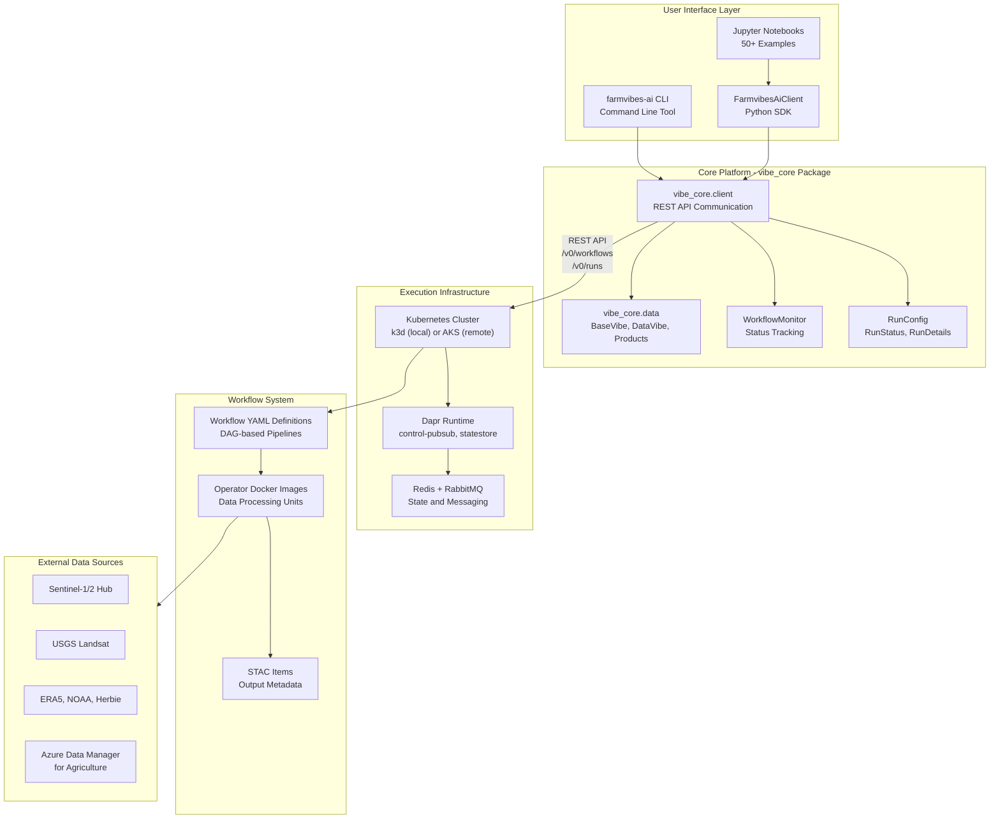
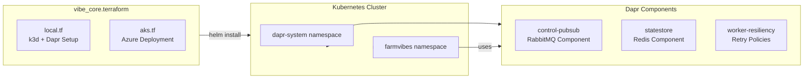
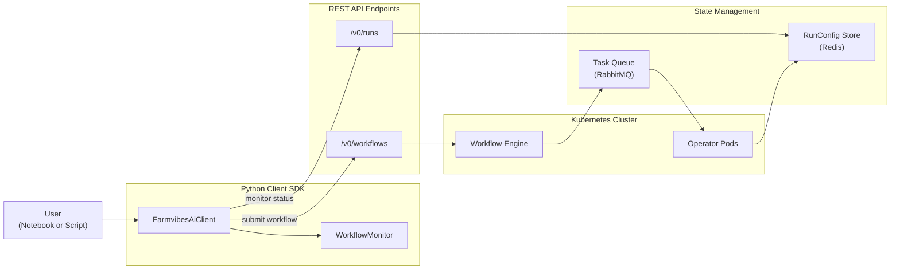

<!-- source: DeepWiki mcp.deepwiki.com · repo microsoft/farmvibes-ai · page 1 Overview · fetched 2026-10-26 -->

# Overview

<details>
<summary>Relevant source files</summary>

The following files were used as context for generating this wiki page:

- [README.md](README.md)
- [docs/requirements.txt](docs/requirements.txt)
- [src/vibe_core/pyproject.toml](src/vibe_core/pyproject.toml)

</details>


## Purpose and Scope

This document provides a high-level introduction to FarmVibes.AI, a multi-modal geospatial machine learning platform designed for agriculture and sustainability applications. It covers the platform's core purpose, key capabilities, system architecture, and technology stack.

For detailed installation and setup instructions, see [Getting Started](#2). For architectural deep-dives, see [Architecture](#3). For specific workflow documentation, see [Workflows](#4).

---

## What is FarmVibes.AI

FarmVibes.AI is a geospatial machine learning platform that enables data fusion across multiple remote sensing and environmental data sources to generate agricultural and sustainability insights. The platform addresses the challenge of combining heterogeneous geospatial datasets—including satellite imagery (optical, SAR, multispectral), weather data, elevation maps, and custom raster data—into unified inputs for machine learning models.

The platform operates on the principle that fusing data across modalities, spatial regions, and temporal windows produces more robust insights than analyzing datasets in isolation. For example, detecting agricultural practices or estimating carbon footprint becomes more accurate when combining Sentinel-1 radar, Sentinel-2 optical imagery, weather patterns, and historical data from similar locations.

**Sources:** [README.md:1-16](), [README.md:35-44]()

---

## Architecture Overview

FarmVibes.AI consists of three main layers: the user interface layer, the core platform layer (`vibe_core`), and the execution infrastructure layer.



**Diagram: FarmVibes.AI System Architecture**

The platform uses a client-server model where users interact with the system through Python clients or CLI, which communicate with a Kubernetes-based execution backend. Workflows are defined as directed acyclic graphs (DAGs) and executed as containerized operators orchestrated by Dapr.

**Sources:** [README.md:74-83](), [src/vibe_core/pyproject.toml:19-60]()

---

## System Components

### Core Package: `vibe-core`

The `vibe-core` Python package ([src/vibe_core/pyproject.toml:20]()) provides the client-side SDK and data models for interacting with FarmVibes.AI. It includes:

| Module | Purpose |
|--------|---------|
| `vibe_core.client` | REST API client for workflow submission and monitoring |
| `vibe_core.data` | Data models including `BaseVibe`, `DataVibe`, product types, and rasters |
| `vibe_core.cli` | Command-line interface (`farmvibes-ai` command) |
| `vibe_core.terraform` | Infrastructure-as-code modules for cluster deployment |

The package has key dependencies on `pystac` for STAC metadata handling, `pydantic` for data validation, `shapely` for geometry operations, and `hydra-zen` for configuration management ([src/vibe_core/pyproject.toml:41-52]()).

**Sources:** [src/vibe_core/pyproject.toml:1-64]()

### Execution Infrastructure



**Diagram: Infrastructure Deployment Architecture**

The platform deploys on Kubernetes using Terraform modules located in `vibe_core.terraform` ([src/vibe_core/pyproject.toml:17]()). These modules provision either:
- **Local deployment**: k3d cluster on developer machines
- **Remote deployment**: Azure Kubernetes Service (AKS)

Dapr provides distributed application runtime capabilities including pub/sub messaging via RabbitMQ (`control-pubsub` component) and state management via Redis (`statestore` component), with configurable resiliency policies (`worker-resiliency`).

**Sources:** [src/vibe_core/pyproject.toml:17]()

### Workflow System

Workflows are defined as YAML specifications describing directed acyclic graphs of operators. Each operator is a containerized unit of work that:
- Receives input data conforming to `BaseVibe` or derived types
- Performs data processing, downloading, or model inference
- Produces output as STAC items containing geospatial metadata

The workflow execution model supports:
- Parallel execution of independent operators
- Data dependency management between operators
- Retry and timeout policies for resilience
- Progress monitoring via `WorkflowMonitor`

For detailed workflow documentation, see [Workflows](#4).

**Sources:** [README.md:47-50](), [README.md:66-72]()

---

## Key Capabilities

### Data Ingestion

FarmVibes.AI provides pre-built workflows for downloading and preprocessing data from:

| Data Source | Data Type | Example Workflows |
|-------------|-----------|-------------------|
| Sentinel-1/2 | SAR and optical imagery | Cloud removal, temporal compositing |
| Landsat | Multispectral imagery | Index calculation, time series |
| ERA5, NOAA, Herbie | Weather and climate data | Precipitation, temperature |
| USGS | Elevation maps | Terrain analysis |
| NAIP | High-resolution imagery | Field-level analysis |
| Azure Data Manager for Agriculture | Field boundaries, management data | Integration workflows |

Custom rasterized datasets (e.g., drone imagery) can be ingested using bring-your-own-data workflows.

**Sources:** [README.md:29-33]()

### Data Fusion and Processing

The platform includes workflows for:
- **Index calculation**: NDVI, MSAVI, EVI, and other vegetation indices
- **Cloud removal**: SpaceEye algorithm for generating cloud-free composites
- **Temporal aggregation**: Time series analysis and statistics
- **Spatial operations**: Resampling, masking, alignment across data sources
- **Multi-modal fusion**: Combining optical, SAR, weather, and elevation data

These workflows prepare fusion-ready datasets where each sample contains aligned data from multiple modalities across spatial neighborhoods and temporal windows.

**Sources:** [README.md:35-50]()

### Machine Learning Applications

FarmVibes.AI includes example notebooks demonstrating:
- **Harvest detection**: Estimating emergence and harvest dates from NDVI time series ([README.md:97-98]())
- **Carbon sequestration**: Simulating soil carbon estimates using COMET-Farm API ([README.md:99-100]())
- **Crop segmentation**: Training crop identification models on SpaceEye imagery ([README.md:103-107]())
- **Micro-climate forecasting**: DeepMC model for weather prediction ([README.md:101-102]())

For a complete list, see [Example Notebooks](#6).

**Sources:** [README.md:90-110]()

---

## Technology Stack

### Core Dependencies

The `vibe-core` package relies on:

| Dependency | Version | Purpose |
|------------|---------|---------|
| `pystac` | ~1.6.0 | STAC metadata handling |
| `pydantic` | ~1.10.0 | Data validation and serialization |
| `shapely` | >=1.7.1 | Geometric operations |
| `requests` | ~2.32.0 | HTTP communication |
| `hydra-zen` | ~0.10 | Configuration management |
| `rich` | ~13.7.1 | Terminal UI formatting |

**Sources:** [src/vibe_core/pyproject.toml:41-52]()

### Documentation Toolchain

Documentation is built using Sphinx ([docs/requirements.txt:2]()) with:
- `sphinx_rtd_theme` for Read the Docs styling
- `sphinxcontrib.mermaid` for diagram rendering
- `myst_parser` for Markdown support
- `sphinx_autodoc_typehints` for API documentation

The documentation is automatically built and deployed to GitHub Pages. For details, see [Documentation System](#7.2).

**Sources:** [docs/requirements.txt:1-7]()

---

## Deployment Models

### Local Cluster

The local deployment model uses:
- **Docker Desktop** as the container runtime
- **k3d** for lightweight Kubernetes cluster
- **Terraform** to provision Dapr, Redis, and RabbitMQ
- **Local storage** for workflow outputs and cached data

This mode is suitable for development, testing, and running workflows on a single machine. Data is persisted locally in the developer's environment ([README.md:76-78]()).

### Remote Cluster

The remote deployment model supports:
- **Azure Kubernetes Service (AKS)** for production workloads
- **Azure Container Registry (ACR)** for custom operator images
- **Azure ML** for model training at scale
- **Cloud storage** for data persistence

Both deployment models use identical workflow definitions and operator images, enabling seamless transition from development to production.

**Sources:** [README.md:74-83]()

---

## Interaction Model



**Diagram: User Interaction and Execution Flow**

Users interact with FarmVibes.AI through the `FarmvibesAiClient` class, which:
1. Submits workflows to `/v0/workflows` endpoint
2. Monitors execution status via `/v0/runs` endpoint
3. Displays progress using `WorkflowMonitor` with rich terminal UI
4. Retrieves results as STAC items

The workflow engine schedules operators as Kubernetes pods, using RabbitMQ for task distribution and Redis for state persistence. For detailed client documentation, see [Client API](#3.4).

**Sources:** [README.md:81-82](), [src/vibe_core/pyproject.toml:58-59]()

---

## Package Distribution

The `vibe-core` package is distributed via PyPI ([src/vibe_core/pyproject.toml:20]()) and can be installed using:

```bash
pip install vibe-core
```

The package provides the `farmvibes-ai` command-line interface ([src/vibe_core/pyproject.toml:58-59]()), which serves as the primary tool for cluster management:

```bash
farmvibes-ai install    # Deploy local cluster
farmvibes-ai start      # Start cluster services
farmvibes-ai stop       # Stop cluster services
farmvibes-ai status     # Check cluster status
```

For installation instructions, see [Getting Started](#2).

**Sources:** [src/vibe_core/pyproject.toml:1-64]()

---

## Project Metadata

FarmVibes.AI is developed by the Microsoft FarmVibes.AI Team and distributed under the MIT License ([src/vibe_core/pyproject.toml:26]()). The project targets Python 3.8+ ([src/vibe_core/pyproject.toml:27]()) and is optimized for Linux operating systems ([src/vibe_core/pyproject.toml:31]()).

Project resources:
- **Repository**: https://github.com/microsoft/farmvibes-ai ([src/vibe_core/pyproject.toml:55]())
- **Issue Tracker**: https://github.com/microsoft/farmvibes-ai/issues ([src/vibe_core/pyproject.toml:56]())
- **Documentation**: https://microsoft.github.io/farmvibes-ai/ ([README.md:114]())
- **Contact**: terravibes@microsoft.com ([src/vibe_core/pyproject.toml:23]())

For contribution guidelines, see [Contributing and Issue Management](#7.1).

**Sources:** [src/vibe_core/pyproject.toml:22-56](), [README.md:114]()

---

## Next Steps

To get started with FarmVibes.AI:

1. **Install the platform**: Follow the [Getting Started](#2) guide to set up your local cluster
2. **Explore examples**: Review [Example Notebooks](#6) to understand common use cases
3. **Run your first workflow**: See [Running Workflows](#5.2) for step-by-step instructions
4. **Understand the architecture**: Read [Architecture](#3) for detailed component documentation
5. **Browse workflows**: Explore the [Workflow Catalog](#8.2) for available data processing pipelines

For troubleshooting, see [Monitoring and Debugging](#5.3).

**Sources:** [README.md:84-88](), [README.md:112-126]()

---

