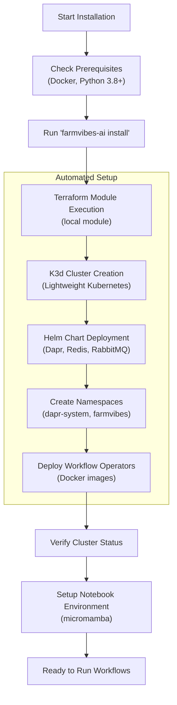
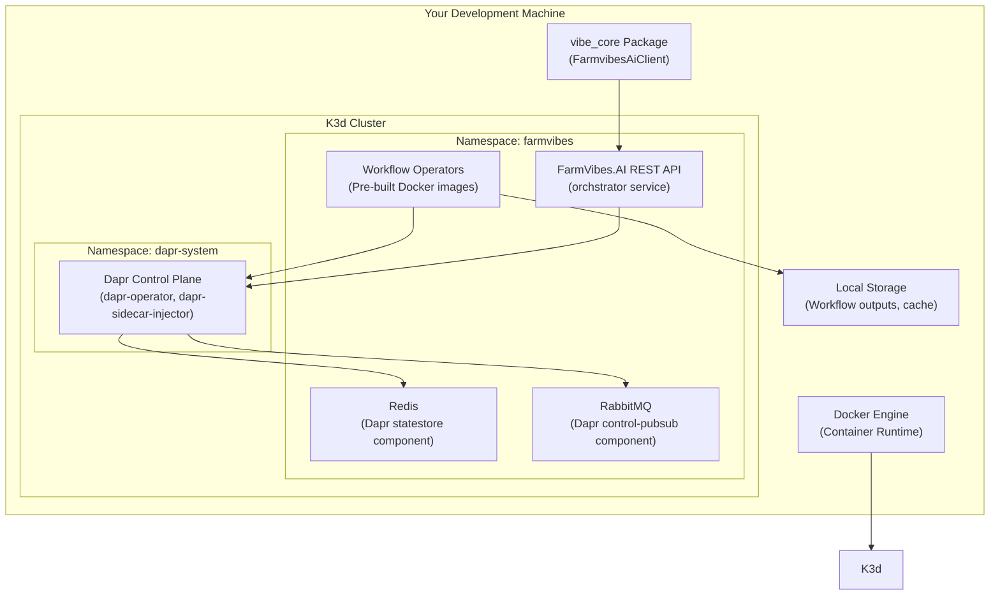
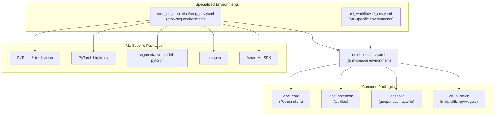
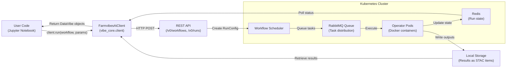

<!-- source: DeepWiki mcp.deepwiki.com · repo microsoft/farmvibes-ai · page 2 Getting Started · fetched 2026-10-26 -->

# Getting Started

<details>
<summary>Relevant source files</summary>

The following files were used as context for generating this wiki page:

- [README.md](README.md)
- [notebooks/README.md](notebooks/README.md)
- [notebooks/crop_segmentation/crop_env.yaml](notebooks/crop_segmentation/crop_env.yaml)
- [resources/vm/setup_farmvibes_ai_vm.sh](resources/vm/setup_farmvibes_ai_vm.sh)
- [src/vibe_core/setup.py](src/vibe_core/setup.py)

</details>


## Purpose and Scope

This guide walks you through installing FarmVibes.AI, setting up the development environment, and running your first workflow. By the end of this guide, you will have a local FarmVibes.AI cluster running and understand how to submit workflows using the Python client.

For comprehensive information about the system architecture and components, see [Architecture](#3). For detailed guides on working with notebooks and workflows, see [User Guides](#5). For troubleshooting installation issues, refer to the FarmVibes.AI documentation's TROUBLESHOOTING.md guide.

## Overview of Installation Process

FarmVibes.AI runs as a local Kubernetes cluster on your development machine. The installation process sets up all required infrastructure components and makes the system accessible via a Python client API.



**Installation Flow Diagram**: Shows the automated steps executed during FarmVibes.AI installation, from prerequisites through infrastructure setup to ready state.

Sources: [README.md:84-88](), [resources/vm/setup_farmvibes_ai_vm.sh:1-55]()

## Prerequisites

Before installing FarmVibes.AI, ensure your system meets the following requirements:

### System Requirements

| Component | Requirement | Notes |
|-----------|-------------|-------|
| Operating System | Linux (Ubuntu 20.04+), macOS, Windows with WSL2 | Windows requires WSL2 for Docker |
| RAM | 8 GB minimum, 16 GB recommended | More RAM enables larger workflow executions |
| Disk Space | 50 GB minimum, 100 GB recommended | Space needed for Docker images and cached data |
| CPU | 4 cores minimum | Multi-core processors improve workflow performance |

### Required Software

The following software must be installed before running the FarmVibes.AI installation:

**Docker Engine** (v20.10 or later):
- Docker Desktop for Windows/macOS
- Docker CE for Linux

**Python** (v3.8 or later):
- Python 3.8, 3.9, or 3.10 supported
- `pip` package manager included

**Git** (v2.x or later):
- Required for cloning the repository
- Git LFS recommended for large file support

Sources: [resources/vm/setup_farmvibes_ai_vm.sh:6-55](), [README.md:84-88]()

## Installation Options

FarmVibes.AI supports two primary installation modes:

### Local Installation (Recommended)

Install directly on your development machine for the fastest iteration and development experience. This mode creates a local Kubernetes cluster using K3d and runs all workflows on your machine.

**Best for**: Development, experimentation, small-scale data processing

### Azure VM Installation

Deploy to a dedicated Azure Virtual Machine for more compute resources and isolation from your local environment. A setup script automates the VM configuration.

**Best for**: Production workflows, large-scale data processing, team environments

Sources: [README.md:84-88](), [resources/vm/setup_farmvibes_ai_vm.sh:1-55]()

## Installing FarmVibes.AI Locally

### Installation Command

After installing the prerequisites, install FarmVibes.AI using the CLI:

```bash
farmvibes-ai install
```

This command performs the following actions:

1. **Validates Prerequisites**: Checks for Docker, Python, and other dependencies
2. **Initializes Terraform**: Prepares the local infrastructure module
3. **Creates K3d Cluster**: Deploys a lightweight Kubernetes cluster
4. **Installs Dapr Runtime**: Sets up the distributed application runtime
5. **Deploys Supporting Services**: Installs Redis (state store) and RabbitMQ (message broker)
6. **Configures Namespaces**: Creates `dapr-system` and `farmvibes` namespaces
7. **Deploys Workflow Operators**: Pulls and deploys operator Docker images

### Infrastructure Components

The installation creates the following infrastructure stack:



**Infrastructure Components Diagram**: Shows the deployed components after installation, including Kubernetes namespaces, Dapr runtime, supporting services, and storage.

Sources: [README.md:74-82]()

### Verifying Installation

After installation completes, verify the cluster is running:

```bash
farmvibes-ai status
```

This command checks:
- K3d cluster health
- Dapr runtime status
- Pod readiness in both namespaces
- Service endpoints availability

Expected output indicates all components are in "Running" state.

Sources: [README.md:74-88]()

## Azure VM Setup

For deploying FarmVibes.AI on an Azure VM, use the provided setup script:

### VM Preparation Script

The [resources/vm/setup_farmvibes_ai_vm.sh:1-55]() script automates VM configuration:

**Key Setup Steps**:
1. **System Updates**: Updates apt package index [resources/vm/setup_farmvibes_ai_vm.sh:6-7]()
2. **Git Installation**: Installs Git and Git LFS [resources/vm/setup_farmvibes_ai_vm.sh:9-10]()
3. **Python Setup**: Installs Python 3 and pip [resources/vm/setup_farmvibes_ai_vm.sh:12-14]()
4. **Docker Installation**: Installs Docker CE with official repository [resources/vm/setup_farmvibes_ai_vm.sh:16-40]()
5. **User Configuration**: Configures Docker group permissions [resources/vm/setup_farmvibes_ai_vm.sh:42-50]()
6. **Git LFS**: Initializes Git LFS for large files [resources/vm/setup_farmvibes_ai_vm.sh:52-55]()

### Running the Setup

1. Provision an Ubuntu 20.04 VM on Azure
2. Copy the setup script to the VM
3. Execute: `bash setup_farmvibes_ai_vm.sh`
4. Log out and back in (for Docker group changes)
5. Run `farmvibes-ai install` as in local installation

Sources: [README.md:86-88](), [resources/vm/setup_farmvibes_ai_vm.sh:1-55]()

## Setting Up the Notebook Environment

FarmVibes.AI provides Jupyter notebooks for interactive workflows. The recommended approach uses `micromamba` for environment management.

### Installing Micromamba

Micromamba is a lightweight, fast alternative to conda for package management.

**Installation** (Linux/macOS):
```bash
"${SHELL}" <(curl -L micro.mamba.pm/install.sh)
```

Refer to the [micromamba documentation](https://mamba.readthedocs.io/en/latest/) for Windows installation and troubleshooting.

Sources: [notebooks/README.md:6-9]()

### Creating the Base Environment

The repository provides environment files for notebook execution:

**Base Environment** ([notebooks/env.yaml]()):
```bash
cd notebooks
micromamba env create -f env.yaml
```

This creates an environment named `farmvibes-ai` with common packages for running most notebooks.

**Activating the Environment**:
```bash
micromamba activate farmvibes-ai
```

Sources: [notebooks/README.md:11-19]()

### Specialized Environments

Some notebooks require additional dependencies and provide their own environment files:

| Notebook Category | Environment File | Environment Name | Key Packages |
|-------------------|------------------|------------------|--------------|
| Crop Segmentation | `crop_segmentation/crop_env.yaml` | `crop-seg` | PyTorch, torchvision, segmentation-models-pytorch |
| Machine Learning | Various `*_env.yaml` files | Workflow-specific | PyTorch Lightning, torchgeo, Azure ML |

**Example: Crop Segmentation Environment**:
```bash
cd notebooks/crop_segmentation
micromamba env create -f crop_env.yaml
micromamba activate crop-seg
```

The environment file at [notebooks/crop_segmentation/crop_env.yaml:1-31]() includes:
- PyTorch 1.10.2 with CUDA support [notebooks/crop_segmentation/crop_env.yaml:9]()
- Geospatial libraries (shapely, geopandas, rasterio) [notebooks/crop_segmentation/crop_env.yaml:10-12]()
- Deep learning tools (pytorch-lightning, segmentation-models-pytorch) [notebooks/crop_segmentation/crop_env.yaml:23-24]()
- FarmVibes.AI client packages [notebooks/crop_segmentation/crop_env.yaml:30-31]()

Sources: [notebooks/README.md:11-22](), [notebooks/crop_segmentation/crop_env.yaml:1-31]()

### Environment Structure



**Environment Hierarchy Diagram**: Shows the relationship between base and specialized environments, with the base environment providing common packages and specialized environments adding domain-specific dependencies.

Sources: [notebooks/README.md:11-22](), [notebooks/crop_segmentation/crop_env.yaml:1-31]()

## Running Your First Workflow

With FarmVibes.AI installed and environments configured, you can now execute workflows using the Python client.

### Starting a Jupyter Notebook Session

1. Activate the environment:
```bash
micromamba activate farmvibes-ai
```

2. Navigate to the notebooks directory:
```bash
cd notebooks
```

3. Launch JupyterLab:
```bash
jupyter lab
```

### Using the Python Client

The `FarmvibesAiClient` class in the `vibe_core` package provides the interface for workflow execution.

**Basic Client Setup**:
```python
from vibe_core.client import FarmvibesAiClient

# Connect to local cluster
client = FarmvibesAiClient()
```

The client automatically connects to the local REST API endpoint (typically `http://localhost:31108`).

### Workflow Execution Flow



**Workflow Execution Flow Diagram**: Traces the complete path from user code submission through task execution to result retrieval, showing all components involved in workflow orchestration.

### Example: Simple Helloworld Workflow

**Workflow Submission**:
```python
from datetime import datetime
from shapely.geometry import Point, box

# Define area of interest (bounding box)
geom = box(-122.4, 37.7, -122.3, 37.8)  # San Francisco area

# Define time range
time_range = (
    datetime(2022, 1, 1),
    datetime(2022, 1, 31)
)

# Run workflow
run = client.run(
    workflow="helloworld",
    parameters={
        "geometry": geom,
        "time_range": time_range
    }
)

# Monitor execution
run.monitor()

# Get results
results = run.output
```

**Key Components**:
- **Workflow Name**: String identifier for the workflow (e.g., `"helloworld"`)
- **Parameters**: Dictionary with workflow-specific inputs (geometry, time_range, etc.)
- **Run Object**: Returned object for monitoring and retrieving results
- **Monitor Method**: Displays progress in real-time
- **Output Property**: Returns results as `DataVibe` objects

Sources: [README.md:95-96]()

### Monitoring Workflow Execution

The `monitor()` method provides real-time feedback:

**Progress Display**:
- Progress bars for each workflow operator
- Task status tables (pending, running, completed, failed)
- Execution time and resource usage

**Programmatic Status Checking**:
```python
# Check run status
status = run.status  # Returns RunStatus enum

# Check if complete
if run.is_done:
    print("Workflow completed")

# Get detailed status
details = run.details  # Returns RunDetails object
```

For more details on monitoring and debugging, see [Monitoring and Debugging](#5.3).

Sources: [README.md:95-96]()

### Accessing Workflow Results

Workflow outputs are returned as `DataVibe` objects, which represent geospatial data with metadata:

```python
# Access output items
for item in run.output:
    print(f"ID: {item.id}")
    print(f"Type: {type(item).__name__}")
    print(f"Assets: {item.assets}")
    
    # Access raster data
    if hasattr(item, 'raster_asset'):
        raster_path = item.raster_asset.path
        # Process raster with rasterio, xarray, etc.
```

**Output Storage**:
- Results are stored locally in the configured storage directory
- Outputs follow STAC (SpatioTemporal Asset Catalog) conventions
- Each workflow run creates a unique output directory

For more information on data models, see [Data Models](#3.3).

## Next Steps

Now that you have FarmVibes.AI running, explore the following resources:

### Learn by Example

**Example Notebooks**: Browse the [Example Notebooks](#6) section for domain-specific tutorials:
- [Agriculture Examples](#6.1): Crop analysis, carbon sequestration, harvest detection
- [Remote Sensing Examples](#6.2): Satellite imagery processing, SpaceEye, index calculation
- [ML and Segmentation Examples](#6.3): Crop segmentation, SAM model usage

**Recommended Starting Points**:
1. **HelloWorld** [notebooks/helloworld](): Basic workflow execution and visualization
2. **Harvest Period** [notebooks/harvest_period](): NDVI time-series analysis for field monitoring
3. **SpaceEye** [notebooks/spaceeye](): Cloud-free image generation from Sentinel-2

Sources: [README.md:90-110]()

### Explore Workflows

**Available Workflows**: Review the [Workflow Catalog](#8.2) for a complete list of pre-built workflows organized by category:
- Data Ingestion: Sentinel-1/2, Landsat, weather data downloaders
- Processing: Index calculation, time-series aggregation, segmentation
- FarmAI Applications: Crop classification, carbon estimation, change detection

**Workflow System**: Learn about the workflow architecture in [Workflows](#4), including:
- DAG-based workflow structure
- Custom workflow creation
- Operator composition

Sources: [README.md:77-79]()

### Understand the Platform

**Architecture Overview**: Read the [Architecture](#3) section to understand:
- System components and their interactions
- Infrastructure deployment patterns
- Data flow through the platform

**Client API**: Explore the [Client API](#3.4) documentation for advanced usage:
- Workflow parameterization
- Run management and cancellation
- Result filtering and querying

Sources: [README.md:112-125]()

### Troubleshooting

If you encounter issues:

1. **Check Cluster Status**: Run `farmvibes-ai status` to verify all components are running
2. **Review Logs**: Access operator logs for detailed error messages
3. **Consult Documentation**: Review the TROUBLESHOOTING.md guide in the documentation
4. **GitHub Issues**: Search or create issues at https://github.com/microsoft/farmvibes-ai

For detailed debugging guidance, see [Monitoring and Debugging](#5.3).

Sources: [README.md:125]()

## Summary

This guide covered:

1. **Prerequisites**: System requirements and required software
2. **Installation**: Both local and Azure VM setup procedures
3. **Environment Setup**: Using micromamba to create notebook environments
4. **First Workflow**: Executing and monitoring workflows with the Python client
5. **Next Steps**: Resources for continued learning

You now have a working FarmVibes.AI installation and can begin exploring the platform's capabilities for geospatial ML and agriculture insights.

Sources: [README.md:1-148](), [notebooks/README.md:1-22]()

---

