<!-- source: DeepWiki mcp.deepwiki.com · repo microsoft/farmvibes-ai · page 3 Architecture · fetched 2026-10-26 -->

# Architecture

Relevant source files

The following files were used as context for generating this wiki page:

- [docs/requirements.txt](docs/requirements.txt)
- [src/vibe_core/pyproject.toml](src/vibe_core/pyproject.toml)
- [src/vibe_core/vibe_core/client.py](src/vibe_core/vibe_core/client.py)
- [src/vibe_core/vibe_core/data/core_types.py](src/vibe_core/vibe_core/data/core_types.py)
- [src/vibe_core/vibe_core/datamodel.py](src/vibe_core/vibe_core/datamodel.py)

## Purpose and Scope

This document describes the overall architecture of FarmVibes.AI, including the major system components, their interactions, and key architectural patterns. It provides a high-level view of how the platform is structured and how data flows through the system.

For detailed information about specific subsystems, refer to:
- Package structure and dependencies: [vibe_core Package](#3.1)
- Kubernetes and Dapr infrastructure: [Infrastructure and Deployment](#3.2)
- Data type system and BaseVibe hierarchy: [Data Models](#3.3)
- Client SDK and API interaction: [Client API](#3.4)
- Workflow system details: [Workflows](#4)

---

## System Overview

FarmVibes.AI follows a **microservices architecture** deployed on Kubernetes, with a Python client SDK communicating with a REST API service. The system uses **Dapr** (Distributed Application Runtime) for service-to-service communication, state management, and pub/sub messaging.

### Layered Architecture

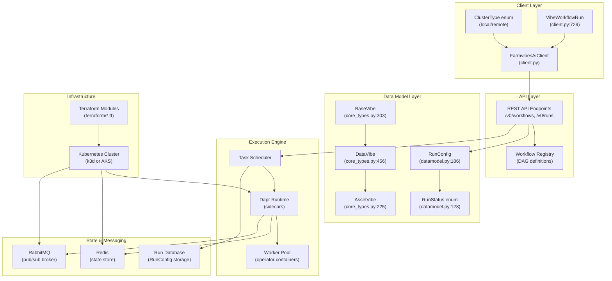

**Sources:** [src/vibe_core/vibe_core/client.py:1-1105](), [src/vibe_core/vibe_core/datamodel.py:1-353](), [src/vibe_core/vibe_core/data/core_types.py:1-870]()

---

## Core Components

### 1. vibe_core Package

The `vibe_core` package is the primary Python distribution that users install via pip. It contains the client SDK, data models, and utility functions.

**Key modules:**
- `vibe_core.client`: Contains `FarmvibesAiClient` class for API interaction
- `vibe_core.datamodel`: Defines `RunConfig`, `RunStatus`, `RunDetails`, and related types
- `vibe_core.data.core_types`: Defines `BaseVibe`, `DataVibe`, `AssetVibe` base classes
- `vibe_core.monitor`: Provides `VibeWorkflowRunMonitor` for tracking execution
- `vibe_core.cli`: Command-line interface via `farmvibes-ai` command

**Package configuration:**

| Property | Value |
|----------|-------|
| Package name | `vibe-core` |
| Python version | `>=3.8` |
| Build system | `setuptools>=42`, `wheel` |
| CLI entry point | `farmvibes-ai` command |

**Dependencies include:**
- `pydantic~=1.10.0` (data validation)
- `pystac~=1.6.0` (STAC format support)
- `requests~=2.32.0` (HTTP client)
- `shapely>=1.7.1` (geometry operations)
- `rich~=13.7.1` (terminal UI)

**Sources:** [src/vibe_core/pyproject.toml:1-64]()

### 2. Client SDK (FarmvibesAiClient)

The `FarmvibesAiClient` class provides the primary interface for users to interact with the platform.

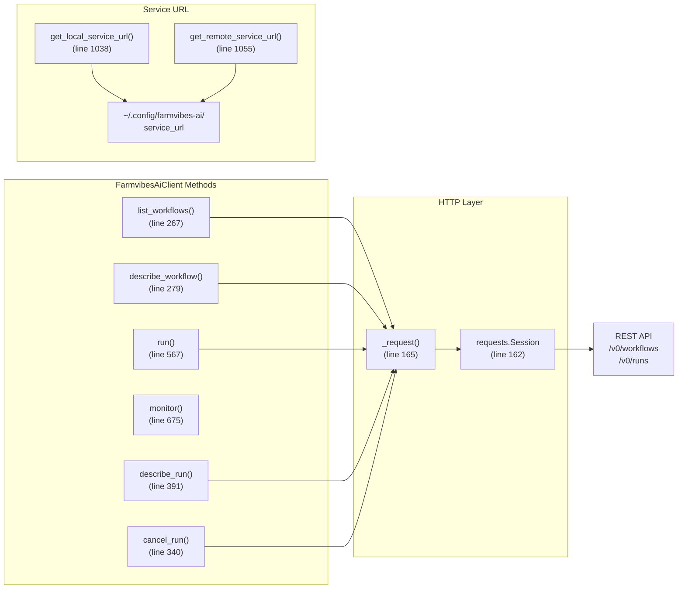

**Key responsibilities:**
- Workflow discovery and submission ([src/vibe_core/vibe_core/client.py:267-277](), [src/vibe_core/vibe_core/client.py:567-612]())
- Run lifecycle management ([src/vibe_core/vibe_core/client.py:340-389]())
- Real-time monitoring ([src/vibe_core/vibe_core/client.py:675-726]())
- Service URL resolution ([src/vibe_core/vibe_core/client.py:1038-1104]())

**Sources:** [src/vibe_core/vibe_core/client.py:145-1105]()

### 3. Data Model Layer

The data model is built on a hierarchical type system rooted in `BaseVibe`.

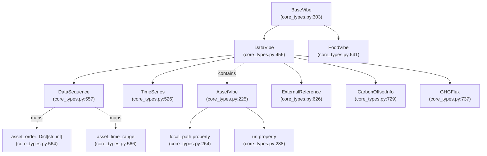

**Key type properties:**

| Type | Key Fields | Purpose |
|------|------------|---------|
| `BaseVibe` | `id`, `hash_id` | Base for all data types |
| `DataVibe` | `time_range`, `geometry`, `bbox`, `assets` | Spatiotemporal data with assets |
| `AssetVibe` | `path_or_url`, `type`, `id` | Reference to file or remote resource |
| `DataSequence` | `asset_order`, `asset_time_range` | Ordered collection of assets |

**Type registration:** All `BaseVibe` subclasses are automatically registered in `data_registry` during class definition ([src/vibe_core/vibe_core/data/core_types.py:407-410]()).

**Sources:** [src/vibe_core/vibe_core/data/core_types.py:303-870]()

### 4. Run Configuration and Status

Workflow execution state is managed through a set of dataclasses:

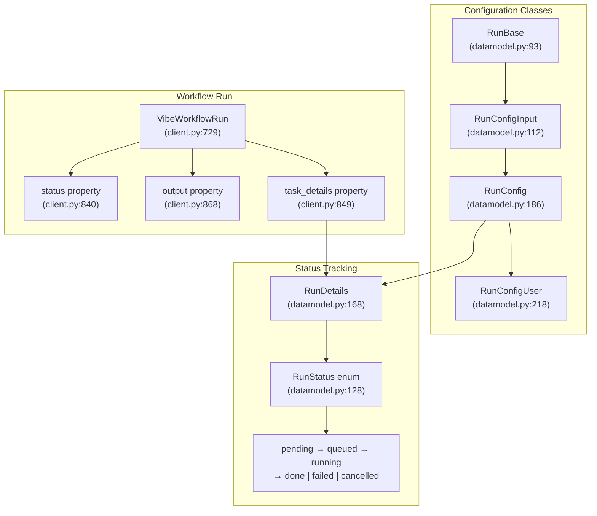

**RunStatus state machine:**
- `pending`: Run created but not yet scheduled
- `queued`: Run scheduled, waiting for execution
- `running`: Run is actively executing
- `done`: Run completed successfully
- `failed`: Run encountered an error
- `cancelled`: Run was cancelled by user
- `deleting/deleted`: Run is being/has been deleted

**Sources:** [src/vibe_core/vibe_core/datamodel.py:93-260](), [src/vibe_core/vibe_core/client.py:729-1036]()

---

## Communication Patterns

### Client-Server Interaction

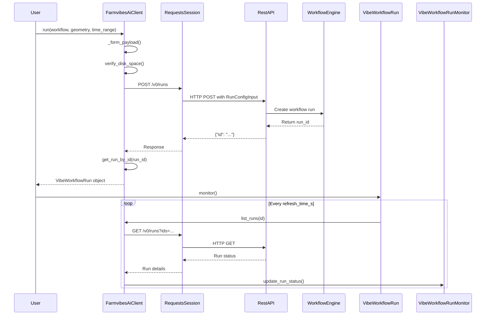

**REST API endpoints:**
- `GET /v0/workflows`: List available workflows
- `GET /v0/workflows/{name}`: Get workflow description
- `POST /v0/runs`: Submit new workflow run
- `GET /v0/runs`: List runs (with optional filters)
- `GET /v0/runs/{id}`: Get run details
- `POST /v0/runs/{id}/cancel`: Cancel a run
- `DELETE /v0/runs/{id}`: Delete a run
- `POST /v0/runs/{id}/resubmit`: Resubmit a run
- `GET /v0/system-metrics`: Get system metrics

**Sources:** [src/vibe_core/vibe_core/client.py:165-189](), [src/vibe_core/vibe_core/client.py:267-627]()

### Dapr-based Service Communication

Within the Kubernetes cluster, services communicate through Dapr sidecars:

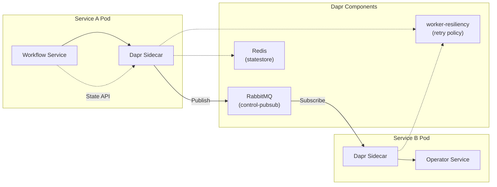

**Dapr features used:**
- **Pub/Sub**: Task distribution via RabbitMQ (`control-pubsub` component)
- **State Store**: Run state persistence via Redis (`statestore` component)
- **Resiliency**: Automatic retries and timeouts (`worker-resiliency` policy)

**Sources:** Inferred from system diagrams and typical Dapr patterns

---

## Data Flow

### Input Data Processing

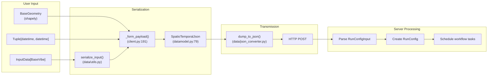

**Key transformations:**
1. **Geometry conversion**: Shapely `BaseGeometry` → GeoJSON ([src/vibe_core/vibe_core/client.py:233-238]())
2. **Serialization**: Python objects → JSON via `dump_to_json()` ([src/vibe_core/vibe_core/client.py:608-609]())
3. **Type handling**: `BaseVibe` objects serialized via STAC format

**Sources:** [src/vibe_core/vibe_core/client.py:191-239]()

### Output Data Processing

```mermaid
graph LR
    subgraph "Server Storage"
        CompressOutput["Compress with zlib<br/>encode() (datamodel.py:329)"]
        Base64["Base64 encode"]
        StoreRun["Store in RunConfig.output"]
    end
    
    subgraph "Client Retrieval"
        GetRun["describe_run(run_id)"]
        Decode["decode() (datamodel.py:343)"]
        ParseJson["json.loads()"]
    end
    
    subgraph "Conversion"
        DeserializeStac["deserialize_stac()"]
        StacConverter["StacConverter.from_stac_item()"]
        BaseVibeDict["BaseVibeDict<br/>(Dict[str, BaseVibe])"]
    end
    
    CompressOutput --> Base64
    Base64 --> StoreRun
    
    StoreRun --> GetRun
    GetRun --> Decode
    Decode --> ParseJson
    
    ParseJson --> DeserializeStac
    DeserializeStac --> StacConverter
    StacConverter --> BaseVibeDict
```

**Output encoding/decoding:**
- **Encoding**: `zlib.compress()` → `base64.encode()` ([src/vibe_core/vibe_core/datamodel.py:329-340]())
- **Decoding**: `base64.decode()` → `zlib.decompress()` ([src/vibe_core/vibe_core/datamodel.py:343-352]())
- **STAC conversion**: JSON → `BaseVibe` objects via `StacConverter` ([src/vibe_core/vibe_core/client.py:779-780]())

**Sources:** [src/vibe_core/vibe_core/datamodel.py:329-352](), [src/vibe_core/vibe_core/client.py:762-780]()

---

## Execution Model

### Workflow Run Lifecycle

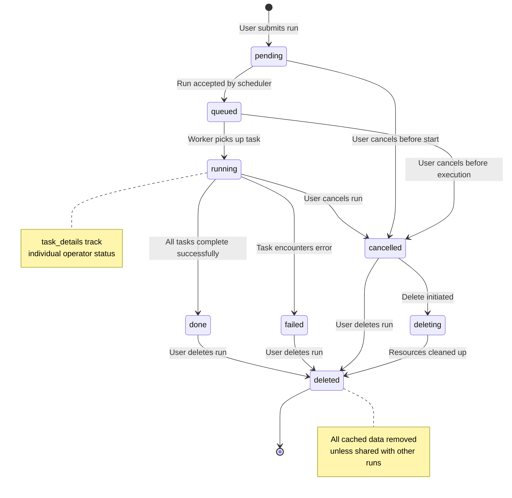

**State transitions:**
- `pending` → `queued`: Scheduler accepts run
- `queued` → `running`: First task begins execution
- `running` → `done`/`failed`: All tasks complete/error occurs
- Any state → `cancelled`: User calls `cancel_run()` ([src/vibe_core/vibe_core/client.py:340-362]())
- Terminal states → `deleted`: User calls `delete_run()` ([src/vibe_core/vibe_core/client.py:364-389]())

**Blocking methods:**
- `block_until_complete()`: Wait for `done` or `failed` ([src/vibe_core/vibe_core/client.py:953-973]())
- `block_until_cancelled()`: Wait for `cancelled` ([src/vibe_core/vibe_core/client.py:933-951]())
- `block_until_deleted()`: Wait for `deleted` ([src/vibe_core/vibe_core/client.py:975-993]())

**Sources:** [src/vibe_core/vibe_core/datamodel.py:128-164](), [src/vibe_core/vibe_core/client.py:807-993]()

### Task Execution Flow

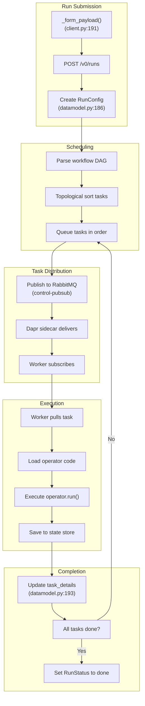

**Key execution concepts:**
- **DAG-based workflows**: Tasks organized as directed acyclic graphs
- **Topological execution**: Dependencies determine task order
- **Distributed workers**: Multiple operator pods execute tasks concurrently
- **State persistence**: Task outputs stored in Redis for downstream tasks
- **Task details tracking**: Each task has individual `RunDetails` ([src/vibe_core/vibe_core/datamodel.py:168-183]())

**Sources:** [src/vibe_core/vibe_core/client.py:191-612](), [src/vibe_core/vibe_core/datamodel.py:168-196]()

---

## Configuration and Service Discovery

### Service URL Resolution

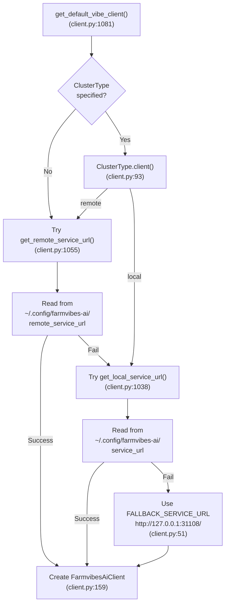

**Configuration paths:**
- Remote cluster: `~/.config/farmvibes-ai/remote_service_url` ([src/vibe_core/vibe_core/client.py:69-75]())
- Local cluster: `~/.config/farmvibes-ai/service_url` ([src/vibe_core/vibe_core/client.py:63-67]())
- Fallback URL: `http://127.0.0.1:31108/` ([src/vibe_core/vibe_core/client.py:51-55]())

**ClusterType enum:**
- `ClusterType.local`: Connect to local k3d cluster
- `ClusterType.remote`: Connect to remote AKS cluster

**Sources:** [src/vibe_core/vibe_core/client.py:51-104](), [src/vibe_core/vibe_core/client.py:1038-1104]()

---

## Summary

The FarmVibes.AI architecture is characterized by:

1. **Client-Server Model**: Python SDK (`FarmvibesAiClient`) communicates with REST API
2. **Microservices on Kubernetes**: Containerized operators with Dapr sidecars
3. **Type-Safe Data Model**: `BaseVibe` hierarchy with automatic registry
4. **Stateful Execution**: `RunConfig` and `RunStatus` track workflow lifecycle
5. **Distributed Messaging**: RabbitMQ pub/sub for task distribution
6. **Persistent State**: Redis for operator state and caching
7. **Modular Package**: `vibe_core` provides reusable client and data model components

This architecture enables scalable, distributed execution of geospatial ML workflows while providing a simple Python interface for users.

---

