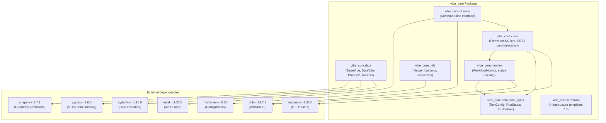
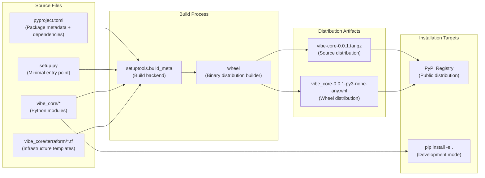
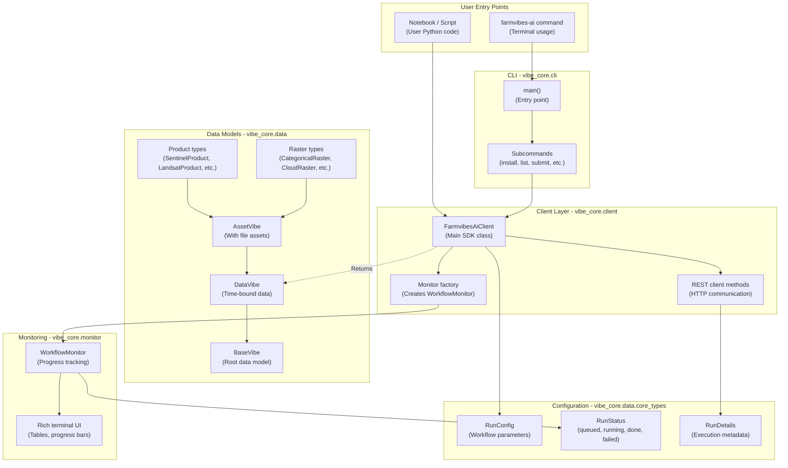

<!-- source: DeepWiki mcp.deepwiki.com · repo microsoft/farmvibes-ai · page 3.1 vibe_core Package · fetched 2026-10-26 -->

# vibe_core Package

<details>
<summary>Relevant source files</summary>

The following files were used as context for generating this wiki page:

- [docs/requirements.txt](docs/requirements.txt)
- [resources/vm/setup_farmvibes_ai_vm.sh](resources/vm/setup_farmvibes_ai_vm.sh)
- [src/vibe_core/pyproject.toml](src/vibe_core/pyproject.toml)
- [src/vibe_core/setup.py](src/vibe_core/setup.py)

</details>


## Purpose and Scope

The `vibe_core` package is the foundational Python package for the FarmVibes.AI platform. It provides the client SDK, data models, workflow management APIs, and command-line interface that enable users to interact with the distributed workflow execution system. This package is distributed as `vibe-core` on PyPI and serves as the primary interface for programmatic access to FarmVibes.AI capabilities.

This document covers the package structure, dependencies, build system, and key module organization. For detailed documentation on specific components:
- Data models and the BaseVibe hierarchy: see [Data Models](#3.3)
- Client API usage and workflow submission: see [Client API](#3.4)
- Workflow monitoring and debugging: see [Monitoring and Debugging](#5.3)
- Infrastructure deployment: see [Infrastructure and Deployment](#3.2)

**Sources:** [src/vibe_core/pyproject.toml:19-59]()

---

## Package Structure and Key Modules

The `vibe_core` package is organized into several core modules that provide distinct functionality layers. The following diagram maps the high-level architectural concepts to concrete code modules within the package:



**Sources:** [src/vibe_core/pyproject.toml:41-52](), [src/vibe_core/pyproject.toml:58-59]()

---

## Package Metadata and Distribution

The `vibe_core` package is configured using modern Python packaging standards with a declarative `pyproject.toml` file. The following table summarizes the package metadata:

| Property | Value | Description |
|----------|-------|-------------|
| Package Name | `vibe-core` | PyPI distribution name |
| Version | `0.0.1` | Current package version |
| Python Requirement | `>=3.8` | Minimum Python version |
| License | MIT | Open source license |
| Build System | `setuptools>=42, wheel` | Build backend requirements |
| Entry Point | `farmvibes-ai` | CLI command name |
| Maintainer | Microsoft FarmVibes.AI Team | Contact: terravibes@microsoft.com |

The package includes Terraform infrastructure files as package data, allowing the client to deploy local and remote Kubernetes clusters programmatically.

**Sources:** [src/vibe_core/pyproject.toml:19-33](), [src/vibe_core/pyproject.toml:58-59]()

---

## Dependencies

The package declares runtime dependencies that support different aspects of its functionality:

### Core Dependencies

| Dependency | Version | Purpose |
|------------|---------|---------|
| `pydantic` | ~=1.10.0 | Data validation and serialization for all data models |
| `pystac` | ~=1.6.0 | STAC (SpatioTemporal Asset Catalog) item creation and parsing |
| `requests` | ~=2.32.0 | HTTP client for REST API communication with the workflow engine |
| `shapely` | >=1.7.1 | Geometric operations on spatial data (geometries, bounding boxes) |
| `jsonschema` | ~=4.6 | JSON schema validation for workflow definitions |
| `hydra-zen` | ~=0.10 | Configuration management and validation |
| `rich` | ~=13.7.1 | Terminal UI components (progress bars, tables) for monitoring |
| `msal` | ==1.22.0 | Microsoft Authentication Library for Azure integration |
| `certifi` | ~=2023.7.22 | SSL certificate bundle for secure connections |
| `strenum` | ~=0.4.7 | String-based enumerations for type-safe constants |

### Optional Dependencies

| Dependency Group | Dependencies | Purpose |
|------------------|--------------|---------|
| `test` | `orjson~=3.9.15` | Fast JSON serialization for testing |

**Sources:** [src/vibe_core/pyproject.toml:41-52](), [src/vibe_core/pyproject.toml:61-64]()

---

## Build and Packaging System

The `vibe_core` package uses a modern, declarative build system based on PEP 517/518 standards. The build process is configured entirely through `pyproject.toml`, with `setup.py` serving as a minimal entry point.



The build system configuration specifies:
- **Build backend**: `setuptools.build_meta` [src/vibe_core/pyproject.toml:1-6]()
- **Package discovery**: Automatic discovery with `tests*` exclusion [src/vibe_core/pyproject.toml:8-11]()
- **Package data**: Includes Terraform files (`vibe_core/terraform/*.tf`) [src/vibe_core/pyproject.toml:14-17]()
- **Entry point**: CLI command `farmvibes-ai` maps to `vibe_core.cli.main:main` [src/vibe_core/pyproject.toml:58-59]()

**Sources:** [src/vibe_core/pyproject.toml:1-17](), [src/vibe_core/setup.py:1-8]()

---

## Module Organization

The package's internal structure separates concerns across specialized modules. The following diagram shows the conceptual mapping from user-facing APIs to internal module responsibilities:



**Sources:** [src/vibe_core/pyproject.toml:41-52]()

---

## Command-Line Interface

The package provides a command-line interface through the `farmvibes-ai` entry point. This is configured as a console script in the package metadata:

```
[project.scripts]
farmvibes-ai = "vibe_core.cli.main:main"
```

When the package is installed via `pip install vibe-core`, the `farmvibes-ai` command becomes available in the user's shell. The CLI module at [vibe_core/cli/main.py]() implements subcommands for:
- Cluster installation and management
- Workflow listing and submission
- Run status monitoring
- Configuration management

The CLI uses the `rich` library for enhanced terminal output, providing formatted tables and progress indicators.

**Sources:** [src/vibe_core/pyproject.toml:58-59]()

---

## Installation Methods

The `vibe_core` package can be installed through multiple methods depending on the use case:

### Standard Installation

```bash
pip install vibe-core
```

This installs the package from PyPI along with all required dependencies.

### Development Installation

```bash
cd src/vibe_core
pip install -e .
```

The `-e` flag installs the package in editable mode, allowing code changes to take effect without reinstallation.

### With Test Dependencies

```bash
pip install vibe-core[test]
```

This installs additional dependencies required for testing, specifically `orjson` for fast JSON operations.

**Sources:** [src/vibe_core/pyproject.toml:61-64]()

---

## Infrastructure Files

The package includes Terraform infrastructure templates as package data. These `.tf` files are located in `vibe_core/terraform/` and are distributed with the package to enable programmatic cluster deployment:

```
[options.package_data]
vibe_core = ["terraform/*.tf"]
```

This allows the client SDK to access infrastructure-as-code templates directly from the installed package, supporting both local (k3d) and remote (AKS) Kubernetes cluster provisioning. The Terraform integration is detailed in [Infrastructure and Deployment](#3.2).

**Sources:** [src/vibe_core/pyproject.toml:14-17]()

---

## Package URLs and Resources

The package metadata defines several URLs for user reference:

| Resource | URL | Purpose |
|----------|-----|---------|
| Homepage | https://github.com/microsoft/farmvibes-ai | Main repository |
| Bug Tracker | https://github.com/microsoft/farmvibes-ai/issues | Issue reporting |

These are included in the PyPI distribution metadata and displayed on the package's PyPI page.

**Sources:** [src/vibe_core/pyproject.toml:54-56]()

---

## Relationship to Documentation System

The `vibe_core` package is documented using Sphinx, with documentation build dependencies specified in a separate requirements file. The documentation system uses:

- **Sphinx** (7.1.2): Core documentation generator
- **sphinx_rtd_theme** (2.0.0): ReadTheDocs theme for consistent styling
- **myst_parser** (2.0.0): Markdown support in documentation
- **sphinx_autodoc_typehints** (2.0.1): Automatic type hint documentation
- **sphinxcontrib.mermaid** (0.8.1): Mermaid diagram rendering
- **sphinxcontrib-openapi** (0.8.4): OpenAPI specification rendering

The documentation build process is covered in [Documentation System](#7.2).

**Sources:** [docs/requirements.txt:1-7]()

---

## Summary

The `vibe_core` package serves as the foundational layer for FarmVibes.AI, providing:

1. **Client SDK**: Programmatic access to workflow execution via `FarmvibesAiClient`
2. **Data Models**: Pydantic-based models for spatial-temporal data with STAC integration
3. **Monitoring**: Rich terminal UI for real-time workflow progress tracking
4. **CLI**: Command-line interface for cluster management and workflow operations
5. **Infrastructure**: Embedded Terraform templates for deployment automation

The package is built using modern Python packaging standards (PEP 517/518), distributed via PyPI, and integrates with the broader FarmVibes.AI ecosystem through REST API communication with the Kubernetes-based workflow execution engine.

---

