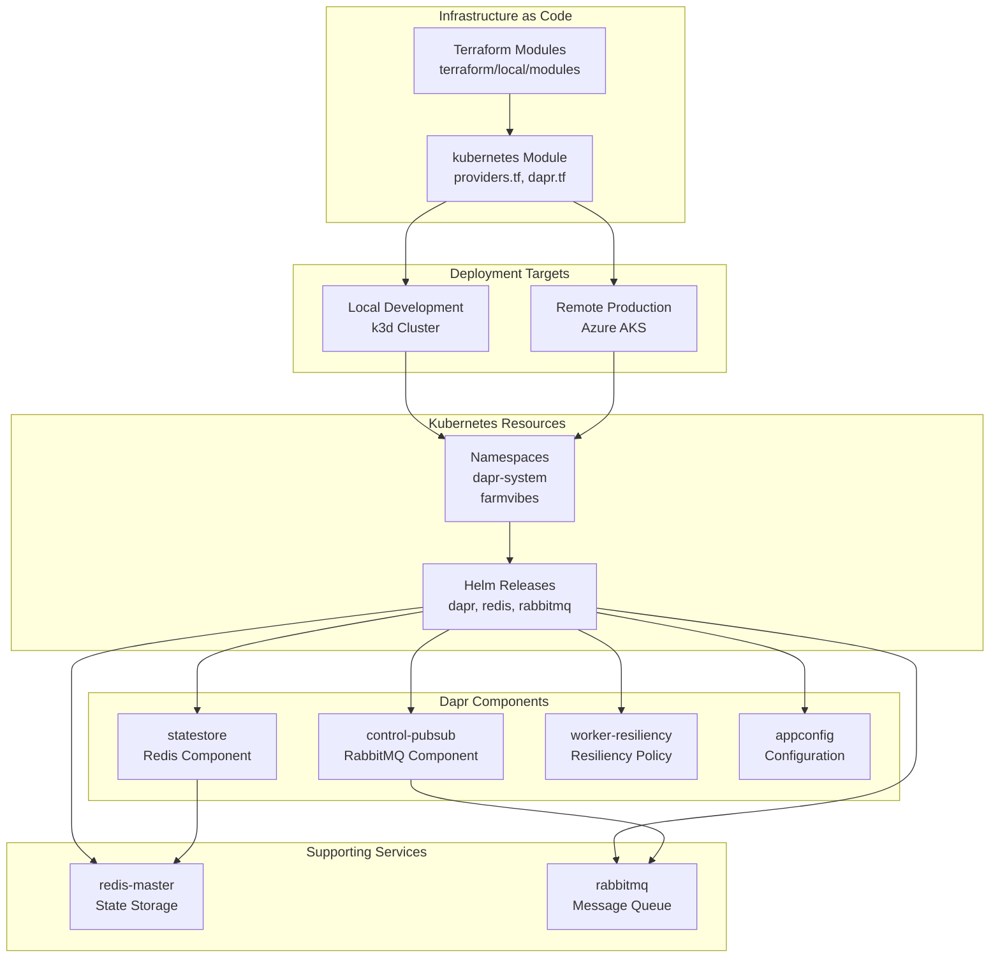
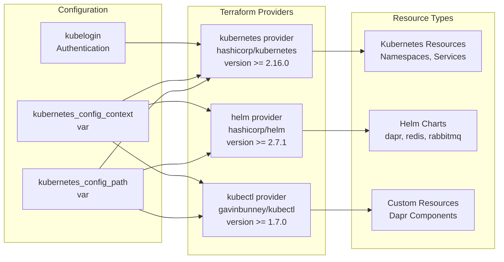
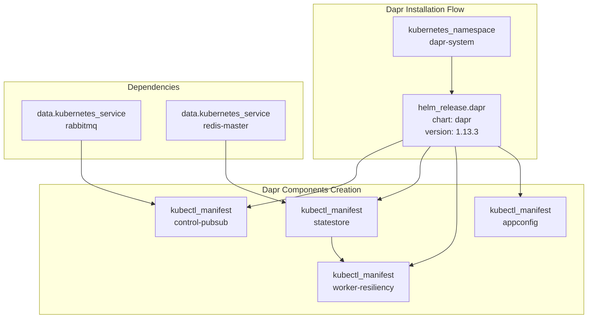
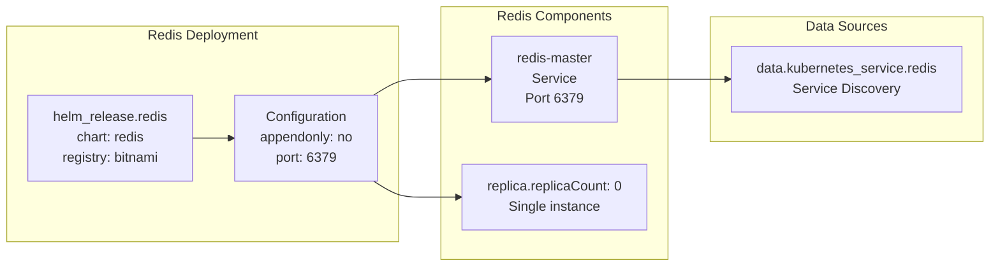
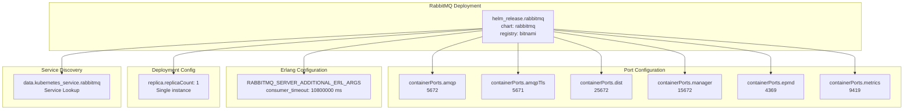
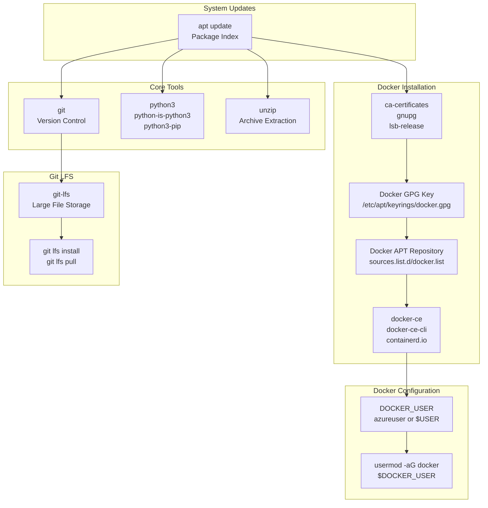
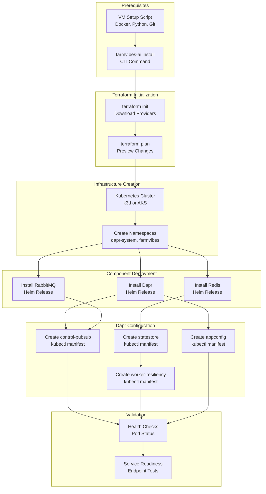

<!-- source: DeepWiki mcp.deepwiki.com · repo microsoft/farmvibes-ai · page 3.2 Infrastructure and Deployment · fetched 2026-10-26 -->

# Infrastructure and Deployment

<details>
<summary>Relevant source files</summary>

The following files were used as context for generating this wiki page:

- [resources/vm/setup_farmvibes_ai_vm.sh](resources/vm/setup_farmvibes_ai_vm.sh)
- [src/vibe_core/setup.py](src/vibe_core/setup.py)
- [src/vibe_core/vibe_core/terraform/local/modules/kubernetes/dapr.tf](src/vibe_core/vibe_core/terraform/local/modules/kubernetes/dapr.tf)
- [src/vibe_core/vibe_core/terraform/local/modules/kubernetes/providers.tf](src/vibe_core/vibe_core/terraform/local/modules/kubernetes/providers.tf)
- [src/vibe_core/vibe_core/terraform/local/modules/kubernetes/rabbitmq.tf](src/vibe_core/vibe_core/terraform/local/modules/kubernetes/rabbitmq.tf)
- [src/vibe_core/vibe_core/terraform/local/modules/kubernetes/redis.tf](src/vibe_core/vibe_core/terraform/local/modules/kubernetes/redis.tf)

</details>


## Purpose and Scope

This document describes the infrastructure architecture and deployment mechanisms for FarmVibes.AI. It covers the Kubernetes-based deployment system, Dapr integration for distributed computing, Terraform infrastructure-as-code modules, and the setup process for both local and remote clusters.

For information about the higher-level system architecture, see [Architecture](#3). For details about the Python client and workflow execution, see [Client API](#3.4) and [Workflows](#4). For practical deployment instructions, see [Getting Started](#2).

## Deployment Architecture Overview

FarmVibes.AI uses a containerized, Kubernetes-based architecture with Dapr for service orchestration. The platform supports two primary deployment modes:

| Deployment Mode | Use Case | Kubernetes Distribution | Resource Requirements |
|----------------|----------|------------------------|----------------------|
| **Local** | Development, testing, small workloads | k3d (lightweight K8s) | Laptop/workstation with Docker |
| **Remote** | Production, large-scale processing | Azure Kubernetes Service (AKS) | Cloud infrastructure |

Both modes use identical Terraform modules and Helm charts, ensuring deployment consistency across environments.



**Sources:** [src/vibe_core/vibe_core/terraform/local/modules/kubernetes/providers.tf](), [src/vibe_core/vibe_core/terraform/local/modules/kubernetes/dapr.tf]()

## Terraform Module Structure

The infrastructure is defined using Terraform modules located in `src/vibe_core/vibe_core/terraform/local/modules/kubernetes/`. The module system uses three primary providers to manage Kubernetes resources:



The `providers.tf` file [src/vibe_core/vibe_core/terraform/local/modules/kubernetes/providers.tf:4-21]() declares the required providers and versions. Each provider is configured to use the same kubeconfig path and context:

- **kubernetes provider**: Manages core Kubernetes resources (namespaces, services, config maps)
- **helm provider**: Deploys Helm charts for Dapr, Redis, and RabbitMQ
- **kubectl provider**: Applies Dapr custom resource definitions (CRDs)

The providers support Azure authentication via `kubelogin` [src/vibe_core/vibe_core/terraform/local/modules/kubernetes/providers.tf:27-37](), enabling seamless integration with Azure Kubernetes Service.

**Sources:** [src/vibe_core/vibe_core/terraform/local/modules/kubernetes/providers.tf]()

## Dapr Installation and Configuration

Dapr (Distributed Application Runtime) is installed in the `dapr-system` namespace using the official Helm chart. The `dapr.tf` module manages the complete Dapr lifecycle:

| Component | Type | Purpose |
|-----------|------|---------|
| `kubernetesdaprnamespace` | Kubernetes Namespace | Isolates Dapr system components |
| `dapr` | Helm Release | Installs Dapr runtime v1.13.3 |
| `control-pubsub` | Dapr Component | RabbitMQ pub/sub for workflow orchestration |
| `statestore` | Dapr Component | Redis state storage for actor state |
| `worker-resiliency` | Dapr Resiliency | Retry policies for worker operations |
| `appconfig` | Dapr Configuration | Enables resiliency features |

### Dapr Helm Release

The Dapr Helm chart [src/vibe_core/vibe_core/terraform/local/modules/kubernetes/dapr.tf:10-29]() is configured with:

- **watchInterval**: 30 seconds for operator polling
- **enable-ha**: High availability mode enabled



**Sources:** [src/vibe_core/vibe_core/terraform/local/modules/kubernetes/dapr.tf:1-139]()

## Dapr Component Configuration

### control-pubsub Component

The `control-pubsub` component [src/vibe_core/vibe_core/terraform/local/modules/kubernetes/dapr.tf:31-69]() configures RabbitMQ as the pub/sub message broker:

```yaml
apiVersion: dapr.io/v1alpha1
kind: Component
metadata:
  name: control-pubsub
  namespace: ${var.namespace}
spec:
  type: pubsub.rabbitmq
  version: v1
```

Key configuration parameters:

| Parameter | Value | Purpose |
|-----------|-------|---------|
| `protocol` | `amqp` | AMQP protocol for messaging |
| `hostname` | `rabbitmq.${var.namespace}.svc.cluster.local` | Service discovery within cluster |
| `port` | `5672` | Standard AMQP port |
| `backOffMaxRetries` | `-1` | Unlimited retries for reliability |
| `publisherConfirm` | `true` | Confirms message delivery |
| `requeueInFailure` | `true` | Re-queues failed messages |
| `deliveryMode` | `2` | Persistent message storage |
| `prefetchCount` | `0` | No prefetch limit |
| `deletedWhenUnused` | `false` | Queues persist when idle |

The password is sourced from a Kubernetes secret `rabbitmq` with key `rabbitmq-password` [src/vibe_core/vibe_core/terraform/local/modules/kubernetes/dapr.tf:48-51]().

### statestore Component

The `statestore` component [src/vibe_core/vibe_core/terraform/local/modules/kubernetes/dapr.tf:71-95]() configures Redis for Dapr actor state management:

```yaml
apiVersion: dapr.io/v1alpha1
kind: Component
metadata:
  name: statestore
  namespace: ${var.namespace}
spec:
  type: state.redis
  version: v1
```

Configuration:

| Parameter | Value | Purpose |
|-----------|-------|---------|
| `redisHost` | `redis-master:6379` | Redis master service endpoint |
| `actorStateStore` | `true` | Enables actor state storage |
| `keyPrefix` | `none` | No key prefix applied |

The password references the `redis` secret with key `redis-password` [src/vibe_core/vibe_core/terraform/local/modules/kubernetes/dapr.tf:84-87]().

### worker-resiliency Policy

The `worker-resiliency` policy [src/vibe_core/vibe_core/terraform/local/modules/kubernetes/dapr.tf:97-123]() defines retry and timeout behavior for workflow operators:

```yaml
apiVersion: dapr.io/v1alpha1
kind: Resiliency
metadata:
  name: worker-resiliency
scopes:
  - terravibes-worker
spec:
  policies:
    timeouts:
      opExecution: 3h
    retries:
      workerRetry:
        policy: exponential
        maxInterval: 60s
        maxRetries: -1
  targets:
    components:
      control-pubsub:
        inbound:
          retry: "workerRetry"
          timeout: "opExecution"
```

Key features:

- **Timeout**: 3-hour execution limit per operator (must exceed longest individual operation)
- **Retry Policy**: Exponential backoff with 60-second maximum interval
- **Max Retries**: Unlimited (`-1`) for fault tolerance
- **Scope**: Applied to `terravibes-worker` actors
- **Target**: Applied to inbound messages from `control-pubsub`

### appconfig Configuration

The `appconfig` resource [src/vibe_core/vibe_core/terraform/local/modules/kubernetes/dapr.tf:125-139]() enables the Resiliency feature flag:

```yaml
apiVersion: dapr.io/v1alpha1
kind: Configuration
metadata:
  name: appconfig
  namespace: ${var.namespace}
spec:
  features:
    - name: Resiliency
      enabled: true
```

**Sources:** [src/vibe_core/vibe_core/terraform/local/modules/kubernetes/dapr.tf:31-139]()

## Redis State Store

Redis is deployed via Helm from the Bitnami registry [src/vibe_core/vibe_core/terraform/local/modules/kubernetes/redis.tf:4-29](). The configuration optimizes for state storage rather than persistence:



Configuration highlights:

| Parameter | Value | Rationale |
|-----------|-------|-----------|
| `commonConfiguration` | `appendonly no` | Disables AOF persistence for performance |
| `master.containerPort` | `6379` | Standard Redis port |
| `replica.replicaCount` | `0` | No replication (single master) |
| `image.tag` | `var.redis_image_tag` | Configurable Redis version |

The `data.kubernetes_service.redis` resource [src/vibe_core/vibe_core/terraform/local/modules/kubernetes/redis.tf:31-38]() provides service discovery for other components to reference the `redis-master` service.

**Sources:** [src/vibe_core/vibe_core/terraform/local/modules/kubernetes/redis.tf]()

## RabbitMQ Message Broker

RabbitMQ is deployed via Helm from the Bitnami registry [src/vibe_core/vibe_core/terraform/local/modules/kubernetes/rabbitmq.tf:4-53](). The configuration optimizes for workflow message processing:



Port mappings:

| Port | Protocol | Purpose |
|------|----------|---------|
| 5672 | AMQP | Standard messaging protocol |
| 5671 | AMQP over TLS | Encrypted messaging |
| 25672 | Inter-node | Clustering distribution |
| 15672 | HTTP | Management UI |
| 4369 | EPMD | Erlang port mapper |
| 9419 | Prometheus | Metrics endpoint |

The critical configuration is the consumer timeout [src/vibe_core/vibe_core/terraform/local/modules/kubernetes/rabbitmq.tf:45-51]():

```hcl
extraEnvVars[0].name = "RABBITMQ_SERVER_ADDITIONAL_ERL_ARGS"
extraEnvVars[0].value = "-rabbit consumer_timeout 10800000"
```

This sets a 3-hour (10,800,000 milliseconds) consumer timeout, matching the Dapr resiliency timeout to prevent premature message cancellation during long-running workflow operations.

The `data.kubernetes_service.rabbitmq` resource [src/vibe_core/vibe_core/terraform/local/modules/kubernetes/rabbitmq.tf:55-62]() enables service discovery for the Dapr pub/sub component.

**Sources:** [src/vibe_core/vibe_core/terraform/local/modules/kubernetes/rabbitmq.tf]()

## VM Setup Prerequisites

For development environments, the `setup_farmvibes_ai_vm.sh` script [resources/vm/setup_farmvibes_ai_vm.sh]() automates prerequisite installation on Ubuntu systems:



The script performs the following installation sequence:

1. **System Updates**: Updates package index [resources/vm/setup_farmvibes_ai_vm.sh:6-7]()
2. **Git Installation**: Installs version control [resources/vm/setup_farmvibes_ai_vm.sh:9-10]()
3. **Python Setup**: Installs Python 3 with pip, sets `python` alias [resources/vm/setup_farmvibes_ai_vm.sh:12-14]()
4. **Docker Dependencies**: Installs SSL certificates and GPG tools [resources/vm/setup_farmvibes_ai_vm.sh:16-17]()
5. **Docker Repository**: Adds official Docker APT repository [resources/vm/setup_farmvibes_ai_vm.sh:19-31]()
6. **Docker Engine**: Installs Docker CE, CLI, and containerd [resources/vm/setup_farmvibes_ai_vm.sh:38-40]()
7. **Docker Permissions**: Adds user to `docker` group for sudo-less access [resources/vm/setup_farmvibes_ai_vm.sh:42-50]()
8. **Git LFS**: Installs and initializes Large File Storage support [resources/vm/setup_farmvibes_ai_vm.sh:52-55]()

The script determines the Docker user automatically:
- If running as root: defaults to `azureuser` (Azure VM convention)
- Otherwise: uses current `$USER`
- Can be overridden via `$DOCKER_USER` environment variable

**Sources:** [resources/vm/setup_farmvibes_ai_vm.sh]()

## Deployment Execution Flow

The complete deployment process follows this sequence:



Each step has explicit Terraform dependencies defined via `depends_on` clauses:

- `helm_release.dapr` depends on `kubernetes_namespace.kubernetesdaprnamespace` [src/vibe_core/vibe_core/terraform/local/modules/kubernetes/dapr.tf:28]()
- `kubectl_manifest.control-pubsub` depends on `helm_release.dapr` and `data.kubernetes_service.rabbitmq` [src/vibe_core/vibe_core/terraform/local/modules/kubernetes/dapr.tf:68]()
- `kubectl_manifest.statestore` depends on `helm_release.dapr` and `data.kubernetes_service.redis` [src/vibe_core/vibe_core/terraform/local/modules/kubernetes/dapr.tf:94]()
- `kubectl_manifest.resiliency-sidecar` depends on `helm_release.dapr` and `kubectl_manifest.statestore-sidecar` [src/vibe_core/vibe_core/terraform/local/modules/kubernetes/dapr.tf:122]()

These dependencies ensure components are created in the correct order and that required services are available before dependent resources are configured.

**Sources:** [src/vibe_core/vibe_core/terraform/local/modules/kubernetes/dapr.tf](), [src/vibe_core/vibe_core/terraform/local/modules/kubernetes/redis.tf](), [src/vibe_core/vibe_core/terraform/local/modules/kubernetes/rabbitmq.tf]()

## Local vs. Remote Deployment

Both deployment modes use the same Terraform modules but target different Kubernetes distributions:

### Local Deployment (k3d)

| Characteristic | Configuration |
|----------------|---------------|
| **Kubernetes Distribution** | k3d (K3s in Docker) |
| **Resource Allocation** | Shared with host system |
| **Networking** | Docker bridge network |
| **Storage** | Local filesystem mounts |
| **Use Cases** | Development, testing, small datasets |
| **Cost** | Free (local compute only) |

Local deployment connects to k3d via kubeconfig [src/vibe_core/vibe_core/terraform/local/modules/kubernetes/providers.tf:24-25]():

```hcl
provider "kubernetes" {
  config_path    = var.kubernetes_config_path
  config_context = var.kubernetes_config_context
}
```

The same configuration applies to `helm` [src/vibe_core/vibe_core/terraform/local/modules/kubernetes/providers.tf:40-44]() and `kubectl` [src/vibe_core/vibe_core/terraform/local/modules/kubernetes/providers.tf:47-51]() providers.

### Remote Deployment (Azure AKS)

| Characteristic | Configuration |
|----------------|---------------|
| **Kubernetes Distribution** | Azure Kubernetes Service (AKS) |
| **Resource Allocation** | Dedicated node pools |
| **Networking** | Azure Virtual Network |
| **Storage** | Azure Blob Storage |
| **Use Cases** | Production, large-scale processing |
| **Cost** | Pay-as-you-go (Azure pricing) |

Remote deployment adds Azure authentication via `kubelogin` [src/vibe_core/vibe_core/terraform/local/modules/kubernetes/providers.tf:27-37]():

```hcl
exec {
  api_version = "client.authentication.k8s.io/v1beta1"
  command     = "kubelogin"
  args = [
    "get-token",
    "--use-azurerm-env-vars",
    "|",
    "jq",
    ".status.token"
  ]
}
```

This enables integration with Azure Active Directory for cluster access control.

**Sources:** [src/vibe_core/vibe_core/terraform/local/modules/kubernetes/providers.tf]()

## Package Distribution

The `vibe_core` package is distributed as a Python wheel package. The `setup.py` file [src/vibe_core/setup.py]() uses a minimal configuration that delegates to `pyproject.toml`:

```python
from setuptools import setup

if __name__ == "__main__":
    setup()
```

This standard Python packaging approach allows:

1. **Installation via pip**: `pip install vibe-core`
2. **Editable installs**: `pip install -e .` for development
3. **Dependency management**: Declared in `pyproject.toml`
4. **Distribution**: Upload to PyPI for public access

The setup configuration includes the Terraform modules as package data, ensuring they are included in the distribution and accessible to the CLI installation commands.

**Sources:** [src/vibe_core/setup.py]()

## Summary

FarmVibes.AI's infrastructure uses a layered approach:

1. **Foundation**: Docker and Kubernetes provide container orchestration
2. **Messaging Layer**: Dapr abstracts RabbitMQ pub/sub and Redis state management
3. **Infrastructure as Code**: Terraform ensures reproducible deployments
4. **Flexibility**: Identical architecture for local development and cloud production

The key components interact through well-defined interfaces:

- **Workflow operators** publish messages to `control-pubsub`
- **Dapr actors** store state in `statestore`
- **Resiliency policies** ensure fault tolerance with exponential backoff
- **Kubernetes services** provide service discovery within the cluster

This architecture enables FarmVibes.AI to scale from laptop development to production workloads while maintaining consistent behavior across environments.

---

