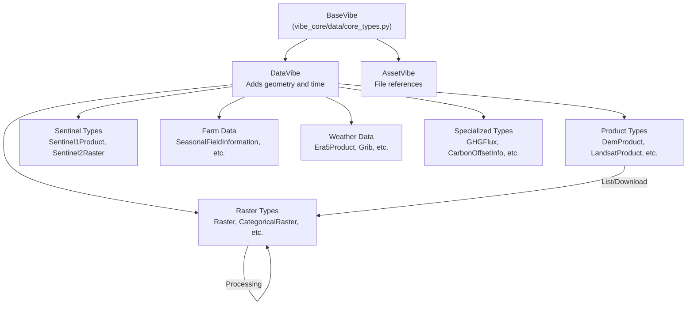
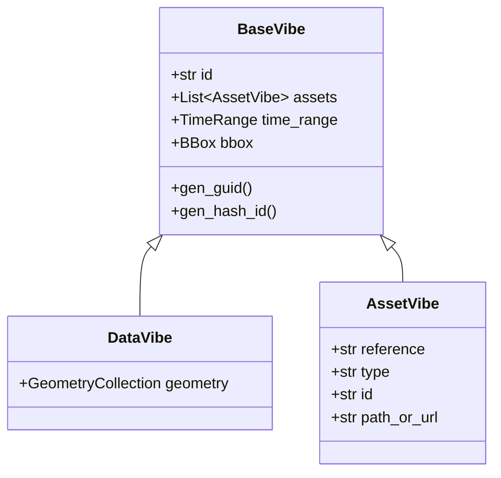
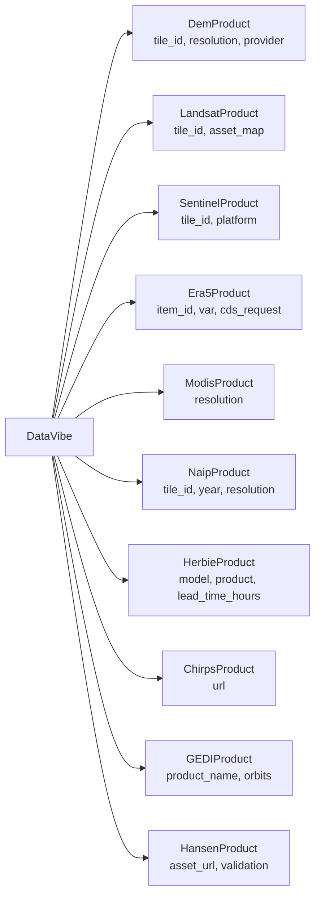
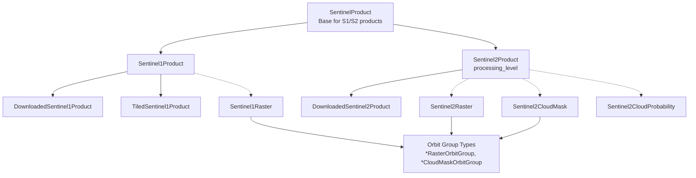
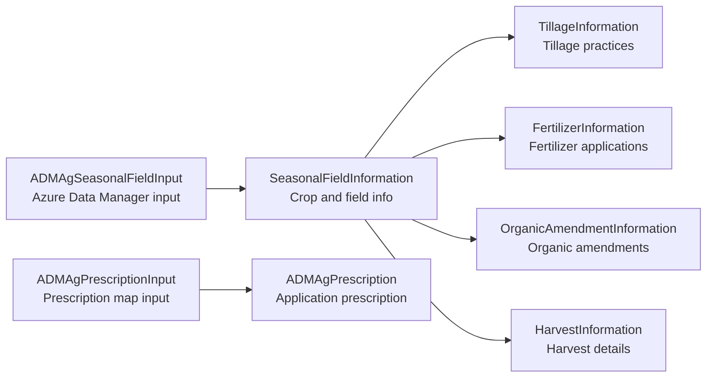
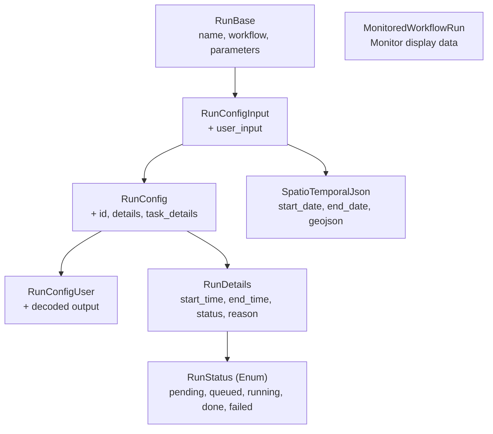

<!-- source: DeepWiki mcp.deepwiki.com · repo microsoft/farmvibes-ai · page 3.3 Data Models · fetched 2026-10-26 -->

# Data Models

Relevant source files

The following files were used as context for generating this wiki page:

- [src/vibe_core/vibe_core/data/__init__.py](src/vibe_core/vibe_core/data/__init__.py)
- [src/vibe_core/vibe_core/data/products.py](src/vibe_core/vibe_core/data/products.py)
- [src/vibe_core/vibe_core/datamodel.py](src/vibe_core/vibe_core/datamodel.py)

## Purpose and Scope

This document describes the data model architecture in FarmVibes.AI, including the type hierarchy, data representations, and serialization mechanisms used throughout the platform. The data models define how geospatial, temporal, and agricultural data is structured and passed between workflow operators.

For information about how these data models are used in client interactions, see [Client API](#3.4). For a complete reference of all available data types and their properties, see [Data Model Reference](#8.1). For information about how data models are used within workflow execution, see [Workflows](#4).

## Data Model Architecture

FarmVibes.AI uses a hierarchical type system centered around the `BaseVibe` class. All data types inherit from this base class, providing common functionality for identification, spatial/temporal metadata, and asset management. The architecture supports multiple levels of specialization for different data sources and processing stages.

**Sources:** [src/vibe_core/vibe_core/data/__init__.py:1-93](), [src/vibe_core/vibe_core/data/core_types.py]()

## BaseVibe Hierarchy

### Core Base Classes

The type system has three fundamental base classes exported from [src/vibe_core/vibe_core/data/__init__.py:8-11]():

| Class | Purpose | Key Attributes |
|-------|---------|----------------|
| `BaseVibe` | Root of all data types | `id`, `assets`, `time_range`, `bbox` |
| `DataVibe` | Adds spatial/temporal context | `geometry`, inherits from `BaseVibe` |
| `AssetVibe` | Represents file references | `reference`, `type`, `id`, `path_or_url` |

**Sources:** [src/vibe_core/vibe_core/data/__init__.py:7-32](), [src/vibe_core/vibe_core/data/core_types.py]()

### Supporting Data Structures

The data models use several supporting types for spatial and temporal representation:

| Type | Description | Defined In |
|------|-------------|------------|
| `BBox` | Bounding box with min/max coordinates | [core_types.py:11]() |
| `TimeRange` | Start and end datetime pair | [core_types.py:27]() |
| `GeometryCollection` | GeoJSON geometry wrapper | [core_types.py:20]() |
| `Point` | Spatial point coordinate | [core_types.py:24]() |

**Sources:** [src/vibe_core/vibe_core/data/__init__.py:11-32]()

## Product Types

Product types represent metadata about available data from external sources. They are the output of list-like operators and the input to download operators. Products contain information needed to retrieve data but do not contain the actual raster data itself.

**Sources:** [src/vibe_core/vibe_core/data/__init__.py:43-58](), [src/vibe_core/vibe_core/data/products.py:1-385]()

### Key Product Implementations

#### LandsatProduct

The `LandsatProduct` class includes an `asset_map` dictionary that tracks downloaded bands [src/vibe_core/vibe_core/data/products.py:59-98](). It provides methods:
- `add_downloaded_band()` - Associates a band name with an asset path
- `get_downloaded_band()` - Retrieves an asset by band name

#### HerbieProduct

The `HerbieProduct` represents weather forecast data with fields for model type, product type, forecast lead time, and GRIB2 index search patterns [src/vibe_core/vibe_core/data/products.py:347-365]().

#### HansenProduct

The `HansenProduct` includes URL validation and extraction methods for parsing tile names, versions, and layer names from Hansen Global Forest Change dataset URLs [src/vibe_core/vibe_core/data/products.py:204-337]().

**Sources:** [src/vibe_core/vibe_core/data/products.py:59-365]()

## Raster Types

Raster types represent actual geospatial imagery data. They extend `DataVibe` and contain asset references to the underlying GeoTIFF or other raster files.

```mermaid
graph TB
    Raster["Raster<br/>Base raster class"]
    
    CategoricalRaster["CategoricalRaster<br/>Discrete classification values"]
    CloudRaster["CloudRaster<br/>Cloud mask data"]
    DemRaster["DemRaster<br/>Elevation data"]
    
    LandsatRaster["LandsatRaster<br/>Landsat imagery"]
    ModisRaster["ModisRaster<br/>MODIS imagery"]
    NaipRaster["NaipRaster<br/>NAIP high-res imagery"]
    Sentinel1Raster["Sentinel1Raster<br/>SAR radar data"]
    Sentinel2Raster["Sentinel2Raster<br/>Multispectral optical"]
    
    GNATSGORaster["GNATSGORaster<br/>Soil data"]
    SamMaskRaster["SamMaskRaster<br/>Segmentation masks"]
    SpaceEyeRaster["SpaceEyeRaster<br/>Cloud-free composite"]
    
    RasterSequence["RasterSequence<br/>Time series collection"]
    RasterChunk["RasterChunk<br/>Spatial tile"]
    
    Raster --> CategoricalRaster
    Raster --> CloudRaster
    Raster --> DemRaster
    Raster --> LandsatRaster
    Raster --> ModisRaster
    Raster --> NaipRaster
    Raster --> Sentinel1Raster
    Raster --> Sentinel2Raster
    Raster --> GNATSGORaster
    Raster --> SamMaskRaster
    Raster --> SpaceEyeRaster
    
    Raster --> RasterSequence
    Raster --> RasterChunk
```

**Sources:** [src/vibe_core/vibe_core/data/__init__.py:59-73]()

### Specialized Raster Types

| Raster Type | Purpose | Use Case |
|-------------|---------|----------|
| `CategoricalRaster` | Discrete class values | Land cover classification, crop types |
| `CloudRaster` | Cloud mask information | Cloud detection and filtering |
| `RasterSequence` | Time series collection | Multi-temporal analysis |
| `RasterChunk` | Spatial tile | Distributed processing |
| `SpaceEyeRaster` | Cloud-free composite | Gap-filled imagery |
| `SamMaskRaster` | Segmentation output | Object detection masks |

**Sources:** [src/vibe_core/vibe_core/data/rasters.py](), [src/vibe_core/vibe_core/data/__init__.py:59-73]()

## Sentinel-Specific Types

Sentinel satellite data has dedicated type hierarchies due to its complexity and prevalence in the platform. These types handle both products and rasters for Sentinel-1 (radar) and Sentinel-2 (optical) data.

**Sources:** [src/vibe_core/vibe_core/data/__init__.py:74-90](), [src/vibe_core/vibe_core/data/sentinel.py]()

### Sentinel Processing Levels

The `S2ProcessingLevel` enum defines Sentinel-2 processing stages [src/vibe_core/vibe_core/data/sentinel.py]():
- L1C: Top-of-atmosphere reflectance
- L2A: Bottom-of-atmosphere (surface) reflectance

**Sources:** [src/vibe_core/vibe_core/data/__init__.py:74-90](), [src/vibe_core/vibe_core/data/sentinel.py]()

## Agricultural Data Types

Agricultural data types support farm management and carbon accounting workflows. These types are defined in [src/vibe_core/vibe_core/data/farm.py]().

**Sources:** [src/vibe_core/vibe_core/data/__init__.py:33-42](), [src/vibe_core/vibe_core/data/farm.py]()

## Weather and Climate Data Types

Weather data types handle forecast and reanalysis products:

| Type | Data Source | Fields |
|------|-------------|--------|
| `Era5Product` | ERA5 Reanalysis | `item_id`, `var`, `cds_request` |
| `HerbieProduct` | Weather forecasts (HRRR, GFS) | `model`, `product`, `lead_time_hours`, `search_text` |
| `GfsForecast` | GFS model output | Forecast-specific metadata |
| `Grib` | GRIB file data | Weather variable data |
| `ChirpsProduct` | Precipitation data | `url` |

**Sources:** [src/vibe_core/vibe_core/data/__init__.py:92](), [src/vibe_core/vibe_core/data/products.py:101-365](), [src/vibe_core/vibe_core/data/weather.py]()

## Specialized Application Types

FarmVibes.AI includes specialized types for specific applications:

```mermaid
graph TB
    GHGProtocolVibe["GHGProtocolVibe<br/>GHG protocol accounting"]
    GHGFlux["GHGFlux<br/>Greenhouse gas flux"]
    CarbonOffsetInfo["CarbonOffsetInfo<br/>Carbon sequestration"]
    
    FoodVibe["FoodVibe<br/>Food product data"]
    FoodFeatures["FoodFeatures<br/>Nutritional features"]
    ProteinSequence["ProteinSequence<br/>Protein data"]
    
    DataSummaryStatistics["DataSummaryStatistics<br/>Statistical summaries"]
    TimeSeries["TimeSeries<br/>Time series data"]
    OrdinalTrendTest["OrdinalTrendTest<br/>Trend analysis"]
    RasterPixelCount["RasterPixelCount<br/>Pixel statistics"]
    
    ExternalReference["ExternalReference<br/>External data links"]
    ExternalReferenceList["ExternalReferenceList<br/>Reference collections"]
    
    ChipWindow["ChipWindow<br/>Image chips"]
    RasterIlluminance["RasterIlluminance<br/>Lighting conditions"]
```

**Sources:** [src/vibe_core/vibe_core/data/__init__.py:7-32](), [src/vibe_core/vibe_core/data/core_types.py]()

## Run Management Data Models

The run management models, defined in [src/vibe_core/vibe_core/datamodel.py](), handle workflow execution state and configuration.

**Sources:** [src/vibe_core/vibe_core/datamodel.py:1-353]()

### RunStatus Enum

The `RunStatus` enum defines workflow execution states [src/vibe_core/vibe_core/datamodel.py:128-165]():

| Status | Description |
|--------|-------------|
| `pending` | Run created but not started |
| `queued` | Run queued for execution |
| `running` | Run actively executing |
| `done` | Run completed successfully |
| `failed` | Run encountered an error |
| `cancelled` | Run was cancelled by user |
| `deleting` | Run is being deleted |
| `deleted` | Run has been deleted |

The `RunStatus.finished()` static method checks if a run has reached a terminal state (done, cancelled, or failed) [src/vibe_core/vibe_core/datamodel.py:148-165]().

**Sources:** [src/vibe_core/vibe_core/datamodel.py:128-165]()

### RunConfig and RunDetails

The `RunConfig` dataclass [src/vibe_core/vibe_core/datamodel.py:186-216]() contains:
- `id`: Unique run identifier (UUID)
- `details`: Overall run status and timing (RunDetails)
- `task_details`: Per-task status information (Dict[str, RunDetails])
- `spatio_temporal_json`: Spatial and temporal bounds
- `output`: Encoded workflow output

The `RunDetails` dataclass [src/vibe_core/vibe_core/datamodel.py:168-183]() tracks:
- Timing: `submission_time`, `start_time`, `end_time`
- Status: Current `status` from RunStatus enum
- Error information: `reason` string for failures
- Subtask information: Nested task status

**Sources:** [src/vibe_core/vibe_core/datamodel.py:168-216]()

### RunConfigUser

The `RunConfigUser` class extends `RunConfig` with a decoded output field for user consumption [src/vibe_core/vibe_core/datamodel.py:219-259](). The `from_runconfig()` class method converts a `RunConfig` to `RunConfigUser` by decoding the compressed output string.

**Sources:** [src/vibe_core/vibe_core/datamodel.py:219-259]()

## Data Type Utilities

### Type Identification

The data model system uses helper functions for generating identifiers [src/vibe_core/vibe_core/data/__init__.py:30-32]():

| Function | Purpose | Usage |
|----------|---------|-------|
| `gen_guid()` | Generate unique ID | New data instances |
| `gen_hash_id()` | Generate deterministic hash | Content-based identification |
| `gen_forecast_time_hash_id()` | Weather forecast hash | Forecast deduplication |

**Sources:** [src/vibe_core/vibe_core/data/__init__.py:30-32](), [src/vibe_core/vibe_core/data/core_types.py]()

### Serialization and Conversion

The `StacConverter` utility [src/vibe_core/vibe_core/data/__init__.py:91]() handles conversion between FarmVibes.AI data types and STAC (SpatioTemporal Asset Catalog) format for interoperability.

The run output encoding/decoding functions [src/vibe_core/vibe_core/datamodel.py:329-353]() compress workflow outputs:
- `encode()`: Compresses string data with zlib and base64 encodes it
- `decode()`: Reverses the compression and encoding

**Sources:** [src/vibe_core/vibe_core/data/__init__.py:91](), [src/vibe_core/vibe_core/datamodel.py:329-353]()

## Type Collections

### BaseVibeDict and OpIOType

The platform uses type aliases for collections of data objects:
- `BaseVibeDict`: Dictionary mapping strings to lists of BaseVibe objects
- `OpIOType`: Union type for operator inputs/outputs
- `TypeDictVibe`: Type information dictionary

These types enable operators to accept and return multiple data items organized by port names.

**Sources:** [src/vibe_core/vibe_core/data/__init__.py:10-29](), [src/vibe_core/vibe_core/data/core_types.py]()

### Additional Support Types

The data model system includes several specialized support types [src/vibe_core/vibe_core/data/__init__.py:12-29]():

| Type | Purpose |
|------|---------|
| `ChunkLimits` | Define spatial chunking boundaries |
| `RasterIlluminance` | Store illumination metadata |
| `AirbusPrice`, `AirbusProduct`, `AirbusRaster` | Airbus commercial imagery |
| `Region` | Named region with GeoJSON |
| `Message` | API message formatting |

**Sources:** [src/vibe_core/vibe_core/data/__init__.py:1-93](), [src/vibe_core/vibe_core/datamodel.py:54-76]()

---

