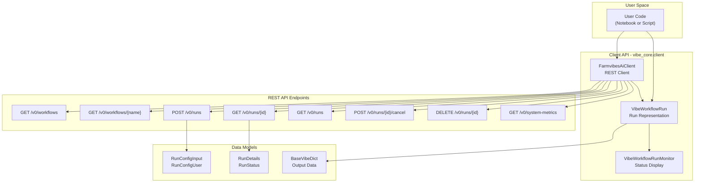
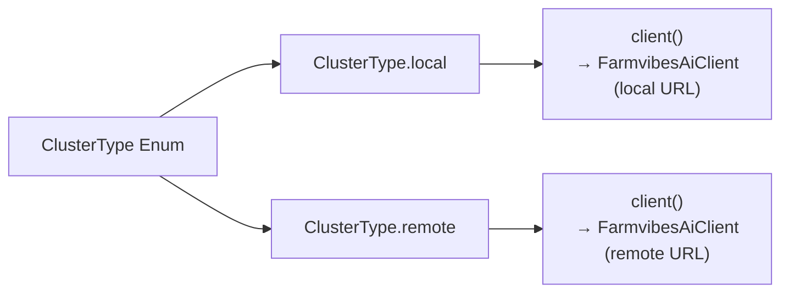
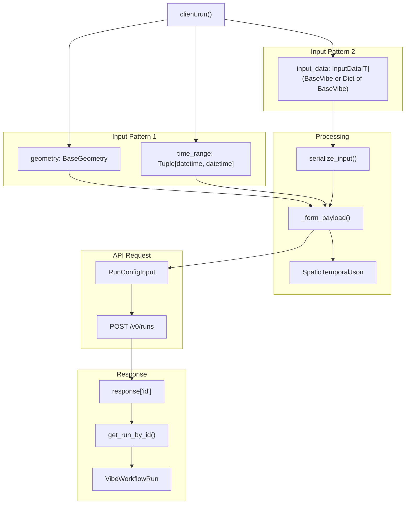
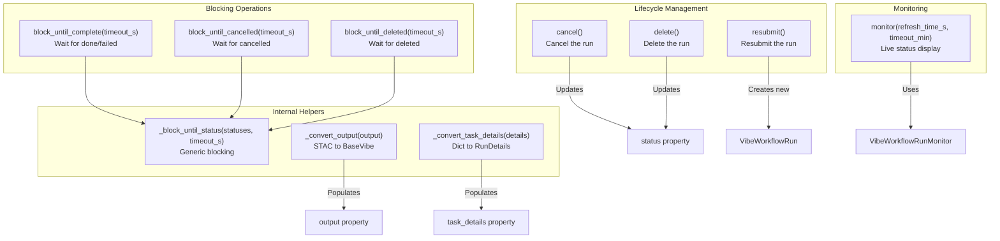
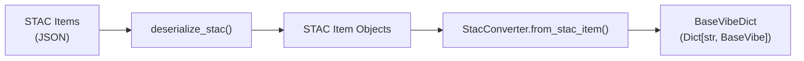
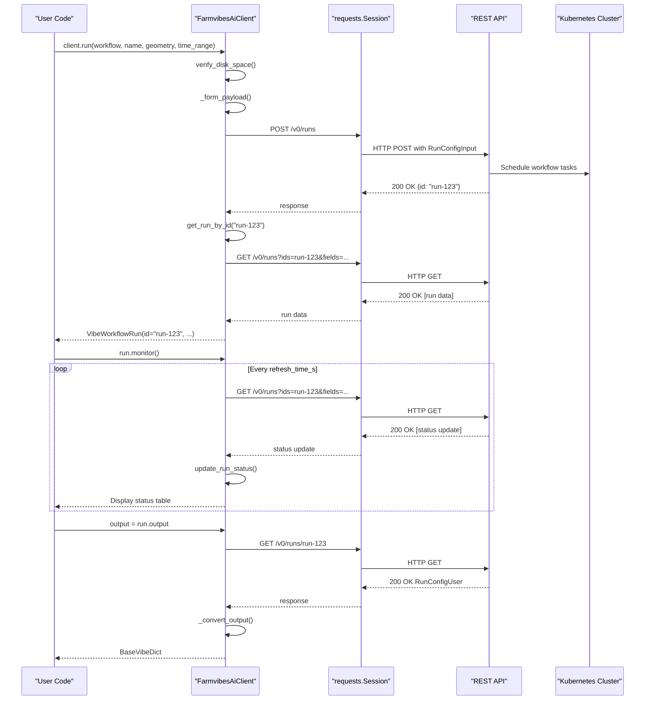

<!-- source: DeepWiki mcp.deepwiki.com · repo microsoft/farmvibes-ai · page 3.4 Client API · fetched 2026-10-26 -->

# Client API

<details>
<summary>Relevant source files</summary>

The following files were used as context for generating this wiki page:

- [src/vibe_core/vibe_core/client.py](src/vibe_core/vibe_core/client.py)
- [src/vibe_core/vibe_core/data/core_types.py](src/vibe_core/vibe_core/data/core_types.py)
- [src/vibe_core/vibe_core/monitor.py](src/vibe_core/vibe_core/monitor.py)

</details>


## Purpose and Scope

This document describes the FarmVibes.AI Client API, which provides programmatic access to the FarmVibes.AI platform. The Client API enables users to list workflows, submit workflow runs, monitor execution, retrieve results, and manage workflow lifecycle from Python applications or Jupyter notebooks.

For information about the underlying data models used by the Client API, see [Data Models](#3.3). For practical guides on using the client in notebooks and workflows, see [Running Workflows](#5.2) and [Monitoring and Debugging](#5.3).

**Sources:** [src/vibe_core/vibe_core/client.py:1-10]()

---

## Overview

The Client API is implemented in the `vibe_core` package and consists of three primary components:

1. **FarmvibesAiClient** - The main client class that communicates with the FarmVibes.AI REST API
2. **VibeWorkflowRun** - Represents a workflow run and provides methods to interact with it
3. **VibeWorkflowRunMonitor** - Provides rich console output for monitoring workflow execution status

The client follows a REST-based architecture, making HTTP requests to the FarmVibes.AI service endpoints and deserializing responses into Python objects.



**Client API Architecture**

**Sources:** [src/vibe_core/vibe_core/client.py:145-190](), [src/vibe_core/vibe_core/client.py:729-806]()

---

## Client Initialization and Configuration

### Creating a Client Instance

The `FarmvibesAiClient` class requires a base URL to the FarmVibes.AI service. The service URL is typically stored in a configuration file or can be provided directly.

| Function | Purpose | Return Type |
|----------|---------|-------------|
| `get_local_service_url()` | Retrieves local service URL from config file | `str` |
| `get_remote_service_url()` | Retrieves remote service URL from config file | `str` |
| `get_vibe_client(url)` | Creates client with specified URL | `FarmvibesAiClient` |
| `get_default_vibe_client(type)` | Creates client for specified cluster type | `FarmvibesAiClient` |

**Configuration File Paths:**
- Local service URL: `~/.config/farmvibes-ai/service_url`
- Remote service URL: `~/.config/farmvibes-ai/remote_service_url`
- Fallback URL: `http://127.0.0.1:31108/`

**Sources:** [src/vibe_core/vibe_core/client.py:51-75](), [src/vibe_core/vibe_core/client.py:1038-1104]()

### ClusterType Enumeration

The `ClusterType` enum provides convenient access to local or remote clusters:



**ClusterType Pattern**

**Sources:** [src/vibe_core/vibe_core/client.py:87-103]()

---

## Workflow Discovery and Documentation

### Listing Available Workflows

The `list_workflows()` method returns a list of all workflow names available on the service.

**Method Signature:**
```python
def list_workflows(self) -> List[str]
```

**REST Endpoint:** `GET /v0/workflows`

**Sources:** [src/vibe_core/vibe_core/client.py:267-277]()

### Describing Workflows

The `describe_workflow()` method retrieves detailed information about a workflow, including inputs, outputs, parameters, and task descriptions.

**Method Signature:**
```python
def describe_workflow(self, workflow_name: str) -> Dict[str, Any]
```

**REST Endpoint:** `GET /v0/workflows/{workflow_name}?return_format=description`

**Returned Dictionary Keys:**
- `name` - Workflow name
- `description` - `TaskDescription` object with workflow documentation
- `inputs` - Dictionary of input port names and types
- `outputs` - Dictionary of output port names and types
- `parameters` - Dictionary of parameter names and default values

**Sources:** [src/vibe_core/vibe_core/client.py:279-307]()

### Getting Workflow YAML

The `get_workflow_yaml()` method retrieves the YAML definition of a workflow.

**Method Signature:**
```python
def get_workflow_yaml(self, workflow_name: str) -> str
```

**REST Endpoint:** `GET /v0/workflows/{workflow_name}?return_format=yaml`

**Sources:** [src/vibe_core/vibe_core/client.py:322-338]()

### Printing Workflow Documentation

The `document_workflow()` method prints formatted documentation using `VibeWorkflowDocumenter`.

**Method Signature:**
```python
def document_workflow(self, workflow_name: str) -> None
```

**Sources:** [src/vibe_core/vibe_core/client.py:414-438](), [src/vibe_core/vibe_core/monitor.py:71-191]()

---

## Workflow Execution

### Submitting a Workflow Run

The `run()` method submits a new workflow run to the service. It supports two patterns for providing input data:

1. **Geometry and Time Range** - Simple spatiotemporal input
2. **Input Data** - Complex input using `BaseVibe` objects



**Workflow Run Submission Flow**

**Method Signature:**
```python
@overload
def run(
    self,
    workflow: Union[str, Dict[str, Any]],
    name: str,
    *,
    geometry: BaseGeometry,
    time_range: Tuple[datetime, datetime],
    parameters: Optional[Dict[str, Any]] = None,
) -> VibeWorkflowRun: ...

@overload
def run(
    self,
    workflow: Union[str, Dict[str, Any]],
    name: str,
    *,
    input_data: InputData[T],
    parameters: Optional[Dict[str, Any]] = None,
) -> VibeWorkflowRun: ...
```

**Parameters:**
| Parameter | Type | Required | Description |
|-----------|------|----------|-------------|
| `workflow` | `str` or `Dict[str, Any]` | Yes | Workflow name or definition |
| `name` | `str` | Yes | Name for this run |
| `geometry` | `BaseGeometry` | Pattern 1 | Shapely geometry (Point, Polygon, etc.) |
| `time_range` | `Tuple[datetime, datetime]` | Pattern 1 | Start and end timestamps |
| `input_data` | `InputData[T]` | Pattern 2 | BaseVibe objects or dict of BaseVibe |
| `parameters` | `Dict[str, Any]` | No | Workflow-specific parameters |

**REST Endpoint:** `POST /v0/runs`

**Sources:** [src/vibe_core/vibe_core/client.py:546-612](), [src/vibe_core/vibe_core/client.py:191-239]()

### Resubmitting a Workflow Run

The `resubmit_run()` method creates a new run with the same configuration as an existing run.

**Method Signature:**
```python
def resubmit_run(self, run_id: str) -> VibeWorkflowRun
```

**REST Endpoint:** `POST /v0/runs/{run_id}/resubmit`

**Sources:** [src/vibe_core/vibe_core/client.py:614-626]()

---

## Run Management

### Listing Runs

The `list_runs()` method retrieves workflow runs with optional filtering.

**Method Signature:**
```python
def list_runs(
    self,
    ids: Optional[Union[str, List[str]]] = None,
    fields: Optional[Union[str, List[str]]] = None,
) -> List[Dict[str, Any]]
```

**Parameters:**
- `ids` - Filter by run IDs
- `fields` - Select specific fields to return

**REST Endpoint:** `GET /v0/runs?ids={ids}&fields={fields}`

**Sources:** [src/vibe_core/vibe_core/client.py:440-463]()

### Getting Runs by ID

| Method | Purpose | Return Type |
|--------|---------|-------------|
| `get_run_by_id(id)` | Get single run by ID | `VibeWorkflowRun` |
| `get_last_runs(n)` | Get last n runs | `List[VibeWorkflowRun]` |

**Sources:** [src/vibe_core/vibe_core/client.py:465-506]()

### Describing a Run

The `describe_run()` method retrieves complete run configuration and details.

**Method Signature:**
```python
def describe_run(self, run_id: str) -> RunConfigUser
```

**REST Endpoint:** `GET /v0/runs/{run_id}`

**Returned Object (`RunConfigUser`):**
- `id` - Run ID
- `name` - Run name
- `workflow` - Workflow name or definition
- `parameters` - Parameters used
- `details` - `RunDetails` with status, start/end times
- `task_details` - Dictionary of task statuses
- `output` - Dictionary of output data (when done)

**Sources:** [src/vibe_core/vibe_core/client.py:391-412]()

### Cancelling and Deleting Runs

| Method | Purpose | Allowed States | REST Endpoint |
|--------|---------|----------------|---------------|
| `cancel_run(run_id)` | Cancel running/pending run | pending, running, queued | `POST /v0/runs/{id}/cancel` |
| `delete_run(run_id)` | Delete completed run and cached data | done, failed, cancelled | `DELETE /v0/runs/{id}` |

**Important:** Deleting a run removes cached data only if no other runs share operations with it.

**Sources:** [src/vibe_core/vibe_core/client.py:340-389]()

---

## VibeWorkflowRun Class

The `VibeWorkflowRun` class represents a workflow run and provides properties and methods to interact with it.

### Properties

| Property | Type | Description | Cached |
|----------|------|-------------|--------|
| `id` | `str` | Unique run identifier | Yes |
| `name` | `str` | User-assigned run name | Yes |
| `workflow` | `str` | Workflow name | Yes |
| `parameters` | `Dict[str, Any]` | Run parameters | Yes |
| `status` | `RunStatus` | Current status (pending, running, done, failed, etc.) | No |
| `task_details` | `Dict[str, RunDetails]` | Details for each task | Conditional |
| `task_status` | `Dict[str, str]` | Status of each task | No |
| `output` | `Optional[BaseVibeDict]` | Workflow output (when done) | Conditional |
| `reason` | `Optional[str]` | Status reason or failure message | No |

**Status Values (`RunStatus` enum):**
- `pending` - Waiting to start
- `queued` - Queued for execution
- `running` - Currently executing
- `done` - Completed successfully
- `failed` - Execution failed
- `cancelled` - Cancelled by user
- `deleting` - Being deleted
- `deleted` - Deleted

**Sources:** [src/vibe_core/vibe_core/client.py:729-900]()

### Methods



**VibeWorkflowRun Methods**

**Sources:** [src/vibe_core/vibe_core/client.py:902-1023]()

### Blocking Until Status

The blocking methods poll the run status at regular intervals (default 10 seconds) until a target status is reached or timeout occurs.

**Method Signature:**
```python
def block_until_complete(self, timeout_s: Optional[int] = None) -> VibeWorkflowRun
```

**Raises:** `RuntimeError` if timeout is reached before target status.

**Sources:** [src/vibe_core/vibe_core/client.py:807-837](), [src/vibe_core/vibe_core/client.py:953-993]()

### Output Conversion

When a workflow completes successfully, the `output` property converts STAC items to `BaseVibe` objects using `StacConverter`.



**Output Conversion Pipeline**

**Sources:** [src/vibe_core/vibe_core/client.py:762-780](), [src/vibe_core/vibe_core/client.py:868-877]()

---

## Workflow Monitoring

### Monitor Method

The `monitor()` method provides live status updates for one or more workflow runs.

**Method Signature (FarmvibesAiClient):**
```python
def monitor(
    self,
    runs: Union[List[VibeWorkflowRun], VibeWorkflowRun, int] = 1,
    refresh_time_s: int = 1,
    refresh_warnings_time_min: int = 5,
    timeout_min: Optional[int] = None,
    detailed_task_info: bool = False,
) -> None
```

**Method Signature (VibeWorkflowRun):**
```python
def monitor(
    self,
    refresh_time_s: int = 1,
    refresh_warnings_time_min: int = 5,
    timeout_min: Optional[int] = None,
    detailed_task_info: bool = False,
) -> None
```

**Parameters:**
| Parameter | Type | Default | Description |
|-----------|------|---------|-------------|
| `runs` | `Union[List, VibeWorkflowRun, int]` | 1 | Runs to monitor or count of last runs |
| `refresh_time_s` | `int` | 1 | Status refresh interval in seconds |
| `refresh_warnings_time_min` | `int` | 5 | Warning refresh interval in minutes |
| `timeout_min` | `Optional[int]` | None | Maximum monitoring time (None = indefinite) |
| `detailed_task_info` | `bool` | False | Show detailed task status counts |

**Sources:** [src/vibe_core/vibe_core/client.py:675-726](), [src/vibe_core/vibe_core/client.py:995-1023]()

### VibeWorkflowRunMonitor

The `VibeWorkflowRunMonitor` class implements the monitoring display using the `rich` library for formatted console output.

**Display Modes:**
1. **Single Run Mode** - Shows all tasks with individual progress
2. **Multi-Run Mode** - Shows run summary with active tasks

**Table Columns:**
| Column | Single Run | Multi-Run | Description |
|--------|-----------|-----------|-------------|
| Run Name | No | Yes | Name of the workflow run |
| Task Name | Yes | Yes | Name of the task |
| Status | Yes | Yes | Current status with color coding |
| Start Time | Yes | Yes | Task start timestamp |
| End Time | Yes | Yes | Task end timestamp |
| Duration | Yes | Yes | Elapsed time (HH:MM:SS) |
| Progress | Yes | Yes | Progress bar or subtask counts |

**Status Color Coding:**
- `pending` - Yellow
- `queued` - Yellow
- `running` - Cyan
- `done` - Green
- `failed` - Red
- `cancelled` - Yellow
- `deleting` - Dark orange
- `deleted` - Orange red

**Sources:** [src/vibe_core/vibe_core/monitor.py:193-558]()

### Progress Display Formats

**Simple Mode (`detailed_task_info=False`):**
- Shows progress bar with completed/total count
- Example: `[██████████░░░░░░░░░░] 5/10`

**Detailed Mode (`detailed_task_info=True`):**
- Shows counts for each status
- Example: `5/2/1/1/1` = Done/Running/Queued/Pending/Failed

**Sources:** [src/vibe_core/vibe_core/monitor.py:276-309]()

---

## System Metrics and Disk Space Management

### Getting System Metrics

The `get_system_metrics()` method retrieves system resource information.

**Method Signature:**
```python
def get_system_metrics(self) -> MetricsDict
```

**REST Endpoint:** `GET /v0/system-metrics`

**Returned Metrics:**
- `disk_free` - Available disk space in bytes
- Additional platform-specific metrics

**Sources:** [src/vibe_core/vibe_core/client.py:309-320]()

### Disk Space Verification

The `verify_disk_space()` method checks if sufficient cache space is available and issues warnings when low.

**Threshold:** 50 GiB (configurable via `DISK_FREE_THRESHOLD_BYTES`)

**Automatic Checks:**
- Before submitting new runs (`run()`, `resubmit_run()`)
- Periodically during monitoring (every 5 minutes by default)

**Warning Message:**
```
RuntimeWarning: The FarmVibes.AI cache is running low on disk space 
and only has X.X GiB left. Please consider clearing the cache to 
free up space and to avoid potential failures.
```

**Sources:** [src/vibe_core/vibe_core/client.py:241-265](), [src/vibe_core/vibe_core/client.py:77-78]()

---

## API Request Flow



**Complete API Interaction Flow**

**Sources:** [src/vibe_core/vibe_core/client.py:165-189](), [src/vibe_core/vibe_core/client.py:567-612](), [src/vibe_core/vibe_core/client.py:628-726]()

---

## Time Zone Handling

The client and API may operate in different time zones. The `get_api_time_zone()` method determines the API server's time zone from the `date` HTTP header.

**Time Zone Conversions:**
- API timestamps are received in API time zone
- Converted to client time zone for display
- All `datetime` objects in `DataVibe` are stored in UTC

**Sources:** [src/vibe_core/vibe_core/client.py:508-544](), [src/vibe_core/vibe_core/monitor.py:239-274]()

---

## Error Handling

### HTTP Errors

The `_request()` method raises `HTTPError` with detailed messages when API calls fail.

**Error Message Format:**
```
HTTPError: 400 Client Error: Bad Request for url: ... <error details from API>
```

**Sources:** [src/vibe_core/vibe_core/client.py:165-189]()

### Timeout Errors

Blocking methods raise `RuntimeError` when timeout is exceeded:

```
RuntimeError: Timeout of {timeout_s}s reached while waiting for the workflow to have 
a status of {status_options}. Workflow is currently in status {current_status}.
```

**Sources:** [src/vibe_core/vibe_core/client.py:829-836]()

### Validation Errors

Input validation errors are raised before API calls:
- Missing required parameters
- Invalid geometry/time range combinations
- Invalid run counts (e.g., n <= 0)

**Sources:** [src/vibe_core/vibe_core/client.py:230-231](), [src/vibe_core/vibe_core/client.py:495-506]()

---

## Usage Patterns

### Pattern 1: Simple Workflow Execution

```python
from vibe_core.client import get_default_vibe_client
from shapely.geometry import Point
from datetime import datetime, timedelta

# Create client
client = get_default_vibe_client()

# Define input
geometry = Point(-120.0, 35.0).buffer(0.01)
end_time = datetime.now()
start_time = end_time - timedelta(days=30)

# Submit run
run = client.run(
    workflow="data_ingestion/sentinel2/preprocess_s2",
    name="my_sentinel2_run",
    geometry=geometry,
    time_range=(start_time, end_time)
)

# Monitor until complete
run.block_until_complete()

# Get output
output = run.output
```

### Pattern 2: Monitoring Multiple Runs

```python
# Submit multiple runs
runs = []
for region in regions:
    run = client.run(workflow="...", name=f"run_{region}", geometry=region, ...)
    runs.append(run)

# Monitor all runs simultaneously
client.monitor(runs, detailed_task_info=True)
```

### Pattern 3: Run Management

```python
# List recent runs
recent_runs = client.get_last_runs(10)

# Cancel active run
if recent_runs[0].status == RunStatus.running:
    recent_runs[0].cancel()
    recent_runs[0].block_until_cancelled()

# Delete completed run
if recent_runs[1].status == RunStatus.done:
    recent_runs[1].delete()
```

**Sources:** [src/vibe_core/vibe_core/client.py:145-1104]()

---

