<!-- source: DeepWiki mcp.deepwiki.com · repo microsoft/farmvibes-ai · page 4 Workflows · fetched 2026-10-26 -->

# Workflows

<details>
<summary>Relevant source files</summary>

The following files were used as context for generating this wiki page:

- [docs/source/docfiles/markdown/WORKFLOW_LIST.md](docs/source/docfiles/markdown/WORKFLOW_LIST.md)
- [src/vibe_core/vibe_core/cli/helper.py](src/vibe_core/vibe_core/cli/helper.py)
- [src/vibe_core/vibe_core/client.py](src/vibe_core/vibe_core/client.py)
- [src/vibe_core/vibe_core/data/core_types.py](src/vibe_core/vibe_core/data/core_types.py)

</details>


## Purpose and Scope

This document explains the workflow system in FarmVibes.AI, including the DAG-based architecture, workflow types, definition format, and execution model. Workflows are the primary abstraction for orchestrating data processing pipelines in the platform.

For information about submitting and managing workflow runs, see [Running Workflows](#5.2). For documentation of specific workflows organized by category, see [Data Ingestion Workflows](#4.1), [Data Processing Workflows](#4.2), and [FarmAI and ML Workflows](#4.3). For a comprehensive catalog of all workflows, see [Workflow Catalog](#8.2).

---

## Overview

Workflows in FarmVibes.AI are directed acyclic graphs (DAGs) that define data processing pipelines. Each workflow consists of a set of operators (tasks) connected by edges that specify data dependencies. Workflows transform input data through a series of operations to produce output data products.

The workflow system provides:

- **Composability**: Workflows can be composed from reusable operators and sub-workflows
- **Type Safety**: Strongly-typed inputs and outputs ensure data compatibility between operators
- **Distributed Execution**: Tasks execute in parallel across Kubernetes pods with Dapr coordination
- **Data Caching**: Intermediate results are cached and reused across workflow runs
- **Declarative Definition**: Workflows are defined in YAML format with clear separation of structure and logic

Sources: [docs/source/docfiles/markdown/WORKFLOW_LIST.md:1-12]()

---

## Workflow Architecture

### DAG Structure

Each workflow is a directed acyclic graph where:

- **Nodes** represent operators (atomic units of computation)
- **Edges** represent data flows between operators
- **Sources** are input ports that receive data from the workflow runner
- **Sinks** are output ports that provide results to the user

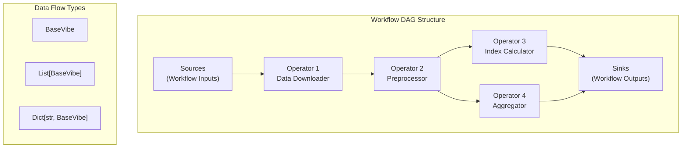

**Workflow DAG Components**

Sources: [docs/source/docfiles/markdown/WORKFLOW_LIST.md:3-11]()

### Operator Structure

Each operator in the workflow graph is an independent computational unit that:

- Declares typed input and output ports
- Implements a `run()` method that processes input data
- Executes in isolation within a Docker container
- Communicates via Dapr pub/sub messaging

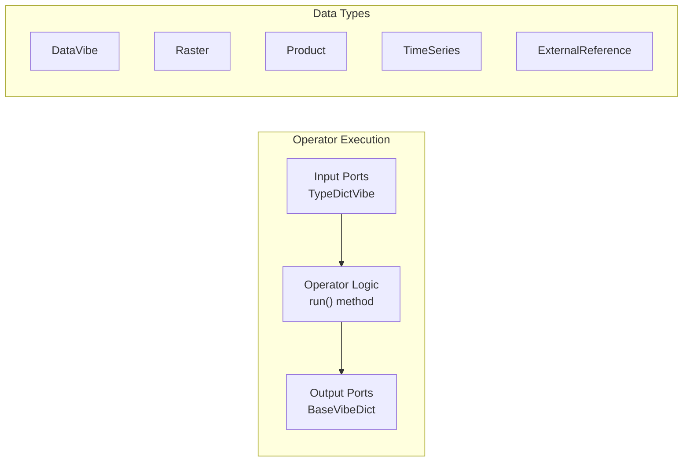

**Operator Input/Output Flow**

Sources: [src/vibe_core/vibe_core/data/core_types.py:96-102](), [src/vibe_core/vibe_core/data/core_types.py:104-146]()

---

## Workflow Categories

FarmVibes.AI organizes workflows into five major categories based on their purpose and domain:

| Category | Description | Example Workflows |
|----------|-------------|-------------------|
| **data_ingestion** | Download and preprocess data from external sources | `sentinel2/preprocess_s2`, `landsat/preprocess_landsat`, `spaceeye/spaceeye`, `weather/download_era5` |
| **data_processing** | Transform and analyze data | `index/index`, `timeseries/timeseries_aggregation`, `clip/clip`, `linear_trend/chunked_linear_trend` |
| **farm_ai** | Agricultural application workflows | `agriculture/ndvi_summary`, `agriculture/canopy_cover`, `carbon_local/carbon_whatif`, `segmentation/segment_s2` |
| **forest_ai** | Forest monitoring workflows | `deforestation/alos_trend_detection`, `deforestation/ordinal_trend_detection` |
| **ml** | Machine learning workflows | `crop_segmentation`, `segment_anything/automatic_segmentation`, `dataset_generation/datagen_crop_segmentation` |

Sources: [docs/source/docfiles/markdown/WORKFLOW_LIST.md:3-11]()

### Category Relationships

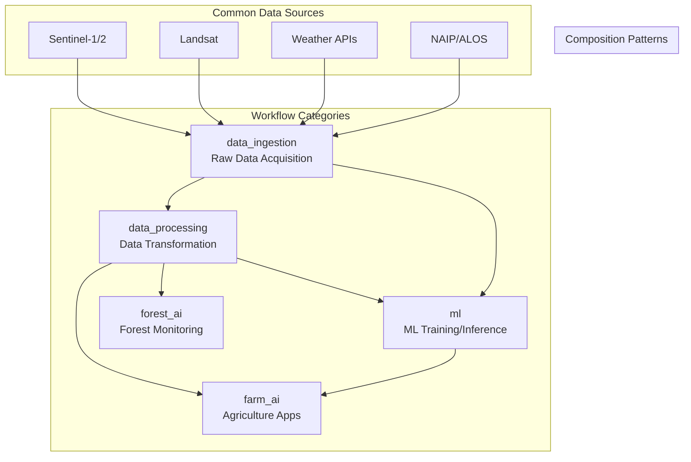

**Workflow Category Dependencies**

Sources: [docs/source/docfiles/markdown/WORKFLOW_LIST.md:16-210]()

---

## Workflow Definition Format

Workflows are defined in YAML files with the following structure:

### Core Components

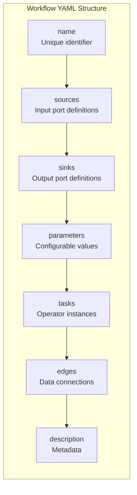

**Workflow Definition Structure**

### Type System

Workflows use a strongly-typed system based on the `BaseVibe` hierarchy:

- **Type Specifications**: Port types are defined using `TypeDictVibe` validation
- **Type Parsing**: The `TypeParser` class converts string type specifications to Python types
- **Inheritance**: Ports can inherit types using `@INHERIT(port_name)` syntax
- **Container Types**: Support for `List[T]` where T is a `BaseVibe` subclass

Sources: [src/vibe_core/vibe_core/data/core_types.py:104-146](), [src/vibe_core/vibe_core/data/core_types.py:148-222]()

### Parameter System

Workflows accept parameters that configure operator behavior:

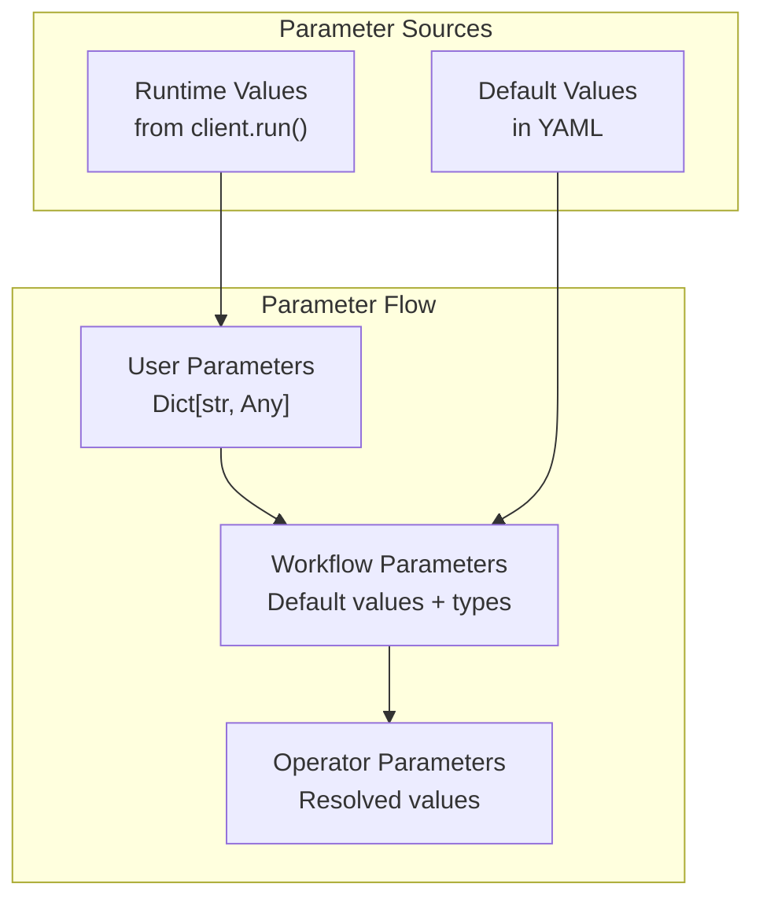

**Workflow Parameter Resolution**

Sources: [src/vibe_core/vibe_core/client.py:191-239]()

---

## Workflow Execution Model

### Submission and Initialization

When a user submits a workflow run via the `FarmvibesAiClient`, the following sequence occurs:

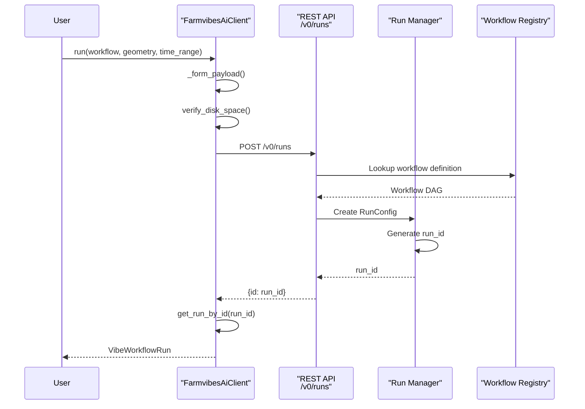

**Workflow Submission Sequence**

Sources: [src/vibe_core/vibe_core/client.py:567-613](), [src/vibe_core/vibe_core/client.py:191-239]()

### Task Scheduling and Execution

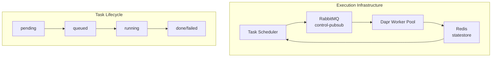

**Task Execution Architecture**

The execution model follows these principles:

1. **Parallel Execution**: Independent tasks execute concurrently across worker pods
2. **Data Dependencies**: Tasks wait for upstream dependencies before starting
3. **State Persistence**: Task status and outputs are stored in Redis via Dapr
4. **Fault Tolerance**: Failed tasks can be retried according to resiliency policies
5. **Result Caching**: Completed task outputs are cached and reused across runs

Sources: [src/vibe_core/vibe_core/client.py:628-727]()

### Run Status Tracking

Workflow runs progress through the following states defined in `RunStatus`:

| Status | Description |
|--------|-------------|
| `pending` | Run created, waiting to start |
| `queued` | Tasks queued for execution |
| `running` | Tasks actively executing |
| `done` | All tasks completed successfully |
| `failed` | One or more tasks failed |
| `cancelled` | Run cancelled by user |
| `deleted` | Run and cached data deleted |

Sources: [src/vibe_core/vibe_core/client.py:839-901]()

---

## Working with Workflows

### Listing Available Workflows

The `FarmvibesAiClient.list_workflows()` method returns all available workflow names:

```python
client.list_workflows() -> List[str]
```

This retrieves workflow names from the workflow registry at endpoint `/v0/workflows`.

Sources: [src/vibe_core/vibe_core/client.py:267-277]()

### Describing Workflow Structure

The `describe_workflow()` method returns the complete workflow definition:

```python
client.describe_workflow(workflow_name: str) -> Dict[str, Any]
```

Returns a dictionary with keys:
- `name`: Workflow identifier
- `description`: `TaskDescription` object with metadata
- `inputs`: Source port specifications
- `outputs`: Sink port specifications
- `parameters`: Parameter definitions with types and defaults

Sources: [src/vibe_core/vibe_core/client.py:279-307]()

### Running Workflows

Workflows are executed using the `run()` method with two input patterns:

**Pattern 1: Geometry and Time Range**
```python
run = client.run(
    workflow="sentinel2/preprocess_s2",
    name="my_run",
    geometry=shapely_geometry,
    time_range=(start_datetime, end_datetime),
    parameters={"resolution": 10}
)
```

**Pattern 2: Structured Input Data**
```python
run = client.run(
    workflow="index/index",
    name="ndvi_calculation",
    input_data=raster_list,
    parameters={"index": "ndvi"}
)
```

The method returns a `VibeWorkflowRun` object for monitoring and output retrieval.

Sources: [src/vibe_core/vibe_core/client.py:567-613]()

### Monitoring Execution

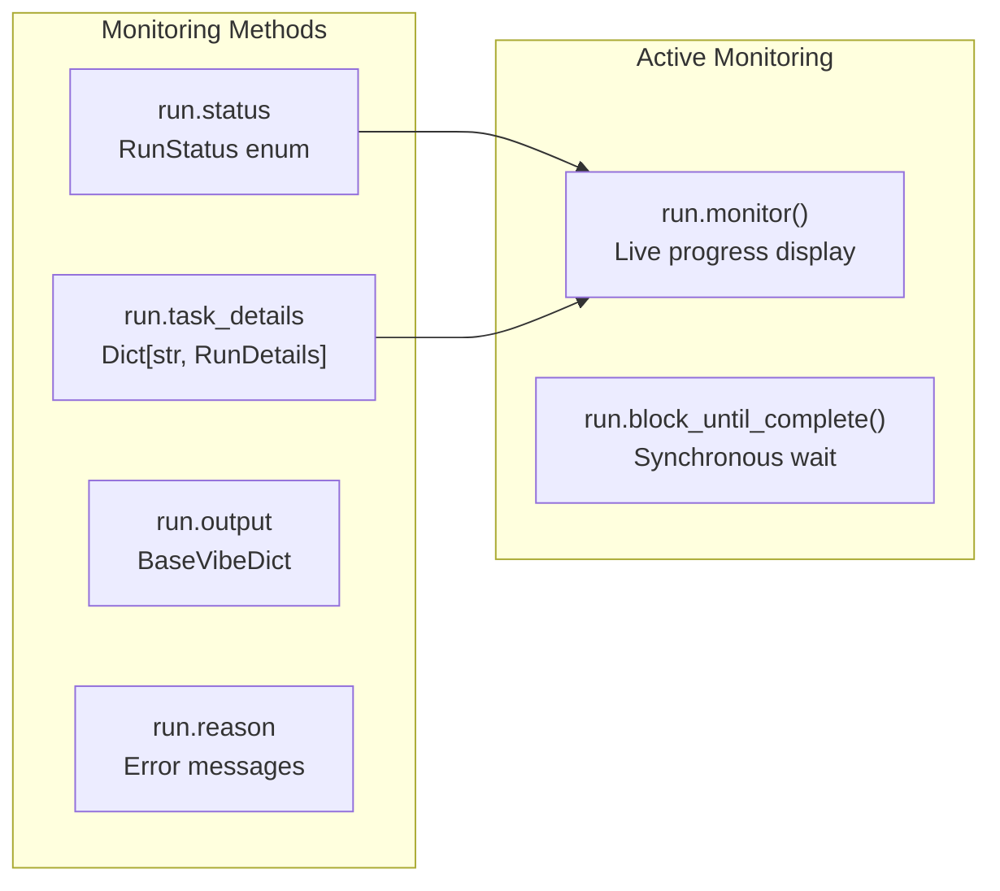

**Workflow Run Monitoring API**

The `VibeWorkflowRun` class provides several methods for tracking execution:

- `status` property: Current run status (cached after completion)
- `task_details` property: Per-task execution details
- `output` property: Final workflow outputs (only available when `status == done`)
- `monitor()` method: Display live progress with auto-refresh
- `block_until_complete()` method: Synchronous wait for completion

Sources: [src/vibe_core/vibe_core/client.py:729-1036](), [src/vibe_core/vibe_core/client.py:839-901]()

### Output Data Access

When a workflow run completes successfully, outputs are retrieved via the `output` property:

```python
run.output -> Optional[BaseVibeDict]
```

The returned `BaseVibeDict` is a dictionary where:
- Keys are sink port names from the workflow definition
- Values are `BaseVibe` objects or `List[BaseVibe]` depending on the sink type

The conversion from STAC items to `BaseVibe` objects is handled by `StacConverter`:

Sources: [src/vibe_core/vibe_core/client.py:867-878](), [src/vibe_core/vibe_core/client.py:762-780]()

### Run Lifecycle Management

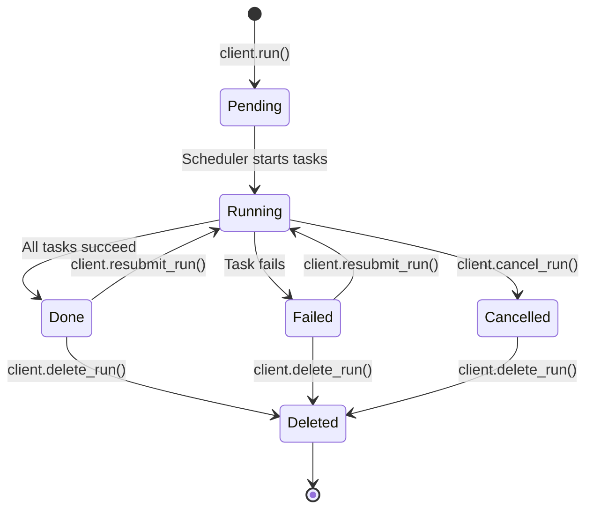

**Workflow Run State Machine**

Available lifecycle operations:

- `cancel()`: Stop execution of in-progress run
- `delete()`: Remove completed run and cached data
- `resubmit()`: Create new run with same configuration

Sources: [src/vibe_core/vibe_core/client.py:902-932](), [src/vibe_core/vibe_core/client.py:340-389]()

---

## Data Caching and Reuse

The workflow system implements intelligent caching to avoid redundant computation:

### Cache Key Generation

Each task output is cached with a key derived from:
- Operator name and version
- Input data hash IDs
- Parameter values

When a new workflow run requests the same computation, the cached result is reused instead of re-executing the task.

### Storage Model

Cached data is stored as:
- **Metadata**: STAC items in Redis state store
- **Assets**: Files in persistent storage (local or cloud)
- **References**: `AssetVibe` objects with URLs or local paths

Sources: [src/vibe_core/vibe_core/data/core_types.py:224-300](), [src/vibe_core/vibe_core/data/core_types.py:344-362]()

### Cache Cleanup

The `delete_run()` method removes cached data that is not shared with other runs:

- Checks reference counts for each cached item
- Deletes assets and metadata when reference count reaches zero
- Preserves shared intermediate results

Sources: [src/vibe_core/vibe_core/client.py:364-389]()

---

## Data Types in Workflows

Workflows operate on strongly-typed data objects derived from `BaseVibe`:

### Core Type Hierarchy

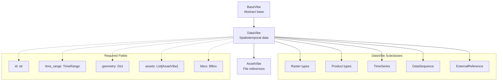

**BaseVibe Type Hierarchy**

### Key Data Type Properties

All `DataVibe` objects include:

- `id`: Unique identifier (SHA-256 hash or user-provided)
- `time_range`: Start and end timestamps (UTC timezone)
- `geometry`: GeoJSON-compatible geometry dictionary
- `bbox`: Bounding box calculated from geometry
- `assets`: List of file references (rasters, vectors, etc.)

Sources: [src/vibe_core/vibe_core/data/core_types.py:455-511](), [src/vibe_core/vibe_core/data/core_types.py:302-411]()

### Data Sequences

The `DataSequence` type supports workflows that process ordered collections:

```python
@dataclass
class DataSequence(DataVibe):
    asset_order: Dict[str, int]
    asset_time_range: Dict[str, TimeRange]
    asset_geometry: Dict[str, BaseGeometry]
```

This enables time-series workflows to maintain temporal ordering while processing data in parallel.

Sources: [src/vibe_core/vibe_core/data/core_types.py:556-615]()

---

## Workflow Composition

Complex workflows can be built by composing simpler workflows:

### Sub-workflow Pattern

A workflow can include another workflow as an operator, creating nested DAGs:

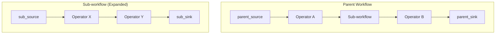

**Nested Workflow Composition**

This pattern is used extensively in `farm_ai` workflows, which combine data ingestion and processing workflows to deliver end-to-end solutions.

Sources: [docs/source/docfiles/markdown/WORKFLOW_LIST.md:143-187]()

---

## Summary

The FarmVibes.AI workflow system provides a robust, scalable framework for geospatial data processing:

- **DAG-based architecture** enables parallel execution and clear data dependencies
- **Type-safe data model** ensures compatibility between workflow stages
- **Distributed execution** leverages Kubernetes and Dapr for scalability
- **Intelligent caching** avoids redundant computation across runs
- **Composable workflows** allow building complex pipelines from reusable components
- **Five workflow categories** organize operations by domain and purpose

For practical examples of using workflows, see [Running Workflows](#5.2). For detailed documentation of individual workflows, see [Data Ingestion Workflows](#4.1), [Data Processing Workflows](#4.2), and [FarmAI and ML Workflows](#4.3).

---

