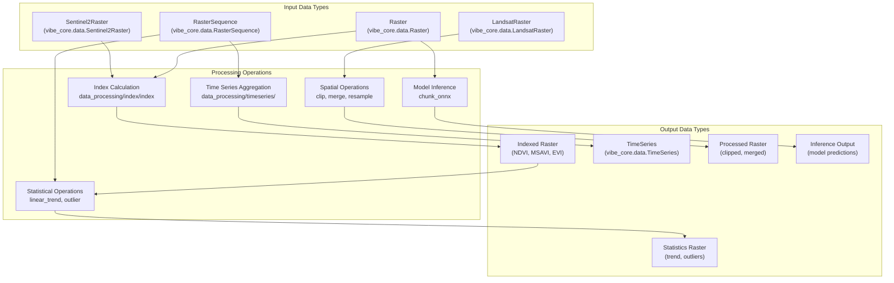
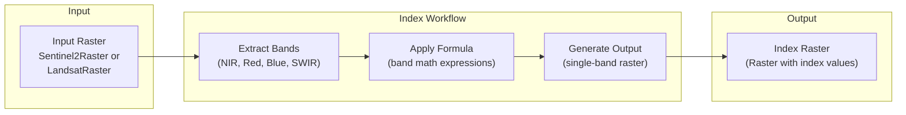
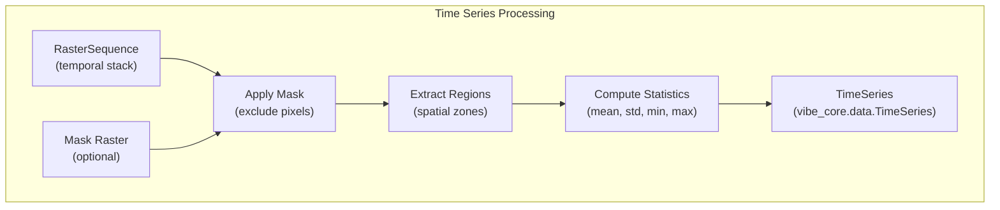
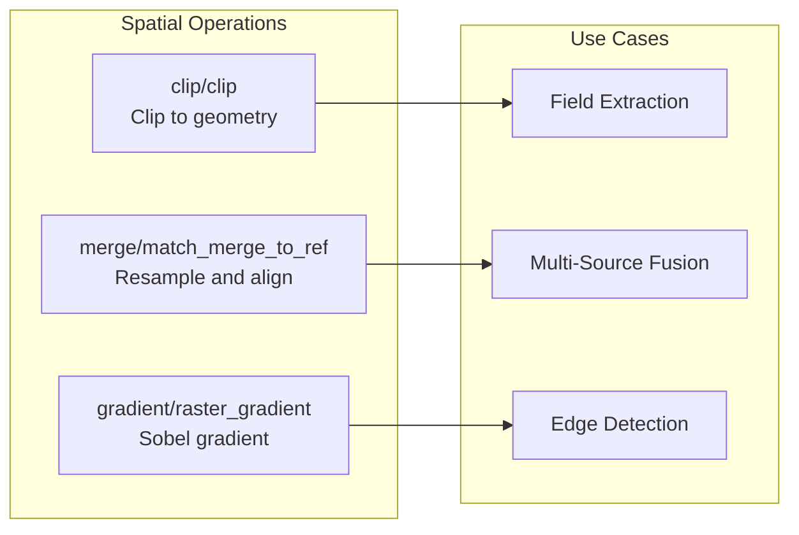
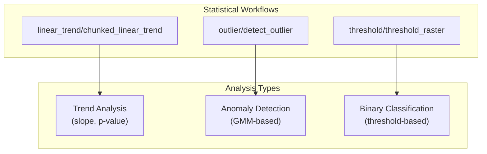
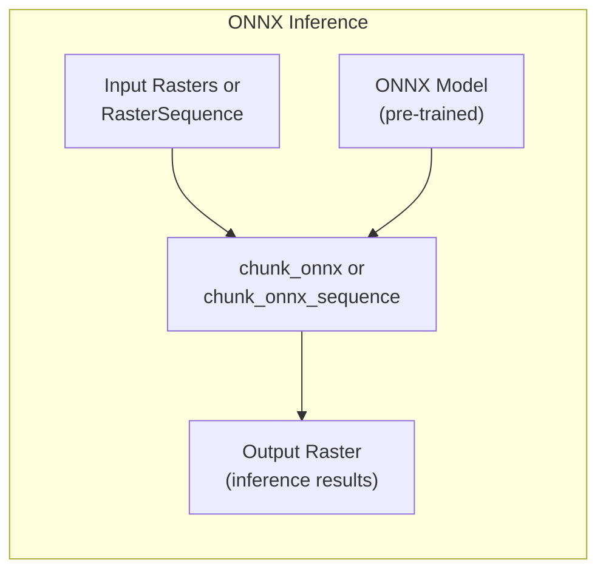
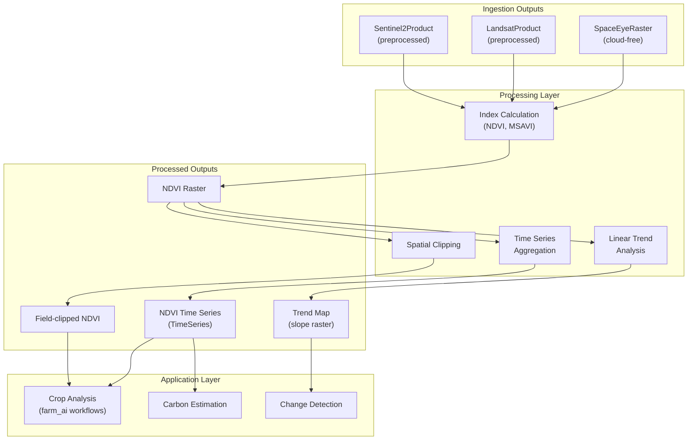
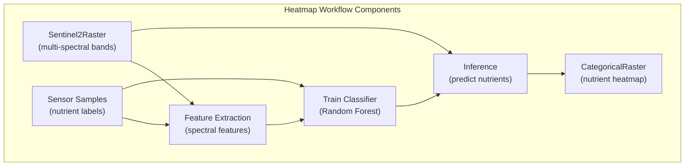
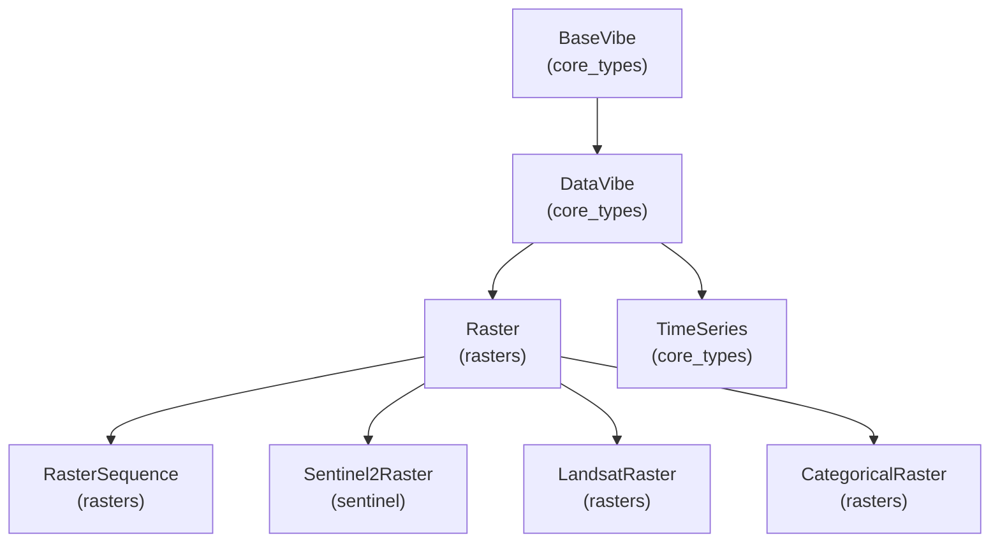

<!-- source: DeepWiki mcp.deepwiki.com · repo microsoft/farmvibes-ai · page 4.2 Data Processing Workflows · fetched 2026-10-26 -->

# Data Processing Workflows

<details>
<summary>Relevant source files</summary>

The following files were used as context for generating this wiki page:

- [docs/source/docfiles/markdown/WORKFLOW_LIST.md](docs/source/docfiles/markdown/WORKFLOW_LIST.md)
- [src/vibe_core/vibe_core/cli/helper.py](src/vibe_core/vibe_core/cli/helper.py)
- [src/vibe_core/vibe_core/data/__init__.py](src/vibe_core/vibe_core/data/__init__.py)

</details>


## Purpose and Scope

This document covers data processing workflows in FarmVibes.AI that transform ingested data into derived products and analytics. These workflows consume outputs from data ingestion workflows (see [Data Ingestion Workflows](#4.1)) and produce processed datasets for agricultural applications and machine learning workflows (see [FarmAI and ML Workflows](#4.3)).

Data processing workflows perform operations such as:
- Computing spectral indices (NDVI, MSAVI, EVI)
- Time series aggregation and statistical analysis
- Spatial operations (clipping, resampling, merging)
- Gradient and linear trend computation
- Outlier detection and thresholding
- ONNX model inference for transformation tasks

For information about the general workflow system architecture, see [Workflows](#4). For details on running and monitoring workflows, see [Running Workflows](#5.2) and [Monitoring and Debugging](#5.3).

**Sources:** [docs/source/docfiles/markdown/WORKFLOW_LIST.md:1-14]()

## Overview

Data processing workflows are DAG-based pipelines that transform raster data, products, and other data vibes into derived datasets. They bridge the gap between raw ingested data and application-specific insights, implementing standard geospatial operations, statistical computations, and machine learning inference.

These workflows operate on the `BaseVibe` data model hierarchy, consuming types like `Raster`, `RasterSequence`, `Sentinel2Raster`, and producing processed outputs such as indexed rasters, time series statistics, and aggregated products.



**Sources:** [docs/source/docfiles/markdown/WORKFLOW_LIST.md:7-8](), [src/vibe_core/vibe_core/data/__init__.py:1-93]()

## Processing Workflow Categories

### Index Calculation Workflows

Index calculation workflows compute spectral indices from multi-band rasters. The primary workflow is `data_processing/index/index`, which applies mathematical expressions to raster bands to derive vegetation indices, moisture indices, and other spectral metrics.

**Workflow:** `data_processing/index/index`

**Common Indices:**
- **NDVI** (Normalized Difference Vegetation Index): `(NIR - Red) / (NIR + Red)`
- **MSAVI** (Modified Soil-Adjusted Vegetation Index): Complex soil-brightness correction
- **EVI** (Enhanced Vegetation Index): Improved sensitivity in high biomass regions
- **Methane Index**: For detecting methane emissions from ultra-emitters



**Sources:** [docs/source/docfiles/markdown/WORKFLOW_LIST.md:128]()

### Time Series Processing Workflows

Time series workflows aggregate spatial raster data over time, computing statistical measures across pixel regions. Two primary workflows exist:

**Workflow:** `data_processing/timeseries/timeseries_aggregation`

Computes mean, standard deviation, maximum, and minimum values across all regions of input rasters and produces a `TimeSeries` object.

**Workflow:** `data_processing/timeseries/timeseries_masked_aggregation`

Similar to `timeseries_aggregation`, but applies a mask raster to exclude certain pixels from the computation (e.g., masking out clouds or non-field areas).

| Workflow | Input Types | Output Type | Key Parameters |
|----------|-------------|-------------|----------------|
| `timeseries_aggregation` | `RasterSequence` | `TimeSeries` | Region definitions |
| `timeseries_masked_aggregation` | `RasterSequence`, Mask | `TimeSeries` | Region definitions, mask raster |



**Sources:** [docs/source/docfiles/markdown/WORKFLOW_LIST.md:138-141](), [src/vibe_core/vibe_core/data/__init__.py:27-28]()

### Spatial Operation Workflows

Spatial operation workflows perform geometric transformations and raster manipulations.

#### Clipping: `data_processing/clip/clip`

Performs spatial clip on an input raster based on a reference geometry. Useful for extracting field boundaries or regions of interest.

#### Merging and Resampling: `data_processing/merge/match_merge_to_ref`

Resamples input rasters to match a reference raster's grid, enabling multi-source data fusion. This ensures consistent spatial resolution and alignment across datasets from different sensors.

#### Gradient Computation: `data_processing/gradient/raster_gradient`

Computes the spatial gradient of each band using a Sobel operator, useful for edge detection and terrain analysis.



**Sources:** [docs/source/docfiles/markdown/WORKFLOW_LIST.md:121-133]()

### Statistical Analysis Workflows

Statistical workflows identify patterns, trends, and anomalies in raster data.

#### Linear Trend: `data_processing/linear_trend/chunked_linear_trend`

Computes pixel-wise linear trend over a sequence of rasters (e.g., NDVI time series), producing slope and significance maps for trend analysis.

#### Outlier Detection: `data_processing/outlier/detect_outlier`

Fits a single-component Gaussian Mixture Model (GMM) over input data to detect outliers according to a threshold parameter. Useful for identifying anomalous pixels or regions.

#### Thresholding: `data_processing/threshold/threshold_raster`

Applies threshold values to raster pixels, creating binary or multi-class masks based on pixel intensity.



**Sources:** [docs/source/docfiles/markdown/WORKFLOW_LIST.md:130-137]()

### ONNX Model Inference Workflows

These workflows run ONNX (Open Neural Network Exchange) models over raster data to perform machine learning inference as a data processing step.

**Workflow:** `data_processing/chunk_onnx/chunk_onnx`

Runs an ONNX model over all input rasters to produce a single output raster. Processes rasters in chunks for memory efficiency.

**Workflow:** `data_processing/chunk_onnx/chunk_onnx_sequence`

Similar to `chunk_onnx`, but operates on raster sequences, applying temporal models that consume multiple time steps.

These workflows enable integration of pre-trained models (e.g., classification, segmentation) into processing pipelines without requiring model-specific operators.



**Sources:** [docs/source/docfiles/markdown/WORKFLOW_LIST.md:117-120]()

## Data Flow Through Processing Pipelines

Processing workflows typically consume outputs from data ingestion workflows and produce inputs for application workflows. The following diagram illustrates common data flow patterns:



**Sources:** [docs/source/docfiles/markdown/WORKFLOW_LIST.md:1-14](), [src/vibe_core/vibe_core/data/__init__.py:59-90]()

## Heatmap Generation Workflow

A specialized processing workflow combines classification with spatial interpolation to generate nutrient heatmaps from sensor samples.

**Workflow:** `data_processing/heatmap/classification`

This workflow utilizes Sentinel-2 imagery and labeled sensor samples containing nutrient information (Nitrogen, Carbon, pH, Phosphorus) to train a Random Forest classifier. The inference operation predicts nutrient distribution in soil across the farm boundary, producing a nutrient heatmap.

**Input Data Types:**
- `Sentinel2Raster`: Multi-spectral satellite imagery
- Sensor samples: Labeled points with nutrient measurements

**Output:**
- `CategoricalRaster`: Nutrient classification map

**Processing Steps:**
1. Extract features from Sentinel-2 bands at sample locations
2. Train Random Forest classifier on labeled samples
3. Apply classifier to all pixels within farm boundary
4. Generate classified raster with nutrient categories



**Sources:** [docs/source/docfiles/markdown/WORKFLOW_LIST.md:125-126]()

## Data Model Integration

Processing workflows operate on the `BaseVibe` data model hierarchy defined in [src/vibe_core/vibe_core/data/__init__.py](). Key types include:

| Type | Purpose | Module |
|------|---------|--------|
| `Raster` | Base raster data type | `vibe_core.data.rasters` |
| `RasterSequence` | Temporal stack of rasters | `vibe_core.data.rasters` |
| `Sentinel2Raster` | Sentinel-2 specific raster | `vibe_core.data.sentinel` |
| `LandsatRaster` | Landsat specific raster | `vibe_core.data.rasters` |
| `CategoricalRaster` | Classification output | `vibe_core.data.rasters` |
| `TimeSeries` | Time series statistics | `vibe_core.data.core_types` |
| `DataSummaryStatistics` | Statistical summaries | `vibe_core.data.core_types` |

These types inherit from `BaseVibe` and support STAC (SpatioTemporal Asset Catalog) serialization for workflow interoperability.



**Sources:** [src/vibe_core/vibe_core/data/__init__.py:1-93]()

## Common Processing Patterns

### Pattern 1: Index Calculation and Time Series Aggregation

A common pattern combines index calculation with time series aggregation to analyze vegetation dynamics over time:

1. Ingest Sentinel-2 data using `sentinel2/preprocess_s2`
2. Compute NDVI using `data_processing/index/index`
3. Aggregate NDVI time series using `data_processing/timeseries/timeseries_aggregation`
4. Analyze trends with `data_processing/linear_trend/chunked_linear_trend`

### Pattern 2: Multi-Source Data Fusion

Combining data from multiple sensors requires spatial alignment:

1. Ingest data from multiple sources (Sentinel-2, Landsat, DEM)
2. Use `data_processing/merge/match_merge_to_ref` to align grids
3. Apply multi-band processing or classification

### Pattern 3: Field-Level Analysis

Extracting field-specific metrics requires clipping and masking:

1. Ingest satellite imagery for region
2. Use `data_processing/clip/clip` to extract field boundary
3. Apply `data_processing/timeseries/timeseries_masked_aggregation` with field mask
4. Compute field-level statistics for agricultural decision-making

**Sources:** [docs/source/docfiles/markdown/WORKFLOW_LIST.md:115-141]()

## Workflow Configuration and Execution

Data processing workflows are configured and executed using the FarmVibesAiClient (see [Client API](#3.4)). Each workflow accepts parameters defining:

- **Input data references**: STAC items or workflow output IDs
- **Processing parameters**: Thresholds, formulas, statistical methods
- **Spatial constraints**: Geometries, bounding boxes
- **Temporal constraints**: Time ranges

Example workflow submission pattern:
```python
# Reference: Client API documentation
from vibe_core.client import FarmvibesAiClient

client = FarmvibesAiClient()

# Submit index calculation workflow
run = client.run(
    workflow="data_processing/index/index",
    parameters={
        "input_raster": sentinel2_output_id,
        "index_type": "ndvi"
    }
)
```

**Sources:** [src/vibe_core/vibe_core/data/__init__.py:1-93]()

## Integration with Application Workflows

Data processing workflows serve as building blocks for higher-level application workflows in the `farm_ai` and `ml` categories. For example:

- **NDVI Summary** (`farm_ai/agriculture/ndvi_summary`): Combines index calculation with time series aggregation
- **Land Degradation** (`farm_ai/land_degradation/ndvi_linear_trend`): Uses linear trend analysis on NDVI
- **Crop Segmentation** (`ml/crop_segmentation`): Uses index calculation followed by classification
- **Change Detection** (`farm_ai/agriculture/change_detection`): Combines outlier detection with NDVI processing

These application workflows internally invoke data processing workflows as sub-components, demonstrating the composability of the workflow system.

**Sources:** [docs/source/docfiles/markdown/WORKFLOW_LIST.md:143-209]()

---

