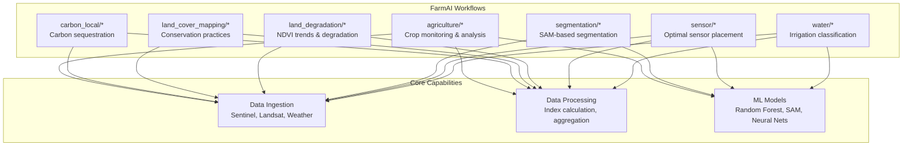
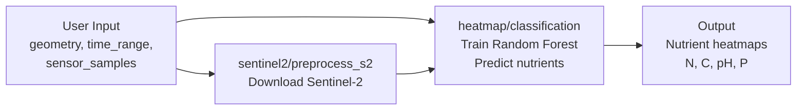
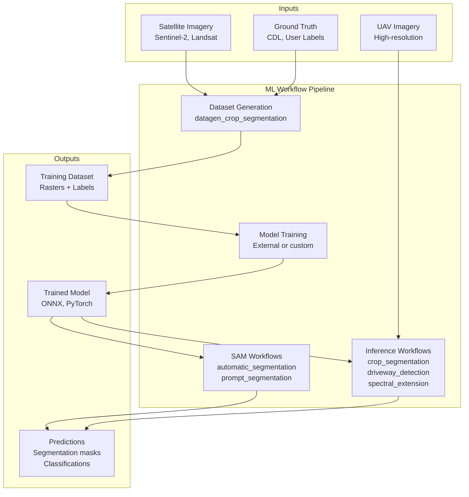
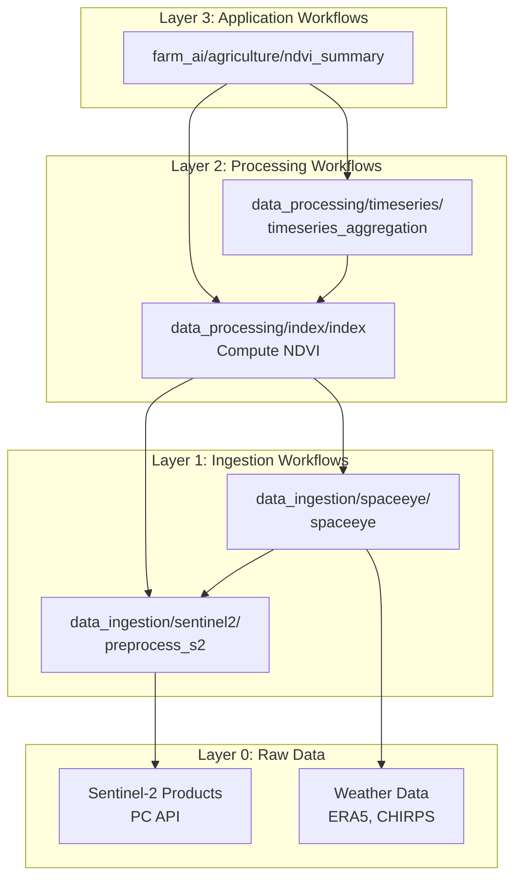
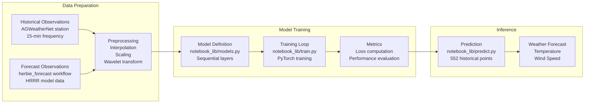
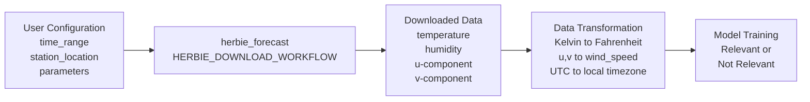

<!-- source: DeepWiki mcp.deepwiki.com · repo microsoft/farmvibes-ai · page 4.3 FarmAI and ML Workflows · fetched 2026-10-26 -->

# FarmAI and ML Workflows

Relevant source files

The following files were used as context for generating this wiki page:

- [docs/source/docfiles/markdown/WORKFLOW_LIST.md](docs/source/docfiles/markdown/WORKFLOW_LIST.md)
- [notebooks/deepmc/mc_forecast.ipynb](notebooks/deepmc/mc_forecast.ipynb)
- [notebooks/helloworld.ipynb](notebooks/helloworld.ipynb)
- [src/vibe_core/vibe_core/cli/helper.py](src/vibe_core/vibe_core/cli/helper.py)

## Purpose and Scope

This page documents the agricultural application workflows (FarmAI) and machine learning workflows (ML) available in FarmVibes.AI. These represent the highest-level, domain-specific workflows that combine data ingestion and processing to solve real-world agricultural and environmental problems.

For information about lower-level workflows that download raw data, see [Data Ingestion Workflows](#4.1). For workflows that transform and process data, see [Data Processing Workflows](#4.2). For details on the workflow execution system and DAG architecture, see [Workflows](#4).

**Sources:** [docs/source/docfiles/markdown/WORKFLOW_LIST.md:1-210]()

---

## Overview

FarmAI and ML workflows are **composed workflows** that orchestrate multiple data ingestion and processing operations to deliver end-to-end solutions. Unlike the simpler ingestion or processing workflows, these workflows:

- Combine multiple data sources (satellite imagery, weather data, elevation maps, etc.)
- Apply domain-specific processing pipelines
- Generate actionable outputs (predictions, classifications, trends, recommendations)
- Often involve machine learning models for training or inference

These workflows fall into two main categories:

| Category | Purpose | Examples |
|----------|---------|----------|
| **farm_ai** | Agricultural and environmental applications | Crop analysis, carbon sequestration, conservation practices, irrigation mapping |
| **ml** | Machine learning model operations | Dataset generation, model training, segmentation, inference |

**Sources:** [docs/source/docfiles/markdown/WORKFLOW_LIST.md:5-11]()

---

## FarmAI Workflow Categories

FarmAI workflows are organized into domain-specific subcategories that address different agricultural and environmental use cases.

**Diagram: FarmAI Workflow Organization**

**Sources:** [docs/source/docfiles/markdown/WORKFLOW_LIST.md:143-186]()

### Agriculture Workflows

Agriculture workflows provide crop monitoring, vegetation analysis, and field-level insights.

| Workflow | Purpose | Key Outputs |
|----------|---------|-------------|
| `agriculture/canopy_cover` | Estimates pixel-wise canopy cover | Canopy coverage maps |
| `agriculture/change_detection` | Identifies NDVI changes/outliers | Change detection maps |
| `agriculture/emergence_summary` | Crop emergence statistics via MSAVI | Mean, std, max, min emergence metrics |
| `agriculture/green_house_gas_fluxes` | Computes GHG fluxes | Gas flux estimates |
| `agriculture/heatmap_using_classification` | Nutrient prediction using Random Forest | Soil nutrient heatmaps (N, C, pH, P) |
| `agriculture/heatmap_using_classification_admag` | Nutrient prediction with ADMAg integration | Heatmaps from ADMAg prescriptions |
| `agriculture/heatmap_using_neighboring_data_points` | Spatial interpolation for nutrients | Interpolated nutrient maps |
| `agriculture/methane_index` | Methane index from ultra emitters | Methane detection maps |
| `agriculture/ndvi_summary` | NDVI statistics over time | Mean, std, max, min NDVI |
| `agriculture/weed_detection` | Color-based region segmentation | Weed region shapefiles |

**Example workflow composition** for `agriculture/heatmap_using_classification`:

**Diagram: Heatmap Classification Workflow Composition**

The heatmap classification workflow demonstrates a common pattern: downloading satellite imagery and using labeled sensor samples to train a Random Forest classifier that predicts soil nutrients across the farm boundary.

**Sources:** [docs/source/docfiles/markdown/WORKFLOW_LIST.md:145-163](), [docs/source/docfiles/markdown/WORKFLOW_LIST.md:125-126]()

### Carbon Sequestration Workflows

Carbon workflows estimate carbon sequestration potential for different agricultural scenarios.

| Workflow | Purpose | Integration |
|----------|---------|-------------|
| `carbon_local/admag_carbon_integration` | Carbon sequestration using ADMAg seasonal field data | Azure Data Manager for Agriculture |
| `carbon_local/carbon_whatif` | Carbon offset comparison between baseline and scenario | COMET-Farm API |

These workflows use the **COMET-Farm API** to compute carbon sequestration based on historical (baseline) and proposed (scenario) agricultural practices.

**Sources:** [docs/source/docfiles/markdown/WORKFLOW_LIST.md:165-168]()

### Land Cover and Conservation Workflows

Land cover workflows identify conservation practices and land features.

| Workflow | Purpose | Data Sources |
|----------|---------|--------------|
| `land_cover_mapping/conservation_practices` | Identifies terraces and grassed waterways | Digital Elevation Models (DEM) |

**Sources:** [docs/source/docfiles/markdown/WORKFLOW_LIST.md:169-170]()

### Land Degradation Workflows

Land degradation workflows analyze vegetation trends over time to detect ecosystem changes.

| Workflow | Purpose | Approach |
|----------|---------|----------|
| `land_degradation/landsat_ndvi_trend` | Linear NDVI trend over Landsat imagery | Pixel-wise regression |
| `land_degradation/ndvi_linear_trend` | Pixel-wise NDVI linear trend | Statistical trend analysis |

**Sources:** [docs/source/docfiles/markdown/WORKFLOW_LIST.md:171-174]()

### Segmentation Workflows

Segmentation workflows use the **Segment Anything Model (SAM)** for image segmentation tasks.

| Workflow | Input | Segmentation Mode |
|----------|-------|-------------------|
| `segmentation/auto_segment_basemap` | Bing Maps basemap | Automatic (no prompts) |
| `segmentation/auto_segment_s2` | Sentinel-2 imagery | Automatic (no prompts) |
| `segmentation/segment_basemap` | Bing Maps basemap | Prompt-based (points, bboxes) |
| `segmentation/segment_s2` | Sentinel-2 imagery | Prompt-based (points, bboxes) |

**Sources:** [docs/source/docfiles/markdown/WORKFLOW_LIST.md:175-182]()

### Sensor Placement Workflows

Sensor workflows identify optimal locations for soil sampling or sensor deployment.

| Workflow | Purpose | Algorithm |
|----------|---------|-----------|
| `sensor/optimal_locations` | Optimal sampling locations | Gaussian Mixture Model clustering on raster indices |

**Sources:** [docs/source/docfiles/markdown/WORKFLOW_LIST.md:183-184]()

### Water Management Workflows

Water workflows analyze irrigation patterns.

| Workflow | Purpose | Output |
|----------|---------|--------|
| `water/irrigation_classification` | Irrigation probability mapping | 30m pixel-wise irrigation probability |

**Sources:** [docs/source/docfiles/markdown/WORKFLOW_LIST.md:185-186]()

---

## ML Workflow Categories

ML workflows handle machine learning operations including dataset generation, model training, and inference.

**Diagram: ML Workflow Pipeline**

**Sources:** [docs/source/docfiles/markdown/WORKFLOW_LIST.md:195-209]()

### Dataset Generation Workflows

Dataset generation workflows prepare training data for machine learning models.

| Workflow | Purpose | Inputs | Outputs |
|----------|---------|--------|---------|
| `dataset_generation/datagen_crop_segmentation` | Crop segmentation training data | NDVI rasters, CDL maps | Paired image-label datasets |

The workflow aligns satellite-derived NDVI with ground truth crop classifications from the USDA Crop Data Layer (CDL) to create training datasets.

**Sources:** [docs/source/docfiles/markdown/WORKFLOW_LIST.md:199-200]()

### Model Inference Workflows

Inference workflows apply trained models to new data.

| Workflow | Model Type | Purpose |
|----------|------------|---------|
| `crop_segmentation` | Segmentation | Crop field boundaries from SpaceEye NDVI |
| `driveway_detection` | Detection | Identify driveways in front of houses |
| `spectral_extension` | Super-resolution | Generate high-res Sentinel-2 bands from UAV + Sentinel-2 |

**Sources:** [docs/source/docfiles/markdown/WORKFLOW_LIST.md:197-208]()

### Segment Anything Model (SAM) Workflows

SAM workflows provide foundation model-based segmentation capabilities.

| Workflow | Mode | Description |
|----------|------|-------------|
| `segment_anything/automatic_segmentation` | Automatic | Segments entire raster without prompts |
| `segment_anything/prompt_segmentation` | Prompted | Segments using point or bounding box prompts |

These workflows are used by the FarmAI segmentation workflows and can also be invoked directly for custom segmentation tasks.

**Sources:** [docs/source/docfiles/markdown/WORKFLOW_LIST.md:203-206]()

---

## Workflow Composition Patterns

FarmAI and ML workflows follow a **layered composition pattern** where higher-level workflows orchestrate lower-level operations.

**Diagram: Layered Workflow Composition**

This pattern allows:
- **Reusability**: Lower-level workflows are building blocks for multiple applications
- **Modularity**: Each layer has a well-defined interface and responsibility
- **Maintainability**: Changes to data sources or algorithms are isolated to specific layers

**Sources:** [docs/source/docfiles/markdown/WORKFLOW_LIST.md:1-210]()

---

## Machine Learning Training Example: Micro Climate Prediction

The micro climate prediction notebook demonstrates an end-to-end ML workflow for weather forecasting using historical observations and forecast data.

### Workflow Structure

The training pipeline consists of several modules organized in the `notebook_lib` directory:

| Module | Purpose | Key Functions |
|--------|---------|---------------|
| `notebook_lib/preprocess.py` | Data preprocessing and wavelet transforms | Data bundling, wavelet decomposition |
| `notebook_lib/models.py` | Neural network architecture | Model definition with sequential layers |
| `notebook_lib/modules.py` | Layer components | Custom PyTorch modules |
| `notebook_lib/train.py` | Training loop | Model instantiation, training steps, metrics |
| `notebook_lib/predict.py` | Inference | Model evaluation and prediction |
| `notebook_lib/utils.py` | Utilities | CSV reading, data scaling, train/test split |

**Sources:** [notebooks/deepmc/mc_forecast.ipynb:43-48]()

### Training Process

**Diagram: Micro Climate Prediction Training Pipeline**

**Sources:** [notebooks/deepmc/mc_forecast.ipynb:28-48]()

### Data Requirements

The workflow requires specific data characteristics:

| Data Type | Training Requirement | Inference Requirement |
|-----------|---------------------|----------------------|
| Historical observations | Minimum 2 years | 552 data points |
| Required features | datetime, humidity, windspeed, temperature | Same |
| Forecast data | Optional (for "relevant" scenario) | Optional |
| Frequency | 60-minute intervals | 60-minute intervals |

**Relevant vs. Not Relevant Scenarios:**

1. **Relevant**: Historical and forecast observations closely match → Use both datasets for training
2. **Not Relevant**: Significant discrepancies or forecast data unavailable → Use only historical observations

**Sources:** [notebooks/deepmc/mc_forecast.ipynb:29-32](), [notebooks/deepmc/mc_forecast.ipynb:204-214]()

### Integration with FarmVibes.AI Workflows

The notebook uses the `data_ingestion/weather/herbie_forecast` workflow to download forecast observations:

**Diagram: Forecast Data Integration**

**Sources:** [notebooks/deepmc/mc_forecast.ipynb:83-94](), [notebooks/deepmc/mc_forecast.ipynb:299-318]()

### Key Implementation Details

**Preprocessing steps:**
1. Convert index variable to datetime [notebooks/deepmc/mc_forecast.ipynb:260-266]()
2. Interpolate missing values using neighbors [notebooks/deepmc/mc_forecast.ipynb:260-266]()
3. Resample to 60-minute frequency [notebooks/deepmc/mc_forecast.ipynb:260-266]()
4. Scale using scikit-learn StandardScaler [notebooks/deepmc/mc_forecast.ipynb:260-266]()

**Model features:**
- For relevant scenarios: `["humidity", "humidity_forecast", "temperature", "temperature_forecast", "wind_speed", "wind_speed_forecast"]` [notebooks/deepmc/mc_forecast.ipynb:230-234]()
- For non-relevant scenarios: `["humidity", "temperature", "wind_speed"]` [notebooks/deepmc/mc_forecast.ipynb:250-253]()

**Output variables:**
- `wind_speed` and `temperature` predictions [notebooks/deepmc/mc_forecast.ipynb:195-198]()

**Sources:** [notebooks/deepmc/mc_forecast.ipynb:260-266](), [notebooks/deepmc/mc_forecast.ipynb:195-234](), [notebooks/deepmc/mc_forecast.ipynb:250-253]()

---

## Running FarmAI and ML Workflows

FarmAI and ML workflows are executed like any other workflow using the Python client. See [Running Workflows](#5.2) for general execution instructions and [Working with Notebooks](#5.1) for guidance on setting up notebook environments.

Many FarmAI workflows are demonstrated in example notebooks located in the `notebooks/` directory. See [Agriculture Examples](#6.1) for agricultural use cases and [ML and Segmentation Examples](#6.3) for machine learning workflows.

**Sources:** [docs/source/docfiles/markdown/WORKFLOW_LIST.md:1-210]()

---

