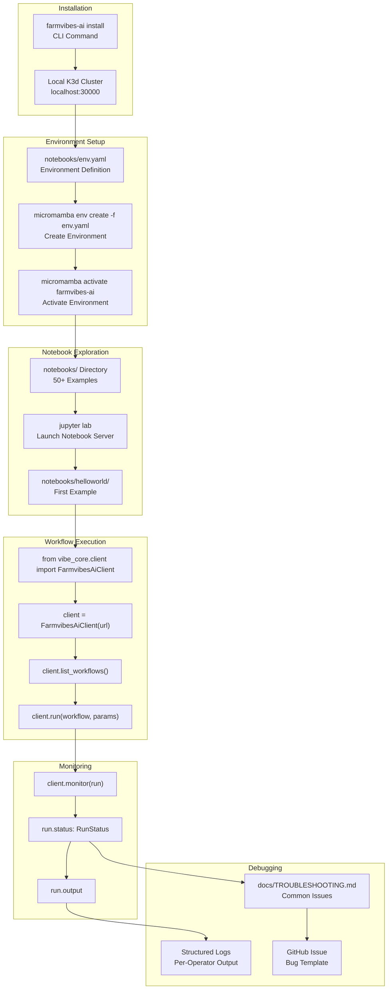
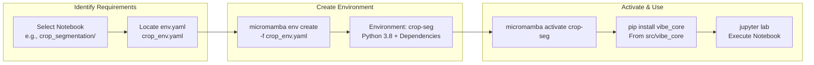
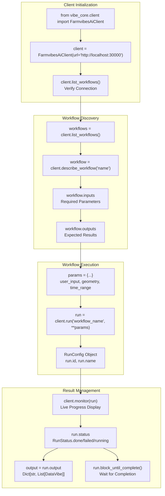
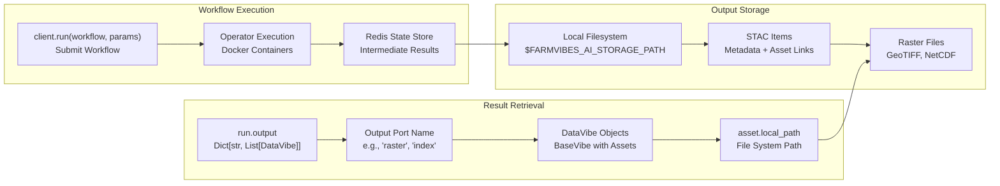

<!-- source: DeepWiki mcp.deepwiki.com · repo microsoft/farmvibes-ai · page 5 User Guides · fetched 2026-10-26 -->

# User Guides

<details>
<summary>Relevant source files</summary>

The following files were used as context for generating this wiki page:

- [README.md](README.md)
- [notebooks/README.md](notebooks/README.md)
- [notebooks/crop_segmentation/crop_env.yaml](notebooks/crop_segmentation/crop_env.yaml)

</details>


This section provides practical guides for common user tasks in FarmVibes.AI. It covers environment setup, workflow execution, monitoring, and troubleshooting. These guides are designed for users who want to use FarmVibes.AI to build geospatial machine learning models and agricultural insights.

For detailed architecture and system design information, see [Architecture](#3). For reference documentation on specific workflows and data models, see [Reference](#8).

## Overview

FarmVibes.AI users typically follow this progression:

1. **Installation and Setup** - Install the platform and configure the local cluster
2. **Environment Configuration** - Set up Python environments for notebooks using micromamba
3. **Exploration** - Run example notebooks to understand capabilities
4. **Workflow Execution** - Submit and configure workflows for custom use cases
5. **Monitoring** - Track workflow progress and inspect results
6. **Debugging** - Troubleshoot issues and understand failure modes

This page provides an overview of these tasks. For in-depth coverage, see the subsections:
- [Working with Notebooks](#5.1) - Environment setup and notebook execution
- [Running Workflows](#5.2) - Workflow submission and configuration
- [Monitoring and Debugging](#5.3) - Status tracking and troubleshooting

## User Journey

The following diagram illustrates the typical user journey through FarmVibes.AI, mapping high-level tasks to specific commands and code entities.



**Sources:** [README.md:84-88](), [notebooks/README.md:1-22]()

## Environment Management

FarmVibes.AI uses micromamba for Python environment management. This approach isolates dependencies for different notebook categories and prevents version conflicts.

### Environment Structure

The following table shows the environment files available in the repository:

| Environment File | Environment Name | Purpose | Key Dependencies |
|-----------------|------------------|---------|------------------|
| `notebooks/env.yaml` | `farmvibes-ai` | General notebooks | vibe_core, vibe_notebook, matplotlib, geopandas |
| `notebooks/crop_segmentation/crop_env.yaml` | `crop-seg` | ML training notebooks | pytorch, segmentation-models-pytorch, torchgeo |
| `notebooks/segment_anything/segment_env.yaml` | `segment-anything` | SAM model notebooks | segment-anything, opencv, ultralytics |
| `notebooks/deepmc/deepmc_env.yaml` | `deepmc` | Weather forecasting | tensorflow, keras, scikit-learn |

### Environment Creation Workflow



**Sources:** [notebooks/README.md:6-22](), [notebooks/crop_segmentation/crop_env.yaml:1-31]()

### Common Environment Commands

```bash
# List available environments
micromamba env list

# Create environment from file
micromamba env create -f notebooks/env.yaml

# Activate environment
micromamba activate farmvibes-ai

# Deactivate environment
micromamba deactivate

# Remove environment
micromamba env remove -n farmvibes-ai
```

The `vibe_core` and `vibe_notebook` packages are installed from local source directories rather than PyPI, ensuring compatibility with the running cluster version.

**Sources:** [notebooks/README.md:13-19](), [notebooks/crop_segmentation/crop_env.yaml:30-31]()

## Client Interaction Model

Users interact with FarmVibes.AI primarily through the `FarmvibesAiClient` Python class. The following diagram shows the client lifecycle and key operations.



**Sources:** [README.md:81-82](), [README.md:121-122]()

## Common User Tasks

### Task 1: Running Your First Workflow

The helloworld notebook demonstrates the basic workflow execution pattern:

```python
from vibe_core.client import FarmvibesAiClient
from shapely.geometry import box

# Initialize client
client = FarmvibesAiClient("http://localhost:30000")

# Define area and time
geometry = box(-122.4, 37.7, -122.3, 37.8)  # San Francisco area
time_range = ("2022-01-01", "2022-01-31")

# Run workflow
run = client.run(
    workflow="data_ingestion/sentinel2/preprocess_s2",
    geometry=geometry,
    time_range=time_range
)

# Monitor execution
client.monitor(run)

# Get results
output = run.output
```

This pattern is consistent across all workflows: define parameters, submit run, monitor, retrieve results.

**Sources:** [README.md:95-96]()

### Task 2: Building Multi-Step Pipelines

FarmVibes.AI workflows can chain together. For example, computing NDVI time series requires:

1. Download Sentinel-2 imagery
2. Preprocess and mask clouds
3. Calculate NDVI index
4. Aggregate time series

These steps are encapsulated in workflows like `data_processing/index/index_time_series`:

```python
# Single workflow call handles entire pipeline
run = client.run(
    workflow="data_processing/index/index_time_series",
    geometry=field_geometry,
    time_range=("2022-03-01", "2022-10-31"),
    index="ndvi"  # Specify index type
)

# Results include time-stamped NDVI values
ndvi_series = run.output["index"]
```

The workflow internally orchestrates data download, preprocessing, and computation.

**Sources:** [README.md:97-98]()

### Task 3: Training and Inference

Machine learning workflows follow a two-phase pattern:

**Training Phase:**
```python
# Prepare labeled data
run_train = client.run(
    workflow="farm_ai/crop_segmentation/train",
    training_data=training_rasters,
    labels=ground_truth_labels,
    model_config={"epochs": 50, "batch_size": 8}
)

# Trained model is stored in output
trained_model = run_train.output["model"]
```

**Inference Phase:**
```python
# Apply model to new area
run_inference = client.run(
    workflow="farm_ai/crop_segmentation/inference",
    input_rasters=new_imagery,
    model=trained_model
)

# Get predictions
predictions = run_inference.output["predictions"]
```

**Sources:** [README.md:103-107]()

### Task 4: Working with External APIs

Some workflows integrate external services like COMET-Farm for carbon sequestration analysis:

```python
# Carbon estimation workflow
run = client.run(
    workflow="farm_ai/carbon_local/future",
    geometry=field_geometry,
    time_range=("2020-01-01", "2025-12-31"),
    practices={
        "tillage": "no-till",
        "cover_crops": True
    }
)

# Results include carbon estimates
carbon_data = run.output["carbon_estimates"]
```

API keys and secrets are managed separately through the secrets system (see SECRETS.md).

**Sources:** [README.md:99-100]()

## Workflow Parameter Patterns

Most workflows accept a common set of parameters. Understanding these patterns accelerates workflow usage:

| Parameter | Type | Purpose | Example |
|-----------|------|---------|---------|
| `geometry` | `shapely.geometry.Polygon` or `box` | Spatial extent | `box(-122.4, 37.7, -122.3, 37.8)` |
| `time_range` | `Tuple[str, str]` | Temporal extent (ISO 8601) | `("2022-01-01", "2022-12-31")` |
| `user_input` | `Dict` or `DataVibe` | Custom input data | Preprocessed rasters, labels |
| `index` | `str` | Index type for computation | `"ndvi"`, `"evi"`, `"msavi"` |
| `parameters` | `Dict` | Workflow-specific config | Model hyperparameters, thresholds |

### Geometry Specification

```python
from shapely.geometry import box, Polygon

# Bounding box (simpler)
bbox = box(min_lon, min_lat, max_lon, max_lat)

# Custom polygon (more precise)
polygon = Polygon([
    (-122.4, 37.7),
    (-122.3, 37.7),
    (-122.3, 37.8),
    (-122.4, 37.8),
    (-122.4, 37.7)
])
```

### Time Range Formats

```python
# Date strings (ISO 8601)
time_range = ("2022-01-01", "2022-12-31")

# With timestamps
time_range = ("2022-01-01T00:00:00", "2022-12-31T23:59:59")

# Single day
time_range = ("2022-06-15", "2022-06-15")
```

**Sources:** [README.md:28-44]()

## Data Persistence and Outputs

Workflow outputs are persisted locally on the machine running the cluster. Understanding the output structure is essential for result retrieval.



**Sources:** [README.md:76-78]()

### Accessing Output Files

```python
# Get workflow results
output = run.output

# Access specific output port
rasters = output["raster"]  # List of DataVibe objects

# Access individual files
for vibe in rasters:
    for asset in vibe.assets:
        file_path = asset.local_path
        # file_path points to local GeoTIFF
        print(f"Result stored at: {file_path}")
```

## Progress Monitoring

FarmVibes.AI provides multiple mechanisms for monitoring workflow execution:

### Monitor Display

The `client.monitor(run)` method provides a real-time progress display:

```python
client.monitor(run)
```

Output:
```
Workflow: data_ingestion/sentinel2/preprocess_s2
Status: running
Progress: 3/5 tasks complete

Task                          Status      Duration
download_sentinel2            done        00:02:34
cloud_masking                 done        00:00:45
preprocessing                 running     00:01:12
index_calculation             pending     --
aggregation                   pending     --
```

### Programmatic Status Checking

```python
from vibe_core.data import RunStatus

# Check status
if run.status == RunStatus.done:
    print("Workflow completed successfully")
    output = run.output
elif run.status == RunStatus.failed:
    print("Workflow failed")
    # Inspect error details
elif run.status == RunStatus.running:
    print("Workflow still executing")
```

For detailed monitoring patterns, see [Monitoring and Debugging](#5.3).

**Sources:** [README.md:121-122]()

## Error Handling and Common Issues

### Connection Errors

If the client cannot connect to the cluster:

```python
try:
    client = FarmvibesAiClient("http://localhost:30000")
    client.list_workflows()
except Exception as e:
    print("Cluster may not be running. Try:")
    print("  farmvibes-ai status")
    print("  farmvibes-ai start")
```

### Workflow Failures

Workflows may fail due to:
- Invalid parameters (geometry outside data coverage)
- Missing API keys (external data sources)
- Network timeouts (large data downloads)
- Insufficient resources (memory limits)

Check workflow logs for detailed error messages:

```python
# Get run details including errors
run_details = client.describe_run(run.id)
print(run_details.error_message)
```

### Troubleshooting Resources

For comprehensive troubleshooting guidance:
- See [Monitoring and Debugging](#5.3) for debugging techniques
- Consult `docs/TROUBLESHOOTING.md` for common issues
- Review GitHub issues for similar problems

**Sources:** [README.md:125]()

## Notebook Categories

The `notebooks/` directory contains over 50 examples organized by use case. This table provides an overview:

| Category | Example Notebooks | Key Workflows |
|----------|-------------------|---------------|
| Getting Started | `helloworld/` | Basic client usage, workflow execution |
| Data Ingestion | `sentinel/`, `landsat/`, `weather/` | Satellite and weather data download |
| Index Calculation | `ndvi/`, `indices/` | Vegetation index computation |
| Time Series | `timeseries/`, `harvest_period/` | Temporal aggregation, trend analysis |
| Machine Learning | `crop_segmentation/`, `segment_anything/` | Model training and inference |
| Agricultural Applications | `carbon/`, `heatmaps/`, `canopy_cover/` | Domain-specific insights |
| Advanced | `spaceeye/`, `deepmc/` | Cloud removal, weather forecasting |

Each notebook includes:
- Environment setup instructions
- Data preparation steps
- Workflow execution examples
- Visualization code
- Expected outputs

For a complete catalog with descriptions, see [Notebook Catalog](#8.3).

**Sources:** [README.md:90-110](), [notebooks/README.md:1-3]()

## Best Practices

### Environment Management

1. **Use Separate Environments**: Create dedicated environments for different notebook categories to avoid dependency conflicts
2. **Update Regularly**: Rebuild environments after FarmVibes.AI updates to sync with cluster versions
3. **Local Installation**: Always install `vibe_core` from source (`src/vibe_core`) to match cluster version

### Workflow Execution

1. **Start Small**: Test workflows on small areas and short time ranges before scaling up
2. **Check Coverage**: Verify data availability for your area/time using data preview workflows
3. **Monitor Resources**: Large workflows may require significant disk space and memory
4. **Cache Results**: Reuse workflow outputs as inputs to subsequent workflows to avoid redundant processing

### Development Workflow

1. **Explore Examples**: Start with notebooks similar to your use case
2. **Incremental Complexity**: Build custom workflows by composing existing ones
3. **Test Locally**: Validate workflows on local cluster before deploying to production
4. **Document Parameters**: Keep track of parameter combinations that work well for your scenarios

**Sources:** [README.md:28-78]()

## Next Steps

- **[Working with Notebooks](#5.1)** - Detailed environment setup, micromamba usage, and notebook execution patterns
- **[Running Workflows](#5.2)** - Comprehensive workflow submission guide, parameter configuration, and result handling
- **[Monitoring and Debugging](#5.3)** - Advanced monitoring techniques, log analysis, and troubleshooting workflows

For deeper technical details:
- **[Client API](#3.4)** - Complete API reference for FarmvibesAiClient
- **[Workflows](#4)** - Workflow architecture and composition
- **[Data Models](#3.3)** - Understanding DataVibe objects and the type system

---

**Sources:** [README.md:1-148](), [notebooks/README.md:1-22](), [notebooks/crop_segmentation/crop_env.yaml:1-31]()

---

