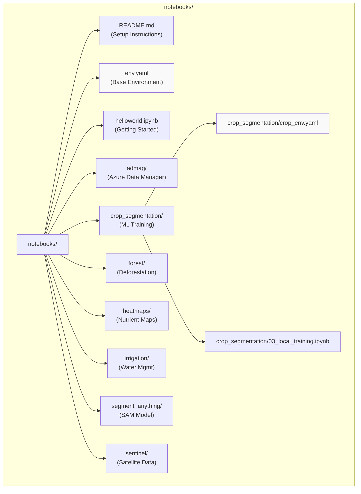
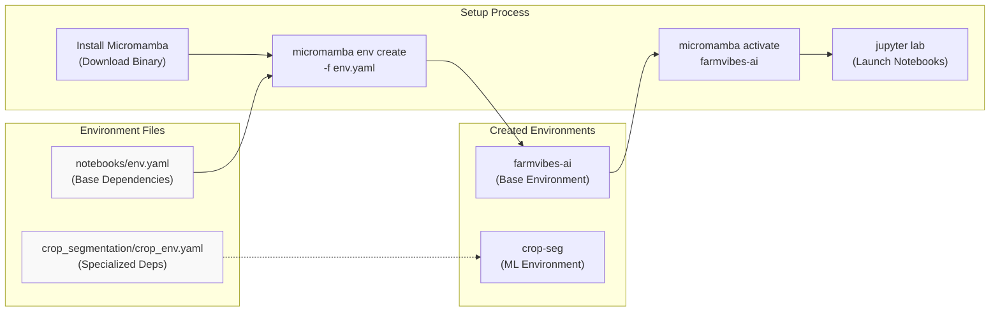
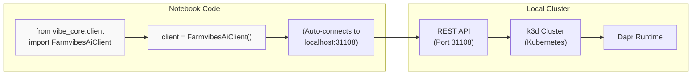

<!-- source: DeepWiki mcp.deepwiki.com · repo microsoft/farmvibes-ai · page 5.1 Working with Notebooks · fetched 2026-10-26 -->

# Working with Notebooks

<details>
<summary>Relevant source files</summary>

The following files were used as context for generating this wiki page:

- [docs/source/docfiles/markdown/NOTEBOOK_LIST.md](docs/source/docfiles/markdown/NOTEBOOK_LIST.md)
- [notebooks/README.md](notebooks/README.md)
- [notebooks/crop_segmentation/crop_env.yaml](notebooks/crop_segmentation/crop_env.yaml)

</details>


This guide covers the setup, environment management, and execution patterns for working with FarmVibes.AI Jupyter notebooks. It explains how to use micromamba for environment isolation, understand the notebook directory structure, and follow common patterns for interacting with the FarmVibes.AI platform.

For detailed descriptions of individual example notebooks and their use cases, see [Example Notebooks](#6). For information about submitting and running workflows programmatically, see [Running Workflows](#5.2).

---

## Notebook Organization

FarmVibes.AI provides over 50 example notebooks organized by domain and use case. The notebooks are located in the `notebooks/` directory at the repository root, with subdirectories for different application areas.

### Directory Structure



**Notebook Directory Organization**

The directory structure groups notebooks by application domain. Most notebooks can run with the base `env.yaml` environment, while specialized notebooks (e.g., machine learning workflows) provide additional environment files in their subdirectories.

Sources: [notebooks/README.md:1-22](), [docs/source/docfiles/markdown/NOTEBOOK_LIST.md:1-447]()

### Notebook Categories

Notebooks are organized into the following categories:

| Category | Directory | Example Notebooks |
|----------|-----------|-------------------|
| Getting Started | `notebooks/` | `helloworld.ipynb`, `sentinel/spectral_indices.ipynb` |
| Azure Integration | `admag/` | ADMAg integration, COMET-Farm API |
| Crop Analysis | `harvest_period/`, `crop_cycles/` | Harvest detection, crop cycle analysis |
| Segmentation | `crop_segmentation/`, `segment_anything/` | ML training, SAM workflows |
| Remote Sensing | `sentinel/`, `forest/` | SpaceEye, deforestation detection |
| Water Management | `irrigation/` | Irrigation classification |
| Sustainability | `carbon/`, `ghg_fluxes/`, `heatmaps/` | Carbon sequestration, nutrient maps |
| ML Training | `crop_segmentation/`, `deepmc/`, `weed_detection/` | Model training and inference |

Sources: [docs/source/docfiles/markdown/NOTEBOOK_LIST.md:10-363]()

---

## Environment Setup with Micromamba

FarmVibes.AI notebooks use **micromamba** for environment management, providing isolated Python environments with all required dependencies. Micromamba is a lightweight, fast alternative to conda.

### Installation Flow



**Micromamba Environment Setup Flow**

Sources: [notebooks/README.md:6-22]()

### Installing Micromamba

Install micromamba by following the instructions at the [micromamba website](https://mamba.readthedocs.io/en/latest/). Micromamba provides faster dependency resolution and smaller disk footprint compared to traditional conda.

For troubleshooting, refer to the [micromamba troubleshooting page](https://mamba.readthedocs.io/en/latest/user_guide/troubleshooting.html).

Sources: [notebooks/README.md:6-9]()

### Creating the Base Environment

The base environment defined in `notebooks/env.yaml` includes common packages required by most notebooks:

```bash
micromamba env create -f env.yaml
```

This creates an environment named `farmvibes-ai` containing the FarmVibes.AI client libraries and common dependencies for geospatial processing and visualization.

Sources: [notebooks/README.md:11-19]()

### Activating the Environment

Before running notebooks, activate the environment:

```bash
micromamba activate farmvibes-ai
```

Then launch JupyterLab:

```bash
jupyter lab
```

### Specialized Environments

Some notebooks require additional dependencies (e.g., PyTorch, Azure ML SDK). These notebooks provide their own environment files in their subdirectories.

**Example: Crop Segmentation Environment**

The crop segmentation notebooks require PyTorch and machine learning libraries:

```bash
micromamba env create -f crop_segmentation/crop_env.yaml
micromamba activate crop-seg
```

Key dependencies in `crop_env.yaml`:

| Package | Version | Purpose |
|---------|---------|---------|
| `python` | 3.8.* | Runtime |
| `pytorch` | ~1.10.2 | Deep learning framework |
| `segmentation-models-pytorch` | 0.2.1 | Segmentation model architectures |
| `pytorch-lightning` | 1.7.3 | Training framework |
| `torchgeo` | 0.3.0 | Geospatial datasets |
| `azure-ai-ml` | Latest | Azure ML integration |

Sources: [notebooks/crop_segmentation/crop_env.yaml:1-31](), [notebooks/README.md:20-21]()

---

## Common Notebook Patterns

FarmVibes.AI notebooks follow consistent patterns for client initialization, workflow submission, and result handling.

### Client Initialization Pattern



**Client Initialization in Notebooks**

All notebooks begin by importing and initializing the `FarmvibesAiClient`, which connects to the local FarmVibes.AI cluster. The client handles authentication and communication with the workflow execution engine.

Sources: [notebooks/README.md:1-4]()

### Workflow Submission Pattern

Notebooks typically follow this workflow submission pattern:

1. **Define Input Parameters**: Geometry, time range, workflow-specific parameters
2. **Submit Workflow**: Call `client.run()` with workflow name and parameters
3. **Monitor Execution**: Display progress with built-in monitoring
4. **Retrieve Outputs**: Access results as DataVibe objects

The workflow execution and monitoring patterns are detailed in [Running Workflows](#5.2) and [Monitoring and Debugging](#5.3).

### Data Access Pattern

Notebooks access workflow outputs using the STAC (SpatioTemporal Asset Catalog) pattern:

```python
# Outputs are returned as lists of DataVibe objects
outputs = run.output["output_name"]

# Each DataVibe contains assets (files)
for item in outputs:
    # Access raster data
    raster_path = item.assets["raster"].path_or_url
    
    # Access metadata
    time_range = item.time_range
    geometry = item.geometry
```

This pattern is consistent across all FarmVibes.AI notebooks and workflows.

---

## Environment File Structure

Environment files specify dependencies using YAML format. Understanding the structure helps when creating custom environments or troubleshooting dependency issues.

### Base Environment Structure

The base `env.yaml` file [notebooks/env.yaml]() typically includes:

```yaml
name: farmvibes-ai
channels:
  - conda-forge
  - defaults
dependencies:
  - python=3.8.*
  - pip
  - geopandas
  - rasterio
  - shapely
  - jupyter
  - ipywidgets
  - pip:
      - ./src/vibe_core
      - ./src/vibe_notebook
```

Key components:

| Section | Purpose |
|---------|---------|
| `name` | Environment name (used with `micromamba activate`) |
| `channels` | Package sources (conda-forge, defaults) |
| `dependencies` | Conda packages and pip requirements |
| `pip` section | Python packages installed via pip |

### Local Package Installation

Both environment files install FarmVibes.AI packages from local sources:

```yaml
pip:
  - ../../src/vibe_core      # Core client library
  - ../../src/vibe_notebook  # Notebook utilities
```

This ensures notebooks use the version of the client corresponding to the repository version.

Sources: [notebooks/crop_segmentation/crop_env.yaml:28-31]()

---

## Notebook-Specific Dependencies

Some notebooks have additional dependency requirements documented in their README or at the top of the notebook file. Common additional requirements include:

### Machine Learning Notebooks

Notebooks in `crop_segmentation/`, `deepmc/`, and `weed_detection/` require:
- PyTorch or TensorFlow
- Training frameworks (pytorch-lightning)
- Model architectures (segmentation-models-pytorch)
- ONNX export capabilities

Sources: [notebooks/crop_segmentation/crop_env.yaml:1-31]()

### Azure Integration Notebooks

Notebooks using Azure services (ADMAg, Azure ML) require:
- `azure-ai-ml`
- `azure-identity`
- Azure credentials configured in the environment

Sources: [notebooks/crop_segmentation/crop_env.yaml:28-29]()

### Visualization Notebooks

Notebooks with advanced visualizations may require:
- `matplotlib`
- `plotly`
- `ipywidgets` (for interactive controls)

---

## Troubleshooting

### Environment Creation Fails

**Issue**: `micromamba env create` fails with dependency conflicts.

**Solutions**:
1. Check micromamba version: Update to latest version
2. Clear package cache: `micromamba clean --all`
3. Specify exact channels: Ensure `conda-forge` is prioritized
4. Check [micromamba troubleshooting guide](https://mamba.readthedocs.io/en/latest/user_guide/troubleshooting.html)

Sources: [notebooks/README.md:9]()

### Notebook Cannot Connect to Cluster

**Issue**: `FarmvibesAiClient()` initialization fails.

**Solutions**:
1. Verify cluster is running: `kubectl get pods -n farmvibes`
2. Check port forwarding: API should be accessible on `localhost:31108`
3. Restart cluster if needed: See [Infrastructure and Deployment](#3.2)

### Import Errors for vibe_core

**Issue**: `ImportError: No module named 'vibe_core'`

**Solutions**:
1. Ensure environment was created from correct location (repository root or notebook directory)
2. Verify pip installed local packages: `pip list | grep vibe`
3. Reinstall environment: `micromamba env remove -n farmvibes-ai` then recreate

Sources: [notebooks/crop_segmentation/crop_env.yaml:30-31]()

### Kernel Dies During Execution

**Issue**: Notebook kernel crashes during workflow execution.

**Solutions**:
1. Check memory usage: Large rasters may require more RAM
2. Reduce data extent or time range in workflow parameters
3. Use remote cluster with more resources: See [Infrastructure and Deployment](#3.2)
4. Check logs: See [Monitoring and Debugging](#5.3)

---

## Next Steps

After setting up notebook environments:

- **Explore Examples**: Start with `helloworld.ipynb` and progress to domain-specific notebooks. See [Example Notebooks](#6) for the complete catalog.
- **Run Workflows**: Learn workflow submission and configuration in [Running Workflows](#5.2).
- **Monitor Execution**: Understand status tracking and debugging in [Monitoring and Debugging](#5.3).
- **Browse Workflow Catalog**: Explore available workflows in [Workflow Catalog](#8.2).

Sources: [docs/source/docfiles/markdown/NOTEBOOK_LIST.md:1-447](), [notebooks/README.md:1-22]()

---

