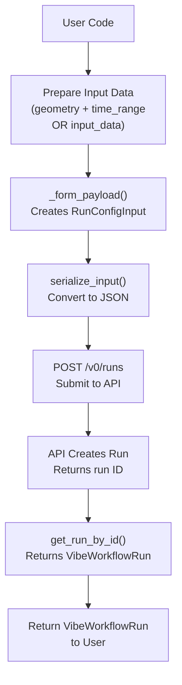
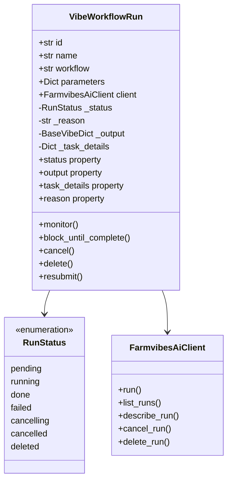
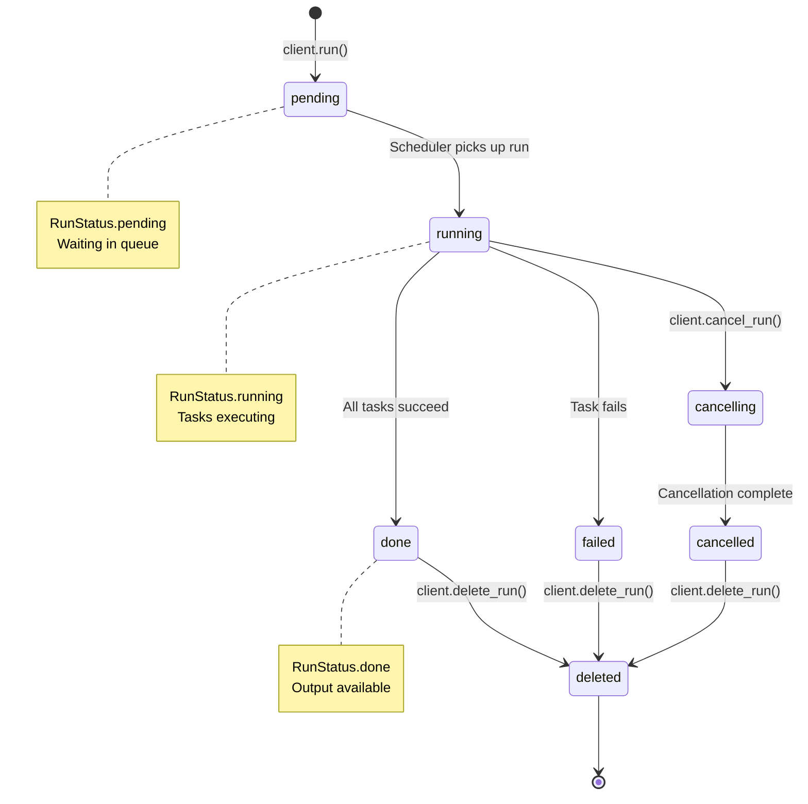
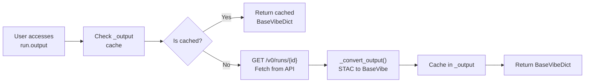

<!-- source: DeepWiki mcp.deepwiki.com · repo microsoft/farmvibes-ai · page 5.2 Running Workflows · fetched 2026-10-26 -->

# Running Workflows

<details>
<summary>Relevant source files</summary>

The following files were used as context for generating this wiki page:

- [notebooks/carbon/whatif.ipynb](notebooks/carbon/whatif.ipynb)
- [notebooks/harvest_period/ndvi_summary.ipynb](notebooks/harvest_period/ndvi_summary.ipynb)
- [src/vibe_core/vibe_core/client.py](src/vibe_core/vibe_core/client.py)
- [src/vibe_core/vibe_core/data/core_types.py](src/vibe_core/vibe_core/data/core_types.py)

</details>


This page explains how to submit and execute workflows using the FarmVibes.AI Python client. It covers workflow submission, monitoring execution progress, accessing outputs, and managing workflow runs.

For information about the available workflows and their descriptions, see the workflow catalog documentation. For details about the data models used as inputs and outputs, see [Data Models](#3.3).

## Prerequisites

Before running workflows, you need:
1. A running FarmVibes.AI service instance (local or remote)
2. The `vibe_core` Python package installed in your environment
3. Knowledge of which workflow you want to run and its required inputs

The client communicates with the FarmVibes.AI REST API to submit workflows, query their status, and retrieve results.

Sources: [src/vibe_core/vibe_core/client.py:1-163]()

## Creating a Client

The `FarmvibesAiClient` class provides the interface for interacting with the FarmVibes.AI service. You create a client by specifying the base URL of the service:

```python
from vibe_core.client import FarmvibesAiClient, get_default_vibe_client

# Option 1: Use the default client (reads URL from config)
client = get_default_vibe_client()

# Option 2: Specify URL explicitly
client = FarmvibesAiClient("http://127.0.0.1:31108/")
```

The `get_default_vibe_client()` helper function reads the service URL from configuration files stored at `~/.config/farmvibes-ai/service_url` for local clusters or `~/.config/farmvibes-ai/remote_service_url` for remote deployments.

The client maintains a session with default headers for JSON communication and provides methods for all workflow operations.

Sources: [src/vibe_core/vibe_core/client.py:51-163]()

## Workflow Submission Process

### Workflow Submission Flow



Sources: [src/vibe_core/vibe_core/client.py:567-612]()

### Submitting with Geometry and Time Range

The most common way to run a workflow is by specifying a geographic region and time range:

```python
from shapely.geometry import Point
from datetime import datetime

# Define the area of interest
geometry = Point(-93.5, 42.0).buffer(0.01)  # Small region in Iowa

# Define the time period
time_range = (datetime(2020, 4, 1), datetime(2020, 12, 30))

# Submit the workflow
run = client.run(
    workflow="farm_ai/agriculture/ndvi_summary",
    name="my_ndvi_run",
    geometry=geometry,
    time_range=time_range,
    parameters={"param_name": "value"}  # Optional
)
```

The geometry must be a valid Shapely geometry object (Point, Polygon, etc.) and is automatically converted to GeoJSON format internally. The time range is a tuple of two `datetime` objects representing the start and end of the period.

Sources: [src/vibe_core/vibe_core/client.py:577-605](), [notebooks/harvest_period/ndvi_summary.ipynb:73-111]()

### Submitting with Input Data

For more complex workflows, you can provide input data directly instead of geometry and time range:

```python
from vibe_core.data import SeasonalFieldInformation

# Prepare input data objects
input_data = {
    "baseline_seasonal_fields": baseline_seasonal_fields,
    "scenario_seasonal_fields": scenario_seasonal_fields,
}

# Submit with input_data instead of geometry/time_range
run = client.run(
    workflow="farm_ai/carbon_local/carbon_whatif",
    name="carbon_calculation",
    input_data=input_data,
    parameters={
        "ngrok_token": "your_token",
        "comet_support_email": "email@example.com"
    }
)
```

When using `input_data`, you cannot also specify `geometry` and `time_range` - you must use one approach or the other. The input data is serialized using `serialize_input()` which handles conversion of `BaseVibe` objects to the format expected by the API.

Sources: [src/vibe_core/vibe_core/client.py:567-605](), [notebooks/carbon/whatif.ipynb:209-246]()

### Parameters

Workflows can accept optional parameters that customize their behavior. The available parameters depend on the specific workflow definition. You pass parameters as a dictionary:

```python
parameters = {
    "buffer_size": 100,
    "threshold": 0.5,
    "output_format": "geotiff"
}

run = client.run(
    workflow="workflow_name",
    name="run_name",
    geometry=geometry,
    time_range=time_range,
    parameters=parameters
)
```

The `_form_payload()` method constructs a `RunConfigInput` dataclass containing all the submission details, which is then serialized to JSON for the API request.

Sources: [src/vibe_core/vibe_core/client.py:191-239]()

## The VibeWorkflowRun Object

### VibeWorkflowRun Structure



The `run()` method returns a `VibeWorkflowRun` object, which represents a specific execution of a workflow. This object provides properties and methods for interacting with the running workflow:

| Property | Type | Description |
|----------|------|-------------|
| `id` | str | Unique identifier for this run |
| `name` | str | User-provided name for the run |
| `workflow` | str | Name of the workflow being executed |
| `parameters` | Dict | Parameters passed to the workflow |
| `status` | RunStatus | Current execution status (pending, running, done, etc.) |
| `output` | BaseVibeDict | Dictionary of output data (only available when done) |
| `task_details` | Dict[str, RunDetails] | Detailed information about each task in the workflow |
| `reason` | str | Explanation if the run failed |

Sources: [src/vibe_core/vibe_core/client.py:729-805]()

## Monitoring Workflow Progress

### The monitor() Method

The `monitor()` method provides real-time progress tracking for workflow runs:

```python
# Monitor a single run
run.monitor()

# Monitor multiple runs with a summary table
client.monitor([run1, run2, run3])

# Monitor the last 5 runs
client.monitor(5)

# Monitor with custom refresh interval and timeout
run.monitor(refresh_time_s=2, timeout_min=60)
```

The monitor displays a live updating table showing:
- Run ID and name
- Current status
- Task progress (number of tasks completed/total)
- Execution time
- Any warnings or errors

The method blocks until all workflows finish or the timeout is reached.

Sources: [src/vibe_core/vibe_core/client.py:675-726]()

### Workflow Run Lifecycle



A workflow run progresses through several states:

1. **pending**: Initial state after submission, waiting for scheduler
2. **running**: Actively executing tasks
3. **done**: Completed successfully, outputs available
4. **failed**: Encountered an error during execution
5. **cancelling**: Cancellation requested but not yet complete
6. **cancelled**: Successfully cancelled
7. **deleted**: Run deleted and cache cleared

You can check the status at any time using `run.status`. The `RunStatus` enum provides helper methods like `RunStatus.finished()` to check if a run has reached a terminal state.

Sources: [src/vibe_core/vibe_core/client.py:839-846](), [src/vibe_core/vibe_core/datamodel.py]()

### Blocking Until Completion

For automated workflows, you can block until a run completes:

```python
# Block until done or failed
run.block_until_complete(timeout_s=3600)  # 1 hour timeout

# Access outputs immediately after
if run.status == RunStatus.done:
    results = run.output
```

This is useful in scripts where you need to wait for results before proceeding.

Sources: [src/vibe_core/vibe_core/client.py:847-891]()

## Accessing Workflow Outputs

### Output Retrieval Process



Once a workflow completes successfully, you can access its outputs through the `output` property:

```python
# Wait for completion
run.monitor()

# Access outputs (dict of output port names to data)
outputs = run.output

# Access specific output port
timeseries_data = outputs["timeseries"]

# Output is a list of BaseVibe objects
for item in timeseries_data:
    print(f"Asset path: {item.assets[0].local_path}")
    print(f"Time range: {item.time_range}")
```

The output is a dictionary where:
- Keys are the output port names defined in the workflow
- Values are lists of `BaseVibe` objects (or single objects)

Each `BaseVibe` object contains:
- `assets`: List of `AssetVibe` objects with file paths/URLs
- `geometry`: GeoJSON geometry
- `time_range`: Tuple of start and end datetimes
- `bbox`: Bounding box
- Additional type-specific attributes

The `_convert_output()` method automatically deserializes STAC items returned by the API into typed `BaseVibe` objects using the `StacConverter`.

Sources: [src/vibe_core/vibe_core/client.py:857-897](), [notebooks/harvest_period/ndvi_summary.ipynb:216-254]()

### Accessing Asset Files

Each output item has one or more assets representing files:

```python
# Get the first output item
result = run.output["output_port"][0]

# Access the first asset
asset = result.assets[0]

# Get local file path (downloads if remote)
local_file = asset.local_path

# Get URL (useful for remote assets)
url = asset.url

# Check asset type
mime_type = asset.type
```

The `AssetVibe.local_path` property automatically downloads remote assets to a temporary directory if needed, so you can always work with local files.

Sources: [src/vibe_core/vibe_core/data/core_types.py:224-300]()

## Managing Workflow Runs

### Listing Runs

You can query existing runs:

```python
# List all runs
all_runs = client.list_runs()

# List specific runs by ID
runs = client.list_runs(ids=["run_id_1", "run_id_2"])

# List with specific fields only
runs = client.list_runs(fields=["id", "name", "status"])

# Get the last n runs
last_runs = client.get_last_runs(5)

# Get a specific run by ID
run = client.get_run_by_id("run_id")
```

Sources: [src/vibe_core/vibe_core/client.py:440-506]()

### Cancelling Runs

To cancel a running workflow:

```python
# Cancel via the run object
run.cancel()

# Or cancel via the client with run ID
message = client.cancel_run(run_id)
```

Cancellation may take some time depending on the current state of execution. The run status will change to `cancelling` and then `cancelled` when complete.

Sources: [src/vibe_core/vibe_core/client.py:340-362](), [src/vibe_core/vibe_core/client.py:923-928]()

### Deleting Runs

To delete a completed run and clear its cached data:

```python
# Delete via the run object
run.delete()

# Or delete via the client
message = client.delete_run(run_id)
```

Only runs with status `done`, `failed`, or `cancelled` can be deleted. If you need to delete a running workflow, cancel it first. Deletion removes the run record and any cached output data not shared with other runs.

Sources: [src/vibe_core/vibe_core/client.py:364-389](), [src/vibe_core/vibe_core/client.py:930-935]()

### Resubmitting Runs

To rerun a workflow with the same inputs and parameters:

```python
# Resubmit an existing run
new_run = run.resubmit()

# Or resubmit via the client
new_run = client.resubmit_run(run_id)
```

This creates a new run with the same configuration as the original, useful for retrying failed runs or re-executing with updated data.

Sources: [src/vibe_core/vibe_core/client.py:614-626](), [src/vibe_core/vibe_core/client.py:937-942]()

### Run Management Operations

| Operation | Method | Requirements | Result |
|-----------|--------|--------------|--------|
| List all runs | `client.list_runs()` | None | List of run dictionaries |
| Get run details | `client.describe_run(run_id)` | Valid run ID | `RunConfigUser` object |
| Cancel run | `client.cancel_run(run_id)` | Running run | Status changes to `cancelled` |
| Delete run | `client.delete_run(run_id)` | Completed/cancelled/failed | Status changes to `deleted`, cache cleared |
| Resubmit run | `client.resubmit_run(run_id)` | Any completed run | New run with same config |

Sources: [src/vibe_core/vibe_core/client.py:340-626]()

## Complete Example

Here's a complete example showing the full workflow execution cycle:

```python
from vibe_core.client import get_default_vibe_client
from shapely.geometry import Point
from datetime import datetime

# 1. Create client
client = get_default_vibe_client()

# 2. Define inputs
geometry = Point(-93.5, 42.0).buffer(0.01)
time_range = (datetime(2020, 4, 1), datetime(2020, 12, 30))

# 3. Submit workflow
run = client.run(
    workflow="farm_ai/agriculture/ndvi_summary",
    name="example_run",
    geometry=geometry,
    time_range=time_range
)

# 4. Monitor progress
run.monitor()

# 5. Check status
print(f"Run status: {run.status}")

# 6. Access outputs (if successful)
if run.status == RunStatus.done:
    timeseries = run.output["timeseries"]
    for item in timeseries:
        asset_path = item.assets[0].local_path
        print(f"Result file: {asset_path}")
else:
    print(f"Run failed: {run.reason}")
```

Sources: [notebooks/harvest_period/ndvi_summary.ipynb:36-172](), [src/vibe_core/vibe_core/client.py:145-942]()

---

