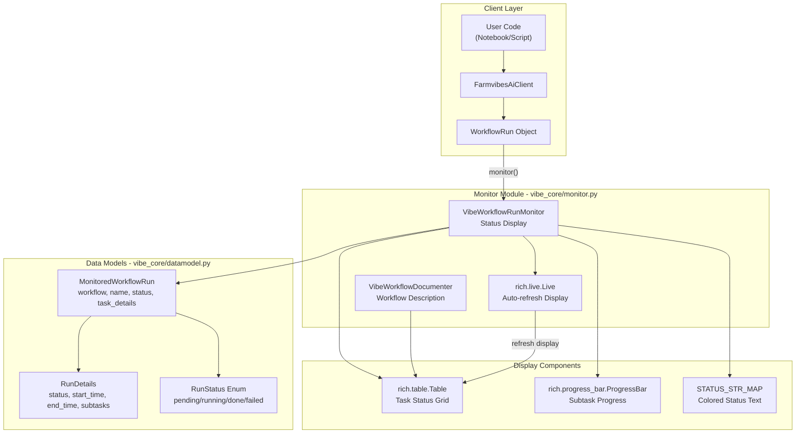
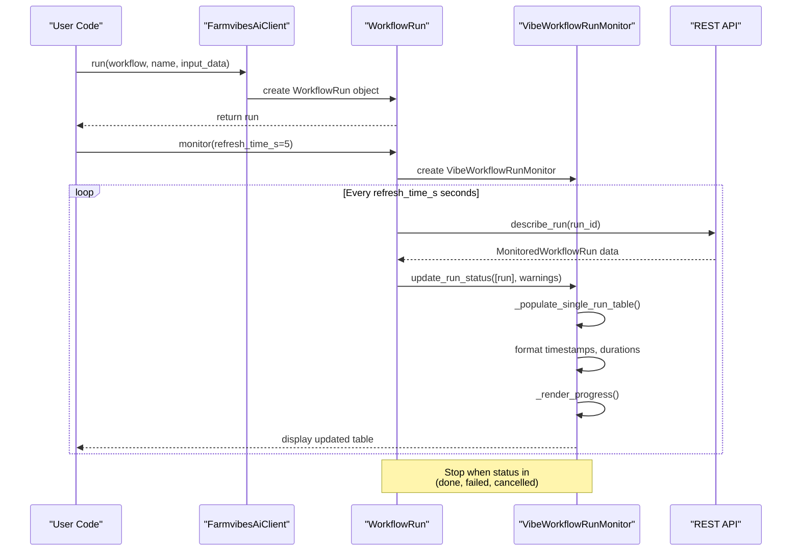
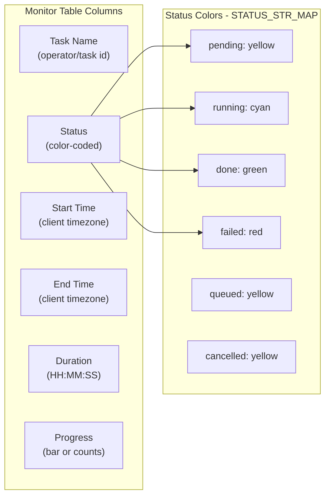
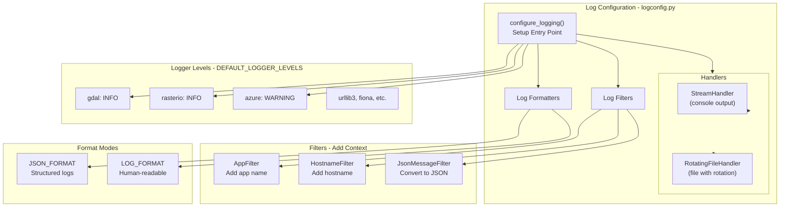
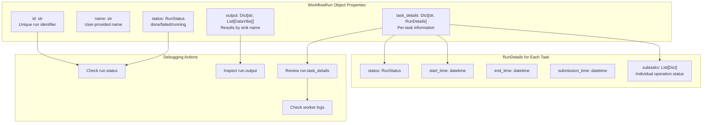
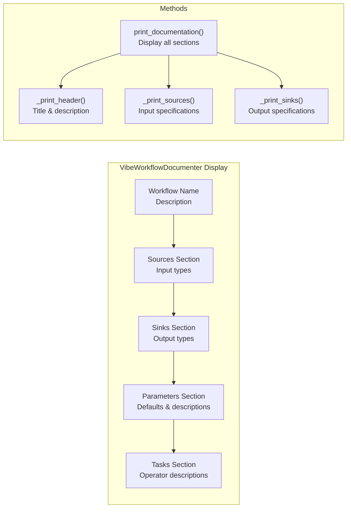
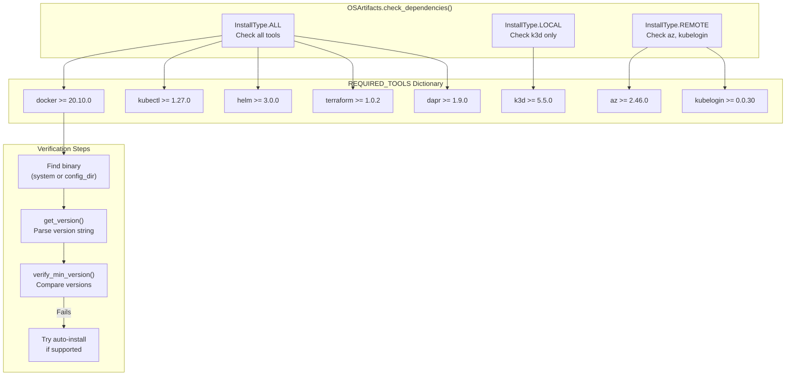

<!-- source: DeepWiki mcp.deepwiki.com · repo microsoft/farmvibes-ai · page 5.3 Monitoring and Debugging · fetched 2026-10-26 -->

# Monitoring and Debugging

<details>
<summary>Relevant source files</summary>

The following files were used as context for generating this wiki page:

- [notebooks/heatmaps/notebook_lib/utils.py](notebooks/heatmaps/notebook_lib/utils.py)
- [notebooks/sentinel/timelapse_visualization.ipynb](notebooks/sentinel/timelapse_visualization.ipynb)
- [src/vibe_core/vibe_core/cli/osartifacts.py](src/vibe_core/vibe_core/cli/osartifacts.py)
- [src/vibe_core/vibe_core/logconfig.py](src/vibe_core/vibe_core/logconfig.py)
- [src/vibe_core/vibe_core/monitor.py](src/vibe_core/vibe_core/monitor.py)

</details>


This page explains how to monitor workflow execution, inspect logs, and debug issues in FarmVibes.AI. It covers the monitoring system that provides real-time status updates, the logging infrastructure for detailed inspection, and common troubleshooting approaches.

For information about running workflows and configuring execution parameters, see [Running Workflows](#5.2). For details on workflow status and run management via the client API, see [Client API](#3.4).

---

## Workflow Monitoring System

FarmVibes.AI provides a real-time monitoring system that displays workflow execution status, task progress, and timing information in an interactive table format using the Rich library.

### Monitor Architecture

The monitoring system consists of two main components that format and display workflow information:



**Diagram: Monitoring System Component Interaction**

Sources: [src/vibe_core/vibe_core/monitor.py:1-559]()

### VibeWorkflowRunMonitor Class

The `VibeWorkflowRunMonitor` class manages the real-time display of workflow execution status. It renders a table showing task names, statuses, timestamps, durations, and subtask progress.

**Key Properties and Methods:**

| Method/Property | Purpose |
|----------------|---------|
| `__init__(api_time_zone, detailed_task_info, multi_run)` | Initialize monitor with timezone and display mode |
| `update_run_status(monitored_runs, monitored_warnings)` | Refresh the display with latest run information |
| `_populate_single_run_table(run, warnings)` | Build table for single workflow run |
| `_populate_multi_run_table(runs, warnings)` | Build table for multiple concurrent runs |
| `_render_progress(task_info)` | Generate progress bar or detailed subtask counts |

Sources: [src/vibe_core/vibe_core/monitor.py:193-559]()

### Monitor Usage Pattern



**Diagram: Monitor Execution Flow**

Sources: [src/vibe_core/vibe_core/monitor.py:542-558](), [notebooks/heatmaps/notebook_lib/utils.py:109]()

### Status Display Format

The monitor displays workflow execution in a structured table with the following columns:



**Diagram: Monitor Display Structure**

The table header includes:
- **Run name** and **Run id** for single runs
- **Workflow name** (or "Custom: '{name}'" for custom workflows)
- **Run status** with color coding
- **Run duration** computed from task submission/completion times

Sources: [src/vibe_core/vibe_core/monitor.py:25-34](), [src/vibe_core/vibe_core/monitor.py:202-236]()

### Progress Rendering

Progress is displayed in two modes controlled by the `detailed_task_info` parameter:

**Simple Mode (default):**
- Shows a progress bar with completed/total subtasks
- Format: `[=====>    ] 5/10`

**Detailed Mode:**
- Shows subtask counts by status: `D/R/Q/P/F`
- Format: `5/2/1/1/1` (Done/Running/Queued/Pending/Failed)

The `_render_progress()` method generates these displays:

```python
# For simple mode - progress bar
ProgressBar(total=total, completed=counts[RunStatus.done], width=self.PBAR_WIDTH)

# For detailed mode - status counts string
f"[green]{counts[RunStatus.done]}[/]/[blue]{counts[RunStatus.running]}[/]/..."
```

Sources: [src/vibe_core/vibe_core/monitor.py:276-309](), [src/vibe_core/vibe_core/monitor.py:233-234]()

### Time Zone Handling

The monitor converts API server timestamps to the client's local timezone for display:

| Property | Purpose |
|----------|---------|
| `api_tz` | Time zone of the API server (passed to constructor) |
| `client_tz` | Client's local time zone (from `dateutil.tz.tzlocal()`) |
| `_get_time_str(time)` | Convert API time to client timezone string |
| `time_or_now(time)` | Convert time or use current time if None |

Sources: [src/vibe_core/vibe_core/monitor.py:239-246](), [src/vibe_core/vibe_core/monitor.py:267-274](), [src/vibe_core/vibe_core/monitor.py:387-402]()

---

## Logging System

FarmVibes.AI uses Python's standard logging framework with structured JSON formatting for production deployments and human-readable formatting for development.

### Logging Configuration

The `configure_logging()` function in [src/vibe_core/vibe_core/logconfig.py:121-172]() sets up logging with the following features:



**Diagram: Logging Configuration Architecture**

Sources: [src/vibe_core/vibe_core/logconfig.py:1-172]()

### Log Format Specifications

**Human-Readable Format (`LOG_FORMAT`):**
```
[%(asctime)s] [%(hostname)s] %(levelname)s [%(name)s:%(lineno)s] %(message)s
```

Example output:
```
[2023-10-15 14:30:45] [worker-node-1] INFO [vibe_core.client:142] Submitting workflow run
```

**JSON Format (`JSON_FORMAT`):**
```json
{
  "app_id": "farmvibes-ai",
  "instance": "worker-node-1",
  "level": "INFO",
  "msg": "Submitting workflow run",
  "scope": "vibe_core.client",
  "time": "2023-10-15 14:30:45",
  "type": "log",
  "ver": "dev"
}
```

Sources: [src/vibe_core/vibe_core/logconfig.py:15-23]()

### Log Filters

Three filter classes add contextual information to log records:

| Filter Class | Field Added | Source |
|--------------|-------------|--------|
| `HostnameFilter` | `hostname` | `platform.node()` |
| `AppFilter` | `app` | Constructor parameter |
| `JsonMessageFilter` | `json_message` | Serialized message + traceback |

The `JsonMessageFilter` handles exception formatting by converting tracebacks to JSON-safe strings:

```python
if record.exc_info:
    record.msg = record.msg + "\n" + logging.Formatter().formatException(record.exc_info)
    record.exc_info = None
record.json_message = json.dumps(record.getMessage())
```

Sources: [src/vibe_core/vibe_core/logconfig.py:43-106]()

### Default Logger Levels

The system configures specific log levels for common libraries to reduce noise:

| Logger Name | Default Level | Reason |
|-------------|---------------|--------|
| `gdal`, `rasterio`, `fiona` | INFO | Suppress verbose geospatial processing details |
| `urllib3` | INFO | Reduce HTTP connection details |
| `azure` | WARNING | Minimize Azure SDK chattiness |
| `matplotlib` | INFO | Limit plotting library messages |
| `uvicorn` | WARNING | Reduce web server logs |

Sources: [src/vibe_core/vibe_core/logconfig.py:25-36]()

### File Rotation Configuration

When `logdir` is specified, logs are written to rotating files:

| Parameter | Default Value | Purpose |
|-----------|---------------|---------|
| `MAX_LOG_FILE_BYTES` | 100 MB | Maximum size before rotation |
| `LOG_BACKUP_COUNT` | 5 | Number of backup files to keep |
| `logfile` | `{hostname}.log` | Log file name pattern |

Sources: [src/vibe_core/vibe_core/logconfig.py:38-40]()

---

## Debugging Workflows

### Inspecting Run Details

When a workflow run completes or fails, you can inspect detailed information through the `WorkflowRun` object:



**Diagram: Workflow Run Debugging Entry Points**

Sources: [src/vibe_core/vibe_core/monitor.py:20]()

### Common Failure Patterns

#### Failed Status Detection

A workflow run can fail at different levels:

1. **Run-level failure**: `run.status == RunStatus.failed`
2. **Task-level failure**: Individual tasks in `run.task_details` with `failed` status
3. **Subtask failure**: Individual operations within a task fail

Check the failure level:

```python
if run.status != "done":
    # Inspect which tasks failed
    for task_name, details in run.task_details.items():
        if details.status == RunStatus.failed:
            print(f"Task {task_name} failed")
            if details.subtasks:
                failed_subtasks = [s for s in details.subtasks if s['status'] == 'failed']
                print(f"  Failed subtasks: {failed_subtasks}")
```

Sources: [src/vibe_core/vibe_core/monitor.py:282](), [notebooks/heatmaps/notebook_lib/utils.py:111-115]()

### Workflow Documentation

Before debugging a workflow, inspect its expected inputs, outputs, and parameters using `VibeWorkflowDocumenter`:



**Diagram: Workflow Documentation Display**

The documenter displays workflow information in colored, formatted output:

- **Title**: Workflow name in bold blue
- **Description**: Short and long descriptions with border padding
- **Sources/Sinks**: Name, type, and description for each I/O
- **Parameters**: Name, default value, and description
- **Tasks**: Component operator descriptions

Sources: [src/vibe_core/vibe_core/monitor.py:71-191]()

### Missing Data Detection

For satellite imagery workflows, check for missing or incomplete data:

```python
def get_missing_ratio(raster, geometry):
    ar = read_raster(raster, geometry, filled=False)[0]
    c = ar.count()
    total = np.prod(ar.shape)
    return 1.0 - (c / total)

# Filter rasters with too much missing data
missing_data_thr = 0.1
valid_rasters = [r for r in rasters if get_missing_ratio(r, geometry) < missing_data_thr]
```

Sources: [notebooks/sentinel/timelapse_visualization.ipynb:59-64](), [notebooks/sentinel/timelapse_visualization.ipynb:234-249]()

---

## Troubleshooting Tools

### Dependency Verification

The CLI includes dependency checking to verify all required tools are installed and meet minimum version requirements:



**Diagram: Dependency Checking System**

Sources: [src/vibe_core/vibe_core/cli/osartifacts.py:66-120](), [src/vibe_core/vibe_core/cli/osartifacts.py:126-236]()

### Dependency Class Structure

Each dependency is defined using a `Dependency` dataclass:

| Field | Purpose | Example |
|-------|---------|---------|
| `name` | Tool name | `"kubectl"` |
| `install_instructions` | URL for manual install | `"https://kubernetes.io/..."` |
| `type` | Where needed | `InstallType.ALL` |
| `version_argument` | Command to get version | `"version --client"` |
| `version_regex` | Pattern to extract version | `r"gitVersion:\s+\d+\.\d+\.\d+"` |
| `minimum_version` | Required minimum | `"1.27.0"` |
| `upgrade_command` | Native upgrade command | `"az upgrade"` (optional) |

Sources: [src/vibe_core/vibe_core/cli/osartifacts.py:47-57]()

### Version Comparison Algorithm

The `verify_min_version()` method compares semantic versions:

1. Strip leading 'v' and build metadata (`+suffix`)
2. Split into parts: `[major, minor, patch]`
3. Compare parts left-to-right:
   - If current < minimum: return `False`
   - If current > minimum: return `True`
   - If equal: continue to next part
4. If all equal and lengths match: return `True`

```python
current_versions = tool_version.split(".")
wanted_versions = expected_version.split(".")

for cv, wv in zip(current_versions, wanted_versions):
    if int(wv) > int(cv):
        return False
    elif int(cv) > int(wv):
        return True
```

Sources: [src/vibe_core/vibe_core/cli/osartifacts.py:335-365]()

### Auto-Installation Support

For tools that support automatic installation, the CLI provides installer classes:

| Tool | Installer Class | Installation Method |
|------|----------------|---------------------|
| Terraform | `TerraformInstaller` | Download from HashiCorp releases |
| kubectl | `KubectlInstaller` | Download from Kubernetes storage |
| Helm | `HelmInstaller` | Download from Helm releases |
| k3d | `K3dInstaller` | Download from GitHub releases |
| Dapr | `DaprInstaller` | Download from Dapr CLI releases |
| kubelogin | `KubeloginInstaller` | Download from Azure/kubelogin releases |
| Azure CLI | `AzCliInstaller` | Use platform package manager |
| Docker CLI | `DockerCliInstaller` | Download static binary |

All installers inherit from `PrivateCliToolInstaller` and implement platform-specific download/extraction logic:

```python
def install_helper(self, url: str, file_name: str) -> None:
    # Download to temp directory
    # Extract if zip or tar.gz
    # Find binary in extracted files
    # Copy to config_dir with executable permissions
```

Sources: [src/vibe_core/vibe_core/cli/osartifacts.py:401-432](), [src/vibe_core/vibe_core/cli/osartifacts.py:548-619]()

---

## Monitor Integration Example

Typical workflow execution with monitoring in notebook environments:

```python
from vibe_core.client import get_default_vibe_client

# Initialize client
client = get_default_vibe_client()

# Submit workflow
run = client.run(
    workflow="data_ingestion/sentinel2/preprocess_s2",
    name="my_run",
    geometry=geometry,
    time_range=time_range
)

# Monitor with 5-second refresh
run.monitor(refresh_time_s=5)

# After completion, check status
if run.status == "done":
    rasters = run.output["raster"]
else:
    # Inspect failures
    print(f"Run failed with status: {run.status}")
    for task_name, details in run.task_details.items():
        if details.status == "failed":
            print(f"Failed task: {task_name}")
```

Sources: [notebooks/sentinel/timelapse_visualization.ipynb:106-131](), [notebooks/heatmaps/notebook_lib/utils.py:99-115]()

---

