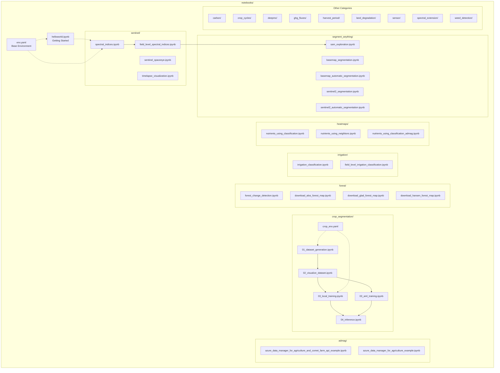
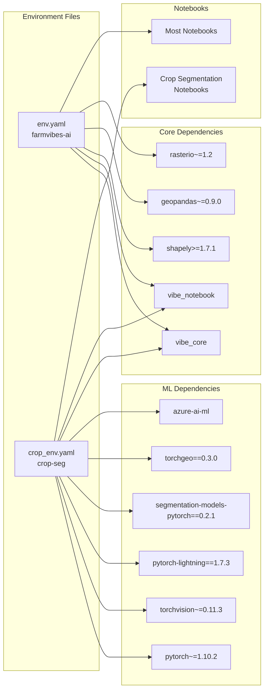
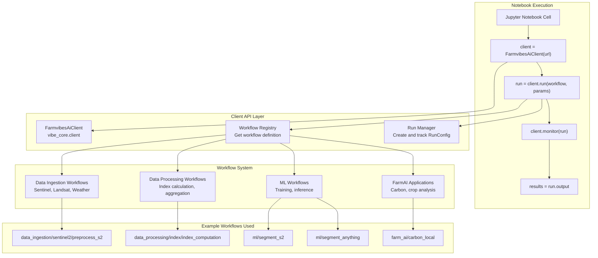
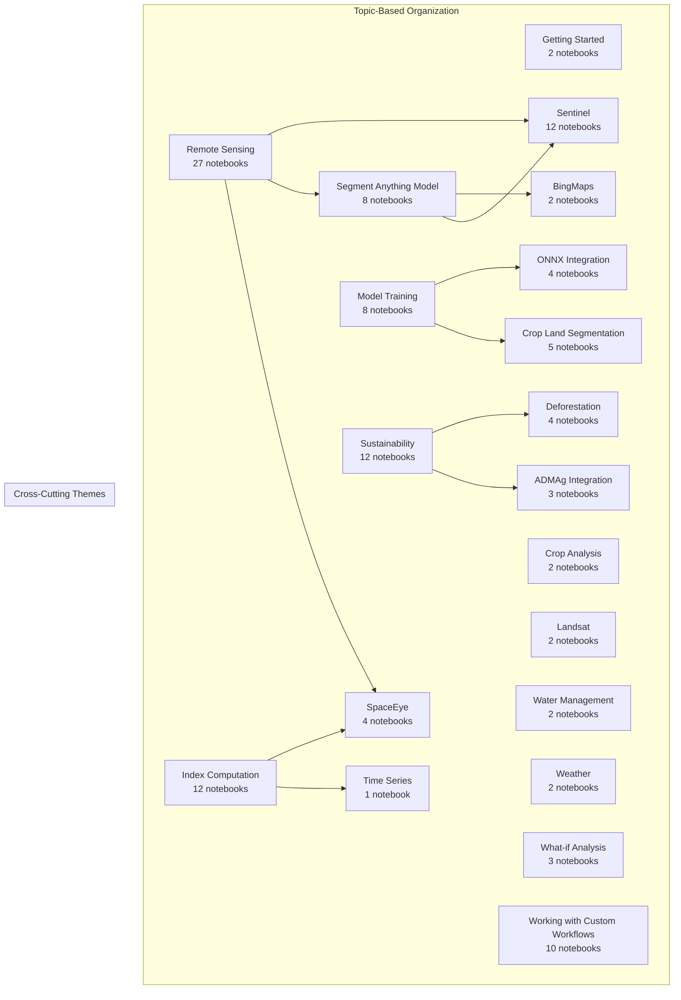

<!-- source: DeepWiki mcp.deepwiki.com · repo microsoft/farmvibes-ai · page 6 Example Notebooks · fetched 2026-10-26 -->

# Example Notebooks

<details>
<summary>Relevant source files</summary>

The following files were used as context for generating this wiki page:

- [docs/source/docfiles/markdown/NOTEBOOK_LIST.md](docs/source/docfiles/markdown/NOTEBOOK_LIST.md)
- [notebooks/README.md](notebooks/README.md)
- [notebooks/crop_segmentation/crop_env.yaml](notebooks/crop_segmentation/crop_env.yaml)

</details>


This page provides an overview of the example Jupyter notebooks included with FarmVibes.AI, organized by use case and application domain. These notebooks demonstrate platform capabilities through practical examples ranging from basic spectral index computation to advanced machine learning workflows. For detailed guidance on executing notebooks, see [Working with Notebooks](#5.1). For detailed catalogs of agriculture, remote sensing, and ML examples, see [Agriculture Examples](#6.1), [Remote Sensing Examples](#6.2), and [ML and Segmentation Examples](#6.3).

**Sources:** [docs/source/docfiles/markdown/NOTEBOOK_LIST.md:1-11](), [notebooks/README.md:1-4]()

## Notebook Organization and Categories

FarmVibes.AI includes over 50 example notebooks organized into functional categories. Each notebook demonstrates one or more workflows, data models, and processing pipelines available in the platform.



**Notebook Directory Structure**

The notebooks are organized into directories by domain:

| Directory | Focus Area | Example Notebooks |
|-----------|-----------|-------------------|
| `notebooks/` | Getting Started | `helloworld.ipynb` |
| `notebooks/admag/` | Azure Data Manager Integration | ADMAg + COMET-Farm, NDVI summaries |
| `notebooks/sentinel/` | Sentinel-2 Processing | Spectral indices, SpaceEye, timelapse |
| `notebooks/crop_segmentation/` | ML Model Training | Dataset generation, training, inference |
| `notebooks/segment_anything/` | SAM Segmentation | Field boundary detection, automatic segmentation |
| `notebooks/forest/` | Deforestation Monitoring | Forest change detection, map downloads |
| `notebooks/irrigation/` | Water Management | Irrigation classification, field-level analysis |
| `notebooks/heatmaps/` | Nutrient Mapping | Heatmap estimation with classification/neighbors |
| `notebooks/carbon/` | Carbon Sequestration | What-if analysis |
| `notebooks/crop_cycles/` | Temporal Analysis | Crop cycle detection |
| `notebooks/deepmc/` | Weather Prediction | Microclimate forecasting |
| `notebooks/ghg_fluxes/` | Sustainability | GHG emissions computation |
| `notebooks/harvest_period/` | Crop Timing | Harvest and germination detection |
| `notebooks/land_degradation/` | Environmental Monitoring | NDVI trends, precipitation analysis |
| `notebooks/sensor/` | Sensor Placement | Optimal location algorithms |
| `notebooks/spectral_extension/` | Data Fusion | High-resolution multispectral generation |
| `notebooks/weed_detection/` | Crop Health | Weed detection with GMM |

**Sources:** [docs/source/docfiles/markdown/NOTEBOOK_LIST.md:10-363](), [notebooks/README.md:1-4]()

## Environment Setup

Notebooks require dependency installation through micromamba environments. The repository provides multiple environment files for different notebook categories.

### Base Environment Setup

The base environment `farmvibes-ai` provides common dependencies for most notebooks:

**Installation Command:**
```bash
micromamba env create -f env.yaml
```

This creates the `farmvibes-ai` environment from [notebooks/env.yaml:1-22](). The environment includes core packages like `vibe_core` and `vibe_notebook`.

### Specialized Environment Files

Some notebooks require additional dependencies defined in specialized environment files:

**Crop Segmentation Environment:**
- **File:** [notebooks/crop_segmentation/crop_env.yaml:1-31]()
- **Environment Name:** `crop-seg` [notebooks/crop_segmentation/crop_env.yaml:1]()
- **Key Dependencies:** 
  - PyTorch ~1.10.2 [notebooks/crop_segmentation/crop_env.yaml:9]()
  - torchvision ~0.11.3 [notebooks/crop_segmentation/crop_env.yaml:13]()
  - pytorch-lightning 1.7.3 [notebooks/crop_segmentation/crop_env.yaml:23]()
  - segmentation-models-pytorch 0.2.1 [notebooks/crop_segmentation/crop_env.yaml:24]()
  - torchgeo 0.3.0 [notebooks/crop_segmentation/crop_env.yaml:25]()
  - azure-ai-ml and azure-identity for AML integration [notebooks/crop_segmentation/crop_env.yaml:28-29]()
- **Used By:** Crop segmentation notebooks (01-04)

**Environment Activation:**
```bash
micromamba activate farmvibes-ai  # Base environment
micromamba activate crop-seg      # Crop segmentation environment
```



**Sources:** [notebooks/README.md:6-21](), [notebooks/crop_segmentation/crop_env.yaml:1-31]()

## Notebook-Workflow Integration

Example notebooks demonstrate how to interact with FarmVibes.AI workflows through the Python client API. Each notebook instantiates a `FarmvibesAiClient` and submits workflow runs.



**Common Notebook Pattern:**

Notebooks follow a standard execution pattern:

1. **Client Instantiation** - Connect to FarmVibes.AI cluster
2. **Workflow Submission** - Submit workflow with parameters (geometry, time range, etc.)
3. **Monitoring** - Track execution progress with progress bars
4. **Result Retrieval** - Fetch output data as DataVibe objects
5. **Visualization** - Display results using matplotlib, folium, or other libraries

**Workflow Parameter Patterns:**

Most notebooks require:
- Geographic extent (bounding box or geometry)
- Time range (start_date, end_date)
- Workflow-specific parameters (index names, model paths, thresholds)

**Sources:** [docs/source/docfiles/markdown/NOTEBOOK_LIST.md:1-11]()

## Notebook Categories and Use Cases

The following table organizes notebooks by primary use case, showing disk requirements and execution time where documented:

### Getting Started

| Notebook | Description | Key Workflows |
|----------|-------------|---------------|
| `helloworld.ipynb` | Basic client instantiation and workflow execution | Simple example workflow |
| `sentinel/spectral_indices.ipynb` | Compute spectral indices from Sentinel-2 | Index calculation workflows |

### Agriculture Applications

| Notebook | Description | Resources |
|----------|-------------|-----------|
| `harvest_period/ndvi_summary.ipynb` | Detect harvest and germination periods | Time series analysis |
| `crop_cycles/crop_cycles.ipynb` | Detect number of crop cycles per year | NDVI time series, ONNX models |
| `admag/azure_data_manager_for_agriculture_example.ipynb` | NDVI summary with ADMAg integration | ADMAg API, Sentinel-2 |
| `admag/azure_data_manager_for_agriculture_and_comet_farm_api_example.ipynb` | Carbon sequestration with ADMAg and COMET-Farm | COMET-Farm API, ADMAg |

### Remote Sensing

| Notebook | Description | Data Sources |
|----------|-------------|--------------|
| `sentinel/sentinel_spaceeye.ipynb` | Cloud-free imagery with SpaceEye | Sentinel-1, Sentinel-2 |
| `sentinel/timelapse_visualization.ipynb` | Generate timelapse animations | SpaceEye, NDVI rasters |
| `sentinel/field_level_spectral_indices.ipynb` | Field-level index computation | Sentinel-2, SAM segmentation |
| `spectral_extension/spectral_extension.ipynb` | High-res multispectral data fusion | Drone imagery, Sentinel-2 (~10 minutes) |

### Machine Learning and Segmentation

| Notebook | Description | ML Framework |
|----------|-------------|--------------|
| `crop_segmentation/01_dataset_generation.ipynb` | Generate training dataset | NDVI, CDL rasters |
| `crop_segmentation/02_visualize_dataset.ipynb` | Dataset exploration | Visualization tools |
| `crop_segmentation/03_local_training.ipynb` | Local model training | PyTorch, segmentation-models-pytorch |
| `crop_segmentation/03_aml_training.ipynb` | Azure ML model training | Azure ML SDK |
| `crop_segmentation/04_inference.ipynb` | Model inference | ONNX runtime |
| `segment_anything/sam_exploration.ipynb` | SAM model exploration | Segment Anything Model |
| `segment_anything/basemap_segmentation.ipynb` | SAM on BingMaps | SAM workflow |
| `segment_anything/sentinel2_segmentation.ipynb` | SAM on Sentinel-2 | SAM workflow |
| `segment_anything/basemap_automatic_segmentation.ipynb` | Automatic SAM segmentation (BingMaps) | SAM workflow |
| `segment_anything/sentinel2_automatic_segmentation.ipynb` | Automatic SAM segmentation (Sentinel-2) | SAM workflow |

### Sustainability and Environmental Monitoring

| Notebook | Description | Sustainability Focus |
|----------|-------------|---------------------|
| `carbon/whatif.ipynb` | Carbon sequestration what-if analysis | COMET-Farm API |
| `ghg_fluxes/ghg_fluxes.ipynb` | GHG emissions computation (~30s) | Emissions/sequestration |
| `forest/forest_change_detection.ipynb` | Detect forest changes | Deforestation |
| `forest/download_alos_forest_map.ipynb` | Download ALOS forest maps | Forest extent |
| `forest/download_glad_forest_map.ipynb` | Download GLAD forest maps | Forest extent |
| `forest/download_hansen_forest_map.ipynb` | Download Hansen forest maps | Global forest change |
| `land_degradation/land_degradation.ipynb` | NDVI trends and precipitation analysis | Land degradation |

### Water Management

| Notebook | Description | Data Sources |
|----------|-------------|--------------|
| `irrigation/irrigation_classification.ipynb` | Irrigation probability mapping | Landsat-8, DEM |
| `irrigation/field_level_irrigation_classification.ipynb` | Field-level irrigation classification | SAM segmentation, indices |

### Nutrient and Sensor Management

| Notebook | Description | Resources |
|----------|-------------|-----------|
| `heatmaps/nutrients_using_classification.ipynb` | Nutrient heatmap with Random Forest | Soil samples, Sentinel-2 |
| `heatmaps/nutrients_using_neighbors.ipynb` | Nutrient heatmap with neighbor interpolation | Optimal sensor locations |
| `heatmaps/nutrients_using_classification_admag.ipynb` | Nutrient heatmap with ADMAg integration (~1GB, <1 minute) | ADMAg soil samples |
| `sensor/optimal_locations.ipynb` | Optimal sensor placement | Satellite imagery |
| `sensor/optimal_locations_segmentation.ipynb` | Sensor placement over segmented fields | SAM, Sentinel-2 |

### Weather and Climate

| Notebook | Description | Models |
|----------|-------------|--------|
| `deepmc/mc_forecast.ipynb` | Microclimate prediction | DeepMC model |

### Specialized Applications

| Notebook | Description | Application |
|----------|-------------|-------------|
| `weed_detection/weed_detection.ipynb` | Weed detection with GMM | Gaussian Mixture Model |

**Sources:** [docs/source/docfiles/markdown/NOTEBOOK_LIST.md:10-446]()

## Running Notebooks

### Prerequisites

1. **FarmVibes.AI Cluster Running** - Ensure local or remote cluster is deployed (see [Infrastructure and Deployment](#3.2))
2. **Environment Activated** - Activate appropriate micromamba environment
3. **Cluster URL** - Note the cluster URL (default: `http://localhost:30000` for local)

### Execution Steps

1. **Activate Environment:**
   ```bash
   micromamba activate farmvibes-ai
   ```

2. **Launch Jupyter:**
   ```bash
   jupyter lab
   ```

3. **Open Notebook** - Navigate to desired notebook in the file browser

4. **Update Cluster URL** - Most notebooks define:
   ```python
   FARMVIBES_AI_URL = "http://localhost:30000"
   ```

5. **Run Cells** - Execute cells sequentially; workflows submit to cluster

### Monitoring Execution

Notebooks use the monitoring capabilities described in [Monitoring and Debugging](#5.3):
- Progress bars show workflow execution status
- Tables display task-level progress
- Logs available through cluster API

### Output Storage

Workflow outputs are stored in the cluster's data directory. Notebooks typically:
- Download outputs to local variables as DataVibe objects
- Visualize results inline
- Save processed outputs to local files

**Sources:** [notebooks/README.md:1-21]()

## Notebook Collections by Topic



The documentation in [NOTEBOOK_LIST.md:10-363]() organizes notebooks into 21 topic-based categories, with significant overlap. For example:
- **Remote Sensing** category includes 27 notebooks spanning multiple domains
- **Model Training** includes notebooks from crop segmentation, nutrient heatmaps, and weed detection
- **Segment Anything Model** notebooks appear in multiple categories (Remote Sensing, BingMaps, Sentinel)

**Sources:** [docs/source/docfiles/markdown/NOTEBOOK_LIST.md:10-363]()

## Additional Resources

For comprehensive notebook listings with detailed descriptions, see:
- [Agriculture Examples](#6.1) - Crop analysis, carbon sequestration, harvest detection
- [Remote Sensing Examples](#6.2) - Satellite processing, SpaceEye, time series
- [ML and Segmentation Examples](#6.3) - Model training, SAM workflows, inference

For workflow execution and monitoring details:
- [Running Workflows](#5.2) - Workflow submission and configuration
- [Monitoring and Debugging](#5.3) - Execution tracking and troubleshooting
- [Workflow Catalog](#8.2) - Complete workflow reference

For development and customization:
- [Working with Notebooks](#5.1) - Notebook development guide
- [Client API](#3.4) - FarmvibesAiClient reference

**Sources:** [docs/source/docfiles/markdown/NOTEBOOK_LIST.md:1-448]()

---

