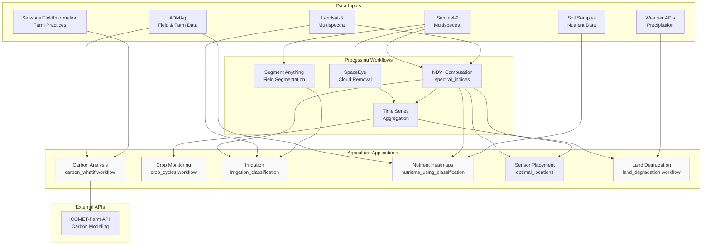
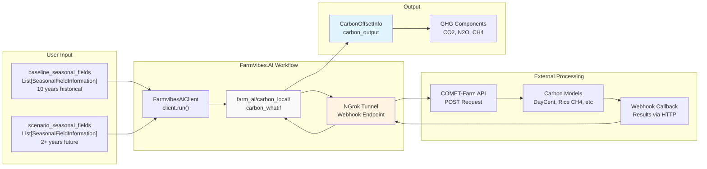
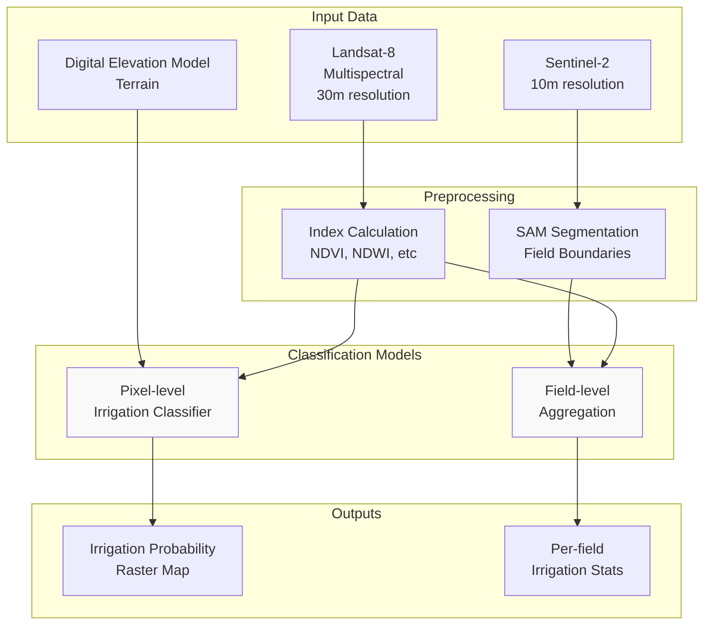
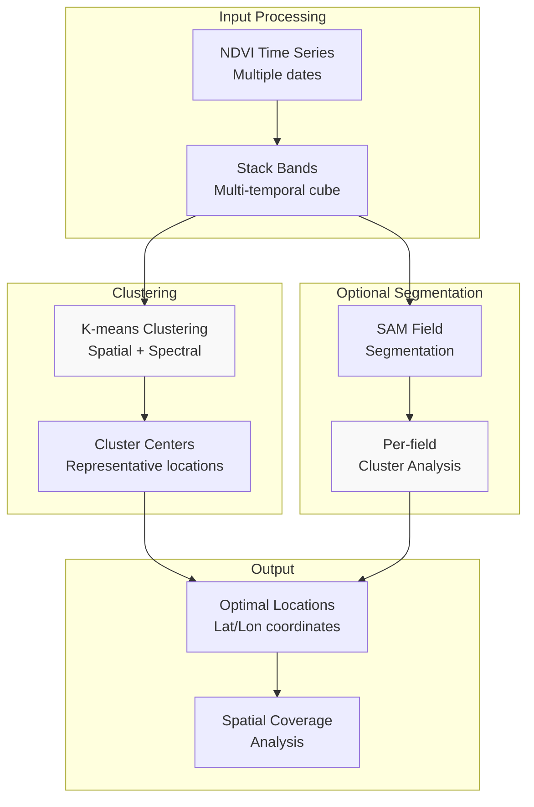

<!-- source: DeepWiki mcp.deepwiki.com · repo microsoft/farmvibes-ai · page 6.1 Agriculture Examples · fetched 2026-10-26 -->

# Agriculture Examples

<details>
<summary>Relevant source files</summary>

The following files were used as context for generating this wiki page:

- [docs/source/docfiles/markdown/NOTEBOOK_LIST.md](docs/source/docfiles/markdown/NOTEBOOK_LIST.md)
- [notebooks/carbon/whatif.ipynb](notebooks/carbon/whatif.ipynb)
- [notebooks/harvest_period/ndvi_summary.ipynb](notebooks/harvest_period/ndvi_summary.ipynb)

</details>


## Purpose and Scope

This page documents the example notebooks that demonstrate agricultural applications using FarmVibes.AI. These notebooks showcase end-to-end workflows for crop management, carbon sequestration analysis, irrigation monitoring, soil nutrient assessment, and land health evaluation. Each example demonstrates how to combine satellite imagery, weather data, and farm management information to generate actionable agricultural insights.

For notebooks focused on satellite data processing and index calculation, see [Remote Sensing Examples](#6.2). For machine learning model training and segmentation workflows, see [ML and Segmentation Examples](#6.3). For general guidance on running notebooks, see [Working with Notebooks](#5.1).

## Agriculture Application Categories

FarmVibes.AI provides notebooks organized into five main agricultural application areas:

| Category | Use Cases | Primary Data Sources |
|----------|-----------|---------------------|
| **Carbon & Sustainability** | Carbon sequestration, GHG emissions, what-if analysis | COMET-Farm API, ADMAg, Sentinel-2 |
| **Crop Monitoring** | Crop cycles, harvest detection, germination periods | Sentinel-2, Landsat, NDVI time series |
| **Irrigation Management** | Irrigation classification, water use assessment | Landsat-8, DEM, Sentinel-2, SAM |
| **Soil & Nutrients** | Nutrient heatmaps, optimal sensor placement | Sentinel-2, soil samples, ADMAg |
| **Land Health** | Land degradation, weed detection | Landsat, precipitation data, high-res imagery |

Sources: [docs/source/docfiles/markdown/NOTEBOOK_LIST.md:10-363]()

### Agriculture Workflow Architecture



**Architecture Diagram: Agriculture Application Data Flow**

This diagram illustrates how agricultural applications integrate multiple data sources through processing workflows. Applications consume standardized outputs like NDVI rasters and time series aggregations, demonstrating the modular workflow design.

Sources: [docs/source/docfiles/markdown/NOTEBOOK_LIST.md:14-363]()

## Carbon Sequestration and Sustainability

FarmVibes.AI provides three notebooks for carbon analysis and greenhouse gas emissions evaluation, all leveraging the COMET-Farm API for carbon modeling.

### Available Notebooks

| Notebook | Workflow | Description | Setup Requirements |
|----------|----------|-------------|-------------------|
| [What-if analysis of carbon sequestration](https://github.com/microsoft/farmvibes-ai/blob/main/notebooks/carbon/whatif.ipynb) | `farm_ai/carbon_local/carbon_whatif` | Compare baseline vs scenario carbon sequestration | COMET-Farm account, ngrok token |
| [Carbon sequestration with ADMAg and COMET-Farm](https://github.com/microsoft/farmvibes-ai/blob/main/notebooks/admag/azure_data_manager_for_agriculture_and_comet_farm_api_example.ipynb) | ADMAg integration + carbon workflow | Retrieve farm data from ADMAg and estimate carbon | ADMAg credentials, COMET-Farm account |
| [Green House Gas fluxes](https://github.com/microsoft/farmvibes-ai/blob/main/notebooks/ghg_fluxes/ghg_fluxes.ipynb) | GHG computation workflow | Calculate emissions and sequestration by crop | COMET-Farm account |

Sources: [docs/source/docfiles/markdown/NOTEBOOK_LIST.md:26-28](), [docs/source/docfiles/markdown/NOTEBOOK_LIST.md:287-300](), [docs/source/docfiles/markdown/NOTEBOOK_LIST.md:329-337](), [docs/source/docfiles/markdown/NOTEBOOK_LIST.md:407-446]()

### Carbon Workflow Execution Pattern



**Diagram: Carbon Sequestration Workflow Execution**

This diagram shows the end-to-end execution of the carbon whatif workflow, including the ngrok tunnel requirement for receiving COMET-Farm API webhook callbacks.

Sources: [notebooks/carbon/whatif.ipynb:1-312]()

### SeasonalFieldInformation Data Model

The carbon workflows require `SeasonalFieldInformation` objects that contain comprehensive farm management data. The structure includes:

```python
SeasonalFieldInformation(
    id=str,
    time_range=(datetime, datetime),  # Season start/end
    geometry=dict,                      # Field boundary
    crop_name=str,
    crop_type=str,
    fertilizers=[FertilizerInformation],
    harvests=[HarvestInformation],
    tillages=[TillageInformation],
    organic_amendments=[OrganicAmendmentInformation]
)
```

**Baseline Requirements**: 10 calendar years of historical data  
**Scenario Requirements**: 2+ calendar years of future practices

The whatif notebook demonstrates loading these objects from JSON files at [notebooks/carbon/whatif.ipynb:59-112](). The `seasonal_field_from_dict` helper function reconstructs the nested data structures including harvest information, tillage operations, organic amendments, and fertilizer applications.

Sources: [notebooks/carbon/whatif.ipynb:17-24](), [notebooks/carbon/whatif.ipynb:59-112]()

### COMET-Farm API Output Structure

The COMET-Farm API returns comprehensive greenhouse gas analysis broken down by component:

| Category | Metrics | Description |
|----------|---------|-------------|
| **Carbon** | `SoilCarbon`, `BiomassBurningCarbon`, `SoilCarbonStock2000`, `SoilCarbonStockBegin`, `SoilCarbonStockEnd` | Soil carbon changes and stock levels |
| **CO2** | `LimingCO2`, `UreaFertilizationCO2`, `DrainedOrganicSoilsCO2` | Direct CO2 emissions |
| **N2O** | `SoilN2O`, `SoilN2O_Direct`, `SoilN2O_Indirect_Volatilization`, `SoilN2O_Indirect_Leaching` | Nitrous oxide from soil and management |
| **CH4** | `SoilCH4`, `WetlandRiceCultivationCH4`, `BiomassBurningCH4` | Methane emissions |

The workflow aggregates results across all soil map units within the field boundary and returns a `CarbonOffsetInfo` object accessible via `run.output["carbon_output"][0]`.

Sources: [notebooks/carbon/whatif.ipynb:118-162](), [notebooks/carbon/whatif.ipynb:266-268]()

### Prerequisites and Configuration

Running carbon workflows requires external service registration:

1. **COMET-Farm Account**: Register at https://comet-farm.com/ for API access and support
2. **NGrok Token**: Sign up at https://dashboard.ngrok.com/ to obtain authentication token for webhook tunnel
3. **ADMAg Credentials** (optional): For notebooks integrating Azure Data Manager for Agriculture

The workflow parameters must include:

```python
parameters = {
    "ngrok_token": NGROK_AUTH_TOKEN,
    "comet_support_email": COMET_REGISTERED_EMAIL
}
```

**Important**: The ngrok tunnel exposes a public endpoint for the duration of workflow execution. The connection closes automatically when the workflow completes. Incorrect configuration will cause workflow failure.

Sources: [notebooks/carbon/whatif.ipynb:168-184](), [notebooks/carbon/whatif.ipynb:200-205](), [notebooks/carbon/whatif.ipynb:232-246]()

## Crop Monitoring and Analysis

Crop monitoring notebooks analyze vegetation indices time series to detect crop cycles, harvest periods, and germination events.

### Available Notebooks

| Notebook | Workflow | Description | Data Sources |
|----------|----------|-------------|--------------|
| [Crop cycle detection](https://github.com/microsoft/farmvibes-ai/blob/main/notebooks/crop_cycles/crop_cycles.ipynb) | Custom ONNX workflow | Detect number of crop cycles per year using time-series analysis | Sentinel-2, SpaceEye, NDVI |
| [Harvest and germination periods](https://github.com/microsoft/farmvibes-ai/blob/main/notebooks/harvest_period/ndvi_summary.ipynb) | NDVI time series analysis | Infer harvest/germination from NDVI temporal patterns | Sentinel-2, NDVI time series |
| [Integration with ADMAg](https://github.com/microsoft/farmvibes-ai/blob/main/notebooks/admag/azure_data_manager_for_agriculture_example.ipynb) | ADMAg + NDVI summary | Compute NDVI statistics for fields managed in ADMAg | ADMAg fields, Sentinel-2 |

Sources: [docs/source/docfiles/markdown/NOTEBOOK_LIST.md:44-50](), [docs/source/docfiles/markdown/NOTEBOOK_LIST.md:381-414]()

### Crop Cycle Detection Workflow

The crop cycle detection notebook demonstrates a custom workflow that:

1. Downloads Sentinel-2 imagery using SpaceEye for cloud-free composites
2. Computes NDVI time series over the growing season
3. Applies an ONNX model to identify crop cycle patterns
4. Returns the number of distinct crop cycles detected

This workflow is particularly useful for regions practicing multiple cropping seasons per year or intercropping systems.

Sources: [docs/source/docfiles/markdown/NOTEBOOK_LIST.md:83-88](), [docs/source/docfiles/markdown/NOTEBOOK_LIST.md:144-152](), [docs/source/docfiles/markdown/NOTEBOOK_LIST.md:161-172](), [docs/source/docfiles/markdown/NOTEBOOK_LIST.md:381]()

### Harvest Period Detection

The harvest and germination notebook analyzes NDVI temporal profiles to identify:

- **Germination Period**: Rapid increase in NDVI indicating crop emergence
- **Peak Vegetation**: Maximum NDVI corresponding to full canopy
- **Harvest Period**: Sharp NDVI decline indicating crop removal
- **Senescence Patterns**: Gradual NDVI decrease prior to harvest

The workflow produces time series visualizations and summary statistics that can be integrated with farm management systems.

Sources: [docs/source/docfiles/markdown/NOTEBOOK_LIST.md:46-48](), [docs/source/docfiles/markdown/NOTEBOOK_LIST.md:306-308](), [docs/source/docfiles/markdown/NOTEBOOK_LIST.md:409]()

## Irrigation Management

Irrigation classification notebooks estimate irrigation probability and water management practices using multi-source remote sensing data.

### Available Notebooks

| Notebook | Workflow | Data Inputs | Output |
|----------|----------|-------------|--------|
| [Irrigation classification](https://github.com/microsoft/farmvibes-ai/blob/main/notebooks/irrigation/irrigation_classification.ipynb) | `irrigation_classification` | Landsat-8, DEM | Irrigation probability map |
| [Field-level irrigation classification](https://github.com/microsoft/farmvibes-ai/blob/main/notebooks/irrigation/field_level_irrigation_classification.ipynb) | SAM + irrigation | Sentinel-2, SAM segmentation | Per-field irrigation probability |

Sources: [docs/source/docfiles/markdown/NOTEBOOK_LIST.md:89-90](), [docs/source/docfiles/markdown/NOTEBOOK_LIST.md:112-115](), [docs/source/docfiles/markdown/NOTEBOOK_LIST.md:311-316](), [docs/source/docfiles/markdown/NOTEBOOK_LIST.md:417]()

### Irrigation Classification Approach



**Diagram: Irrigation Classification Pipeline**

The irrigation classification workflow combines spectral indices with elevation data for pixel-level classification. The field-level variant adds SAM segmentation to compute per-field statistics.

Sources: [docs/source/docfiles/markdown/NOTEBOOK_LIST.md:183-184](), [docs/source/docfiles/markdown/NOTEBOOK_LIST.md:191-192](), [docs/source/docfiles/markdown/NOTEBOOK_LIST.md:403](), [docs/source/docfiles/markdown/NOTEBOOK_LIST.md:417]()

### Use Cases

**Regional Irrigation Mapping**: Generate continuous irrigation probability maps for large agricultural regions using the base `irrigation_classification` workflow.

**Farm-level Water Management**: Use the field-level classification to assess irrigation status for individual farm parcels, integrating with farm management systems for water use optimization.

Sources: [docs/source/docfiles/markdown/NOTEBOOK_LIST.md:313-316]()

## Soil and Nutrient Management

Soil nutrient management notebooks estimate spatial distribution of soil properties and identify optimal locations for soil sampling or sensor deployment.

### Available Notebooks

| Notebook | Approach | Workflow | Data Requirements |
|----------|----------|----------|-------------------|
| [Nutrient Heatmap - Classification](https://github.com/microsoft/farmvibes-ai/blob/main/notebooks/heatmaps/nutrients_using_classification.ipynb) | Random Forest | Custom workflow | Soil samples + Sentinel-2 |
| [Nutrient Heatmap - Neighbors](https://github.com/microsoft/farmvibes-ai/blob/main/notebooks/heatmaps/nutrients_using_neighbors.ipynb) | K-Nearest Neighbors | Custom workflow | Soil samples + optimal locations |
| [Nutrient Heatmap - ADMAg](https://github.com/microsoft/farmvibes-ai/blob/main/notebooks/heatmaps/nutrients_using_classification_admag.ipynb) | Random Forest | ADMAg + custom workflow | ADMAg soil samples + Sentinel-2 |
| [Optimal Sensor Placement](https://github.com/microsoft/farmvibes-ai/blob/main/notebooks/sensor/optimal_locations.ipynb) | K-means clustering | `optimal_locations` | Sentinel-2, NDVI |
| [Optimal Sensor Placement - Segmented](https://github.com/microsoft/farmvibes-ai/blob/main/notebooks/sensor/optimal_locations_segmentation.ipynb) | K-means + SAM | SAM + `optimal_locations` | Sentinel-2, SAM segmentation |

Sources: [docs/source/docfiles/markdown/NOTEBOOK_LIST.md:93-102](), [docs/source/docfiles/markdown/NOTEBOOK_LIST.md:129-138](), [docs/source/docfiles/markdown/NOTEBOOK_LIST.md:350-357](), [docs/source/docfiles/markdown/NOTEBOOK_LIST.md:423-432]()

### Nutrient Heatmap Generation

The nutrient heatmap workflows create spatial interpolations of soil properties (N, P, K, pH, organic matter) across fields:

**Classification Approach**: Train a Random Forest model on soil sample locations and corresponding spectral indices. Predict nutrient levels for all pixels based on their spectral signatures.

**Neighbors Approach**: Use K-Nearest Neighbors interpolation weighted by distance and spectral similarity. Particularly effective when combined with optimal sensor placement.

**ADMAg Integration**: Retrieve soil sample data directly from Azure Data Manager for Agriculture, eliminating manual data preparation.

All workflows output georeferenced raster files containing continuous nutrient estimates, suitable for variable rate application planning.

Sources: [docs/source/docfiles/markdown/NOTEBOOK_LIST.md:93-98](), [docs/source/docfiles/markdown/NOTEBOOK_LIST.md:423-427]()

### Optimal Sensor Placement



**Diagram: Optimal Sensor Placement Algorithm**

The optimal locations workflow uses k-means clustering on multi-temporal NDVI data to identify spatially representative locations that maximize field variability coverage. The segmented variant ensures each field receives appropriate sensor coverage.

Sources: [docs/source/docfiles/markdown/NOTEBOOK_LIST.md:99-102](), [docs/source/docfiles/markdown/NOTEBOOK_LIST.md:135-136](), [docs/source/docfiles/markdown/NOTEBOOK_LIST.md:195-196](), [docs/source/docfiles/markdown/NOTEBOOK_LIST.md:224-225](), [docs/source/docfiles/markdown/NOTEBOOK_LIST.md:429-432]()

### Integration Patterns

**Sampling Strategy Optimization**: Run optimal sensor placement first to identify locations, then collect soil samples at those locations for maximum information gain.

**Sensor Network Design**: Use optimal locations to position permanent soil moisture or nutrient sensors for precision agriculture monitoring.

**Variable Rate Mapping**: Combine optimal locations with nutrient heatmaps to create prescription maps for variable rate fertilizer application.

Sources: [docs/source/docfiles/markdown/NOTEBOOK_LIST.md:350-357]()

## Land Health Monitoring

Land health notebooks assess degradation, detect weeds, and monitor long-term vegetation trends.

### Available Notebooks

| Notebook | Purpose | Data Sources | Analysis Method |
|----------|---------|--------------|-----------------|
| [Land degradation](https://github.com/microsoft/farmvibes-ai/blob/main/notebooks/land_degradation/land_degradation.ipynb) | Detect degradation via NDVI trends | Landsat, precipitation | Time series trend analysis |
| [Weed detection](https://github.com/microsoft/farmvibes-ai/blob/main/notebooks/weed_detection/weed_detection.ipynb) | Identify weed-affected areas | High-resolution imagery | Gaussian Mixture Model |

Sources: [docs/source/docfiles/markdown/NOTEBOOK_LIST.md:68-78](), [docs/source/docfiles/markdown/NOTEBOOK_LIST.md:91-92](), [docs/source/docfiles/markdown/NOTEBOOK_LIST.md:114-115](), [docs/source/docfiles/markdown/NOTEBOOK_LIST.md:119-138](), [docs/source/docfiles/markdown/NOTEBOOK_LIST.md:193-194](), [docs/source/docfiles/markdown/NOTEBOOK_LIST.md:207-208](), [docs/source/docfiles/markdown/NOTEBOOK_LIST.md:320-326](), [docs/source/docfiles/markdown/NOTEBOOK_LIST.md:419-420](), [docs/source/docfiles/markdown/NOTEBOOK_LIST.md:443-444]()

### Land Degradation Detection

The land degradation notebook combines vegetation index trends with precipitation analysis to distinguish between:

- **Climate-driven decline**: NDVI decrease correlated with reduced precipitation
- **Degradation**: NDVI decline despite normal or increased precipitation
- **Recovery**: NDVI improvement following restoration efforts

The workflow computes:
1. Long-term NDVI trends from Landsat time series (multi-year)
2. Precipitation anomalies from weather data
3. Correlation analysis between vegetation and climate
4. Degradation risk maps highlighting areas requiring intervention

Sources: [docs/source/docfiles/markdown/NOTEBOOK_LIST.md:91-92](), [docs/source/docfiles/markdown/NOTEBOOK_LIST.md:114-115](), [docs/source/docfiles/markdown/NOTEBOOK_LIST.md:193-194](), [docs/source/docfiles/markdown/NOTEBOOK_LIST.md:322-323](), [docs/source/docfiles/markdown/NOTEBOOK_LIST.md:419]()

### Weed Detection Workflow

The weed detection notebook applies unsupervised learning to identify anomalous vegetation patterns indicative of weed pressure:

1. Acquire high-resolution imagery (drone or very high-resolution satellite)
2. Compute spectral indices and texture features
3. Apply Gaussian Mixture Model to cluster similar regions
4. Identify clusters with spectral signatures characteristic of weeds
5. Generate weed probability maps for targeted herbicide application

This approach enables precision weed management, reducing herbicide use while maintaining crop health.

Sources: [docs/source/docfiles/markdown/NOTEBOOK_LIST.md:137-138](), [docs/source/docfiles/markdown/NOTEBOOK_LIST.md:207-208](), [docs/source/docfiles/markdown/NOTEBOOK_LIST.md:443]()

## Common Setup and Execution Patterns

### Micromamba Environment

All agriculture notebooks require the appropriate micromamba environment. Follow the setup instructions at the [notebooks documentation](https://github.com/microsoft/farmvibes-ai/tree/main/notebooks).

### Client Initialization

Standard pattern for connecting to FarmVibes.AI:

```python
from vibe_core.client import FarmvibesAiClient, get_default_vibe_client

client: FarmvibesAiClient = get_default_vibe_client()
```

This obtains a client configured to communicate with the local or remote FarmVibes.AI cluster.

Sources: [notebooks/carbon/whatif.ipynb:193-194]()

### Workflow Execution Pattern

All notebooks follow a consistent execution pattern:

1. **Document the workflow**: `client.document_workflow(WORKFLOW_NAME)` displays input/output specifications
2. **Prepare input data**: Load or create required data objects (geometries, time ranges, etc)
3. **Configure parameters**: Set workflow-specific parameters (e.g., ngrok token, email addresses)
4. **Submit workflow**: `client.run(workflow_name, input_data, parameters)`
5. **Monitor execution**: `run.monitor()` displays progress with live updates
6. **Access results**: `run.output[output_name]` retrieves output data objects

Sources: [notebooks/carbon/whatif.ipynb:213-247]()

### Time Range and Geometry Specification

Agriculture workflows typically require:

```python
time_range = (
    datetime(2022, 1, 1),  # Start date
    datetime(2022, 12, 31)  # End date
)

geometry = {
    "type": "Polygon",
    "coordinates": [[
        [lon1, lat1],
        [lon2, lat2],
        [lon3, lat3],
        [lon4, lat4],
        [lon1, lat1]  # Close polygon
    ]]
}
```

These define the spatiotemporal extent for data retrieval and analysis.

### Output Access and Visualization

Results are returned as FarmVibes.AI data objects. Common patterns include:

- **Raster outputs**: Access via `run.output["raster_output"]` returns list of raster objects
- **Vector outputs**: Access via `run.output["vector_output"]` returns list of geometries
- **Scalar outputs**: Access specific metrics like `carbon_offset_info.carbon`
- **Download outputs**: Use `run.download(output_name, local_path)` to retrieve files

Sources: [notebooks/carbon/whatif.ipynb:266-268]()

### ADMAg Integration

Notebooks with ADMAg integration require additional configuration:

1. Azure Data Manager for Agriculture credentials
2. Party ID and field IDs from ADMAg
3. Appropriate API permissions for data access

These notebooks demonstrate seamless integration between FarmVibes.AI workflows and Azure agricultural data management services.

Sources: [docs/source/docfiles/markdown/NOTEBOOK_LIST.md:24-32](), [docs/source/docfiles/markdown/NOTEBOOK_LIST.md:348-349]()

## Resource Requirements

Most agriculture notebooks have modest resource requirements:

- **Disk Space**: <1 GB for typical field-scale analysis
- **Execution Time**: <10 minutes for most workflows
- **Exceptions**: 
  - Carbon sequestration: Variable, depends on COMET-Farm API queue (potentially hours)
  - Land degradation: Longer execution due to multi-year Landsat time series
  - Large-scale regional analysis: Scale with area of interest

The NOTEBOOK_LIST.md file provides specific disk space and running time estimates where available.

Sources: [docs/source/docfiles/markdown/NOTEBOOK_LIST.md:3-4](), [docs/source/docfiles/markdown/NOTEBOOK_LIST.md:407](), [docs/source/docfiles/markdown/NOTEBOOK_LIST.md:427](), [docs/source/docfiles/markdown/NOTEBOOK_LIST.md:437]()

---

