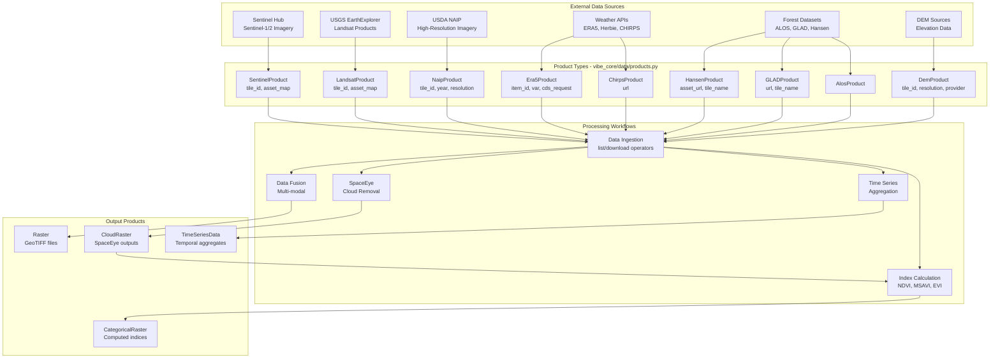
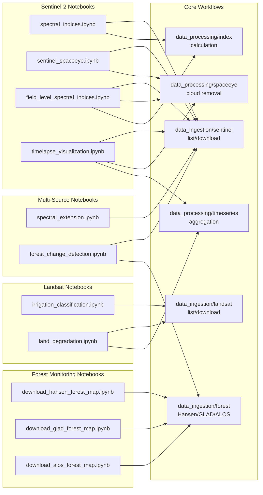

<!-- source: DeepWiki mcp.deepwiki.com · repo microsoft/farmvibes-ai · page 6.2 Remote Sensing Examples · fetched 2026-10-26 -->

# Remote Sensing Examples

<details>
<summary>Relevant source files</summary>

The following files were used as context for generating this wiki page:

- [docs/source/docfiles/markdown/NOTEBOOK_LIST.md](docs/source/docfiles/markdown/NOTEBOOK_LIST.md)
- [src/vibe_core/vibe_core/data/products.py](src/vibe_core/vibe_core/data/products.py)

</details>


## Purpose and Scope

This page documents example notebooks that demonstrate remote sensing capabilities in FarmVibes.AI, including satellite imagery processing, multi-spectral data analysis, cloud removal, and time series workflows. These examples focus on ingesting and processing geospatial data from various satellite platforms (Sentinel-1/2, Landsat, MODIS, NAIP, etc.) and applying analysis techniques to extract insights.

For agricultural applications built on top of remote sensing data, see [Agriculture Examples](#6.1). For machine learning and segmentation workflows that use remote sensing inputs, see [ML and Segmentation Examples](#6.3). For details on the underlying workflow system, see [Workflows](#4).

---

## Remote Sensing Data Flow

The following diagram illustrates how remote sensing data flows from external sources through FarmVibes.AI product types and workflows to generate processed outputs.

**Remote Sensing Pipeline Architecture**



**Sources:** [src/vibe_core/vibe_core/data/products.py:1-385]()

---

## Data Sources and Product Types

FarmVibes.AI supports ingestion from multiple remote sensing data sources, each represented by a specific product type that encapsulates metadata and asset references.

### Satellite Imagery Products

| Product Class | Data Source | Key Attributes | Resolution | Use Cases |
|--------------|-------------|----------------|------------|-----------|
| `SentinelProduct` | Sentinel-1/2 | `tile_id`, `asset_map` | 10-60m | Multi-spectral analysis, cloud removal |
| `LandsatProduct` | Landsat 8/9 | `tile_id`, `asset_map`, band methods | 30m | Long-term change detection, indices |
| `NaipProduct` | USDA NAIP | `tile_id`, `year`, `resolution` | 0.6-1m | High-resolution field mapping |
| `ModisProduct` | MODIS Terra/Aqua | `resolution` | 250m-1km | Large-scale vegetation monitoring |
| `BingMapsProduct` | Bing Maps | `url`, `zoom_level`, `imagery_set` | Variable | Basemap integration |

**Sources:** [src/vibe_core/vibe_core/data/products.py:22-385]()

### Weather and Climate Products

| Product Class | Data Source | Key Attributes | Temporal Resolution | Use Cases |
|--------------|-------------|----------------|---------------------|-----------|
| `Era5Product` | ECMWF ERA5 | `item_id`, `var`, `cds_request` | Hourly | Historical weather analysis |
| `HerbieProduct` | NOAA HRRR/RAP | `model`, `product`, `lead_time_hours` | Sub-hourly | Weather forecasting |
| `ChirpsProduct` | CHIRPS | `url` | Daily | Precipitation analysis |
| `ClimatologyLabProduct` | Climatology Lab | `url`, `variable` | Daily/Monthly | Climate data |

**Sources:** [src/vibe_core/vibe_core/data/products.py:100-186]()

### Forest Monitoring Products

| Product Class | Data Source | Key Attributes | Coverage | Use Cases |
|--------------|-------------|----------------|----------|-----------|
| `HansenProduct` | Global Forest Change | `asset_url`, `tile_name`, `last_year` | Global, 30m | Deforestation analysis |
| `GLADProduct` | GLAD Alerts | `url`, `tile_name` | Tropics, 30m | Forest change detection |
| `AlosProduct` | JAXA ALOS | - | Global, 25m | Forest extent mapping |

**Sources:** [src/vibe_core/vibe_core/data/products.py:132-202]()

### Terrain and Land Cover Products

| Product Class | Data Source | Key Attributes | Use Cases |
|--------------|-------------|----------------|-----------|
| `DemProduct` | Various DEM providers | `tile_id`, `resolution`, `provider` | Elevation analysis, watershed |
| `CDLProduct` | USDA Cropland Data Layer | - | Crop type classification |
| `GNATSGOProduct` | gNATSGO | - | Soil properties |
| `EsriLandUseLandCoverProduct` | Esri LULC | - | Land use classification |

**Sources:** [src/vibe_core/vibe_core/data/products.py:23-343]()

---

## Notebook Examples by Data Source

The following diagram maps notebook examples to the specific product types and workflows they demonstrate.

**Notebook-to-Workflow Mapping**



**Sources:** [docs/source/docfiles/markdown/NOTEBOOK_LIST.md:155-210]()

---

## Sentinel-2 Processing Examples

Sentinel-2 provides multi-spectral optical imagery at 10-60m resolution and is the primary data source for vegetation monitoring and crop analysis.

### Basic Spectral Index Computation

**Notebook:** [`notebooks/sentinel/spectral_indices.ipynb`](https://github.com/microsoft/farmvibes-ai/blob/main/notebooks/sentinel/spectral_indices.ipynb)

**Description:** Demonstrates downloading Sentinel-2 imagery for a region and computing common vegetation indices (NDVI, MSAVI, EVI).

**Key Workflow:** `data_ingestion/sentinel/preprocess`

**Product Types Used:**
- `SentinelProduct` - Input metadata from Sentinel Hub
- `Raster` - Downloaded bands and computed indices

**Typical Pattern:**
1. Define area of interest (geometry) and time range
2. Submit workflow to list and download Sentinel-2 products
3. Compute indices using band math operators
4. Visualize results as rasters or time series

**Sources:** [docs/source/docfiles/markdown/NOTEBOOK_LIST.md:203-204](), [docs/source/docfiles/markdown/NOTEBOOK_LIST.md:439-440]()

### SpaceEye Cloud Removal

**Notebook:** [`notebooks/sentinel/sentinel_spaceeye.ipynb`](https://github.com/microsoft/farmvibes-ai/blob/main/notebooks/sentinel/sentinel_spaceeye.ipynb)

**Description:** Demonstrates SpaceEye algorithm for removing clouds and generating cloud-free composite imagery over the Amazon Rainforest.

**Key Workflow:** `data_processing/spaceeye/spaceeye`

**Product Types Used:**
- `SentinelProduct` - Input Sentinel-2 tiles
- `CloudRaster` - Cloud-free output from SpaceEye

**SpaceEye Process:**
1. Collects multiple Sentinel-2 acquisitions over time
2. Identifies cloud and cloud shadow pixels
3. Uses temporal fusion to fill cloudy areas
4. Produces spatially complete, cloud-free imagery

**Key Feature:** Particularly effective in tropical regions with persistent cloud cover.

**Sources:** [docs/source/docfiles/markdown/NOTEBOOK_LIST.md:189-190](), [docs/source/docfiles/markdown/NOTEBOOK_LIST.md:415-416]()

### Field-Level Analysis with Segmentation

**Notebook:** [`notebooks/sentinel/field_level_spectral_indices.ipynb`](https://github.com/microsoft/farmvibes-ai/blob/main/notebooks/sentinel/field_level_spectral_indices.ipynb)

**Description:** Combines SpaceEye cloud removal with field boundary segmentation (SAM) to compute per-field spectral statistics.

**Key Workflows:**
- `data_processing/spaceeye/spaceeye` - Cloud removal
- `ml/segment_anything/auto_segment_s2` - Field segmentation
- `data_processing/index/index` - Index calculation

**Output:** Per-field average NDVI, MSAVI, EVI values over time.

**Sources:** [docs/source/docfiles/markdown/NOTEBOOK_LIST.md:185-186](), [docs/source/docfiles/markdown/NOTEBOOK_LIST.md:405-406]()

### Timelapse Visualization

**Notebook:** [`notebooks/sentinel/timelapse_visualization.ipynb`](https://github.com/microsoft/farmvibes-ai/blob/main/notebooks/sentinel/timelapse_visualization.ipynb)

**Description:** Creates animated timelapse visualizations of SpaceEye imagery and NDVI changes over growing seasons.

**Key Workflow:** `data_processing/timeseries/timeseries_aggregation`

**Output Products:**
- `CloudRaster` sequence - SpaceEye frames
- `CategoricalRaster` sequence - NDVI frames
- Animated GIF/video outputs

**Sources:** [docs/source/docfiles/markdown/NOTEBOOK_LIST.md:205-206](), [docs/source/docfiles/markdown/NOTEBOOK_LIST.md:441-442]()

---

## Landsat Processing Examples

Landsat provides 30m resolution multi-spectral imagery with a continuous archive dating back to 1972, enabling long-term change detection.

### Irrigation Classification

**Notebook:** [`notebooks/irrigation/irrigation_classification.ipynb`](https://github.com/microsoft/farmvibes-ai/blob/main/notebooks/irrigation/irrigation_classification.ipynb)

**Description:** Uses Landsat 8 imagery combined with DEM data to classify irrigated vs. non-irrigated cropland.

**Key Workflows:**
- `data_ingestion/landsat/preprocess_landsat` - Download Landsat products
- `data_ingestion/dem/download_dem` - Elevation data
- `ml/gradient_boosting/irrigation_classifier` - ML classification

**Product Types Used:**
- `LandsatProduct` - Multi-band Landsat scenes with `add_downloaded_band()` and `get_downloaded_band()` methods
- `DemProduct` - Digital elevation models
- `CategoricalRaster` - Irrigation probability maps

**Sources:** [docs/source/docfiles/markdown/NOTEBOOK_LIST.md:191-192](), [docs/source/docfiles/markdown/NOTEBOOK_LIST.md:417-418](), [src/vibe_core/vibe_core/data/products.py:59-98]()

### Land Degradation Analysis

**Notebook:** [`notebooks/land_degradation/land_degradation.ipynb`](https://github.com/microsoft/farmvibes-ai/blob/main/notebooks/land_degradation/land_degradation.ipynb)

**Description:** Computes NDVI trends on Landsat time series and correlates with precipitation data to detect land degradation.

**Key Workflows:**
- `data_ingestion/landsat/preprocess_landsat`
- `data_ingestion/weather/era5`
- `data_processing/timeseries/timeseries_aggregation`

**Product Types Used:**
- `LandsatProduct` - Historical Landsat archive
- `Era5Product` - Precipitation time series
- `TimeSeriesData` - Aggregated NDVI and rainfall

**Analysis Approach:** Linear regression on NDVI trends, residual analysis after precipitation normalization.

**Sources:** [docs/source/docfiles/markdown/NOTEBOOK_LIST.md:193-194](), [docs/source/docfiles/markdown/NOTEBOOK_LIST.md:419-420]()

---

## Multi-Source Data Fusion

### Spectral Extension

**Notebook:** [`notebooks/spectral_extension/spectral_extension.ipynb`](https://github.com/microsoft/farmvibes-ai/blob/main/notebooks/spectral_extension/spectral_extension.ipynb)

**Description:** Fuses high-resolution drone RGB imagery with lower-resolution Sentinel-2 multi-spectral data to generate high-resolution multi-spectral outputs.

**Key Workflow:** `data_processing/fusion/spectral_extension`

**Product Types Used:**
- `SentinelProduct` - Multi-spectral reference (10m)
- `Raster` - High-resolution RGB drone imagery (sub-meter)
- `Raster` - Fused high-resolution multi-spectral output

**Fusion Process:**
1. Spatially align high-resolution RGB with Sentinel-2 bands
2. Train regression model to predict spectral bands from RGB
3. Apply model to full high-resolution extent
4. Output high-resolution NIR, SWIR, and other spectral bands

**Use Case:** Enables precision agriculture analysis at sub-meter resolution using standard RGB drones.

**Sources:** [docs/source/docfiles/markdown/NOTEBOOK_LIST.md:201-202](), [docs/source/docfiles/markdown/NOTEBOOK_LIST.md:437-438]()

---

## Forest Monitoring and Change Detection

FarmVibes.AI provides workflows for downloading and analyzing global forest datasets.

### Global Forest Change (Hansen)

**Notebook:** [`notebooks/forest/download_hansen_forest_map.ipynb`](https://github.com/microsoft/farmvibes-ai/blob/main/notebooks/forest/download_hansen_forest_map.ipynb)

**Description:** Downloads Hansen Global Forest Change dataset tiles covering a region of interest.

**Key Workflow:** `data_ingestion/forest/download_hansen`

**Product Type:** `HansenProduct`

**Key Attributes:**
- `asset_url` - URL to specific layer tile
- `tile_name` - Grid tile identifier (e.g., "20N_090W")
- `last_year` - Most recent year in dataset
- `version` - Dataset version (e.g., "v1.10")
- `layer_name` - Dataset layer (treecover2000, gain, lossyear, datamask, first, last)

**Product Methods:**
- `extract_tile_name(asset_url)` - Parse tile identifier from URL
- `extract_last_year(asset_url)` - Extract dataset end year
- `extract_version(asset_url)` - Parse version string
- `validate_url()` - Verify URL format

**Output Layers:**
- `treecover2000` - Tree canopy cover percentage in year 2000
- `lossyear` - Year of forest loss (2001-2022)
- `gain` - Forest gain between 2000 and 2012
- `datamask` - Data quality mask

**Sources:** [docs/source/docfiles/markdown/NOTEBOOK_LIST.md:179-180](), [docs/source/docfiles/markdown/NOTEBOOK_LIST.md:399-400](), [src/vibe_core/vibe_core/data/products.py:203-337]()

### GLAD Forest Alerts

**Notebook:** [`notebooks/forest/download_glad_forest_map.ipynb`](https://github.com/microsoft/farmvibes-ai/blob/main/notebooks/forest/download_glad_forest_map.ipynb)

**Description:** Downloads Global Land Analysis (GLAD) forest extent maps for tropical regions.

**Key Workflow:** `data_ingestion/forest/download_glad`

**Product Type:** `GLADProduct`

**Key Attributes:**
- `url` - Download URL for tile
- `tile_name` - Extracted from URL via property

**Coverage:** Tropical forest regions at 30m resolution.

**Sources:** [docs/source/docfiles/markdown/NOTEBOOK_LIST.md:177-178](), [docs/source/docfiles/markdown/NOTEBOOK_LIST.md:397-398](), [src/vibe_core/vibe_core/data/products.py:188-201]()

### ALOS Forest Maps

**Notebook:** [`notebooks/forest/download_alos_forest_map.ipynb`](https://github.com/microsoft/farmvibes-ai/blob/main/notebooks/forest/download_alos_forest_map.ipynb)

**Description:** Downloads JAXA ALOS (Advanced Land Observing Satellite) forest extent maps.

**Key Workflow:** `data_ingestion/forest/download_alos`

**Product Type:** `AlosProduct`

**Coverage:** Global forest/non-forest maps at 25m resolution.

**Sources:** [docs/source/docfiles/markdown/NOTEBOOK_LIST.md:175-176](), [docs/source/docfiles/markdown/NOTEBOOK_LIST.md:395-396](), [src/vibe_core/vibe_core/data/products.py:132-136]()

### Forest Change Detection

**Notebook:** [`notebooks/forest/forest_change_detection.ipynb`](https://github.com/microsoft/farmvibes-ai/blob/main/notebooks/forest/forest_change_detection.ipynb)

**Description:** Integrates multiple forest datasets to detect and quantify forest changes over time.

**Key Workflows:**
- `data_ingestion/forest/download_hansen`
- `data_ingestion/sentinel/preprocess`
- `data_processing/change_detection`

**Analysis Approach:**
1. Download historical forest cover from Hansen dataset
2. Acquire recent Sentinel imagery
3. Compare forest extent changes
4. Quantify deforestation area and rates

**Sources:** [docs/source/docfiles/markdown/NOTEBOOK_LIST.md:173-174](), [docs/source/docfiles/markdown/NOTEBOOK_LIST.md:393-394]()

---

## Time Series Analysis

### Crop Cycle Detection

**Notebook:** [`notebooks/crop_cycles/crop_cycles.ipynb`](https://github.com/microsoft/farmvibes-ai/blob/main/notebooks/crop_cycles/crop_cycles.ipynb)

**Description:** Analyzes NDVI time series from SpaceEye imagery to automatically detect number of crop growing cycles per year.

**Key Workflows:**
- `data_processing/spaceeye/spaceeye` - Cloud-free imagery
- `data_processing/index/index` - NDVI calculation
- `data_processing/timeseries/timeseries_aggregation`
- `ml/crop_cycle_detection` - Cycle detection algorithm

**Product Flow:**
1. `SentinelProduct` → SpaceEye → `CloudRaster`
2. `CloudRaster` → Index calculation → `CategoricalRaster` (NDVI)
3. `CategoricalRaster` → Time series aggregation → `TimeSeriesData`
4. `TimeSeriesData` → ML model → Cycle count

**Output:** Number of distinct growing cycles and their approximate timing.

**Sources:** [docs/source/docfiles/markdown/NOTEBOOK_LIST.md:161-162](), [docs/source/docfiles/markdown/NOTEBOOK_LIST.md:381-382]()

### Harvest and Germination Period Detection

**Notebook:** [`notebooks/harvest_period/ndvi_summary.ipynb`](https://github.com/microsoft/farmvibes-ai/blob/main/notebooks/harvest_period/ndvi_summary.ipynb)

**Description:** Infers harvest and germination periods from NDVI time series patterns.

**Key Workflow:** `data_processing/timeseries/ndvi_summary`

**Analysis Method:**
1. Compute NDVI statistics over time (mean, std, min, max)
2. Identify local minima (harvest/post-harvest) and maxima (peak growth)
3. Estimate phenological stages based on NDVI trends

**Output:** Dates of planting, peak growth, and harvest events.

**Sources:** [docs/source/docfiles/markdown/NOTEBOOK_LIST.md:187-188](), [docs/source/docfiles/markdown/NOTEBOOK_LIST.md:409-410]()

---

## Weather and Climate Data Integration

### ERA5 Climate Reanalysis

**Product Type:** `Era5Product`

**Key Attributes:**
- `item_id` - Unique product identifier
- `var` - Climate variable name
- `cds_request` - Dictionary of CDS API request parameters

**Use Cases:**
- Historical weather reconstruction
- Precipitation analysis for land degradation studies
- Temperature and humidity for crop modeling

**Workflow:** `data_ingestion/weather/era5`

**Sources:** [src/vibe_core/vibe_core/data/products.py:119-129]()

### HRRR/RAP Weather Forecasts

**Product Type:** `HerbieProduct`

**Key Attributes:**
- `model` - Model name (hrrr, hrrrak, rap, gfs, rrfs)
- `product` - Product type (sfc, prs, nat, subh)
- `lead_time_hours` - Forecast lead time
- `search_text` - Regular expression for GRIB2 index file search

**Use Cases:**
- Short-term weather forecasting
- Sub-hourly meteorological data
- Micro-climate prediction

**Workflow:** `data_ingestion/weather/herbie`

**Note:** For more information on Herbie, see https://herbie.readthedocs.io/en/latest/index.html

**Sources:** [src/vibe_core/vibe_core/data/products.py:346-365]()

### CHIRPS Precipitation

**Product Type:** `ChirpsProduct`

**Key Attributes:**
- `url` - Download URL for CHIRPS data

**Use Cases:**
- Daily precipitation estimates
- Drought monitoring
- Agricultural water availability assessment

**Workflow:** `data_ingestion/weather/chirps`

**Sources:** [src/vibe_core/vibe_core/data/products.py:100-110]()

---

## High-Resolution Imagery

### NAIP Aerial Imagery

**Product Type:** `NaipProduct`

**Key Attributes:**
- `tile_id` - NAIP tile identifier
- `year` - Acquisition year
- `resolution` - Spatial resolution (typically 0.6-1m)

**Coverage:** United States agricultural areas, updated every 2-4 years

**Use Cases:**
- Sub-meter field mapping
- Fine-scale crop health monitoring
- Validation of satellite-based analyses

**Workflow:** `data_ingestion/naip/download_naip`

**Sources:** [src/vibe_core/vibe_core/data/products.py:40-56]()

### BingMaps Basemaps

**Product Type:** `BingMapsProduct`

**Key Attributes:**
- `url` - Download URL
- `zoom_level` - Map zoom level
- `imagery_set` - Imagery type (Aerial, Road, etc.)
- `map_layer` - Layer identifier
- `orientation` - Map orientation angle

**Use Cases:**
- High-resolution visual reference
- SAM segmentation inputs
- Field boundary identification

**Workflows:**
- `data_ingestion/bing/basemap_download`
- `ml/segment_anything/auto_segment_basemap`

**Sources:** [src/vibe_core/vibe_core/data/products.py:367-385]()

---

## Common Patterns and Best Practices

### LandsatProduct Band Management

The `LandsatProduct` class provides methods for managing downloaded bands through the `asset_map` dictionary:

**Adding Downloaded Bands:**
```python
# From LandsatProduct class
def add_downloaded_band(self, band_name: str, asset_path: str):
    """Creates a new AssetVibe and adds to asset_map"""
```

**Retrieving Downloaded Bands:**
```python
# From LandsatProduct class  
def get_downloaded_band(self, band_name: str) -> AssetVibe:
    """Returns AssetVibe for specified band name"""
```

**Typical Usage Pattern:**
1. List Landsat products for region and time range
2. Download specific bands (e.g., "B4" red, "B5" NIR)
3. Use `add_downloaded_band()` to register each downloaded asset
4. Access bands via `get_downloaded_band()` for further processing
5. Compute indices using band combinations

**Sources:** [src/vibe_core/vibe_core/data/products.py:68-97]()

### HansenProduct URL Validation

The `HansenProduct` class enforces strict URL format validation to ensure data integrity:

**URL Format:**
```
https://storage.googleapis.com/earthenginepartners-hansen/
GFC-{year}-v{version}/Hansen_GFC-{year}-v{version}_{layer}_{tile}.tif
```

**Example:**
```
https://storage.googleapis.com/earthenginepartners-hansen/
GFC-2022-v1.10/Hansen_GFC-2022-v1.10_treecover2000_20N_090W.tif
```

**Validation Pattern:**
- Regular expression matching in `validate_url()` method
- Extracts year, version, layer name, and tile identifier
- Raises `ValueError` if URL format invalid

**Properties:**
- `tile_name` - Grid tile (e.g., "20N_090W")
- `last_year` - Dataset end year (e.g., 2022)
- `version` - Version string (e.g., "v1.10")
- `layer_name` - Data layer (treecover2000, lossyear, gain, datamask, first, last)

**Sources:** [src/vibe_core/vibe_core/data/products.py:213-336]()

### Multi-Temporal Data Processing

**Recommended Workflow Pattern:**
1. **Define temporal extent** - Set date range covering growing season or analysis period
2. **List products** - Use list operators to identify available acquisitions
3. **Download data** - Retrieve raster products for all time points
4. **Preprocess** - Apply cloud removal (SpaceEye) or masking
5. **Compute indices** - Calculate NDVI, MSAVI, etc. for each time point
6. **Aggregate** - Use time series aggregation to compute statistics
7. **Analyze** - Apply change detection, trend analysis, or ML models

**Time Series Best Practices:**
- Use SpaceEye for optical imagery in cloudy regions
- Maintain consistent spatial resolution across time points
- Consider temporal frequency requirements (daily, weekly, monthly)
- Account for seasonal variations and phenological stages

---

## Notebook Categories Summary

The following table summarizes all remote sensing example notebooks by primary data source:

| Category | Notebook Count | Primary Products | Key Workflows |
|----------|---------------|------------------|---------------|
| Sentinel-2 | 10 | `SentinelProduct` | SpaceEye, index calculation, SAM |
| Landsat | 2 | `LandsatProduct` | Long-term analysis, irrigation |
| Forest Monitoring | 4 | `HansenProduct`, `GLADProduct`, `AlosProduct` | Forest download, change detection |
| Multi-Source Fusion | 2 | Multiple products | Spectral extension, data fusion |
| Time Series | 3 | `TimeSeriesData` | Temporal aggregation, trends |
| High-Resolution | 2 | `NaipProduct`, `BingMapsProduct` | SAM segmentation, validation |
| Weather Integration | 1 | `Era5Product`, `ChirpsProduct` | Climate analysis, degradation |

**Total Remote Sensing Notebooks:** 24

**Sources:** [docs/source/docfiles/markdown/NOTEBOOK_LIST.md:155-210]()

---

## Related Documentation

- **[Agriculture Examples](#6.1)** - Crop-specific applications using remote sensing data
- **[ML and Segmentation Examples](#6.3)** - Machine learning workflows for image analysis
- **[Data Ingestion Workflows](#4.1)** - Technical details on data download workflows
- **[Data Processing Workflows](#4.2)** - Index calculation and transformation workflows
- **[Data Models](#3.3)** - Complete reference for product types and data structures
- **[Working with Notebooks](#5.1)** - Setup and execution guide for Jupyter notebooks

---

