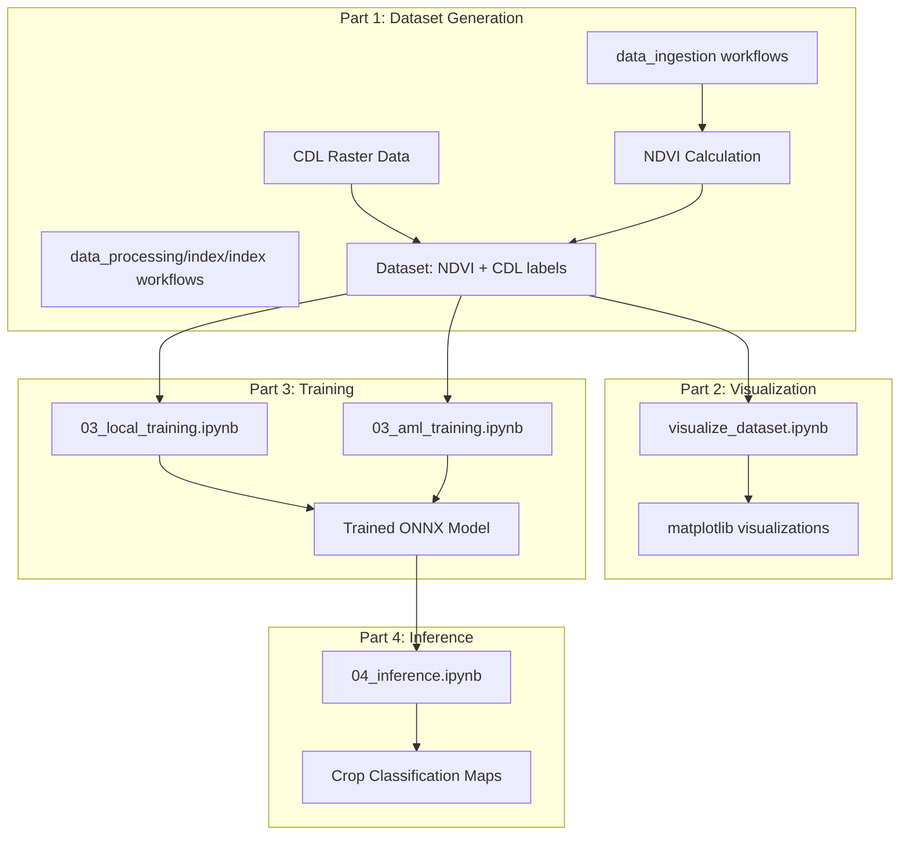
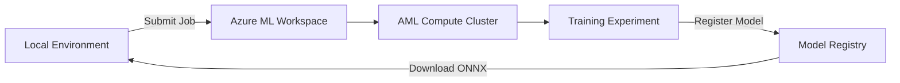
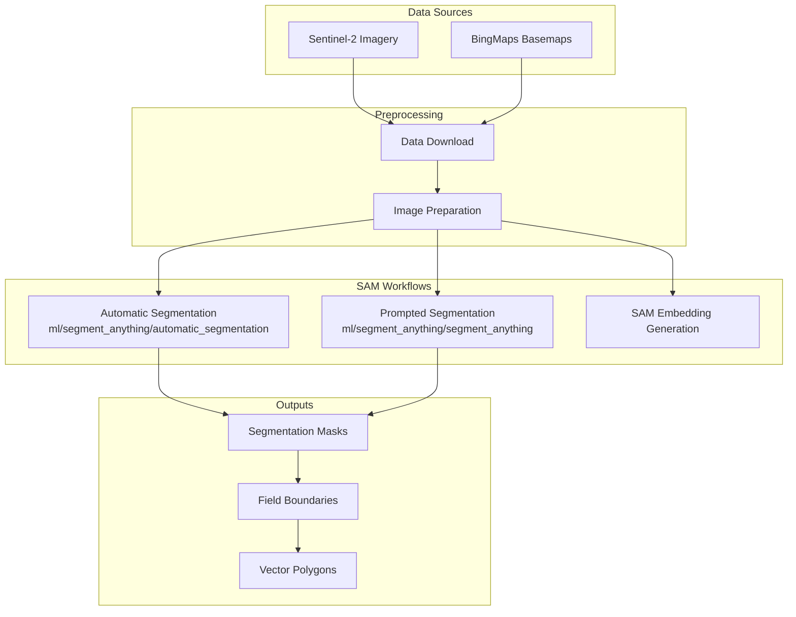
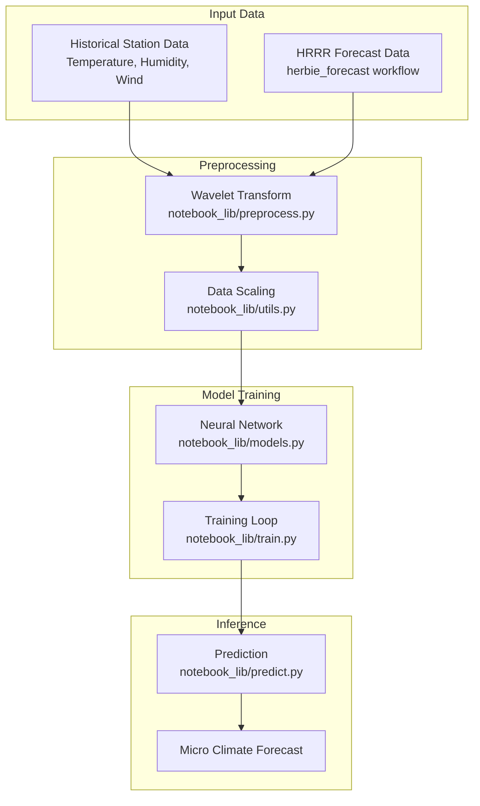
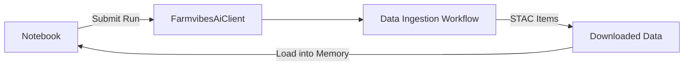

<!-- source: DeepWiki mcp.deepwiki.com · repo microsoft/farmvibes-ai · page 6.3 ML and Segmentation Examples · fetched 2026-10-26 -->

# ML and Segmentation Examples

<details>
<summary>Relevant source files</summary>

The following files were used as context for generating this wiki page:

- [docs/source/docfiles/markdown/NOTEBOOK_LIST.md](docs/source/docfiles/markdown/NOTEBOOK_LIST.md)
- [notebooks/deepmc/mc_forecast.ipynb](notebooks/deepmc/mc_forecast.ipynb)
- [notebooks/helloworld.ipynb](notebooks/helloworld.ipynb)

</details>


This page documents example notebooks that demonstrate machine learning workflows, crop segmentation, and Segment Anything Model (SAM) integration in FarmVibes.AI. These examples cover the complete ML lifecycle from dataset generation through model training to inference deployment.

For remote sensing and imagery processing examples, see [Remote Sensing Examples](#6.2). For agricultural analysis applications, see [Agriculture Examples](#6.1).

## Overview

The ML and segmentation examples are organized into three main categories:

1. **Crop Land Segmentation** - A comprehensive 4-part workflow for training semantic segmentation models to classify crop fields
2. **Segment Anything Model (SAM)** - Integration of Meta's SAM for field boundary detection and automatic segmentation
3. **Other ML Workflows** - Additional examples including weed detection, micro climate prediction, and nutrient heatmap estimation

All notebooks follow the pattern of downloading/preparing data using FarmVibes.AI workflows, then performing ML tasks either locally or on Azure Machine Learning.

## Crop Land Segmentation Workflow

The crop land segmentation examples demonstrate end-to-end ML pipeline for training models to classify crop types from satellite imagery using NDVI (Normalized Difference Vegetation Index) and CDL (Cropland Data Layer) data.

### Workflow Overview



Sources: [docs/source/docfiles/markdown/NOTEBOOK_LIST.md:383-392]()

### Part 1: Dataset Generation

**Notebook:** `notebooks/crop_segmentation/01_dataset_generation.ipynb`

This notebook generates training datasets by combining NDVI indices from Sentinel-2 imagery with ground truth labels from the Cropland Data Layer (CDL).

**Key Workflows Used:**
- `data_ingestion/sentinel2/preprocess_s2` - Downloads and preprocesses Sentinel-2 imagery
- `data_processing/index/index` - Computes NDVI from Sentinel-2 bands
- CDL data retrieval for ground truth labels

**Dataset Structure:**
- Input features: NDVI time series over a region of interest
- Labels: CDL crop classification codes
- Output format: Raster datasets ready for training

The notebook demonstrates spatial and temporal aggregation to create aligned feature-label pairs suitable for supervised learning.

Sources: [docs/source/docfiles/markdown/NOTEBOOK_LIST.md:383-384]()

### Part 2: Dataset Visualization

**Notebook:** `notebooks/crop_segmentation/02_visualize_dataset.ipynb`

Provides visual exploration of the generated dataset to verify data quality and understand feature distributions before training.

**Visualizations Include:**
- NDVI time series plots per crop type
- Spatial distribution of crop classes
- Feature statistics and histograms
- Sample verification across the dataset

Sources: [docs/source/docfiles/markdown/NOTEBOOK_LIST.md:385-386]()

### Part 3: Model Training

Two training approaches are demonstrated:

#### Local Training

**Notebook:** `notebooks/crop_segmentation/03_local_training.ipynb`

Trains a segmentation model locally using standard ML libraries. The workflow includes:

1. Data loading and preprocessing
2. Model architecture definition (typically U-Net or similar CNN)
3. Training loop with validation
4. Model export to ONNX format for deployment

**Key Components:**
- Uses PyTorch or TensorFlow for model definition
- Implements cross-validation
- Exports model as ONNX for cross-platform inference
- Saves model artifacts for later use

Sources: [docs/source/docfiles/markdown/NOTEBOOK_LIST.md:387-388]()

#### Azure Machine Learning Training

**Notebook:** `notebooks/crop_segmentation/03_aml_training.ipynb`

Demonstrates distributed training on Azure Machine Learning for larger-scale experiments:



**Benefits:**
- Scalable compute resources
- Experiment tracking and versioning
- Hyperparameter tuning
- Model registry for versioning

Sources: [docs/source/docfiles/markdown/NOTEBOOK_LIST.md:389-390]()

### Part 4: Inference

**Notebook:** `notebooks/crop_segmentation/04_inference.ipynb`

Demonstrates inference on new regions using trained ONNX models:

1. Load trained ONNX model
2. Download NDVI data for target region
3. Run inference to generate crop classification maps
4. Visualize and export results

The ONNX format enables efficient inference across different platforms and frameworks.

Sources: [docs/source/docfiles/markdown/NOTEBOOK_LIST.md:391-392]()

## Segment Anything Model (SAM) Examples

These notebooks integrate Meta's Segment Anything Model for field boundary detection and automatic segmentation tasks.

### SAM Integration Architecture



Sources: [docs/source/docfiles/markdown/NOTEBOOK_LIST.md:212-230]()

### SAM Exploration

**Notebook:** `notebooks/segment_anything/sam_exploration.ipynb`

Exploratory notebook demonstrating SAM's capabilities for field boundary segmentation:

**Features:**
- Interactive prompting (points, boxes, masks)
- Embedding generation and caching
- Multiple mask proposals per prompt
- Quality score evaluation

**Workflow Integration:**
The notebook uses FarmVibes.AI workflows to prepare input imagery, then applies SAM for segmentation tasks specific to agricultural field detection.

Sources: [docs/source/docfiles/markdown/NOTEBOOK_LIST.md:401-402]()

### Automatic Segmentation Notebooks

#### BingMaps Automatic Segmentation

**Notebook:** `notebooks/segment_anything/basemap_automatic_segmentation.ipynb`

Automatically segments high-resolution BingMaps basemaps without manual prompting:

**Workflow:** `ml/segment_anything/automatic_segmentation`

**Process:**
1. Downloads BingMaps imagery for region of interest
2. Divides imagery into tiles
3. Runs SAM automatic mask generation per tile
4. Aggregates and filters masks
5. Outputs segmentation polygons

Sources: [docs/source/docfiles/markdown/NOTEBOOK_LIST.md:375-376]()

#### Sentinel-2 Automatic Segmentation

**Notebook:** `notebooks/segment_anything/sentinel2_automatic_segmentation.ipynb`

Similar to BingMaps version but operates on multispectral Sentinel-2 imagery:

**Key Differences:**
- Handles multispectral bands
- Lower resolution requires different tiling strategy
- Can leverage spectral indices (NDVI) for filtering

Sources: [docs/source/docfiles/markdown/NOTEBOOK_LIST.md:377-378]()

### Prompted Segmentation Notebooks

#### BingMaps Prompted Segmentation

**Notebook:** `notebooks/segment_anything/basemap_segmentation.ipynb`

Demonstrates interactive field segmentation with user-provided prompts:

**Workflow:** `ml/segment_anything/segment_anything`

**Prompt Types:**
- Point prompts (positive/negative)
- Bounding box prompts
- Mask prompts for refinement

Sources: [docs/source/docfiles/markdown/NOTEBOOK_LIST.md:433-434]()

#### Sentinel-2 Prompted Segmentation

**Notebook:** `notebooks/segment_anything/sentinel2_segmentation.ipynb`

Applies prompted SAM segmentation to Sentinel-2 satellite imagery for field delineation.

Sources: [docs/source/docfiles/markdown/NOTEBOOK_LIST.md:435-436]()

## Other Machine Learning Examples

### Weed Detection

**Notebook:** `notebooks/weed_detection/weed_detection.ipynb`

Trains an unsupervised Gaussian Mixture Model (GMM) to identify weed-affected regions in agricultural fields:

**Approach:**
1. Downloads high-resolution imagery
2. Extracts spectral features
3. Trains GMM to cluster similar regions
4. Identifies anomalous clusters as potential weed presence

**Applications:**
- Precision agriculture
- Targeted herbicide application
- Crop health monitoring

Sources: [docs/source/docfiles/markdown/NOTEBOOK_LIST.md:443-444]()

### Micro Climate Prediction

**Notebook:** `notebooks/deepmc/mc_forecast.ipynb`

Trains a deep learning model to forecast micro-climate weather parameters using historical weather station data and global forecasts.

#### Model Architecture



Sources: [notebooks/deepmc/mc_forecast.ipynb:1-50]()

**Key Features:**
- Uses PyTorch as deep learning framework
- Downloads forecast data via `data_ingestion/weather/herbie_forecast` workflow
- Implements wavelet-based feature engineering
- Trains separate models for temperature and wind speed
- Requires minimum 2 years of historical data for training
- Requires 552 data points for inference

**Code Organization:**
- `notebook_lib/preprocess.py` - Data preprocessing and wavelet transforms
- `notebook_lib/models.py` - Neural network architecture
- `notebook_lib/modules.py` - Model components
- `notebook_lib/train.py` - Training procedures
- `notebook_lib/predict.py` - Inference implementation
- `notebook_lib/utils.py` - Utility functions

Sources: [notebooks/deepmc/mc_forecast.ipynb:42-49]()

### Nutrient Heatmap Estimation

**Notebook:** `notebooks/heatmaps/nutrients_using_classification.ipynb`

Uses Random Forest classification to estimate soil nutrient distribution from soil samples and satellite imagery:

**Workflow:**
1. Combines soil sample locations with NDVI/spectral indices
2. Trains Random Forest classifier on sample data
3. Generates pixel-wise nutrient predictions
4. Creates heatmap visualizations

**Features:**
- Integrates ground truth soil samples
- Uses spectral indices as predictive features
- Produces continuous heatmaps of nutrient levels
- Can integrate with ADMAg for soil sample data

Sources: [docs/source/docfiles/markdown/NOTEBOOK_LIST.md:423-424]()

### Irrigation Classification

**Notebook:** `notebooks/irrigation/irrigation_classification.ipynb`

Generates irrigation probability maps using Landsat 8 imagery and DEM (Digital Elevation Model) data:

**Input Data:**
- Landsat 8 multispectral imagery
- DEM for terrain features
- NDVI time series

**Method:**
- Machine learning classification
- Uses temporal patterns in NDVI
- Terrain features improve accuracy

Sources: [docs/source/docfiles/markdown/NOTEBOOK_LIST.md:417-418]()

## Common ML Patterns and Tools

### ONNX Integration

Multiple notebooks demonstrate ONNX (Open Neural Network Exchange) integration for cross-platform model deployment:

| Notebook | ONNX Usage |
|----------|------------|
| Crop Segmentation Training | Exports trained models to ONNX format |
| Crop Segmentation Inference | Loads ONNX models for prediction |
| Crop Cycle Detection | Uses ONNX for time-series analysis |

**Benefits:**
- Platform-independent inference
- Integration with FarmVibes.AI workflows
- Efficient deployment at scale
- Model versioning and portability

Sources: [docs/source/docfiles/markdown/NOTEBOOK_LIST.md:142-152]()

### Environment Setup

All ML notebooks require specific Python environments configured via micromamba:

**Example Setup:**
```bash
micromamba env create -f ./env_file.yaml
micromamba activate environment-name
```

Common environments include:
- `deepmc-pytorch` - For PyTorch-based training (micro climate)
- Crop segmentation environments with ML dependencies
- SAM-specific environments with segment-anything package

Unix-based systems (Linux and MacOS) are currently supported for most ML notebooks.

Sources: [notebooks/deepmc/mc_forecast.ipynb:12-20]()

### Data Download Workflows

ML notebooks leverage FarmVibes.AI data ingestion workflows:



**Common Workflows:**
- `data_ingestion/sentinel2/*` - Sentinel-2 imagery
- `data_ingestion/landsat/*` - Landsat imagery
- `data_ingestion/weather/herbie_forecast` - Weather forecasts
- `data_processing/index/*` - Spectral index calculation

All data is retrieved as STAC (SpatioTemporal Asset Catalog) items for standardized access.

Sources: [docs/source/docfiles/markdown/NOTEBOOK_LIST.md:1-50]()

### Training Patterns

#### Local Training Pattern

1. Initialize `FarmvibesAiClient`
2. Submit data download workflows
3. Monitor workflow completion
4. Load data into training framework
5. Train model locally
6. Export model (typically ONNX)
7. Save artifacts

#### Azure ML Training Pattern

1. Configure Azure ML workspace
2. Prepare training script
3. Define compute environment
4. Submit training job to Azure ML
5. Monitor via Azure ML dashboard
6. Download trained model from registry

Sources: [docs/source/docfiles/markdown/NOTEBOOK_LIST.md:119-140]()

### Visualization and Analysis

Most notebooks include visualization components:
- `matplotlib` for plotting time series and spatial data
- Interactive maps for geospatial results
- Statistical analysis of model performance
- Confusion matrices for classification tasks

## Best Practices

### Dataset Preparation

1. **Spatial Alignment:** Ensure all input rasters are aligned (same CRS, resolution, extent)
2. **Temporal Consistency:** Use consistent time ranges across data sources
3. **Quality Control:** Visualize datasets before training to catch issues
4. **Data Splitting:** Properly split data into train/validation/test sets

### Model Training

1. **Start Small:** Test workflows with small regions before scaling
2. **Monitor Resources:** Track memory and compute usage
3. **Version Control:** Save model versions with metadata
4. **Experiment Tracking:** Use Azure ML or local logging for reproducibility

### Inference and Deployment

1. **ONNX Export:** Export models to ONNX for production use
2. **Batch Processing:** Process large areas in tiles to manage memory
3. **Result Validation:** Always visualize and validate predictions
4. **Integration:** Leverage FarmVibes.AI workflows for scalable inference

Sources: [docs/source/docfiles/markdown/NOTEBOOK_LIST.md:383-446]()

---

