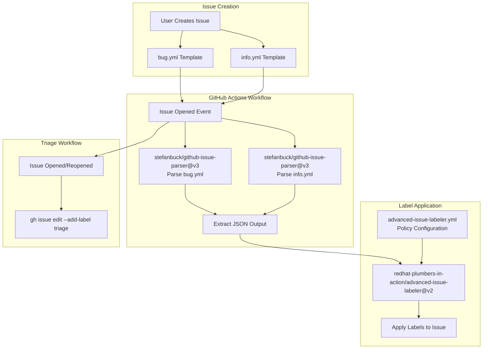
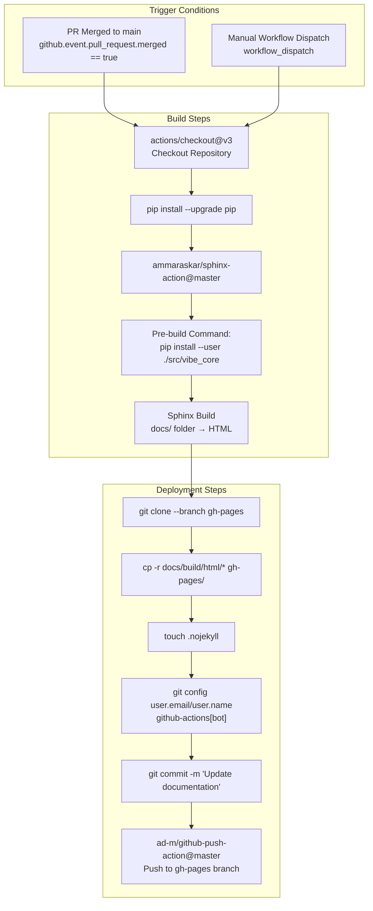

<!-- source: DeepWiki mcp.deepwiki.com · repo microsoft/farmvibes-ai · page 7 Development · fetched 2026-10-26 -->

# Development

Relevant source files

The following files were used as context for generating this wiki page:

- [.github/ISSUE_TEMPLATE/bug.yml](.github/ISSUE_TEMPLATE/bug.yml)
- [.github/ISSUE_TEMPLATE/info.yml](.github/ISSUE_TEMPLATE/info.yml)
- [.github/advanced-issue-labeler.yml](.github/advanced-issue-labeler.yml)
- [.github/workflows/doc-build.yml](.github/workflows/doc-build.yml)
- [.github/workflows/issue-labeler.yml](.github/workflows/issue-labeler.yml)
- [.github/workflows/triage-issues.yml](.github/workflows/triage-issues.yml)

This page provides an overview of the development practices, tooling, and workflows for contributors to FarmVibes.AI. It covers the development lifecycle, issue management automation, documentation build system, and contribution guidelines.

For detailed information on specific topics:
- For issue templates, automated labeling, and contribution process, see [Contributing and Issue Management](#7.1)
- For documentation build system and Sphinx configuration, see [Documentation System](#7.2)
- For testing practices and environment configuration, see [Testing and Environment Setup](#7.3)

## Development Workflow Overview

FarmVibes.AI follows a standard GitHub-based development workflow with automated issue management and continuous documentation deployment. The system uses GitHub Actions for CI/CD, structured issue templates for bug reporting, and automated labeling to categorize and triage issues.

```mermaid
graph LR
    subgraph "Contribution Flow"
        Fork["Fork Repository"]
        Clone["Clone Locally"]
        Branch["Create Feature Branch"]
        Develop["Develop & Test"]
        Commit["Commit Changes"]
        Push["Push to Fork"]
        PR["Create Pull Request"]
    end
    
    subgraph "Review Process"
        CodeReview["Code Review"]
        CIChecks["CI Checks"]
        Approval["Approval"]
        Merge["Merge to main"]
    end
    
    subgraph "Automated Post-Merge"
        DocBuild["doc-build.yml Workflow"]
        SphinxBuild["Sphinx Build"]
        Deploy["Deploy to gh-pages"]
    end
    
    Fork --> Clone
    Clone --> Branch
    Branch --> Develop
    Develop --> Commit
    Commit --> Push
    Push --> PR
    
    PR --> CodeReview
    PR --> CIChecks
    CodeReview --> Approval
    CIChecks --> Approval
    Approval --> Merge
    
    Merge --> DocBuild
    DocBuild --> SphinxBuild
    SphinxBuild --> Deploy
```

**Sources:** [.github/workflows/doc-build.yml:1-51]()

## Issue Management System

FarmVibes.AI uses structured issue templates and automated labeling to efficiently manage bug reports and information requests. The system consists of three main components:

### Issue Templates

Two structured YAML templates define the issue creation workflow:

| Template | Purpose | Labels Applied |
|----------|---------|---------------|
| `bug.yml` | Bug reports with structured fields | `bug` |
| `info.yml` | Feature requests and general questions | `question` |

The templates collect specific information:

**Bug Report Fields** ([.github/ISSUE_TEMPLATE/bug.yml:10-22]()):
- `bug-location`: Where the bug occurred (setup, workflow, notebook, etc.)
- `cluster-type`: Local or remote AKS cluster
- `bug-description`: Detailed description with error messages and logs
- `steps-to-reproduce`: Reproduction steps with parameters

**Information Request Fields** ([.github/ISSUE_TEMPLATE/info.yml:10-26]()):
- `info-topic`: Topic area (feature request, documentation, workflow, etc.)
- `info-request`: Question or request details

### Automated Labeling Pipeline

The issue labeling system automatically categorizes issues based on template responses:

**Sources:** [.github/workflows/issue-labeler.yml:1-37](), [.github/workflows/triage-issues.yml:1-18]()

### Label Mapping Policy

The `advanced-issue-labeler.yml` configuration file defines label mapping rules based on template responses:

**Bug Location Labels** ([.github/advanced-issue-labeler.yml:3-16]()):
- `Documentation` → `documentation` label
- `FarmVibes.AI setup` → `FarmVibes.AI setup` label
- `Management script` → `management script` label
- `Notebook execution` → `notebooks` label
- `Workflow execution` → `workflows` label

**Cluster Type Labels** ([.github/advanced-issue-labeler.yml:17-22]()):
- `Local cluster` → `local cluster` label
- `Remote (AKS) cluster` → `remote cluster` label

**Info Topic Labels** ([.github/advanced-issue-labeler.yml:23-41]()):
- `Feature request` → `enhancement` label
- Additional mappings for documentation, notebooks, workflows, and cluster types

**Sources:** [.github/advanced-issue-labeler.yml:1-41]()

## Documentation Build System

FarmVibes.AI documentation is automatically built and deployed using GitHub Actions and Sphinx. The workflow triggers on pull request merges to the `main` branch or manual dispatch.

### Documentation Build Workflow

The `doc-build.yml` workflow performs the following steps:

**Sources:** [.github/workflows/doc-build.yml:1-51]()

### Build Process Details

The documentation build process consists of three main phases:

**Phase 1: Environment Setup** ([.github/workflows/doc-build.yml:18-23]()):
- Checks out the repository using `actions/checkout@v3`
- Upgrades pip to the latest version

**Phase 2: Sphinx Build** ([.github/workflows/doc-build.yml:25-30]()):
- Uses `ammaraskar/sphinx-action@master` to build documentation
- Executes pre-build command: `pip install --user ./src/vibe_core` to install dependencies
- Builds documentation from `docs/` folder to HTML output

**Phase 3: GitHub Pages Deployment** ([.github/workflows/doc-build.yml:32-50]()):
- Clones the `gh-pages` branch
- Copies built HTML files to the `gh-pages` directory
- Creates `.nojekyll` file to bypass Jekyll processing
- Configures git with GitHub Actions bot credentials
- Commits changes with message "Update documentation"
- Pushes to `gh-pages` branch using `ad-m/github-push-action@master`

The workflow includes error handling: the commit command uses `|| true` to ignore failures when no changes are present.

**Sources:** [.github/workflows/doc-build.yml:25-50]()

## Development Tools and Practices

### GitHub Actions Workflows

The repository uses three main GitHub Actions workflows for automation:

| Workflow | File | Trigger | Purpose |
|----------|------|---------|---------|
| Documentation Build | `doc-build.yml` | PR merge to main, manual | Build and deploy Sphinx docs to GitHub Pages |
| Issue Labeler | `issue-labeler.yml` | Issue opened | Parse issue templates and apply labels |
| Triage Labeler | `triage-issues.yml` | Issue opened/reopened | Add `triage` label for team review |

**Sources:** [.github/workflows/doc-build.yml:1-3](), [.github/workflows/issue-labeler.yml:1-2](), [.github/workflows/triage-issues.yml:1-2]()

### Issue Template Structure

Issue templates use GitHub's YAML form syntax with specific field types:

**Field Types Used:**
- `markdown`: Static text for instructions
- `dropdown`: Single or multiple choice selection
- `textarea`: Free-form text input

**Validation:** Fields can be marked as `required: true` or `required: false` to enforce completion ([.github/ISSUE_TEMPLATE/bug.yml:21-22](), [.github/ISSUE_TEMPLATE/info.yml:25-26]()).

**Sources:** [.github/ISSUE_TEMPLATE/bug.yml:5-61](), [.github/ISSUE_TEMPLATE/info.yml:5-35]()

### Permissions Configuration

GitHub Actions workflows require specific permissions:

**Documentation Build Permissions** ([.github/workflows/doc-build.yml:14-16]()):
- `contents: write` - Required to push to gh-pages branch
- `pages: write` - Required for GitHub Pages deployment

**Issue Labeler Permissions** ([.github/workflows/issue-labeler.yml:10-15]()):
- `issues: write` - Required to modify issue labels
- `actions: read` - Required for private repositories
- `contents: read` - Required to access repository files

**Triage Labeler Permissions** ([.github/workflows/triage-issues.yml:10-11]()):
- `issues: write` - Required to add triage label

**Sources:** [.github/workflows/doc-build.yml:14-16](), [.github/workflows/issue-labeler.yml:10-15](), [.github/workflows/triage-issues.yml:10-11]()

## Contributing to FarmVibes.AI

Contributors should follow these general guidelines:

1. **Issue Reporting:** Use the structured bug or information request templates when creating issues. The system will automatically apply appropriate labels.

2. **Documentation Updates:** Documentation changes trigger automatic builds on merge to `main`. Ensure Sphinx builds succeed locally before submitting PRs.

3. **Code Contributions:** Follow the standard fork-and-pull-request workflow. Ensure code changes include appropriate tests and documentation updates.

4. **Environment Setup:** Development requires proper environment configuration with micromamba and necessary dependencies. See [Testing and Environment Setup](#7.3) for details.

For more detailed contribution guidelines, issue management processes, and documentation system specifics, refer to the child pages under this section.

---

