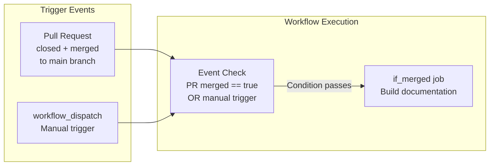
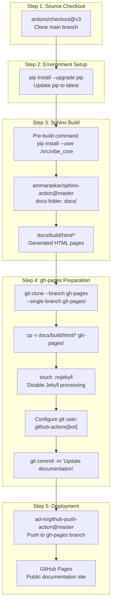
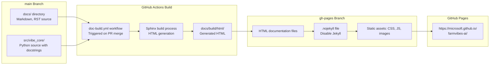
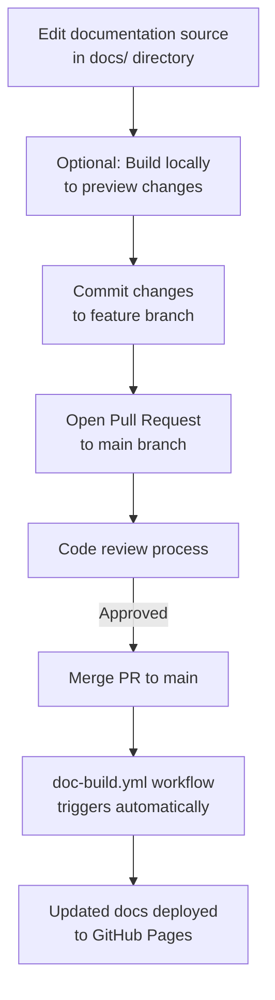

<!-- source: DeepWiki mcp.deepwiki.com · repo microsoft/farmvibes-ai · page 7.2 Documentation System · fetched 2026-10-26 -->

# Documentation System

<details>
<summary>Relevant source files</summary>

The following files were used as context for generating this wiki page:

- [.github/workflows/doc-build.yml](.github/workflows/doc-build.yml)
- [docs/requirements.txt](docs/requirements.txt)
- [src/vibe_core/pyproject.toml](src/vibe_core/pyproject.toml)

</details>


## Purpose and Scope

The Documentation System automates the generation and deployment of FarmVibes.AI's technical documentation. It uses Sphinx to build HTML pages from source files located in the `docs/` directory and automatically publishes them to GitHub Pages whenever code changes are merged to the main branch. This system ensures that public-facing documentation at https://microsoft.github.io/farmvibes-ai/ stays synchronized with the codebase.

For information about contributing to documentation content, see [Contributing and Issue Management](#7.1). For general development setup, see [Testing and Environment Setup](#7.3).

## Documentation Technology Stack

FarmVibes.AI uses **Sphinx** as its documentation generator with several extensions to support modern documentation features. The complete dependency stack is defined in [docs/requirements.txt:1-7]().

### Core Dependencies

| Package | Version | Purpose |
|---------|---------|---------|
| `sphinx` | 7.1.2 | Core documentation generator |
| `sphinx_rtd_theme` | 2.0.0 | Read the Docs theme for consistent styling |
| `myst_parser` | 2.0.0 | Markdown support alongside reStructuredText |
| `sphinxcontrib.mermaid` | 0.8.1 | Mermaid diagram rendering |
| `sphinx_autodoc_typehints` | 2.0.1 | Automatic API documentation from type hints |
| `sphinxcontrib-openapi` | 0.8.4 | OpenAPI specification rendering |
| `docutils` | 0.20.1 | Document utilities foundation |

The `myst_parser` extension enables Sphinx to process Markdown files (`.md`) in addition to reStructuredText (`.rst`), providing flexibility in documentation authoring. The `sphinxcontrib.mermaid` extension allows embedding Mermaid diagrams directly in documentation source files.

**Sources:** [docs/requirements.txt:1-7]()

### Package Configuration

The `vibe_core` package includes documentation URLs in its package metadata, linking users to the documentation site and issue tracker:

```
"Homepage" = "https://github.com/microsoft/farmvibes-ai"
"Bug Tracker" = "https://github.com/microsoft/farmvibes-ai/issues"
```

These URLs appear in package listings on PyPI and in package metadata accessible via `pip show vibe-core`.

**Sources:** [src/vibe_core/pyproject.toml:54-56]()

## Documentation Build Workflow

The documentation build and deployment process runs automatically via GitHub Actions, triggered by pull request merges or manual workflow dispatch.

### Workflow Trigger Configuration



**Workflow Trigger Logic:**
- **Automatic:** Triggered when a pull request is merged to the `main` branch [.github/workflows/doc-build.yml:4-7]()
- **Manual:** Can be triggered via GitHub Actions UI using `workflow_dispatch` [.github/workflows/doc-build.yml:8]()
- **Conditional execution:** Job only runs if `github.event.pull_request.merged == true` or event is `workflow_dispatch` [.github/workflows/doc-build.yml:11]()

**Sources:** [.github/workflows/doc-build.yml:3-11]()

### Build Job Configuration

The documentation build job runs on `ubuntu-latest` with specific permissions required for deployment:

| Permission | Scope | Purpose |
|------------|-------|---------|
| `contents` | write | Push built documentation to `gh-pages` branch |
| `pages` | write | Deploy to GitHub Pages |

**Sources:** [.github/workflows/doc-build.yml:12-16]()

## Documentation Build Pipeline

The complete build and deployment pipeline consists of five sequential steps executed by GitHub Actions.



### Step-by-Step Process

**1. Source Checkout**
- Uses `actions/checkout@v3` to clone the repository [.github/workflows/doc-build.yml:18-19]()
- Checks out the `main` branch containing latest documentation source

**2. Environment Setup**
- Upgrades pip to latest version to ensure dependency compatibility [.github/workflows/doc-build.yml:21-23]()
- Command: `pip install --upgrade pip`

**3. Sphinx Build**
- Installs `vibe_core` package in user directory as pre-build step [.github/workflows/doc-build.yml:30]()
  - Required because Sphinx needs to import the package for API documentation generation
- Executes `ammaraskar/sphinx-action@master` GitHub Action [.github/workflows/doc-build.yml:27-30]()
- Processes documentation source files in `docs/` directory
- Generates HTML output in `docs/build/html/`

**4. gh-pages Branch Preparation**
- Clones the `gh-pages` branch into a separate directory [.github/workflows/doc-build.yml:35]()
- Copies all generated HTML files from `docs/build/html/*` to `gh-pages/` [.github/workflows/doc-build.yml:36]()
- Creates `.nojekyll` file to disable GitHub's Jekyll processing [.github/workflows/doc-build.yml:38]()
  - This is critical because Jekyll would ignore files/directories starting with underscore, which Sphinx uses
- Configures git with bot credentials [.github/workflows/doc-build.yml:39-40]()
- Stages and commits changes with message "Update documentation" [.github/workflows/doc-build.yml:41-42]()
- Uses `|| true` to ignore commit failures when no changes exist [.github/workflows/doc-build.yml:42-43]()

**5. Deployment**
- Uses `ad-m/github-push-action@master` to push commits [.github/workflows/doc-build.yml:45-50]()
- Pushes to `gh-pages` branch using `GITHUB_TOKEN` for authentication
- GitHub Pages automatically serves the updated content

**Sources:** [.github/workflows/doc-build.yml:17-50]()

## Documentation Directory Structure

While the specific directory structure is not detailed in the provided files, the build process assumes a standard Sphinx documentation layout:

```
docs/
├── source/              # Documentation source files (Markdown, RST)
├── conf.py              # Sphinx configuration
├── requirements.txt     # Documentation build dependencies
└── build/
    └── html/            # Generated HTML output (not committed)
```

The `vibe_core` package is installed during the build process [.github/workflows/doc-build.yml:30](), suggesting that documentation includes auto-generated API reference from Python docstrings using `sphinx.ext.autodoc`.

**Sources:** [.github/workflows/doc-build.yml:29-30]()

## GitHub Pages Deployment

The `gh-pages` branch serves as the publication source for GitHub Pages. This branch contains only the built HTML artifacts, not the source documentation files.

### Deployment Architecture



### Key Deployment Details

**Branch Isolation:**
- The `gh-pages` branch is completely separate from `main`, containing only built artifacts
- Cloned with `--single-branch` flag to avoid fetching unrelated history [.github/workflows/doc-build.yml:35]()

**Jekyll Bypass:**
- GitHub Pages defaults to processing content with Jekyll
- The `.nojekyll` file instructs GitHub Pages to serve files directly [.github/workflows/doc-build.yml:38]()
- Critical for Sphinx output which uses underscore-prefixed directories (e.g., `_static/`, `_sources/`)

**Incremental Updates:**
- Each build replaces all files in `gh-pages` branch [.github/workflows/doc-build.yml:36]()
- Old versions are not preserved; `gh-pages` branch history tracks deployments
- Failed commits (when no changes exist) are silently ignored [.github/workflows/doc-build.yml:42]()

**Sources:** [.github/workflows/doc-build.yml:34-50]()

## Development Workflow

### Building Documentation Locally

To build documentation locally before submitting changes:

1. Install documentation dependencies:
   ```bash
   pip install -r docs/requirements.txt
   ```

2. Install `vibe_core` package (required for API docs):
   ```bash
   pip install ./src/vibe_core
   ```

3. Build documentation:
   ```bash
   cd docs
   sphinx-build -b html source build/html
   ```

4. View built documentation:
   ```bash
   open build/html/index.html  # macOS
   xdg-open build/html/index.html  # Linux
   ```

### Documentation Update Process



**Process Flow:**
1. Edit documentation source files (Markdown or RST)
2. Optionally build locally to verify rendering
3. Commit changes to a feature branch
4. Open pull request to `main` branch
5. After review and approval, merge PR
6. GitHub Actions automatically builds and deploys documentation
7. Changes appear on public site within minutes

**Important Notes:**
- Never commit directly to `gh-pages` branch; it is managed by automation
- Documentation builds only trigger on merged PRs, not on open PRs
- Build failures can be investigated in GitHub Actions logs
- The `vibe_core` package must build successfully for documentation to generate API references

**Sources:** [.github/workflows/doc-build.yml:3-11](), [docs/requirements.txt:1-7]()

## Sphinx Configuration and Extensions

The Sphinx configuration enables several key features through extensions defined in `docs/requirements.txt`:

### Markdown Support
- **Extension:** `myst_parser` [docs/requirements.txt:5]()
- Allows writing documentation in Markdown (`.md`) alongside reStructuredText (`.rst`)
- Supports CommonMark and extended syntax

### Mermaid Diagrams
- **Extension:** `sphinxcontrib.mermaid` [docs/requirements.txt:4]()
- Renders Mermaid diagrams directly in documentation
- Diagrams defined in code blocks with ` ```mermaid ` syntax

### API Documentation
- **Extension:** `sphinx_autodoc_typehints` [docs/requirements.txt:6]()
- Automatically generates API documentation from Python docstrings
- Includes type hints in documentation output
- Requires `vibe_core` package to be installed during build

### OpenAPI Specification
- **Extension:** `sphinxcontrib-openapi` [docs/requirements.txt:7]()
- Renders OpenAPI/Swagger specifications
- Useful for documenting REST API endpoints

### Theme
- **Theme:** `sphinx_rtd_theme` (Read the Docs theme) [docs/requirements.txt:3]()
- Provides responsive, professional styling
- Standard theme for Python project documentation

**Sources:** [docs/requirements.txt:1-7]()

## Error Handling and Resilience

The documentation build workflow includes several resilience mechanisms:

### Commit Failure Handling
```bash
git commit -m "Update documentation" -a || true
```
[.github/workflows/doc-build.yml:42]()

- Uses `|| true` to continue workflow even if commit fails
- Commit fails when no documentation changes occurred (no files modified)
- Prevents spurious workflow failures from blocking deployments

### Build Failure Visibility
- If Sphinx build fails, the workflow fails and stops
- GitHub Actions logs capture Sphinx warnings and errors
- Build failures prevent deployment of broken documentation
- Developers are notified via GitHub UI

### Authentication
- Uses built-in `GITHUB_TOKEN` for authentication [.github/workflows/doc-build.yml:50]()
- Token automatically scoped to repository with appropriate permissions
- No manual secret management required

**Sources:** [.github/workflows/doc-build.yml:42-50]()

## Integration with Package Distribution

The documentation system is referenced in the `vibe_core` package metadata, creating a connection between the PyPI package and documentation site:

```toml
[project.urls]
"Homepage" = "https://github.com/microsoft/farmvibes-ai"
"Bug Tracker" = "https://github.com/microsoft/farmvibes-ai/issues"
```
[src/vibe_core/pyproject.toml:54-56]()

These URLs appear when users run `pip show vibe-core` or view the package on PyPI, directing them to:
- The GitHub repository (which links to documentation)
- The issue tracker for bug reports and questions

While the direct documentation URL (`https://microsoft.github.io/farmvibes-ai/`) is not listed in package metadata, users can discover it through the GitHub repository homepage.

**Sources:** [src/vibe_core/pyproject.toml:54-56]()

## Summary

The FarmVibes.AI documentation system provides automated, continuous deployment of technical documentation using industry-standard tools:

- **Sphinx** generates professional HTML documentation from Markdown and reStructuredText sources
- **GitHub Actions** automates builds on every merge to `main` branch
- **GitHub Pages** serves documentation publicly without separate hosting infrastructure
- **Multiple extensions** support Markdown, Mermaid diagrams, API documentation, and OpenAPI specs
- **Automated deployment** ensures documentation stays synchronized with code changes
- **Resilient workflow** handles edge cases and provides clear error reporting

This zero-maintenance documentation pipeline allows developers to focus on content while automation handles building, versioning, and deployment.

**Sources:** [.github/workflows/doc-build.yml:1-51](), [docs/requirements.txt:1-7](), [src/vibe_core/pyproject.toml:54-56]()

---

