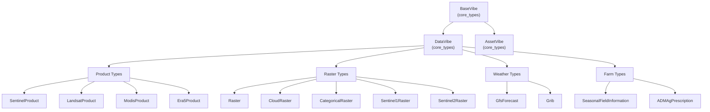
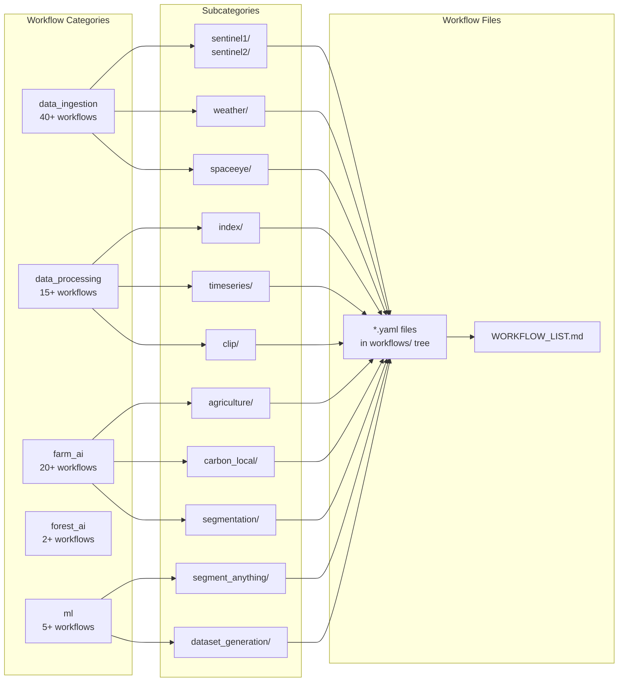
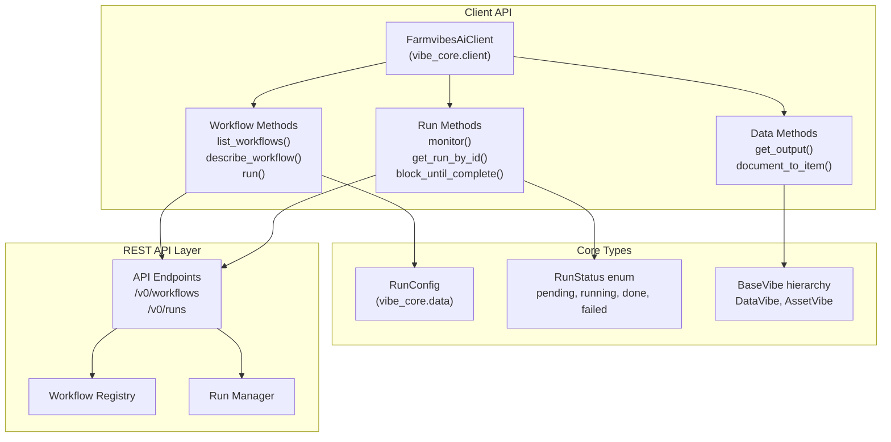
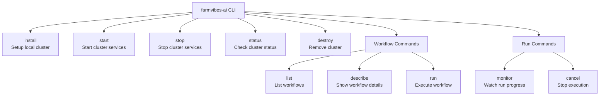

<!-- source: DeepWiki mcp.deepwiki.com · repo microsoft/farmvibes-ai · page 8 Reference · fetched 2026-10-26 -->

# Reference

Relevant source files

The following files were used as context for generating this wiki page:

- [docs/source/docfiles/markdown/WORKFLOW_LIST.md](docs/source/docfiles/markdown/WORKFLOW_LIST.md)
- [src/vibe_core/vibe_core/cli/helper.py](src/vibe_core/vibe_core/cli/helper.py)
- [src/vibe_core/vibe_core/data/__init__.py](src/vibe_core/vibe_core/data/__init__.py)

This section provides comprehensive reference documentation for FarmVibes.AI's core components. It serves as a lookup guide for developers and users who need detailed information about data models, available workflows, and example notebooks.

The reference documentation is organized into three main categories:
- **Data Model Reference** ([#8.1](#8.1)): Complete documentation of all data types, products, rasters, and the BaseVibe hierarchy
- **Workflow Catalog** ([#8.2](#8.2)): Detailed catalog of all available workflows with descriptions and parameters
- **Notebook Catalog** ([#8.3](#8.3)): Complete listing of example notebooks organized by use case

For architectural information about how these components work together, see [Architecture](#3). For practical guides on using these components, see [User Guides](#5).

## Reference Organization

The following diagram shows how reference materials are organized within FarmVibes.AI:

```mermaid
graph TB
    subgraph "Data Model Reference"
        CoreTypes["core_types module<br/>BaseVibe, DataVibe, etc."]
        Products["products module<br/>SentinelProduct, LandsatProduct, etc."]
        Rasters["rasters module<br/>Raster, CloudRaster, etc."]
        Sentinel["sentinel module<br/>Sentinel1/2 specific types"]
        Farm["farm module<br/>ADMAg types"]
        Weather["weather module<br/>GfsForecast, Grib, etc."]
    end
    
    subgraph "Workflow Catalog"
        DataIngestion["data_ingestion category<br/>40+ workflows"]
        DataProcessing["data_processing category<br/>15+ workflows"]
        FarmAI["farm_ai category<br/>20+ workflows"]
        ForestAI["forest_ai category<br/>2+ workflows"]
        ML["ml category<br/>5+ workflows"]
    end
    
    subgraph "Notebook Examples"
        AgricultureNB["Agriculture notebooks<br/>Crop analysis, carbon, etc."]
        RemoteSensingNB["Remote sensing notebooks<br/>SpaceEye, indices, etc."]
        MLNB["ML notebooks<br/>Segmentation, training, etc."]
    end
    
    subgraph "Code Locations"
        DataInit["vibe_core/data/__init__.py"]
        WorkflowYAML["workflows/*.yaml"]
        NotebookDir["notebooks/**/*.ipynb"]
    end
    
    CoreTypes --> DataInit
    Products --> DataInit
    Rasters --> DataInit
    Sentinel --> DataInit
    Farm --> DataInit
    Weather --> DataInit
    
    DataIngestion --> WorkflowYAML
    DataProcessing --> WorkflowYAML
    FarmAI --> WorkflowYAML
    ForestAI --> WorkflowYAML
    ML --> WorkflowYAML
    
    AgricultureNB --> NotebookDir
    RemoteSensingNB --> NotebookDir
    MLNB --> NotebookDir
```

**Sources:** [src/vibe_core/vibe_core/data/__init__.py:1-93](), [docs/source/docfiles/markdown/WORKFLOW_LIST.md:1-209]()

## Data Model Reference Structure

The FarmVibes.AI data model is organized hierarchically, with all types inheriting from `BaseVibe`. The following diagram shows the complete type hierarchy and module organization:

All data model classes are exported from [src/vibe_core/vibe_core/data/__init__.py:1-93](). The module structure includes:

| Module | Primary Classes | Purpose |
|--------|----------------|---------|
| `core_types` | `BaseVibe`, `DataVibe`, `AssetVibe`, `BBox`, `TimeRange`, `Point` | Base types and geometric primitives |
| `products` | `SentinelProduct`, `LandsatProduct`, `ModisProduct`, `Era5Product` | Satellite and weather product metadata |
| `rasters` | `Raster`, `CloudRaster`, `CategoricalRaster`, `RasterSequence` | Raster data containers |
| `sentinel` | `Sentinel1Raster`, `Sentinel2Raster`, `SpaceEyeRaster` | Sentinel-specific types |
| `farm` | `SeasonalFieldInformation`, `ADMAgPrescription`, `FertilizerInformation` | Agricultural data types |
| `weather` | `GfsForecast`, `Grib`, `Era5Product` | Weather and forecast data |

**Sources:** [src/vibe_core/vibe_core/data/__init__.py:1-93]()

## Workflow Catalog Structure

FarmVibes.AI provides 80+ workflows organized into five main categories. The following diagram maps workflow categories to their locations in the codebase:

### Workflow Category Breakdown

The following table summarizes the workflow categories and their purposes:

| Category | Workflow Count | Description | Example Workflows |
|----------|---------------|-------------|-------------------|
| `data_ingestion` | 40+ | Download and preprocess data from external sources | `sentinel2/preprocess_s2`, `weather/download_era5`, `spaceeye/spaceeye` |
| `data_processing` | 15+ | Transform and analyze raster data | `index/index`, `timeseries/timeseries_aggregation`, `clip/clip` |
| `farm_ai` | 20+ | Agricultural applications and analysis | `agriculture/canopy_cover`, `carbon_local/carbon_whatif`, `segmentation/segment_s2` |
| `forest_ai` | 2+ | Forest monitoring and change detection | `deforestation/ordinal_trend_detection`, `deforestation/alos_trend_detection` |
| `ml` | 5+ | Machine learning workflows | `segment_anything/automatic_segmentation`, `crop_segmentation`, `dataset_generation/datagen_crop_segmentation` |

**Sources:** [docs/source/docfiles/markdown/WORKFLOW_LIST.md:1-209]()

## API Reference Structure

The FarmVibes.AI client API provides programmatic access to workflows and data. The following diagram shows the client API structure and its relationship to core components:

### Client API Key Classes

The client API is organized around the following key classes:

| Class | Module | Purpose |
|-------|--------|---------|
| `FarmvibesAiClient` | `vibe_core.client` | Main entry point for API interaction |
| `RunConfig` | `vibe_core.data` | Configuration for workflow execution |
| `RunStatus` | `vibe_core.data` | Enumeration of run states |
| `DataVibe` | `vibe_core.data` | Base class for data outputs |
| `Monitor` | `vibe_core.client.monitor` | Real-time workflow monitoring |

**Sources:** [src/vibe_core/vibe_core/data/__init__.py:1-93]()

## CLI Command Reference

The `farmvibes-ai` CLI provides command-line access to cluster management and workflow operations. The following diagram shows the CLI command structure:

**Sources:** [src/vibe_core/vibe_core/cli/helper.py:1-119]()

## Using the Reference Documentation

The reference section is designed for lookup rather than learning. For step-by-step guides and tutorials, see:

- **Getting Started** ([#2](#2)): Initial setup and first workflow execution
- **User Guides** ([#5](#5)): Practical guides for common tasks
- **Example Notebooks** ([#6](#6)): Hands-on examples with explanations

Each reference sub-section provides:

1. **Data Model Reference** ([#8.1](#8.1)):
   - Complete class definitions
   - Property descriptions
   - Type hierarchies
   - Usage examples

2. **Workflow Catalog** ([#8.2](#8.2)):
   - Workflow descriptions
   - Input/output specifications
   - Parameter documentation
   - Example invocations

3. **Notebook Catalog** ([#8.3](#8.3)):
   - Notebook descriptions
   - Required setup steps
   - Expected outputs
   - Related workflows

**Sources:** [docs/source/docfiles/markdown/WORKFLOW_LIST.md:1-209](), [src/vibe_core/vibe_core/data/__init__.py:1-93]()

---

