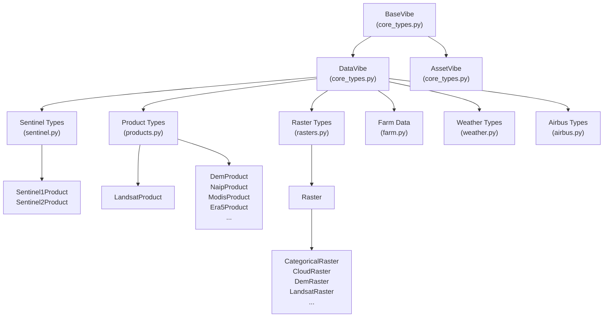
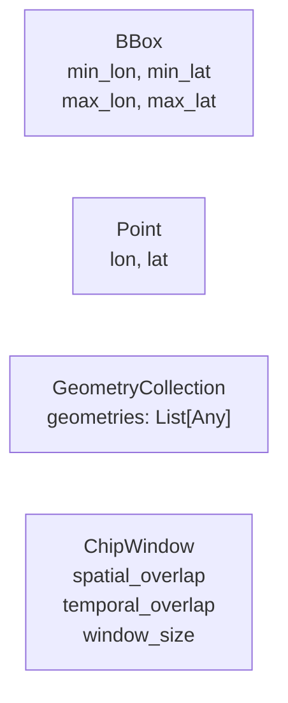
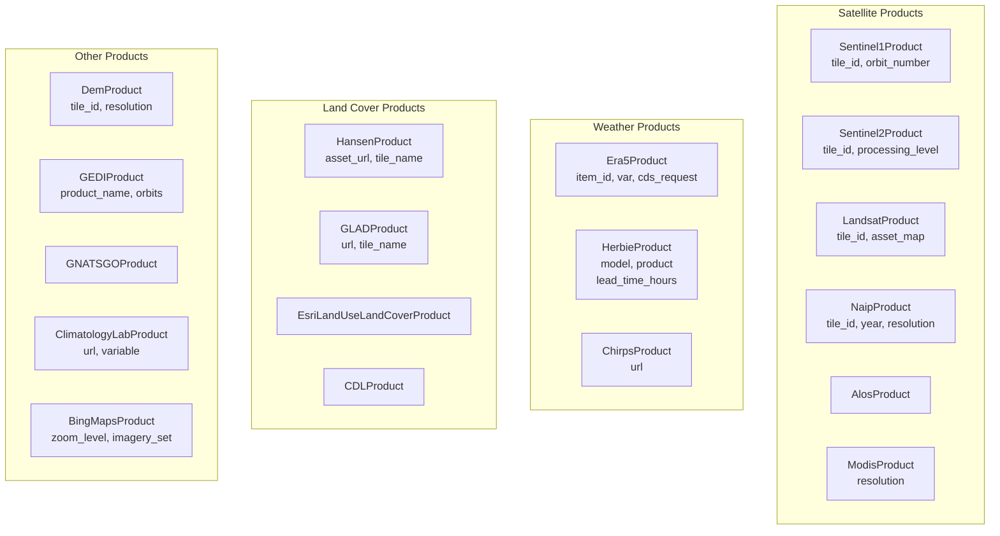
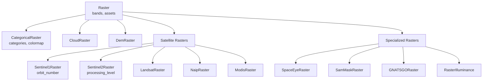
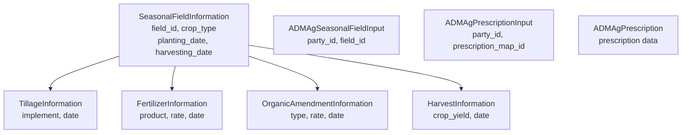
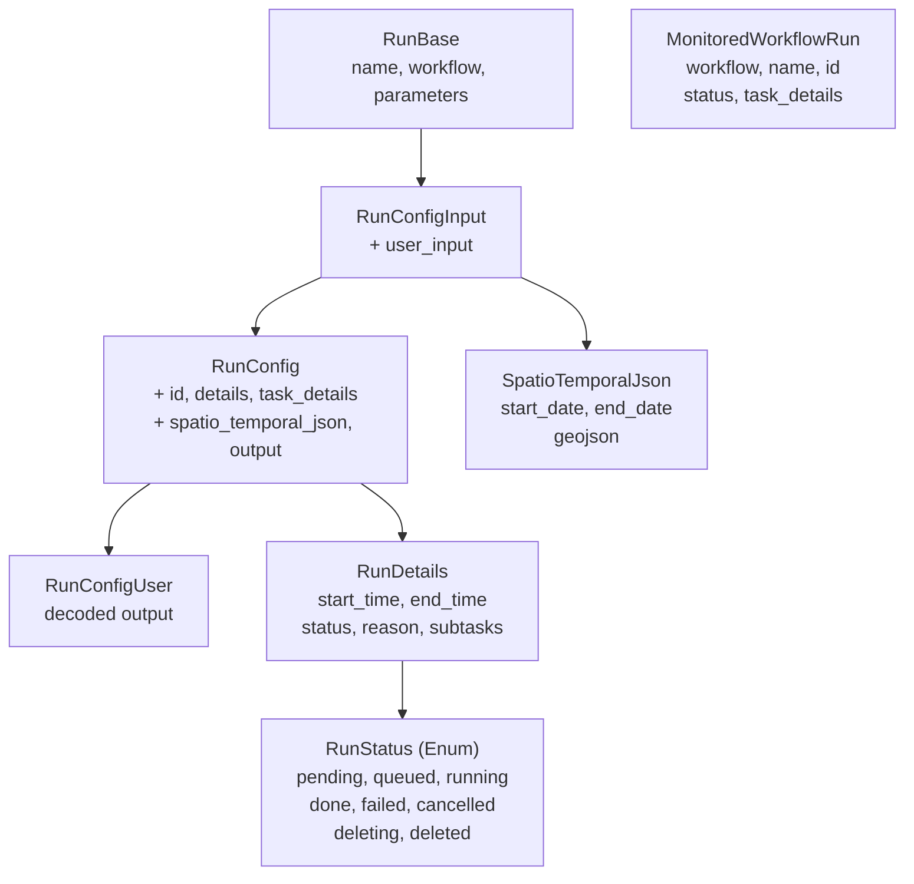
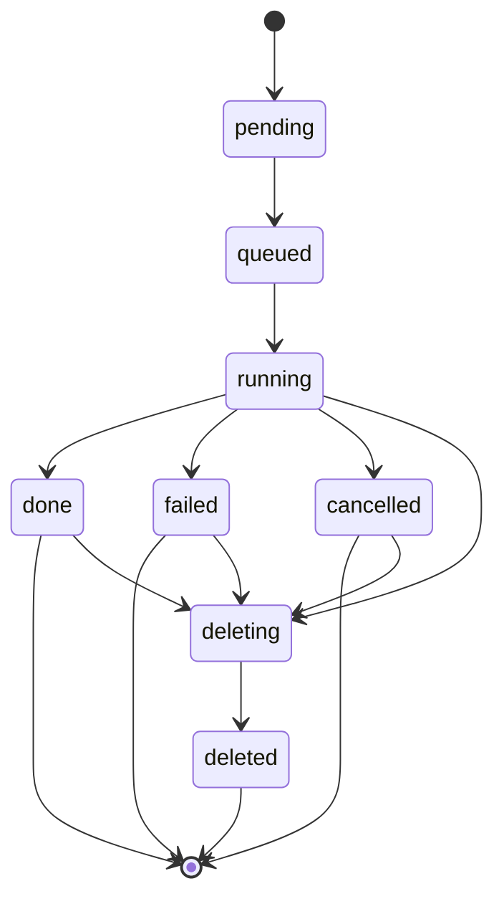

<!-- source: DeepWiki mcp.deepwiki.com · repo microsoft/farmvibes-ai · page 8.1 Data Model Reference · fetched 2026-10-26 -->

# Data Model Reference

<details>
<summary>Relevant source files</summary>

The following files were used as context for generating this wiki page:

- [src/vibe_core/vibe_core/data/__init__.py](src/vibe_core/vibe_core/data/__init__.py)
- [src/vibe_core/vibe_core/data/products.py](src/vibe_core/vibe_core/data/products.py)
- [src/vibe_core/vibe_core/datamodel.py](src/vibe_core/vibe_core/datamodel.py)

</details>


This page provides a comprehensive reference for all data models used in FarmVibes.AI. These models represent geospatial data, satellite imagery products, rasters, agricultural information, and workflow execution metadata. All data models are implemented as Python dataclasses and support serialization to/from STAC (SpatioTemporal Asset Catalog) format.

For architectural overview and design patterns of the data model system, see [Data Models](#3.3). For information about using data models in workflows, see [Workflows](#4).

## Overview

FarmVibes.AI's data model hierarchy is built around a core base class called `BaseVibe`, which provides common functionality for all data types. The hierarchy extends through specialized types for different data sources, processing stages, and agricultural applications.

### Data Model Hierarchy



Sources: [src/vibe_core/vibe_core/data/__init__.py:1-93]()

## Core Base Classes

### BaseVibe

The `BaseVibe` class is the root of all data types in FarmVibes.AI. It provides common attributes for geometry, time range, assets, and unique identification.

| Property | Type | Description |
|----------|------|-------------|
| `geometry` | `Union[GeometryCollection, BBox, Point, None]` | Spatial geometry of the data |
| `time_range` | `TimeRange` | Temporal extent (start and end datetime) |
| `assets` | `List[AssetVibe]` | List of file assets associated with this data |
| `id` | `str` | Unique identifier |

Sources: [src/vibe_core/vibe_core/data/__init__.py:7-32]()

### DataVibe

The `DataVibe` class extends `BaseVibe` and represents data items that contain actual information (as opposed to just metadata). Most product and raster types inherit from this class.

Sources: [src/vibe_core/vibe_core/data/__init__.py:7-32]()

### AssetVibe

The `AssetVibe` class represents a single file asset (e.g., a GeoTIFF file, JSON file, or model artifact).

| Property | Type | Description |
|----------|------|-------------|
| `reference` | `str` | File path or URL to the asset |
| `type` | `str` | MIME type of the asset |
| `id` | `str` | Unique identifier for this asset |

Sources: [src/vibe_core/vibe_core/data/__init__.py:7-32]()

## Geometric and Temporal Types

These types represent spatial and temporal information used throughout the system.

### Spatial Types



| Type | Properties | Description |
|------|------------|-------------|
| `BBox` | `min_lon`, `min_lat`, `max_lon`, `max_lat` | Bounding box defined by corner coordinates |
| `Point` | `lon`, `lat` | Geographic point |
| `GeometryCollection` | `geometries: List[Any]` | Collection of multiple geometries |
| `ChipWindow` | `spatial_overlap`, `temporal_overlap`, `window_size` | Defines chip extraction parameters |

Sources: [src/vibe_core/vibe_core/data/__init__.py:7-32]()

### Temporal Types

| Type | Properties | Description |
|------|------------|-------------|
| `TimeRange` | `start: datetime`, `end: datetime` | Temporal range with start and end times |
| `TimeSeries` | `items: List[DataVibe]` | Collection of time-ordered data items |

Sources: [src/vibe_core/vibe_core/data/__init__.py:7-32]()

## Product Types

Product types represent metadata about available data before it is downloaded. They are typically the output of list operators and input to download operators.

### Product Type Mapping



Sources: [src/vibe_core/vibe_core/data/__init__.py:43-58](), [src/vibe_core/vibe_core/data/products.py:1-385]()

### Satellite Product Types

| Type | Key Properties | Description |
|------|----------------|-------------|
| `Sentinel1Product` | `tile_id`, `orbit_number` | Metadata for Sentinel-1 SAR imagery |
| `Sentinel2Product` | `tile_id`, `processing_level` | Metadata for Sentinel-2 optical imagery |
| `DownloadedSentinel1Product` | Inherits from `Sentinel1Product` | Downloaded Sentinel-1 product |
| `DownloadedSentinel2Product` | Inherits from `Sentinel2Product` | Downloaded Sentinel-2 product |
| `TiledSentinel1Product` | Inherits from `Sentinel1Product` | Tiled Sentinel-1 product for large areas |
| `LandsatProduct` | `tile_id`, `asset_map: Dict[str, str]` | Metadata for Landsat imagery with band mapping |
| `NaipProduct` | `tile_id`, `year`, `resolution` | Metadata for NAIP high-resolution imagery |
| `AlosProduct` | (inherits from DataVibe) | Metadata for ALOS satellite products |
| `ModisProduct` | `resolution` | Metadata for MODIS products |

Sources: [src/vibe_core/vibe_core/data/__init__.py:43-90](), [src/vibe_core/vibe_core/data/products.py:22-149]()

### Weather Product Types

| Type | Key Properties | Description |
|------|----------------|-------------|
| `Era5Product` | `item_id`, `var`, `cds_request` | Metadata for ERA5 reanalysis data |
| `HerbieProduct` | `model`, `product`, `lead_time_hours`, `search_text` | Metadata for weather forecast data (HRRR, GFS, RAP, etc.) |
| `ChirpsProduct` | `url` | Metadata for CHIRPS precipitation data |
| `GfsForecast` | (from weather.py) | GFS weather forecast data |
| `Grib` | (from weather.py) | Generic GRIB file data |

Sources: [src/vibe_core/vibe_core/data/__init__.py:43-92](), [src/vibe_core/vibe_core/data/products.py:101-366]()

### Land Cover and Terrain Product Types

| Type | Key Properties | Description |
|------|----------------|-------------|
| `DemProduct` | `tile_id`, `resolution`, `provider` | Metadata for Digital Elevation Model tiles |
| `HansenProduct` | `asset_url`, `tile_name`, `last_year`, `version`, `layer_name` | Metadata for Hansen Global Forest Change dataset |
| `GLADProduct` | `url`, `tile_name` | Metadata for Global Land Analysis products |
| `EsriLandUseLandCoverProduct` | (inherits from DataVibe) | Metadata for Esri 9-class land cover |
| `CDLProduct` | (inherits from DataVibe) | Metadata for USDA Crop Data Layer |
| `GNATSGOProduct` | (inherits from DataVibe) | Metadata for gNATSGO soil data |
| `GEDIProduct` | `product_name`, `start_orbit`, `stop_orbit`, `processing_level` | Metadata for GEDI lidar products |
| `ClimatologyLabProduct` | `url`, `variable` | Metadata for Climatology Lab datasets |

Sources: [src/vibe_core/vibe_core/data/products.py:22-344]()

### Commercial Product Types

| Type | Key Properties | Description |
|------|----------------|-------------|
| `AirbusProduct` | (from airbus.py) | Metadata for Airbus commercial imagery |
| `AirbusPrice` | (from airbus.py) | Pricing information for Airbus products |
| `BingMapsProduct` | `url`, `zoom_level`, `imagery_set`, `map_layer`, `orientation` | Metadata for Bing Maps imagery |

Sources: [src/vibe_core/vibe_core/data/__init__.py:6](), [src/vibe_core/vibe_core/data/products.py:367-385]()

## Raster Types

Raster types represent downloaded and processed imagery data. They extend product types with actual file assets.

### Raster Type Hierarchy



Sources: [src/vibe_core/vibe_core/data/__init__.py:59-73]()

### Core Raster Types

| Type | Key Properties | Description |
|------|----------------|-------------|
| `Raster` | `bands: Dict[str, int]`, `assets: List[AssetVibe]` | Base class for all raster data |
| `RasterSequence` | `rasters: List[Raster]` | Ordered collection of rasters (e.g., time series) |
| `RasterChunk` | (inherits from Raster) | Spatial chunk of a larger raster |
| `ChunkLimits` | `x_min`, `x_max`, `y_min`, `y_max` | Defines boundaries of raster chunks |
| `CategoricalRaster` | `categories: Dict[int, str]`, `colormap` | Raster with discrete categories (e.g., land cover) |
| `CloudRaster` | (inherits from Raster) | Cloud mask raster |
| `DemRaster` | (inherits from Raster) | Digital elevation model raster |

Sources: [src/vibe_core/vibe_core/data/__init__.py:59-73]()

### Satellite Raster Types

| Type | Key Properties | Description |
|------|----------------|-------------|
| `Sentinel1Raster` | `orbit_number`, `orbit_direction` | Sentinel-1 SAR imagery raster |
| `Sentinel1RasterOrbitGroup` | `assets: List[Sentinel1Raster]` | Collection of Sentinel-1 rasters from same orbit |
| `Sentinel2Raster` | `processing_level`, `tile_id` | Sentinel-2 optical imagery raster |
| `Sentinel2RasterOrbitGroup` | `assets: List[Sentinel2Raster]` | Collection of Sentinel-2 rasters from same orbit |
| `Sentinel2CloudMask` | (inherits from CloudRaster) | Cloud mask for Sentinel-2 imagery |
| `Sentinel2CloudMaskOrbitGroup` | `assets: List[Sentinel2CloudMask]` | Collection of cloud masks |
| `Sentinel2CloudProbability` | (inherits from Raster) | Cloud probability scores for Sentinel-2 |
| `LandsatRaster` | `tile_id`, `bands` | Landsat imagery raster |
| `NaipRaster` | `tile_id`, `year` | NAIP high-resolution imagery raster |
| `ModisRaster` | `resolution` | MODIS imagery raster |
| `GNATSGORaster` | (inherits from Raster) | gNATSGO soil data raster |

Sources: [src/vibe_core/vibe_core/data/__init__.py:59-90]()

### Specialized Raster Types

| Type | Key Properties | Description |
|------|----------------|-------------|
| `SpaceEyeRaster` | (inherits from Raster) | Cloud-removed composite raster from SpaceEye workflow |
| `SamMaskRaster` | (inherits from CategoricalRaster) | Segmentation mask from Segment Anything Model |
| `RasterIlluminance` | `illuminance: float` | Raster with associated illuminance value |
| `AirbusRaster` | (from airbus.py) | Airbus commercial imagery raster |

Sources: [src/vibe_core/vibe_core/data/__init__.py:59-88]()

### Raster Processing Types

| Type | Properties | Description |
|------|------------|-------------|
| `RasterPixelCount` | `counts: Dict[int, int]` | Pixel value histogram/statistics |
| `DataSummaryStatistics` | Statistical summaries (from core_types.py) | Summary statistics for raster data |

Sources: [src/vibe_core/vibe_core/data/__init__.py:7-32]()

## Farm and Agriculture Data Types

These types represent agricultural data integrated from Azure Data Manager for Agriculture (ADMAg) and other sources.

### Farm Data Model



Sources: [src/vibe_core/vibe_core/data/__init__.py:33-42]()

### Farm Data Types

| Type | Key Properties | Description |
|------|----------------|-------------|
| `SeasonalFieldInformation` | `field_id`, `crop_type`, `planting_date`, `harvesting_date` | Information about a field for a growing season |
| `TillageInformation` | `implement`, `date`, `field_id` | Tillage operation details |
| `FertilizerInformation` | `product`, `rate`, `date`, `field_id` | Fertilizer application details |
| `OrganicAmendmentInformation` | `type`, `rate`, `date`, `field_id` | Organic amendment application details |
| `HarvestInformation` | `crop_yield`, `date`, `field_id` | Harvest operation details |
| `ADMAgSeasonalFieldInput` | `party_id`, `field_id` | Input for fetching ADMAg seasonal field data |
| `ADMAgPrescriptionInput` | `party_id`, `prescription_map_id` | Input for fetching ADMAg prescription maps |
| `ADMAgPrescription` | Prescription data fields | Prescription map data from ADMAg |

Sources: [src/vibe_core/vibe_core/data/__init__.py:33-42]()

## Carbon and GHG Data Types

Types for greenhouse gas analysis and carbon sequestration modeling.

| Type | Key Properties | Description |
|------|-------------|-------------|
| `GHGFlux` | Flux values and metadata | Greenhouse gas flux measurements |
| `GHGProtocolVibe` | Protocol data | GHG Protocol standard data |
| `CarbonOffsetInfo` | Offset calculations | Carbon offset information |

Sources: [src/vibe_core/vibe_core/data/__init__.py:7-32]()

## Food and Nutrition Data Types

Types for food analysis and nutritional information.

| Type | Key Properties | Description |
|------|-------------|-------------|
| `FoodVibe` | Food data | Food item information |
| `FoodFeatures` | Nutritional features | Food characteristics and nutrition data |
| `ProteinSequence` | Sequence data | Protein sequence information |

Sources: [src/vibe_core/vibe_core/data/__init__.py:7-32]()

## Statistical and Analysis Types

Types for statistical analysis and time series operations.

| Type | Key Properties | Description |
|------|-------------|-------------|
| `OrdinalTrendTest` | Test statistics | Results from ordinal trend analysis |
| `DataSummaryStatistics` | Statistical measures | Summary statistics for datasets |

Sources: [src/vibe_core/vibe_core/data/__init__.py:7-32]()

## External Reference Types

Types for managing external data references and URLs.

| Type | Key Properties | Description |
|------|-------------|-------------|
| `ExternalReference` | `url`, `metadata` | Reference to external data source |
| `ExternalReferenceList` | `references: List[ExternalReference]` | Collection of external references |

Sources: [src/vibe_core/vibe_core/data/__init__.py:7-32]()

## Run Management Types

These types manage workflow execution, status tracking, and run configuration.

### Run Configuration Model



Sources: [src/vibe_core/vibe_core/datamodel.py:1-353]()

### Run Configuration Types

| Type | Key Properties | Description |
|------|----------------|-------------|
| `RunBase` | `name`, `workflow`, `parameters` | Base class for run configuration |
| `RunConfigInput` | `user_input: Union[SpatioTemporalJson, Dict, List]` | Input for creating a workflow run |
| `RunConfig` | `id: UUID`, `details: RunDetails`, `task_details: Dict`, `output: str` | Complete run configuration with encoded output |
| `RunConfigUser` | `output: OpIOType` | User-facing run config with decoded output |
| `SpatioTemporalJson` | `start_date: datetime`, `end_date: datetime`, `geojson: Dict` | Spatial and temporal parameters for a run |

Sources: [src/vibe_core/vibe_core/datamodel.py:78-241]()

### Run Status and Details

| Type/Enum | Values/Properties | Description |
|-----------|-------------------|-------------|
| `RunStatus` | `pending`, `queued`, `running`, `done`, `failed`, `cancelled`, `deleting`, `deleted` | Enum representing run execution state |
| `RunDetails` | `start_time`, `submission_time`, `end_time`, `reason`, `status`, `subtasks` | Detailed information about run execution |
| `MonitoredWorkflowRun` | `workflow`, `name`, `id`, `status`, `task_details` | Monitored workflow execution information |

Sources: [src/vibe_core/vibe_core/datamodel.py:128-327]()

### Run Status States



Sources: [src/vibe_core/vibe_core/datamodel.py:128-165]()

## Additional Types

### Utility and Helper Types

| Type | Properties | Description |
|------|------------|-------------|
| `BaseVibeDict` | Dictionary type | Type alias for dictionaries of BaseVibe objects |
| `TypeDictVibe` | Type information | Type dictionary for Vibe objects |
| `Region` | `name`, `geojson` | Named geographic region |
| `Message` | `message`, `id`, `location` | API message structure |
| `TaskDescription` | `inputs`, `outputs`, `parameters`, `task_descriptions` | Description of workflow task |
| `MetricsDict` | `load_avg`, `cpu_usage`, `free_mem`, `used_mem`, `total_mem`, `disk_free` | System metrics |

Sources: [src/vibe_core/vibe_core/data/__init__.py:7-32](), [src/vibe_core/vibe_core/datamodel.py:27-277]()

### Identifier Generation

| Function | Purpose | Description |
|----------|---------|-------------|
| `gen_guid()` | Generate UUID | Creates a unique identifier string |
| `gen_hash_id()` | Generate hash ID | Creates a hash-based identifier |
| `gen_forecast_time_hash_id()` | Forecast time hash | Generates hash for weather forecast times |

Sources: [src/vibe_core/vibe_core/data/__init__.py:7-32](), [src/vibe_core/vibe_core/data/__init__.py:92]()

## Data Serialization

### STAC Converter

The `StacConverter` class provides methods for converting between FarmVibes.AI data models and STAC format.

| Component | Purpose |
|-----------|---------|
| `StacConverter` | Converts BaseVibe objects to/from STAC Items |

Sources: [src/vibe_core/vibe_core/data/__init__.py:91]()

### Encoding/Decoding

| Function | Purpose | Description |
|----------|---------|-------------|
| `encode(data: str)` | Compress and encode | Compresses data with zlib and encodes as base64 |
| `decode(data: str)` | Decode and decompress | Decodes base64 and decompresses with zlib |

Sources: [src/vibe_core/vibe_core/datamodel.py:329-353]()

## Data Model Usage

### Creating Data Objects

All data models are Python dataclasses that can be instantiated with keyword arguments:

```python
from vibe_core.data import TimeRange, BBox, Sentinel2Product
from datetime import datetime

# Create temporal range
time_range = TimeRange(
    start=datetime(2023, 1, 1),
    end=datetime(2023, 12, 31)
)

# Create spatial bounding box
bbox = BBox(min_lon=-120.0, min_lat=35.0, max_lon=-119.0, max_lat=36.0)

# Create product metadata
product = Sentinel2Product(
    geometry=bbox,
    time_range=time_range,
    tile_id="10TGK"
)
```

### Working with Assets

Asset management uses the `AssetVibe` class and asset lists:

```python
from vibe_core.data import LandsatProduct, AssetVibe

product = LandsatProduct()
product.add_downloaded_band("B4", "/path/to/red_band.tif")
product.add_downloaded_band("B5", "/path/to/nir_band.tif")

# Retrieve specific band
red_band = product.get_downloaded_band("B4")
print(red_band.reference)  # /path/to/red_band.tif
```

Sources: [src/vibe_core/vibe_core/data/products.py:59-98]()

## Type Organization by Module

The data model types are organized across several Python modules:

| Module | Types | Purpose |
|--------|-------|---------|
| `core_types.py` | `BaseVibe`, `DataVibe`, `AssetVibe`, geometric types, statistical types | Core base classes and fundamental types |
| `products.py` | `LandsatProduct`, `Era5Product`, `DemProduct`, etc. | Product metadata for various data sources |
| `rasters.py` | `Raster`, `CategoricalRaster`, `RasterSequence`, etc. | Raster imagery and derived types |
| `sentinel.py` | `Sentinel1Product`, `Sentinel2Product`, `SpaceEyeRaster`, etc. | Sentinel-specific products and rasters |
| `farm.py` | `SeasonalFieldInformation`, `FertilizerInformation`, etc. | Agricultural management data |
| `weather.py` | `GfsForecast`, `Grib` | Weather and forecast data |
| `airbus.py` | `AirbusProduct`, `AirbusRaster`, `AirbusPrice` | Commercial Airbus imagery |
| `datamodel.py` | `RunConfig`, `RunStatus`, `MonitoredWorkflowRun` | Workflow execution management |

Sources: [src/vibe_core/vibe_core/data/__init__.py:1-93]()

---

