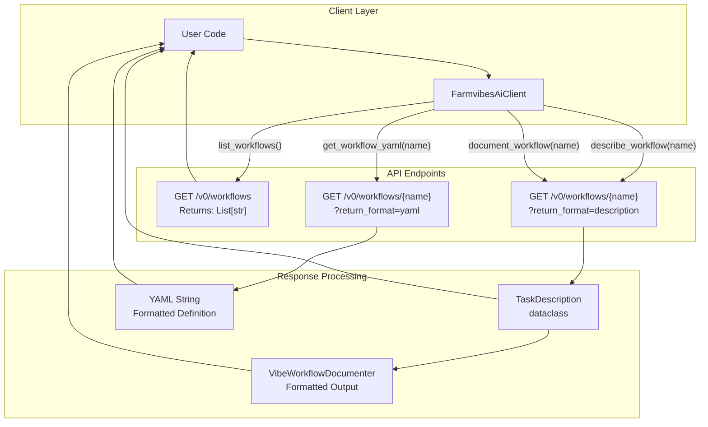
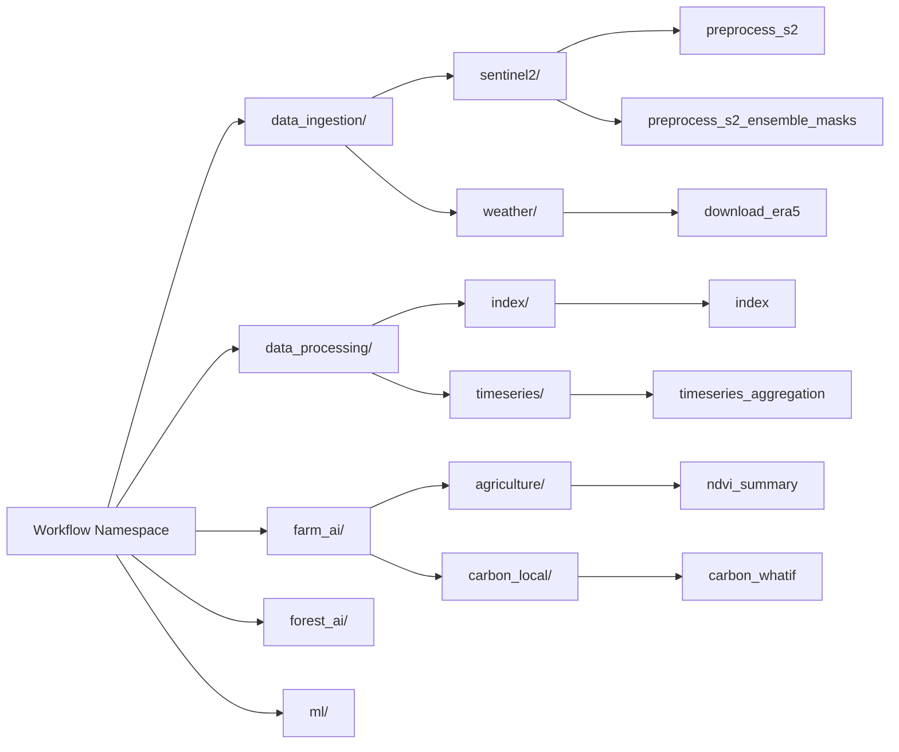
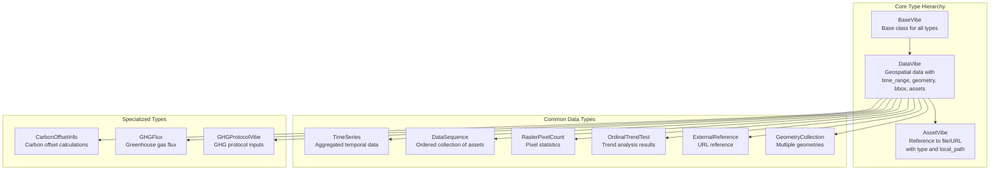
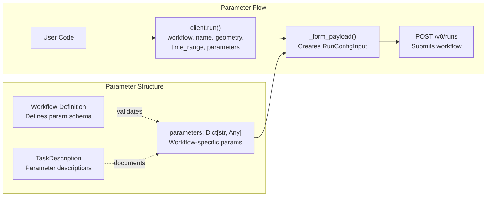

<!-- source: DeepWiki mcp.deepwiki.com · repo microsoft/farmvibes-ai · page 8.2 Workflow Catalog · fetched 2026-10-26 -->

# Workflow Catalog

<details>
<summary>Relevant source files</summary>

The following files were used as context for generating this wiki page:

- [docs/source/docfiles/markdown/WORKFLOW_LIST.md](docs/source/docfiles/markdown/WORKFLOW_LIST.md)
- [src/vibe_core/vibe_core/cli/helper.py](src/vibe_core/vibe_core/cli/helper.py)
- [src/vibe_core/vibe_core/client.py](src/vibe_core/vibe_core/client.py)
- [src/vibe_core/vibe_core/data/core_types.py](src/vibe_core/vibe_core/data/core_types.py)

</details>


This page provides a complete reference catalog of all workflows available in FarmVibes.AI. Each workflow is documented with its name, category, and purpose. For information about running workflows and configuring their parameters, see [Running Workflows](#5.2). For practical examples of using specific workflows, see the notebook catalogs in sections [6.1](#6.1), [6.2](#6.2), and [6.3](#6.3).

A workflow in FarmVibes.AI is a DAG-based pipeline that orchestrates multiple operators to accomplish a specific task. Workflows are organized into five main categories based on their purpose: data ingestion, data processing, FarmAI applications, ForestAI applications, and machine learning operations.

## Workflow Discovery and Inspection

The `FarmvibesAiClient` class provides methods to programmatically discover and inspect available workflows:

**Listing Available Workflows**

The `list_workflows()` method returns all workflow names registered in the system:

```python
from vibe_core.client import get_default_vibe_client

client = get_default_vibe_client()
workflows = client.list_workflows()  # Returns List[str]
```

**Describing Workflow Structure**

The `describe_workflow(workflow_name)` method returns detailed information about a workflow, including its inputs, outputs, parameters, and task structure:

```python
workflow_desc = client.describe_workflow("data_ingestion/sentinel2/preprocess_s2")
# Returns dict with keys: 'name', 'description', 'inputs', 'outputs', 'parameters'
# The 'description' value is a TaskDescription object
```

**Getting YAML Definition**

The `get_workflow_yaml(workflow_name)` method returns the workflow's YAML definition:

```python
yaml_def = client.get_workflow_yaml("data_ingestion/sentinel2/preprocess_s2")
# Returns formatted YAML string
```

**Interactive Documentation**

The `document_workflow(workflow_name)` method prints formatted documentation to stdout:

```python
client.document_workflow("data_ingestion/sentinel2/preprocess_s2")
# Prints formatted documentation including name, description, inputs, outputs, parameters
```

Sources: [src/vibe_core/vibe_core/client.py:267-338]()

## Workflow Discovery Architecture



Sources: [src/vibe_core/vibe_core/client.py:267-338](), [src/vibe_core/vibe_core/datamodel.py:45-46]()

## Workflow Categories

FarmVibes.AI workflows are organized into five main categories:

| Category | Purpose | Typical Use Case |
|----------|---------|------------------|
| **data_ingestion** | Download and preprocess data from external sources | Acquiring Sentinel-2 imagery, downloading weather data, fetching satellite products |
| **data_processing** | Transform and analyze data | Computing indices (NDVI, MSAVI), aggregating time series, performing spatial operations |
| **farm_ai** | Agricultural application workflows | Carbon sequestration estimation, crop analysis, nutrient mapping |
| **forest_ai** | Forest monitoring workflows | Deforestation detection, forest extent mapping, trend analysis |
| **ml** | Machine learning operations | Model training, inference, dataset generation, segmentation |

Sources: [docs/source/docfiles/markdown/WORKFLOW_LIST.md:3-11]()

## Workflow Naming Convention

Workflows follow a hierarchical naming pattern: `category/subcategory/workflow_name`. This structure allows for logical organization and easy discovery:



Sources: [docs/source/docfiles/markdown/WORKFLOW_LIST.md:16-210]()

## Complete Workflow Catalog

### data_ingestion

Workflows that download and preprocess data from external sources. These workflows prepare data for use in processing and analysis pipelines.

#### Azure Data Manager for Agriculture (ADMAg)

| Workflow | Description |
|----------|-------------|
| `admag/admag_seasonal_field` | Generates SeasonalFieldInformation using ADMAg (Microsoft Azure Data Manager for Agriculture) |
| `admag/prescriptions` | Fetches prescriptions using ADMAg (Microsoft Azure Data Manager for Agriculture) |

#### Commercial Satellite Imagery

| Workflow | Description |
|----------|-------------|
| `airbus/airbus_download` | Downloads available AirBus imagery for the input geometry and time range |
| `airbus/airbus_price` | Prices available AirBus imagery for the input geometry and time range |

#### ALOS Forest Products

| Workflow | Description |
|----------|-------------|
| `alos/alos_forest_extent_download` | Downloads Advanced Land Observing Satellite (ALOS) forest/non-forest classification map |
| `alos/alos_forest_extent_download_merge` | Downloads ALOS forest/non-forest classification map and merges it into a single raster |

#### Basemaps

| Workflow | Description |
|----------|-------------|
| `bing/basemap_download` | Downloads Bing Maps basemaps |
| `bing/basemap_download_merge` | Downloads Bing Maps basemap tiles and merges them into a single raster |

#### Crop Data Layer (CDL)

| Workflow | Description |
|----------|-------------|
| `cdl/download_cdl` | Downloads crop classes maps in the continental USA for the input time range |

#### Digital Elevation Model (DEM)

| Workflow | Description |
|----------|-------------|
| `dem/download_dem` | Downloads digital elevation map tiles that intersect with the input geometry and time range |

#### GEDI LiDAR Products

| Workflow | Description |
|----------|-------------|
| `gedi/download_gedi` | Downloads GEDI products for the input region and time range |
| `gedi/download_gedi_rh100` | Downloads L2B GEDI products and extracts RH100 variables |

#### GLAD Forest Products

| Workflow | Description |
|----------|-------------|
| `glad/glad_forest_extent_download` | Downloads Global Land Analysis (GLAD) forest extent data |
| `glad/glad_forest_extent_download_merge` | Downloads the tiles from GLAD forest data that intersect with the user input geometry and time range, and merges them into a single raster |

#### Soil Data

| Workflow | Description |
|----------|-------------|
| `gnatsgo/download_gnatsgo` | Downloads gNATSGO raster data that intersect with the input geometry and time range |
| `soil/soilgrids` | Downloads digital soil mapping information from SoilGrids for the input geometry |
| `soil/usda` | Downloads USDA soil classification raster |

#### Hansen Forest Change

| Workflow | Description |
|----------|-------------|
| `hansen/hansen_forest_change_download` | Downloads and merges Global Forest Change (Hansen) rasters that intersect the user-provided geometry/time range |

#### Landsat

| Workflow | Description |
|----------|-------------|
| `landsat/preprocess_landsat` | Downloads and preprocesses LANDSAT tiles that intersect with the input geometry and time range |

#### MODIS

| Workflow | Description |
|----------|-------------|
| `modis/download_modis_surface_reflectance` | Downloads MODIS 8-day surface reflectance rasters that intersect with the input geometry and time range |
| `modis/download_modis_vegetation_index` | Downloads MODIS 16-day vegetation index products that intersect with the input geometry and time range |

#### NAIP

| Workflow | Description |
|----------|-------------|
| `naip/download_naip` | Downloads NAIP tiles that intersect with the input geometry and time range |

#### OpenStreetMap

| Workflow | Description |
|----------|-------------|
| `osm_road_geometries` | Downloads road geometry for input region from Open Street Maps |

#### Sentinel-1

| Workflow | Description |
|----------|-------------|
| `sentinel1/preprocess_s1` | Downloads and preprocesses tiles of Sentinel-1 imagery that intersect with the input Sentinel-2 products in the input time range |

#### Sentinel-2

| Workflow | Description |
|----------|-------------|
| `sentinel2/cloud_ensemble` | Computes the cloud probability of a Sentinel-2 L2A raster using an ensemble of five cloud segmentation models |
| `sentinel2/improve_cloud_mask` | Improves cloud masks by merging the product cloud mask with cloud and shadow masks computed by machine learning segmentation models |
| `sentinel2/improve_cloud_mask_ensemble` | Improves cloud masks by merging the product cloud mask with cloud and shadow masks computed by an ensemble of machine learning segmentation models |
| `sentinel2/preprocess_s2` | Downloads and preprocesses Sentinel-2 imagery that covers the input geometry and time range |
| `sentinel2/preprocess_s2_ensemble_masks` | Downloads and preprocesses Sentinel-2 imagery that covers the input geometry and time range, and computes improved cloud masks using an ensemble of cloud and shadow segmentation models |
| `sentinel2/preprocess_s2_improved_masks` | Downloads and preprocesses Sentinel-2 imagery that covers the input geometry and time range, and computes improved cloud masks using cloud and shadow segmentation models |

#### SpaceEye Cloud Removal

| Workflow | Description |
|----------|-------------|
| `spaceeye/spaceeye` | Runs the SpaceEye cloud removal pipeline, yielding daily cloud-free images for the input geometry and time range |
| `spaceeye/spaceeye_inference` | Performs SpaceEye inference to generate daily cloud-free images given Sentinel data and cloud masks |
| `spaceeye/spaceeye_interpolation` | Runs the SpaceEye cloud removal pipeline using an interpolation-based algorithm, yielding daily cloud-free images for the input geometry and time range |
| `spaceeye/spaceeye_interpolation_inference` | Performs temporal damped interpolation to generate daily cloud-free images given Sentinel-2 data and cloud masks |
| `spaceeye/spaceeye_preprocess` | Runs the SpaceEye preprocessing pipeline |
| `spaceeye/spaceeye_preprocess_ensemble` | Runs the SpaceEye preprocessing pipeline with an ensemble of cloud segmentation models |

#### User Data Ingestion

| Workflow | Description |
|----------|-------------|
| `user_data/ingest_geometry` | Adds user geometries into the cluster storage, allowing for them to be used on workflows |
| `user_data/ingest_raster` | Adds user rasters into the cluster storage, allowing for them to be used on workflows |
| `user_data/ingest_smb` | Adds user rasters into the cluster storage from an SMB share, allowing for them to be used on workflows |

#### Weather Data

| Workflow | Description |
|----------|-------------|
| `weather/download_chirps` | Downloads accumulated precipitation data from the CHIRPS dataset |
| `weather/download_era5` | Hourly estimated weather variables |
| `weather/download_era5_monthly` | Monthly estimated weather variables |
| `weather/download_gridmet` | Daily surface meteorological properties from GridMET |
| `weather/download_herbie` | Downloads forecast data for provided location & time range using herbie python package |
| `weather/download_terraclimate` | Monthly climate and hydroclimate properties from TerraClimate |
| `weather/get_ambient_weather` | Downloads weather data from an Ambient Weather station |
| `weather/get_forecast` | Downloads weather forecast data from NOAA Global Forecast System (GFS) for the input time range |
| `weather/herbie_forecast` | Downloads forecast observations for provided location & time range using herbie python package |

Sources: [docs/source/docfiles/markdown/WORKFLOW_LIST.md:16-114]()

### data_processing

Workflows that transform data into different formats or compute derived products. These workflows typically take ingested data as input and produce processed outputs.

#### ONNX Model Execution

| Workflow | Description |
|----------|-------------|
| `chunk_onnx/chunk_onnx` | Runs an Onnx model over all rasters in the input to produce a single raster |
| `chunk_onnx/chunk_onnx_sequence` | Runs an Onnx model over all rasters in the input to produce a single raster |

#### Spatial Operations

| Workflow | Description |
|----------|-------------|
| `clip/clip` | Performs a clip on an input raster based on a provided reference geometry |
| `merge/match_merge_to_ref` | Resamples input rasters to the reference rasters' grid |

#### Raster Analysis

| Workflow | Description |
|----------|-------------|
| `gradient/raster_gradient` | Computes the gradient of each band of the input raster with a Sobel operator |
| `threshold/threshold_raster` | Thresholds values of the input raster if higher than the threshold parameter |

#### Vegetation Indices

| Workflow | Description |
|----------|-------------|
| `index/index` | Computes an index from the bands of an input raster |

#### Statistical Analysis

| Workflow | Description |
|----------|-------------|
| `heatmap/classification` | Utilizes input Sentinel-2 satellite imagery & the sensor samples as labeled data that contain nutrient information (Nitrogen, Carbon, pH, Phosphorus) to train a model using Random Forest classifier. The inference operation predicts nutrients in soil for the chosen farm boundary |
| `linear_trend/chunked_linear_trend` | Computes the pixel-wise linear trend of a list of rasters (e.g. NDVI) |
| `outlier/detect_outlier` | Fits a single-component Gaussian Mixture Model (GMM) over input data to detect outliers according to the threshold parameter |

#### Time Series Operations

| Workflow | Description |
|----------|-------------|
| `timeseries/timeseries_aggregation` | Computes the mean, standard deviation, maximum, and minimum values of all regions of the raster and aggregates them into a timeseries |
| `timeseries/timeseries_masked_aggregation` | Computes the mean, standard deviation, maximum, and minimum values of all regions of the raster considered by the mask and aggregates them into a timeseries |

Sources: [docs/source/docfiles/markdown/WORKFLOW_LIST.md:115-142]()

### farm_ai

Application workflows that combine data ingestion and processing to enable agricultural use cases. These workflows produce actionable insights for farming operations.

#### Agricultural Analysis

| Workflow | Description |
|----------|-------------|
| `agriculture/canopy_cover` | Estimates pixel-wise canopy cover for a region and date |
| `agriculture/change_detection` | Identifies changes/outliers over NDVI across dates |
| `agriculture/emergence_summary` | Calculates emergence statistics using thresholded MSAVI (mean, standard deviation, maximum and minimum) for the input geometry and time range |
| `agriculture/green_house_gas_fluxes` | Computes Green House Fluxes for a region and date range |
| `agriculture/methane_index` | Computes methane index from ultra emitters for a region and date range |
| `agriculture/ndvi_summary` | Calculates NDVI statistics (mean, standard deviation, maximum and minimum) for the input geometry and time range |
| `agriculture/weed_detection` | Generates shape files for similarly colored regions in the input raster |

#### Nutrient Mapping

| Workflow | Description |
|----------|-------------|
| `agriculture/heatmap_using_classification` | The workflow generates a nutrient heatmap for samples provided by user by downloading the samples from user input |
| `agriculture/heatmap_using_classification_admag` | This workflow integrate the ADMAG API to download prescriptions and generate heatmap |
| `agriculture/heatmap_using_neighboring_data_points` | Creates heatmap using the neighbors by performing spatial interpolation operations. It utilizes soil information collected at optimal sensor/sample locations and downloaded sentinel satellite imagery |

#### Carbon Sequestration

| Workflow | Description |
|----------|-------------|
| `carbon_local/admag_carbon_integration` | Computes the offset amount of carbon that would be sequestered in a seasonal field using Microsoft Azure Data Manager for Agriculture (ADMAg) data |
| `carbon_local/carbon_whatif` | Computes the offset amount of carbon that would be sequestered in a seasonal field using the baseline (historical) and scenario (time range interested in) information |

#### Land Cover and Conservation

| Workflow | Description |
|----------|-------------|
| `land_cover_mapping/conservation_practices` | Identifies conservation practices (terraces and grassed waterways) using elevation data |

#### Land Degradation

| Workflow | Description |
|----------|-------------|
| `land_degradation/landsat_ndvi_trend` | Estimates a linear trend over NDVI computer over LANDSAT tiles that intersect with the input geometry and time range |
| `land_degradation/ndvi_linear_trend` | Computes the pixel-wise NDVI linear trend over the input raster |

#### Segmentation

| Workflow | Description |
|----------|-------------|
| `segmentation/auto_segment_basemap` | Downloads basemap with BingMaps API and runs Segment Anything Model (SAM) automatic segmentation over them |
| `segmentation/auto_segment_s2` | Downloads Sentinel-2 imagery and runs Segment Anything Model (SAM) automatic segmentation over them |
| `segmentation/segment_basemap` | Downloads basemap with BingMaps API and runs Segment Anything Model (SAM) over them with points and/or bounding boxes as prompts |
| `segmentation/segment_s2` | Downloads Sentinel-2 imagery and runs Segment Anything Model (SAM) over them with points and/or bounding boxes as prompts |

#### Sensor Placement

| Workflow | Description |
|----------|-------------|
| `sensor/optimal_locations` | Identify optimal locations by performing clustering operation using Gaussian Mixture model on computed raster indices |

#### Water Management

| Workflow | Description |
|----------|-------------|
| `water/irrigation_classification` | Develops 30m pixel-wise irrigation probability map |

Sources: [docs/source/docfiles/markdown/WORKFLOW_LIST.md:143-187]()

### forest_ai

Workflows focused on forest monitoring and deforestation detection using satellite imagery and temporal analysis.

| Workflow | Description |
|----------|-------------|
| `deforestation/alos_trend_detection` | Detects increase/decrease trends in forest pixel levels over the user-input geometry and time range for the ALOS forest map |
| `deforestation/ordinal_trend_detection` | Detects increase/decrease trends in the pixel levels over the user-input geometry and time range |

Sources: [docs/source/docfiles/markdown/WORKFLOW_LIST.md:188-194]()

### ml

Machine learning workflows for training models, running inference, and generating datasets for supervised learning tasks.

#### Segmentation Models

| Workflow | Description |
|----------|-------------|
| `crop_segmentation` | Runs a crop segmentation model based on NDVI from SpaceEye imagery along the year |
| `driveway_detection` | Detects driveways in front of houses |
| `segment_anything/automatic_segmentation` | Runs a Segment Anything Model (SAM) automatic segmentation over input rasters |
| `segment_anything/prompt_segmentation` | Runs Segment Anything Model (SAM) over input rasters with points and/or bounding boxes as prompts |

#### Dataset Generation

| Workflow | Description |
|----------|-------------|
| `dataset_generation/datagen_crop_segmentation` | Generates a dataset for crop segmentation, based on NDVI raster and Crop Data Layer (CDL) maps |

#### Spectral Analysis

| Workflow | Description |
|----------|-------------|
| `spectral_extension` | Generates high-resolution Sentinel-2 bands by combining UAV and Sentinel-2 data |

Sources: [docs/source/docfiles/markdown/WORKFLOW_LIST.md:195-210]()

## Workflow Input and Output Types

Workflows operate on typed data objects that inherit from `BaseVibe`. The most common base type is `DataVibe`, which represents geospatial data with temporal and spatial properties:



Each `DataVibe` object contains:
- `id`: Unique identifier
- `time_range`: Tuple of (start_datetime, end_datetime)
- `geometry`: GeoJSON geometry dictionary
- `bbox`: Bounding box tuple (minx, miny, maxx, maxy)
- `assets`: List of `AssetVibe` objects representing files or URLs

Sources: [src/vibe_core/vibe_core/data/core_types.py:224-870]()

## Workflow Parameter Types

Workflows accept parameters through the `parameters` dictionary in the `run()` method. Parameter types are validated according to the workflow definition:



Common parameter types include:
- String values (e.g., product types, model names)
- Numeric values (e.g., thresholds, window sizes)
- Boolean flags (e.g., enable/disable features)
- List values (e.g., band selections, multiple options)

Sources: [src/vibe_core/vibe_core/client.py:191-239](), [src/vibe_core/vibe_core/client.py:567-612]()

## Accessing Workflow Details

Each workflow in this catalog has a corresponding documentation page with detailed information about inputs, outputs, parameters, and task structure. The documentation pages follow the pattern `workflow_yaml/{category}/{workflow_name}.md`.

For example, the Sentinel-2 preprocessing workflow is documented at:
`workflow_yaml/data_ingestion/sentinel2/preprocess_s2.md`

To programmatically access this information:

```python
# Get structured description
desc = client.describe_workflow("data_ingestion/sentinel2/preprocess_s2")
print(desc['description'].inputs)   # Input port specifications
print(desc['description'].outputs)  # Output port specifications
print(desc['description'].parameters)  # Parameter definitions

# Get YAML definition
yaml_def = client.get_workflow_yaml("data_ingestion/sentinel2/preprocess_s2")
print(yaml_def)

# Print formatted documentation
client.document_workflow("data_ingestion/sentinel2/preprocess_s2")
```

Sources: [src/vibe_core/vibe_core/client.py:279-338](), [docs/source/docfiles/markdown/WORKFLOW_LIST.md:1-210]()

---

