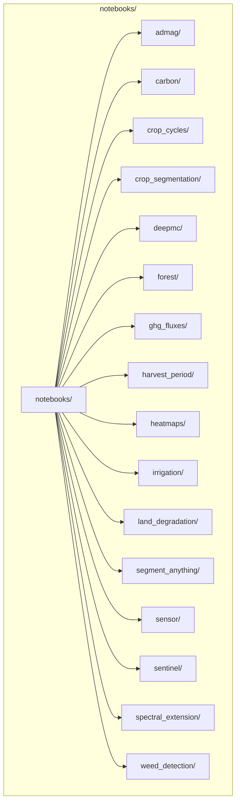
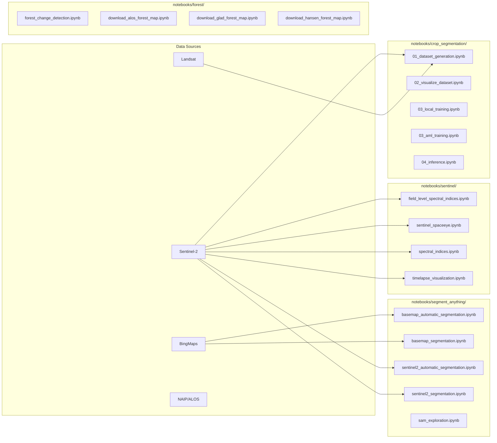
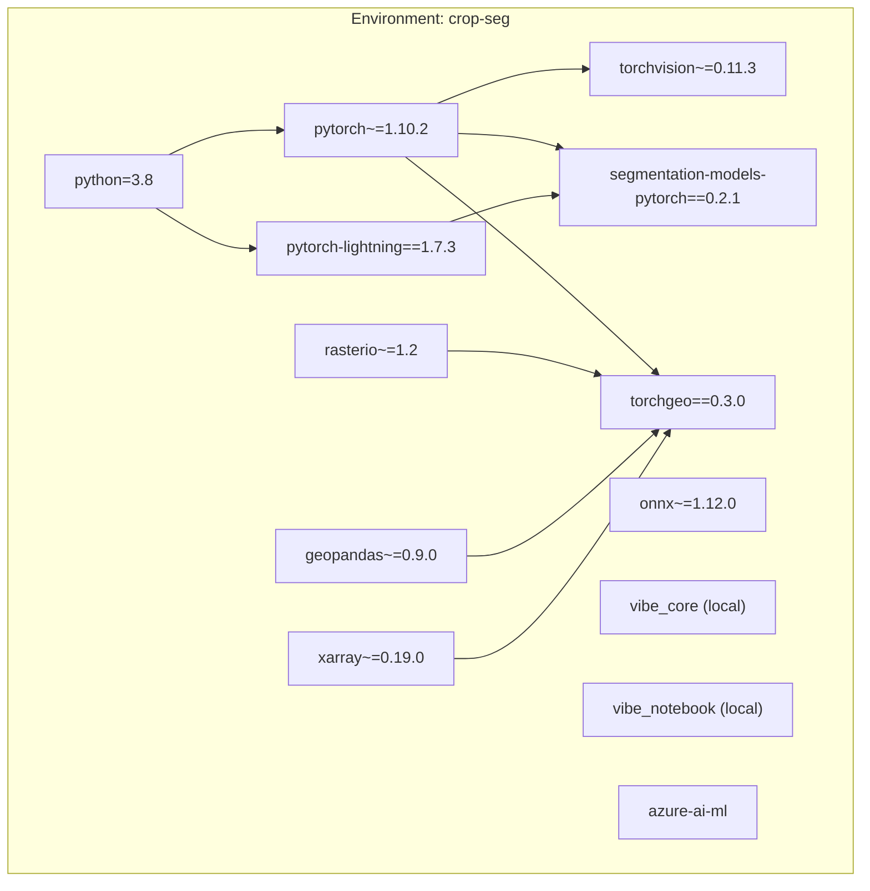
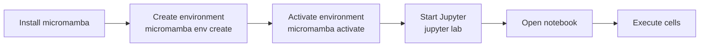

<!-- source: DeepWiki mcp.deepwiki.com · repo microsoft/farmvibes-ai · page 8.3 Notebook Catalog · fetched 2026-10-26 -->

# Notebook Catalog

<details>
<summary>Relevant source files</summary>

The following files were used as context for generating this wiki page:

- [docs/source/docfiles/markdown/NOTEBOOK_LIST.md](docs/source/docfiles/markdown/NOTEBOOK_LIST.md)
- [notebooks/README.md](notebooks/README.md)
- [notebooks/crop_segmentation/crop_env.yaml](notebooks/crop_segmentation/crop_env.yaml)

</details>


This reference page provides a complete catalog of all example notebooks available in FarmVibes.AI. Each notebook demonstrates specific workflows and capabilities of the platform. For guidance on running notebooks and setting up environments, see [Working with Notebooks](#5.1). For an overview of notebook categories and getting started, see [Example Notebooks](#6).

## Notebook Organization

FarmVibes.AI includes over 50 example notebooks organized in the [notebooks/]() directory. Each notebook demonstrates one or more workflows and may require specific environment configurations.

### Directory Structure



**Sources:** [notebooks/README.md:1-22](), [docs/source/docfiles/markdown/NOTEBOOK_LIST.md:1-447]()

### Environment Files

Notebooks use micromamba environments defined in YAML files. The base environment is `env.yaml` in the notebooks root, with specialized environments for specific use cases:

| Environment File | Purpose | Key Dependencies |
|-----------------|---------|------------------|
| `notebooks/env.yaml` | Base environment for most notebooks | `vibe_core`, `vibe_notebook`, raster processing |
| `notebooks/crop_segmentation/crop_env.yaml` | Crop segmentation workflows | PyTorch, torchvision, segmentation-models-pytorch, torchgeo |
| Additional environment files | Located in specific notebook directories | Varies by use case |

**Sources:** [notebooks/README.md:11-21](), [notebooks/crop_segmentation/crop_env.yaml:1-31]()

## Complete Notebook Catalog

### Getting Started

| Notebook | File Path | Description |
|----------|-----------|-------------|
| Hello World | [notebooks/helloworld.ipynb]() | Simple example of how to instantiate a client and run a workflow |
| Spectral indices | [notebooks/sentinel/spectral_indices.ipynb]() | Compute and visualize spectral indices from Sentinel-2 imagery |

**Sources:** [docs/source/docfiles/markdown/NOTEBOOK_LIST.md:14-22]()

### ADMAg - Microsoft Azure Data Manager for Agriculture

| Notebook | File Path | Description | Metadata |
|----------|-----------|-------------|----------|
| Carbon sequestration evaluation with ADMAg and COMET-Farm API | [notebooks/admag/azure_data_manager_for_agriculture_and_comet_farm_api_example.ipynb]() | Derive carbon sequestration information with COMET-Farm API using ADMAg to retrieve farming data | |
| Integration with ADMAg to compute NDVI summary | [notebooks/admag/azure_data_manager_for_agriculture_example.ipynb]() | Connecting FarmVibes.AI and Microsoft Azure Data Manager for Agriculture | |
| Nutrient Heatmap Estimation with ADMAg integration | [notebooks/heatmaps/nutrients_using_classification_admag.ipynb]() | Using soil samples retrieved with ADMAg, train a Random Forest model to estimate soil nutrient heatmap | ~1GB, <1 minute |

**Sources:** [docs/source/docfiles/markdown/NOTEBOOK_LIST.md:24-32]()

### BingMaps

| Notebook | File Path | Description |
|----------|-----------|-------------|
| Automatic Segmentation of BingMaps basemaps | [notebooks/segment_anything/basemap_automatic_segmentation.ipynb]() | Automatically segment BingMaps basemaps with SAM workflow |
| Segment Anything Model Workflow (BingMaps basemap) | [notebooks/segment_anything/basemap_segmentation.ipynb]() | Segment BingMaps basemaps with SAM workflow |

**Sources:** [docs/source/docfiles/markdown/NOTEBOOK_LIST.md:34-42]()

### Crop Analysis

| Notebook | File Path | Description |
|----------|-----------|-------------|
| Harvest and germination periods | [notebooks/harvest_period/ndvi_summary.ipynb]() | Infer harvest and germination periods from NDVI time series |
| Integration with ADMAg to compute NDVI summary | [notebooks/admag/azure_data_manager_for_agriculture_example.ipynb]() | Connecting FarmVibes.AI and ADMAg to compute crop NDVI summaries |

**Sources:** [docs/source/docfiles/markdown/NOTEBOOK_LIST.md:44-51]()

### Crop Land Segmentation

| Notebook | File Path | Description |
|----------|-----------|-------------|
| Crop land segmentation (1/4) - dataset generation | [notebooks/crop_segmentation/01_dataset_generation.ipynb]() | Generate a dataset based on NDVI and CDL rasters to train a crop land segmentation model |
| Crop land segmentation (2/4) - dataset visualization | [notebooks/crop_segmentation/02_visualize_dataset.ipynb]() | Visual exploration of the crop land segmentation dataset |
| Crop land segmentation (3/4) - local model training | [notebooks/crop_segmentation/03_local_training.ipynb]() | Train a crop land segmentation model locally |
| Crop land segmentation (3/4) - model training on Azure Machine Learning | [notebooks/crop_segmentation/03_aml_training.ipynb]() | Train a crop land segmentation model on Azure Machine Learning |
| Crop land segmentation (4/4) - inference | [notebooks/crop_segmentation/04_inference.ipynb]() | Infer crop land segmentation for new regions with a trained model |

**Sources:** [docs/source/docfiles/markdown/NOTEBOOK_LIST.md:53-66]()

### Deforestation

| Notebook | File Path | Description |
|----------|-----------|-------------|
| Detecting Forest Changes | [notebooks/forest/forest_change_detection.ipynb]() | Helps users to detect forest changes |
| Download ALOS forest extent maps | [notebooks/forest/download_alos_forest_map.ipynb]() | Download the ALOS (Advanced Land Observing Satellite) forest extent maps |
| Download Glad Forest Map | [notebooks/forest/download_glad_forest_map.ipynb]() | Download the Global Land Analysis (GLAD) forest extent maps |
| Download Global Forest Change (Hansen) maps | [notebooks/forest/download_hansen_forest_map.ipynb]() | Download and process the Global Forest Change (Hansen) maps |

**Sources:** [docs/source/docfiles/markdown/NOTEBOOK_LIST.md:68-79]()

### Index Computation

| Notebook | File Path | Description |
|----------|-----------|-------------|
| Crop cycle detection | [notebooks/crop_cycles/crop_cycles.ipynb]() | Run time-series analysis over NDVI data to detect the number of crop cycles in a year for a certain region |
| Field-level spectral indices | [notebooks/sentinel/field_level_spectral_indices.ipynb]() | Compute and visualize spectral indices over crop fields segmented from Sentinel-2 and SpaceEye imagery |
| Harvest and germination periods | [notebooks/harvest_period/ndvi_summary.ipynb]() | Infer harvest and germination periods from NDVI time series |
| Irrigation classification | [notebooks/irrigation/irrigation_classification.ipynb]() | Generate irrigation probability map using Landsat8 image and DEM data |
| Land degradation | [notebooks/land_degradation/land_degradation.ipynb]() | Compute NDVI trends on Landsat images and analyse precipitation data to detect land degradation |
| Nutrient Heatmap Estimation - Classification | [notebooks/heatmaps/nutrients_using_classification.ipynb]() | Using soil samples from a farm, train a Random Forest model to estimate a heatmap of soil nutrients |
| Nutrient Heatmap Estimation - Neighbors | [notebooks/heatmaps/nutrients_using_neighbors.ipynb]() | Estimate a heatmap of soil nutrients based on neighboring soil samples with location suggested by an optimal sensor placement workflow |
| Nutrient Heatmap Estimation with ADMAg integration | [notebooks/heatmaps/nutrients_using_classification_admag.ipynb]() | Using soil samples from a farm retrieved with ADMAg, train a Random Forest model to estimate a heatmap of soil nutrients |
| Optimal Sensor Placement | [notebooks/sensor/optimal_locations.ipynb]() | Find optimal sensor placement location using satellite imagery |
| Optimal Sensor Placement over Segmented Crop Field | [notebooks/sensor/optimal_locations_segmentation.ipynb]() | Segment a field with SAM over Sentinel-2 imagery and estimate optimal sensor placement |
| Spectral indices | [notebooks/sentinel/spectral_indices.ipynb]() | Compute and visualize spectral indices from Sentinel-2 imagery |
| Timelapse visualization | [notebooks/sentinel/timelapse_visualization.ipynb]() | Generate a timelapse of SpaceEye and NDVI rasters |

**Sources:** [docs/source/docfiles/markdown/NOTEBOOK_LIST.md:81-108]()

### Landsat

| Notebook | File Path | Description |
|----------|-----------|-------------|
| Irrigation classification | [notebooks/irrigation/irrigation_classification.ipynb]() | Generate irrigation probability map by running workflow that uses Landsat8 image and DEM data |
| Land degradation | [notebooks/land_degradation/land_degradation.ipynb]() | Compute NDVI trends on Landsat images and analyse precipitation data to detect land degradation |

**Sources:** [docs/source/docfiles/markdown/NOTEBOOK_LIST.md:110-117]()

### Model Training

| Notebook | File Path | Description |
|----------|-----------|-------------|
| Crop land segmentation (1/4) - dataset generation | [notebooks/crop_segmentation/01_dataset_generation.ipynb]() | Generate a dataset based on NDVI and CDL rasters to train a crop land segmentation model |
| Crop land segmentation (3/4) - local model training | [notebooks/crop_segmentation/03_local_training.ipynb]() | Train a crop land segmentation model locally |
| Crop land segmentation (3/4) - model training on Azure Machine Learning | [notebooks/crop_segmentation/03_aml_training.ipynb]() | Train a crop land segmentation model on Azure Machine Learning |
| Micro climate prediction | [notebooks/deepmc/mc_forecast.ipynb]() | Train a model to predict micro climate parameters given global weather information and local weather station data |
| Nutrient Heatmap Estimation - Classification | [notebooks/heatmaps/nutrients_using_classification.ipynb]() | Using soil samples, train a Random Forest model to estimate soil nutrient heatmap |
| Nutrient Heatmap Estimation - Neighbors | [notebooks/heatmaps/nutrients_using_neighbors.ipynb]() | Estimate soil nutrient heatmap based on neighboring soil samples |
| Nutrient Heatmap Estimation with ADMAg integration | [notebooks/heatmaps/nutrients_using_classification_admag.ipynb]() | Using ADMAg soil samples, train a Random Forest model to estimate soil nutrient heatmap |
| Optimal Sensor Placement | [notebooks/sensor/optimal_locations.ipynb]() | Find optimal sensor placement location using satellite imagery |
| Weed detection | [notebooks/weed_detection/weed_detection.ipynb]() | Train a Gaussian Mixture Model to group similar regions in a raster image affected by weed |

**Sources:** [docs/source/docfiles/markdown/NOTEBOOK_LIST.md:119-140]()

### ONNX Integration

| Notebook | File Path | Description |
|----------|-----------|-------------|
| Crop cycle detection | [notebooks/crop_cycles/crop_cycles.ipynb]() | Run time-series analysis over NDVI data to detect crop cycles |
| Crop land segmentation (3/4) - local model training | [notebooks/crop_segmentation/03_local_training.ipynb]() | Train a crop land segmentation model locally with ONNX export |
| Crop land segmentation (3/4) - model training on Azure Machine Learning | [notebooks/crop_segmentation/03_aml_training.ipynb]() | Train a crop land segmentation model on Azure ML with ONNX export |
| Crop land segmentation (4/4) - inference | [notebooks/crop_segmentation/04_inference.ipynb]() | Infer crop land segmentation using ONNX model |

**Sources:** [docs/source/docfiles/markdown/NOTEBOOK_LIST.md:142-153]()

### Remote Sensing



The Remote Sensing category includes 27 notebooks covering satellite imagery processing, segmentation, and analysis:

| Notebook | File Path | Primary Data Source |
|----------|-----------|---------------------|
| Automatic Segmentation of BingMaps basemaps | [notebooks/segment_anything/basemap_automatic_segmentation.ipynb]() | BingMaps |
| Automatic Segmentation of Sentinel-2 | [notebooks/segment_anything/sentinel2_automatic_segmentation.ipynb]() | Sentinel-2 |
| Crop cycle detection | [notebooks/crop_cycles/crop_cycles.ipynb]() | Sentinel-2 + SpaceEye |
| Crop land segmentation (1/4) - dataset generation | [notebooks/crop_segmentation/01_dataset_generation.ipynb]() | Sentinel-2, CDL |
| Crop land segmentation (2/4) - dataset visualization | [notebooks/crop_segmentation/02_visualize_dataset.ipynb]() | Generated dataset |
| Crop land segmentation (3/4) - local model training | [notebooks/crop_segmentation/03_local_training.ipynb]() | Generated dataset |
| Crop land segmentation (3/4) - model training on Azure Machine Learning | [notebooks/crop_segmentation/03_aml_training.ipynb]() | Generated dataset |
| Crop land segmentation (4/4) - inference | [notebooks/crop_segmentation/04_inference.ipynb]() | Sentinel-2 |
| Detecting Forest Changes | [notebooks/forest/forest_change_detection.ipynb]() | Multiple forest datasets |
| Download ALOS forest extent maps | [notebooks/forest/download_alos_forest_map.ipynb]() | ALOS |
| Download Glad Forest Map | [notebooks/forest/download_glad_forest_map.ipynb]() | GLAD |
| Download Global Forest Change (Hansen) maps | [notebooks/forest/download_hansen_forest_map.ipynb]() | Hansen GFC |
| Field boundary segmentation (SAM exploration) | [notebooks/segment_anything/sam_exploration.ipynb]() | Sentinel-2 |
| Field-level Irrigation Classification | [notebooks/irrigation/field_level_irrigation_classification.ipynb]() | Sentinel-2 + SAM |
| Field-level spectral indices | [notebooks/sentinel/field_level_spectral_indices.ipynb]() | Sentinel-2 + SpaceEye |
| Harvest and germination periods | [notebooks/harvest_period/ndvi_summary.ipynb]() | Sentinel-2 |
| Investigating Amazon Rainforest deforestation with SpaceEye | [notebooks/sentinel/sentinel_spaceeye.ipynb]() | Sentinel-2 + SpaceEye |
| Irrigation classification | [notebooks/irrigation/irrigation_classification.ipynb]() | Landsat-8, DEM |
| Land degradation | [notebooks/land_degradation/land_degradation.ipynb]() | Landsat, weather data |
| Optimal Sensor Placement over Segmented Crop Field | [notebooks/sensor/optimal_locations_segmentation.ipynb]() | Sentinel-2 + SAM |
| Segment Anything Model Workflow (BingMaps basemap) | [notebooks/segment_anything/basemap_segmentation.ipynb]() | BingMaps |
| Segment Anything Model Workflow (Sentinel-2) | [notebooks/segment_anything/sentinel2_segmentation.ipynb]() | Sentinel-2 |
| Spectral Extension | [notebooks/spectral_extension/spectral_extension.ipynb]() | Sentinel-2, drone imagery |
| Spectral indices | [notebooks/sentinel/spectral_indices.ipynb]() | Sentinel-2 |
| Timelapse visualization | [notebooks/sentinel/timelapse_visualization.ipynb]() | Sentinel-2 + SpaceEye |
| Weed detection | [notebooks/weed_detection/weed_detection.ipynb]() | Custom raster |

**Sources:** [docs/source/docfiles/markdown/NOTEBOOK_LIST.md:155-210]()

### Segment Anything Model

| Notebook | File Path | Description |
|----------|-----------|-------------|
| Automatic Segmentation of BingMaps basemaps | [notebooks/segment_anything/basemap_automatic_segmentation.ipynb]() | Automatically segment BingMaps basemaps with SAM workflow |
| Automatic Segmentation of Sentinel-2 | [notebooks/segment_anything/sentinel2_automatic_segmentation.ipynb]() | Automatically segment Sentinel-2 imagery with SAM workflow |
| Field boundary segmentation (SAM exploration) | [notebooks/segment_anything/sam_exploration.ipynb]() | Segment Anything Model exploration over FarmVibes.AI data to segment crop field boundaries |
| Field-level Irrigation Classification | [notebooks/irrigation/field_level_irrigation_classification.ipynb]() | Estimate an irrigation probability map over crop fields segmented with SAM |
| Field-level spectral indices | [notebooks/sentinel/field_level_spectral_indices.ipynb]() | Compute and visualize spectral indices over crop fields segmented from Sentinel-2 and SpaceEye imagery |
| Optimal Sensor Placement over Segmented Crop Field | [notebooks/sensor/optimal_locations_segmentation.ipynb]() | Segment a field with SAM over Sentinel-2 imagery and estimate optimal sensor placement for the segmented region |
| Segment Anything Model Workflow (BingMaps basemap) | [notebooks/segment_anything/basemap_segmentation.ipynb]() | Segment BingMaps basemaps with SAM workflow |
| Segment Anything Model Workflow (Sentinel-2) | [notebooks/segment_anything/sentinel2_segmentation.ipynb]() | Segment Sentinel-2 imagery with SAM workflow |

**Sources:** [docs/source/docfiles/markdown/NOTEBOOK_LIST.md:212-231]()

### Sentinel

| Notebook | File Path | Description |
|----------|-----------|-------------|
| Automatic Segmentation of Sentinel-2 | [notebooks/segment_anything/sentinel2_automatic_segmentation.ipynb]() | Automatically segment Sentinel-2 imagery with SAM workflow |
| Field boundary segmentation (SAM exploration) | [notebooks/segment_anything/sam_exploration.ipynb]() | Explore SAM over FarmVibes.AI data to segment crop field boundaries |
| Field-level spectral indices | [notebooks/sentinel/field_level_spectral_indices.ipynb]() | Compute and visualize spectral indices over crop fields segmented from Sentinel-2 and SpaceEye imagery |
| Investigating Amazon Rainforest deforestation with SpaceEye | [notebooks/sentinel/sentinel_spaceeye.ipynb]() | Download and preprocess Sentinel data to obtain cloud-free images using SpaceEye over the Amazon Rainforest |
| Nutrient Heatmap Estimation - Classification | [notebooks/heatmaps/nutrients_using_classification.ipynb]() | Using soil samples, train a Random Forest model to estimate soil nutrient heatmap |
| Nutrient Heatmap Estimation - Neighbors | [notebooks/heatmaps/nutrients_using_neighbors.ipynb]() | Estimate soil nutrient heatmap based on neighboring soil samples |
| Nutrient Heatmap Estimation with ADMAg integration | [notebooks/heatmaps/nutrients_using_classification_admag.ipynb]() | Using ADMAg soil samples, train a Random Forest model to estimate soil nutrient heatmap |
| Optimal Sensor Placement | [notebooks/sensor/optimal_locations.ipynb]() | Find optimal sensor placement location using satellite imagery |
| Optimal Sensor Placement over Segmented Crop Field | [notebooks/sensor/optimal_locations_segmentation.ipynb]() | Segment a field with SAM and estimate optimal sensor placement |
| Segment Anything Model Workflow (Sentinel-2) | [notebooks/segment_anything/sentinel2_segmentation.ipynb]() | Segment Sentinel-2 imagery with SAM workflow |
| Spectral Extension | [notebooks/spectral_extension/spectral_extension.ipynb]() | Generate high-resolution multispectral data by combining high-resolution drone imagery and multispectral Sentinel-2 data |
| Spectral indices | [notebooks/sentinel/spectral_indices.ipynb]() | Compute and visualize spectral indices from Sentinel-2 imagery |

**Sources:** [docs/source/docfiles/markdown/NOTEBOOK_LIST.md:233-260]()

### SpaceEye

| Notebook | File Path | Description |
|----------|-----------|-------------|
| Crop cycle detection | [notebooks/crop_cycles/crop_cycles.ipynb]() | Run time-series analysis over NDVI data to detect crop cycles |
| Field-level spectral indices | [notebooks/sentinel/field_level_spectral_indices.ipynb]() | Compute and visualize spectral indices over crop fields segmented from Sentinel-2 and SpaceEye imagery |
| Investigating Amazon Rainforest deforestation with SpaceEye | [notebooks/sentinel/sentinel_spaceeye.ipynb]() | Download and preprocess Sentinel data to obtain cloud-free images using SpaceEye over the Amazon Rainforest |
| Timelapse visualization | [notebooks/sentinel/timelapse_visualization.ipynb]() | Generate a timelapse of SpaceEye and NDVI rasters |

**Sources:** [docs/source/docfiles/markdown/NOTEBOOK_LIST.md:262-273]()

### Sustainability

| Notebook | File Path | Description | Metadata |
|----------|-----------|-------------|----------|
| Carbon sequestration evaluation with ADMAg and COMET-Farm API | [notebooks/admag/azure_data_manager_for_agriculture_and_comet_farm_api_example.ipynb]() | Derive carbon sequestration information with COMET-Farm API using ADMAg | |
| Detecting Forest Changes | [notebooks/forest/forest_change_detection.ipynb]() | Helps users to detect forest changes | |
| Download ALOS forest extent maps | [notebooks/forest/download_alos_forest_map.ipynb]() | Download the ALOS forest extent maps | |
| Download Glad Forest Map | [notebooks/forest/download_glad_forest_map.ipynb]() | Download the GLAD forest extent maps | |
| Download Global Forest Change (Hansen) maps | [notebooks/forest/download_hansen_forest_map.ipynb]() | Download and process the Hansen GFC maps | |
| Green House Gas fluxes | [notebooks/ghg_fluxes/ghg_fluxes.ipynb]() | Compute GHG emissions and sequestration for a given crop, location and time range | 30s |
| Nutrient Heatmap Estimation - Classification | [notebooks/heatmaps/nutrients_using_classification.ipynb]() | Using soil samples, train a Random Forest model to estimate soil nutrient heatmap | |
| Nutrient Heatmap Estimation - Neighbors | [notebooks/heatmaps/nutrients_using_neighbors.ipynb]() | Estimate soil nutrient heatmap based on neighboring soil samples | |
| Nutrient Heatmap Estimation with ADMAg integration | [notebooks/heatmaps/nutrients_using_classification_admag.ipynb]() | Using ADMAg soil samples, train a Random Forest model to estimate soil nutrient heatmap | |
| Optimal Sensor Placement | [notebooks/sensor/optimal_locations.ipynb]() | Find optimal sensor placement location using satellite imagery | |
| Optimal Sensor Placement over Segmented Crop Field | [notebooks/sensor/optimal_locations_segmentation.ipynb]() | Segment a field with SAM and estimate optimal sensor placement | |
| What-if analysis of carbon sequestration | [notebooks/carbon/whatif.ipynb]() | Derive carbon sequestration information with COMET-Farm API | |

**Sources:** [docs/source/docfiles/markdown/NOTEBOOK_LIST.md:275-302]()

### Time Series

| Notebook | File Path | Description |
|----------|-----------|-------------|
| Harvest and germination periods | [notebooks/harvest_period/ndvi_summary.ipynb]() | Infer harvest and germination periods from NDVI time series |

**Sources:** [docs/source/docfiles/markdown/NOTEBOOK_LIST.md:304-309]()

### Water Management

| Notebook | File Path | Description |
|----------|-----------|-------------|
| Field-level Irrigation Classification | [notebooks/irrigation/field_level_irrigation_classification.ipynb]() | Estimate an irrigation probability map over crop fields segmented with SAM |
| Irrigation classification | [notebooks/irrigation/irrigation_classification.ipynb]() | Generate irrigation probability map by running workflow that uses Landsat8 image and DEM data |

**Sources:** [docs/source/docfiles/markdown/NOTEBOOK_LIST.md:311-318]()

### Weather

| Notebook | File Path | Description |
|----------|-----------|-------------|
| Land degradation | [notebooks/land_degradation/land_degradation.ipynb]() | Compute NDVI trends on Landsat images and analyse precipitation data to detect land degradation |
| Micro climate prediction | [notebooks/deepmc/mc_forecast.ipynb]() | Train a model to predict micro climate parameters given global weather information and local weather station data |

**Sources:** [docs/source/docfiles/markdown/NOTEBOOK_LIST.md:320-327]()

### What-if Analysis

| Notebook | File Path | Description |
|----------|-----------|-------------|
| Carbon sequestration evaluation with ADMAg and COMET-Farm API | [notebooks/admag/azure_data_manager_for_agriculture_and_comet_farm_api_example.ipynb]() | Derive carbon sequestration information with COMET-Farm API using ADMAg |
| Green House Gas fluxes | [notebooks/ghg_fluxes/ghg_fluxes.ipynb]() | Compute GHG emissions and sequestration for a given crop, location and time range |
| What-if analysis of carbon sequestration | [notebooks/carbon/whatif.ipynb]() | Derive carbon sequestration information with COMET-Farm API |

**Sources:** [docs/source/docfiles/markdown/NOTEBOOK_LIST.md:329-338]()

### Working with Custom Workflows

| Notebook | File Path | Description |
|----------|-----------|-------------|
| Crop cycle detection | [notebooks/crop_cycles/crop_cycles.ipynb]() | Run time-series analysis over NDVI data to detect crop cycles |
| Crop land segmentation (1/4) - dataset generation | [notebooks/crop_segmentation/01_dataset_generation.ipynb]() | Generate a dataset based on NDVI and CDL rasters |
| Crop land segmentation (2/4) - dataset visualization | [notebooks/crop_segmentation/02_visualize_dataset.ipynb]() | Visual exploration of the crop land segmentation dataset |
| Integration with ADMAg to compute NDVI summary | [notebooks/admag/azure_data_manager_for_agriculture_example.ipynb]() | Connecting FarmVibes.AI and ADMAg |
| Nutrient Heatmap Estimation - Classification | [notebooks/heatmaps/nutrients_using_classification.ipynb]() | Using soil samples, train a Random Forest model to estimate soil nutrient heatmap |
| Nutrient Heatmap Estimation - Neighbors | [notebooks/heatmaps/nutrients_using_neighbors.ipynb]() | Estimate soil nutrient heatmap based on neighboring soil samples |
| Nutrient Heatmap Estimation with ADMAg integration | [notebooks/heatmaps/nutrients_using_classification_admag.ipynb]() | Using ADMAg soil samples, train a Random Forest model to estimate soil nutrient heatmap |
| Optimal Sensor Placement | [notebooks/sensor/optimal_locations.ipynb]() | Find optimal sensor placement location using satellite imagery |
| Spectral indices | [notebooks/sentinel/spectral_indices.ipynb]() | Compute and visualize spectral indices from Sentinel-2 imagery |
| Timelapse visualization | [notebooks/sentinel/timelapse_visualization.ipynb]() | Generate a timelapse of SpaceEye and NDVI rasters |

**Sources:** [docs/source/docfiles/markdown/NOTEBOOK_LIST.md:340-363]()

## Notebook Environment Setup

### Base Environment Installation

The base environment `env.yaml` enables running most notebooks. Create it using:

```bash
micromamba env create -f notebooks/env.yaml
```

This creates an environment named `farmvibes-ai` with core dependencies including `vibe_core` and `vibe_notebook`.

**Sources:** [notebooks/README.md:11-21]()

### Specialized Environments

Some notebooks require additional dependencies. For example, crop segmentation notebooks use `crop_env.yaml`:



Key dependencies in `crop_env.yaml`:
- **PyTorch ecosystem**: `pytorch`, `torchvision`, `pytorch-lightning` for deep learning
- **Geospatial libraries**: `rasterio`, `geopandas`, `xarray`, `rioxarray` for geospatial data handling
- **Segmentation models**: `segmentation-models-pytorch`, `torchgeo` for crop segmentation
- **Model export**: `onnx` for model portability
- **Azure integration**: `azure-ai-ml`, `azure-identity` for Azure ML training

**Sources:** [notebooks/crop_segmentation/crop_env.yaml:1-31]()

## Notebook Metadata

### Resource Requirements

Some notebooks include metadata about expected resource usage:

| Metadata Type | Example | Notebook |
|---------------|---------|----------|
| Disk space and time | ~1GB, <1 minute | [nutrients_using_classification_admag.ipynb]() |
| Execution time | 30s | [ghg_fluxes.ipynb]() |
| Execution time | ~10 minutes | [spectral_extension.ipynb]() |

These estimates are based on the recommended VM size for FarmVibes.AI deployment.

**Sources:** [docs/source/docfiles/markdown/NOTEBOOK_LIST.md:1-447]()

## Alphabetical Index

Complete alphabetical listing of all notebooks:

| Notebook Title | File Path |
|----------------|-----------|
| Automatic Segmentation of BingMaps basemaps | [notebooks/segment_anything/basemap_automatic_segmentation.ipynb]() |
| Automatic Segmentation of Sentinel-2 | [notebooks/segment_anything/sentinel2_automatic_segmentation.ipynb]() |
| Carbon sequestration evaluation with Microsoft Azure Data Manager for Agriculture (ADMAg) and COMET-Farm API | [notebooks/admag/azure_data_manager_for_agriculture_and_comet_farm_api_example.ipynb]() |
| Crop cycle detection | [notebooks/crop_cycles/crop_cycles.ipynb]() |
| Crop land segmentation (1/4) - dataset generation | [notebooks/crop_segmentation/01_dataset_generation.ipynb]() |
| Crop land segmentation (2/4) - dataset visualization | [notebooks/crop_segmentation/02_visualize_dataset.ipynb]() |
| Crop land segmentation (3/4) - local model training | [notebooks/crop_segmentation/03_local_training.ipynb]() |
| Crop land segmentation (3/4) - model training on Azure Machine Learning | [notebooks/crop_segmentation/03_aml_training.ipynb]() |
| Crop land segmentation (4/4) - inference | [notebooks/crop_segmentation/04_inference.ipynb]() |
| Detecting Forest Changes | [notebooks/forest/forest_change_detection.ipynb]() |
| Download ALOS forest extent maps | [notebooks/forest/download_alos_forest_map.ipynb]() |
| Download Glad Forest Map | [notebooks/forest/download_glad_forest_map.ipynb]() |
| Download Global Forest Change (Hansen) maps | [notebooks/forest/download_hansen_forest_map.ipynb]() |
| Field boundary segmentation (SAM exploration) | [notebooks/segment_anything/sam_exploration.ipynb]() |
| Field-level Irrigation Classification | [notebooks/irrigation/field_level_irrigation_classification.ipynb]() |
| Field-level spectral indices | [notebooks/sentinel/field_level_spectral_indices.ipynb]() |
| Green House Gas fluxes | [notebooks/ghg_fluxes/ghg_fluxes.ipynb]() |
| Harvest and germination periods | [notebooks/harvest_period/ndvi_summary.ipynb]() |
| Hello World | [notebooks/helloworld.ipynb]() |
| Integration with ADMAg to compute NDVI summary | [notebooks/admag/azure_data_manager_for_agriculture_example.ipynb]() |
| Investigating Amazon Rainforest deforestation with SpaceEye | [notebooks/sentinel/sentinel_spaceeye.ipynb]() |
| Irrigation classification | [notebooks/irrigation/irrigation_classification.ipynb]() |
| Land degradation | [notebooks/land_degradation/land_degradation.ipynb]() |
| Micro climate prediction | [notebooks/deepmc/mc_forecast.ipynb]() |
| Nutrient Heatmap Estimation - Classification | [notebooks/heatmaps/nutrients_using_classification.ipynb]() |
| Nutrient Heatmap Estimation - Neighbors | [notebooks/heatmaps/nutrients_using_neighbors.ipynb]() |
| Nutrient Heatmap Estimation with ADMAg integration | [notebooks/heatmaps/nutrients_using_classification_admag.ipynb]() |
| Optimal Sensor Placement | [notebooks/sensor/optimal_locations.ipynb]() |
| Optimal Sensor Placement over Segmented Crop Field | [notebooks/sensor/optimal_locations_segmentation.ipynb]() |
| Segment Anything Model Workflow (BingMaps basemap) | [notebooks/segment_anything/basemap_segmentation.ipynb]() |
| Segment Anything Model Workflow (Sentinel-2) | [notebooks/segment_anything/sentinel2_segmentation.ipynb]() |
| Spectral Extension | [notebooks/spectral_extension/spectral_extension.ipynb]() |
| Spectral indices | [notebooks/sentinel/spectral_indices.ipynb]() |
| Timelapse visualization | [notebooks/sentinel/timelapse_visualization.ipynb]() |
| Weed detection | [notebooks/weed_detection/weed_detection.ipynb]() |
| What-if analysis of carbon sequestration | [notebooks/carbon/whatif.ipynb]() |

**Sources:** [docs/source/docfiles/markdown/NOTEBOOK_LIST.md:373-446]()

## Using Notebooks

### Basic Workflow



**Sources:** [notebooks/README.md:1-21]()

### Environment Selection

Different notebooks require different environments based on their dependencies:

- **Base notebooks**: Use `farmvibes-ai` environment from `notebooks/env.yaml`
- **Crop segmentation**: Use `crop-seg` environment from `notebooks/crop_segmentation/crop_env.yaml`
- **Custom notebooks**: Check for environment files in the notebook's directory

For detailed instructions on notebook execution and troubleshooting, see [Working with Notebooks](#5.1).

**Sources:** [notebooks/README.md:1-22](), [notebooks/crop_segmentation/crop_env.yaml:1-31]()