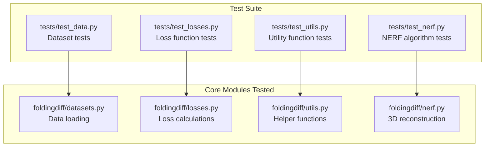
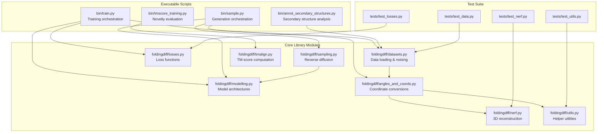
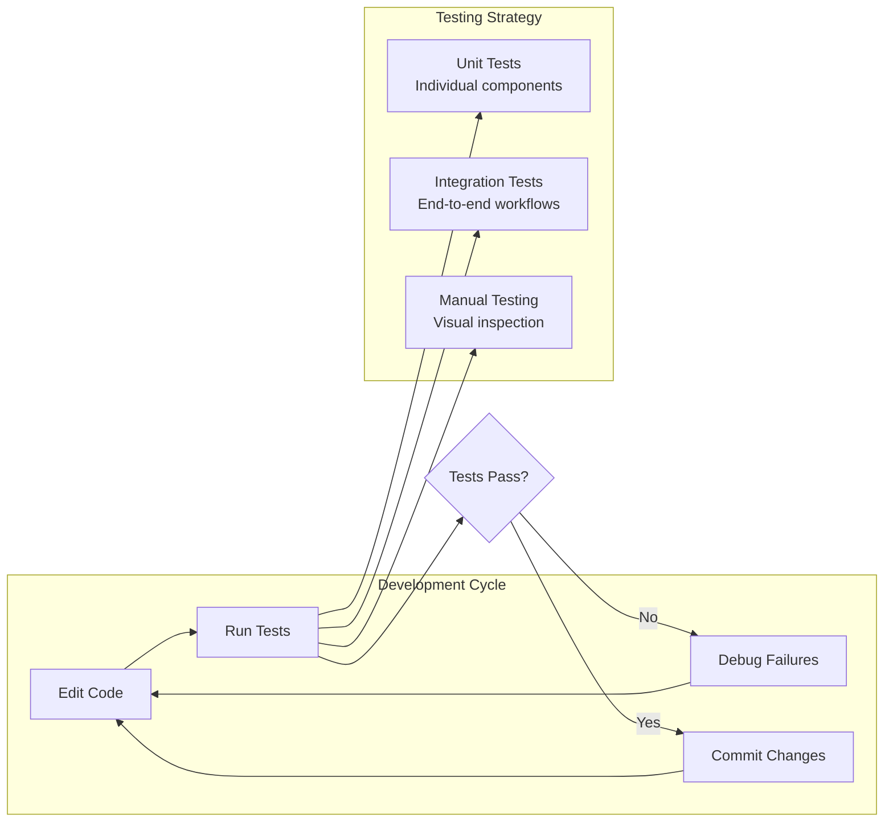

<!-- source: DeepWiki mcp.deepwiki.com · repo microsoft/foldingdiff · page 10 Development Guide · fetched 2026-10-26 -->

# Development Guide

<details>
<summary>Relevant source files</summary>

The following files were used as context for generating this wiki page:

- [.gitignore](.gitignore)
- [tests/test_data.py](tests/test_data.py)
- [tests/test_losses.py](tests/test_losses.py)
- [tests/test_utils.py](tests/test_utils.py)

</details>


This document provides resources for developers working on the FoldingDiff codebase. It covers the testing infrastructure, utility modules, development workflows, and guidelines for contributing to the project. This page focuses on the technical aspects of development rather than usage.

For information about training models, see [Training](#6). For sampling and generation, see [Generation and Sampling](#7). For analysis tools, see [Advanced Topics](#9).

## Testing Infrastructure

The FoldingDiff codebase includes a comprehensive test suite located in the `tests/` directory. The tests validate core functionality including data loading, loss functions, utility functions, and the NERF reconstruction algorithm.

### Test Suite Organization



**Test Coverage by Module**

| Test File | Module Tested | Test Classes | Key Focus Areas |
|-----------|--------------|--------------|-----------------|
| `test_data.py` | `datasets.py` | `TestCathCanonical`, `TestCathCanonicalAnglesOnly`, `TestNoisedDataset` | Data shapes, angle ranges, noising process |
| `test_losses.py` | `losses.py` | `TestRadianSmoothL1Loss`, `TestPairwiseDistLoss` | Angular wrapping, loss symmetry, masking |
| `test_utils.py` | `utils.py` | `TestModuloWithWrappedRange`, `TestTolerantComparison` | Modulo operations, numerical comparisons |
| `test_nerf.py` | `nerf.py` | (Various) | 3D coordinate reconstruction |

Sources: [tests/test_data.py:1-169](), [tests/test_losses.py:1-209](), [tests/test_utils.py:1-108]()

### Dataset Tests

The `TestCathCanonical` class validates the `CathCanonicalAnglesDataset` functionality:

- **Shape validation**: [tests/test_data.py:38-46]() verifies returned tensors have expected dimensions (pad length × number of features)
- **Feature counts**: [tests/test_data.py:33-36]() checks that 9 features are returned (6 angles + 3 distances)
- **Angular ranges**: [tests/test_data.py:47-52]() ensures all angular features fall within [-π, π]
- **Return keys**: [tests/test_data.py:25-31]() validates dictionary contains `angles`, `coords`, `position_ids`, `attn_mask`, `lengths`

The `TestCathCanonicalAnglesOnly` class tests the angles-only variant:

- **Feature filtering**: [tests/test_data.py:77-80]() confirms only 6 angular features are returned (distances removed)
- **Angular flags**: [tests/test_data.py:82-84]() verifies all features are marked as angular
- **Repeated initialization**: [tests/test_data.py:101-115]() ensures dataset can be initialized multiple times without conflicts
- **Repeated queries**: [tests/test_data.py:117-125]() validates deterministic behavior on multiple queries
- **Zero centering**: [tests/test_data.py:127-135]() tests optional zero-centering functionality

The `TestNoisedDataset` class validates noise application:

- **Deterministic base**: [tests/test_data.py:150-154]() ensures the underlying clean data is consistent across queries
- **Noise reconstruction**: [tests/test_data.py:156-168]() verifies that angles can be recovered by removing noise with correct scaling factors

Sources: [tests/test_data.py:14-169]()

### Loss Function Tests

The `TestRadianSmoothL1Loss` class extensively tests angular loss computation:

**Wrapping behavior**:
- [tests/test_losses.py:10-15]() validates basic wrapping around 2π
- [tests/test_losses.py:17-25]() tests wrapping for values near ±π boundaries
- [tests/test_losses.py:62-71]() confirms differences of 2π are always zero

**Symmetry and invariance**:
- [tests/test_losses.py:125-135]() verifies loss is symmetric: `loss(x, y) = loss(y, x)`
- [tests/test_losses.py:73-87]() tests that shifting by 2π doesn't change loss

**Edge cases**:
- [tests/test_losses.py:36-42]() tests when both values are positive
- [tests/test_losses.py:43-51]() tests negative/positive combinations
- [tests/test_losses.py:137-144]() validates specific numeric examples

The `TestPairwiseDistLoss` class tests coordinate distance loss:

- **Shift invariance**: [tests/test_losses.py:158-162]() confirms loss is translation-invariant
- **Length masking**: [tests/test_losses.py:164-181]() validates proper masking of padded positions
- **Zero for identity**: [tests/test_losses.py:195-198]() verifies zero loss for identical inputs (up to shift)
- **Symmetry**: [tests/test_losses.py:200-204]() confirms `loss(x, y) = loss(y, x)`

Sources: [tests/test_losses.py:9-205]()

### Utility Function Tests

The `TestModuloWithWrappedRange` class validates the custom modulo operation used for angular wrapping:

- **Basic wrapping**: [tests/test_utils.py:11-19]() tests simple cases
- **Negative values**: [tests/test_utils.py:21-29]() validates wrapping for negative inputs
- **Array handling**: [tests/test_utils.py:46-54]() confirms function works with numpy arrays

The `TestTolerantComparison` class tests numerical comparison with floating-point tolerance:

- **Comparison operators**: [tests/test_utils.py:60-78]() validates `>=` and `<=` operators
- **Negative values**: [tests/test_utils.py:80-98]() tests with negative numbers
- **Edge cases**: [tests/test_utils.py:100-103]() validates comparisons near -π boundary

Sources: [tests/test_utils.py:8-105]()

## Running Tests

Tests are implemented using Python's `unittest` framework. To run the test suite:

```bash
# Run all tests
python -m unittest discover tests/

# Run specific test file
python -m unittest tests.test_data

# Run specific test class
python -m unittest tests.test_data.TestCathCanonical

# Run specific test method
python -m unittest tests.test_data.TestCathCanonical.test_angles
```

Tests use caching where appropriate to avoid recomputing expensive operations. For example, [tests/test_data.py:23]() enables dataset caching with `use_cache=True`.

Sources: [tests/test_data.py:1-7](), [tests/test_losses.py:1-7](), [tests/test_utils.py:1-6]()

## Code Organization



**Design Principles**:

1. **Separation of concerns**: Executable scripts in `bin/` orchestrate workflows; reusable logic in `foldingdiff/`
2. **Modularity**: Core functionality separated into focused modules (data, models, losses, sampling)
3. **Testability**: Unit tests validate individual components independently
4. **Type safety**: Use of PyTorch tensors and numpy arrays with consistent shapes

Sources: [tests/test_data.py:11](), [tests/test_losses.py:6](), [tests/test_utils.py:5]()

## Key Utility Modules

### modulo_with_wrapped_range

The `modulo_with_wrapped_range` function handles angular wrapping for arbitrary ranges. It's essential for maintaining angles within [-π, π]:

**Function signature**: `modulo_with_wrapped_range(x, range_min, range_max)`

**Purpose**: Wraps values to fall within a specified range, handling both positive and negative ranges

**Use cases**:
- Wrapping predicted angles back to [-π, π] range
- Recovering angles from noised values [tests/test_data.py:166]()
- Ensuring angular features stay within bounds

**Test coverage**: [tests/test_utils.py:8-54]()

### tolerant_comparison_check

The `tolerant_comparison_check` function performs numerical comparisons with floating-point tolerance:

**Function signature**: `tolerant_comparison_check(array, operator, threshold)`

**Purpose**: Handles numerical comparisons that account for floating-point precision issues

**Use cases**:
- Validating angle ranges are within bounds [tests/test_data.py:51-52]()
- Checking that values meet thresholds despite floating-point errors

**Test coverage**: [tests/test_utils.py:57-103]()

Sources: [tests/test_utils.py:8-105]()

## Development Workflow



**Best practices**:

1. **Run tests before committing**: Ensure all tests pass before pushing changes
2. **Add tests for new features**: Write tests alongside new functionality
3. **Test edge cases**: Include boundary conditions and error cases
4. **Use caching strategically**: Enable dataset caching in tests to speed up execution
5. **Validate tensor shapes**: Always check that returned tensors have expected dimensions

Sources: [tests/test_data.py:1-169](), [tests/test_losses.py:1-209](), [tests/test_utils.py:1-108]()

## Version Control

The `.gitignore` file specifies which files should not be tracked:

**Data files**:
- `*.pkl` - Cached dataset files
- `data/cath/*` - CATH database PDB files
- `data/alphafold/*.pdb.gz` - AlphaFold prediction files

**Development files**:
- `.vscode/*` - Editor configurations
- `__pycache__/` - Python bytecode
- `.ipynb_checkpoints` - Jupyter notebook checkpoints
- `.pytest_cache/` - Test cache

**Build artifacts**:
- `build/`, `dist/`, `*.egg-info/` - Package build files

This ensures large data files and environment-specific configurations don't pollute the repository.

Sources: [.gitignore:1-167]()

## Common Development Tasks

### Adding a New Dataset Class

When adding a new dataset variant:

1. Inherit from `CathCanonicalAnglesDataset` or `CathCanonicalAnglesOnlyDataset`
2. Override `__getitem__` to customize data loading
3. Set `feature_names` and `feature_is_angular` dictionaries
4. Add corresponding tests in `tests/test_data.py`
5. Validate shapes, ranges, and return keys

Example test structure from [tests/test_data.py:55-136]():
```python
class TestYourDataset(unittest.TestCase):
    def setUp(self):
        self.dset = YourDataset(pad=128)
    
    def test_return_keys(self):
        # Check dictionary keys
        
    def test_shapes(self):
        # Validate tensor dimensions
        
    def test_angular_range(self):
        # Ensure angles in [-π, π]
```

### Adding a New Loss Function

When implementing a new loss:

1. Add function to `foldingdiff/losses.py`
2. Handle angular vs non-angular features appropriately
3. Support masking for variable-length sequences
4. Create test class in `tests/test_losses.py`
5. Test symmetry, shift invariance, and edge cases

Example test structure from [tests/test_losses.py:9-145]():
```python
class TestYourLoss(unittest.TestCase):
    def test_symmetric(self):
        # Verify loss(x, y) == loss(y, x)
        
    def test_zero_on_identical(self):
        # Check zero loss for identical inputs
        
    def test_masking(self):
        # Validate length masking works
```

### Adding a New Utility Function

When adding utilities:

1. Add function to `foldingdiff/utils.py`
2. Write comprehensive tests in `tests/test_utils.py`
3. Test with both scalar and array inputs
4. Include edge cases and boundary conditions

Example test structure from [tests/test_utils.py:8-54]():
```python
class TestYourUtility(unittest.TestCase):
    def test_simple_case(self):
        # Basic functionality
        
    def test_edge_case(self):
        # Boundary conditions
        
    def test_array_input(self):
        # Handle numpy arrays
```

Sources: [tests/test_data.py:14-169](), [tests/test_losses.py:9-209](), [tests/test_utils.py:8-108]()

## Testing Best Practices

### Determinism

Ensure tests produce consistent results:
- Use fixed random seeds when needed
- Cache expensive computations [tests/test_data.py:23]()
- Test that repeated queries return identical results [tests/test_data.py:117-125]()

### Numerical Precision

Handle floating-point comparisons carefully:
- Use `assertAlmostEqual` with appropriate precision [tests/test_losses.py:15]()
- Use `torch.allclose` for tensor comparisons [tests/test_data.py:125]()
- Apply tolerances for boundary checks [tests/test_utils.py:62]()

### Test Independence

Keep tests independent:
- Use `setUp` methods for per-test initialization [tests/test_data.py:19-23]()
- Don't rely on test execution order
- Clean up any created files or state

### Meaningful Assertions

Write clear, specific assertions:
- Check exact values when possible [tests/test_data.py:36]()
- Validate both positive and negative cases [tests/test_losses.py:158-162]()
- Test that mutations change results when expected [tests/test_losses.py:173-181]()

Sources: [tests/test_data.py:1-169](), [tests/test_losses.py:1-209](), [tests/test_utils.py:1-108]()

## Summary

The FoldingDiff codebase follows software engineering best practices with comprehensive testing, modular architecture, and clear separation of concerns. The test suite validates core functionality including data loading, loss computation, and utility operations. Developers should run tests frequently, add tests for new features, and follow the established patterns for dataset classes, loss functions, and utilities.

For specific subsystem details:
- Testing infrastructure: See [Testing](#10.1)
- Utility functions: See [Utility Functions](#10.2)
- Custom metrics: See [Custom Metrics](#10.3)

---

