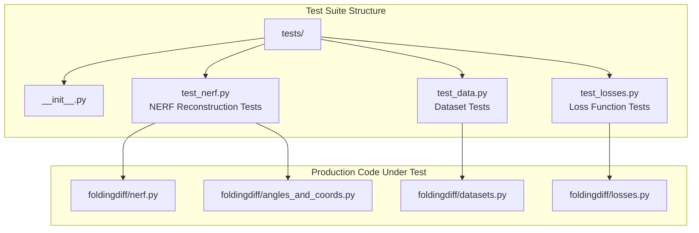
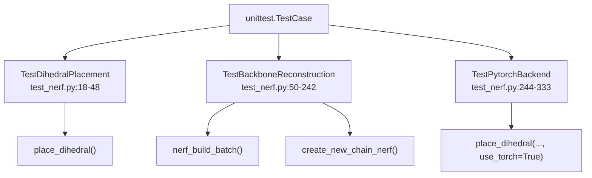
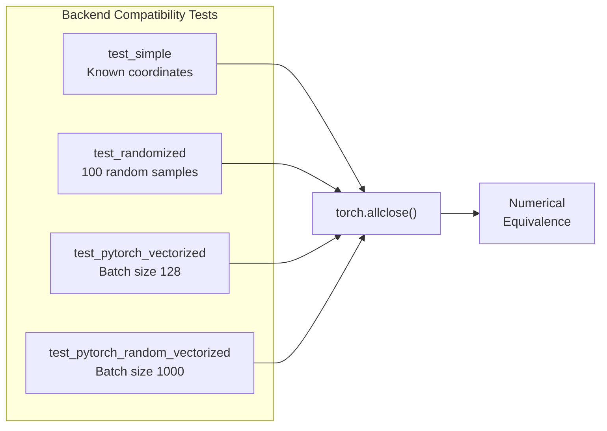
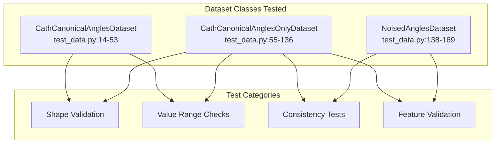
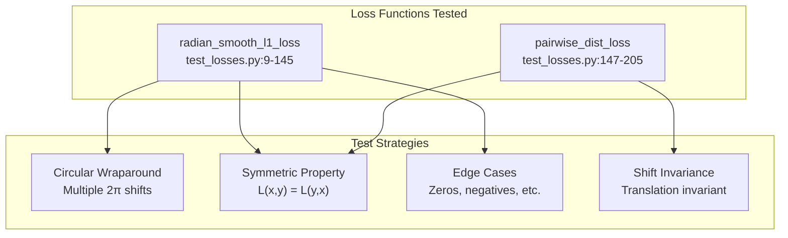
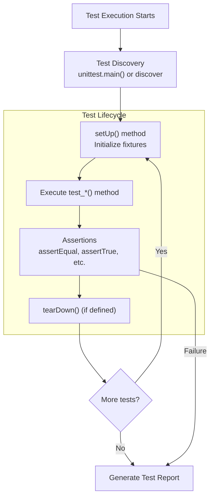

<!-- source: DeepWiki mcp.deepwiki.com · repo microsoft/foldingdiff · page 10.1 Testing · fetched 2026-10-26 -->

# Testing

<details>
<summary>Relevant source files</summary>

The following files were used as context for generating this wiki page:

- [.gitignore](.gitignore)
- [foldingdiff/nerf.py](foldingdiff/nerf.py)
- [tests/__init__.py](tests/__init__.py)
- [tests/test_data.py](tests/test_data.py)
- [tests/test_losses.py](tests/test_losses.py)
- [tests/test_nerf.py](tests/test_nerf.py)

</details>


This page documents the test suite for FoldingDiff, covering unit tests for core functionality including NERF coordinate reconstruction, dataset processing, and loss functions. The tests verify correctness of mathematical operations, data transformations, and ensure consistency across different computational backends (NumPy and PyTorch). For information about evaluation metrics like TM-scores and designability, see [TM-Score and Novelty Assessment](#8.1) and [Designability Testing](#8.2).

## Test Organization

The test suite is organized into three main test modules under the `tests/` directory, each focusing on a specific component of the system:



**Test Framework**: All tests use Python's standard `unittest` framework with test classes inheriting from `unittest.TestCase`.

**Test Fixtures**: The test suite includes two sample PDB files for testing reconstruction:
- `data/1CRN.pdb` - 46 residue crambin structure
- `data/7PFL.pdb` - Longer protein structure for comprehensive testing

Sources: [tests/test_nerf.py:1-18](), [tests/test_data.py:1-12](), [tests/test_losses.py:1-7]()

## NERF Reconstruction Tests

The NERF tests verify that the Natural Extension of Reference Frame algorithm correctly converts internal coordinates to 3D Cartesian coordinates and back. These tests are critical for ensuring generated angles can be properly reconstructed into valid protein structures.

### Test Class Hierarchy



Sources: [tests/test_nerf.py:18-333]()

### TestDihedralPlacement

This class tests the fundamental `place_dihedral` function, which computes the position of a fourth atom given three reference atoms and geometric constraints.

| Test Method | Purpose | Validation Criteria |
|------------|---------|---------------------|
| `test_simple` | Basic placement about origin | Verifies known coordinates match computed placement |
| `test_randomized` | Randomized geometric configurations | Tests 100 random placements using biotite's dihedral calculation |

**Key Test Pattern**: [tests/test_nerf.py:35-47]() demonstrates the randomized testing approach:
1. Generate random coordinates for atoms a, b, c, d
2. Extract actual bond angle, length, and dihedral from d's position
3. Verify `place_dihedral` reconstructs d correctly

Sources: [tests/test_nerf.py:18-48]()

### TestBackboneReconstruction

This class validates full backbone reconstruction from angular features, testing both exhaustive (all angles/distances) and minimal (phi, psi, omega only) feature sets.

**Test Configuration**:
- Exhaustive angles: `["phi", "psi", "omega", "tau", "CA:C:1N", "C:1N:1CA"]`
- Exhaustive distances: `["0C:1N", "N:CA", "CA:C"]`
- Minimal angles: `["phi", "psi", "omega"]`
- Minimal distances: `[]` (empty - use default bond lengths)

| Test Method | Feature Set | Expected TM-Score | Key Validation |
|------------|-------------|-------------------|----------------|
| `test_full_reconstruction` | Exhaustive | 1.0 (exact) | Perfect reconstruction with all features |
| `test_full_reconstruction_with_centering` | Exhaustive | 1.0 (exact) | Centering preserves structure |
| `test_minimal_reconstruction` | Minimal | > 0.5 | Reasonable reconstruction with basic angles |
| `test_batch_reconstruction` | Exhaustive | > 0.95 per sample | Batch processing works correctly |
| `test_batch_reconstruction_diff_len` | Exhaustive | > 0.95 per sample | Handles variable-length with NaN padding |

**Batch Reconstruction Testing**: [tests/test_nerf.py:131-177]() validates the `nerf_build_batch` function:
- Creates batch of 64 identical structures
- Verifies output shape is `(batch_size, length * 3, 3)`
- Each reconstructed structure scores TM > 0.95 against original

**Variable-Length Batch Testing**: [tests/test_nerf.py:178-242]() tests the critical capability of handling different sequence lengths:
- Uses NaN padding for shorter sequences
- Filters NaN values before writing PDB: `coords[np.all(~np.isnan(coords), axis=1)]`
- Ensures both sequences reconstruct accurately

Sources: [tests/test_nerf.py:50-242]()

### TestPytorchBackend

These tests ensure the PyTorch implementation of NERF produces identical results to the NumPy implementation, critical for differentiability during training.



**Vectorization Testing**: [tests/test_nerf.py:308-332]() tests batch computation with 1000 random samples, validating that vectorized operations produce identical results to element-wise operations.

Sources: [tests/test_nerf.py:244-333]()

## Dataset Tests

The dataset tests ensure data loaders return properly formatted tensors with correct shapes, value ranges, and consistent behavior across repeated queries.

### Dataset Test Coverage



Sources: [tests/test_data.py:14-169]()

### TestCathCanonical

Tests for the base `CathCanonicalAnglesDataset` class which includes both angular and distance features.

**Setup**: [tests/test_data.py:19-23]()
- Pad length: 512 residues
- Uses caching (`use_cache=True`) to avoid recomputing on each test run

| Test Method | Validation |
|------------|------------|
| `test_return_keys` | Verifies dictionary contains: `["angles", "coords", "position_ids", "attn_mask", "lengths"]` |
| `test_num_feature` | Confirms 9 features (6 angles + 3 distances) |
| `test_shapes` | Validates tensor shapes match padding length |
| `test_angles` | Ensures angular features stay within [-π, π] range |

**Angular Range Validation**: [tests/test_data.py:47-52]() demonstrates feature-aware testing:
```python
angular_idx = np.where(self.dset.feature_is_angular["angles"])[0]
self.assertTrue(np.all(d["angles"].numpy()[..., angular_idx] >= -np.pi))
self.assertTrue(np.all(d["angles"].numpy()[..., angular_idx] <= np.pi))
```

Sources: [tests/test_data.py:14-53]()

### TestCathCanonicalAnglesOnly

Tests for the angles-only variant that excludes distance features.

**Key Distinctions from Base Class**:
- Returns 6 features instead of 9 (angles only)
- All features are angular (`feature_is_angular` all True)
- Supports zero-centering option

| Test Method | Purpose |
|------------|---------|
| `test_all_angular` | Confirms all features have angular property |
| `test_repeated_init` | Validates multiple initializations don't corrupt state |
| `test_repeated_query` | Ensures consistent results for same index |
| `test_repeated_query_zero_center` | Validates zero-centering consistency |

**Consistency Testing**: [tests/test_data.py:117-135]() verifies that repeated queries return identical tensors using `torch.allclose`.

Sources: [tests/test_data.py:55-136]()

### TestNoisedDataset

Tests the `NoisedAnglesDataset` wrapper that applies forward diffusion noise to clean angles.

**Test Setup**: [tests/test_data.py:143-148]()
- Creates clean dataset with `zero_center=True` and `trim_strategy="leftalign"`
- Wraps in `NoisedAnglesDataset` for noise application

**Critical Tests**:

1. **Repeated Query Consistency**: [tests/test_data.py:150-154]() - Ensures the same unnoised starting point is used for repeated queries (noise is sampled fresh each time, but original angles are consistent)

2. **Angle Reconstruction**: [tests/test_data.py:156-168]() - Validates the diffusion mathematics:
   ```
   x_0 = (x_t - √(1-ᾱ_t) * ε) / √ᾱ_t
   ```
   This test verifies that given the noised angles, known noise, and alpha values, the original angles can be recovered (with modulo wrapping).

Sources: [tests/test_data.py:138-169]()

## Loss Function Tests

Loss function tests ensure correct computation of custom loss functions designed for angular and spatial data, including proper handling of circular/periodic angular values.

### Loss Function Test Structure



Sources: [tests/test_losses.py:9-205]()

### TestRadianSmoothL1Loss

This extensive test class validates the circular-aware smooth L1 loss used for angular predictions. The key challenge is that angles wrap around at ±π, so a prediction of -3.14 should be close to +3.14.

**Core Test Categories**:

| Category | Example Tests | Key Property Tested |
|----------|--------------|---------------------|
| Basic wrapping | `test_easy`, `test_rounding` | Loss correctly handles 2π wrapping |
| Zero handling | `test_zeros` | Any multiple of 2π apart gives zero loss |
| Sign variations | `test_neg_pos`, `test_neg_pos_2` | Works across positive/negative boundaries |
| Shift invariance | `test_loop_*` series | Loss invariant under adding 2πk to inputs |
| Symmetry | `test_symmetric` | L(x,y) = L(y,x) for all x,y |

**Shift Invariance Test Pattern**: [tests/test_losses.py:73-87]() demonstrates robust testing:
```python
for i in range(-10, 10):
    for j in range(-10, 10):
        l = losses.radian_smooth_l1_loss(
            x + i * 2 * np.pi, y + j * 2 * np.pi, beta=0.1
        )
        self.assertAlmostEqual(expected_value, l.item(), places=4)
```
This validates that the loss is truly invariant to adding any multiple of 2π to either input.

**Randomized Symmetry Test**: [tests/test_losses.py:125-135]() tests 100 random value pairs across a wide range (-200π to 200π) to ensure symmetry holds universally.

Sources: [tests/test_losses.py:9-145]()

### TestPairwiseDistLoss

Tests the pairwise distance loss used for structural similarity, which compares pairwise distances between atoms rather than absolute coordinates.

**Test Setup**: [tests/test_losses.py:152-156]() creates:
- Random input coordinates: shape `(128, 48, 3)` (batch, length, xyz)
- Random target coordinates: same shape
- Random lengths: integers in [1, 48) to test masking

**Critical Properties Tested**:

| Test Method | Property | Validation |
|------------|----------|------------|
| `test_shift_invariance` | Translation invariance | `loss(x, y) = loss(x+1, y+100)` |
| `test_length_masking_eq` | Correct masking | Mutating beyond mask doesn't change loss |
| `test_length_masking_neq` | Mask enforcement | Mutating within mask does change loss |
| `test_reduce_on_closer_match` | Sensitivity | Loss decreases as structures become more similar |
| `test_zero_on_identical` | Identity property | `loss(x, x+shift) = 0` |
| `test_symmetric` | Symmetry | `loss(x, y) = loss(y, x)` |

**Shift Invariance Mechanism**: [tests/test_losses.py:158-162]() confirms that pairwise distance loss only depends on relative positions, not absolute coordinates - critical for structural comparison.

**Length Masking**: [tests/test_losses.py:164-181]() validates that the loss correctly uses length tensors to ignore padding positions, ensuring variable-length sequences are handled properly.

Sources: [tests/test_losses.py:147-205]()

## Running Tests

### Execution Methods

The test suite can be executed in several ways:

**Method 1: Run all tests**
```bash
python -m unittest discover tests/
```

**Method 2: Run specific test module**
```bash
python -m unittest tests.test_nerf
python -m unittest tests.test_data
python -m unittest tests.test_losses
```

**Method 3: Run individual test class**
```bash
python -m unittest tests.test_nerf.TestBackboneReconstruction
```

**Method 4: Run specific test method**
```bash
python -m unittest tests.test_nerf.TestBackboneReconstruction.test_full_reconstruction
```

**Method 5: Execute test file directly**
```bash
python tests/test_nerf.py
```

### Test Execution Flow



### Common Test Patterns

**Pattern 1: Tolerance-based Comparison**
```python
self.assertAlmostEqual(expected, actual, places=5)  # 5 decimal places
self.assertTrue(torch.allclose(tensor1, tensor2, atol=1e-6))
```

**Pattern 2: Shape Validation**
```python
self.assertEqual(tensor.shape, (batch, seq_len, features))
```

**Pattern 3: Range Validation**
```python
self.assertTrue(np.all(angles >= -np.pi))
self.assertTrue(np.all(angles <= np.pi))
```

**Pattern 4: Property Validation**
```python
self.assertGreater(score, 0.5)  # TM-score threshold
self.assertLess(new_loss, old_loss)  # Loss reduction
```

Sources: [tests/test_nerf.py:1-352](), [tests/test_data.py:1-169](), [tests/test_losses.py:1-209]()

## Test Coverage Summary

The test suite provides comprehensive coverage of core mathematical operations and data processing:

| Component | Test Classes | Key Coverage Areas |
|-----------|-------------|-------------------|
| NERF | 3 classes, ~15 tests | Dihedral placement, full reconstruction, batch processing, backend compatibility |
| Datasets | 3 classes, ~15 tests | Shape validation, feature extraction, consistency, noise application |
| Losses | 2 classes, ~20 tests | Circular wrapping, symmetry, invariance properties, masking |

**Test Data Requirements**: Tests require two PDB files (`data/1CRN.pdb` and `data/7PFL.pdb`) to be present for reconstruction validation.

**External Dependencies**: Tests rely on:
- `biotite.structure` for reference dihedral calculations
- `tmalign` for structure comparison (TM-score computation)
- `torch` and `numpy` for numerical operations

Sources: [tests/test_nerf.py:1-352](), [tests/test_data.py:1-169](), [tests/test_losses.py:1-209]()

---

