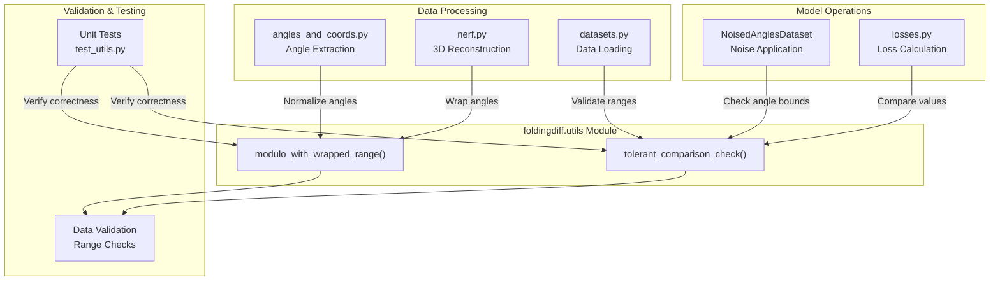
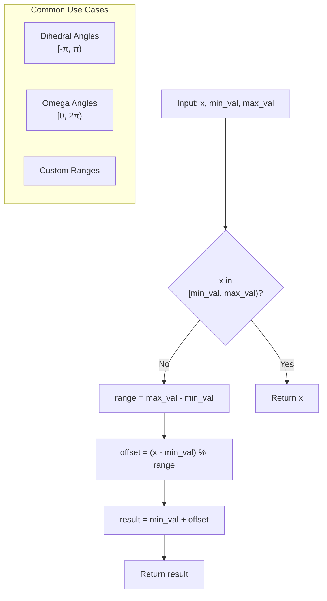
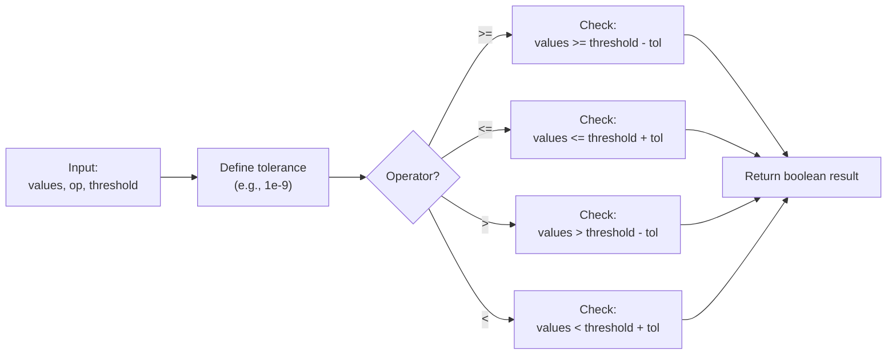
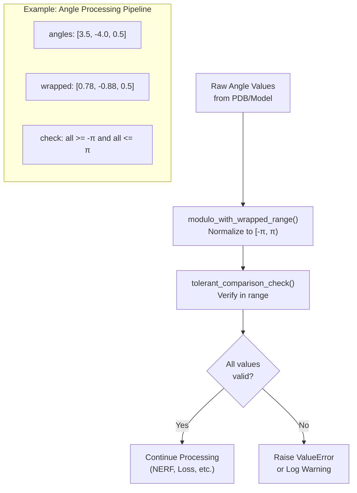

<!-- source: DeepWiki mcp.deepwiki.com · repo microsoft/foldingdiff · page 10.2 Utility Functions · fetched 2026-10-26 -->

# Utility Functions

<details>
<summary>Relevant source files</summary>

The following files were used as context for generating this wiki page:

- [tests/test_utils.py](tests/test_utils.py)

</details>


## Purpose and Scope

This page documents the utility functions provided by the `foldingdiff.utils` module. These functions handle common low-level operations required throughout the codebase, particularly for angular arithmetic and robust numerical comparisons. These utilities are foundational for the data pipeline and model operations.

For information about higher-level processing utilities, see the Data Pipeline documentation ([#4](#4)). For testing utilities, see [Testing](#10.1).

---

## Overview

The `foldingdiff.utils` module provides two primary utility functions that address common challenges when working with protein structural data:

| Function | Purpose | Primary Use Case |
|----------|---------|------------------|
| `modulo_with_wrapped_range` | Wraps numerical values into a specified range | Normalizing dihedral angles to [-π, π] or other ranges |
| `tolerant_comparison_check` | Performs comparisons with floating-point tolerance | Validating angle ranges while accounting for precision errors |

These utilities are essential for maintaining numerical stability and correctness throughout the system, especially when dealing with angular data where wraparound behavior is required.

**Sources:** [tests/test_utils.py:1-107]()

---

## System Integration

The following diagram shows how utility functions integrate with core system components:



**Sources:** [tests/test_utils.py:1-107]()

---

## `modulo_with_wrapped_range` Function

### Purpose

The `modulo_with_wrapped_range` function wraps numerical values into a specified range `[min_val, max_val)` using modular arithmetic. This is critical for handling angular data, where values naturally wrap around (e.g., 2π radians is equivalent to 0 radians).

### Function Signature

Based on the test cases, the function signature is:

```python
modulo_with_wrapped_range(x, min_val, max_val) -> value or array
```

**Parameters:**
- `x`: Input value or numpy array to be wrapped
- `min_val`: Minimum value of the target range (inclusive)
- `max_val`: Maximum value of the target range (exclusive)

**Returns:** Value(s) wrapped into the range `[min_val, max_val)`

### Behavior Examples

The following table illustrates the wrapping behavior based on unit tests:

| Input Value | Range | Output | Description |
|-------------|-------|--------|-------------|
| 3 | [-2, 2) | -1 | Value above max wraps to equivalent negative value |
| 5 | [-2, 2) | 1 | Multiple wraps: 5 - 4 = 1 |
| -3 | [-2, 2) | 1 | Negative value below min wraps to positive |
| 3 | [0, 4) | 3 | Value within range unchanged |
| 5 | [0, 4) | 1 | Wrap for non-negative ranges |
| -1 | [0, 4) | 3 | Negative value wraps to positive range |

**Sources:** [tests/test_utils.py:8-55]()

### Wrapping Logic Diagram



**Sources:** [tests/test_utils.py:8-55]()

### Array Support

The function supports both scalar values and numpy arrays, allowing batch processing of angle data:

```python
# Example from tests
input_array = np.array([2, -2])
result = modulo_with_wrapped_range(input_array, -2, 2)
# result: np.array([-2, -2])

input_array = np.array([1, -3])
result = modulo_with_wrapped_range(input_array, -2, 2)
# result: np.array([1, 1])
```

**Sources:** [tests/test_utils.py:46-54]()

### Usage in the Codebase

This function is primarily used for normalizing dihedral angles (phi, psi, omega) which must be wrapped into standard ranges:

- **Phi and Psi angles**: Typically wrapped to [-π, π)
- **Omega angles**: Often wrapped to [0, 2π) or [-π, π) depending on convention
- **Post-sampling normalization**: Ensuring generated angles fall within valid ranges

---

## `tolerant_comparison_check` Function

### Purpose

The `tolerant_comparison_check` function performs numerical comparisons that account for floating-point precision errors. This is essential when validating that computed values fall within expected ranges, particularly for angles where values near ±π may have small precision errors.

### Function Signature

Based on the test cases, the function signature is:

```python
tolerant_comparison_check(values, operator, threshold) -> bool
```

**Parameters:**
- `values`: Scalar value or numpy array to compare
- `operator`: Comparison operator as string (`">="`, `"<="`, `">"`, `"<"`)
- `threshold`: Value to compare against

**Returns:** `True` if all values satisfy the comparison with tolerance, `False` otherwise

### Comparison Behavior



**Sources:** [tests/test_utils.py:57-104]()

### Test Cases

The following table demonstrates the tolerance behavior:

| Values | Operator | Threshold | Result | Reason |
|--------|----------|-----------|--------|--------|
| [1.1, 1.1] | `">="` | 1.0 | `True` | Values clearly above threshold |
| [1.1, 1.1] | `"<="` | 1.0 | `False` | Values above threshold |
| [1.1, 1.1] | `"<="` | 1.2 | `True` | Values below threshold |
| [-1.1, -1.1] | `">="` | -1.2 | `True` | Negative comparison |
| -3.14159274... | `">="` | -π | `True` | Handles floating-point π representation |

**Sources:** [tests/test_utils.py:57-104]()

### Critical Use Case: π Comparison

A particularly important test case demonstrates handling of π:

```python
# From test_negative_pi_true
value = -3.1415927410125732
result = tolerant_comparison_check(value, ">=", -np.pi)
# result: True
```

This test ensures that values very close to -π (but with slight floating-point errors) are correctly validated. This is crucial when validating angle ranges like `[-π, π]`.

**Sources:** [tests/test_utils.py:100-103]()

### Usage Context

This function is typically used in data validation scenarios:

1. **Dataset Loading**: Verify that extracted angles fall within valid ranges
2. **Post-Processing**: Ensure generated angles are within bounds
3. **Loss Calculation**: Check intermediate values during training
4. **Testing**: Validate that transformations preserve expected properties

---

## Function Interaction Pattern

The following diagram shows a typical usage pattern combining both utilities:



**Sources:** [tests/test_utils.py:1-107]()

---

## Testing

The utility functions have comprehensive unit tests in `tests/test_utils.py`:

### Test Coverage

| Test Class | Function Tested | Number of Tests |
|------------|-----------------|-----------------|
| `TestModuloWithWrappedRange` | `modulo_with_wrapped_range` | 9 |
| `TestTolerantComparison` | `tolerant_comparison_check` | 9 |

### Running Tests

To run the utility function tests:

```bash
# Run all utility tests
python -m pytest tests/test_utils.py -v

# Run specific test class
python -m pytest tests/test_utils.py::TestModuloWithWrappedRange -v
python -m pytest tests/test_utils.py::TestTolerantComparison -v
```

### Test Structure

```mermaid
graph TD
    TEST_MODULE["tests/test_utils.py"]
    
    subgraph "TestModuloWithWrappedRange"
        T1["test_simple"]
        T2["test_simple2"]
        T3["test_negative"]
        T4["test_negative_wrapped"]
        T5["test_positive_range"]
        T6["test_positive_range_wrapped"]
        T7["test_positive_range_negative_value"]
        T8["test_arr"]
        T9["test_arr2"]
    end
    
    subgraph "TestTolerantComparison"
        T10["test_simple_positive_geq"]
        T11["test_simple_postive_leq"]
        T12["test_simple_positive_leq_true"]
        T13["test_simple_positive_geq_false"]
        T14["test_negative_geq_true"]
        T15["test_negative_leq_true"]
        T16["test_negative_leq_false"]
        T17["test_negative_geq_false"]
        T18["test_negative_pi_true"]
    end
    
    TEST_MODULE --> T1
    TEST_MODULE --> T10
```



**Sources:** [tests/test_utils.py:1-107]()

---

## Key Design Principles

The utility functions follow these design principles:

1. **Simplicity**: Each function has a single, well-defined purpose
2. **Robustness**: Handle edge cases (negative values, wraparound, floating-point precision)
3. **Vectorization**: Support both scalar and array inputs for efficiency
4. **Testability**: Comprehensive unit tests with clear examples

These utilities form the foundation for reliable numerical operations throughout the FoldingDiff codebase, particularly for handling the angular data that represents protein backbone geometry.

**Sources:** [tests/test_utils.py:1-107]()

---

