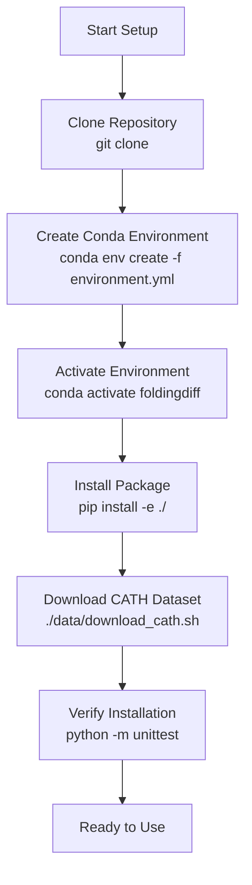
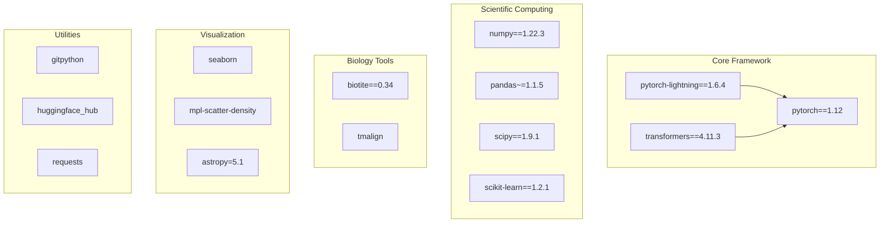

<!-- source: DeepWiki mcp.deepwiki.com · repo microsoft/foldingdiff · page 2 Getting Started · fetched 2026-10-26 -->

# Getting Started

<details>
<summary>Relevant source files</summary>

The following files were used as context for generating this wiki page:

- [CONTRIBUTING.md](CONTRIBUTING.md)
- [README.md](README.md)
- [TRADEMARKS.md](TRADEMARKS.md)
- [data/cath_checksums.md5](data/cath_checksums.md5)
- [data/download_cath.sh](data/download_cath.sh)
- [environment.yml](environment.yml)
- [foldingdiff/utils.py](foldingdiff/utils.py)
- [plots/generated_0.gif](plots/generated_0.gif)
- [requirements.txt](requirements.txt)
- [scripts/README.md](scripts/README.md)
- [scripts/amlt.yaml](scripts/amlt.yaml)
- [setup.py](setup.py)

</details>


This page guides you through the initial setup of FoldingDiff, including installation of dependencies, environment configuration, and downloading the required CATH dataset. After completing these steps, you will be ready to train models, generate protein structures, or evaluate results.

For detailed environment configuration including AMLT and Singularity deployment, see [Installation and Environment Setup](#2.1). For information about the CATH dataset structure and verification procedures, see [Downloading CATH Dataset](#2.2).

## Prerequisites

Before beginning, ensure you have:

- **Git** for cloning the repository
- **Conda** (or [mamba](https://mamba.readthedocs.io/en/latest/index.html)) for environment management
- **Python 3.8** or higher
- Sufficient disk space for the CATH dataset (~2-3 GB compressed, ~5 GB uncompressed)

## Setup Overview

The setup process follows three main stages: repository cloning, environment creation, and data acquisition.

**Setup Workflow**



Sources: [README.md:9-17](), [README.md:19-28]()

## Quick Start

### 1. Clone Repository

```bash
git clone https://github.com/microsoft/foldingdiff
cd foldingdiff
```

### 2. Create Conda Environment

The environment specification is defined in `environment.yml` with all required dependencies.

```bash
conda env create -f environment.yml
conda activate foldingdiff
pip install -e ./
```

This installs:
- **PyTorch 1.12** with CUDA support for GPU acceleration
- **PyTorch Lightning 1.6.4** for training orchestration
- **HuggingFace Transformers 4.11.3** for BERT model architecture
- **Biotite 0.34** for protein structure manipulation
- **TM-align** for structural similarity calculations
- Additional scientific computing libraries (numpy, pandas, seaborn, etc.)

Sources: [README.md:11-17](), [environment.yml:1-25](), [setup.py:15-29]()

**Dependency Architecture**



Sources: [environment.yml:8-24](), [requirements.txt:1-14]()

### 3. Download CATH Dataset

The CATH dataset is required for training. Navigate to the `data` directory and run the download script:

```bash
cd data
chmod +x download_cath.sh
./download_cath.sh
```

The script performs three operations:
1. Downloads `cath-dataset-nonredundant-S40.pdb.tgz` from UCL FTP server
2. Verifies integrity using MD5 checksum
3. Extracts PDB files to `data/cath/dompdb/`

If the download link fails, a mirror is available at the [Dropbox link](https://www.dropbox.com/s/ka5m5lx58477qu6/cath-dataset-nonredundant-S40.pdb.tgz?dl=0) referenced in the README.

Sources: [README.md:19-30](), [data/download_cath.sh:1-9](), [data/cath_checksums.md5:1]()

## Post-Setup Directory Structure

After completing setup, your directory structure should look like this:

```
foldingdiff/
├── bin/                          # Executable scripts
│   ├── train.py                  # Training pipeline
│   ├── sample.py                 # Sampling/generation
│   └── tmscore_training.py       # Novelty assessment
├── foldingdiff/                  # Core library code
│   ├── datasets.py               # Data loading classes
│   ├── modelling.py              # Model architecture
│   ├── sampling.py               # Reverse diffusion
│   ├── angles_and_coords.py      # Coordinate conversion
│   ├── nerf.py                   # 3D reconstruction
│   └── losses.py                 # Loss functions
├── data/
│   ├── cath/
│   │   ├── dompdb/              # PDB files (after extraction)
│   │   └── cath-dataset-nonredundant-S40.pdb.tgz
│   └── download_cath.sh
├── config_jsons/                 # Training configurations
├── tests/                        # Unit tests
├── environment.yml               # Conda environment spec
├── setup.py                      # Package installation
└── README.md
```

Sources: [README.md:44-49](), [data/download_cath.sh:8-9]()

## Environment Configuration

### Standard Installation

The standard installation uses `environment.yml` and is suitable for local development and training on personal machines with GPUs.

**Key packages installed:**
- `pytorch::pytorch=1.12` - Deep learning framework with CUDA support
- `pytorch-lightning=1.6.4` - Training abstractions and callbacks
- `huggingface::transformers=4.11.3` - BERT model implementation
- `biotite=0.34` - Protein structure I/O and manipulation
- `bioconda::tmalign` - Structural alignment for evaluation

Sources: [environment.yml:1-24](), [README.md:11-17]()

### Alternative: Requirements.txt

For environments where conda is not available, a `requirements.txt` is provided for pip-based installation:

```bash
pip install -r requirements.txt
```

This installs the same dependencies but without conda-managed packages like TM-align, which must be installed separately.

Sources: [requirements.txt:1-14]()

### Cloud Deployment (AMLT/Singularity)

For training on Azure ML or Singularity clusters, see [Installation and Environment Setup](#2.1) for AMLT configuration details. The AMLT setup uses a pre-built Docker image (`amlt-sing/pytorch-1.11.0`) and installs dependencies via pip for faster setup.

Sources: [scripts/amlt.yaml:1-40](), [scripts/README.md:1-17]()

## Verification

### Run Unit Tests

Verify the installation by running the test suite:

```bash
python -m unittest -v
```

Expected output includes tests for:
- Dataset loading and angle extraction
- NERF reconstruction algorithm
- Loss function calculations
- Utility functions (modulo operations, comparisons)

You may see warnings about illegal omega values in certain PDB files - these are expected and indicate the dataset loading is working correctly:

```
WARNING:root:Illegal values for omega in .../data/cath/dompdb/2ebqA00 -- skipping
```

Sources: [README.md:183-195]()

### Verify CATH Dataset

Check that the CATH dataset was extracted correctly:

```bash
ls data/cath/dompdb/ | wc -l
```

You should see thousands of PDB files. The dataset contains non-redundant protein domains from the CATH database with ≤40% sequence identity.

Verify the checksum of the downloaded tarball:

```bash
cd data
md5sum -c cath_checksums.md5
```

Expected output:
```
cath/cath-dataset-nonredundant-S40.pdb.tgz: OK
```

Sources: [data/download_cath.sh:4-5](), [data/cath_checksums.md5:1]()

## Next Steps

After completing setup, you can:

1. **Train a model** - See [Training Pipeline](#6.1) for using `bin/train.py` with configuration files
2. **Generate structures** - See [Sampling Pipeline](#7.1) for using pre-trained models to generate protein backbones
3. **Evaluate results** - See [Evaluation and Analysis](#8) for computing TM-scores, designability metrics, and structural analyses

### Using Pre-trained Models

If you want to skip training and use pre-trained weights, the model is available on HuggingFace Hub at `wukevin/foldingdiff_cath`. The model will be automatically downloaded when you run sampling:

```python
from huggingface_hub import snapshot_download
from foldingdiff import modelling

# Automatically downloads and caches model
model_dir = snapshot_download("wukevin/foldingdiff_cath")
model = modelling.BertForDiffusion.from_dir(model_dir)
```

Sources: [README.md:52-77]()

### Running Without Data Download

Note that the CATH dataset is **not required** for sampling with pre-trained models. It is only needed for:
- Training your own models
- Using the `--testcomparison` flag in `sample.py` to compare generated structures against test set
- Computing novelty metrics via `tmscore_training.py`

Sources: [README.md:21-22](), [README.md:88]()

## Common Issues

### Conda Environment Creation Fails

If `conda env create` is slow or fails, try using `mamba` instead:

```bash
mamba env create -f environment.yml
```

Mamba is a faster drop-in replacement for conda.

### Missing TM-align

If TM-align is not available after environment creation, install it manually:

```bash
conda install -c bioconda tmalign
```

### CUDA Out of Memory

If you encounter CUDA out-of-memory errors during training, reduce the batch size in your training configuration JSON file or use the `--device cpu` flag for CPU execution (significantly slower).

Sources: [environment.yml:23](), [README.md:98-103]()

---

