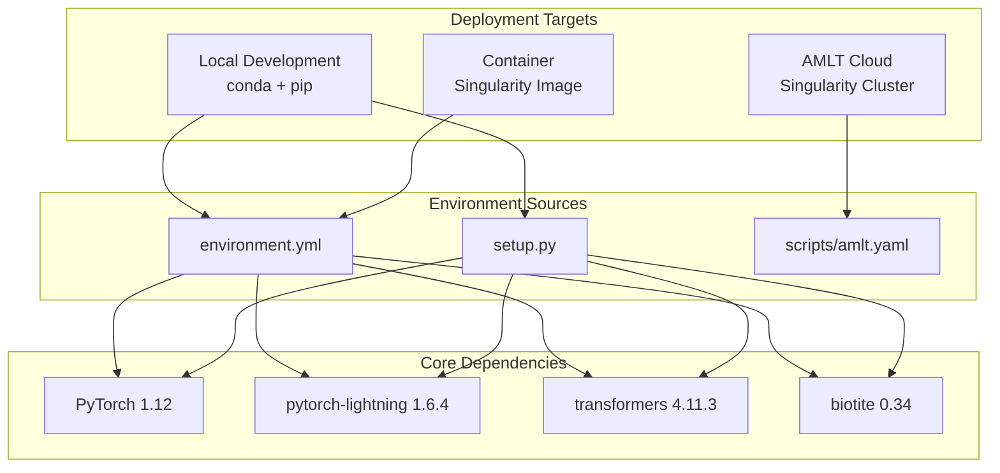
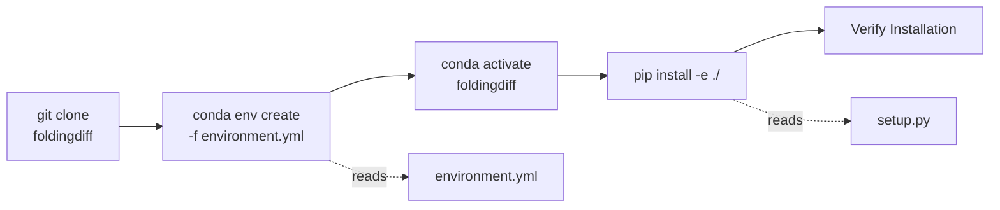
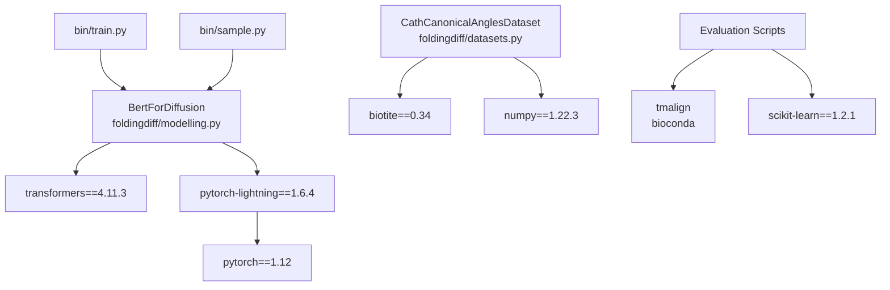
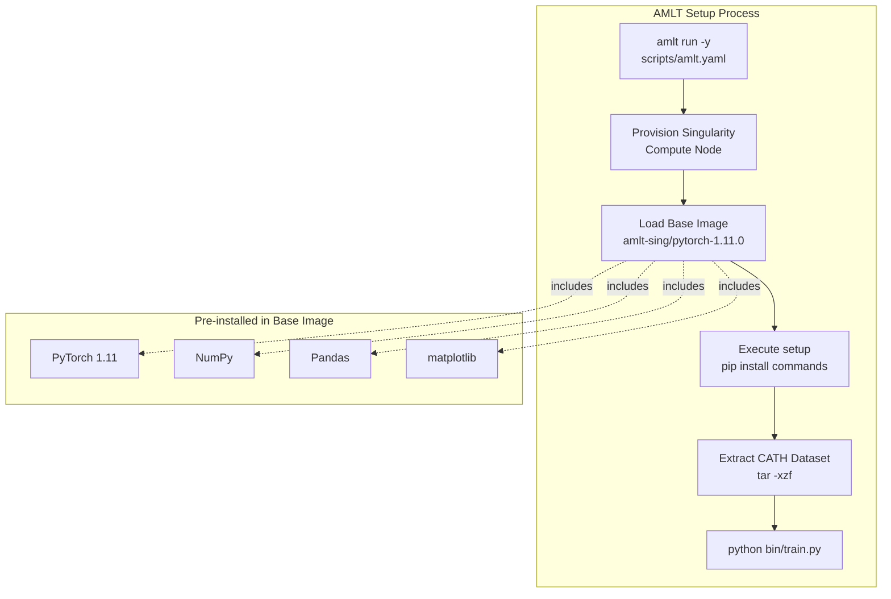

<!-- source: DeepWiki mcp.deepwiki.com · repo microsoft/foldingdiff · page 2.1 Installation and Environment Setup · fetched 2026-10-26 -->

# Installation and Environment Setup

<details>
<summary>Relevant source files</summary>

The following files were used as context for generating this wiki page:

- [CONTRIBUTING.md](CONTRIBUTING.md)
- [README.md](README.md)
- [TRADEMARKS.md](TRADEMARKS.md)
- [environment.yml](environment.yml)
- [foldingdiff/utils.py](foldingdiff/utils.py)
- [plots/generated_0.gif](plots/generated_0.gif)
- [requirements.txt](requirements.txt)
- [scripts/README.md](scripts/README.md)
- [scripts/amlt.yaml](scripts/amlt.yaml)
- [setup.py](setup.py)

</details>


## Purpose and Scope

This page provides detailed instructions for installing FoldingDiff and setting up the required environment for development and deployment. It covers three primary deployment scenarios: local development, AMLT cloud training, and Singularity container deployment. For information about downloading the CATH dataset after installation, see [Downloading CATH Dataset](#2.2). For training configuration after setup, see [Training Configuration](#6.3).

## Deployment Target Overview

FoldingDiff supports three deployment configurations, each with slightly different setup requirements:



**Deployment Target Selection**

Sources: [README.md:9-17](), [scripts/amlt.yaml:1-40](), [environment.yml:1-25]()

## Local Installation

### Prerequisites

Before installation, ensure you have:
- Python 3.8 or higher
- conda or [mamba](https://mamba.readthedocs.io/en/latest/index.html) package manager
- Git for cloning the repository

### Installation Steps

The local installation process follows a two-phase approach: creating the conda environment and installing the package itself.



**Installation Process Flow**

#### Step 1: Clone Repository

```bash
git clone https://github.com/microsoft/foldingdiff
cd foldingdiff
```

#### Step 2: Create Conda Environment

The `environment.yml` file defines all required dependencies:

```bash
conda env create -f environment.yml
```

Alternatively, for faster installation, use mamba:

```bash
mamba env create -f environment.yml
```

Sources: [README.md:11-17](), [environment.yml:1-25]()

#### Step 3: Activate Environment

```bash
conda activate foldingdiff
```

#### Step 4: Install Package in Editable Mode

```bash
pip install -e ./
```

The editable mode (`-e`) allows code changes to take effect without reinstalling. The `setup.py` file defines package metadata and dependencies.

Sources: [README.md:13-17](), [setup.py:1-37]()

## Dependency Specification

FoldingDiff requires specific versions of core libraries to ensure compatibility. Dependencies are specified in two locations with slightly different formats.

### environment.yml Dependencies

| Package | Version | Channel | Purpose |
|---------|---------|---------|---------|
| `python` | 3.8 | defaults | Base interpreter |
| `numpy` | 1.22.3 | anaconda | Numerical computing |
| `pandas` | ~1.1.5 | conda-forge | Data manipulation |
| `pytorch` | 1.12 | pytorch | Deep learning framework |
| `transformers` | 4.11.3 | huggingface | BERT model architecture |
| `pytorch-lightning` | 1.6.4 | conda-forge | Training framework |
| `huggingface_hub` | latest | conda-forge | Model hosting |
| `biotite` | 0.34 | conda-forge | Structural biology |
| `tmalign` | latest | bioconda | Structure alignment |
| `scikit-learn` | 1.2.1 | conda-forge | Clustering algorithms |
| `seaborn` | latest | conda-forge | Visualization |
| `mpl-scatter-density` | latest | conda-forge | Dense scatter plots |
| `astropy` | 5.1 | conda-forge | Unit handling |
| `gitpython` | latest | conda-forge | Git integration |
| `requests` | latest | conda-forge | HTTP requests |

Sources: [environment.yml:1-25]()

### setup.py Dependencies

The `setup.py` file lists minimum required packages without version pinning for flexibility:

```python
install_requires=[
    "pandas",
    "numpy", 
    "torch",
    "scipy",
    "transformers",
    "pytorch-lightning",
    "huggingface-hub",
    "seaborn",
    "mpl-scatter-density",
    "astropy",
    "gitpython",
    "biotite",
    "requests"
]
```

Sources: [setup.py:15-29]()

### Critical Version Requirements

**PyTorch 1.12** is required for compatibility with `pytorch-lightning 1.6.4`. **Transformers 4.11.3** is pinned because the `BertForDiffusion` model relies on specific internal APIs that changed in later versions. **Biotite 0.34** is required for stable PDB parsing functionality.



**Dependency Relationships**

Sources: [environment.yml:9-24](), [setup.py:15-29]()

## AMLT/Singularity Deployment

AMLT (Azure Machine Learning Tools) deployment uses Singularity containers for cloud training. This setup differs from local installation because the environment is pre-configured in the container image.

### AMLT Configuration Structure

The `scripts/amlt.yaml` file defines the deployment:

```yaml
target:
  service: sing
  name: msrresrchvc
  workspace_name: msrresrchws

environment:
  image: amlt-sing/pytorch-1.11.0
  setup:
    - pip install seaborn
    - pip install mpl-scatter-density
    - pip install astropy
    - pip install transformers==4.11.3
    - pip install pytorch-lightning==1.6.4
    - pip install sequence-models
    - pip install biotite==0.34
```

Sources: [scripts/amlt.yaml:1-29]()

### Key Differences from Local Setup

1. **Base Image**: Uses `amlt-sing/pytorch-1.11.0` which includes PyTorch, NumPy, Pandas, and matplotlib pre-installed
2. **pip-only Installation**: All packages installed via pip instead of conda for faster setup
3. **No conda Environment**: The Singularity image provides the Python environment
4. **Dataset Extraction**: CATH dataset is extracted during job execution



**AMLT Deployment Workflow**

Sources: [scripts/amlt.yaml:8-40](), [scripts/README.md:1-17]()

### AMLT Job Submission

To submit a training job to AMLT:

```bash
# Requires separate amlt8 conda environment
conda create -n amlt8 python=3.8
conda activate amlt8
pip install amulet-ml

# Submit job
amlt run -y scripts/amlt.yaml -o results
```

The `-o results` flag specifies the output directory for logs and checkpoints. The job configuration in `amlt.yaml` includes:

- **SKU Selection**: `16G2-V100` specifies 16GB memory with 2 V100 GPUs
- **Priority**: `high` priority in the `premium` SLA tier
- **Data Handling**: Automatic extraction of CATH dataset from tarball
- **Output Directory**: `$$AMLT_OUTPUT_DIR/results` for model checkpoints

Sources: [scripts/amlt.yaml:34-40](), [scripts/README.md:5-13]()

## Installation Verification

After installation, verify that the environment is correctly configured:

### Import Test

```python
# Test core imports
from foldingdiff import modelling
from foldingdiff import datasets as dsets
from foldingdiff import angles_and_coords
from foldingdiff import nerf

# Verify PyTorch and CUDA
import torch
print(f"PyTorch version: {torch.__version__}")
print(f"CUDA available: {torch.cuda.is_available()}")

# Verify transformers
import transformers
print(f"Transformers version: {transformers.__version__}")

# Verify lightning
import pytorch_lightning as pl
print(f"Lightning version: {pl.__version__}")
```

### Running Tests

The codebase includes unit tests implemented through both doctests and unittest:

```bash
# Run unittests
python -m unittest -v
```

Expected warnings during testing:
```
WARNING:root:Illegal values for omega in protdiff-main/data/cath/dompdb/5a2qw00 -- skipping
```

These warnings are normal and indicate that certain PDB files in the CATH dataset have invalid dihedral angle values and are automatically skipped.

Sources: [README.md:184-196]()

### Verifying Package Installation

```bash
# Check that foldingdiff is installed in editable mode
pip show foldingdiff

# Verify all required packages
pip list | grep -E "torch|transformers|lightning|biotite"
```

## Environment File Details

### environment.yml Structure

The `environment.yml` file specifies four conda channels in priority order:

1. `defaults` - Core Anaconda packages
2. `anaconda` - Additional Anaconda packages  
3. `pytorch` - PyTorch and related packages
4. `conda-forge` - Community-maintained packages
5. `huggingface` - HuggingFace transformers
6. `bioconda` - Bioinformatics packages (for `tmalign`)

Sources: [environment.yml:1-7]()

### setup.py Metadata

The `setup.py` file defines package metadata used for distribution:

| Field | Value |
|-------|-------|
| `name` | `"foldingdiff"` |
| `author` | `"Kevin Wu"` |
| `version` | `"0.0.1"` |
| `python_requires` | `">=3.8"` |
| `url` | `https://github.com/microsoft/foldingdiff` |

The `find_packages()` function automatically discovers the `foldingdiff` package directory and its submodules.

Sources: [setup.py:1-37]()

## Common Installation Issues

### Issue: ModuleNotFoundError for foldingdiff

**Cause**: Package not installed in editable mode or wrong environment activated.

**Solution**: 
```bash
conda activate foldingdiff
pip install -e ./
```

### Issue: CUDA not available

**Cause**: PyTorch CPU-only version installed or CUDA driver mismatch.

**Solution**: Reinstall PyTorch with CUDA support matching your driver:
```bash
# For CUDA 11.3
conda install pytorch==1.12 cudatoolkit=11.3 -c pytorch
```

### Issue: Slow conda environment creation

**Cause**: conda's dependency solver is computationally expensive.

**Solution**: Use mamba instead:
```bash
conda install -c conda-forge mamba
mamba env create -f environment.yml
```

### Issue: biotite import fails

**Cause**: Biotite version mismatch or C extension compilation failure.

**Solution**: Force reinstall from conda-forge:
```bash
conda install -c conda-forge biotite==0.34 --force-reinstall
```

## Next Steps

After successful installation:

1. **Download CATH Dataset**: See [Downloading CATH Dataset](#2.2) for instructions on obtaining training data
2. **Verify Dataset**: Run basic dataset loading to ensure PDB files are correctly processed
3. **Training**: Proceed to [Training Pipeline](#6.1) to train your own model
4. **Sampling**: Use pre-trained models with [Sampling Pipeline](#7.1) to generate structures

Sources: [README.md:19-31](), [README.md:33-49]()

---

