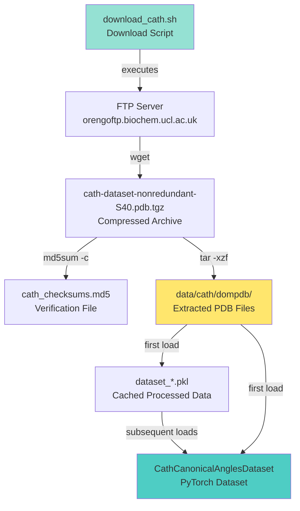
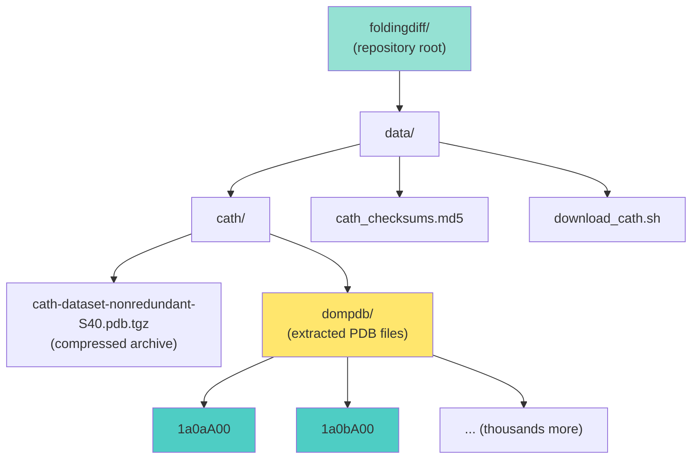
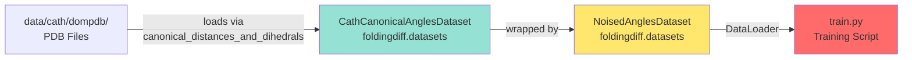

<!-- source: DeepWiki mcp.deepwiki.com · repo microsoft/foldingdiff · page 2.2 Downloading CATH Dataset · fetched 2026-10-26 -->

# Downloading CATH Dataset

<details>
<summary>Relevant source files</summary>

The following files were used as context for generating this wiki page:

- [CONTRIBUTING.md](CONTRIBUTING.md)
- [README.md](README.md)
- [TRADEMARKS.md](TRADEMARKS.md)
- [data/cath_checksums.md5](data/cath_checksums.md5)
- [data/download_cath.sh](data/download_cath.sh)
- [plots/generated_0.gif](plots/generated_0.gif)
- [requirements.txt](requirements.txt)
- [scripts/README.md](scripts/README.md)
- [setup.py](setup.py)

</details>


## Purpose and Scope

This page explains how to download and prepare the CATH protein structure dataset for use with FoldingDiff. The CATH dataset provides the training data for the diffusion model and is essential for training your own models or evaluating generated structures against the training set.

**Note:** For information about how the CATH data is processed into model inputs, see [Dataset Classes](#4.1). For details on the training pipeline itself, see [Training Pipeline (train.py)](#6.1).

## What is CATH

CATH (Class, Architecture, Topology, Homology) is a hierarchical classification of protein domain structures. FoldingDiff uses the **CATH 4.2 non-redundant dataset at S40 sequence identity**, which contains:

- High-quality protein domain structures from the Protein Data Bank (PDB)
- Non-redundant entries with ≤40% sequence identity
- PDB files containing 3D coordinates of protein backbone atoms (N, CA, C)

The dataset is stored as individual PDB files, one per protein domain, organized in a directory structure.

**Sources:** [README.md:19-30](), [data/download_cath.sh:1-9]()

## When is CATH Required

The CATH dataset is required for the following use cases:

| Use Case | CATH Required | Reason |
|----------|---------------|--------|
| Training models | ✅ Yes | Provides training and validation data |
| Sampling structures | ❌ No | Pre-trained models can generate structures without data |
| Sampling with `--testcomparison` | ✅ Yes | Compares generated structures to test set |
| TM-score novelty evaluation | ✅ Yes | Calculates similarity to training structures |
| Secondary structure annotation | ❌ No | Only requires generated structures |

**Sources:** [README.md:19-21](), [README.md:88]()

## Data Flow Architecture



**Diagram:** CATH dataset download and processing pipeline

**Sources:** [data/download_cath.sh:1-9](), [README.md:66-72]()

## Download Procedure

### Prerequisites

Ensure you are in the repository's root directory and have an active internet connection.

### Step-by-Step Instructions

**1. Navigate to the data directory:**

```bash
cd data
```

**2. Make the download script executable:**

```bash
chmod +x download_cath.sh
```

**3. Run the download script:**

```bash
./download_cath.sh
```

This script performs three operations:
- Downloads the tarball from the CATH FTP server using `wget`
- Verifies the download integrity using MD5 checksums
- Extracts the PDB files into `data/cath/dompdb/`

**Sources:** [README.md:22-28](), [data/download_cath.sh:1-9]()

### Download Script Details

The script [data/download_cath.sh:1-9]() performs the following operations:

| Line | Operation | Description |
|------|-----------|-------------|
| 2 | `wget -P cath ...` | Downloads tarball to `data/cath/` directory |
| 5 | `md5sum -c ...` | Verifies download integrity against expected checksum |
| 8 | `cd cath` | Enters the cath directory |
| 9 | `tar -xzf ...` | Extracts PDB files from compressed archive |

**Sources:** [data/download_cath.sh:1-9]()

## Verification

### MD5 Checksum Verification

The script automatically verifies the download using the checksum file [data/cath_checksums.md5:1]():

```
Expected MD5: 070a96ace6d82b87524cb82c3269e4dc
File: cath/cath-dataset-nonredundant-S40.pdb.tgz
```

If the checksum fails, the download is corrupted and should be re-attempted.

### Manual Verification

To manually verify the download:

```bash
cd data
md5sum cath/cath-dataset-nonredundant-S40.pdb.tgz
# Compare output to: 070a96ace6d82b87524cb82c3269e4dc
```

### Expected Warnings During Processing

When the CATH dataset is first loaded by the code, you may see warnings like:

```
WARNING:root:Illegal values for omega in /path/to/data/cath/dompdb/2ebqA00 -- skipping
```

These warnings are **normal and expected** [README.md:67]() — they indicate that certain PDB files contain invalid dihedral angles and are automatically skipped during processing.

**Sources:** [data/cath_checksums.md5:1](), [README.md:66-68](), [README.md:193-195]()

## Directory Structure

After successful download and extraction, the directory structure will be:



**Diagram:** Directory structure after CATH dataset download

### File Organization

| Path | Type | Description |
|------|------|-------------|
| `data/` | Directory | Root data directory |
| `data/cath/` | Directory | CATH dataset directory |
| `data/cath/cath-dataset-nonredundant-S40.pdb.tgz` | Archive | Compressed dataset (can be deleted after extraction) |
| `data/cath/dompdb/` | Directory | Extracted PDB files (one per protein domain) |
| `data/cath/dompdb/[domainID]` | PDB file | Individual protein domain structure (e.g., `2ebqA00`) |
| `data/cath_checksums.md5` | Checksum | MD5 hash for verification |
| `data/download_cath.sh` | Script | Download automation script |

**Sources:** [data/download_cath.sh:8-9](), [README.md:22-28]()

## Dataset Caching

### Automatic Cache Generation

When the CATH dataset is first loaded by the code (e.g., during training), the system automatically:

1. Reads all PDB files from `data/cath/dompdb/`
2. Extracts dihedral angles and distances using [foldingdiff/angles_and_coords.py]()
3. Caches the processed data as `.pkl` files for faster loading in future runs

The cache files are stored in the FoldingDiff package directory and have names like:
- `dataset_cath_*.pkl`

### Cache Invalidation

The cache is automatically regenerated if:
- The dataset parameters change (e.g., padding length, subset selection)
- The cache file is deleted or corrupted
- The underlying CATH data files are modified

**Sources:** [README.md:66-72]()

## Troubleshooting

### Download Failures

If the FTP download fails (e.g., due to network issues or server unavailability), use the **Dropbox mirror**:

1. Download from: [Dropbox mirror link](https://www.dropbox.com/s/ka5m5lx58477qu6/cath-dataset-nonredundant-S40.pdb.tgz?dl=0)
2. Place the file in `data/cath/`
3. Verify with: `md5sum -c cath_checksums.md5`
4. Extract manually: `cd data/cath && tar -xzf cath-dataset-nonredundant-S40.pdb.tgz`

**Sources:** [README.md:30]()

### Checksum Mismatch

If `md5sum -c` reports a checksum mismatch:

1. Delete the corrupted tarball: `rm data/cath/cath-dataset-nonredundant-S40.pdb.tgz`
2. Re-run the download script: `./download_cath.sh`
3. If issues persist, try the Dropbox mirror (see above)

### Disk Space Requirements

The CATH dataset requires approximately:
- **~1.5 GB** for the compressed tarball
- **~2.5 GB** for extracted PDB files
- **~4 GB total** (including both compressed and extracted data)

Ensure sufficient disk space before downloading.

### Permission Issues

If you encounter permission errors when running the script:

```bash
chmod +x data/download_cath.sh
# Then re-run
cd data && ./download_cath.sh
```

**Sources:** [README.md:22-30]()

## Integration with Training

The downloaded CATH dataset is automatically used by the training pipeline through dataset classes:



**Diagram:** CATH dataset integration with training pipeline

Key dataset classes that use CATH:
- `CathCanonicalAnglesDataset` - Loads and processes CATH PDB files
- `CathCanonicalAnglesOnlyDataset` - Variant that only uses angular features
- `NoisedAnglesDataset` - Adds noise according to diffusion schedule

For more details on these classes, see [Dataset Classes](#4.1).

**Sources:** [README.md:64-76](), [bin/train.py]()

## Verification of Successful Setup

To verify your CATH dataset is properly configured:

**1. Check file structure:**
```bash
ls data/cath/dompdb/ | head -5
# Should list PDB files like: 1a0aA00, 1a0bA00, etc.
```

**2. Test dataset loading (requires environment setup, see [Installation and Environment Setup](#2.1)):**
```python
from foldingdiff import datasets as dsets

# This will trigger cache generation if needed
dataset = dsets.CathCanonicalAnglesOnlyDataset(pad=128, trim_strategy='randomcrop')
print(f"Successfully loaded {len(dataset)} structures")
```

If this runs without errors (except expected warnings about illegal omega values), your CATH dataset is properly configured.

**Sources:** [README.md:64-76](), [README.md:193-195]()

---

