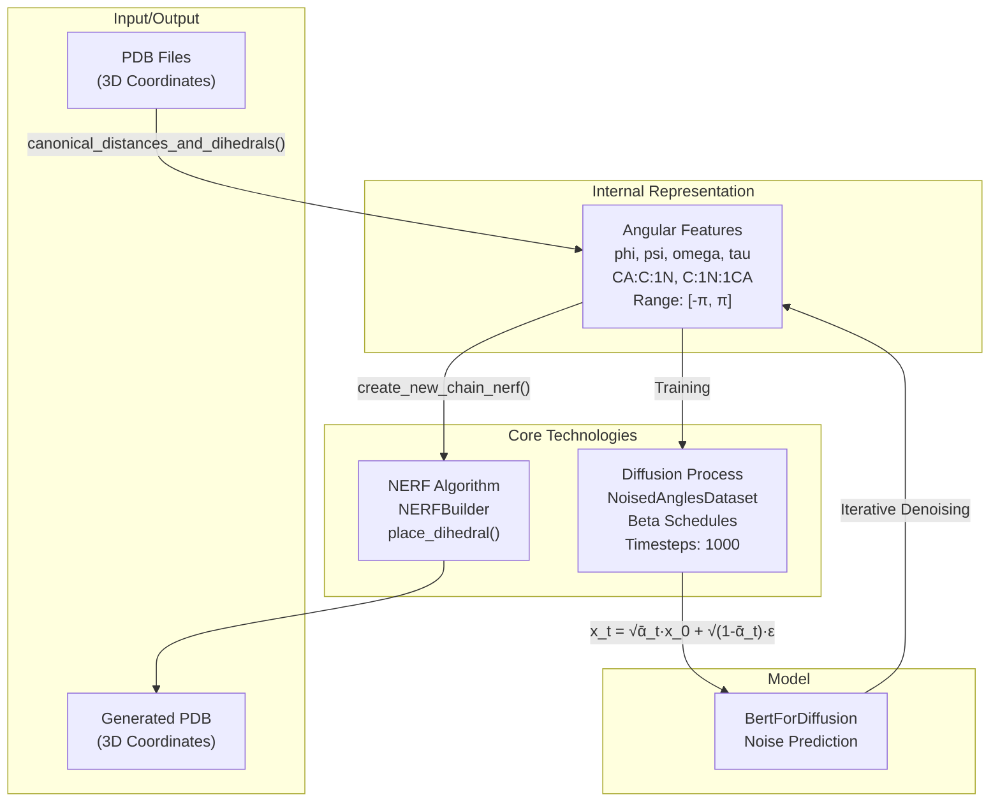
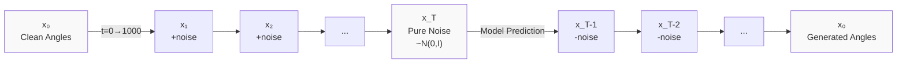
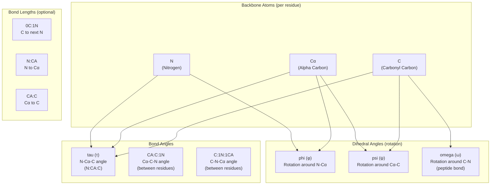
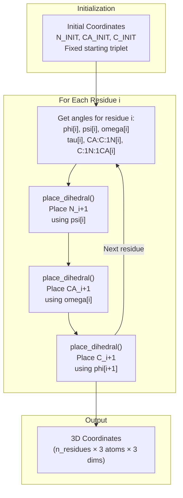
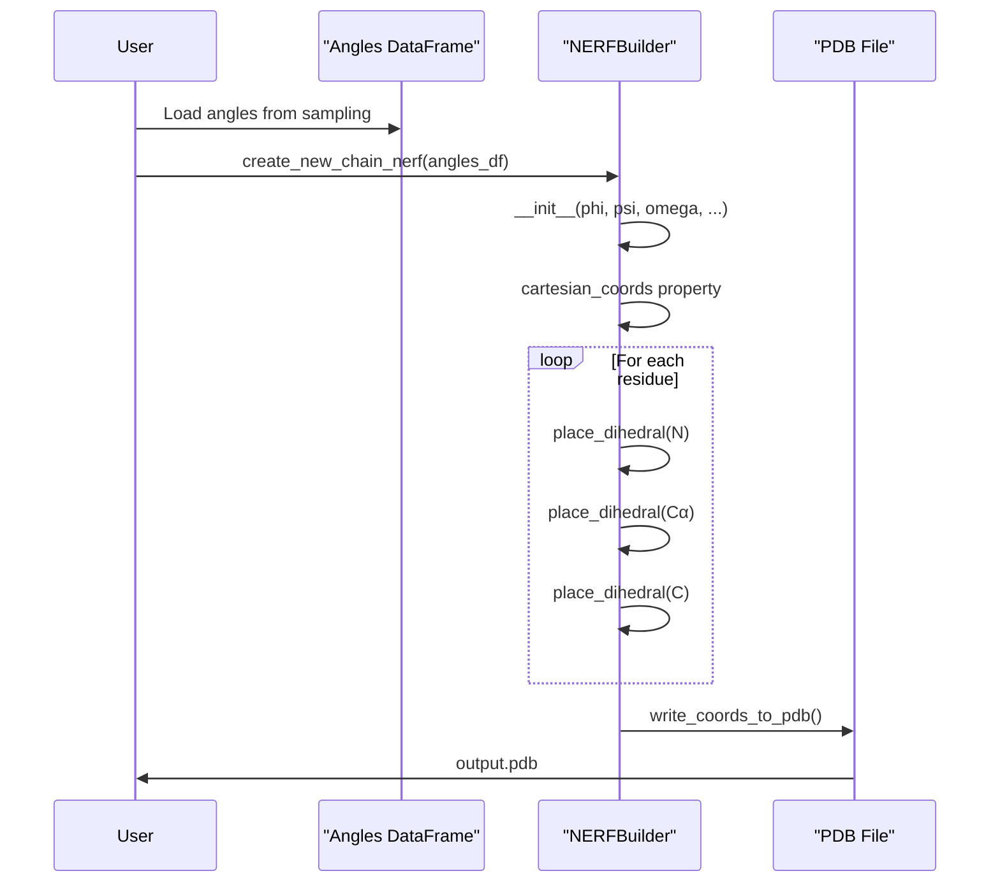
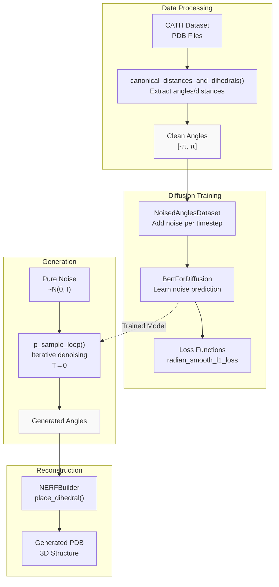

<!-- source: DeepWiki mcp.deepwiki.com · repo microsoft/foldingdiff · page 3 Core Concepts · fetched 2026-10-26 -->

# Core Concepts

<details>
<summary>Relevant source files</summary>

The following files were used as context for generating this wiki page:

- [CONTRIBUTING.md](CONTRIBUTING.md)
- [README.md](README.md)
- [TRADEMARKS.md](TRADEMARKS.md)
- [foldingdiff/angles_and_coords.py](foldingdiff/angles_and_coords.py)
- [foldingdiff/datasets.py](foldingdiff/datasets.py)
- [foldingdiff/nerf.py](foldingdiff/nerf.py)
- [foldingdiff/sampling.py](foldingdiff/sampling.py)
- [plots/generated_0.gif](plots/generated_0.gif)
- [requirements.txt](requirements.txt)
- [scripts/README.md](scripts/README.md)
- [setup.py](setup.py)
- [tests/test_angles_and_coords.py](tests/test_angles_and_coords.py)
- [tests/test_nerf.py](tests/test_nerf.py)

</details>


This page introduces the three fundamental concepts that underpin FoldingDiff's approach to protein backbone generation:

1. **Diffusion Models for Proteins** - The generative modeling framework based on iterative denoising
2. **Internal Coordinates Representation** - The use of dihedral and bond angles instead of Cartesian coordinates
3. **NERF Reconstruction** - The algorithm for converting angles back to 3D structures

These concepts are essential to understanding how FoldingDiff generates novel protein backbones. For detailed implementation of the model architecture, see [Model Architecture](#5). For the training pipeline, see [Training](#6). For sampling/generation, see [Generation and Sampling](#7).

---

## System Design Philosophy

FoldingDiff's core innovation is operating in **angular space** rather than Cartesian coordinate space. This design choice provides several advantages: translation/rotation invariance, reduced dimensionality, and physically meaningful constraints. The system combines three key technologies to achieve this:



**Sources:** [foldingdiff/datasets.py:30-38](), [foldingdiff/angles_and_coords.py:30-109](), [foldingdiff/nerf.py:27-143](), [foldingdiff/sampling.py:78-133]()

---

## Diffusion Models for Proteins

For a comprehensive treatment of diffusion models in the context of protein generation, see [Diffusion Models for Proteins](#3.1).

### Forward and Reverse Processes

The diffusion model consists of two Markov chains:

1. **Forward Process (Noising)**: Gradually corrupts protein structure by adding Gaussian noise over `T` timesteps
2. **Reverse Process (Denoising)**: Learns to remove noise iteratively to generate new structures



### Key Mathematical Components

The forward diffusion process at timestep `t` is defined by:

**Forward Equation:**
```
x_t = √(ᾱ_t) · x_0 + √(1 - ᾱ_t) · ε
```

Where:
- `x_0` is the original (clean) angles
- `x_t` is the noised angles at timestep `t`
- `ᾱ_t` is the cumulative product of alphas: `∏(1 - β_i)` for `i=1` to `t`
- `ε ~ N(0, I)` is Gaussian noise
- `β_t` is the variance schedule at timestep `t`

**Reverse Sampling Equation (p_sample):**
```
x_t-1 = (1/√α_t) · (x_t - (β_t/√(1-ᾱ_t)) · model(x_t, t)) + √σ_t · z
```

Where:
- `model(x_t, t)` predicts the noise `ε` added to create `x_t`
- `z ~ N(0, I)` is noise (zero at `t=0`)

### Code Implementation

| Component | Class/Function | File Location | Description |
|-----------|---------------|---------------|-------------|
| Forward Process | `NoisedAnglesDataset.__getitem__()` | [foldingdiff/datasets.py:801-886]() | Adds noise to angles according to timestep |
| Reverse Process | `p_sample()` | [foldingdiff/sampling.py:28-76]() | Single denoising step |
| Full Sampling | `p_sample_loop()` | [foldingdiff/sampling.py:78-133]() | Iterative denoising from T→0 |
| Beta Schedules | `get_variance_schedule()` | [foldingdiff/beta_schedules.py]() | Linear, cosine, etc. |
| Alpha Computation | `compute_alphas()` | [foldingdiff/beta_schedules.py]() | Computes ᾱ_t from β_t |

### Variance Schedules

The system supports multiple beta schedules that control the noise level at each timestep:

- **Linear**: `β_t` increases linearly from `β_start` to `β_end`
- **Cosine**: Smoother schedule based on cosine function (commonly used)
- Others: quadratic, sigmoid, etc.

The choice of schedule affects training stability and sample quality.

**Sources:** [foldingdiff/datasets.py:685-886](), [foldingdiff/sampling.py:28-133](), [README.md:1-196]()

---

## Internal Coordinates Representation

For detailed information about the angular representation system, see [Internal Coordinates Representation](#3.2).

### Why Angles Instead of Coordinates?

FoldingDiff operates on **internal coordinates** (angles and bond lengths) rather than Cartesian coordinates (x, y, z). This choice provides several critical advantages:

| Advantage | Description |
|-----------|-------------|
| **Translation Invariance** | Proteins are identical regardless of absolute position in space |
| **Rotation Invariance** | Proteins are identical regardless of orientation |
| **Reduced Dimensionality** | 6 angles per residue vs. 9 coordinates (3 atoms × 3 dimensions) |
| **Physically Meaningful** | Angles directly represent protein backbone geometry |
| **Natural Constraints** | Angles naturally wrap around [-π, π] |

### Angle and Distance Features

The system uses six angular features and optionally three distance features:



### Feature Specifications

**Canonical Full Angles** (`CathCanonicalAnglesOnlyDataset`):
```python
feature_names = ["phi", "psi", "omega", "tau", "CA:C:1N", "C:1N:1CA"]
feature_is_angular = [True, True, True, True, True, True]
```

**Canonical Minimal Angles** (`CathCanonicalMinimalAnglesDataset`):
```python
feature_names = ["phi", "psi", "omega", "tau"]
feature_is_angular = [True, True, True, True]
```

**Canonical with Distances** (`CathCanonicalAnglesDataset`):
```python
feature_names = ["0C:1N", "N:CA", "CA:C", "phi", "psi", "omega", "tau", "CA:C:1N", "C:1N:1CA"]
feature_is_angular = [False, False, False, True, True, True, True, True, True]
```

### Angular Data Properties

All angular features are constrained to the range **[-π, π]** radians. This is enforced throughout the pipeline:

1. **Extraction**: `canonical_distances_and_dihedrals()` ensures angles are in valid range
2. **Noising**: `modulo_with_wrapped_range()` wraps noised angles back to [-π, π]
3. **Sampling**: `p_sample_loop()` wraps at each denoising step
4. **Output**: Final angles are checked before conversion to PDB

The system uses circular statistics for angular features, treating them as points on a circle rather than linear values.

**Sources:** [foldingdiff/datasets.py:44-72](), [foldingdiff/datasets.py:502-567](), [foldingdiff/angles_and_coords.py:23-27](), [foldingdiff/angles_and_coords.py:30-109]()

---

## NERF Reconstruction

For a comprehensive explanation of the NERF algorithm, see [NERF Reconstruction](#3.3).

### Natural Extension of Reference Frame

NERF (Natural Extension of Reference Frame) is the algorithm that converts internal coordinates (angles) back to 3D Cartesian coordinates. This is essential because:

1. **Training** uses angles extracted from PDB files
2. **Generation** produces angles that must be converted to PDB format
3. **Evaluation** requires 3D structures for TM-score and other metrics

### The Building Process

NERF builds a protein backbone **atom by atom** in the sequence N → Cα → C → N → Cα → C → ..., using the previous three atoms to place each new atom:



### The place_dihedral Function

The core of NERF is the `place_dihedral()` function, which places a new point `d` given:
- Three previous points: `a`, `b`, `c`
- Bond angle: angle between `b-c` and `c-d`
- Bond length: distance from `c` to `d`
- Torsion angle (dihedral): twist around the `b-c` axis

**Mathematical Formulation:**

```
d = c + M · [−L·cos(θ), L·cos(τ)·sin(θ), L·sin(τ)·sin(θ)]ᵀ
```

Where:
- `L` = bond_length
- `θ` = bond_angle
- `τ` = torsion_angle
- `M` is a rotation matrix constructed from the coordinate frame defined by `a`, `b`, `c`

### Implementation Details

| Component | Location | Description |
|-----------|----------|-------------|
| `NERFBuilder` class | [foldingdiff/nerf.py:27-143]() | Main builder that iterates through residues |
| `place_dihedral()` | [foldingdiff/nerf.py:145-205]() | Places a single atom given geometry |
| `nerf_build_batch()` | [foldingdiff/nerf.py:207-293]() | Batch version for parallel processing |
| `create_new_chain_nerf()` | [foldingdiff/angles_and_coords.py:112-184]() | High-level interface |

### Usage Example Flow



### Default Bond Geometry

NERF uses standard bond lengths and angles unless explicitly provided:

| Parameter | Default Value | Description |
|-----------|---------------|-------------|
| `N_CA_LENGTH` | 1.46 Å | N-Cα bond length |
| `CA_C_LENGTH` | 1.54 Å | Cα-C bond length |
| `C_N_LENGTH` | 1.34 Å | C-N peptide bond length |
| `bond_angle_n_ca` | 121° (2.11 rad) | N-Cα-C angle |
| `bond_angle_ca_c` | 109° (1.90 rad) | Cα-C-N angle (tau) |
| `bond_angle_c_n` | 115° (2.01 rad) | C-N-Cα angle |

These defaults allow reconstruction using only the three dihedral angles (phi, psi, omega) if desired, though better accuracy is achieved by also predicting tau and the inter-residue angles.

### PyTorch Backend

NERF supports both NumPy and PyTorch backends. The PyTorch backend enables:
- **Batched processing**: Process multiple structures in parallel
- **GPU acceleration**: Faster reconstruction for large batches
- **Differentiability**: Allows gradient flow for potential end-to-end training

The backend is automatically detected based on input types (NumPy arrays vs. PyTorch tensors).

**Sources:** [foldingdiff/nerf.py:1-314](), [foldingdiff/angles_and_coords.py:112-184](), [tests/test_nerf.py:18-242]()

---

## Putting It All Together

The three core concepts work together in the complete pipeline:



### Key Design Decisions

1. **Angular Space**: Operating in angle space provides geometric invariances and reduces dimensionality
2. **Diffusion Model**: Enables high-quality generation through learned iterative refinement
3. **NERF Reconstruction**: Allows conversion back to standard PDB format for evaluation and use

### Circular Boundary Handling

Throughout the pipeline, angular features require special handling due to their circular nature:

- **Forward Diffusion**: `modulo_with_wrapped_range()` ensures noised angles remain in [-π, π]
- **Reverse Diffusion**: Each denoising step re-wraps angles
- **Mean Centering**: Uses circular mean (`wrapped_mean()`) not arithmetic mean
- **Loss Functions**: `radian_smooth_l1_loss()` accounts for circular distance

**Sources:** [foldingdiff/datasets.py:1-958](), [foldingdiff/sampling.py:1-365](), [foldingdiff/nerf.py:1-314](), [foldingdiff/utils.py]()

---

