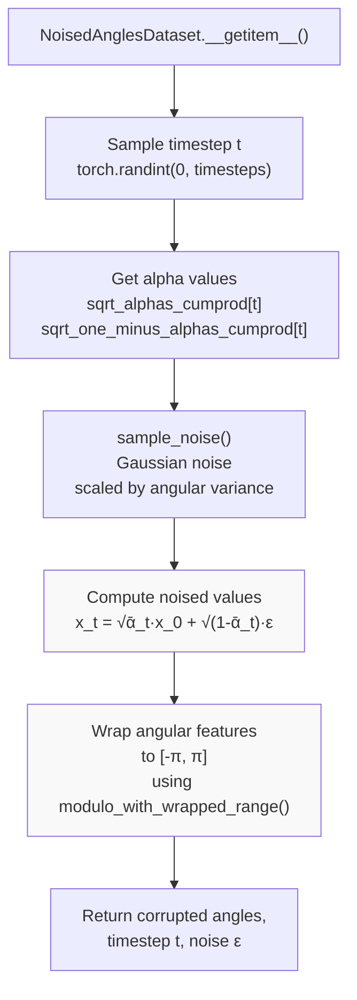
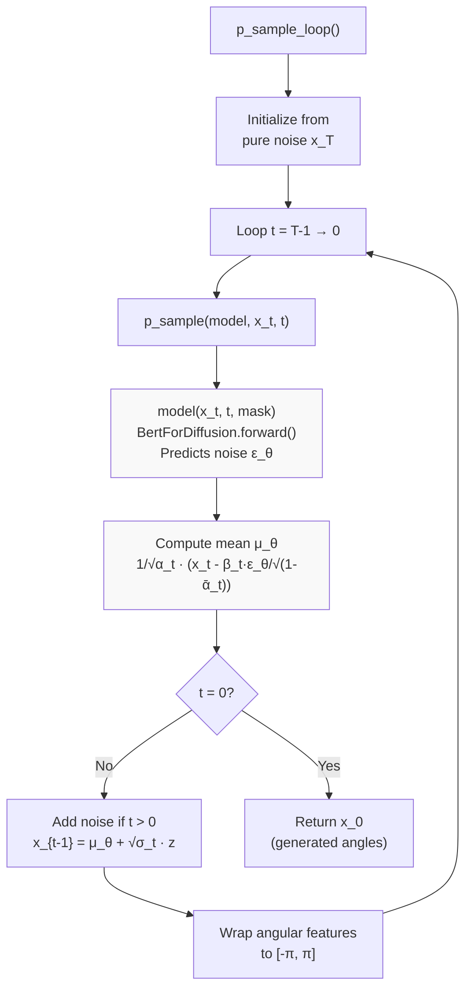
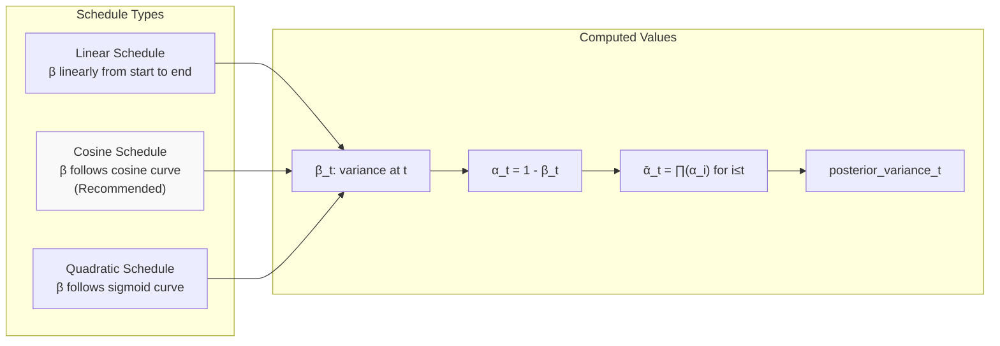

<!-- source: DeepWiki mcp.deepwiki.com · repo microsoft/foldingdiff · page 3.1 Diffusion Models for Proteins · fetched 2026-10-26 -->

# Diffusion Models for Proteins

<details>
<summary>Relevant source files</summary>

The following files were used as context for generating this wiki page:

- [CONTRIBUTING.md](CONTRIBUTING.md)
- [README.md](README.md)
- [TRADEMARKS.md](TRADEMARKS.md)
- [foldingdiff/__init__.py](foldingdiff/__init__.py)
- [foldingdiff/angles_and_coords.py](foldingdiff/angles_and_coords.py)
- [foldingdiff/beta_schedules.py](foldingdiff/beta_schedules.py)
- [foldingdiff/custom_metrics.py](foldingdiff/custom_metrics.py)
- [foldingdiff/datasets.py](foldingdiff/datasets.py)
- [foldingdiff/losses.py](foldingdiff/losses.py)
- [foldingdiff/pymol_vis.py](foldingdiff/pymol_vis.py)
- [foldingdiff/sampling.py](foldingdiff/sampling.py)
- [plots/generated_0.gif](plots/generated_0.gif)
- [requirements.txt](requirements.txt)
- [scripts/README.md](scripts/README.md)
- [setup.py](setup.py)
- [tests/test_angles_and_coords.py](tests/test_angles_and_coords.py)

</details>


## Purpose and Scope

This page explains the theoretical and practical foundations of diffusion models as applied to protein backbone generation in FoldingDiff. It covers the forward noising process, reverse denoising process, timestep scheduling, and variance schedules (beta schedules). For implementation details of the noising dataset, see [Noising Process](#4.3). For the sampling pipeline that uses reverse diffusion, see [Reverse Diffusion Process](#7.2). For details on the protein representation being diffused, see [Internal Coordinates Representation](#3.2).

## Overview of Diffusion Models

Diffusion models are a class of generative models that learn to create data by reversing a gradual noising process. In FoldingDiff, the data being generated is protein backbone structures represented as internal angles (phi, psi, omega, tau). The model learns to denoise these angular representations across a sequence of timesteps.

The core insight is that if we can learn to reverse a well-defined noising process, we can generate new samples by starting from pure noise and iteratively denoising until we obtain a valid protein structure.

**Diagram: Diffusion Process Overview**

```mermaid
graph LR
    subgraph "Forward Process (Training)"
        X0["Clean Angles<br/>x₀<br/>(phi, psi, omega, tau)"]
        X250["Partially Noised<br/>x₂₅₀"]
        X500["More Noised<br/>x₅₀₀"]
        X1000["Pure Noise<br/>x₁₀₀₀<br/>~N(0,I)"]
        
        X0 -->|"Add noise<br/>t=1→250"| X250
        X250 -->|"Add noise<br/>t=251→500"| X500
        X500 -->|"Add noise<br/>t=501→1000"| X1000
    end
    
    subgraph "Reverse Process (Sampling)"
        Y1000["Pure Noise<br/>x₁₀₀₀<br/>~N(0,I)"]
        Y500["Partially Denoised<br/>x₅₀₀"]
        Y250["More Denoised<br/>x₂₅₀"]
        Y0["Generated Angles<br/>x₀<br/>(phi, psi, omega, tau)"]
        
        Y1000 -->|"Denoise<br/>Model predicts noise"| Y500
        Y500 -->|"Denoise<br/>Model predicts noise"| Y250
        Y250 -->|"Denoise<br/>Model predicts noise"| Y0
    end
    
    X1000 -.->|"Training teaches<br/>reverse process"| Y1000
```



Sources: [foldingdiff/datasets.py:685-887](), [foldingdiff/sampling.py:27-133](), [README.md:1-196]()

## The Forward Process (Noising)

The forward process gradually adds Gaussian noise to clean protein angle data. At each timestep `t`, the noised data `x_t` is computed as a linear combination of the original data `x_0` and sampled noise `ε`.

### Mathematical Formulation

The forward diffusion process at timestep `t` is defined as:

```
x_t = √(ᾱ_t) · x_0 + √(1 - ᾱ_t) · ε
```

Where:
- `x_0` is the original clean data (protein angles)
- `ε ~ N(0, I)` is Gaussian noise
- `ᾱ_t` (alpha bar) is the cumulative product of alphas up to timestep `t`
- `α_t = 1 - β_t` where `β_t` is the variance schedule

This formulation allows us to sample any noised timestep directly without iterating through all previous timesteps.

### Code Implementation

**Diagram: Forward Process Code Flow**



Sources: [foldingdiff/datasets.py:801-886]()

Key implementation details from `NoisedAnglesDataset`:

| Component | Code Location | Description |
|-----------|---------------|-------------|
| Timestep sampling | [datasets.py:849]() | `t = torch.randint(0, self.timesteps, (1,)).long()` |
| Alpha retrieval | [datasets.py:852-855]() | Extract `sqrt_alphas_cumprod_t` and `sqrt_one_minus_alphas_cumprod_t` |
| Noise generation | [datasets.py:772-799]() | `sample_noise()` creates noise with optional variance scaling |
| Forward equation | [datasets.py:861-863]() | `noised_vals = sqrt_alphas_cumprod_t * vals + sqrt_one_minus_alphas_cumprod_t * noise` |
| Angular wrapping | [datasets.py:869-871]() | Ensures angles remain in `[-π, π]` range |

The noise sampling is protein-specific: angular features (phi, psi, omega, tau) can have different variance scales than non-angular features, and all angular noise is wrapped to `[-π, π]` to respect the circular topology of angles.

Sources: [foldingdiff/datasets.py:685-887](), [foldingdiff/utils.py]()

## The Reverse Process (Denoising)

The reverse process learns to remove noise step-by-step, starting from pure Gaussian noise and ending with a valid protein structure. The neural network predicts the noise component at each timestep, which is then used to compute a denoised estimate.

### Mathematical Formulation

At each reverse timestep, the model predicts the noise and computes the mean of the distribution:

```
μ_θ(x_t, t) = 1/√α_t · (x_t - β_t/√(1-ᾱ_t) · ε_θ(x_t, t))
```

Then samples the previous timestep:
```
x_{t-1} = μ_θ(x_t, t) + √(posterior_variance_t) · z    if t > 0
x_0 = μ_θ(x_t, t)                                        if t = 0
```

Where:
- `ε_θ(x_t, t)` is the noise predicted by the model
- `z ~ N(0, I)` is new random noise
- `posterior_variance_t = β_t · (1 - ᾱ_{t-1}) / (1 - ᾱ_t)`

### Code Implementation

**Diagram: Reverse Process Code Flow**



Sources: [foldingdiff/sampling.py:27-133]()

Key implementation details:

| Component | Code Location | Description |
|-----------|---------------|-------------|
| Noise prediction | [sampling.py:65]() | `model(x, t, attention_mask=attn_mask)` |
| Mean computation | [sampling.py:62-67]() | Implements equation 11 from DDPM paper |
| Posterior variance | [sampling.py:72]() | `posterior_variance_t = alpha_beta_values["posterior_variance"][t_index]` |
| Noise addition | [sampling.py:73-75]() | `model_mean + torch.sqrt(posterior_variance_t) * noise` |
| Angular wrapping | [sampling.py:119-130]() | Per-feature wrapping based on `is_angle` flags |
| Sampling loop | [sampling.py:78-133]() | Iterates from `T-1` down to `0` |

The reverse process respects the circular nature of angles by wrapping them after each denoising step.

Sources: [foldingdiff/sampling.py:27-133](), [foldingdiff/modelling.py]()

## Timesteps

Timesteps represent discrete steps in the noising/denoising process. FoldingDiff uses 1000 timesteps by default, providing a smooth gradient from clean data to pure noise.

**Timestep Progression:**

| Timestep Range | Noise Level | Usage |
|----------------|-------------|-------|
| `t = 0` | No noise (clean) | Target for generation, initial training data |
| `t = 1-250` | Low noise | Early denoising, structure coarse features preserved |
| `t = 251-500` | Medium noise | Mid-level features corrupted |
| `t = 501-750` | High noise | Only very coarse structure remains |
| `t = 751-1000` | Maximum noise | Nearly pure Gaussian noise |

The timestep is encoded and provided to the model through a learned embedding, allowing the model to condition its predictions on the current noise level. See [BertForDiffusion Model](#5.1) for details on timestep encoding.

**Code References:**

- Timestep sampling in training: [datasets.py:849]()
- Timestep embedding in model: [modelling.py]() (model time encoding)
- Reverse iteration: [sampling.py:102-107]()

Sources: [foldingdiff/datasets.py:699](), [foldingdiff/sampling.py:83](), [README.md:38-39]()

## Beta Schedules

Beta schedules (variance schedules) control how noise variance changes across timesteps. The schedule β_t determines how much noise is added at each step, with α_t = 1 - β_t.

### Available Schedules

**Diagram: Beta Schedule Comparison**



Sources: [foldingdiff/beta_schedules.py:1-116]()

### Schedule Definitions

**Linear Schedule** ([beta_schedules.py:32-35]()):
```python
def linear_beta_schedule(timesteps, beta_start=1e-4, beta_end=0.02):
    return torch.linspace(beta_start, beta_end, timesteps)
```
Linearly interpolates from `beta_start` to `beta_end`. Simple but may add noise too quickly at early timesteps.

**Cosine Schedule** ([beta_schedules.py:20-29]()) - **Recommended**:
```python
def cosine_beta_schedule(timesteps, s=8e-3):
    steps = timesteps + 1
    x = torch.linspace(0, timesteps, steps)
    alphas_cumprod = torch.cos(((x / timesteps) + s) / (1 + s) * torch.pi * 0.5) ** 2
    alphas_cumprod = alphas_cumprod / alphas_cumprod[0]
    betas = 1 - (alphas_cumprod[1:] / alphas_cumprod[:-1])
    return torch.clip(betas, 0.0001, 0.9999)
```
Follows a cosine curve, providing smoother transitions. This is the default schedule used in trained models.

**Quadratic Schedule** ([beta_schedules.py:38-42]()):
```python
def quadratic_beta_schedule(timesteps, beta_start=1e-4, beta_end=0.02):
    betas = torch.linspace(-6, 6, timesteps)
    return torch.sigmoid(betas) * (beta_end - beta_start) + beta_start
```
Uses sigmoid function for smooth S-curve transitions.

### Computed Alpha Values

From the beta schedule, several derived values are computed ([beta_schedules.py:45-62]()):

| Value | Formula | Purpose |
|-------|---------|---------|
| `alphas` | `1 - betas` | Per-step retention factor |
| `alphas_cumprod` | `∏ alphas` | Cumulative retention (ᾱ_t) |
| `sqrt_alphas_cumprod` | `√(alphas_cumprod)` | Used in forward process |
| `sqrt_one_minus_alphas_cumprod` | `√(1 - alphas_cumprod)` | Noise scaling in forward process |
| `posterior_variance` | `β_t · (1-ᾱ_{t-1})/(1-ᾱ_t)` | Variance for reverse process |

These precomputed values are stored in `NoisedAnglesDataset.alpha_beta_terms` and accessed during training and sampling.

Sources: [foldingdiff/beta_schedules.py:1-116](), [foldingdiff/datasets.py:724-725]()

## Protein-Specific Considerations

Diffusion models for proteins have unique considerations compared to image diffusion:

### Angular vs Non-Angular Features

The dataset distinguishes between angular features (phi, psi, omega, tau) and non-angular features (distances). Angular features are periodic and must be wrapped to `[-π, π]`:

```python
# From NoisedAnglesDataset.sample_noise()
angular_idx = np.where(self.dset.feature_is_angular[self.dset_key])[0]
noise[..., angular_idx] = utils.modulo_with_wrapped_range(
    noise[..., angular_idx], -np.pi, np.pi
)
```

This wrapping occurs:
- After noise generation ([datasets.py:795-797]())
- After computing noised values ([datasets.py:869-871]())
- After each denoising step ([sampling.py:119-130]())

### Variance Scaling

Different variance scales can be applied to angular vs non-angular features:

- `angular_variance`: Scale factor for angular noise (default: 1.0)
- `nonangular_variance`: Scale factor for distance noise (default: 1.0)

This allows independent control over how aggressively noise is added to different feature types ([datasets.py:702-703, 784-791]()).

### Zero-Centering

The dataset can optionally zero-center features by computing wrapped means of the training data and offsetting all values. This helps stabilize training but requires special handling for circular angular features ([datasets.py:209-219]()).

Sources: [foldingdiff/datasets.py:685-887](), [foldingdiff/sampling.py:78-133](), [foldingdiff/custom_metrics.py:85-94]()

## Training Objective

During training, the model learns to predict the noise `ε` that was added at each timestep. The loss function compares the predicted noise to the actual noise:

```
L = ||ε - ε_θ(x_t, t)||
```

Where:
- `ε` is the true noise added (from `NoisedAnglesDataset`)
- `ε_θ(x_t, t)` is the model's prediction
- The norm is typically smooth L1 loss for angular features ([losses.py:29-63]())

The model receives:
- `corrupted`: Noised angles x_t
- `t`: Timestep embedding
- `attn_mask`: Attention mask for variable-length sequences

And predicts:
- `predicted_noise`: The noise component ε_θ

Sources: [foldingdiff/losses.py:29-63](), [foldingdiff/modelling.py](), [bin/train.py]()

---

