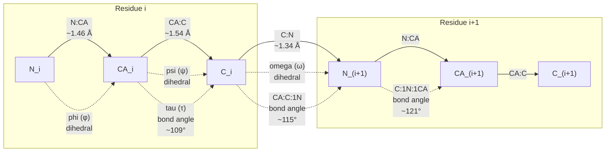
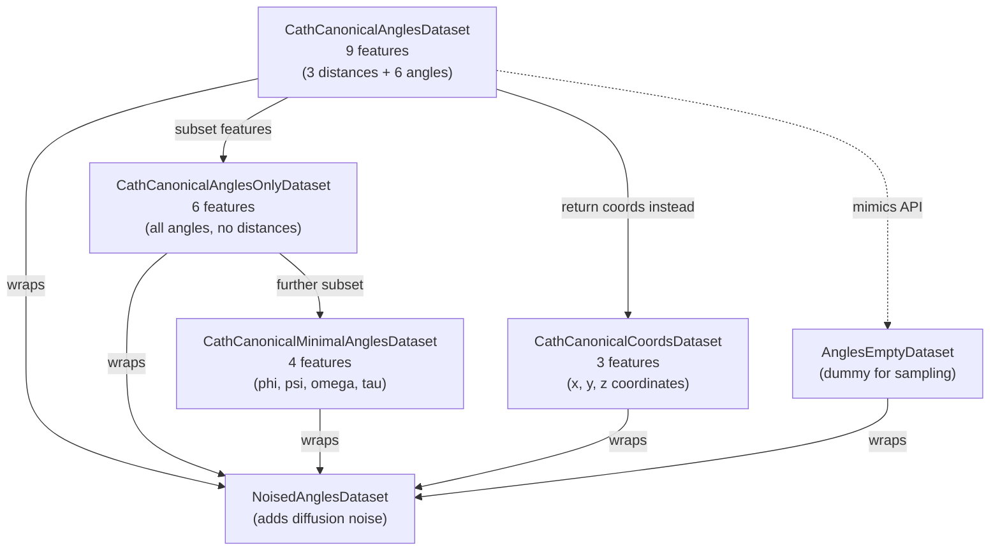
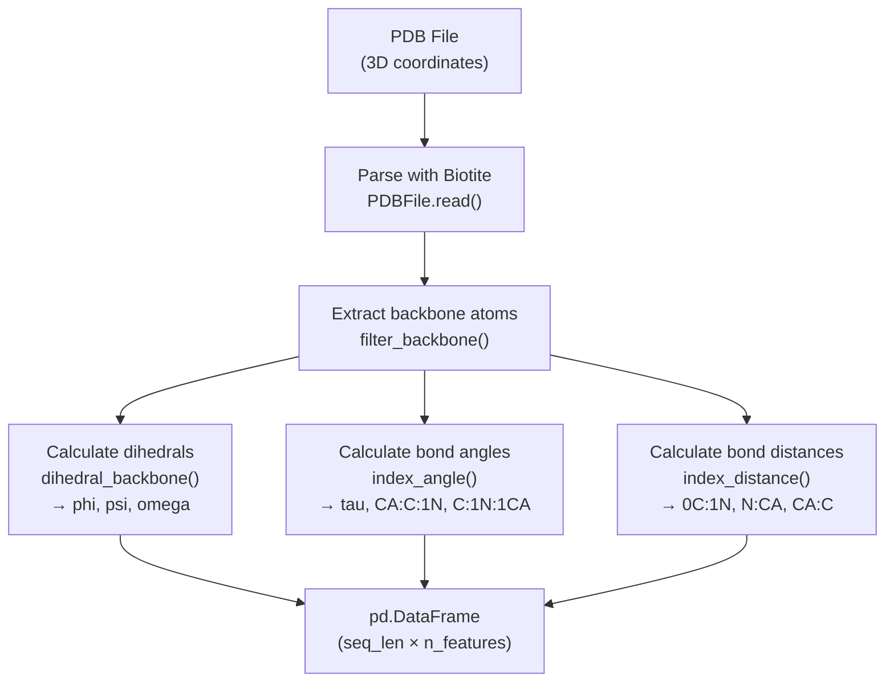
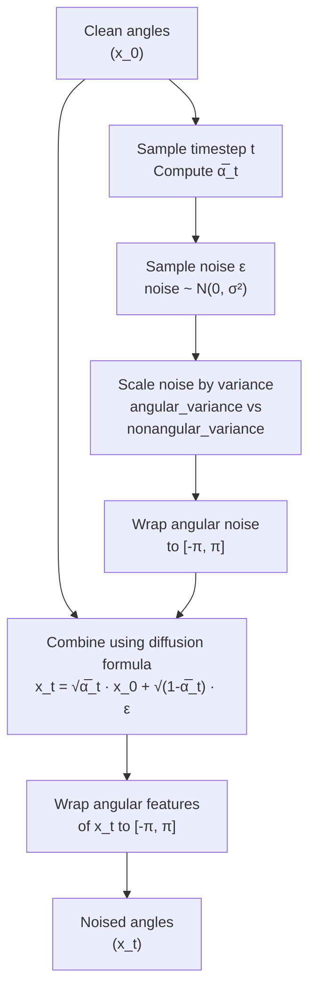
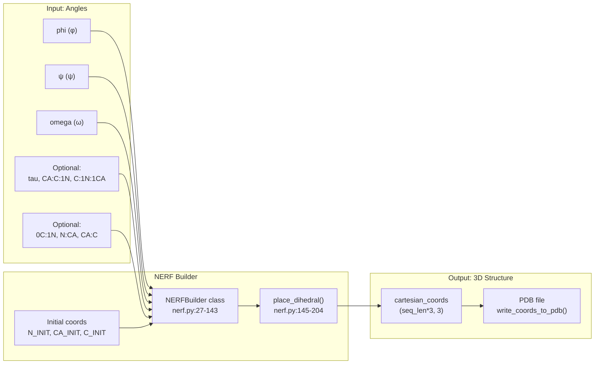

<!-- source: DeepWiki mcp.deepwiki.com · repo microsoft/foldingdiff · page 3.2 Internal Coordinates Representation · fetched 2026-10-26 -->

# Internal Coordinates Representation

<details>
<summary>Relevant source files</summary>

The following files were used as context for generating this wiki page:

- [foldingdiff/angles_and_coords.py](foldingdiff/angles_and_coords.py)
- [foldingdiff/datasets.py](foldingdiff/datasets.py)
- [foldingdiff/nerf.py](foldingdiff/nerf.py)
- [foldingdiff/sampling.py](foldingdiff/sampling.py)
- [tests/test_angles_and_coords.py](tests/test_angles_and_coords.py)
- [tests/test_nerf.py](tests/test_nerf.py)

</details>


## Purpose and Scope

This document explains FoldingDiff's use of **internal coordinates** (dihedral angles and bond lengths) rather than Cartesian coordinates to represent protein backbone structures. It covers the specific angles and distances used, the rationale for this choice, available feature sets, and how this representation is implemented in code.

For the algorithmic details of converting angles back to 3D coordinates, see [NERF Reconstruction](#3.3). For the implementation details of angle extraction functions, see [Angle Extraction and Conversion](#4.2). For how datasets wrap this representation, see [Dataset Classes](#4.1).

---

## Why Internal Coordinates?

FoldingDiff operates in **angle space** rather than Cartesian coordinate space for several key reasons:

**Translation and Rotation Invariance**: Internal coordinates describe the relative geometry of the backbone, making them invariant to rigid body transformations. A protein structure maintains the same angle representation regardless of its position or orientation in 3D space.

**Dimensionality Reduction**: Instead of representing each backbone atom with 3 Cartesian coordinates (x, y, z), internal coordinates describe the structure using angles between atoms and bond lengths. For a protein with N residues, this reduces representation from 9N values (3 atoms × 3 coordinates per residue) to 6-9 values per residue depending on the feature set.

**Physical Constraints**: Bond lengths and angles in proteins are relatively constrained by chemistry. By modeling these directly, the diffusion process operates within a more physically meaningful space where generated samples are more likely to represent chemically valid structures.

**Circular Manifold**: Angular values naturally live on a circular manifold (wrapping at ±π), which FoldingDiff handles explicitly through modulo operations during noising and denoising.

Sources: [foldingdiff/datasets.py:1-463](), [foldingdiff/angles_and_coords.py:1-110]()

---

## Protein Backbone Representation

A protein backbone consists of a repeating pattern of three atoms per residue: **N (nitrogen)**, **CA (alpha carbon)**, and **C (carbonyl carbon)**. The backbone geometry is fully determined by:

**Dihedral Angles (Torsion Angles)**: Rotation around backbone bonds
- **phi (φ)**: Rotation around the N-CA bond
- **psi (ψ)**: Rotation around the CA-C bond  
- **omega (ω)**: Rotation around the C-N peptide bond (usually ~180° in trans configuration)

**Bond Angles**: Angles between consecutive bonds
- **tau (τ)** or **N:CA:C**: The bond angle at the alpha carbon (~109°)
- **CA:C:1N**: The bond angle at the carbonyl carbon connecting to the next residue (~115°)
- **C:1N:1CA**: The bond angle at the nitrogen of the next residue (~121°)

**Bond Lengths**: Distances between bonded atoms
- **0C:1N** (or **C:1N**): Distance from carbonyl carbon to next nitrogen (~1.34 Å)
- **N:CA**: Distance from nitrogen to alpha carbon (~1.46 Å)
- **CA:C**: Distance from alpha carbon to carbonyl carbon (~1.54 Å)

The notation `0C:1N` means the carbon of the current residue (0) to the nitrogen of the next residue (1).

Sources: [foldingdiff/angles_and_coords.py:23-28](), [foldingdiff/nerf.py:17-24]()



**Diagram: Protein backbone atoms and the angles/distances that define their geometry**

Sources: [foldingdiff/nerf.py:17-24](), [foldingdiff/angles_and_coords.py:30-110]()

---

## Feature Sets in FoldingDiff

FoldingDiff defines several feature sets with different levels of detail. These are defined in the `FEATURE_SET_NAMES_TO_FEATURE_NAMES` and `FEATURE_SET_NAMES_TO_ANGULARITY` dictionaries.

### Feature Set Definitions

| Feature Set | Features | Count | Description |
|-------------|----------|-------|-------------|
| `canonical` | `0C:1N`, `N:CA`, `CA:C`, `phi`, `psi`, `omega`, `tau`, `CA:C:1N`, `C:1N:1CA` | 9 | Full representation with distances and all angles |
| `canonical-full-angles` | `phi`, `psi`, `omega`, `tau`, `CA:C:1N`, `C:1N:1CA` | 6 | All angles without distances |
| `canonical-minimal-angles` | `phi`, `psi`, `omega`, `tau` | 4 | Minimal angles for reconstruction |
| `cart-coords` | `x`, `y`, `z` | 3 | Cartesian coordinates (for baseline comparison) |

Sources: [foldingdiff/datasets.py:44-72]()

### Angularity Flags

Each feature is marked as angular or non-angular, which affects how noise is applied during diffusion:

```python
FEATURE_SET_NAMES_TO_ANGULARITY = {
    "canonical": [False, False, False, True, True, True, True, True, True],
    "canonical-full-angles": [True, True, True, True, True, True],
    "canonical-minimal-angles": [True, True, True, True],
    "cart-coords": [False, False, False],
}
```

Angular features (dihedral and bond angles) are wrapped to the range [-π, π] using modulo operations, while non-angular features (distances, coordinates) are not wrapped.

Sources: [foldingdiff/datasets.py:44-49]()

---

## Dataset Classes and Feature Handling



**Diagram: Dataset class hierarchy and feature subsetting**

Sources: [foldingdiff/datasets.py:75-567]()

### CathCanonicalAnglesDataset

The base dataset class stores all 9 features:

**Feature Names**: Defined in `feature_names["angles"]`
```python
["0C:1N", "N:CA", "CA:C", "phi", "psi", "omega", "tau", "CA:C:1N", "C:1N:1CA"]
```

**Angularity Flags**: Defined in `feature_is_angular["angles"]`
```python
[False, False, False, True, True, True, True, True, True]
```

The first three features (distances) are non-angular, while the last six (angles) are angular.

Sources: [foldingdiff/datasets.py:82-99]()

### CathCanonicalAnglesOnlyDataset

Subsets to 6 angular features by removing the three distance features:

```python
feature_names = {"angles": ["phi", "psi", "omega", "tau", "CA:C:1N", "C:1N:1CA"]}
feature_is_angular = {"angles": [True, True, True, True, True, True]}
```

The `__getitem__` method indexes into the parent's output using `self.feature_idx` to extract only the desired features.

Sources: [foldingdiff/datasets.py:502-554]()

### CathCanonicalMinimalAnglesDataset

Further subsets to the 4 essential angles needed for basic reconstruction:

```python
feature_names = {"angles": ["phi", "psi", "omega", "tau"]}
feature_is_angular = {"angles": [True, True, True, True]}
```

This is the minimal set that still allows reasonable 3D structure reconstruction using default bond lengths and angles.

Sources: [foldingdiff/datasets.py:557-567]()

---

## Angle Extraction from PDB Files

The `canonical_distances_and_dihedrals()` function extracts angles and distances from PDB files:



**Diagram: Angle extraction pipeline from PDB to DataFrame**

Sources: [foldingdiff/angles_and_coords.py:30-110]()

### Key Implementation Details

**Dihedral Angles**: Extracted using biotite's `struc.dihedral_backbone()` function, which automatically handles the backbone topology.

**Bond Angles**: Calculated using `struc.index_angle()` with explicit atom index specifications:
- `tau` (N:CA:C): Indices at positions (i, i+1, i+2) in the backbone atom array
- `CA:C:1N`: Indices at positions (i+1, i+2, i+3) - connects adjacent residues
- `C:1N:1CA`: Indices at positions (i+2, i+3, i+4) - continues into next residue

**Bond Distances**: Calculated using `struc.index_distance()` with similar indexing patterns.

**Value Range**: All angles are validated to be in the range [-π, π]. If values fall outside this range, the structure is considered malformed and skipped.

Sources: [foldingdiff/angles_and_coords.py:48-110]()

---

## Angle Processing and Normalization

### Zero-Centering

Datasets can optionally zero-center features by computing the mean across all structures:

```python
structures_concat = np.concatenate([s["angles"] for s in self.structures])
self.means = cm.wrapped_mean(structures_concat, axis=0)
```

The `wrapped_mean()` function correctly handles circular means for angular features. During `__getitem__`, the mean is subtracted and the result is wrapped back to [-π, π] for angular features.

Sources: [foldingdiff/datasets.py:208-220](), [foldingdiff/datasets.py:376-388]()

### Modulo Wrapping

Angular features must be kept in the range [-π, π] using `modulo_with_wrapped_range()`:

```python
angles.iloc[:, angular_idx] = utils.modulo_with_wrapped_range(
    angles.iloc[:, angular_idx], -np.pi, np.pi
)
```

This is critical for maintaining the circular topology of angle space. The function performs:
```
wrapped_value = ((value - range_min) % range_width) + range_min
```

Sources: [foldingdiff/datasets.py:386-388](), [foldingdiff/utils.py]()

---

## Noise Application to Angles

The `NoisedAnglesDataset` applies diffusion noise differently to angular and non-angular features:



**Diagram: Noise application pipeline with special handling for angular features**

Sources: [foldingdiff/datasets.py:772-871]()

### Variance Scaling

The `sample_noise()` method scales noise based on feature type:

```python
for j in range(noise.shape[-1]):  # Last dim = feature dim
    s = (
        self.angular_var_scale
        if self.dset.feature_is_angular[self.dset_key][j]
        else self.nonangular_var_scale
    )
    noise[..., j] *= s
```

This allows independent control of noise magnitude for angular vs. non-angular features, which is important because they have different natural scales.

Sources: [foldingdiff/datasets.py:784-791]()

### Wrapping After Noising

After combining clean data with noise, angular features are wrapped:

```python
angular_idx = np.where(self.dset.feature_is_angular[self.dset_key])[0]
noised_vals[:, angular_idx] = utils.modulo_with_wrapped_range(
    noised_vals[:, angular_idx], -np.pi, np.pi
)
```

This ensures noised angles stay on the circular manifold.

Sources: [foldingdiff/datasets.py:867-871]()

---

## Default Bond Lengths and Angles

When not explicitly modeling distances and bond angles, NERF reconstruction uses default values based on typical protein geometry:

| Parameter | Constant | Default Value | Description |
|-----------|----------|---------------|-------------|
| N-CA bond length | `N_CA_LENGTH` | 1.46 Å | Nitrogen to alpha carbon |
| CA-C bond length | `CA_C_LENGTH` | 1.54 Å | Alpha carbon to carbonyl carbon |
| C-N bond length | `C_N_LENGTH` | 1.34 Å | Carbonyl carbon to next nitrogen (peptide bond) |
| N-CA-C angle | `bond_angle_ca_c` | 109° (1.90 rad) | Angle at alpha carbon (tau) |
| CA-C-N angle | `bond_angle_c_n` | 115° (2.01 rad) | Angle at carbonyl carbon |
| C-N-CA angle | `bond_angle_n_ca` | 121° (2.11 rad) | Angle at nitrogen |

Sources: [foldingdiff/nerf.py:17-24](), [foldingdiff/nerf.py:40-42]()

---

## Code Mapping: Angles to PDB Reconstruction



**Diagram: Code flow from angles to 3D PDB structure**

Sources: [foldingdiff/nerf.py:27-143](), [foldingdiff/angles_and_coords.py:112-184](), [foldingdiff/angles_and_coords.py:187-253]()

### Key Functions

**`canonical_distances_and_dihedrals()`**: Extracts angles from PDB → DataFrame
- Location: [foldingdiff/angles_and_coords.py:30-110]()
- Input: PDB filename, list of desired angles and distances
- Output: pandas DataFrame with shape (seq_len, n_features)

**`NERFBuilder`**: Converts angles to 3D coordinates
- Location: [foldingdiff/nerf.py:27-143]()
- Input: phi, psi, omega arrays, optional bond angles/lengths
- Properties: `cartesian_coords`, `centered_cartesian_coords`

**`create_new_chain_nerf()`**: High-level wrapper for angle → PDB conversion
- Location: [foldingdiff/angles_and_coords.py:112-184]()
- Creates NERFBuilder, gets coordinates, writes PDB file
- Auto-determines which angles/distances to use from DataFrame columns

**`write_coords_to_pdb()`**: Writes 3D coordinates to PDB format
- Location: [foldingdiff/angles_and_coords.py:187-253]()
- Creates biotite Atom objects with proper chain/residue information
- All residues are written as GLY (glycine) since only backbone is present

Sources: [foldingdiff/angles_and_coords.py:30-253](), [foldingdiff/nerf.py:27-143]()

---

## Benefits and Trade-offs

### Benefits

**Geometric Validity**: Operating in angle space naturally constrains the model to produce geometrically valid protein backbones. Bond lengths and angles remain within physically reasonable ranges.

**Sample Efficiency**: Reduced dimensionality means the model has fewer degrees of freedom to learn, potentially leading to faster training and better generalization.

**Invariance**: Translation and rotation invariance means the model focuses on the intrinsic geometry rather than extrinsic positioning.

**Interpretability**: Angles have clear structural interpretations (α-helix regions have characteristic phi/psi values, β-sheets have different characteristic values).

### Trade-offs

**Reconstruction Dependency**: Angles must be converted back to Cartesian coordinates for visualization and evaluation, requiring the NERF algorithm (see [NERF Reconstruction](#3.3)).

**Circular Topology**: Special handling is required throughout the pipeline to properly handle the circular nature of angles (wrapping, circular means, etc.).

**Incomplete Information**: Using only backbone dihedrals discards sidechain information. Full-atom reconstruction requires inverse folding or other methods to predict sequences (see [Designability Testing](#8.2)).

**Non-Cartesian Losses**: Some structural quality metrics are most naturally computed in Cartesian space, requiring conversion or specialized loss functions.

Sources: [foldingdiff/datasets.py:1-463](), [foldingdiff/losses.py]()

---

