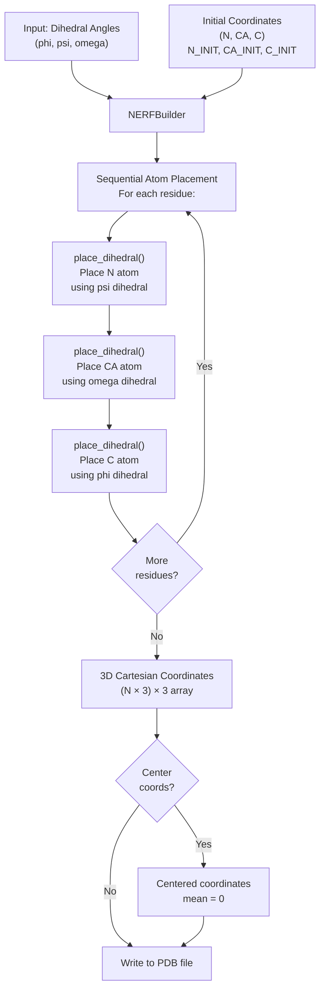
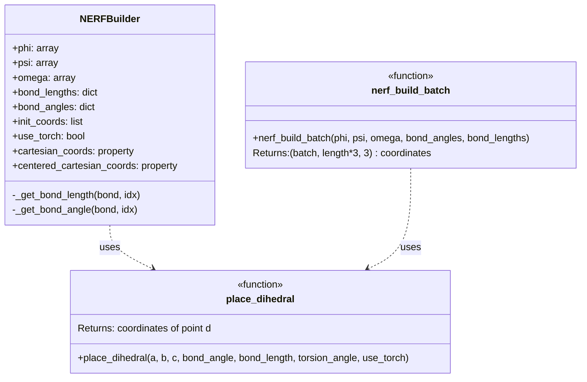
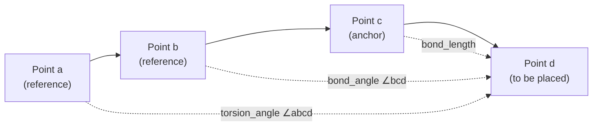
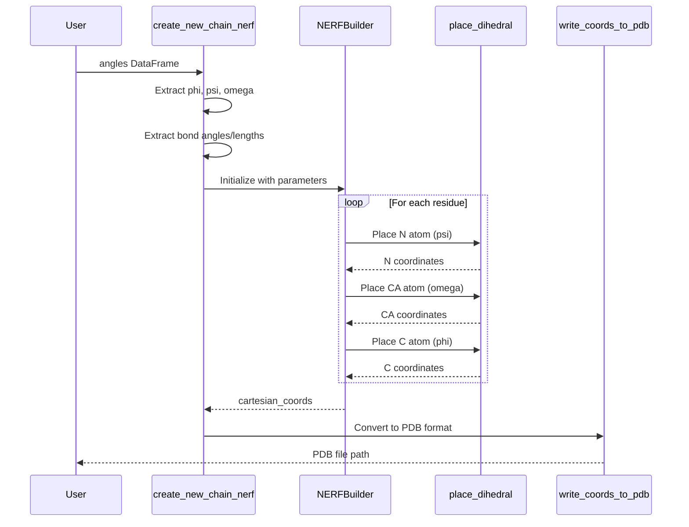
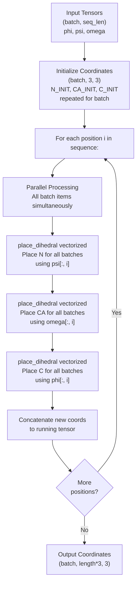
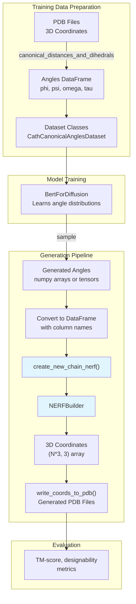

<!-- source: DeepWiki mcp.deepwiki.com · repo microsoft/foldingdiff · page 3.3 NERF Reconstruction · fetched 2026-10-26 -->

# NERF Reconstruction

<details>
<summary>Relevant source files</summary>

The following files were used as context for generating this wiki page:

- [foldingdiff/angles_and_coords.py](foldingdiff/angles_and_coords.py)
- [foldingdiff/datasets.py](foldingdiff/datasets.py)
- [foldingdiff/nerf.py](foldingdiff/nerf.py)
- [foldingdiff/sampling.py](foldingdiff/sampling.py)
- [tests/test_angles_and_coords.py](tests/test_angles_and_coords.py)
- [tests/test_nerf.py](tests/test_nerf.py)

</details>


## Purpose and Scope

This page documents the **Natural Extension Reference Frame (NERF)** algorithm implementation used to convert internal coordinates (dihedral angles, bond angles, and bond lengths) into 3D Cartesian coordinates for protein backbone structures. NERF is the critical component that enables the FoldingDiff system to reconstruct physical protein structures from the angular representations that the diffusion model operates on.

For information about how angles are extracted from PDB files, see [Internal Coordinates Representation](#3.2). For details on how generated angles are converted to full protein structures during sampling, see [Output Generation and Visualization](#7.3).

---

## Algorithm Overview

The NERF algorithm reconstructs protein backbone structures by sequentially placing atoms using geometric constraints. Starting from an initial set of three atoms (N-CA-C), each subsequent atom is placed using:

1. **Bond length**: Distance from the previous atom
2. **Bond angle**: Angle formed with the previous two atoms
3. **Dihedral angle**: Torsion angle formed with the previous three atoms

This process is repeated to build out the entire backbone structure, with the three dihedral angles (phi, psi, omega) serving as the primary degrees of freedom that define protein conformation.



**Sources:** [foldingdiff/nerf.py:1-314](), [foldingdiff/angles_and_coords.py:112-185]()

---

## Core Implementation: NERFBuilder

The `NERFBuilder` class is the primary interface for NERF reconstruction. It accepts dihedral angles and optional bond geometry parameters, then computes the full 3D coordinates.

### Initialization Parameters

| Parameter | Type | Default | Description |
|-----------|------|---------|-------------|
| `phi_dihedrals` | `np.ndarray` or `torch.Tensor` | Required | Phi (φ) dihedral angles for backbone |
| `psi_dihedrals` | `np.ndarray` or `torch.Tensor` | Required | Psi (ψ) dihedral angles for backbone |
| `omega_dihedrals` | `np.ndarray` or `torch.Tensor` | Required | Omega (ω) dihedral angles for backbone |
| `bond_len_n_ca` | `float` or array | `1.46` | N-CA bond length |
| `bond_len_ca_c` | `float` or array | `1.54` | CA-C bond length |
| `bond_len_c_n` | `float` or array | `1.34` | C-N bond length |
| `bond_angle_n_ca` | `float` or array | `121°` | C-N-CA bond angle |
| `bond_angle_ca_c` | `float` or array | `109°` | N-CA-C bond angle (tau) |
| `bond_angle_c_n` | `float` or array | `115°` | CA-C-N bond angle |
| `init_coords` | `np.ndarray` | `[N_INIT, CA_INIT, C_INIT]` | Initial N-CA-C coordinates |

### Key Properties and Methods



**Sources:** [foldingdiff/nerf.py:27-143]()

---

## The place_dihedral Function

The core geometric operation in NERF is implemented in `place_dihedral()`, which computes the position of a fourth point `d` given three existing points `a`, `b`, `c` and geometric constraints.

### Mathematical Formulation

Given points `a`, `b`, `c`, the function places point `d` such that:
- The distance from `c` to `d` equals `bond_length`
- The angle `∠bcd` equals `bond_angle`
- The dihedral angle `∠abcd` equals `torsion_angle`



### Implementation Steps

The function follows these steps (see [foldingdiff/nerf.py:145-204]()):

1. **Compute unit vectors**: Calculate `bc` (from b to c) and normalize
2. **Calculate normal vector**: `n = normalize(cross(ab, bc))`
3. **Create local coordinate system**: `[bc, nbc, n]` where `nbc = cross(n, bc)`
4. **Compute local coordinates of d**: Using bond length and angles
5. **Transform to global coordinates**: Apply rotation matrix transformation

The function supports both NumPy and PyTorch backends, automatically detected based on input types.

**Sources:** [foldingdiff/nerf.py:145-204](), [tests/test_nerf.py:18-48]()

---

## Reconstruction Process Flow

### Single Structure Reconstruction



**Sources:** [foldingdiff/angles_and_coords.py:112-185](), [foldingdiff/nerf.py:78-122]()

---

## Batch Processing Support

For efficient processing during sampling, NERF includes a specialized batch processing function `nerf_build_batch()` that handles multiple structures simultaneously using vectorized operations.

### Function Signature

```python
def nerf_build_batch(
    phi: torch.Tensor,              # (batch, seq_len)
    psi: torch.Tensor,              # (batch, seq_len)
    omega: torch.Tensor,            # (batch, seq_len)
    bond_angle_n_ca_c: torch.Tensor,  # tau
    bond_angle_ca_c_n: torch.Tensor,
    bond_angle_c_n_ca: torch.Tensor,
    bond_len_n_ca: Union[float, torch.Tensor] = N_CA_LENGTH,
    bond_len_ca_c: Union[float, torch.Tensor] = CA_C_LENGTH,
    bond_len_c_n: Union[float, torch.Tensor] = C_N_LENGTH,
) -> torch.Tensor:
    # Returns: (batch, length * 3, 3)
```

### Batch Processing Flow



**Key advantages:**
- All structures in batch processed in parallel
- GPU acceleration via PyTorch
- Memory efficient for large batches
- Maintains gradient information for differentiable operations

**Sources:** [foldingdiff/nerf.py:207-292](), [tests/test_nerf.py:131-177]()

---

## Integration with FoldingDiff Pipeline

NERF serves as the bridge between the model's angular output space and physical 3D structures.

### Data Flow Through NERF



**Sources:** [foldingdiff/sampling.py:135-224](), [foldingdiff/angles_and_coords.py:30-110](), [foldingdiff/datasets.py:304-337]()

---

## PyTorch Backend for Differentiability

NERF includes full PyTorch support, enabling gradient computation through the reconstruction process. This is critical for:

1. **Gradient-based optimization**: Fine-tuning structures
2. **Loss computation**: Direct losses on 3D coordinates
3. **End-to-end training**: Potential future architectures

### Backend Detection

The `NERFBuilder` automatically detects whether to use NumPy or PyTorch based on input types:

```python
self.use_torch = False
if any([isinstance(v, torch.Tensor) 
        for v in [phi_dihedrals, psi_dihedrals, omega_dihedrals]]):
    self.use_torch = True
```

### Implementation Differences

| Operation | NumPy Backend | PyTorch Backend |
|-----------|---------------|-----------------|
| Normalization | `x / np.linalg.norm(x)` | `x / torch.linalg.norm(x, keepdim=True)` |
| Cross product | `np.cross(x, y)` | `torch.linalg.cross(x, y)` |
| Stack | `np.stack([...])` | `torch.stack([...])` |
| Matrix multiply | `m.dot(d)` | `torch.matmul(m, d)` |
| Gradient tracking | N/A | `requires_grad=True` |

**Sources:** [foldingdiff/nerf.py:45-52](), [foldingdiff/nerf.py:161-203](), [tests/test_nerf.py:244-332]()

---

## Fixed vs Variable Geometry

NERF supports both fixed and variable bond geometries:

### Fixed Geometry (Default)

Uses standard ideal values for bond lengths and angles:
- N-CA: 1.46 Å
- CA-C: 1.54 Å  
- C-N: 1.34 Å
- N-CA-C angle (tau): 109°
- CA-C-N angle: 115°
- C-N-CA angle: 121°

### Variable Geometry (Full Model)

Accepts arrays for bond parameters, allowing the model to predict non-ideal geometries:

```python
NERFBuilder(
    phi_dihedrals=phi,
    psi_dihedrals=psi,
    omega_dihedrals=omega,
    bond_len_c_n=predicted_c_n_distances,  # Array, not float
    bond_angle_ca_c=predicted_tau_angles,  # Array, not float
    # ... other variable parameters
)
```

This enables more accurate reconstruction when bond geometry is predicted by the model.

**Sources:** [foldingdiff/nerf.py:32-69](), [foldingdiff/angles_and_coords.py:141-168]()

---

## Usage Examples

### Basic Reconstruction from PDB

```python
# Extract angles from PDB
angles = canonical_distances_and_dihedrals(
    "protein.pdb",
    distances=["0C:1N", "N:CA", "CA:C"],
    angles=["phi", "psi", "omega", "tau", "CA:C:1N", "C:1N:1CA"]
)

# Reconstruct using NERF
create_new_chain_nerf(
    "output.pdb",
    angles,
    angles_to_set=["phi", "psi", "omega", "tau", "CA:C:1N", "C:1N:1CA"],
    dists_to_set=["0C:1N", "N:CA", "CA:C"],
    center_coords=True
)
```

### Batch Processing Generated Structures

```python
# From sampling pipeline
built_coords = nerf_build_batch(
    phi=phi_batch,           # (batch, seq_len)
    psi=psi_batch,
    omega=omega_batch,
    bond_angle_n_ca_c=tau_batch,
    bond_angle_ca_c_n=ca_c_n_batch,
    bond_angle_c_n_ca=c_n_ca_batch,
)
# Returns: (batch, seq_len*3, 3)

# Write each structure to PDB
for i, coords in enumerate(built_coords):
    write_coords_to_pdb(
        coords[~torch.isnan(coords).any(dim=1)].numpy(),
        f"structure_{i}.pdb"
    )
```

**Sources:** [foldingdiff/angles_and_coords.py:112-185](), [tests/test_nerf.py:72-130](), [tests/test_nerf.py:178-241]()

---

## Error Handling and Edge Cases

### NaN Handling

NERF reconstruction may produce NaN values in several cases:
- Invalid dihedral angles outside [-π, π]
- Malformed input geometries
- Numerical instability in cross products

The system checks for NaN values before writing PDB files:

```python
coords = nerf_builder.cartesian_coords
if np.any(np.isnan(coords)):
    logging.warning(f"Found NaN values, not writing pdb file {out_fname}")
    return ""
```

### Padding and Variable Lengths

When processing batched inputs with different sequence lengths, padding is handled by:
1. Padding angle tensors with NaN values
2. Filtering out NaN coordinates before writing PDBs
3. Using attention masks to track valid sequence positions

**Sources:** [foldingdiff/angles_and_coords.py:176-178](), [tests/test_nerf.py:178-241]()

---

## Testing and Validation

The NERF implementation includes comprehensive tests:

### Test Categories

| Test Class | Purpose | Key Tests |
|------------|---------|-----------|
| `TestDihedralPlacement` | Validate `place_dihedral()` | Simple geometry, randomized inputs |
| `TestBackboneReconstruction` | Full reconstruction accuracy | TM-score validation (≥0.95) |
| `TestPytorchBackend` | PyTorch compatibility | Vectorized operations, gradients |

### Reconstruction Accuracy

Tests verify that reconstructing a structure from its extracted angles produces TM-scores of:
- **1.0** for full angle set (phi, psi, omega, tau, CA:C:1N, C:1N:1CA)
- **≥0.5** for minimal angle set (phi, psi, omega only)

This validates both the extraction and reconstruction pipelines.

**Sources:** [tests/test_nerf.py:1-352]()

---

