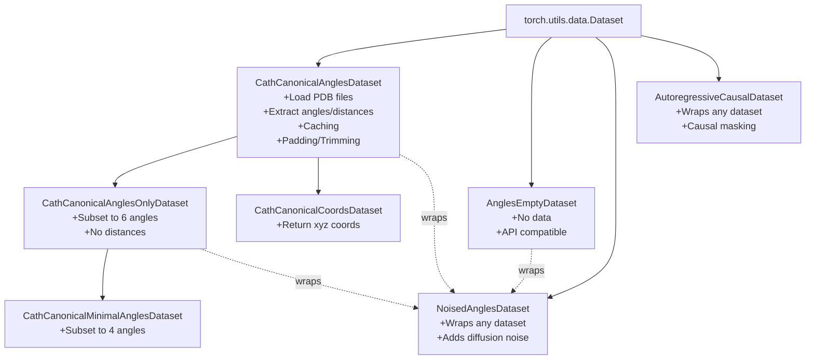
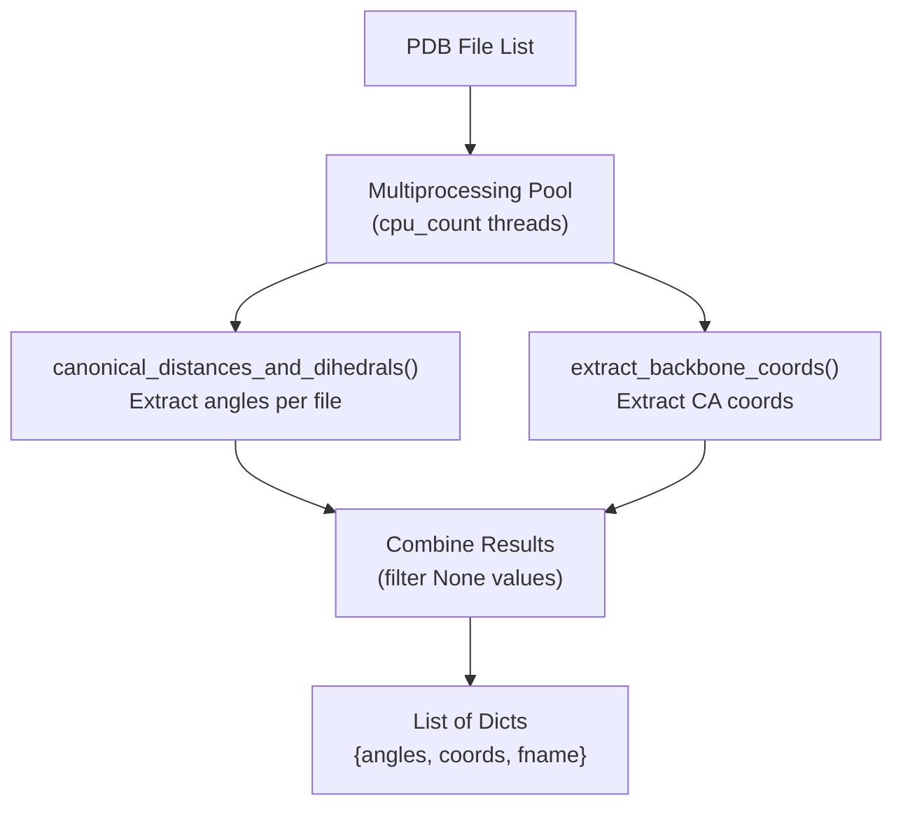
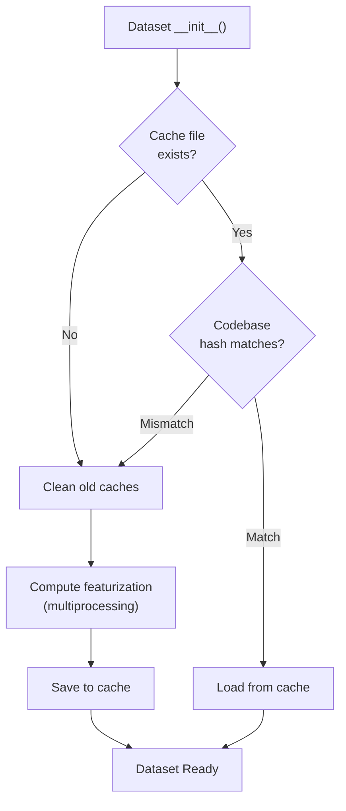
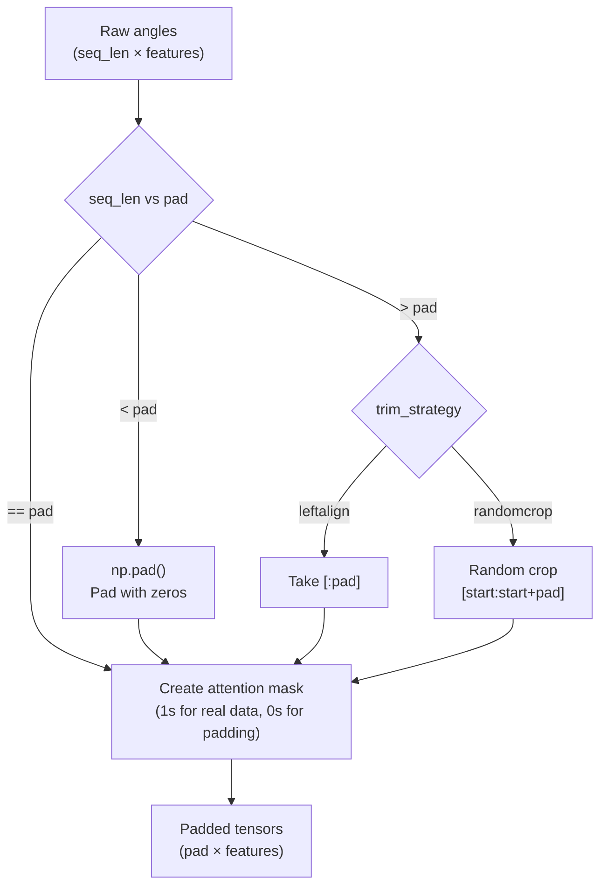
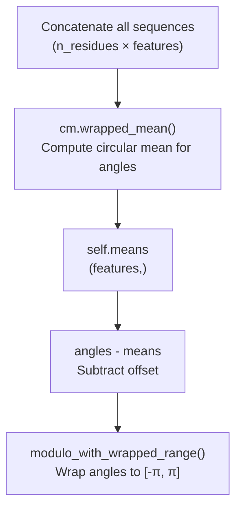
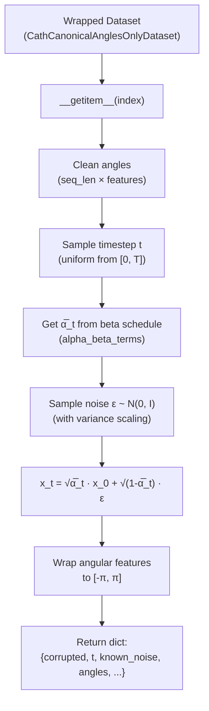
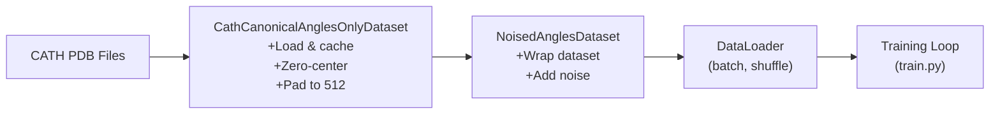
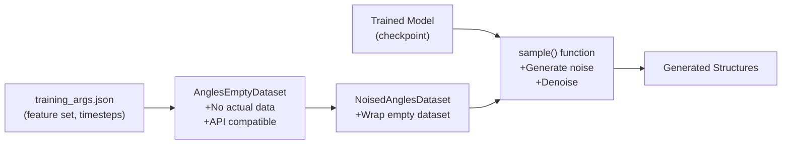

<!-- source: DeepWiki mcp.deepwiki.com · repo microsoft/foldingdiff · page 4 Data Pipeline · fetched 2026-10-26 -->

# Data Pipeline

<details>
<summary>Relevant source files</summary>

The following files were used as context for generating this wiki page:

- [.gitignore](.gitignore)
- [foldingdiff/angles_and_coords.py](foldingdiff/angles_and_coords.py)
- [foldingdiff/datasets.py](foldingdiff/datasets.py)
- [foldingdiff/sampling.py](foldingdiff/sampling.py)
- [tests/test_angles_and_coords.py](tests/test_angles_and_coords.py)
- [tests/test_data.py](tests/test_data.py)
- [tests/test_losses.py](tests/test_losses.py)

</details>


## Purpose and Scope

This document describes the data pipeline in FoldingDiff, which transforms protein structure data from PDB files into tensors suitable for model training and inference. The pipeline handles:

- Loading protein structures from PDB files (CATH dataset)
- Extracting internal coordinate representations (angles and distances)
- Applying padding, trimming, and normalization
- Adding diffusion noise for training
- Providing batched data to models

For information about angle-to-coordinate conversion using NERF, see [NERF Reconstruction](#3.3). For details on the training process that consumes this data, see [Training](#6).

Sources: [foldingdiff/datasets.py:1-40]()

---

## Data Flow Overview

```mermaid
graph LR
    PDB["PDB Files<br/>(CATH dataset)"]
    EXTRACT["canonical_distances_and_dihedrals()<br/>Extract angles & distances"]
    CACHE["Cached .pkl Files<br/>(featurized structures)"]
    DSET["Dataset Classes<br/>(CathCanonicalAnglesDataset)"]
    SUBSET["Feature Subset<br/>(CathCanonicalAnglesOnlyDataset)"]
    NOISE["NoisedAnglesDataset<br/>Add diffusion noise"]
    BATCH["Batched Tensors<br/>(batch × seq_len × features)"]
    MODEL["Model Input<br/>(corrupted, t, attn_mask)"]
    
    PDB --> EXTRACT
    EXTRACT --> CACHE
    CACHE --> DSET
    DSET --> SUBSET
    SUBSET --> NOISE
    NOISE --> BATCH
    BATCH --> MODEL
    
    DSET -.->|"Zero-centering<br/>Padding/Trimming"| SUBSET
    NOISE -.->|"Sample noise<br/>Apply beta schedule"| BATCH
```



**Data Flow**: PDB structures are loaded and converted to angle/distance features, which are cached for efficiency. Dataset classes handle padding, trimming, and zero-centering. The `NoisedAnglesDataset` wrapper adds diffusion noise before data reaches the model.

Sources: [foldingdiff/datasets.py:75-463](), [foldingdiff/angles_and_coords.py:30-109]()

---

## Dataset Class Hierarchy

The data pipeline uses a hierarchical design with base classes and specialized wrappers:

| Class | Purpose | Key Features |
|-------|---------|--------------|
| `CathCanonicalAnglesDataset` | Base dataset loading PDB files | Returns 9 features (3 distances + 6 angles), handles caching, padding, zero-centering |
| `CathCanonicalAnglesOnlyDataset` | Angles-only subset | Returns 6 angles (phi, psi, omega, tau, CA:C:1N, C:1N:1CA), all angular |
| `CathCanonicalMinimalAnglesDataset` | Minimal angle set | Returns 4 angles (phi, psi, omega, tau), minimum for reconstruction |
| `CathCanonicalCoordsDataset` | Cartesian coordinates | Returns CA atom xyz coordinates instead of angles |
| `NoisedAnglesDataset` | Noise wrapper | Wraps any dataset, adds diffusion noise according to beta schedule |
| `AnglesEmptyDataset` | Dummy dataset | No actual data, provides API for inference without loading training data |
| `AutoregressiveCausalDataset` | Autoregressive wrapper | Produces causal masks for autoregressive models |



**Inheritance and Wrapping**: `CathCanonicalAnglesDataset` provides base functionality. Subclasses like `CathCanonicalAnglesOnlyDataset` filter features. `NoisedAnglesDataset` wraps any dataset to add noise. `AnglesEmptyDataset` provides a lightweight interface for sampling without loading training data.

Sources: [foldingdiff/datasets.py:75-624]()

---

## Feature Representations

The dataset supports multiple feature sets representing protein backbone geometry:

### Feature Set Definitions

[foldingdiff/datasets.py:44-72]() defines feature sets and their properties:

```python
FEATURE_SET_NAMES_TO_FEATURE_NAMES = {
    "canonical": ["0C:1N", "N:CA", "CA:C", "phi", "psi", "omega", "tau", "CA:C:1N", "C:1N:1CA"],
    "canonical-full-angles": ["phi", "psi", "omega", "tau", "CA:C:1N", "C:1N:1CA"],
    "canonical-minimal-angles": ["phi", "psi", "omega", "tau"],
    "cart-coords": ["x", "y", "z"],
}

FEATURE_SET_NAMES_TO_ANGULARITY = {
    "canonical": [False, False, False, True, True, True, True, True, True],
    "canonical-full-angles": [True, True, True, True, True, True],
    "canonical-minimal-angles": [True, True, True, True],
    "cart-coords": [False, False, False],
}
```

### Feature Descriptions

| Feature Name | Type | Range | Description |
|--------------|------|-------|-------------|
| `0C:1N` | Distance | [0, ∞) | Bond length from C atom of residue i to N atom of residue i+1 |
| `N:CA` | Distance | [0, ∞) | Bond length from N to CA within a residue |
| `CA:C` | Distance | [0, ∞) | Bond length from CA to C within a residue |
| `phi` | Dihedral | [-π, π] | Phi backbone dihedral angle |
| `psi` | Dihedral | [-π, π] | Psi backbone dihedral angle |
| `omega` | Dihedral | [-π, π] | Omega backbone dihedral angle (usually ~π for trans) |
| `tau` (N:CA:C) | Bond angle | [-π, π] | N-CA-C bond angle within a residue |
| `CA:C:1N` | Bond angle | [-π, π] | CA-C-N bond angle between residues |
| `C:1N:1CA` | Bond angle | [-π, π] | C-N-CA bond angle between residues |

### Angular vs Non-Angular Features

The distinction between angular and non-angular features is critical for proper noise handling and wrapping:

- **Angular features** (True in `feature_is_angular`): Values must be wrapped to [-π, π] range using modulo arithmetic
- **Non-angular features** (False): Bond lengths and Cartesian coordinates, no wrapping needed

Sources: [foldingdiff/datasets.py:44-99](), [foldingdiff/angles_and_coords.py:23-27]()

---

## Loading and Caching System

### PDB File Discovery

[foldingdiff/datasets.py:235-261]() implements flexible file discovery:

```python
def __get_pdb_fnames(self, pdbs: Union[Literal["cath", "alphafold"], str, List[str]]) -> List[str]:
    """Return a list of filenames for PDB structures"""
```

Supports:
- Keyword `"cath"` → loads from `data/cath/dompdb/`
- Keyword `"alphafold"` → loads from `data/alphafold/`
- Directory path → searches for `*.pdb` and `*.pdb.gz` files
- List of file paths → uses provided paths directly

### Featurization Pipeline



**Parallel Processing**: [foldingdiff/datasets.py:304-337]() uses multiprocessing to featurize structures in parallel with `chunksize=250`.

### Caching Mechanism



**Cache Validation**: [foldingdiff/datasets.py:129-163]() computes MD5 hash of all Python files to detect code changes. If hash mismatches, cache is regenerated. Cache filename includes MD5 of all PDB filenames: `cache_canonical_structures_{dataset_name}_{filename_hash}.pkl`

Sources: [foldingdiff/datasets.py:101-337](), [foldingdiff/angles_and_coords.py:30-109]()

---

## Padding and Trimming Strategies

### Sequence Length Handling

Proteins have variable lengths, but models require fixed-size inputs. The dataset supports three trimming strategies for sequences longer than `pad`:

| Strategy | Behavior | Use Case |
|----------|----------|----------|
| `"leftalign"` | Take first `pad` residues | Default, deterministic |
| `"randomcrop"` | Random crop of length `pad` | Data augmentation during training |
| `"discard"` | Remove sequences > `pad` | Filter out long sequences |

[foldingdiff/datasets.py:109-119]() defines these parameters:
```python
def __init__(
    self,
    pad: int = 512,
    min_length: int = 40,
    trim_strategy: TRIM_STRATEGIES = "leftalign",
):
```

### Padding and Masking Implementation

[foldingdiff/datasets.py:402-438]() implements padding logic:



**Attention Masks**: [foldingdiff/datasets.py:403-405]() creates attention masks where `1.0` indicates real data and `0.0` indicates padding:

```python
attn_mask = torch.zeros(size=(self.pad,))
attn_mask[:l] = 1.0  # l = actual sequence length
```

Sources: [foldingdiff/datasets.py:101-462]()

---

## Zero-Centering and Normalization

### Mean Offset Computation

Zero-centering shifts features to have zero mean across the training set, improving model training stability.

[foldingdiff/datasets.py:208-219]() computes wrapped mean for angular features:



**Circular Mean**: For angular features, standard mean is incorrect near boundaries (e.g., -π and π should average to 0, not 0). The `wrapped_mean()` function in [foldingdiff/custom_metrics.py]() handles this correctly.

### Application During Data Loading

[foldingdiff/datasets.py:375-388]() applies mean offset:

```python
if self.means is not None:
    angles = angles - self.means
    # Wrap angular features to [-π, π]
    angular_idx = np.where(colon_count != 1)[0]
    angles.iloc[:, angular_idx] = utils.modulo_with_wrapped_range(
        angles.iloc[:, angular_idx], -np.pi, np.pi
    )
```

**Feature-Specific Means**: Subclasses like `CathCanonicalAnglesOnlyDataset` provide `get_masked_means()` [foldingdiff/datasets.py:524-528]() to return only the mean values for active features.

Sources: [foldingdiff/datasets.py:208-219](), [foldingdiff/datasets.py:375-388](), [foldingdiff/datasets.py:524-535]()

---

## Noising Process

### NoisedAnglesDataset Architecture

`NoisedAnglesDataset` wraps any base dataset and applies diffusion noise according to a beta schedule:



**Diffusion Forward Process**: [foldingdiff/datasets.py:861-871]() implements the forward diffusion equation:

```python
sqrt_alphas_cumprod_t = self.alpha_beta_terms["sqrt_alphas_cumprod"][t.item()]
sqrt_one_minus_alphas_cumprod_t = self.alpha_beta_terms["sqrt_one_minus_alphas_cumprod"][t.item()]

noise = self.sample_noise(vals)
noised_vals = sqrt_alphas_cumprod_t * vals + sqrt_one_minus_alphas_cumprod_t * noise
```

### Noise Sampling with Variance Scaling

[foldingdiff/datasets.py:772-799]() implements adaptive noise sampling:

| Parameter | Type | Purpose |
|-----------|------|---------|
| `angular_variance` | float | Variance scale for angular features (default 1.0) |
| `nonangular_variance` | float | Variance scale for non-angular features (default 1.0) |

```python
def sample_noise(self, vals: torch.Tensor) -> torch.Tensor:
    noise = torch.randn_like(vals)
    
    # Scale by provided variance scales
    for j in range(noise.shape[-1]):
        s = (self.angular_var_scale if self.dset.feature_is_angular[self.dset_key][j] 
             else self.nonangular_var_scale)
        noise[..., j] *= s
    
    # Wrap angular noise to [-π, π]
    angular_idx = np.where(self.dset.feature_is_angular[self.dset_key])[0]
    noise[..., angular_idx] = utils.modulo_with_wrapped_range(
        noise[..., angular_idx], -np.pi, np.pi
    )
    return noise
```

### Beta Schedule Integration

[foldingdiff/datasets.py:718-725]() initializes alpha/beta terms:

```python
betas = beta_schedules.get_variance_schedule(beta_schedule, timesteps)
self.alpha_beta_terms = beta_schedules.compute_alphas(betas)
```

The `alpha_beta_terms` dictionary contains precomputed values used in the forward process:
- `betas`: β_t for each timestep
- `alphas`: α_t = 1 - β_t
- `alphas_cumprod`: ᾱ_t = ∏(1 to t) α_i
- `sqrt_alphas_cumprod`: √ᾱ_t
- `sqrt_one_minus_alphas_cumprod`: √(1 - ᾱ_t)
- `posterior_variance`: Used in reverse process

### Exhaustive Timestep Mode

[foldingdiff/datasets.py:720-757]() supports exhaustive timestep iteration:

```python
def __len__(self) -> int:
    if not self.exhaustive_timesteps:
        return len(self.dset)
    else:
        return int(len(self.dset) * self.timesteps)
```

When `exhaustive_t=True`, the dataset length is multiplied by the number of timesteps, ensuring each structure is seen at every timestep exactly once per epoch. This is useful for validation with deterministic timesteps.

Sources: [foldingdiff/datasets.py:685-886]()

---

## Dataset Output Format

### Return Dictionary Structure

All dataset classes return dictionaries with the following keys:

| Key | Shape | Type | Description |
|-----|-------|------|-------------|
| `angles` | (pad, n_features) | `torch.Tensor` | Clean angles (or subset of features) |
| `coords` | (pad, 3) | `torch.Tensor` | CA atom xyz coordinates (if available) |
| `position_ids` | (pad,) | `torch.Tensor` | Position indices [0, 1, ..., pad-1] |
| `attn_mask` | (pad,) | `torch.Tensor` | Attention mask (1.0 = real, 0.0 = padding) |
| `lengths` | () | `torch.Tensor` | Actual sequence length before padding |

**NoisedAnglesDataset Additional Keys**:

| Key | Shape | Type | Description |
|-----|-------|------|-------------|
| `corrupted` | (pad, n_features) | `torch.Tensor` | Noised angles (x_t) |
| `t` | (1,) | `torch.Tensor` | Timestep index |
| `known_noise` | (pad, n_features) | `torch.Tensor` | Sampled noise ε |
| `sqrt_alphas_cumprod_t` | () | float | √ᾱ_t for this timestep |
| `sqrt_one_minus_alphas_cumprod_t` | () | float | √(1-ᾱ_t) for this timestep |

[foldingdiff/datasets.py:455-462]() and [foldingdiff/datasets.py:873-886]()

Sources: [foldingdiff/datasets.py:364-462](), [foldingdiff/datasets.py:801-886]()

---

## Data Preparation for Training vs Inference

### Training Data Flow



[bin/train.py]() creates training datasets:
1. Load base dataset with `zero_center=True`
2. Wrap with `NoisedAnglesDataset`
3. Create DataLoader with shuffling

### Inference Data Flow



[foldingdiff/sampling.py:227-264]() uses `AnglesEmptyDataset` for inference:

```python
dummy_dset = dsets.AnglesEmptyDataset.from_dir(model_dir)
dummy_noised_dset = dsets.NoisedAnglesDataset(
    dset=dummy_dset,
    dset_key="coords" if training_args == "cart-cords" else "angles",
    timesteps=training_args["timesteps"],
    beta_schedule=training_args["variance_schedule"],
)
```

**Key Difference**: Training uses real protein data with added noise. Inference uses a dummy dataset that only provides API methods (`feature_names`, `feature_is_angular`, `get_masked_means()`) without storing actual data. This avoids loading the entire CATH dataset during sampling.

Sources: [foldingdiff/datasets.py:569-624](), [foldingdiff/sampling.py:227-264]()

---

## Dataset Statistics and Filtering

### Length Distribution

[foldingdiff/datasets.py:221-226]() tracks sequence lengths:

```python
self.all_lengths = [s["angles"].shape[0] for s in self.structures]
logging.info(
    f"Length of angles: {np.min(self.all_lengths)}-{np.max(self.all_lengths)}, "
    f"mean {np.mean(self.all_lengths)}"
)
```

The `sample_length()` method [foldingdiff/datasets.py:339-348]() samples from observed lengths for generating variable-length structures during inference.

### Dataset Splitting

[foldingdiff/datasets.py:188-206]() implements 80/10/10 train/validation/test split:

```python
self.rng = np.random.default_rng(seed=6489)
self.rng.shuffle(self.structures)
if split is not None:
    split_idx = int(len(self.structures) * 0.8)
    if split == "train":
        self.structures = self.structures[:split_idx]
    elif split == "validation":
        self.structures = self.structures[split_idx : split_idx + int(len(self.structures) * 0.1)]
    elif split == "test":
        self.structures = self.structures[split_idx + int(len(self.structures) * 0.1) :]
```

### Filtering Criteria

[foldingdiff/datasets.py:165-183]() applies filtering:

1. **Minimum Length**: Remove sequences < `min_length` (default 40 residues)
2. **Maximum Length** (if `trim_strategy="discard"`): Remove sequences > `pad`
3. **Malformed Structures**: Automatically filtered during featurization if biotite fails to parse

Sources: [foldingdiff/datasets.py:165-226]()

---

## Testing and Validation

The test suite validates dataset behavior:

### Key Test Cases

[tests/test_data.py]() includes:

| Test | Purpose | Location |
|------|---------|----------|
| `test_return_keys` | Verify dictionary keys | [tests/test_data.py:25-31]() |
| `test_shapes` | Verify tensor shapes | [tests/test_data.py:38-45]() |
| `test_angles` | Verify angular range [-π, π] | [tests/test_data.py:47-52]() |
| `test_all_angular` | Verify feature angularity flags | [tests/test_data.py:82-84]() |
| `test_repeated_query` | Verify deterministic loading | [tests/test_data.py:117-125]() |
| `test_angles_reconstructed` | Verify noise inversion | [tests/test_data.py:156-168]() |

### Noise Reconstruction Test

[tests/test_data.py:156-168]() verifies the noising process is reversible:

```python
def test_angles_reconstructed(self):
    d = self.noised_dset[3]
    noised_angles = d["corrupted"]
    orig_angles = d["angles"]
    noise = d["known_noise"]
    
    # Invert the forward process
    recovered = (noised_angles - d["sqrt_one_minus_alphas_cumprod_t"] * noise) / d["sqrt_alphas_cumprod_t"]
    recovered = utils.modulo_with_wrapped_range(recovered, -np.pi, np.pi)
    
    delta = recovered - orig_angles
    self.assertTrue(torch.allclose(delta, torch.zeros_like(delta), atol=1e-4))
```

Sources: [tests/test_data.py:1-169]()

---

