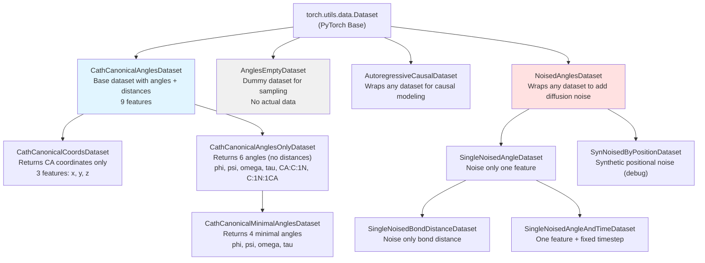
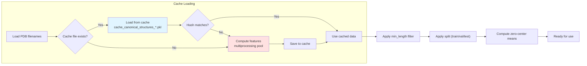
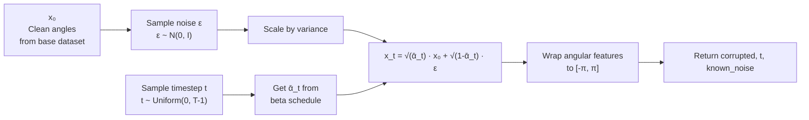
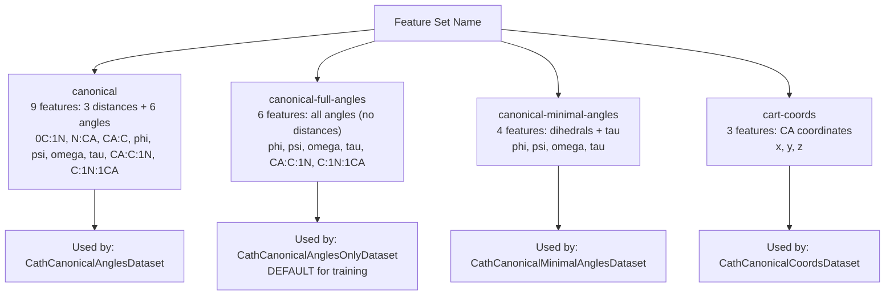
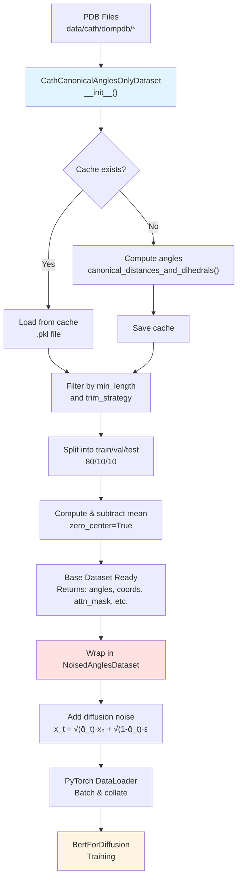

<!-- source: DeepWiki mcp.deepwiki.com · repo microsoft/foldingdiff · page 4.1 Dataset Classes · fetched 2026-10-26 -->

# Dataset Classes

<details>
<summary>Relevant source files</summary>

The following files were used as context for generating this wiki page:

- [.gitignore](.gitignore)
- [foldingdiff/angles_and_coords.py](foldingdiff/angles_and_coords.py)
- [foldingdiff/datasets.py](foldingdiff/datasets.py)
- [foldingdiff/sampling.py](foldingdiff/sampling.py)
- [tests/test_angles_and_coords.py](tests/test_angles_and_coords.py)
- [tests/test_data.py](tests/test_data.py)
- [tests/test_losses.py](tests/test_losses.py)

</details>


This page documents the hierarchy of PyTorch `Dataset` classes that handle protein structure data loading, preprocessing, and noising for the FoldingDiff diffusion model. These classes transform raw PDB files into tensors of angles and distances, apply noise for diffusion training, and manage batching/padding. For information about extracting angles from PDB files, see [Angle Extraction and Conversion](#4.2). For details on how noising is applied during training, see [Noising Process](#4.3).

## Overview of Dataset Architecture

The FoldingDiff codebase uses a compositional dataset architecture where base classes load and preprocess protein structures, and wrapper classes add functionality like noise injection or causal masking. All dataset classes inherit from PyTorch's `torch.utils.data.Dataset` and implement the standard `__len__()` and `__getitem__()` methods.

**Dataset Class Hierarchy**



Sources: [foldingdiff/datasets.py:75-1088]()

## Base Dataset: CathCanonicalAnglesDataset

The `CathCanonicalAnglesDataset` class is the foundation for all protein structure datasets in FoldingDiff. It loads PDB files from disk, computes dihedral angles and bond distances, and returns padded tensors suitable for batch processing.

**Key Responsibilities:**
- Load PDB files from CATH database or custom directories
- Compute angles/distances using `canonical_distances_and_dihedrals()` from [angles_and_coords.py](#4.2)
- Cache computed features to disk for fast reloading
- Handle sequence padding/trimming to fixed length
- Apply zero-centering by subtracting mean values
- Split data into train/validation/test sets

**Constructor Parameters:**

| Parameter | Type | Default | Description |
|-----------|------|---------|-------------|
| `pdbs` | str or list | `"cath"` | Dataset source: "cath", "alphafold", directory path, or list of PDB files |
| `split` | str or None | `None` | Data split: "train" (80%), "validation" (10%), or "test" (10%) |
| `pad` | int | `512` | Maximum sequence length; sequences padded/trimmed to this length |
| `min_length` | int | `40` | Minimum sequence length; shorter sequences excluded |
| `trim_strategy` | str | `"leftalign"` | How to trim long sequences: "leftalign", "randomcrop", or "discard" |
| `toy` | int | `0` | If non-zero, load only first N structures (for testing) |
| `zero_center` | bool | `True` | Subtract mean from features to center at zero |
| `use_cache` | bool | `True` | Use/create cached preprocessed data |

**Data Item Structure:**

Each call to `__getitem__(index)` returns a dictionary with the following keys:

| Key | Shape | Type | Description |
|-----|-------|------|-------------|
| `angles` | `(pad, 9)` | `torch.FloatTensor` | Angle and distance features |
| `coords` | `(pad, 3)` | `torch.FloatTensor` | CA coordinates (x, y, z) |
| `attn_mask` | `(pad,)` | `torch.FloatTensor` | Attention mask (1.0 = valid, 0.0 = padding) |
| `position_ids` | `(pad,)` | `torch.LongTensor` | Position indices [0, 1, 2, ..., pad-1] |
| `lengths` | scalar | `torch.int64` | Actual sequence length (before padding) |

**Feature Set Definition:**

The default feature set includes 9 features total:

```python
feature_names["angles"] = [
    "0C:1N",      # Distance: C of residue i to N of residue i+1
    "N:CA",       # Distance: N to CA within residue
    "CA:C",       # Distance: CA to C within residue
    "phi",        # Dihedral angle
    "psi",        # Dihedral angle
    "omega",      # Dihedral angle
    "tau",        # Bond angle N-CA-C
    "CA:C:1N",    # Bond angle CA-C-N (between residues)
    "C:1N:1CA"    # Bond angle C-N-CA (between residues)
]

feature_is_angular["angles"] = [False, False, False, True, True, True, True, True, True]
```

The first 3 features are distances (non-angular), and the remaining 6 are angles that must remain in range `[-π, π]`.

**Caching Mechanism:**



The cache filename includes an MD5 hash of all PDB filenames to ensure cache invalidation when the dataset changes: [foldingdiff/datasets.py:263-279]()

Sources: [foldingdiff/datasets.py:75-481](), [tests/test_data.py:14-53]()

## Specialized Dataset Variants

### CathCanonicalCoordsDataset

Returns only 3D Cartesian coordinates of alpha carbons (CA atoms), omitting all angle information. Inherits from `CathCanonicalAnglesDataset` but removes the `angles` key from returned dictionaries.

**Use case:** When you need to work directly with CA coordinates rather than internal angle representation.

```python
feature_names["coords"] = ["x", "y", "z"]
feature_is_angular["coords"] = [False, False, False]
```

Sources: [foldingdiff/datasets.py:483-499]()

### CathCanonicalAnglesOnlyDataset

Returns only the 6 angular features, excluding the 3 distance features. This is the most commonly used dataset variant in FoldingDiff training.

**Features returned:**
- **Dihedrals:** phi, psi, omega (backbone torsion angles)
- **Bond angles:** tau (N-CA-C), CA:C:1N, C:1N:1CA

All 6 features are angular (marked as `True` in `feature_is_angular`), which means they are subject to modulo wrapping to remain in `[-π, π]`.

**Key Methods:**
- `get_masked_means()`: Returns mean values for only the 6 active features [foldingdiff/datasets.py:524-528]()
- `set_masked_means(mean_values)`: Updates mean values for the 6 features [foldingdiff/datasets.py:530-535]()

The class maintains a `feature_idx` list that maps from the subset of features to the original 9-feature space: [foldingdiff/datasets.py:517-522]()

Sources: [foldingdiff/datasets.py:502-554](), [tests/test_data.py:55-136]()

### CathCanonicalMinimalAnglesDataset

The minimal set of angles needed to reconstruct a protein backbone with reasonable fidelity. Returns only 4 features: phi, psi, omega (dihedrals) and tau (N-CA-C bond angle).

This variant is useful for experiments testing the minimum information required for protein generation.

Sources: [foldingdiff/datasets.py:557-567]()

## Noising Datasets

### NoisedAnglesDataset

The `NoisedAnglesDataset` class wraps any base dataset and adds diffusion noise according to the forward diffusion process. This is the core dataset used during training.

**Diffusion Process:**



**Constructor Parameters:**

| Parameter | Type | Default | Description |
|-----------|------|---------|-------------|
| `dset` | Dataset | required | Base dataset to wrap (provides clean data) |
| `dset_key` | str | `"angles"` | Dictionary key to extract and noise |
| `timesteps` | int | `250` | Number of diffusion timesteps T |
| `exhaustive_t` | bool | `False` | If True, enumerate all timesteps explicitly |
| `beta_schedule` | str | `"linear"` | Variance schedule: "linear", "cosine", etc. |
| `nonangular_variance` | float | `1.0` | Variance scale for non-angular features |
| `angular_variance` | float | `1.0` | Variance scale for angular features |

**Returned Dictionary:**

In addition to the base dataset's dictionary, `NoisedAnglesDataset` adds:

| Key | Description |
|-----|-------------|
| `corrupted` | Noised version of the input: `x_t` |
| `t` | Timestep tensor (scalar) |
| `known_noise` | The sampled noise `ε` that was added |
| `sqrt_alphas_cumprod_t` | Value of √(ᾱ_t) for this timestep |
| `sqrt_one_minus_alphas_cumprod_t` | Value of √(1-ᾱ_t) for this timestep |

**Noise Sampling:**

The `sample_noise()` method adaptively scales noise based on whether features are angular or non-angular: [foldingdiff/datasets.py:772-799]()

```python
def sample_noise(self, vals: torch.Tensor) -> torch.Tensor:
    noise = torch.randn_like(vals)  # Sample from N(0, I)
    
    # Scale by variance for each feature
    for j in range(noise.shape[-1]):
        scale = (self.angular_var_scale if self.dset.feature_is_angular[self.dset_key][j] 
                 else self.nonangular_var_scale)
        noise[..., j] *= scale
    
    # Wrap angular noise to [-π, π]
    angular_idx = np.where(self.dset.feature_is_angular[self.dset_key])[0]
    noise[..., angular_idx] = modulo_with_wrapped_range(noise[..., angular_idx], -np.pi, np.pi)
    
    return noise
```

**Exhaustive Timesteps Mode:**

When `exhaustive_t=True`, the dataset length becomes `len(base_dataset) × timesteps`, and each base item is paired with every possible timestep. This is useful for validation/testing to systematically evaluate model performance across all timesteps: [foldingdiff/datasets.py:813-825]()

Sources: [foldingdiff/datasets.py:685-887](), [tests/test_data.py:138-169]()

### Specialized Noising Variants

**SingleNoisedAngleDataset**

Noises only a single feature (specified by `ft_idx`), keeping all others clean. Used for ablation studies and debugging. Optionally uses fixed noise across all samples: [foldingdiff/datasets.py:889-932]()

**SingleNoisedBondDistanceDataset**

Specialization of `SingleNoisedAngleDataset` that noises only the bond distance feature (`ft_idx=0`): [foldingdiff/datasets.py:934-942]()

**SingleNoisedAngleAndTimeDataset**

Noises one feature at a single fixed timestep (default `t=100`). Extremely constrained for overfitting tests: [foldingdiff/datasets.py:945-962]()

**SynNoisedByPositionDataset**

Synthetic noising for debugging that adds position-dependent noise (front half negative, back half positive). Tests whether the model uses positional embeddings effectively: [foldingdiff/datasets.py:964-1035]()

Sources: [foldingdiff/datasets.py:889-1035]()

## Empty and Utility Datasets

### AnglesEmptyDataset

A "dataset" that contains no actual data but provides the same API interface as real datasets. Used during sampling when you need to generate structures from scratch without loading real training data.

**Use case:** In `sample.py`, when generating new structures, we need to know feature definitions and variance schedules but don't need actual PDB data.

**Initialization:**

```python
dummy_dset = AnglesEmptyDataset.from_dir(model_dir)  # Load from saved training config
```

The `from_dir()` class method reads `training_args.json` and `training_mean_offset.npy` from a trained model directory to reconstruct feature definitions: [foldingdiff/datasets.py:593-611]()

**Required Properties:**

| Property | Description |
|----------|-------------|
| `feature_is_angular` | Dict mapping feature type to boolean list |
| `feature_names` | Dict mapping feature type to string list |
| `pad` | Maximum sequence length |
| `get_masked_means()` | Returns mean offset array or raises error |

Sources: [foldingdiff/datasets.py:569-624](), [foldingdiff/sampling.py:245-254]()

### AutoregressiveCausalDataset

Wrapper that converts any dataset into a causal language modeling format. Each sample includes a randomly chosen prefix length and a target for the next residue.

**Returned Dictionary Additions:**

| Key | Description |
|-----|-------------|
| `causal_attn_mask` | Attention mask for only the prefix (shorter than full mask) |
| `causal_target` | Target angles for the next residue after prefix |
| `causal_idx` | Index of the target residue |

This is used with the `BertForAutoregressive` model variant for sequential protein generation: [foldingdiff/datasets.py:626-683]()

Sources: [foldingdiff/datasets.py:626-683]()

## Feature Set Definitions

FoldingDiff defines several named feature sets that specify which angles and distances to use:

**Feature Set Configuration**



The mappings are defined at module level: [foldingdiff/datasets.py:44-72]()

```python
FEATURE_SET_NAMES_TO_ANGULARITY = {
    "canonical": [False, False, False, True, True, True, True, True, True],
    "canonical-full-angles": [True, True, True, True, True, True],
    "canonical-minimal-angles": [True, True, True, True],
    "cart-coords": [False, False, False],
}

FEATURE_SET_NAMES_TO_FEATURE_NAMES = {
    "canonical": ["0C:1N", "N:CA", "CA:C", "phi", "psi", "omega", "tau", "CA:C:1N", "C:1N:1CA"],
    "canonical-full-angles": ["phi", "psi", "omega", "tau", "CA:C:1N", "C:1N:1CA"],
    "canonical-minimal-angles": ["phi", "psi", "omega", "tau"],
    "cart-coords": ["x", "y", "z"],
}
```

These definitions are used by `AnglesEmptyDataset` to initialize dummy datasets with correct feature specifications: [foldingdiff/datasets.py:581-586]()

Sources: [foldingdiff/datasets.py:44-72](), [foldingdiff/datasets.py:581-586]()

## Data Flow During Training

**Complete Data Pipeline**



Sources: [foldingdiff/datasets.py:101-226](), [foldingdiff/datasets.py:685-887]()

## Usage Examples

**Basic Dataset Loading:**

```python
from foldingdiff import datasets

# Load the full CATH dataset with angles only
dset = datasets.CathCanonicalAnglesOnlyDataset(
    pdbs="cath",           # Use CATH dataset
    split="train",         # Training split (80% of data)
    pad=128,              # Pad/trim to 128 residues
    min_length=40,        # Exclude sequences < 40 residues
    zero_center=True,     # Subtract mean from features
    use_cache=True        # Use cached computations
)

# Get a single item
item = dset[0]
print(item["angles"].shape)      # torch.Size([128, 6])
print(item["attn_mask"].shape)   # torch.Size([128])
print(item["lengths"])           # Actual sequence length (scalar)
```

**Wrapping with Noise:**

```python
from foldingdiff import datasets

# Create base dataset
base_dset = datasets.CathCanonicalAnglesOnlyDataset(split="train", pad=128)

# Wrap with noising
noised_dset = datasets.NoisedAnglesDataset(
    dset=base_dset,
    dset_key="angles",
    timesteps=1000,
    beta_schedule="linear",
    angular_variance=1.0
)

# Get a noised item
item = noised_dset[0]
print(item["corrupted"].shape)   # torch.Size([128, 6]) - noised angles
print(item["t"])                 # Random timestep in [0, 999]
print(item["known_noise"].shape) # torch.Size([128, 6]) - the noise that was added
```

**Creating an Empty Dataset for Sampling:**

```python
from foldingdiff import datasets

# Load dummy dataset from trained model directory
dummy_dset = datasets.AnglesEmptyDataset.from_dir("path/to/model")

# Wrap with noising (needed for sampling API)
noised_dummy = datasets.NoisedAnglesDataset(
    dset=dummy_dset,
    timesteps=1000,
    beta_schedule="linear"
)

# Use with sampling.sample() function
# (noised_dummy provides noise sampling and feature definitions without real data)
```

Sources: [foldingdiff/datasets.py:75-887](), [foldingdiff/sampling.py:135-224]()

---

