<!-- source: DeepWiki mcp.deepwiki.com · repo microsoft/foldingdiff · page 4.2 Angle Extraction and Conversion · fetched 2026-10-26 -->

# Angle Extraction and Conversion

<details>
<summary>Relevant source files</summary>

The following files were used as context for generating this wiki page:

- [foldingdiff/angles_and_coords.py](foldingdiff/angles_and_coords.py)
- [foldingdiff/datasets.py](foldingdiff/datasets.py)
- [foldingdiff/nerf.py](foldingdiff/nerf.py)
- [foldingdiff/sampling.py](foldingdiff/sampling.py)
- [tests/test_angles_and_coords.py](tests/test_angles_and_coords.py)
- [tests/test_nerf.py](tests/test_nerf.py)

</details>


## Purpose and Scope

This page documents the `angles_and_coords` module and its integration with the NERF algorithm for bidirectional conversion between PDB structures and internal coordinate representations. This system enables:

1. **Forward conversion**: Extracting dihedral angles and bond geometry from PDB files
2. **Reverse conversion**: Reconstructing 3D Cartesian coordinates from internal coordinates using the NERF (Natural Extension of Reference Frame) algorithm

For information about how these conversions integrate with the data pipeline, see [Dataset Classes](#4.1). For details on the NERF algorithm itself, see [NERF Reconstruction](#3.3).

---

## System Overview

The angle extraction and conversion system operates as a bidirectional bridge between two representations of protein structure:

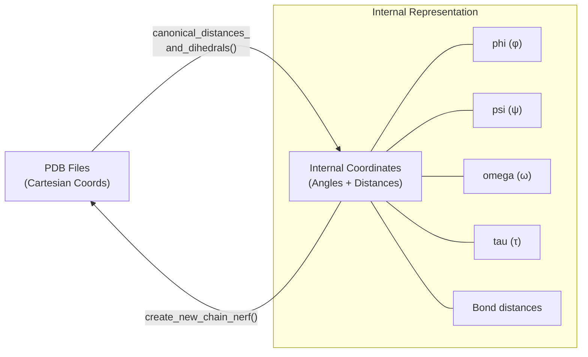

**Sources:** [foldingdiff/angles_and_coords.py:1-253]()

---

## Angle Extraction from PDB Files

The `canonical_distances_and_dihedrals()` function extracts internal coordinates from PDB structures using the Biotite structural biology library.

### Function Signature and Usage

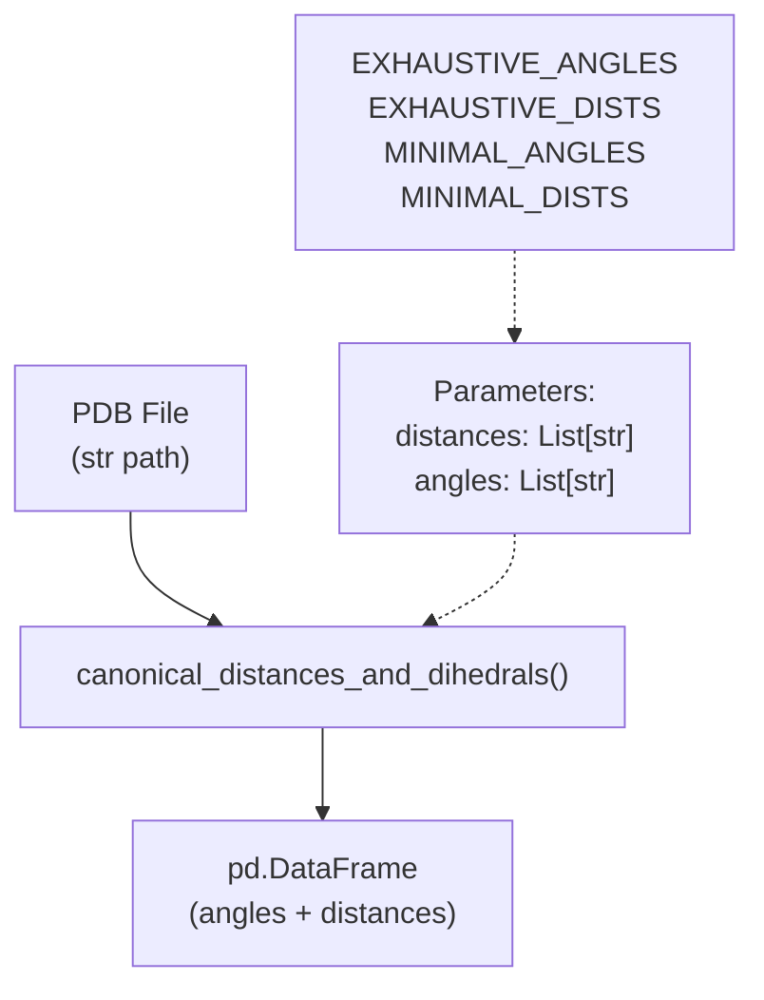

**Sources:** [foldingdiff/angles_and_coords.py:30-109]()

### Extraction Process

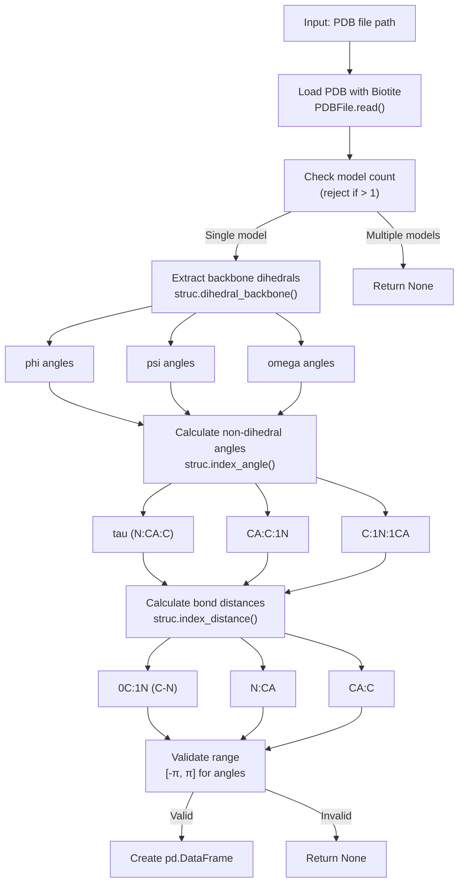

**Sources:** [foldingdiff/angles_and_coords.py:30-109]()

### Implementation Details

The extraction process handles several edge cases:

| Issue | Handling |
|-------|----------|
| Multiple models | Returns `None` [line 42-43]() |
| Malformed structure | Catches `BadStructureError`, returns `None` [line 51-53]() |
| Invalid angle ranges | Checks `[-π, π]` range, returns `None` if violated [line 78-81]() |
| Compressed files | Automatically handles `.gz` files [line 39]() |

**Sources:** [foldingdiff/angles_and_coords.py:30-109]()

---

## Angle Definitions

The system supports two feature sets with different levels of detail:

### Exhaustive Feature Set

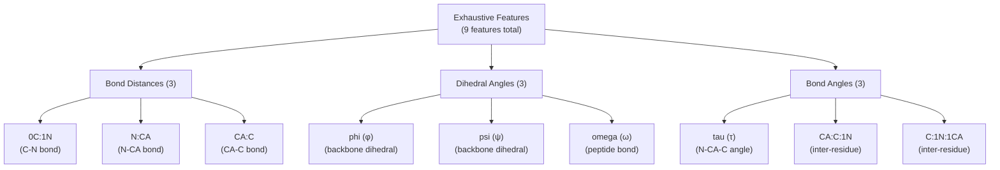

**Constant definitions:**
- `EXHAUSTIVE_ANGLES = ["phi", "psi", "omega", "tau", "CA:C:1N", "C:1N:1CA"]` [line 23]()
- `EXHAUSTIVE_DISTS = ["0C:1N", "N:CA", "CA:C"]` [line 24]()

### Minimal Feature Set

The minimal set includes only what's necessary for reasonable reconstruction:

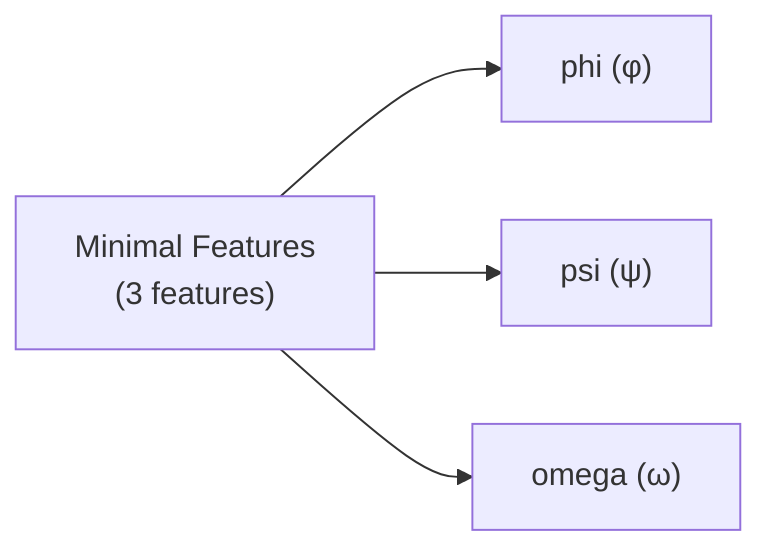

**Constant definitions:**
- `MINIMAL_ANGLES = ["phi", "psi", "omega"]` [line 26]()
- `MINIMAL_DISTS = []` [line 27]()

**Sources:** [foldingdiff/angles_and_coords.py:23-27]()

### Angle Indexing and Padding

Each angle type has specific indexing behavior due to terminus constraints:

| Angle/Distance | First Residue | Middle Residues | Last Residue | Padding |
|----------------|---------------|-----------------|--------------|---------|
| phi (φ) | `NaN` (N-terminus) | Defined | Defined | End padded [line 87]() |
| psi (ψ) | Defined | Defined | `NaN` (C-terminus) | End padded [line 87]() |
| omega (ω) | Defined | Defined | `NaN` (C-terminus) | End padded [line 87]() |
| tau (N:CA:C) | Defined | Defined | Padded with 0 | End padded [line 64]() |
| CA:C:1N | Defined | Defined | Padded with 0 | End padded [line 69]() |
| C:1N:1CA | Defined | Defined | Padded with 0 | End padded [line 72]() |
| 0C:1N (C-N) | N/A | Defined | Padded with 0 | End padded [line 90]() |
| N:CA | N/A (fixed initial) | Defined | Padded with 0 | End padded [line 96]() |
| CA:C | N/A (fixed initial) | Defined | Padded with 0 | End padded [line 103]() |

**Sources:** [foldingdiff/angles_and_coords.py:56-107]()

---

## Coordinate Reconstruction from Angles

The `create_new_chain_nerf()` function reconstructs 3D coordinates from internal coordinates using the NERF algorithm.

### Reconstruction Pipeline

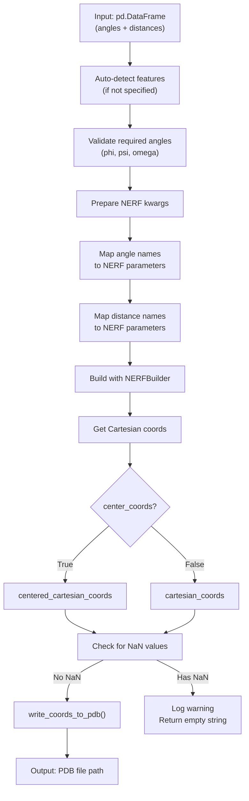

**Sources:** [foldingdiff/angles_and_coords.py:112-184]()

### Feature Name Mapping

The function maps angle/distance names to NERF builder parameters:

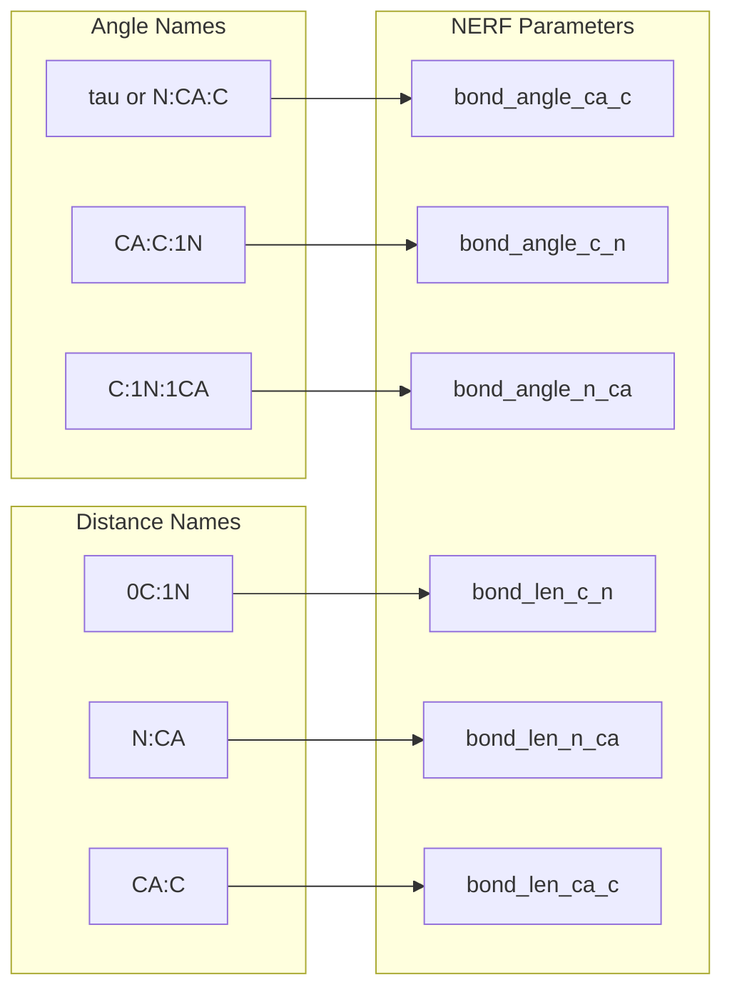

**Sources:** [foldingdiff/angles_and_coords.py:146-168]()

---

## NERF Algorithm Implementation

The NERF (Natural Extension of Reference Frame) algorithm is implemented in the `NERFBuilder` class and related functions.

### NERFBuilder Class

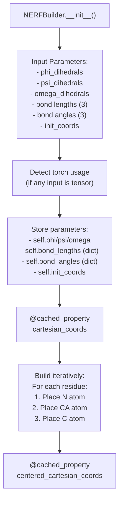

**Sources:** [foldingdiff/nerf.py:27-143]()

### place_dihedral Function

The core geometric operation for placing atoms:

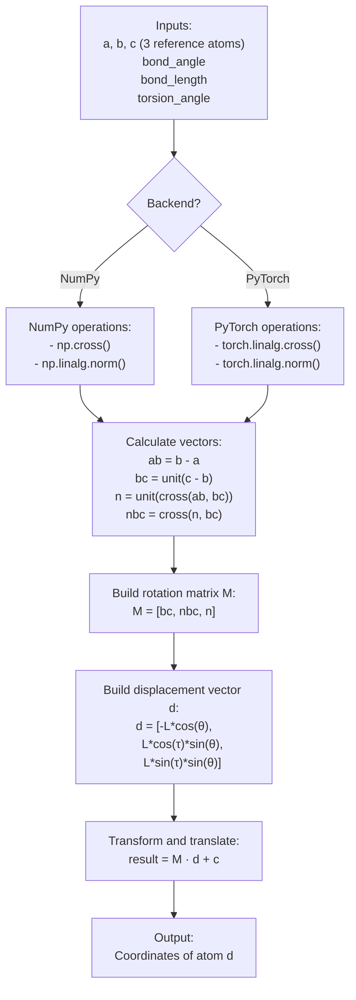

**Mathematical formulation:**
- **L**: bond length
- **θ**: bond angle  
- **τ**: torsion (dihedral) angle

**Sources:** [foldingdiff/nerf.py:145-204]()

### Building Process

The `NERFBuilder` constructs the backbone iteratively:

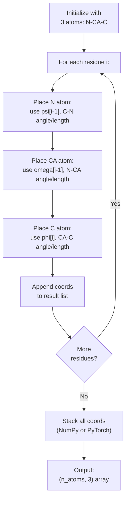

**Default bond parameters:**
- `N_CA_LENGTH = 1.46` Å [line 17]()
- `CA_C_LENGTH = 1.54` Å [line 18]()
- `C_N_LENGTH = 1.34` Å [line 19]()
- Default bond angles: ~109-121° [lines 40-42]()

**Sources:** [foldingdiff/nerf.py:78-122]()

---

## Batch Processing

For efficient generation, the system supports batched NERF reconstruction.

### nerf_build_batch Function

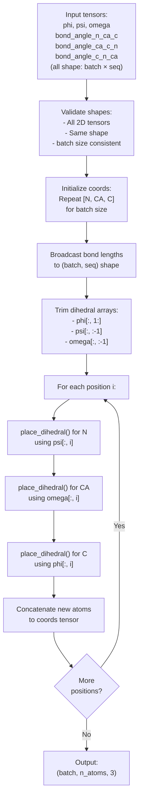

**Sources:** [foldingdiff/nerf.py:207-292]()

---

## PDB File Writing

The `write_coords_to_pdb()` function creates standard PDB files from coordinates.

### Writing Process

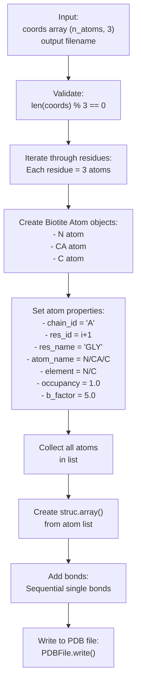

**Notes:**
- All residues are written as glycine (`GLY`)
- Actual sequence information must be added separately via `add_sidechains_to_backbone()`
- Bond list is created sequentially [lines 238-241]()

**Sources:** [foldingdiff/angles_and_coords.py:187-253]()

---

## Integration with Dataset Pipeline

The angle extraction functions are called during dataset construction:

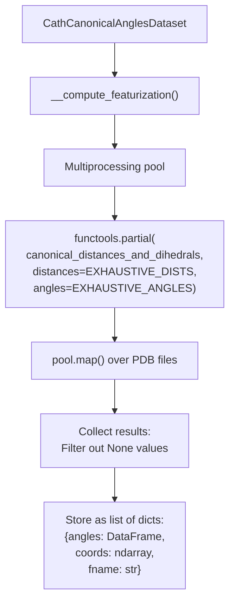

**Parallelization:**
- Uses `multiprocessing.cpu_count()` workers [line 319]()
- Chunks files into batches of 250 [line 320]()
- Filters out structures returning `None` [lines 327-336]()

**Sources:** [foldingdiff/datasets.py:304-337]()

---

## Error Handling and Edge Cases

The system handles several failure modes gracefully:

| Condition | Detection | Handling |
|-----------|-----------|----------|
| Multiple models in PDB | `structure.get_model_count() > 1` | Return `None` |
| Malformed structure | `BadStructureError` exception | Return `None`, log debug message |
| Invalid angle range | Check `[-π, π]` bounds | Return `None`, log warning |
| NaN in coordinates | `np.any(np.isnan(coords))` | Log warning, return empty string |
| Gzipped files | Check `.gz` extension | Automatically use `gzip.open()` |

**Sources:** [foldingdiff/angles_and_coords.py:30-184]()

---

## Helper Functions

### extract_backbone_coords

Extracts only the backbone atom coordinates (N, CA, C or subsets):

```python
def extract_backbone_coords(
    fname: str, 
    atoms: Collection[Literal["N", "CA", "C"]] = ["CA"]
) -> Optional[np.ndarray]
```

Returns shape `(n_atoms, 3)` array of coordinates.

**Sources:** [foldingdiff/angles_and_coords.py:271-284]()

### add_sidechains_to_backbone

Reconstructs full atomic detail from backbone-only structures:

```python
def add_sidechains_to_backbone(
    backbone_pdb_fname: str,
    aa_seq: str,
    out_fname: str,
    reference_pdbs: Optional[Collection[str]] = None,
) -> str
```

Uses a library of sidechain geometries built from reference PDBs to place sidechain atoms using `place_dihedral()`.

**Sources:** [foldingdiff/angles_and_coords.py:378-434]()

### get_pdb_length

Cached function to quickly get the length of a chain:

```python
@functools.lru_cache(maxsize=8192)
def get_pdb_length(fname: str) -> int
```

Returns `-1` for multi-model structures, otherwise the number of residues.

**Sources:** [foldingdiff/angles_and_coords.py:256-268]()

---

